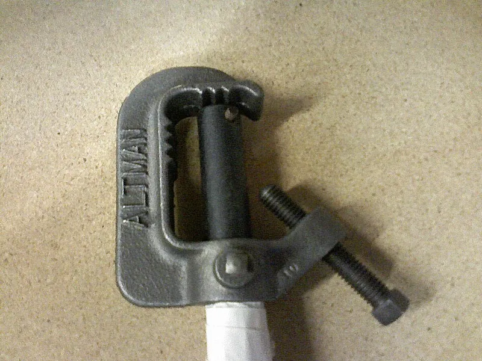

<figure class="eoc-pic eoc-pic-main"><figcaption><strong>Photo.</strong> <a href="https://commons.wikimedia.org/wiki/File:AltmanClamp.jpg">AltmanClamp</a> by StarX (talk) (Uploads), Public domain, from Wikimedia Commons.</figcaption></figure>

A clamp that grips an existing bar, pole, tube, pipe or desk edge by squeezing it, often through a rubber pad, so an accessory can be fixed on, repositioned or removed without drilling or changing the thing it is clamped to.

**In plain words:** A clamp that squeezes round something that is already there, such as a handlebar, a pole, a pipe or the edge of a desk, so you can fix a light, phone, camera, lamp or holder onto it, slide or turn it to a new spot, and take it off again without drilling any holes. **Proper term:** Clamp-on accessory mount (bar clamp, U-bolt, pipe clamp, desk-edge clamp).

**Also called:** handlebar mount, handlebar clamp, bar mount, out-front mount (bike computers), stem mount; split clamp, split bar clamp, two-piece clamp, hinged clamp, ring clamp, pinch clamp, saddle clamp; handlebar shim, rubber shim, rubber pad, clamp spacer (to fit one clamp to several bar sizes); U-bolt (with saddle, V-block or backing plate), mast clamp, pipe U-bolt (sized in pipe measurements, Wikipedia 'U-bolt'); pipe clamp, pipe clip, P-clip, pipe saddle clamp, Rohrschelle (German); stage lighting C-clamp (pipe clamp, hook clamp), trigger clamp, half coupler / Cheeseborough (stagecraft terms, Wikipedia 'C-clamp (stagecraft)'); grip clamps: Super Clamp (Manfrotto, brand), Cardellini clamp (a jaw-style clamp for round, square or rectangular tubing or flat objects, Wikipedia 'Clamp (tool)'); desk clamp, desk-edge clamp, table clamp, C-clamp mount (monitor arms, microphone arms, desk lamps), clamp-on shelf; camera rod clamp, 15 mm or 19 mm rod clamp (standard camera support rods; spacings in OConnor's explainer); frame clamp, bottle-cage clamp (for bikes without threaded [bosses](../glossary.md#boss), Wikipedia 'Bottle cage'); Standard interfaces often found on the clamp's other side: Garmin/Wahoo-type quarter-turn mount, GoPro-type prongs, 1/4-20 tripod thread, 16 mm (5/8 in) spigot socket.

## How it works

Tightening the screw pulls the clamp's jaws or half-shells together round the bar (or pushes a pad up under a desk edge), squeezing it so hard that friction stops the clamp sliding along it or turning round it. A rubber pad raises the grip, protects the finish and fills the gap, so one clamp fits several sizes: Garmin's out-front mount uses its thicker pad on a 25.4 mm bar and the thinner pad on a 31.8 mm bar. A U-bolt wraps round a pipe or post and its two nuts pull it against a plate on the other side. Because nothing is drilled, loosening the screw lets you slide or turn the mount to a new place, or take it off.

## Parts

A few parts that act as one unit. Ring or bar clamps: a split ring or two half-shells, one or two pinch screws with nuts (or a thumbscrew or cam lever), a rubber pad or shims, and the accessory interface (for example a quarter-turn mount, prongs, a threaded stud or a socket). U-bolt mounts: a U-shaped rod threaded at both ends, a saddle or backing plate, two nuts and washers. Desk clamps: a C-shaped frame, a screw with a swivelling pad, and a top plate or socket. Stage C-clamps: clamp body, clamp bolt, spigot that turns through 360 degrees, pan bolt and yoke bolt (Wikipedia 'C-clamp (stagecraft)').

## Everyday examples

- a bike light, phone holder or bike computer clamped to the handlebar (Garmin out-front mount)
- a monitor arm, microphone arm or desk lamp clamped to the edge of a desk (BenQ)
- theatre and film lights hung from a lighting pipe with C-clamps (Wikipedia 'C-clamp (stagecraft)')
- a bottle cage clamped to a bike frame that has no threaded bosses, or overhead road signs held with U-bolts (Wikipedia 'Bottle cage'; 'U-bolt')

## When to use it

When you want to add something to a bar, pole, tube, pipe or desk you don't want to drill, or don't own (a rented flat's desk, a bike frame, a tent pole, a camera rig); when the accessory must move between places or come off often; when you need to fine-tune its position along or round the bar; when one clamp must fit several bar sizes (use pads or shims). Use a U-bolt for heavier or outdoor jobs on round posts and pipes, a jaw-type grip clamp for odd shapes or flat edges (a Super Clamp grips round and square sections and, with its rubber wedge, flat surfaces), and a desk clamp for arms and lamps on a desk edge.

## When not to use it

When a threaded boss, rail or tripod socket is already there: bolt to it instead (Tripod and stand screw mount; Aluminium-extrusion connectors; Clevis joint prongs). For building frames from tube, use clamp-on tube fittings. For loads that hit hard, swing on a long arm or must never move, add a positive stop, a second clamp or a drilled and bolted bracket, because friction clamps can shift under shock (Wikipedia 'Shaft collar'). Don't clamp onto glass or hollow-core desk tops without a reinforcement plate (BenQ), onto carbon parts without a [torque](../glossary.md#torque) figure (Surly), onto steering, brake or gear cables, or onto anything that moves or gets hot. For a quick, light, temporary hold use a spring clip clamp; for an improvised strap round a pole, a hose clamp or cable tie.

## Details

- **What it does (jobs):**
  - join and hold: fixes an accessory (light, phone, bike computer, camera, lamp, monitor arm, sign, bottle cage) onto a bar, pole, pipe, tube or desk edge without drilling
  - lock, and release by hand: thumbscrew, knob and cam-lever versions are tightened and released without tools, so the accessory can be moved or taken off quickly
- **Movement:** none once tightened; when loosened it can slide along the bar and turn round it (rotate+slide) to a new position. Many mounts add a swivel after the clamp, for example a stage C-clamp's spigot that turns through 360 degrees and is locked by a pan bolt (Wikipedia 'C-clamp (stagecraft)')
- **Directions it can move (degrees of freedom):** 0 when tight. Loosened, 2 (slide along the bar and turn round it). A desk clamp loosened can slide along the edge (1 to 2).
- **Special behaviour:**
  - quick-release: versions with a thumbscrew, knob or cam lever go on and off by hand, and many carry a quick-release interface (a quarter-turn bike-computer mount, GoPro-type prongs or a hexagonal spigot socket) so the accessory comes off while the clamp stays on the bar (Garmin instructions; Manfrotto Super Clamp page)
  - none otherwise: it simply holds by squeezing; it does not slip at a set force, so anything that hits it hard can still make it twist or shift (Wikipedia 'Shaft collar': shock loads can make clamp collars shift)
- **How it holds:** friction or clamping (force-fit): the squeeze of the screw, U-bolt or C-frame holds by friction, helped by rubber pads; partly shape ([form-fit](../glossary.md#form-fit--force-fit--material-bond)) in hook-shaped clamps, such as a stage C-clamp whose body is 'designed to sit overtop of a typical theatrical batten' (Wikipedia 'C-clamp (stagecraft)'), and where a clamp hooks round a desk edge
- **Input and output:** not applicable
- **Power:** passive (no power needed)
- **Load:** Light to medium. Examples: a bike computer of well under 100 g on an out-front mount (QIDI blog); 15 kg payload for a Super Clamp on round tube from 13 to 55 mm (Manfrotto); U-bolts are heavy enough to support pipework and overhead road signs (Wikipedia 'U-bolt'). Strong in the direction it squeezes and against a straight pull-off; weakest against twisting round the bar, because an accessory on an arm turns its weight into a twisting force at the clamp (QIDI: a 154 g camera on a 60 mm arm with a 5x shock factor gives about 0.45 N·m), and against knocks and vibration, which can make friction clamps shift (Wikipedia 'Shaft collar').
- **Play and precision:** No play when tight, but no set positions: it can be clamped anywhere, so returning to exactly the same place needs a mark or a stop ⚑ [uncertain: general practice]. Tolerates a range of bar sizes only through its pads, shims or long screws (Super Clamp 13 to 55 mm; Garmin two pads); a fixed printed clamp that is about 1 mm off 'will either not close or will crush the tube' (QIDI blog). Bars [taper](../glossary.md#taper), so the size is only guaranteed at the stem clamp (QIDI blog).
- **Taking it apart:** removable with a hex key or spanner for screw-closed clamps and U-bolts; tool-free quick release for thumbscrew, knob and cam-lever clamps and for quarter-turn or prong interfaces, where the accessory twists or slides off and the clamp stays on the bar
- **How often it can be reused:** many times: metal clamps and U-bolts can be refitted again and again; rubber pads wear and printed clamps lose grip as screw holes wear or the plastic [creeps](../glossary.md#creep), so printed versions are good for a few to many times (use [captive nuts](../glossary.md#captive-nut) or inserts rather than screwing into plastic, QIDI blog) ⚑ [uncertain: no maker's reuse figure opened]
- **Sealing:** none
- **Adjustable:** yes: loosen, slide along or turn round the bar, and re-tighten; swap the rubber pad or add a shim to fit another bar size (Garmin pads; Wikipedia 'Bicycle handlebar': shims fit 25.4 mm or 26 mm bars to 31.8 mm stems); many mounts add a swivel or ball joint for the accessory's angle
- **Access needed:** both sides for most: two-piece and hinged clamps and U-bolts wrap round the bar from the side, so you need to reach round it but not to its end; a desk clamp needs room above and below the desk edge and, for monitor arms, about 5 cm of space behind the desk (BenQ); end of a tube or shaft for one-piece closed rings, which must be slid on from a free end
- **Materials:** Bodies of aluminium, steel, cast metal or glass-filled plastic; rubber or TPU pads; zinc-plated or stainless U-bolts (Wikipedia gives 'bright zinc-plated mild steel' as an example). Printed clamps are best in PETG or ASA rather than PLA for bikes and outdoors (QIDI blog; Prusa material pages), with TPU for pads. Clamps onto steel, aluminium and wood easily; carbon-fibre and thin-walled bars need low, measured tightening (Surly); glass and hollow-core desk tops need a reinforcement plate (BenQ).
- **Heat, cold, water and wear:** Sun and heat: PLA softens above about 60 °C and degrades in UV, so it is a poor choice on a bike or car left in the sun; PETG suits outdoor use below about 80 °C and ASA resists UV up to about 93 °C (Prusa material pages). Vibration: a riding season is millions of small load cycles, which crack [brittle](../glossary.md#brittle--ductile) printed mounts (QIDI blog). Creep: printed clamps and rubber pads relax, so screws loosen after the first use (QIDI blog; Thrinter creep test). Rain and road salt corrode plain steel screws and U-bolts; zinc-plated or stainless parts last longer ⚑ [uncertain: no corrosion test opened].

## Making it

- **Ways to make or get it:**
  - off-the-shelf part (handlebar mounts, U-bolts, pipe clamps, grip clamps, desk clamps)
  - 3D print (FDM): split or hinged bar clamps, pipe clamps, desk-clamp brackets and adapters, with metal screws and nuts
  - CNC: machined aluminium bar clamps
  - sheet metal: bent strap clamps and backing plates for U-bolts
  - woodwork: wooden jaw pads, desk-edge blocks and backing plates
  - laser cut: flat backing plates and brackets held on with U-bolts
- **Printing it in one piece (print in place):** partly: a hinged clamp can be printed already joined, as in a [print-in-place](../glossary.md#print-in-place) handlebar clamp that needs only an M3 screw and nut (Printables 156668), or a hinged pipe clamp that uses filament as hinge pins (Printables 1196715); most printed clamps are two halves joined by screws and nuts, with a rubber or TPU pad added
- **Tools:** hex key (Garmin's mount uses a 2 mm hex key for its interface screws) or spanner for screw-closed clamps and U-bolt nuts; none for thumbscrews, knobs and cam levers; a torque wrench or torque driver with a newton-metre scale on carbon or lightweight handlebars (Surly handlebar instructions)
- **Difficulty:** easy to buy and fit; moderate to print one that lasts on a bike or scooter, because vibration [fatigue](../glossary.md#fatigue), creep and screw threads in plastic are the usual failure points (QIDI blog)

### 3D printing tips

Measure the bar with calipers exactly where the clamp will sit, because bars taper; one guide suggests making the bore about 0.3 mm larger than measured and letting the screw gap close the difference (QIDI blog), and parametric models let you set the size (Printables 156668, 1196715, 243996). Print in PETG or ASA, not PLA, for bikes and anything outdoors: road vibration gives millions of small load cycles and PLA tends to crack along [layer lines](../glossary.md#layer-lines), while PETG bends before it breaks (QIDI blog); PLA also softens above about 60 °C and degrades in UV, PETG is fine below about 80 °C and ASA is UV-resistant to about 93 °C (Prusa material pages). Orient the part so the clamping force runs along the layers, not trying to split them apart (QIDI blog). Use at least 4 [perimeters](../glossary.md#perimeters) and plenty of [infill](../glossary.md#infill) around screw bosses (QIDI: 4+ walls, 40 to 60 % infill; Printables 243996: 4 perimeters and 40 % gyroid). Keep at least one screw diameter of wall round each screw hole (Hubs). Never screw into the plastic itself for a clamp that is re-tightened: use a captive hex nut in a nut trap (QIDI: M4 nut 7.0 mm across flats, pocket 7.2 mm wide and 3.4 mm deep) or a [heat-set insert](../glossary.md#heat-set-insert), with washers under the head and the nut so they don't sink in (QIDI blog; Hubs suggests about 0.2 mm extra round a nut pocket). The weak spot is usually the clamp ear at the screw boss: one designer's mount broke on the bar clamp itself, not the device interface, and was then thickened (Printables 156668; QIDI table). A thin TPU pad (about 2 mm) between clamp and bar adds grip and damps buzz (QIDI blog). For heavier loads let metal take the force: a printed bike-rack bracket uses bent M5 threaded rod as U-bolts in a protective sleeve, with metal plates so 'the plastic only receives pressure load' (Printables 123887). Re-check the screws after the first use, because printed parts creep under a new clamping load (QIDI blog; Thrinter creep test).

### Buying one (off-the-shelf parts)

Search terms: 'handlebar mount', 'out-front mount', 'stem mount', 'handlebar shim' or 'bar shim 31.8 to 25.4', 'rubber shim strip'; 'U-bolt' (with 'saddle', 'V-block' or 'backing plate'), 'mast clamp', 'antenna mast U-bolt'; 'pipe clamp', 'pipe clip', 'cushioned P-clip', 'pipe saddle clamp'; 'stage lighting C-clamp', 'hook clamp', 'trigger clamp', 'half coupler'; 'super clamp' or 'grip clamp' (Manfrotto Super Clamp, brand), 'Cardellini clamp'; 'desk clamp', 'monitor arm desk clamp', 'desk clamp reinforcement plate'; '15 mm rod clamp' (camera support rods); 'two-piece clamp-style shaft collar' (a ready-made split clamp that can carry a bracket); 'bottle cage clamp' or 'frame clamp adapter' for bikes without bosses.

## Rules of thumb

- Match the bar size first. Common bicycle handlebar clamp diameters are 22.2, 25.4, 26.0, 31.8 and 35 mm, and shims adapt smaller bars to larger clamps; the lever and grip areas are 22.2 mm (flat bars) or 23.8 mm (drop bars) (Wikipedia 'Bicycle handlebar', https://en.wikipedia.org/wiki/Bicycle_handlebar; full list there).
- Tighten to the maker's figure, not 'as tight as possible': Garmin gives a maximum of 0.8 N·m (7 lbf-in) for its out-front mount and says to check the screw periodically (Garmin Out-Front Mount Instructions, https://www.adorama.com/col/productManuals/GP0101334000.pdf); Surly says to tighten brake and shifter clamps to the stated torque or 5 N·m, whichever is less, because over-tightening the stem, brake or shifter clamps, or accessories can damage the handlebar (https://surlybikes.com/cdn/shop/files/85-001047_INST01.pdf).
- A clamp that wraps round the bar holds better and leaves no mark compared with a [set screw](../glossary.md#set-screw) pressing on one point: Wikipedia says clamp-style shaft collars have 'nearly twice' the holding power of set-screw collars and cause no shaft damage, but shock loads can make them shift (https://en.wikipedia.org/wiki/Shaft_collar).
- Desk clamps: allow at least about 5 cm (2 in) behind the desk; bevelled or rounded edges over about 2.5 cm (1 in) reduce stability; glass, hollow-core (honeycomb) and easily dented tops need a reinforcement plate to spread the force (BenQ, https://www.benq.eu/en-uk/knowledge-center/knowledge/10-things-to-consider-when-buying-a-monitor-arm.html). Put scrap wood or a pad under a C-clamp's jaws to spread the force and avoid dents (Wikipedia 'C-clamp', https://en.wikipedia.org/wiki/C-clamp).
- Printed clamps: bore about 0.3 mm over the measured bar, 4 or more perimeters, 40 to 60 % infill, captive nuts or inserts with washers, and a tether for anything that could fall into the road (QIDI blog, a filament maker's guide, https://qidi3d.com/blogs/print-lab/gopro-mounts-cyclists); at least one screw diameter of wall round threaded holes (Hubs, https://www.hubs.com/knowledge-base/how-assemble-3d-printed-parts-threaded-fasteners/).
- A U-bolt is specified by four things: material, thread size (e.g. M12 x 50 mm), inside width between the legs and inside height; pipe U-bolts are sold by the pipe size they fit, which is not the bar's measured diameter (Wikipedia 'U-bolt', https://en.wikipedia.org/wiki/U-bolt).

## Common failures

(1) It slowly turns round the bar under an offset load or on bumps: use the right pad or shim, tighten to the stated torque, use a wider clamp or two screws, and keep the arm short (QIDI blog; Garmin). (2) The bar is crushed, dented or cracked from over-tightening, especially carbon or thin-walled tube: use a torque figure and a pad (Surly; Wikipedia 'C-clamp'). (3) A printed clamp cracks at the screw ear or splits along layers: thicken the boss, add [fillets](../glossary.md#chamfer--fillet), print in PETG or ASA and orient the layers sensibly (QIDI blog; Printables 156668). (4) It works loose as plastic creeps or a screw head sinks into the plastic: washers, captive nuts or inserts, and re-tighten after first use (QIDI blog). (5) Threads strip in plastic: never screw directly into a print for a clamp that is re-tightened (QIDI blog; Hubs). (6) The wrong bore size means it won't close or it crushes the tube (QIDI blog). (7) Set-screw clamps mar the bar and get hard to move (Wikipedia 'Shaft collar'). (8) A desk top crushes or cracks under a monitor-arm clamp (BenQ). (9) A knock or shock load makes a friction clamp jump to a new position (Wikipedia 'Shaft collar').

## Safety

On bikes and scooters, fit the mount where it 'does not interfere with the safe operation of your bike' and check the screw now and then (Garmin); make sure it can't slide or swing into the steering, brake levers, cables, the front wheel or the spokes. Things clamped to handlebars have caused crashes: a quick-release handlebar bag fell under a rider's front wheel causing serious injuries (CPSC recall of Cannondale handlebar bags, 2004), and handlebar bracket arms that could crack let gear fall while riding (CPSC recall of Rockgeist BarJam brackets, 2022). Scooter makers say not to hang bags or heavy items on the handlebar (Xiaomi Electric Scooter 4 Pro manual). Over-tightening can crack or crush handlebars, especially carbon, and 'improper installation or repeated rotation of mounted components may lead to product failure' (Surly). Tether cameras and lights so a broken mount doesn't drop them into traffic (QIDI blog), and give anything clamped above head height a separate safety cable (stage practice; Camerastuff safety cable page). Desk clamps can crack glass tops (BenQ).

## Related

- Clamp-on tube fittings (slip-on structural fittings): tees and elbows held by set screws for building frames from tube, rather than adding one accessory
- Hose clamp (worm-drive clamp): a screw band that can strap something round a pole as a quick improvised mount
- Linear [ratchet](../glossary.md#ratchet) (cable tie): the cheapest strap mount for light items, but slips and is single-use
- Spring clip clamp (clothes-peg clip, clip-on holder): jaws held shut by a spring, for quick, light, tool-free holding
- Eccentric cam lever (cam clamp, quick-release skewer): the lever often used to close a bar clamp without tools
- Shaft-to-hub joints (clamp hub, set screw): the same split-clamp idea on a turning shaft
- [Collet](../glossary.md#collet): a slotted sleeve that grips a rod evenly and centred
- Tripod and stand screw mount (camera thread): for things that already have a 1/4-20 or 3/8-16 socket; many clamps end in one
- Bayonet mount (push-and-twist lock): the quarter-turn interface on bike-computer mounts
- Clevis joint (fork-and-pin joint, prong mount): the GoPro-style prong interface found on many bar mounts
- Ball-and-socket joint (lockable ball head): adds an adjustable angle after the clamp
- Toggle clamp: includes [over-centre](../glossary.md#over-centre) U-bolt latch clamps
- Hang-on mounts (keyhole slot, French cleat): for fixing to walls rather than bars
- Internal tube anchors and Expanding internal grip: grip the inside of a tube end instead of the outside
- Aluminium-extrusion connectors (T-slot nuts and brackets): when the frame already has slots to bolt into

## Make it yourself

- [Yet Another Garmin/Wahoo Quarter Turn Bike Handlebar Mount (Printables 156668; URL from Printables API, page not opened)](https://www.printables.com/model/156668-yet-another-garminwahoo-quarter-turn-bike-handleba): Parametric handlebar clamp that prints in place without supports, closed with an M3 screw and nut, in several bar sizes; the designer reinforced the bar clamp after one broke *(licence: CC BY-NC-SA)*
- [Parametric pipe clamp with quick release, fully adjustable in FreeCAD (Printables 1196715; URL from Printables API, page not opened)](https://www.printables.com/model/1196715-parametric-pipe-clamp-with-quick-release-fully-adj): Hinged pipe clamp that snaps shut, adjustable in diameter and thickness; print in PETG with filament hinge pins *(licence: CC BY)*
- [Parametric Pipe Clamp Mount (Printables 243996; URL from Printables API, page not opened)](https://www.printables.com/model/243996-parametric-pipe-clamp-mount): FreeCAD-parametric pipe mount adaptable to any tube size, height or angle; designer recommends 40 % gyroid infill and 4 perimeters *(licence: CC BY)*
- [Desk Mount Headphone Holder / Mount / Clamp (Printables 55862; URL from Printables API, page not opened)](https://www.printables.com/model/55862-desk-mount-headphone-holder-mount-clamp): Popular screw desk-clamp headphone holder for desks up to 40 mm thick *(licence: CC BY-SA)*
- [Parametric U-Bolt Bracket for Bicycle Head Tube (Printables 123887; URL from Printables API, page not opened)](https://www.printables.com/model/123887-parametric-u-bolt-bracket-for-bicycle-head-tube): OpenSCAD bracket held to a bike head tube by bent M5 threaded-rod U-bolts with metal backing plates, so the print only takes pressure *(licence: GPL v2.0)*
- [Parametric Pipe Clamp - Rohrschelle - Quickschelle - Interlocks (Printables 85521; URL from Printables API, page not opened)](https://www.printables.com/model/85521-parametric-pipe-clamp-rohrschelle-quickschelle-int): Fusion 360 parametric snap-in wall pipe clip (minimum pipe 16 mm), with interlocking versions for several pipes *(licence: CC BY-NC)*

## Pictures, videos and models

- [AltmanClamp.jpg (Wikimedia Commons)](https://commons.wikimedia.org/wiki/File:AltmanClamp.jpg): A stage-lighting C-clamp (pipe clamp) with its clamp bolt and spigot *(licence: Public domain)*
- [Measure a u-bolt.jpg (Wikimedia Commons)](https://commons.wikimedia.org/wiki/File:Measure_a_u-bolt.jpg): Diagram of how to measure a U-bolt (inside width, inside height, thread) *(licence: CC BY-SA 3.0 (reuse with credit))*
- [Studded C-Clamp.JPG (Wikimedia Commons)](https://commons.wikimedia.org/wiki/File:Studded_C-Clamp.JPG): A film-grip C-clamp with a stud for mounting small lights *(licence: CC BY 3.0 (reuse with credit))*
- [Pipe Clamps with Rubber (Wikimedia Commons)](https://commons.wikimedia.org/wiki/File:Pipe-Clamps-with-Rubber_12704-360x480_(5000534544).jpg): Two-part pipe clamps with rubber linings *(licence: CC BY 2.0 (reuse with credit))*
- [Garmin Out-Front Mount Instructions (PDF, hosted by a retailer)](https://www.adorama.com/col/productManuals/GP0101334000.pdf): Numbered drawings of fitting the rubber pad and handlebar connector, with pad choice for 25.4 and 31.8 mm bars and the torque limit *(licence: link only (manufacturer document))*

## Needs confirming

⚑ marks something nobody has confirmed yet: a fact the research could not confirm from a source, a finder value that is a best guess, or an open point from the research notes. Corrections are welcome (see `research/needs-confirming.md`).

- ⚑ 3 sentences on this page marked [uncertain].
- ⚑ Research note: *Clamp-on accessory mount*: printed bike-mount figures (PETG over PLA, bore 0.3 mm over the bar) are one filament maker's blog advice (QIDI) and are cited as such; clamp torques differ by maker (Garmin 0.8 N·m maximum; Surly the stated torque or 5 N·m, whichever is less).

## Sources

- <https://www.adorama.com/col/productManuals/GP0101334000.pdf>
- <https://surlybikes.com/cdn/shop/files/85-001047_INST01.pdf>
- <https://en.wikipedia.org/wiki/Bicycle_handlebar>
- <https://en.wikipedia.org/wiki/U-bolt>
- <https://en.wikipedia.org/wiki/C-clamp_(stagecraft)>
- <https://en.wikipedia.org/wiki/Clamp_(tool)>
- <https://en.wikipedia.org/wiki/C-clamp>
- <https://en.wikipedia.org/wiki/Bottle_cage>
- <https://en.wikipedia.org/wiki/Shaft_collar>
- <https://www.ocon.com/inspiration/labs/rod-standards-explained/>
- <https://www.manfrotto.com/uk-en/super-photo-clamp-without-stud-aluminium-035/>
- <https://www.benq.eu/en-uk/knowledge-center/knowledge/10-things-to-consider-when-buying-a-monitor-arm.html>
- <https://www.cpsc.gov/Recalls/2004/cpsc-cannondale-bicycle-corp-announce-recall-of-certain-quick-release-handlebar-bags>
- <https://www.cpsc.gov/Recalls/2022/Rockgeist-Recalls-BarJam-Brackets-Due-to-Crash-and-Injury-Hazards-Recall-Alert>
- <https://wheelyshop.se/cdn/shop/files/Xiaomi_4_Pro_Nordic_Edition__2nd_Gen__Manual.pdf>
- <https://qidi3d.com/blogs/print-lab/gopro-mounts-cyclists>
- <https://camerastuff.co.za/products/camerastuff-safety-cable-stage-light-security-rope-steel-cable-locking-wire-3mm-70cm>
- <https://www.hubs.com/knowledge-base/how-assemble-3d-printed-parts-threaded-fasteners/>
- <https://help.prusa3d.com/article/pla_2062>
- <https://help.prusa3d.com/article/petg_2059>
- <https://help.prusa3d.com/article/asa_1809>
- <http://thrinter.com/creep-abs-pla-petg-alloy-910/>
- <https://commons.wikimedia.org/wiki/File:AltmanClamp.jpg>
- <https://commons.wikimedia.org/wiki/File:Measure_a_u-bolt.jpg>
- <https://commons.wikimedia.org/wiki/File:Studded_C-Clamp.JPG>
- <https://commons.wikimedia.org/wiki/File:Pipe-Clamps-with-Rubber_12704-360x480_(5000534544).jpg>
- <https://api.printables.com/graphql/>
