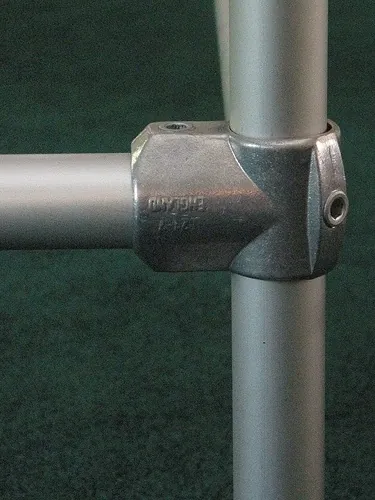

<figure class="eoc-pic eoc-pic-main"><figcaption><strong>Photo.</strong> <a href="https://commons.wikimedia.org/wiki/File:Basic_kee_klamp.jpg">Basic kee klamp</a> by User Cwpollock on en.wikipedia, <a href="http://creativecommons.org/licenses/by-sa/3.0/">CC BY-SA 3.0</a>, from Wikimedia Commons.</figcaption></figure>

Cast metal fittings with round sockets that slip over plain tube and are locked on by a [set screw](../glossary.md#set-screw) pressing on the tube, so tees, elbows, crosses and flanges can join cut lengths of pipe into strong frames and railings that can be adjusted or taken apart.

**In plain words:** Chunky metal tees, elbows and crosses that you slide onto plain round pipe and lock by tightening a screw with an Allen key, so you can build rails, racks, desks and frames like a construction kit, with no welding or threading, and take them apart again. **Proper term:** Structural pipe fittings (slip-on pipe fittings, clamp-on tube fittings, key clamp fittings).

**Also called:** slip-on pipe fittings; slip-on tube fittings; structural pipe fittings (Wikipedia 'Structural pipe fitting'); pipe clamp / tube clamp fittings; tube-and-clamp system; clamp fittings; key clamp / Key Klamp: generic name taken from Kee Klamp (brand, Kee Safety), made since 1934; related brand names Interclamp and Tubeclamp (Wikipedia 'Kee Klamp'); Kee Lite (brand): aluminium version of Kee Klamp; Speed-Rail (brand, Hollaender): aluminium slip-on fittings used for handrails and for film and TV grip rigs; Nu-Rail (brand, Hollaender); set-screw pipe fittings; grub-screw tube connectors; threadless pipe fittings; tee (single socket tee, three socket tee), elbow, cross, side outlet tee, base flange, wall flange, swivel fitting (names of fitting types in the Kee Klamp manual); lean pipe / pipe-and-joint system: 28 mm plastic-coated steel pipe joined by bolted metal clamp joints, used for workshop racks and trolleys (WJ-LEAN); scaffold coupler (right-angle coupler, swivel coupler, sleeve coupler): the bolted clamp-on cousin used on scaffolding tubes (Wikipedia 'Scaffolding'); rod-to-rod cross clamp; [boss](../glossary.md#boss) head, clamp holder or clamp fastener (the laboratory version that locks a clamp to a stand rod; Wikipedia 'Clamp stand').

## How it works

Each socket of the fitting is a round hole slightly larger than the pipe, so the fitting slides onto the pipe and can be moved to any position and angle (Wikipedia 'Structural pipe fitting'). A set screw in a threaded hole in the socket wall is then tightened with a hex key; it presses on the pipe, pushing it against the far side of the socket, and 'the sharp edge of the set screw locks the fitting into the pipe' (Simplified Building). Friction plus that small bite hold the joint against sliding and turning; loosen the screw and the fitting slides free again, so the structure can be adjusted or taken apart (Wikipedia 'Structural pipe fitting'). A light-duty relative is the rod-to-rod cross clamp, such as the lab boss head (clamp holder): a stand rod and a clamp's rod go into its two jaws, and thumbscrews lock them 'at any height or angle', normally at 90° to each other; swivel and all-position holders allow other angles, and 'in some cases it can be used to attach support rods together' (Wikipedia 'Clamp stand').

## Parts

A few parts per joint: the fitting (a one-piece casting with one to four sockets, e.g. elbow, tee, cross or flange), one set screw (grub screw) per socket, and the plain tubes it joins; some split, hinged and swivel fittings are two or three pieces bolted together (Kee Klamp manual).

## Everyday examples

- Galvanised handrails and guardrails around car parks, stairs, loading docks and flat roofs (Wikipedia 'Kee Klamp')
- Market stalls, shop clothing rails and pipe shelving (Wikipedia 'Kee Klamp'; Simplified Building)
- Home-made pipe desks, parkour and ninja-warrior training rigs (Wikipedia 'Kee Klamp')
- Film and TV lighting and camera rigs built from aluminium Speed-Rail (Hollaender)

## When to use it

Use them to build strong, rigid frames from round pipe without welding, threading or special skills: railings, racks, shelves, desks, workbenches, gates, gym rigs, greenhouse or grow-tent frames, camera and lighting rigs. They suit projects you may want to adjust, extend or take apart and rebuild, and outdoor structures when galvanised or aluminium (Wikipedia 'Structural pipe fitting'; Simplified Building). They are also handy for adding a crossbar or mount to an existing tube frame with split or two-piece clamps (Kee Klamp manual; jprince). For jigs and frames that must hold short rods or pins at odd angles, one idea borrowed from medicine is the external-fixator frame: pins are joined to an outside rod by 'special ball-and-socket joints', which are adjusted to set each pin's position and make a rigid support (Wikipedia 'External fixation'). It is mentioned here only as a frame-building idea for non-medical maker use.

## When not to use it

Avoid them for thin-wall tube such as electrical conduit, bike or tent tubing, or soft plastic pipe unless the fitting is made for it (the set screw can crush or dent the tube; Kee requires at least 3.2 mm wall for non-standard tube): use split clamps (see 'Clamp-on accessory mount for bars, poles and edges'), plastic push-fit connectors or internal tube anchors instead. For square or rectangular frames use aluminium extrusion with T-slot connectors. For a light, cheap, permanent frame, welding or glued PVC fittings may be cheaper: Wikipedia notes that for simple installations welding can cost less than Key Klamp. Where precise alignment matters (machines, printers), use extrusion or machined brackets. For safety-critical guardrails, use only certified fittings and the maker's load tables.

## Details

- **What it does (jobs):**
  - join and hold: joins lengths of round pipe at fixed angles (tees, elbows, crosses) or to walls and floors (flanges) to build rigid frames (Wikipedia 'Structural pipe fitting')
  - let it move (turn, slide or bend): swivel and adjustable fittings let a brace be set at any angle before locking, and eye and pin fittings (Kee types 78 and 83) make gate hinges, with a collar (type 75) supporting a fitting that is left loose so it can turn (Kee Klamp manual)
- **Movement:** none: once the set screws are tight the joint is rigid. While loose, a fitting can slide along its pipe and turn round it; swivel fittings add a pivot for braces at any angle, e.g. the BC53-8 swivel elbow adjusts through 202° (Kee Klamp manual)
- **Directions it can move (degrees of freedom):** 0 when tightened. Before tightening, each socket allows 2 (slide along the pipe and turn round it); a swivel fitting adds 1 more (its pivot) until locked.
- **Special behaviour:**
  - none: it is a fixed joint. Its useful trick is that it is fully adjustable and reusable: fittings can be moved, re-angled or taken apart simply by loosening the set screws (Wikipedia 'Structural pipe fitting'), and split or hinged fittings can be added to an existing frame without dismantling it (Kee Klamp manual, split single socket tee)
- **How it holds:**
  - friction or clamping ([force-fit](../glossary.md#form-fit--force-fit--material-bond)): the set screw presses the pipe against the socket wall and friction resists sliding and turning
  - shape (the parts interlock; form-fit): partly, because the pointed or sharp-edged set screw bites a small dent into the pipe ('the sharp edge of the set screw locks the fitting into the pipe', Simplified Building); for permanent or high-load joints held by a single screw, Kee advises drilling and pinning the tube to stop rotational slip (Kee Klamp manual)
- **Input and output:** not applicable
- **Power:** passive (no power needed)
- **Load:** Heavy: Kee Klamp fittings in sizes 5-9 support an [axial](../glossary.md#axial--radial) (sliding) load of 900 kg per set screw tightened to 39 N·m (Kee Klamp manual; Kee Safety technical specification), and Simplified Building says this rating includes a 2:1 safety factor; some Kee load tables use 770 kg with a safety factor of 2. Strong in bending and pull along the pipe; weakest against twisting round the pipe axis where only one screw holds, which is why Kee says single-screw joints under high or permanent load should be drilled and pinned (Kee Klamp manual). Much weaker on thin-wall or soft tube: Kee specifies tube with a wall of at least 3.2 mm if it is not standard BS EN 10255 steel tube (Kee Klamp manual). 3D-printed plastic versions are light duty only.
- **Play and precision:** No play once tight. Positioning is by eye and tape measure, not by precise location, so squareness depends on how carefully the pipes are cut and set before tightening; the [clearance](../glossary.md#clearance) in the sockets absorbs small cutting errors (Kee Safety technical specification) ⚑ [uncertain: no figure for socket clearance published]. Tube must not be joined end-to-end inside a split tee fitting (Kee Klamp manual); a structure built only from swivel fittings will not be rigid (Kee Klamp manual).
- **Taking it apart:** removable: loosen the set screws and slide the fittings off; the pipe and fittings can be reused in a new project (Wikipedia 'Structural pipe fitting')
- **How often it can be reused:** many times: fittings and pipe can be reconfigured and reused (Wikipedia 'Structural pipe fitting'); replacement set screws are sold separately (Simplified Building). The set screw leaves small dents in the pipe, so re-tighten on fresh spots if a joint is moved ⚑ [uncertain: general advice, not from a manufacturer]
- **Sealing:** none: the joint is not sealed and the pipes do not carry fluid
- **Adjustable:** yes: fittings can be slid and rotated to any position before tightening, and adjustable fittings exist for angles, e.g. a 30-45° adjustable cross and swivel fittings for bracing (Kee Klamp manual); 'Adjustability in the fittings allows greater on-site [tolerances](../glossary.md#tolerance) to be met' (Kee Safety technical specification)
- **Access needed:** end of a tube or shaft: most fittings are slid onto the pipe from its end, so plan the assembly order; split and hinged fittings can be clamped onto a pipe from the side (Kee Klamp manual). The set screw is tightened from outside, so the inside of the pipe never needs to be reached
- **Materials:** Fittings: hot-dip galvanised malleable (cast) iron, to BS EN 1562/1563 or ASTM A47 (Kee Klamp manual; Simplified Building); aluminium-magnesium alloy 535 (Hollaender), which Hollaender says is comparable in strength to iron at one-third the weight; aluminium Kee Lite; plastic for 3D-printed or light versions. Set screws: case-hardened steel with a corrosion coating, stainless for aluminium fittings (Kee Klamp manual; Simplified Building). Pipe: steel tube to BS EN 10255 / ISO 65 or US Schedule 40 in standard outside diameters (e.g. size 7 = 42.4 mm = 1-1/4 in nominal bore), galvanised, stainless, aluminium or black iron pipe (Kee Klamp manual; Hollaender).
- **Heat, cold, water and wear:** Galvanised iron fittings with coated set screws are made for outdoor and industrial use (Kee Klamp manual); aluminium alloy 535 fittings are very corrosion resistant and suited to harsh environments (Hollaender); stainless set screws are fitted on aluminium fittings (Simplified Building). Vibration: Kee's 4 g, 24-hour vibration test showed no loosening, but dynamic loads call for periodic checks of set screws (Kee Safety technical specification; Simplified Building). Printed plastic fittings [creep](../glossary.md#creep) and loosen under constant clamping and heat; PLA softens above about 60 °C and degrades in sunlight (Prusa).

## Making it

- **Ways to make or get it:**
  - off-the-shelf part: cast iron or aluminium slip-on fittings in standard pipe sizes, plus galvanised or aluminium pipe cut to length
  - 3D print (FDM): light-duty tube connectors and clamps for thin tube, grow-tent frames, PVC or aluminium tube, usually as two-piece bolted clamps or push-fit sockets (Thingiverse 'Pipe Clamps' by Theorist; jprince's tube tee/cross connector)
  - CNC: machined or laser-cut custom brackets and clamp blocks for tube ⚑ [uncertain: no specific design guide found]
  - woodwork: ⚑ [uncertain] wooden clamp blocks with bolts are possible, but no tested source was found
- **Printing it in one piece (print in place):** no: printed fittings are single rigid parts or two clamp halves, assembled onto the tube with screws or set screws
- **Tools:** A hex key (Allen key): Kee Klamp uses 3/16 in for size 4, 1/4 in for sizes 5-6 and 5/16 in for sizes 7-9 (Simplified Building); a [ratchet](../glossary.md#ratchet) or [torque](../glossary.md#torque) wrench helps reach the rated torque (Kee Klamp manual). A pipe cutter or saw and a file to cut and deburr the pipe; for railings, a drill for floor anchors (Hollaender Speed-Rail instructions).
- **Difficulty:** easy: buy the fittings and matching pipe, cut the pipe to length with a saw or pipe cutter, and tighten with a hex key; 'only simple hand tools are required' (Wikipedia 'Structural pipe fitting'). 3D-printing strong versions is harder (moderate), because set screws need metal threads and plastic creeps under the clamping force

### 3D printing tips

1) Treat printed fittings as light duty: the metal versions rely on a hardened set screw biting into steel pipe at 39 N·m (Kee Klamp manual), which printed plastic threads cannot take. 2) Give the set screw a metal thread: fit a [heat-set insert](../glossary.md#heat-set-insert) or a [captive nut](../glossary.md#captive-nut) rather than screwing into plastic (see the 'Heat-set threaded insert' and 'Captive nut pocket' entries) ⚑ [uncertain: design advice, not a tested rule]. 3) A split clamp is usually better than a single set screw on plastic: jprince's grow-tent tube connector uses two printed halves clamped round the tubes with four M3 screws, can be fitted to an existing frame without taking it apart, and mixes halves to join 16-22 mm tubes of different sizes. 4) Print settings from that design: PLA, PETG, ASA or ABS, 0.4 mm nozzle, 0.16-0.20 mm layers, 15% gyroid [infill](../glossary.md#infill), no supports, printed with the tube cut-outs facing up. 5) Orientation matters: Mike Car prints his 25 mm 3-way connector 'on the corner for strength' so each socket is at an angle to the layers ⚑ [uncertain: why this is stronger is not explained]. 6) Clearance: make sockets a little larger than the tube; Brandano's printed [collet](../glossary.md#collet) coupler uses bores 0.2 mm larger than the shaft, while push-fit connectors are made tight on purpose (randunel's 20 mm 3-way connector is a 'tight fit so that no glue is required'); print a test ring first and adjust for your printer ⚑ [uncertain: values vary by printer]. 7) Don't let a screw tip press straight on a thin plastic or aluminium tube; spread the load with a curved pad or clamp saddle ⚑ [uncertain: general advice]. 8) Plastic creeps and loosens under constant clamping: PLA softens above about 60 °C and degrades in sunlight, while PETG suits indoor and most outdoor use below about 80 °C (Prusa), so use PETG, ASA or ABS outdoors and re-tighten after a few days.

### Buying one (off-the-shelf parts)

Search for: 'structural pipe fittings', 'slip-on pipe fittings', 'key clamp fittings', 'Kee Klamp' (brand) or 'Kee Lite' (brand), 'Speed-Rail' (brand) or 'Nu-Rail' (brand) aluminium fittings, 'Interclamp' (brand). Fitting names: single socket tee, three socket tee, 90° elbow, cross, side outlet tee, corner, swivel socket, base flange, wall flange, railing flange, adjustable cross, split tee, set screw (e.g. Kee 97 series) and matching hex keys. Pipe: steel tube to BS EN 10255 (ISO 65) medium or heavy, or US Schedule 40 pipe, galvanised or aluminium; Kee sizes 2-9 fit outside diameters 13.5, 17.5, 21.3, 26.9, 33.7, 42.4, 48.3 and 60.3 mm (1/4 in to 2 in nominal bore) (Kee Klamp manual). Related systems: 'lean pipe' 28 mm coated pipe with 'metal joints' (WJ-LEAN), scaffold 'right-angle coupler', 'swivel coupler' and 'sleeve coupler' for 48.3 mm scaffold tube ⚑ [uncertain: scaffold tube size not checked in an opened source].

## Rules of thumb

- Kee Klamp sizes 5-9: each set screw tightened to 39 N·m (29 lbf·ft) holds 900 kg of axial load; this torque is 'normally obtained when the screw is fully tightened using a ratchet wrench' (Kee Klamp Fittings Manual, 2007, p. 4; Kee Safety technical specification).
- Simplified Building states the 2000 lb (900 kg) per-screw rating includes a 2:1 safety factor, and that size 6 Kee Lite aluminium fittings should be tightened to only 19 lbf·ft (about 26 N·m) (Simplified Building, 'Kee Klamp Concept').
- Hollaender Speed-Rail aluminium fittings: tighten set screws to about 16 lbf·ft (about 22 N·m); without a torque wrench, tighten until the screw touches the pipe, then one more full turn (Hollaender Speed-Rail installation instructions, step 7).
- Use tube with the standard outside diameter; tube to other specifications is fine if its outside diameter matches BS EN 10255 (ISO 65) and its wall is at least 3.2 mm (Kee Klamp manual, p. 5).
- Match fitting size to pipe size: e.g. Kee size 5 = 26.9 mm (3/4 in), size 6 = 33.7 mm (1 in), size 7 = 42.4 mm (1-1/4 in), size 8 = 48.3 mm (1-1/2 in), size 9 = 60.3 mm (2 in) outside diameter (Kee Klamp manual, p. 5).
- Never build a whole structure from swivel fittings; it won't be stable or rigid (Kee Klamp manual, swivel fittings warnings).
- Where a tube is held by a single grub screw under high or permanent load, drill and pin it to stop it turning (Kee Klamp manual, type 72 warning).
- Don't join two tubes end-to-end inside a split single socket tee (Kee Klamp manual).
- If the load on a socket could exceed its set screw's slip load, or a fitting must be left loose (e.g. a gate hinge), add a clamp-on collar (Kee type 75) underneath to carry it (Kee Klamp manual).
- Tighten set screws after the frame is plumb and square, starting from the base flanges and working up (Hollaender Speed-Rail instructions, step 7).
- Under dynamic loads (vibration, swinging, gym use), check set screws at regular intervals (Simplified Building, 'Kee Klamp Concept'); in an independent 4 g vibration test of a size 7 tee for 24 hours, neither standard nor [self-locking](../glossary.md#self-locking) set screws loosened (Kee Safety technical specification, vibration test).

## Common failures

1) Joint slips along or turns round the pipe: set screw not tight enough, tube too thin or undersized, or a single screw resisting twist (Kee Klamp manual; Simplified Building). Fix: torque correctly, use standard tube, drill and pin highly loaded joints. 2) Screws loosening under repeated or dynamic loads (Simplified Building). Fix: check periodically. 3) Wobbly or out-of-square frame: pipes cut to the wrong length, screws tightened before the frame was plumb, or too many swivel fittings (Hollaender; Kee Klamp manual). 4) Can't fit a fitting because the pipe ends are already captured: plan the assembly order or use split fittings (Kee Klamp manual). 5) Corrosion where the galvanising or coating is damaged; use coated or stainless screws (Kee Klamp manual; Simplified Building). 6) Printed versions: cracked sockets, stripped plastic threads and loosening from creep (Prusa) ⚑ [uncertain: no test data found].

## Safety

If a frame will hold people (railings, guardrails, climbing or gym rigs) or overhead loads, follow the maker's load tables, torque figures and certification: Kee's ratings apply only to standard tube and correctly torqued screws (Kee Klamp manual; Simplified Building). A set screw that is under-tightened or on thin tube can slip and let a joint collapse suddenly. Cut pipe ends are sharp: deburr them and fit end caps ⚑ [uncertain: general advice]. Structures made only of swivel fittings are not rigid (Kee Klamp manual). Printed plastic connectors must not be used for anything that holds a person's weight ⚑ [uncertain: general advice]. The external-fixator frame idea is for building jigs and frames only: never make or use anything like it on a person.

## Related

- Aluminium-extrusion connectors (T-slot nuts and brackets): the equivalent kit system for square aluminium profiles; more precise and easier to attach accessories, but square rather than round
- Internal tube anchors (star nut, expansion plug): grip the inside of a tube end instead of the outside, e.g. for feet, casters or an end thread
- Collet (and keyless chuck): a split sleeve that grips a round rod evenly and centred; printed collet mounts can clamp a tube to a plate
- Shaft-to-hub joints and rigid couplings (set screw, clamp hub): the same set-screw or split-clamp idea used on rotating shafts
- Telescoping tube lever lock (flip lock) and twist lock: clamp one tube inside another at any length
- Scaffold couplers (right-angle, swivel and sleeve couplers): bolted clamp-on fittings for scaffold tube; only right-angle and swivel couplers are load-bearing (Wikipedia 'Scaffolding')
- Threaded pipe fittings (plumbing tees and elbows): screw onto threaded pipe ends, so pipes must be cut and threaded to exact lengths and can't be slid or rotated
- Plastic push-fit tube connectors (e.g. PVC furniture fittings and printed 3-way connectors): cheap and light, held by a tight fit or glue rather than screws
- Ordinary screw joint (bolt and nut): drilling through tubes and bolting them gives a positive joint but weakens the tube and can't be slid
- Clamp-on accessory mount for bars, poles and edges: split bar clamps, U-bolts, pipe clamps and camera-rod clamps that grip a tube from outside to fix one accessory to it; the better choice on thin-wall tube
- Strut hub: joins three or more straight struts at fixed compound angles in one node, for domes and space frames rather than right-angle pipe frames

## Make it yourself

- [Pipe Clamps (Theorist, Thingiverse, 2012)](https://www.thingiverse.com/thing:33780): Printable pipe fittings for building furniture and railings from pipe, designed as a cheaper alternative to Kee Klamp and Alvin Industrial metal fittings *(licence: CC BY-SA 4.0)*
- [Tube Tee / Cross Connector - 90° Perpendicular Tube Clamp (jprince, Printables) (URL from Printables API, page not opened)](https://www.printables.com/model/1849731-tube-tee-cross-connector-90deg-perpendicular-tube): Two-piece printed clamp with four M3 screws that joins two round tubes (16-22 mm, including 1/2 in EMT) at 90°, designed for grow-tent frames; halves can be mixed to join different tube sizes *(licence: CC BY-NC-SA (Creative Commons Attribution-NonCommercial-ShareAlike))*
- [Parametric pipe connector (Konstantin Radchenko, Printables) (URL from Printables API, page not opened)](https://www.printables.com/model/1441958-parametric-pipe-connector): Fusion 360 parametric tube connector: change one diameter parameter to fit your tube and build 3D lattice frames *(licence: CC BY-SA (Creative Commons Attribution-ShareAlike))*
- [Parametric tube to plate collet mount (GetBurning, Printables) (URL from Printables API, page not opened)](https://www.printables.com/model/1030662-parametric-tube-to-plate-collet-mount): OpenSCAD (BOSL2) collet-and-nut fitting that clamps a 22 mm carbon or metal tube to a plate, a flange-style clamp-on fitting *(licence: GNU General Public License v3.0)*

## Pictures, videos and models

- [Basic kee klamp.jpg (Cwpollock, Wikimedia Commons)](https://commons.wikimedia.org/wiki/File:Basic_kee_klamp.jpg): Photo of a basic slip-on Kee Klamp fitting with its set screw (used as the lead image of Wikipedia's 'Kee Klamp' article) *(licence: GFDL 1.2 or later / CC BY-SA 3.0)*
- [Kee Klamp & Kee Lite Pipe Fittings - Features & Use (Simplified Building, YouTube)](https://www.youtube.com/watch?v=2SXjwiZgTSk): Overview of slip-on fittings, sizes and how the set screw locks the fitting onto the pipe; a transcript is on the Simplified Building website (title and channel verified via YouTube oEmbed) *(licence: link only (standard YouTube licence))*
- [Kee Klamp Fittings Manual (Kee Klamp Ltd, 2007, PDF hosted by a Swedish distributor)](https://www.fallskydd.se/pdfs/UK_KeeKlamp_2007_C.pdf): Drawings and dimension tables for every fitting type (tees, elbows, crosses, swivels, flanges), sectional drawings of the tube sizes, and load tables *(licence: link only (copyright Kee Klamp Ltd))*
- [Speed-Rail Assembly/Installation Instructions (Hollaender, PDF)](https://www.hollaender.com/site/assets/files/9374/speed-rail_2-line_installation.pdf): Step-by-step drawings of building a two-line railing from slip-on aluminium fittings, with pipe cut-length formulas and set screw tightening advice *(licence: link only)*
- [Coupler 1.jpg (Warburg, Wikimedia Commons)](https://commons.wikimedia.org/wiki/File:Coupler_1.jpg): Photo of a bolted scaffold coupler holding a diagonal brace on a frame scaffold: the related tube-and-clamp system *(licence: CC BY-SA 3.0)*

## Needs confirming

⚑ marks something nobody has confirmed yet: a fact the research could not confirm from a source, a finder value that is a best guess, or an open point from the research notes. Corrections are welcome (see `research/needs-confirming.md`).

- ⚑ 12 sentences on this page marked [uncertain].

## Sources

- <https://en.wikipedia.org/wiki/Structural_pipe_fitting>
- <https://en.wikipedia.org/wiki/Kee_Klamp>
- <https://en.wikipedia.org/wiki/Scaffolding>
- <https://www.fallskydd.se/pdfs/UK_KeeKlamp_2007_C.pdf>
- <https://www.keesafety.com/media/hcnluj0x/kee_klamp_technical_specification.pdf>
- <https://www.simplifiedbuilding.com/pipe-fittings/kee-klamp-concept>
- <https://www.simplifiedbuilding.com/97-set-screw>
- <https://www.simplifiedbuilding.com/pipe-fittings/kee-klamp/97s-stainless-steel-set-screw>
- <https://www.simplifiedbuilding.com/projects/video-kee-klamp-and-kee-lite-features-use>
- <https://www.youtube.com/watch?v=2SXjwiZgTSk>
- <https://www.hollaender.com/>
- <https://www.hollaender.com/site/assets/files/9374/speed-rail_2-line_installation.pdf>
- <https://www.wj-lean.com/professional-china-pipe-and-joint-system-diameter-28mm-0-7mm-thickness-coated-pipe-wj-lean-product/>
- <https://www.thingiverse.com/thing:33780>
- <https://api.printables.com/graphql/>
- <https://help.prusa3d.com/article/pla_2062>
- <https://help.prusa3d.com/article/petg_2059>
- <https://commons.wikimedia.org/wiki/File:Basic_kee_klamp.jpg>
- <https://commons.wikimedia.org/wiki/File:Coupler_1.jpg>
- <https://en.wikipedia.org/wiki/Clamp_stand>
- <https://en.wikipedia.org/wiki/External_fixation>
