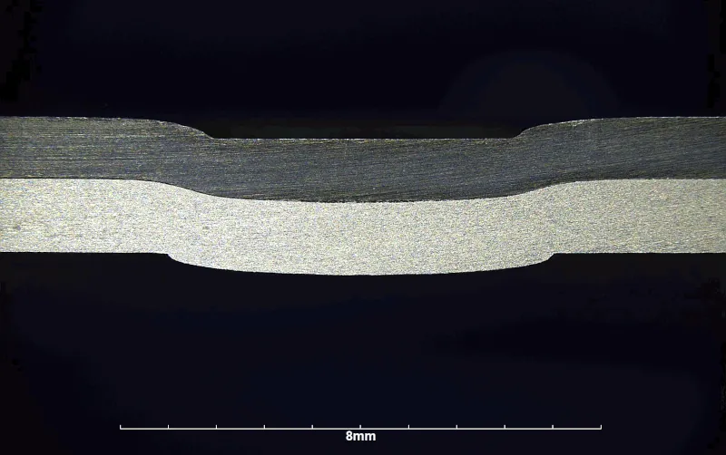
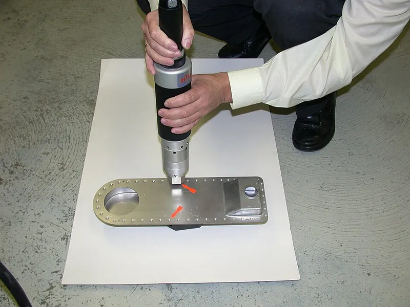
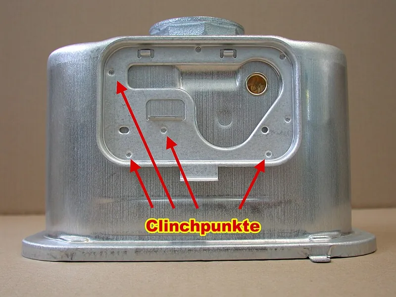

<figure class="eoc-pic eoc-pic-main"><picture><source media="(prefers-reduced-motion: reduce)" srcset="../media/clinching.still.webp"></picture><figcaption><strong>Animation.</strong> <a href="https://commons.wikimedia.org/wiki/File:TOX_Pressotechnik_Clinching.gif">TOX Pressotechnik Clinching</a> by CRT4TopSpot, <a href="https://creativecommons.org/licenses/by-sa/4.0">CC BY-SA 4.0</a>, from Wikimedia Commons.</figcaption></figure>
<figure class="eoc-pic"><figcaption><strong>How it works.</strong> <a href="https://commons.wikimedia.org/wiki/File:Durchsetzfuegen_Clinchen_Handgeraet_0076.jpg">Durchsetzfuegen Clinchen Handgeraet 0076</a> by Michael KR, <a href="https://creativecommons.org/licenses/by-sa/4.0">CC BY-SA 4.0</a>, from Wikimedia Commons.</figcaption></figure>
<figure class="eoc-pic"><figcaption><strong>Photo.</strong> <a href="https://commons.wikimedia.org/wiki/File:Durchsetzfuegen_an_einem_Gaszaehler_4447b.jpg">Durchsetzfuegen an einem Gaszaehler 4447b</a> by Michael KR, <a href="https://creativecommons.org/licenses/by-sa/4.0">CC BY-SA 4.0</a>, from Wikimedia Commons.</figcaption></figure>

A way of permanently joining overlapping metal sheets by pressing them with a punch into a shaped die, so the metal flows sideways into a button-shaped interlock that holds the sheets together without any extra part.

**In plain words:** Two or more metal sheets squashed together by a special punch and die so that they form a little locked 'button', like a press stud made out of the sheets themselves: no rivet, screw, glue or heat. **Proper term:** Clinching (clinch joining, press joining).

**Also called:** clinch joining; press joining; press-joining; sealed clinch joint (Wikipedia 'Clinching'); mechanical clinching; clinch joint; clinch point; clinch button (He 2017 review; European Aluminium Association (EAA) Joining Manual ch. 8); round clinching / clinching without local incision (the usual closed round button) and rectangular or lanced clinching / clinching with local incision (sheets cut along two sides) (EAA Joining Manual 8.1.2.1-8.1.2.2); flat clinching / flat point (button pressed flat afterwards); twin point (two buttons side by side); hit clinching (many small hits) (TOX brochure; EAA; Assembly Magazine 2016); 'riveting without rivets' (TOX brochure title); 'toxing' / 'Toxen' after the TOX company (brand) (TOX brochure; German Wikipedia); German: Durchsetzfuegen, Clinchen, Druckfuegen (German Wikipedia 'Durchsetzfügen'); Trade names (brands): TOX Clinching / TOX Round-Joint (TOX Pressotechnik); Tog-L-Loc, V-Loc and Lance-N-Loc (BTM); RIVCLINCH (Böllhoff) (EAA Joining Manual; Böllhoff); In metal-stud wall framing the hand tool that locks a steel stud to its track is sold as a 'stud crimper' or 'punch lock' (Malco); it makes a similar lanced, fastener-free joint ⚑ [uncertain: sellers call it a crimp, not a clinch].

## How it works

The overlapping sheets are clamped between a punch and a die. The punch pushes both sheets down into the die like a small deep-drawn cup; when the bottom sheet hits the anvil, the squeezed metal can only flow sideways, into a groove in a solid die or by pushing movable die segments outward (TOX brochure p.2; EAA 8.1.2.2). The top sheet spreads out inside the bottom sheet, forming an [undercut](../glossary.md#undercut) (a mushroom-shaped lock), so the sheets can't be pulled apart without tearing the 'neck' of the button or popping the button out (He 2017). The lanced (rectangular) version first cuts both sheets along two sides and then squeezes the strip between the cuts into a lock (EAA 8.1.2.1; Assembly Magazine 2016).

## Parts

Single piece: the joint is made only from the sheets themselves (EAA Joining Manual 8.1.2). The tool is a small matched set: a punch, a die (solid with a ring-shaped groove, or split into sliding segments held by a spring) with an anvil in its bottom, often a stripper/blank holder, all driven by a hand, pneumatic, hydraulic or electric press (Wikipedia 'Clinching'; EAA 8.1.2.2; Assembly Magazine 2002).

## Everyday examples

- Washing machines, fridges and other white goods made from pre-painted sheet steel (Assembly Magazine 2016; German Wikipedia, with Commons photo of a washing-machine clinching station)
- Car bonnets (hoods) and boot lids in aluminium, where spot welding is difficult (Wikipedia 'Clinching'; Assembly Magazine 2016)
- Heating and ventilation ductwork and HVAC cabinets (ACHR News; Assembly Magazine 2016), and the back panel and drive bays of a computer case (German Wikipedia)
- Steel studs locked into their track in metal-stud partition walls with a hand crimper instead of screws (Malco; Gypsum Tools) ⚑ [uncertain: a lanced crimp, similar to but not called clinching by the sellers]

## When to use it

Use clinching when you need many fast, permanent joins in overlapping sheet metal and want no loose parts to buy or feed: appliance cases, ducts, enclosures, brackets and car body panels (Assembly Magazine 2002). It is a good replacement for spot welding when the sheets are pre-painted, galvanised or aluminium, because it does not damage coatings, needs no electricity, cooling water or fume extraction, and joins different metals or different thicknesses (Wikipedia 'Clinching'; Assembly Magazine 2002). It also suits joints that must stay gas-tight or electrically conductive (EAA; TOX 'eClinching' p.7), and can hold glued sheets together while the adhesive [cures](../glossary.md#cure) ('clinch-bonding', German Wikipedia).

## When not to use it

Don't use it when you can reach only one side (use a blind rivet or rivet nut), for [brittle](../glossary.md#brittle--ductile) or very hard metals such as cast material or ultra-high-strength steel (He 2017; EAA), for thick plate beyond the tooling range (He 2017), or where the joint must take high [peel](../glossary.md#peel-vs-shear) or crash loads (use self-pierce rivets, bolts or welding) (EAA 8.1.2). If the parts must come apart again, use screws or bolts. Without access to a clinching press, a hobbyist is usually better off with blind (pop) rivets, a folded seam or tab-and-slot joints.

## Details

- **What it does (jobs):**
  - join and hold: a permanent join for overlapping sheet metal, used instead of spot welds or rivets (Wikipedia 'Clinching'; EAA 8.1.2)
  - seal it, or pass cables or fluid through: a round, uncut clinch point is gas-tight, which is why it is used on gas meters (German Wikipedia; EAA 8.1.2.2); it can also be combined with adhesive or sealant between the sheets (EAA 8.1.2)
- **Movement:** none: the sheets are locked together
- **Directions it can move (degrees of freedom):** 0 once two or more points are made. A single round point stops the sheets sliding apart but can let them twist about the point, which is why a 'twin point' (two buttons side by side) is offered for 'protection against rotation' (EAA 8.1.2.2 c; TOX brochure p.9).
- **Special behaviour:**
  - none of the listed behaviours: it is a plain permanent joint
  - Its own tricks: no consumables, no heat, sparks or fumes, and it does not burn off zinc or paint, so pre-painted and galvanised sheet can be joined (Wikipedia 'Clinching'; Assembly Magazine 2002); joint quality can be checked without breaking it by measuring the leftover bottom thickness or the button diameter (TOX brochure p.7; EAA 8.1.2.4)
- **How it holds:**
  - shape (the parts interlock; [form-fit](../glossary.md#form-fit--force-fit--material-bond)): the top sheet is spread into an undercut inside the bottom sheet, like a press stud (TOX brochure p.2; He 2017)
  - friction or clamping (force-fit): the EAA calls it 'an interlocking friction joint' and German Wikipedia says the button holds the sheets by both form-fit and force-fit (EAA 8.1.2; German Wikipedia)
- **Input and output:** not applicable
- **Power:** passive (no power needed once made). Making the joint needs a press: hand-operated, pneumatic, hydraulic or electric (Assembly Magazine 2016).
- **Load:** light to medium per point; strongest in shear (sliding the sheets past each other), weaker in peel and in pulling straight apart (cross-tension). Example figures for one 4.6 mm punch point: two 0.56 mm galvanised mild-steel sheets about 70 lb (0.31 kN) peel and 285 lb (1.27 kN) pull; two 2 mm sheets about 300 lb (1.33 kN) peel and 1,000 lb (4.45 kN) pull (Norlok data quoted in Assembly Magazine 2016). A single clinch in two 20-gauge sheets holds 'roughly 430 lbs' in shear (Press Lock Technologies in ACHR News). Compared with a spot weld, sources disagree: 'about 50%' (ACHR News), 'up to 70 % of a weld point' (TOX brochure p.6), '2/3 to 1.5 times' (German Wikipedia), or higher static and [fatigue](../glossary.md#fatigue) strength than common spot welds (EAA 8.1.2). Clinches are weaker than self-pierce rivets, especially in cross-tension, so they are used in areas that don't take crash loads (EAA 8.1.2). Fatigue strength is good because there is no notch or heat-affected zone (TOX brochure p.6; Wikipedia 'Clinching').
- **Play and precision:** No play once formed. Position depends on where the tool is placed; 'Alignment of the tools is very critical' and poor fit-up is a major cause of bad joints (Assembly Magazine 2002; EAA 8.1.2.3). The punch and die must be the same nominal size and line up exactly (Assembly Magazine 2016). A single round point may let the parts rotate, so use two points or a twin point (EAA 8.1.2.2 c).
- **Taking it apart:** permanent: the only way apart is to tear or drill out the button, which damages the sheets ⚑ [uncertain: no source describes removal].
- **How often it can be reused:** once
- **Sealing:** airtight or pressure (round, uncut points only): the closed round button is described as gas-tight (EAA 8.1.2.2; German Wikipedia, gas meters). Lanced (rectangular) points are cut on two sides and are not gas-tight (German Wikipedia). Sealant or adhesive can be put between the sheets and clinched through (EAA 8.1.2).
- **Adjustable:** no: once pressed, the join is fixed.
- **Access needed:** both sides: the punch works from one side and the die from the other ('access to both sides of the joint is essential', He 2017; EAA 8.1.2.3). 'Die-driven' systems move the die side instead of the punch for awkward parts, but still need both sides (TOX brochure p.11).
- **Materials:** Joins ductile sheet metals: low-carbon and micro-alloyed steel, zinc-coated, organic-coated and pre-painted steel, stainless steel, ductile aluminium alloys, copper and brass, magnesium (Böllhoff; Wikipedia 'Clinching'; Assembly Magazine 2016), and dissimilar pairs such as aluminium to steel (EAA 8.1.2; Assembly Magazine 2002). With special or heated tooling, also some polymers, fibre-reinforced plastics, wood-metal composites and cardboard (Wikipedia 'Clinching'). Poor for brittle or low-ductility materials: conventional clinching of steel is limited to tensile strength below about 800 N/mm² and elongation above 14% (He 2017), or roughly 10-20% elongation depending on the source (Assembly Magazine 2002 and 2016). Adhesive, sealant, fabric or a sound-damping layer can be clinched between the sheets (EAA 8.1.2; Assembly Magazine 2016).
- **Heat, cold, water and wear:** Because no heat is used, zinc and paint coatings stay intact, so corrosion protection is kept; TOX shows clinches in coated steel tested through 1,000-hour salt-spray and climate tests (TOX brochure p.6; EAA 8.1.2). Clinched joints are 'less affected by environmental agents and effect of aging' than adhesive joints (Wikipedia 'Clinching'). Fatigue and vibration resistance are good (TOX p.6; BTM's V-Loc described as 'vibration-resistant and leak-proof', Assembly Magazine 2016). Joining dissimilar metals (e.g. aluminium to steel) can bring galvanic corrosion where water collects ⚑ [uncertain: general corrosion advice, no clinching source]. Metals only: no [creep](../glossary.md#creep) or heat limit worth worrying about at everyday temperatures, unless an adhesive or polymer layer is clinched in ⚑ [uncertain].

## Making it

- **Ways to make or get it:**
  - sheet metal: the main use, joining overlapping flanges, lap joints, corners and tube-to-sheet joints (Assembly Magazine 2016)
  - off-the-shelf tooling: punch-and-die sets, hand tongs and presses are bought from clinching suppliers (TOX brochure; Böllhoff)
  - tube and extrusion: aluminium extrusions and round tube to flat sheet can be clinched (Assembly Magazine 2016)
- **Printing it in one piece (print in place):** no: clinching is a sheet-metal forming process, not something that can be printed.
- **Tools:** A press with a matched punch and die for the sheet thicknesses: hand-held clinching pliers or tongs (pneumatic, hydraulic or battery powered), table or floor C-frame machines, or tooling fitted into an existing press (Assembly Magazine 2002 and 2016; EAA 8.1.2). Forces are about 5 to 50 kN depending on material and thickness (Wikipedia 'Clinching'), up to 350 kN for large machines (Assembly Magazine 2016). Examples: a pneumatic hand tool with 25 kN joining force for up to 2.5 mm mild steel (Böllhoff RIVCLINCH 0201 IP); TOX's battery hand tool gives 10-50 kN and about 400 points per charge (TOX brochure p.13). No holes need to be drilled first (Wikipedia 'Clinching'). For metal-stud framing, a hand 'stud crimper' with 7:1 compound levers does light-gauge steel (Malco PL1R).
- **Difficulty:** hard: you need a matched punch and die and a press giving several tonnes (5-50 kN), so it is an industrial process; hobbyists can buy a hand stud crimper for thin galvanised steel studs (Malco PL1R, 22 gauge / 0.86 mm) or have parts made by a shop ⚑ [uncertain: no source on hobby access or tool prices].

### 3D printing tips

not applicable: the joint is formed in ductile sheet metal by hardened tool-steel punches and dies under 5-50 kN (Wikipedia 'Clinching'). 3D-printed PLA+ dies have been used to stamp logos into 1-2 mm sheet with a hydraulic press, but 'began to wear out after about a dozen tries' (Hackaday 2025), so a printed clinching die is unlikely to be practical ⚑ [uncertain: no one has reported trying it]. Printed parts can be joined to clinched sheet-metal parts with screws, rivet nuts or self-clinching nuts instead.

### Buying one (off-the-shelf parts)

Search for: 'clinching tool', 'clinching pliers' or 'clinching tongs' (hand-held C-frame, pneumatic, hydraulic, pneumohydraulic or battery), 'clinching press' or 'clinching machine', 'clinching punch and die' (round or rectangular; solid or split/segmented 'moveable' dies), 'multi-point clinching tool', 'flat clinching' die, 'clinch cycle monitor' or force-displacement monitoring (EAA 8.1.2; Böllhoff RIVCLINCH range; TOX brochure; Assembly Magazine 2016). For metal-stud framing: 'stud crimper', 'metal stud crimper' or 'punch lock' hand tool (Malco; Gypsum Tools).

## Rules of thumb

- Edge distance: keep the centre of the joint at least 1.5 x the punch diameter from the outer edge of the flange, or the button may burst out of the edge or distort the part (EAA Joining Manual 8.1.2.3; Assembly Magazine 2002).
- Spacing: space points at least 2 to 3 x the button diameter apart, and never clinch in or right next to an earlier point (EAA 8.1.2.3; Assembly Magazine 2002).
- Overlap: ideally about 10 mm of overlap in the joining area (Assembly Magazine 2016).
- Thickness: single sheets about 0.1 to 3 mm and stacks of 2 to 4 sheets 0.2 to 13 mm, working best with a total stack of 1 to 4 mm (Assembly Magazine 2016); TOX and the EAA quote 0.1 mm per sheet up to 12 mm total (TOX brochure p.4; EAA 8.1.2). Point diameters range from about 2 to 26 mm (TOX brochure p.4).
- Joining direction for unequal sheets: 'thick sheet into thin sheet' (thicker sheet on the punch side), with the thicker sheet no more than twice the thinner; put the harder sheet on the punch side, or the punch may go straight through a soft top sheet (EAA 8.1.2.3; Assembly Magazine 2002).
- Ductility: good clinches if elongation to fracture A80 >= 12% and yield ratio Rp0.2/Rm <= 0.7; limited between 8 and 12% (EAA 8.1.2.3). TOX engineers quoted 'at least 10 percent' (Assembly Magazine 2016) and 'greater than 20 percent' for trouble-free work (Assembly Magazine 2002).
- Quality check: the leftover bottom thickness of the button (TOX 'control dimension X') and the button diameter are measured to check each joint without destroying it (TOX brochure pp.2, 7; EAA 8.1.2.4). One study recommended a bottom thickness of 25% of the total sheet thickness (He 2017).
- Joint strength depends on material, sheet thickness, button size (as large as possible) and surface condition; a dry, grease-free surface gives a stronger joint, but a little [lubrication](../glossary.md#lubrication) improves tool life (EAA 8.1.2.3).
- Tool life: punches and dies typically last more than 250,000 joints (Assembly Magazine 2016); 'hundreds of thousands of cycles' (Wikipedia 'Clinching'; EAA 8.1.2).

## Common failures

1) Neck fracture (the thin wall of the button tears) or button separation (the button pops out) when the neck is too thin or the undercut too small; tooling and bottom thickness are tuned to balance the two (He 2017). 2) Cracks or a missing interlock when the material is not ductile enough or the two sheets differ greatly in ductility (He 2017); test first and use special or heated tooling (EAA). 3) Button bursting out of the flange edge or distorting the part when too close to the edge; keep 1.5 x punch diameter (EAA 8.1.2.3). 4) Thinned, ugly or weak joints and fast tool wear when clinching on or next to an earlier point (EAA 8.1.2.3). 5) Oily aluminium in a closed solid die can form a trapped 'hydrostatic cushion' that can break the die; use moveable-segment dies with oily sheets or adhesive (EAA 8.1.2.2). 6) Poor fit-up or misaligned punch and die give inconsistent joints (Assembly Magazine 2002). 7) Punch going straight through when the softer sheet is on the punch side (EAA 8.1.2.3). 8) Parts twisting about a single point: use two points or a twin point (EAA).

## Safety

Clinching presses and hand tongs apply several tonnes at the punch: keep fingers out of the jaws (TOX hand tongs are offered with one- or two-hand controls, Assembly Magazine 2016). The process makes no sparks, fumes or flash (Wikipedia 'Clinching'; Böllhoff). Round points have no burrs or sharp edges (EAA 8.1.2.2), but lanced points and cut sheet edges can be sharp ⚑ [uncertain: general advice]. Hand stud crimpers can pinch fingers between the handles ⚑ [uncertain: general advice].

## Related

- Blind rivet (pop rivet): also joins sheets permanently, needs access to one side only and a cheap hand tool, but adds a part and a hole
- Spot weld: the industrial joint clinching often replaces; spot welds need electricity and cooling water and burn coatings, which clinching doesn't (EAA 8.1.2; Wikipedia 'Clinching'; Assembly Magazine 2002)
- Self-pierce riveting (not a separate entry): another industrial alternative; self-pierce rivets are stronger than clinches in cross-tension (EAA 8.1.2)
- Clinch riveting (not a separate entry): a variant that adds a solid rivet into the clinch for more strength (EAA Joining Manual 8.2.2.5)
- Self-clinching fastener (press-in nut or stud): uses the same cold flow of sheet metal, but to lock a nut or stud into one sheet rather than join two sheets
- Folded seam (hem, lock seam, Pittsburgh lock): joins sheet edges by folding them together, needs no press but only works along edges
- Bent or twisted tab through a slot (lanced tab) and Tab-and-slot joint: fastener-free sheet joints that a maker can do with pliers
- Ordinary screw joint (bolt and nut): removable alternative when parts must come apart

## Make it yourself

- [Punch Lock, Metal Stud Crimper - PL1R (Malco Tools)](https://www.malcotools.com/product/punch-lock-metal-stud-crimper/): A hand tool (brand: Malco) that makes a rectangular fastener-free crimp through a steel stud and its track, up to 22 gauge (0.86 mm) galvanised steel; the easiest way for a hobbyist to try a lanced, clinch-style joint ⚑ [uncertain: sold as a crimp, not a clinch] *(licence: not applicable (commercial product page))*
- [Using the Wallboard Tools Stud Crimpers (wallboardtools, YouTube; title confirmed via oEmbed, not watched)](https://www.youtube.com/watch?v=sMMJCkvOEXY): Video showing a hand stud crimper joining metal studs to track *(licence: link only (YouTube))*

## Pictures, videos and models

- [TOX Pressotechnik Clinching.gif (CRT4TopSpot, Wikimedia Commons)](https://commons.wikimedia.org/wiki/File:TOX_Pressotechnik_Clinching.gif): Animation of a round clinch point forming in a solid die: punch pushes two sheets into the die and the metal spreads into a button *(licence: CC BY-SA 4.0)*
- [Clinching Phases (Francesco Lambiase, Wikimedia Commons, 2015)](https://commons.wikimedia.org/wiki/File:G5151Clinching_Phases_from_Lambiase_%22Clinch_joining_of_heat-treatable_aluminum_AA6082-T6_alloy_under_warm_conditions%22.png): Cross-section diagram of the stages of forming a clinch joint *(licence: CC BY-SA 4.0)*
- [Clinching dies (Francesco Lambiase, Wikimedia Commons, 2015)](https://commons.wikimedia.org/wiki/File:Clinching_Dies_from_Lambiase_-_%22Mechanical_behaviour_of_polymer-metal_hybrid_joints_produced_by_clinching_with_different_types_of_dies%22.png): The different die types: fixed grooved, split (movable segments), flat and rectangular *(licence: CC BY-SA 4.0)*
- [Durchsetzfügen Clinchen Handgerät (Michael KR, Wikimedia Commons)](https://commons.wikimedia.org/wiki/File:Durchsetzfuegen_Clinchen_Handgeraet_0076.jpg): Photo of a hand-held clinching tool with a clinched workpiece *(licence: CC BY-SA 4.0)*
- [(English) Clinching technology: Joining sheet metal without welding nor fasteners - RIVCLINCH (Böllhoff Group, YouTube; title confirmed via oEmbed, not watched)](https://www.youtube.com/watch?v=P1iMcCI70R0): Manufacturer video of clinching sheet metal with hand and machine tools *(licence: link only (YouTube, all rights reserved))*

## Needs confirming

⚑ marks something nobody has confirmed yet: a fact the research could not confirm from a source, a finder value that is a best guess, or an open point from the research notes. Corrections are welcome (see `research/needs-confirming.md`).

- ⚑ 10 sentences on this page marked [uncertain].
- ⚑ Finder value `removability` = permanent (source uncertain): `removability` is marked ⚑ [uncertain] here: "…ay apart is to tear or drill out the button, which damages the sheets ⚑ [uncertain: no source describes removal]…"
- ⚑ Finder value `sheet_material` = sheet metal or plastic (best guess): carried over from the finder's old rule on entry names (R33), for "What is the sheet made of?" under "Hold two things together > Boards, panels or sheet > No, never"
- ⚑ Finder value `seal_use` = seal a still joint (best guess): carried over from the finder's old rule on entry names (R33), for "What do you need?" under "Seal it, or pass cables, air or liquid through"
- ⚑ Finder value `seal_material` = metal (best guess): carried over from the finder's old rule on entry names (R33), for "What are the parts?" under "Seal it, or pass cables, air or liquid through > Keep water, dust or air out of a joint that does not move > No, never"

## Sources

- <https://en.wikipedia.org/wiki/Clinching>
- <https://de.wikipedia.org/wiki/Durchsetzf%C3%BCgen>
- <https://assets.tox.com/f/176476/x/dd4b9050dd/tox_clinching-technology_80_en.pdf>
- <https://european-aluminium.eu/wp-content/uploads/2022/11/8-mechanical-joining_2015.pdf>
- <https://www.ebi.ac.uk/europepmc/webservices/rest/PMC5468947/fullTextXML (He, X. (2017) 'Clinching for sheet materials', Science and Technology of Advanced Materials 18(1):381-405, doi:10.1080/14686996.2017.1320930, CC BY 4.0)>
- <https://www.assemblymag.com/articles/83301-in-a-clinch>
- <https://www.assemblymag.com/articles/93388-clinching-for-sheet-metal-assembly>
- <https://www.achrnews.com/articles/164712-a-guide-to-sheet-metal-clinching-for-hvac-contractors>
- <https://www.boellhoff.com/us-en/products/assembly-technology/rivclinch-metal-joining-without-fasteners/>
- <https://clinchsystems.com/what-is-clinching/>
- <https://www.malcotools.com/product/punch-lock-metal-stud-crimper/>
- <https://www.gypsumtools.com/blog/how-to-install-gypwall-partition-crimping-vs-screwing/>
- <https://hackaday.com/2025/01/09/sheet-metal-forming-with-3d-printed-dies/>
- <https://commons.wikimedia.org/wiki/File:TOX_Pressotechnik_Clinching.gif>
- <https://commons.wikimedia.org/wiki/File:Durchsetzfuegen_Clinchen_Handgeraet_0076.jpg>
- <https://commons.wikimedia.org/wiki/File:Sondermontageanlage_zur_Waschmaschinenproduktion_30007.jpg>
- <https://www.youtube.com/watch?v=P1iMcCI70R0>
- <https://www.youtube.com/watch?v=sMMJCkvOEXY>
