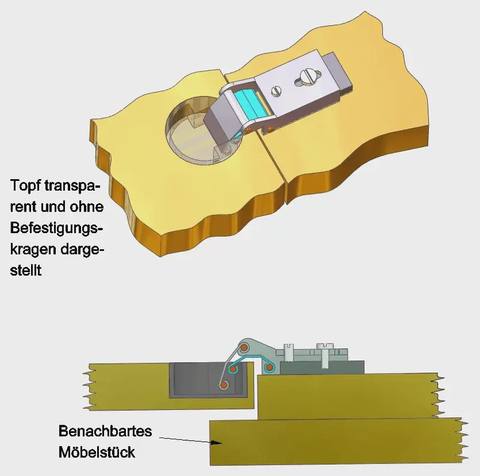
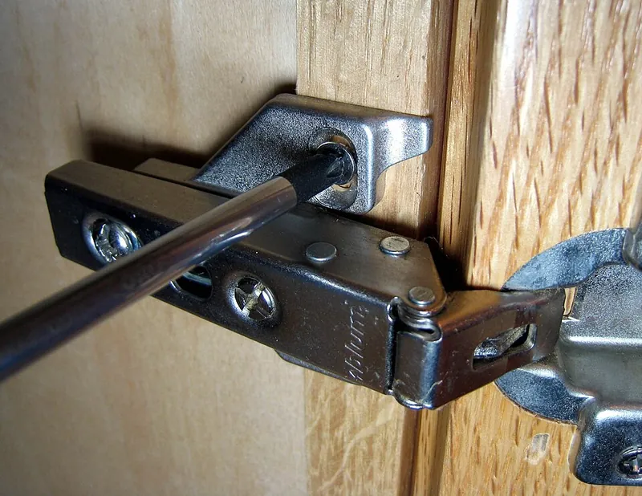
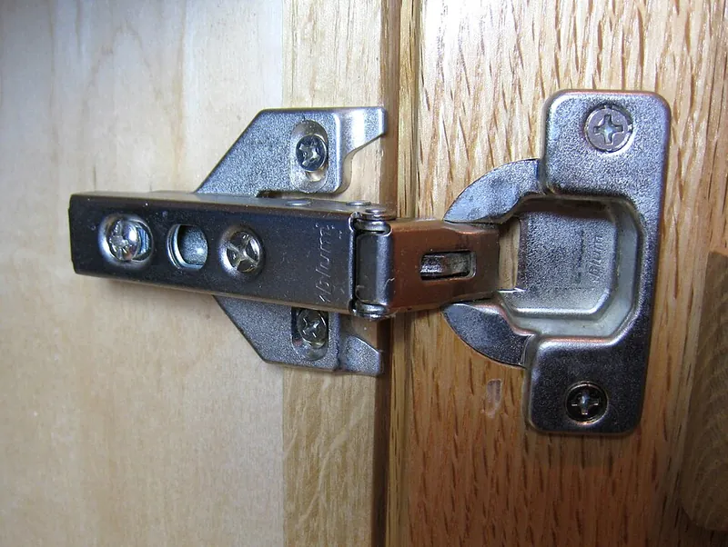

<figure class="eoc-pic eoc-pic-main"><picture><source media="(prefers-reduced-motion: reduce)" srcset="../media/clip-on-concealed-hinge.still.webp"></picture><figcaption><strong>Animation.</strong> <a href="https://commons.wikimedia.org/wiki/File:Scharnier_06.gif">Scharnier 06</a> by Manfredgoellner, <a href="https://creativecommons.org/licenses/by-sa/4.0">CC BY-SA 4.0</a>, from Wikimedia Commons.</figcaption></figure>
<figure class="eoc-pic"><figcaption><strong>How it works.</strong> <a href="https://commons.wikimedia.org/wiki/File:Euro_hinge_2.jpg">Euro hinge 2</a> by Dvortygirl, <a href="https://creativecommons.org/licenses/by-sa/3.0">CC BY-SA 3.0</a>, from Wikimedia Commons.</figcaption></figure>
<figure class="eoc-pic"><figcaption><strong>Photo.</strong> <a href="https://commons.wikimedia.org/wiki/File:Euro_hinge_1.jpg">Euro hinge 1</a> by Dvortygirl, <a href="https://creativecommons.org/licenses/by-sa/3.0">CC BY-SA 3.0</a>, from Wikimedia Commons.</figcaption></figure>

A cabinet-door hinge that hides inside a 35 mm round pocket drilled in the back of the door, clips onto a plate on the cabinet so the door can be lifted off without tools, and has three screws to shift the door sideways, up and down, and in and out until the gaps line up.

**In plain words:** The hidden kitchen-cupboard hinge: a round metal cup sunk into the back of the door, joined by a folding arm to a plate on the cabinet side, that clicks on and off without tools and has little screws for lining the door up. **Proper term:** Concealed hinge (cup hinge, European or Euro hinge), clip-on type.

**Also called:** cup hinge; Euro hinge / European hinge (developed in Europe and uses metric installation standards; Wikipedia 'Hinge'); concealed hinge / hidden hinge / invisible cabinet hinge; 35 mm hinge (after the usual cup-hole diameter); pot hinge (translation of German 'Topfscharnier' or 'Topfband'); four-joint or multi-joint cup hinge (German 'Viergelenk-Topfscharnier'; the usual kind); clip-on hinge / clip hinge / tool-free hinge (the clip-on version, as opposed to slide-on or screw-on versions); soft-close hinge (versions with a built-in damper); full overlay / half overlay (cranked, twin) / inset hinge (the three main door positions); face-frame hinge vs frameless (Euro-style) cabinet hinge; CLIP top, CLIP top BLUMOTION (Blum (brand)); Sensys (Hettich (brand)); Salice and Grass (brands).

## How it works

The cup sits in a flat-bottomed 35 mm hole bored into the back of the door, so the hinge's pivots are sunk into the door's thickness and nothing shows from the front when it is closed (German Wikipedia 'Scharnier'; Rockler). Most cup hinges are four-bar [linkages](../glossary.md#linkage): two pivots in the cup and two on the arm, joined by two links, so the door edge does not swing on a simple circle but moves out and away from the cabinet as it opens; this lets doors sit only a few millimetres from their neighbours without colliding (German Wikipedia 'Scharnier'). The arm hooks over the front of the mounting plate and you press its back down until a spring catch clicks; pulling a small release lever lets it come off again (Blum H002). A spring pulls the door shut and, past a certain angle, helps hold it open, and screws or cams on the arm and plate move the door about 2 mm each way sideways and up or down, and in or out, so the gaps can be evened up after fitting (German Wikipedia; Blum H002).

## Parts

A small assembly that acts as one unit, in two separable halves. 1) The hinge: a cup (sunk into the door), a hinge arm, two links joining cup and arm in a four-bar (four-pivot) linkage, a closing spring, often a soft-close damper in the cup, a side-adjusting screw and a depth-adjusting cam screw, and a spring-loaded clip catch with a release lever. 2) The mounting plate on the cabinet side (screwed, or pressed in with plastic dowels), often with a height-adjusting cam. Plus wood screws or pre-fitted dowels (Wikipedia 'Hinge': cup and arm plus mounting plate; Blum H002 kit and spec sheet; German Wikipedia 'Scharnier').

## Everyday examples

- Kitchen cupboard doors (the round cup is visible on the back of the door when it is open)
- Bathroom vanity and wardrobe doors
- Flat-pack furniture doors that you adjust with a screwdriver after assembly
- Built-in fridge and freezer doors hidden behind a cabinet panel use related multi-joint hinges (German Wikipedia 'Scharnier')

## When to use it

Use cup hinges for cupboard, wardrobe, cabinet and enclosure doors where you want no hinge visible from the front, doors that sit close to their neighbours, and the ability to line up the gaps after fitting. They suit flat panel doors 16 to 26 mm thick in wood, plywood, MDF or particleboard (Blum H002), let you lift doors off for cleaning or painting (Rockler), and come in versions for full-overlay, half-overlay and inset doors, face-frame or frameless cabinets, wide opening angles, soft close and push-to-open. Makers use them on wooden 3D-printer enclosures and workshop cabinets.

## When not to use it

Avoid them on thin doors or lids that can't take a 13 mm deep, 35 mm hole (use a 26 mm mini cup hinge, a butt or knuckle hinge, a [print-in-place](../glossary.md#print-in-place) hinge, or an invisible barrel (Soss-type) hinge for thicker lids); on heavy full-height room doors (use door hinges or Soss-type invisible hinges); outdoors, because Blum designs its concealed hinges for indoor use (Blum spec sheet; use stainless or marine hardware instead); where you need the door to open a full 180° flat (most open 105-120°; use a 170° cup hinge, a Soss-type hinge or a piano hinge); and on doors with no room for the cup behind the front (glass: use a glass-door hinge). For a fully 3D-printed box, a printed hinge is simpler than fitting metal cup hinges.

## Details

- **What it does (jobs):**
  - let it move (turn, slide or bend): it is the pivot for a cupboard door, flap or lid
  - lock, and release by hand: the arm clips onto its mounting plate and a release lever lets the door come off without tools (Blum H002)
  - line parts up exactly: three adjusting screws or cams move the door sideways, up/down and in/out to even out the gaps (Blum H002)
  - slow it, stop it or keep its speed steady: soft-close versions have a damper in the cup so the door does not slam (Blum spec sheet; Woodcraft)
- **Movement:** rotate: most cup hinges open 105° to 120°, wide-angle ones up to 170° (Woodcraft); Blum CLIP top is offered at 107°, 110°, 120° and 170° (Blum product page), and a clip can limit a 110° hinge to 86° (Blum spec sheet). Because it is a four-bar linkage, the door also moves outward as it swings (German Wikipedia 'Scharnier').
- **Directions it can move (degrees of freedom):** 1: the door can only swing; the four links force the swing and the small outward movement to happen together, so there is still only one independent motion (German Wikipedia 'Scharnier'). The adjusting screws are set-and-forget position changes, not free movements.
- **Special behaviour:**
  - quick-release: the hinge arm clips onto the mounting plate and comes off by pulling a release lever, so doors can be removed for cleaning or refinishing without tools (Blum H002; Rockler; Blum: 'Doors can be attached and removed quickly without tools - they snap on and off')
  - [over-centre](../glossary.md#over-centre) (snaps past a point and stays): the built-in spring holds the door shut; past a certain opening angle the spring's pull changes direction and helps hold the door open, and on closing the door pulls itself shut after a certain angle (German Wikipedia 'Scharnier', describing a leaf-spring cup hinge)
  - motion conversion: the four-bar makes the door move out and away from the cabinet as it swings, so its edge clears neighbouring doors even with small gaps (German Wikipedia 'Scharnier')
  - [fail-safe](../glossary.md#fail-safe--fail-secure) or breakaway: Blum lists an 'overload safety feature' on CLIP top BLUMOTION hinges; what exactly it does is not described in the sheet ⚑ [uncertain]
- **How it holds:**
  - shape (the parts interlock; [form-fit](../glossary.md#form-fit--force-fit--material-bond)): the arm hooks over the mounting plate and a catch snaps behind it; Blum says three-point contact keeps them firmly connected (Blum spec sheet)
  - spring force (a spring or springy part presses it in place): the clip catch is spring-loaded, and a closing spring holds the door shut (German Wikipedia 'Scharnier')
  - friction or clamping (force-fit): wood screws (or expanding dowels) clamp the cup into the door and the plate onto the cabinet
- **Input and output:** not applicable
- **Power:** passive (no power needed)
- **Load:** medium, for cabinet-sized doors: Blum suggests 2 hinges for doors of 4-6 kg and 3 hinges for 6-12 kg, for doors up to 600 mm wide (Blum EASY ASSEMBLY blog). Blum's tests include a 67 lb (30 kg) static load applied ten times at 45° opening and an 11 lb (5 kg) extra weight for 100,000 cycles (Blum spec sheet). Strongest carrying the door's weight in [shear](../glossary.md#peel-vs-shear); weakest when a door is pulled or hung on past its stop, which levers the cup and screws out of the door, especially in MDF or particleboard where screws hold poorly (Woodcraft) ⚑ [uncertain] (for the failure mode).
- **Play and precision:** small: once adjusted the door is held firmly (Blum's three-point contact between arm and plate), and because the adjustments live on the hinge and plate, a door that is unclipped and clipped back should return to the same place ⚑ [uncertain]. The adjusters absorb small drilling errors of about 2 mm (Blum H002), but the cup hole must still be bored square to the door, which is why jigs are used (Wikipedia 'Concealed hinge jig').
- **Taking it apart:** tool-free quick release: the door unclips from the mounting plates by hand (Blum H002); the cup and plate themselves are screwed in and removable with a screwdriver
- **How often it can be reused:** many times: the clip is made for repeated removal; Blum cycle-tests all CLIP hinges to 200,000 opening and closing cycles (Blum spec sheet). Screw holes in MDF or particleboard wear out if screws are repeatedly removed and re-driven (Woodcraft; This Old House).
- **Sealing:** none
- **Adjustable:** yes: side adjustment (front screw, about ±2 mm), height adjustment (cam on the mounting plate, about ±2 mm) and depth adjustment (rear cam screw, +3 mm/-2 mm) on Blum CLIP top (Blum H002). Blum's depth cam gives 5 mm of travel in 1¾ turns without loosening a fixing screw, and its side screw gives 4 mm with a stop so it can't be screwed out (Blum spec sheet). Face-frame cup hinges often adjust only sideways and up/down (Woodcraft).
- **Access needed:** one side only (blind): the cup and the mounting plate both screw on from the inside of the door and cabinet, and nothing goes through to the front face
- **Materials:** Commercial hinges: steel (usually nickel-plated) arms and plates, with metal or plastic cups; aluminium and glass-door versions exist (Blum lists aluminium-frame and glass-door hinges) ⚑ [uncertain] (on exact metals). They fit wood, plywood, MDF and particleboard doors; in MDF and particleboard use versions with pre-fitted plastic dowels or inserts, because ordinary screws hold poorly there (Woodcraft; Blum spec sheet). 26 mm cup versions exist for glass doors and small doors (German Wikipedia 'Scharnier').
- **Heat, cold, water and wear:** Designed for indoor use (Blum spec sheet). Soft-close dampers slow down in the cold and speed up in the heat; Blum quotes 65-85 °F (about 18-29 °C) for best action, with no damage outside that range (Blum spec sheet). Screws in MDF and particleboard lose grip as the board swells in damp conditions or is re-screwed ⚑ [uncertain] (for humidity; Woodcraft for re-screwing). Printed mounts or doors in PLA soften at warm temperatures and [creep](../glossary.md#creep) under the door's constant weight; use PETG or ASA if printing parts that carry a door ⚑ [uncertain].

## Making it

- **Ways to make or get it:**
  - off-the-shelf part: the hinge itself is always bought (Blum, Hettich, Salice, Grass and generic makes)
  - woodwork: bore the 35 mm cup hole with a Forstner bit, ideally in a drill press or with a hinge jig; screw the plate to the cabinet side (Woodcraft; Blum H002)
  - CNC: cup holes can be bored on a CNC router or boring machine using the same dimensions ⚑ [uncertain]
  - 3D print (FDM): drilling jigs and templates, spacers, angle-limiting clips, and printed doors or blocks with the cup pocket modelled in; fully printed concealed four-bar hinges also exist
- **Printing it in one piece (print in place):** no: real clip-on cup hinges are metal parts you buy. As a printed alternative, SigmaT4's 'Print in place concealed hinge mechanism' prints its linkage already assembled (small built-in support pillars snap free on first use) and press-fits onto two screwed-on mounts, but it is not a clip-on cup hinge (Printables).
- **Tools:** To fit: drill with a 35 mm Forstner (flat-bottomed) bit, ideally in a drill press or with a jig; a 1/8 in (3 mm) bit for [pilot holes](../glossary.md#pilot-hole); #2 Phillips or Pozidriv screwdriver (Blum H002; Wikipedia 'Concealed hinge jig'). Press-in versions need a knock-in tool or press (Blum spec sheet). To remove or refit the door: none. To adjust: a #2 Phillips or Pozidriv screwdriver.
- **Difficulty:** moderate: buy the hinge (you can't practically make one); fitting is easy with a jig, but the 35 mm cup hole must be drilled square, to the right depth and at the right distance from the edge, and you have to pick the right overlay type

### 3D printing tips

1) Don't try to print the hinge; print the tools and parts around it. Printed drilling jigs are popular: e.g. Agustin Bonini's 'Drill Jig for 35mm Hinge' puts the hole centre 22 mm from the door edge (public domain), Uenbzsto's parametric OpenSCAD drill guide aligns the cup hole, door screws and carcass screws and has STLs for several Blum hinges, and SimonM's parametric template handles inset doors of different thicknesses (all on Printables). Check the jig's centre distance against your hinge's table: Blum's cup centre runs from 20.5 mm to 24.5 mm from the door edge depending on the overlay (Blum H002). 2) Fitting a cup hinge to a printed door or panel: model the 35 mm pocket, 13 mm deep, instead of drilling it; Blum rates CLIP top BLUMOTION for doors 16 to 26 mm thick, so a printed door needs at least that thickness at the hinge, or a printed [boss](../glossary.md#boss) there (Blum H002). Print that area solid or with many walls, because only about 3 mm of material is left behind a 13 mm pocket in a 16 mm door, and test-print one pocket to check the cup fits ⚑ [uncertain] (no printed-pocket test found). 3) Screws: Blum uses #6 x 5/8 in wood screws in 3 mm (1/8 in) pilot holes (Blum H002); in printed plastic, model the pilot holes and don't over-tighten, or use [heat-set inserts](../glossary.md#heat-set-insert) with machine screws ⚑ [uncertain]. Press-in hinge versions use Ø8 mm dowels (Blum spec sheet), which may not grip well in printed holes ⚑ [uncertain]. 4) Doors too thin for a 13 mm deep cup: Billiam's printed 1.5 mm spacer lets Blum CLIP top soft-close hinges go on doors that can't be drilled 13 mm deep (Printables). 5) To stop a door hitting a wall, print an angle-restriction clip: Erik Stenborg's copy of Blum part 74.1103 limits a 107° hinge to 86° and worked in PLA; print it with the flat J-shaped side down (Printables). 6) If you want a fully printed hidden hinge for a printed box or enclosure, use a design made for printing: SigmaT4's print-in-place concealed linkage hinge (left-hand files, mirror for right; allows up to 21 mm of overlap), or ragnarokpw's 180° concealed hinge printed in PETG with pieces of 1.75 mm filament as pins (Printables). For any printed moving joint, start with at least 0.3 mm [clearance](../glossary.md#clearance) (Prusa).

### Buying one (off-the-shelf parts)

Search for: 'concealed hinge 35mm', 'cup hinge', 'European hinge', 'clip-on hinge', 'soft close hinge', and the door position: 'full overlay', 'half overlay' (also 'twin' or 'cranked'), 'inset' hinge; 'face frame' vs 'frameless' hinge; opening angle ('110°', '170° wide angle'); 'mini hinge 26mm' for small or thin doors; 'glass door hinge'. Mounting plates: 'mounting plate 0 mm / 3 mm' (plate height changes overlay), 'wing' or 'cruciform' plate, 'inline' plate, 'face frame adapter plate', 'cam height adjustable plate'; fixings: 'screw-on', 'press-in (Ø8 dowels)', 'EXPANDO', 'INSERTA' (Blum (brand) expanding dowels). Accessories: 'angle restriction clip' (e.g. 86°), 'hinge cover cap', 'soft close adapter' or 'BLUMOTION add-on' (Blum (brand)), 'push-to-open' hinges. Tools: '35mm Forstner bit', 'concealed hinge jig' or 'hinge boring jig' (Blum spec sheet; Woodcraft; Rockler; Wikipedia 'Concealed hinge jig').

## Rules of thumb

- Cup hole: 35 mm diameter, 13 mm (1/2 in) deep, for doors 16 to 26 mm thick (Blum H002 kit instructions for CLIP top BLUMOTION 110°). Other cup sizes exist: 40, 32 and 26 mm, with 26 mm used for glass doors (German Wikipedia 'Scharnier').
- Hole position is set by the boring distance, measured from the rim of the hole to the door edge, not the centre (Woodcraft). Blum: cup centre 20.5 to 24.5 mm from the edge for overlays of 14 to 18 mm (Blum H002); overlay = fixed distance + boring distance - mounting-plate height (Blum spec sheet).
- Mounting plate on a frameless cabinet: centreline 37 mm back from the front edge of the cabinet side, screws 16 mm above and below the plate centreline, 3 mm (1/8 in) pilot holes (Blum H002).
- Keep the cup centre at least 3 to 4 in (about 75 to 100 mm) from the top and bottom of the door (Blum H002); a common choice is 3 in from top and bottom (Woodcraft).
- The distance between the top and bottom hinges must be greater than the width of the door (Blum H002; Blum spec sheet); doors should be taller than they are wide (Blum EASY ASSEMBLY blog).
- Number of hinges: 2 for doors of 4-6 kg, 3 for 6-12 kg, valid for widths up to 600 mm; add a hinge for doors up to 650 mm wide; count handles in the weight; use 3 on tall narrow doors for stability (Blum EASY ASSEMBLY blog).
- Adjustment range to expect: side ±2 mm, height ±2 mm, depth +3/-2 mm (Blum H002).
- Half-overlay doors cover a little under half the side panel (typically 5/16 in), so two doors on a 3/4 in partition leave a 1/8 in gap (Rockler).
- Most cup hinges open 105° to 120°; choose up to 170° for corner cupboards, or an angle-limiting hinge or clip where the door would hit a wall (Woodcraft; Blum spec sheet).
- In MDF or particleboard, choose hinges and plates with barbed plastic inserts or pre-fitted dowels, because ordinary screws lose strength there (Woodcraft; Blum spec sheet).
- Blum's soft-close (BLUMOTION) closes best between 65 and 85 °F (about 18 to 29 °C); colder or hotter only changes the closing speed (Blum spec sheet).

## Common failures

Door sags or gaps go uneven as screws loosen with use; re-tighten and re-adjust the three screws (This Old House; Blum H002). Screws strip out of particleboard or MDF, often after repeated removal; repair by gluing in wood slivers or toothpicks and re-driving the screw (This Old House), or use hinges with plastic dowel inserts (Woodcraft). Door falls off because the arm was not pushed on until it clicked (Blum H002: make contact at the front point, then press until it clips). Cup hole drilled off-square, too deep, or at the wrong distance from the edge, which spoils the door face or the gaps: use a jig and a depth stop, and check the boring-distance table for your overlay (Wikipedia 'Concealed hinge jig'; Blum H002). Wrong hinge type (overlay vs inset, face frame vs frameless) so the door won't sit right (Rockler; Woodcraft). Soft-close too slow in a cold room (Blum spec sheet). Door hits a wall or appliance: fit an angle-restriction clip (Blum spec sheet).

## Safety

Pinch point between door and cabinet edge as the spring pulls the door shut; keep fingers clear, especially with non-soft-close hinges. A door that isn't fully clipped on can drop off the plates: check each arm clicks home (Blum H002). The loose parts are a choking hazard for small children (Blum kit warning). Take the weight of a large door before unclipping the last hinge.

## Related

- Knuckle hinge (butt hinge): a simple visible pin hinge on the outside; cheaper and thinner, but no adjustment and not hidden
- Invisible barrel hinge (Soss-type): also hidden, but sunk into the door edge and frame edge rather than the back face; opens 180° and suits thicker doors and lids; no adjustment or clip-off
- Self-closing hinges (spring hinge, rising butt hinge): hinges whose main job is swinging the door shut; cup hinges usually include a closing spring too
- Dampers (rotary and linear soft-close dampers): the soft-close part on its own, which can be added to ordinary cup hinges
- Push-push latch (push-to-open): pairs with no-spring cup hinges for handle-less doors
- Four-bar linkage: the mechanism inside a multi-joint cup hinge
- Virtual-pivot linkage (remote centre of motion): the idea behind the cup hinge's moving pivot, where the door turns about a point with no pin
- Lift-off hinges and knock-down fittings: other ways to make doors or panels removable, but with tools or with visible hardware
- Print-in-place hinge: a printed alternative for small printed boxes and lids

## Make it yourself

- [Drill Jig for 35mm Hinge (Agustin Bonini, Printables) (URL from Printables API, page not opened)](https://www.printables.com/model/1276350-drill-jig-for-35mm-hinge): A printed drilling jig for 35 mm cup holes with the hole centre 22 mm from the door edge. Read through the Printables public API. *(licence: Public domain (Printables: 'Creative Commons — Public Domain'))*
- [Universal Customizable Euro Cabinet Hinge Drill Guide (Uenbzsto, Printables) (URL from Printables API, page not opened)](https://www.printables.com/model/271058-universal-customizable-euro-cabinet-hinge-drill-gu): OpenSCAD parametric drill guide that aligns the cup hole, door screws and carcass screws; self-aligning dovetails, prints flat without supports; STLs for nine Blum hinge types. Read through the Printables public API. *(licence: CC BY)*
- [Parametric Blum hinge template (SimonM, Printables) (URL from Printables API, page not opened)](https://www.printables.com/model/61793-parametric-blum-hinge-template): OpenSCAD drilling template for Blum inset hinges; adjust the 'inset' variable for door thickness; STLs for 18 and 22 mm doors. Read through the Printables public API. *(licence: CC BY-SA)*
- [Blum hinge spacer (1.5mm) (Billiam, Printables) (URL from Printables API, page not opened)](https://www.printables.com/model/5066-blum-hinge-spacer-15mm): A 1.5 mm printed spacer for Blum CLIP top soft-close hinges on doors too thin to drill 13 mm deep. Read through the Printables public API. *(licence: CC BY)*
- [Blum Hinge Angle Limiter 86 deg (Erik Stenborg, Printables) (URL from Printables API, page not opened)](https://www.printables.com/model/1124557-blum-hinge-angle-limiter-86-deg): A printed copy of Blum part 74.1103 that limits a 107° hinge to 86°; printed fine in PLA. Read through the Printables public API. *(licence: CC BY-NC-SA)*
- [Print in place concealed hinge mechanism + fidget toy (SigmaT4, Printables) (URL from Printables API, page not opened)](https://www.printables.com/model/1176854-print-in-place-concealed-hinge-mechanism-fidget-to): A fully printed, print-in-place concealed linkage hinge that press-fits onto two screwed-on trapezoid mounts; allows up to 21 mm overlap; left-hand files (mirror for right). Read through the Printables public API. *(licence: CC BY-SA)*

## Pictures, videos and models

- [Scharnier 06.gif: 'Topfscharnier als Mehrgelenkscharnier' (Manfredgoellner, Wikimedia Commons)](https://commons.wikimedia.org/wiki/File:Scharnier_06.gif): Animation of a cup hinge working as a multi-joint (four-bar) hinge, showing how the door moves out as it opens *(licence: CC BY-SA 4.0)*
- [Topfscharnier.jpg (Pavel Krok, Wikimedia Commons)](https://commons.wikimedia.org/wiki/File:Topfscharnier.jpg): Photo of a cup hinge with its mounting plate (German Wikipedia caption: multi-joint cup hinge, adjustable in three axes) *(licence: CC BY-SA 2.5)*
- [KIT INSTRUCTIONS - H002 CLIP top BLUMOTION 110° (soft close) hinge (Blum)](https://d2.blum.com/services/BEC003/cme198264_ma_dok_bus_$sen-us_$aof_$v1.pdf): Step-by-step drawings: boring the 35 mm x 13 mm cup hole, positioning the mounting plate 37 mm from the front edge, clipping on and off with the release lever, and the three adjustment screws *(licence: link only)*
- [Cup Hinges: How to Choose, Install & Adjust (Woodcraft)](https://www.woodcraft.com/blogs/cabinetry-furniture-making/try-cup-hinges-for-your-next-cabinets-learn-how-to-choose-install-and-adjust-these-engineered-marvels): Photos and drawings of cup hinges in frameless and face-frame cabinets, boring with a Forstner bit in a drill press, a marking jig, and arrows for each adjustment direction *(licence: link only)*
- [How to Remove and Reattach Blum's CLIP top BLUMOTION Hinges (YouTube, Blum USA)](https://www.youtube.com/watch?v=wmHhg8WvFT4): Manufacturer video of unclipping and re-clipping a door (title confirmed via YouTube oEmbed; content not viewed) ⚑ [uncertain] *(licence: link only (standard YouTube licence))*

## Needs confirming

⚑ marks something nobody has confirmed yet: a fact the research could not confirm from a source, a finder value that is a best guess, or an open point from the research notes. Corrections are welcome (see `research/needs-confirming.md`).

- ⚑ 11 sentences on this page marked [uncertain].
- ⚑ Finder value `connects` = lid, door or cover (best guess): worked out from its name, but joining parts is not one of its two main jobs
- ⚑ Finder value `overload_response` = not applicable (best guess): listed as torque-limiting or breakaway, but no overload behaviour matched

## Sources

- <https://en.wikipedia.org/wiki/Hinge>
- <https://de.wikipedia.org/wiki/Topfscharnier>
- <https://de.wikipedia.org/wiki/Scharnier>
- <https://commons.wikimedia.org/wiki/File:Scharnier_06.gif>
- <https://commons.wikimedia.org/wiki/File:Topfscharnier.jpg>
- <https://en.wikipedia.org/wiki/Concealed_hinge_jig>
- <https://www.woodcraft.com/blogs/cabinetry-furniture-making/try-cup-hinges-for-your-next-cabinets-learn-how-to-choose-install-and-adjust-these-engineered-marvels>
- <https://www.rockler.com/learn/choosing-the-right-hinge-for-your-project>
- <https://ea.blum.com/en/number-of-hinges/>
- <https://www.blum.com/us/en/products/hingesystems/clip-top/programme/>
- <https://cabinotch.us/media/wysiwyg/FAQ/BlumHingeSpecifications.pdf>
- <https://d2.blum.com/services/BEC003/cme198264_ma_dok_bus_$sen-us_$aof_$v1.pdf>
- <https://www.thisoldhouse.com/cabinets/21097094/how-to-fix-loose-cabinet-door-hinges>
- <https://www.youtube.com/watch?v=wmHhg8WvFT4>
- <https://help.prusa3d.com/article/modeling-with-3d-printing-in-mind_164135>
- <https://api.printables.com/graphql/>
