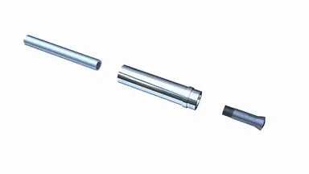
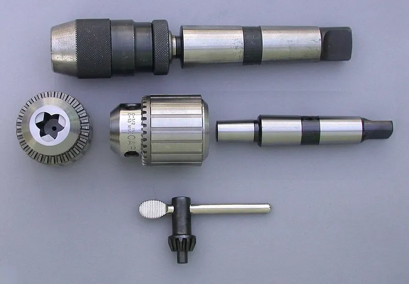
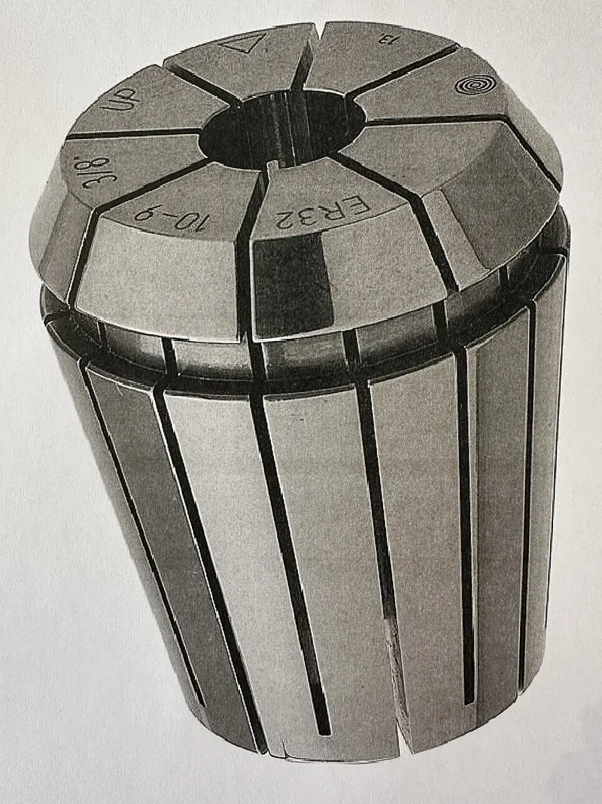

<figure class="eoc-pic eoc-pic-main"><picture><source media="(prefers-reduced-motion: reduce)" srcset="../media/collet.still.webp"></picture><figcaption><strong>Animation.</strong> <a href="https://commons.wikimedia.org/wiki/File:External_thread_pull_collet_action.gif">External thread pull collet action</a> by Slashme, <a href="https://creativecommons.org/licenses/by-sa/4.0">CC BY-SA 4.0</a>, from Wikimedia Commons.</figcaption></figure>
<figure class="eoc-pic"><figcaption><strong>How it works.</strong> <a href="https://commons.wikimedia.org/wiki/File:ChuckDrillKeyedKeylessArbor.jpg">ChuckDrillKeyedKeylessArbor</a> by Glenn McKechnie, <a href="http://creativecommons.org/licenses/by-sa/3.0/">CC BY-SA 3.0</a>, from Wikimedia Commons.</figcaption></figure>
<figure class="eoc-pic"><figcaption><strong>Photo.</strong> <a href="https://commons.wikimedia.org/wiki/File:ER_Collet.jpg">ER Collet</a> by Aweber4418, <a href="https://creativecommons.org/licenses/by-sa/4.0">CC BY-SA 4.0</a>, from Wikimedia Commons.</figcaption></figure>

A slotted sleeve with a cone-shaped outside that a nut or pull-rod forces into a matching cone, so it squeezes evenly around a round tool shank or rod and holds it tight and accurately centred; a keyless chuck does the same job with three jaws that you tighten by hand.

**In plain words:** A split sleeve that slides over a drill bit or rod; tightening a nut pushes it into a cone so its springy fingers close evenly all round and grip the rod dead-centre. The hand-twisted three-jaw chuck on a cordless drill is its everyday cousin. **Proper term:** [Collet](../glossary.md#collet) (collet chuck); close relative covered here: keyless drill chuck (a self-centring three-jaw chuck tightened by hand).

**Also called:** collet chuck; spring collet; split collet; ER collet: the most widely used standard (DIN 6499 / ISO 15488), sizes ER 8 to ER 50, first made by REGO-FIX (brand); 5C, R8, 2J, 3J, 16C and DIN 6343 dead-length collets (machine-tool collet systems named in Wikipedia 'Collet'); watchmaker collets ('split wire chucks'), sized by their outer thread, e.g. 8 mm; router collet; rotary-tool collet, e.g. Dremel (brand) 480-483 collets with the 4485 collet nut; draw-in collet versus dead-length (non-draw-in) collet; emergency collet / soft collet (bought unhardened and machined to an odd size); step collet; expanding collet (grips the inside of a bore, like an expanding mandrel; see 'Expanding internal grip'); pin chuck / pin vise: a tiny collet holder for drills under about 1 mm; multi-size collet, e.g. Rubber-Flex (brand, Jacobs): steel blades held in rubber; Autolock collet / Clarkson chuck (self-tightening collet for threaded-shank cutters); valve collet (split collet, valve keeper): the two tapered half-rings that hold an engine valve spring retainer; keyless chuck, keyless drill chuck, hand-tightened chuck, ratcheting keyless chuck; Jacobs chuck (brand; often used loosely for any drill chuck); Super Chuck (brand).

## How it works

The collet is a sleeve cut into fingers, with a cone ([taper](../glossary.md#taper)) on the outside. Tightening the nut pushes the collet into a matching cone (or a drawbar pulls it in), and the slope turns that push along the axis into an even squeeze inward from all sides, so the fingers close onto the rod and hold it by friction, centred on the axis (Wikipedia 'Collet'). The screw thread and the slope multiply force one after the other, so a modest turn of the spanner gives a very large grip (Wikipedia 'Collet'); undo the nut and the springy fingers open again. A keyless chuck works on a similar sloping principle: twisting the outer sleeve turns a nut inside that drives three threaded jaws along angled holes, so they move forward and inward together onto the shank, and a [ratchet](../glossary.md#ratchet) clicks to stop it working loose (Jacobs patent GB2426944A; Pro Tool Reviews).

## Parts

A few parts: the collet itself (a sleeve slit along its length into springy fingers; an ER collet has 16 slits, REGO-FIX), a body or spindle with a cone-shaped socket, and a threaded nut (cap) or a pull-rod (drawbar). The keyless chuck is a small assembly that acts as one unit: body, three jaws sliding in angled holes, a threaded nut, an outer sleeve you twist, and in most modern chucks a ratchet ring that clicks (Jacobs patent GB2426944A).

## Everyday examples

- The collet and nut that hold the bit in a Dremel-type rotary tool or a wood router (Wikipedia 'Collet'; Dremel 4485)
- The blade holder of an X-Acto-style craft knife (Wikipedia 'Collet')
- The hand-twisted keyless chuck on a cordless drill (Wikipedia 'Chuck (engineering)'; Pro Tool Reviews)
- The twist collar that locks the legs of many tripods and trekking poles (see the 'Telescoping tube twist lock' entry)

## When to use it

Use a collet when a round rod, pin, bit or tube must be held very firmly and exactly centred, and be quick to change or re-position: holding cutting tools in rotary tools, routers and mills; holding round work in a lathe; clamping a drill stop or depth collar anywhere along a drill bit; locking a rod or tube in a bracket at any depth; or joining two shafts in line (Brandano's printed double collet coupling). Collets are the best choice for [accuracy](../glossary.md#repeatability--accuracy), grip and repetitive work, and resist being shaken loose (Wikipedia 'Collet'). Use a keyless chuck when you need to change between many different shank sizes quickly by hand, e.g. drills and screwdriver bits in a hand drill.

## When not to use it

Avoid collets when the rod sizes vary a lot (each collet covers only a narrow range, so you need many; Wikipedia says this makes them unsuitable for general use in electric drills: use a three-jaw chuck), when the rod is not round and straight (use a clamp, [set screw](../glossary.md#set-screw) on a flat, or a jaw chuck), when the part must slip on overload (use a slip clutch), or for large-diameter hubs on shafts (use a keyless locking bush or clamp hub). Avoid keyless chucks where precise centring matters (use a collet) or for very small drills (use a pin chuck). Don't rely on a printed plastic collet for high-speed cutting tools.

## Details

- **What it does (jobs):**
  - join and hold: grips a tool bit, rod, pin, tube or shaft so it stays put or turns with the holder (Wikipedia 'Collet')
  - line parts up exactly: centres the rod on the axis; a standard ER collet runs true to within 10 µm (REGO-FIX)
  - lock, and release by hand: a keyless chuck, and printed collets with knurled nuts, are tightened and released by hand (Wikipedia 'Chuck (engineering)'; QuadeHale's Collet Drill Stop)
- **Movement:** none: once tightened nothing moves. Before tightening, the rod can slide in and out and turn to any angle, which is how its depth is set
- **Directions it can move (degrees of freedom):** 0 when tightened. Wikipedia explains that the taper itself fixes 4 of the 6 (two sideways positions and two tilt angles); friction then stops the rod sliding along the axis and turning. An internal stop can also fix the depth, and square or hex collets stop turning by shape. While loose: 2 (slide in and out, and turn).
- **Special behaviour:**
  - self-aligning or self-centring: the even squeeze from all sides centres the rod on the axis. Wikipedia's comparison table rates collets as reliably self-centring, with run-out (wobble) usually below 0.001 in (0.025 mm); REGO-FIX guarantees 10 µm on standard ER collets and 5 µm on its ultra-precision (ER-UP) collets. A keyless chuck's three jaws also self-centre, but less precisely
  - quick-release: a keyless chuck opens and closes by hand, with no key or spanner (Wikipedia 'Chuck (engineering)'; Dremel sells its 4486 keyless chuck for 'tool-free accessory changes'). Collet nuts usually need a spanner, though printed collet nuts can be knurled for hand use (QuadeHale)
  - none of the other listed behaviours. Note that some types tighten themselves further under load: Autolock (Clarkson) collets are tightened by the cutter's own turning force (Wikipedia 'Collet'), and a keyless chuck 'can cause the chuck to tighten too much when high [torque](../glossary.md#torque) is applied' (Wikipedia 'Chuck (engineering)'), which can make it hard to undo
- **How it holds:**
  - friction or clamping ([force-fit](../glossary.md#form-fit--force-fit--material-bond)): the cone turns the nut's push into an even inward squeeze, and static friction carries the load (Wikipedia 'Chuck (engineering)')
  - spring force (a springy part presses it in place): the springy fingers of a spring-steel collet open again when the nut is released (Wikipedia 'Collet'); the spring helps release rather than hold
  - shape (the parts interlock; form-fit): only in special cases, e.g. square and hex collets, Autolock collets that screw onto a threaded shank, and engine valve collets whose inner rib sits in a groove in the valve stem (Wikipedia 'Collet')
- **Input and output:** Not a motion converter. When it holds a spinning tool it passes rotation straight through: rotation in -> the same rotation out (1:1), on one axis (in line), with no play until it slips, so practically no power is lost ⚑ [uncertain: no efficiency figure published]. Back-drivable: yes; torque passes either way.
- **Power:** passive (no power needed). Machine collet closers on CNC lathes can be powered (electric, hydraulic or air), but the collet itself needs no power (Wikipedia 'Chuck (engineering)')
- **Load:** Medium to heavy for its size, and strong against twisting and pulling as long as the rod fills the collet properly: Wikipedia's comparison rates collets as reliably strong and reliably resistant to being jarred loose, provided the rod closely matches the collet's size. ER nuts are tightened hard to give this grip (e.g. 24 N·m for an ER 11 collet holding 3-7 mm, 136 N·m for ER 32, REGO-FIX) ⚑ [uncertain: none of the sources opened publishes the resulting holding torque]. Weak points: each collet grips only a narrow size range (about 1 mm for ER collets, often one exact size for others, Wikipedia); a bit inserted too shallowly can [creep](../glossary.md#creep) out or bend (Highland Woodworking); oil or dirt on the gripping surfaces lets it slip (ToolsToday); keyless chucks slip if not tightened firmly (Pro Tool Reviews). 3D-printed collets are light duty.
- **Play and precision:** No play once tight. Very repeatable centring: standard ER collets run true within 10 µm over their whole clamping range and ER-UP within 5 µm (REGO-FIX); collets are generally more accurate than self-centring three-jaw chucks (Wikipedia 'Chuck (engineering)'). It tolerates almost no [misalignment](../glossary.md#misalignment) or wrong size: the rod must be straight, round and within the collet's range, and oversize shanks must never be forced in (REGO-FIX). 'Draw-in' collets pull the rod slightly into the holder as they close, changing how far it sticks out; 'dead-length' collets avoid this (Wikipedia 'Chuck (engineering)'). A keyless chuck can grip a bit off-centre if the bit slips between two jaws while tightening (Pro Tool Reviews).
- **Taking it apart:** removable: undo the nut (or twist the keyless chuck open) and pull the rod out. ER collets clip into their nut and are taken out by pressing on the collet's face while pushing its back sideways (REGO-FIX); keyless chucks are tool-free quick release
- **How often it can be reused:** many times: collets are made to be tightened and released at every tool change; replace one when it is damaged or no longer grips a correctly sized, clean shank (ToolsToday). 3D-printed plastic collets are weaker: Brandano broke one taking it apart
- **Sealing:** none: it is not a seal
- **Adjustable:** yes: before tightening, the rod can be set at any depth and angle; loosen, move and re-tighten at any time. Because each ER collet covers a 1 mm range, a set in 1 mm steps holds any diameter within the system's capacity (Wikipedia 'Collet')
- **Access needed:** end of a tube or shaft: the rod goes in from its end and the nut is worked from the front, so nothing behind the holder needs to be reached
- **Materials:** Collets are usually hardened spring steel with one or more cuts along their length (Wikipedia 'Collet'); 'emergency' collets that you machine yourself come in steel, brass or nylon (Wikipedia 'Chuck (engineering)'). Chuck bodies and jaws are steel. For 3D printing, a tough, slightly springy plastic such as PETG suits the collet, with a stiffer plastic such as PLA for the nut (Hackaday, 'Printed It: Collet Drill Stop'). They grip round steel shanks (drill bits, cutters, router bits), rods, pins and tubes; special collets hold square and hex bar.
- **Heat, cold, water and wear:** Metal collets are unaffected by normal workshop heat and cold, but spring steel rusts: keep them clean, and use anti-rust products only where the equipment maker allows, never on the gripping surfaces (ToolsToday). Dust, resin and oil reduce the grip (Highland Woodworking; ToolsToday). Vibration is handled well once tight (Wikipedia rates collets as reliably resistant to being jarred loose). Printed collets lose grip over time as plastic creeps, and PLA softens and deforms above about 60 °C and degrades in sunlight, while PETG is usable below about 80 °C indoors and out (Prusa knowledge base).

## Making it

- **Ways to make or get it:**
  - off-the-shelf part: ER, 5C and R8 collets with their chucks and nuts, router and rotary-tool collets, keyless drill chucks and pin chucks
  - 3D print (FDM): light-duty collets and nuts for drill stops, bit holders, rod couplers, telescopic-rod locks and tube-to-plate mounts (LoboCNC; QuadeHale; Brandano; sdk; GetBurning)
  - CNC: lathe-turned metal collets, and soft 'emergency' collets bored to an odd size or shape (Wikipedia 'Collet')
  - 3D print (resin): ⚑ [uncertain] possible for small parts, but no tested printed-resin collet was found and most resins are [brittle](../glossary.md#brittle--ductile)
- **Printing it in one piece (print in place):** no: the collet, nut and body are printed as separate parts and then screwed together; LoboCNC's design has you work the printed threads back and forth and grease them after assembly
- **Tools:** Collet: one or two spanners (a hex spanner for router and rotary-tool collet nuts, a hook or ring spanner for ER nuts), ideally a torque wrench for ER nuts (REGO-FIX); no tools for hand-knurled printed nuts (QuadeHale). Keyless chuck: none, hand only (Wikipedia 'Chuck (engineering)').
- **Difficulty:** easy to use, moderate to make: buying an ER collet with a matching holder or nut is easy, but making a metal collet needs a lathe and hardening. Printed collets work for light jobs (drill stops, bit holders, rod couplers, tube mounts) but need tuned [clearances](../glossary.md#clearance) and the right plastics (LoboCNC; Hackaday)

### 3D printing tips

1) Buy metal collets for anything that spins fast or cuts; print collets for light holding jobs such as drill stops, bit holders, rod couplers and tube mounts. LoboCNC found printed chucks with moving jaws 'just don't have enough gripping force', while printed collets similar to ER11 'can grab onto your bit with much greater force'. 2) Use two plastics: a tough, springy one for the collet so its fingers can flex 'a millimeter or so without breaking' (PETG), and a stiffer one for the nut (PLA) (Hackaday, Tom Nardi, on Adam Harrison's Collet Drill Stop). 3) Print the collet solid: Hackaday's collets were printed at 100% [infill](../glossary.md#infill); Brandano printed his PETG coupling collet at 0.2 mm layers and 25% infill with a 3 mm brim. 4) Print the collet and the body at different layer heights (LoboCNC: body and ring 0.2 mm, collets 0.15 mm) so the layer ridges don't line up and lock against each other as the collet seats in the cone; print the thin fingers slowly ([perimeters](../glossary.md#perimeters) at about 20 mm/s) so they fuse fully (LoboCNC). 5) Print fine layers where there are threads (Hackaday used 0.1 mm for the threaded parts of the nut, with variable layer height). 6) Allow clearance: Brandano made the shaft bores 0.2 mm larger than the shafts and the nut threads about 0.5 mm larger in diameter than the collet threads; expect to tune this for your printer, as sdk notes his telescopic-rod collet 'pretty much has to be generated for your material'. 7) Lubricate the threads and the cone (PTFE grease or petroleum jelly, QuadeHale; light grease, LoboCNC) so the nut turns smoothly and the collet releases, but keep lubricant off the inside of the collet where it grips (LoboCNC; ToolsToday). 8) Choose the smallest collet that fits the rod without being stretched open; if the rod still moves when fully tightened, use a smaller collet (LoboCNC; QuadeHale's collets flex about ±1 mm). Put the rod in the collet before fitting it into the holder (LoboCNC). 9) Never tighten a printed collet hard without a rod in it: Brandano warns 'the collet segments will snap'. 10) Expect creep: a plastic collet slowly relaxes under constant squeeze, and PLA softens above about 60 °C (Prusa), so re-tighten now and then and use PETG (usable below about 80 °C, Prusa) or better for anything warm ⚑ [uncertain: creep advice is general, not a tested rule].

### Buying one (off-the-shelf parts)

Search for: 'ER collet' (ER 8, ER 11, ER 16, ER 20, ER 25, ER 32, ER 40, ER 50; in 1 mm or 0.5 mm steps, and inch sizes), 'ER collet chuck', 'ER straight shank collet holder' or 'ER extension', 'ER clamping nut', 'ER collet spanner'; '5C collet', 'R8 collet', 'Morse taper ER collet chuck'; 'router collet' (1/4 in, 1/2 in, 6 mm, 8 mm, 12 mm) and 'collet reducer sleeve'; rotary-tool collets such as Dremel (brand) 480 (3.2 mm), 481 (2.4 mm), 482 (1.6 mm), 483 (0.8 mm) and the 4485 collet nut set; 'keyless drill chuck' (with a threaded mount such as 1/2-20 UNF or 3/8-24 UNF, or a JT/B taper) ⚑ [uncertain: mount sizes not checked in an opened source]; Dremel (brand) 4486 keyless chuck for 1/32-1/8 in shanks; 'pin chuck' or 'pin vise' for tiny drills; 'expanding mandrel' for gripping inside a bore.

## Rules of thumb

- Each ER collet grips about 1 mm below its nominal size (0.5 mm in small sizes, 2 mm in ER 50), so buy a set in 1 mm steps to cover every diameter; the ER number is the opening diameter of the cone socket in mm (Wikipedia 'Collet'; REGO-FIX clamping range 1 mm).
- Never force an oversize shank into a collet: REGO-FIX's example is never to use a 12-11 mm collet for a 12.2 mm shank, but the next size up (REGO-FIX ER catalogue, p. 2.04).
- Insert the tool the full length of the collet if possible, and never less than two-thirds of the collet's bore length, or the collet can be permanently deformed and lose accuracy (REGO-FIX ER catalogue, p. 2.04).
- Clip the ER collet into the nut first, then screw nut and collet onto the holder; fitting it wrongly can permanently damage the collet and nut (REGO-FIX ER catalogue, p. 2.04).
- Tighten ER nuts with a torque wrench to the maker's figure, e.g. 8 N·m for an ER 11 collet holding 1-2.9 mm, 24 N·m for 3-7 mm, 136 N·m for ER 32 (REGO-FIX torque table, standard Hi-Q/ER nut); never more than 25% above the recommended torque (REGO-FIX Technical Information p. 14.03).
- Standard ER collets hold run-out to 10 µm and ER-UP to 5 µm over the whole clamping range (REGO-FIX ER catalogue p. 2.02).
- Router bits: push the bit fully in, then pull it back 1/16-1/8 in (1.5-3 mm) before tightening, so the collet can draw the bit in as it closes; a bottomed-out bit can stop the collet tightening fully and then creep out (Highland Woodworking, 'Installing Router Bits'; ToolsToday says back it out about 1/8 in).
- Grip the shank over the full depth of the collet's grip, usually at least 3/4 in (19 mm); less 'risks creeping bits, bent or broken shanks' (Highland Woodworking).
- Tighten firmly but don't 'kill it': over-tightening eventually stretches the mouth of a router spindle so it can't hold any bit (Highland Woodworking).
- Keep the gripping surfaces dry and clean: no oil or anti-rust coating on the shank or inside the collet (Highland Woodworking; ToolsToday).
- A self-holding taper (like the Morse taper that holds many drill chucks on their arbor) sticks by itself; a steep 'self-releasing' taper needs a drawbar to stay in (Wikipedia 'Machine taper'). Collet cones are made steep enough to let go when the nut is undone.
- Keyless chuck: once the ratchet starts clicking, give the sleeve an extra-hard turn by hand; keep the bit centred between the three jaws while tightening, and insert driver bits deeply rather than just the tip (Pro Tool Reviews).

## Common failures

1) Bit slips or creeps out: wrong collet size, oil, resin or rust on the grip surfaces, too-shallow insertion, or bit bottomed out before tightening (Highland Woodworking; ToolsToday). Fix: clean, use the right size, insert deeply, pull back slightly, then tighten. 2) Bit wobbles (run-out): dirty cone, worn or bell-mouthed collet, ER collet not clipped into the nut, or tool inserted less than two-thirds of the bore (REGO-FIX; ToolsToday). Fix: clean, fit correctly, replace worn collets. 3) Collet or spindle damaged by over-tightening or by clamping oversize shanks (REGO-FIX; Highland Woodworking). 4) Stuck collet or chuck: tight taper or self-tightening chuck; ER collets are released from the nut by a sideways push (REGO-FIX); LoboCNC greases the printed cone lightly so collets release. 5) Keyless chuck slipping or bit going in crooked: not tightened hard enough, or bit caught between two jaws (Pro Tool Reviews). 6) Printed collets: layer ridges catching in the cone, thin fingers breaking, collet segments snapping when tightened without a rod, and threads that are hard to start (LoboCNC; Brandano).

## Safety

Collets usually hold spinning cutters: a bit that is under-inserted, bottomed out or loose can creep out or snap and fly off (Highland Woodworking), so follow the insertion and tightening rules and unplug the tool before changing bits. Use the correct collet size; forcing an oversize shank or clamping an empty or under-filled collet can deform it (REGO-FIX) or, for printed collets, snap the segments (Brandano). Keyless chucks can over-tighten themselves under high torque (Wikipedia 'Chuck (engineering)'), so expect to need a firm grip to open them. Keep fingers and loose clothing away from a spinning chuck.

## Related

- Keyless locking bush (taper-lock bush, shaft locking device): the same wedge-and-taper idea, scaled up to lock pulleys and gears onto shafts rather than hold tools
- Telescoping tube twist lock (cam or collet twist lock): uses a collet-like split collar or an internal expander to lock sliding tubes at any length
- Internal tube anchors (star nut, expansion plug): an expanding plug is an 'inside-out' collet that grips the inside of a tube
- Taper fit (Morse taper): a self-holding cone joint with no slits; many drill chucks are mounted on their arbor this way (Wikipedia 'Machine taper')
- Shaft-to-hub joints and rigid couplings (set screw, clamp hub): cheaper and simpler for light loads, but a set screw marks the shaft and does not centre it
- Three-jaw (scroll) chuck: grips a much wider range of sizes but centres less precisely (Wikipedia 'Chuck (engineering)')
- Quick couplers for tubes and hoses (push-to-connect): the 'collet' in a push-fit pneumatic fitting is a ring of gripping teeth that bites the tube, a different mechanism with the same name
- Self-centring cone and socket (taper locator): uses a cone only to locate, not to grip
- SDS chucks (and hex quick-change bit holders): hold bits by shape (grooves or flats) instead of friction, so they can't slip but only take special shanks (SDS: Wikipedia 'Chuck (engineering)')
- Expanding internal grip: the expanding collet and expanding mandrel, which grow outward to grip the inside of a hole, tube or ring instead of squeezing a rod from outside

## Make it yourself

- [Collet Chuck and Collet Assortment (LoboCNC, Printables) (URL from search results; details read via the Printables API)](https://www.printables.com/model/314149-collet-chuck-and-collet-assortment): Printable collet chuck with a set of ER11-like collets holding bits from 6.35 mm down to 1.1 mm, plus collets for 1/4 in and 4 mm hex shanks; includes STEP files for remixing and detailed print and lubrication advice *(licence: CC BY-SA (Creative Commons Attribution-ShareAlike))*
- [Collet Drill Stop (QuadeHale, Thingiverse)](https://www.thingiverse.com/thing:3177276): Drill-bit depth stop loosely based on an ER20 collet, with knurled hand-tightened nuts (M28x2 thread) and a range of collets; the design Hackaday printed and tested in 'Printed It: Collet Drill Stop' *(licence: CC BY-NC-SA 4.0)*
- [Rigid coupling collet (Brandano, Printables) (URL from search results; details read via the Printables API)](https://www.printables.com/model/240848-rigid-coupling-collet): Parametric OpenSCAD double-ended collet with two threaded nuts that joins two shafts in line; printed in PETG *(licence: GNU General Public License v2.0)*
- [parametric lock collet for telescopic rod (sdk, Printables) (URL from Printables API, page not opened)](https://www.printables.com/model/1421540-parametric-lock-collet-for-telescopic-rod): Parametric collet that locks two nested tubes (e.g. 12 mm in 10 mm) at any length, for a bike-stand fixing rod or woodworking pinch rods; a v2 is linked from the description *(licence: GNU Lesser General Public License)*
- [Parametric tube to plate collet mount (GetBurning, Printables) (URL from Printables API, page not opened)](https://www.printables.com/model/1030662-parametric-tube-to-plate-collet-mount): OpenSCAD (BOSL2) collet-and-nut mount that clamps a 22 mm carbon or metal tube to a plate with a 40x40 mm M4 bolt pattern *(licence: GNU General Public License v3.0)*

## Pictures, videos and models

- [External thread pull collet action.gif (Slashme, Wikimedia Commons)](https://commons.wikimedia.org/wiki/File:External_thread_pull_collet_action.gif): Animation of a collet being pulled into its tapered seat by a drawbar, clamping a shaft, spinning, and then releasing it *(licence: CC BY-SA 4.0)*
- [ER Collet.jpg (Aweber4418, Wikimedia Commons)](https://commons.wikimedia.org/wiki/File:ER_Collet.jpg): Photo of an ER collet with a 10-9 mm clamping range, showing the slits from both ends *(licence: CC BY-SA 4.0)*
- [ChuckDrillKeyedKeylessArbor.jpg (Glenn McKechnie, Wikimedia Commons)](https://commons.wikimedia.org/wiki/File:ChuckDrillKeyedKeylessArbor.jpg): An assembled keyless drill chuck above a keyed chuck with its key, arbor and an end view of the three jaws *(licence: CC BY-SA 3.0)*
- [ER Collets and Collet Chucks (Stuart de Haro, YouTube)](https://www.youtube.com/watch?v=mdq4OryG9D8): Short introduction to ER collets and matching collet chucks (title and channel verified via YouTube oEmbed) *(licence: link only (standard YouTube licence))*
- [What's Inside a Keyless Drill Chuck | How To Take Apart and Re-Assemble | Remove From CNC Taper Tool (Engineerable, YouTube)](https://www.youtube.com/watch?v=kPmZA2VUVew): Teardown of a keyless drill chuck showing the jaws, nut and sleeve inside (title and channel verified via YouTube oEmbed) *(licence: link only (standard YouTube licence))*

## Needs confirming

⚑ marks something nobody has confirmed yet: a fact the research could not confirm from a source, a finder value that is a best guess, or an open point from the research notes. Corrections are welcome (see `research/needs-confirming.md`).

- ⚑ 5 sentences on this page marked [uncertain].

## Sources

- <https://en.wikipedia.org/wiki/Collet>
- <https://en.wikipedia.org/wiki/Chuck_(engineering)>
- <https://en.wikipedia.org/wiki/Machine_taper>
- <https://us.rego-fix.com/en/products/collets/standard?system=ER>
- <https://usa.rego-fix.com/rego_torque.pdf>
- <https://www.productivity.com/wp-content/uploads/2020/04/Rego-Fix-ER-Collet-3-26-20-Interactive.pdf>
- <https://productivity.com/wp-content/uploads/2020/04/Rego-Fix-Technical-Information-3-27-20-Interactive.pdf>
- <https://patents.google.com/patent/GB2426944A/en>
- <https://www.protoolreviews.com/how-to-use-a-keyless-drill-chuck/>
- <https://info.highlandwoodworking.com/library/installingrouterbits.pdf>
- <https://toolstoday.com/learn/router-bit-slipping-wobbling-stuck-check-collet>
- <https://www.dremel.com/us/en/p/4485-26154485ab>
- <https://www.dremel.com/us/en/p/4486-26154486ac>
- <https://hackaday.com/2020/04/22/printed-it-collet-drill-stop/>
- <https://www.thingiverse.com/thing:3177276>
- <https://api.printables.com/graphql/>
- <https://www.printables.com/model/314149-collet-chuck-and-collet-assortment>
- <https://www.printables.com/model/240848-rigid-coupling-collet>
- <https://help.prusa3d.com/article/pla_2062>
- <https://help.prusa3d.com/article/petg_2059>
- <https://commons.wikimedia.org/wiki/File:External_thread_pull_collet_action.gif>
- <https://commons.wikimedia.org/wiki/File:ER_Collet.jpg>
- <https://commons.wikimedia.org/wiki/File:ChuckDrillKeyedKeylessArbor.jpg>
- <https://commons.wikimedia.org/wiki/Category:Collet_chucks>
- <https://www.youtube.com/watch?v=mdq4OryG9D8>
- <https://www.youtube.com/watch?v=kPmZA2VUVew>
