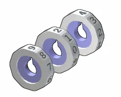
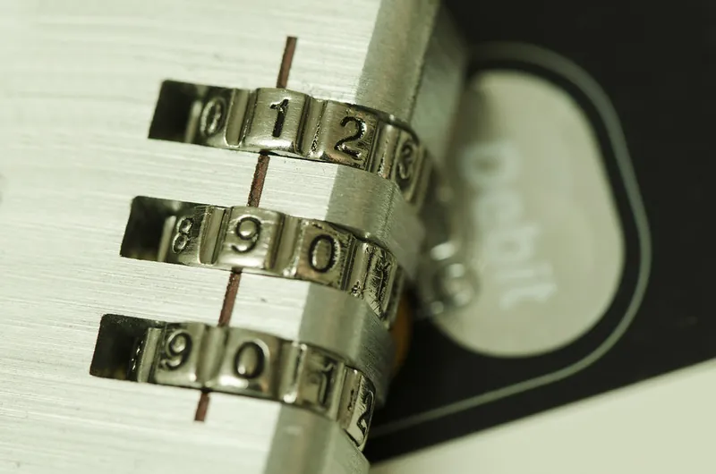
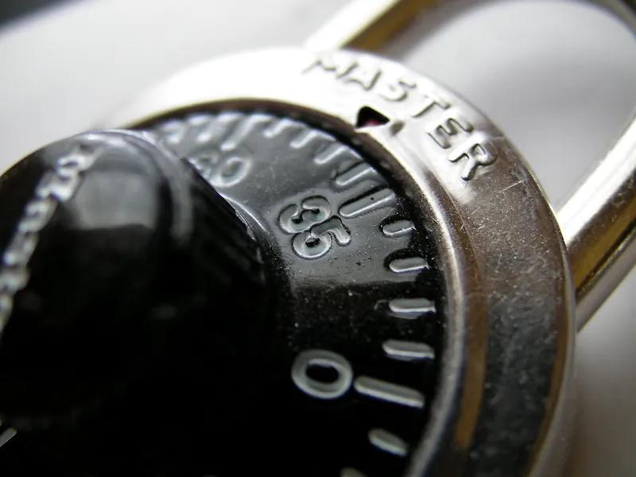

<figure class="eoc-pic eoc-pic-main"><figcaption><strong>Diagram.</strong> <a href="https://commons.wikimedia.org/wiki/File:Combination_discs.png">Combination discs</a> by unknown, <a href="http://creativecommons.org/licenses/by-sa/3.0/">CC BY-SA 3.0</a>, from Wikimedia Commons.</figcaption></figure>
<figure class="eoc-pic"><figcaption><strong>How it works.</strong> <a href="https://www.flickr.com/photos/111692634@N04/11406986014">Combination Lock on top of a Credit card e.g. Credit Card Security</a> by perspec_photo88, <a href="https://creativecommons.org/licenses/by-sa/2.0/">CC BY-SA 2.0</a>, from Flickr via Openverse.</figcaption></figure>
<figure class="eoc-pic"><figcaption><strong>Photo.</strong> <a href="https://www.flickr.com/photos/85638163@N00/4627233065">Combination Lock</a> by Sh4rp_i, <a href="https://creativecommons.org/licenses/by/2.0/">CC BY 2.0</a>, from Flickr via Openverse.</figcaption></figure>

A combination lock holds a bar, bolt or shackle in place with a stack of notched wheels, and releases it only when each wheel has been turned to its secret number so all the notches line up in a row.

**In plain words:** A lock with no key: a stack of wheels, each with a notch, that only lets the bar or shackle move when every wheel has been turned to the right number so all the notches line up. **Proper term:** Combination lock (wheel-pack lock): multiple-dial (number-wheel) lock, or single-dial rotary combination lock.

**Also called:** permutation lock / keyless lock / code lock; word lock / letter combination lock; Wordlock (brand); rotary combination lock / dial lock / combination padlock (school locker padlock); Master Lock (brand); safe lock / vault lock / mechanical safe combination lock; Sargent & Greenleaf (brand); number-wheel lock / multiple-dial lock / thumbwheel lock; luggage lock / suitcase lock / briefcase combination latch / TSA lock (with a key override for security staff); combination bike lock / combination cable lock; cryptex (a cylinder puzzle box with letter wheels, from the novel The Da Vinci Code); resettable (set-your-own) combination lock.

## How it works

Each wheel has a notch (gate) in its rim or bore. A bar with teeth (the shackle pin in a luggage lock, or the fence on a lever in a dial lock) rests against the wheels: while any wheel is at the wrong number its solid rim blocks the bar, and when every notch is lined up the bar drops into the notches and the lock opens. In a multiple-dial lock you turn each numbered wheel directly. In a single-dial lock the dial turns a drive cam whose drive pin picks up the first wheel, which then picks up the next through its own pin and fly; turning left and right a set number of times parks each wheel at its number in turn, and once all the gates are under the fence the lever drops, catches the cam, and further turning pulls the bolt back.

## Parts

A small assembly that acts as one unit. Multiple-dial lock: several number wheels, each on an inner sleeve or hub, a shackle or locking pin with teeth, springs or [detents](../glossary.md#detent) that make the wheels click, a case, and often a reset button. Single-dial lock: dial and spindle, drive cam with a drive pin, a wheel pack of usually three (sometimes four) wheels, each with a gate (notch), a drive pin and a fly, spacing washers and a tension washer, a lever with a fence and a nose, a lever spring, a bolt or shackle, and a case; safe locks add relockers and a change-key wheel.

## Everyday examples

- a school or gym locker padlock with a single numbered dial
- a suitcase, briefcase or bike cable lock with a row of number wheels
- the dial on a safe or bank vault door
- cryptex puzzle boxes and escape-room props with letter wheels

## When to use it

When several people need to open something without carrying keys, when keys would get lost, or when you want to change who can get in just by changing the code: shared lockers, gym bags, bikes, luggage, toolboxes, gift and puzzle boxes, geocaches and escape-room props. Printing one is a great way to learn how the wheel pack works, and a cryptex or dial box makes a memorable gift.

## When not to use it

Don't use cheap number-wheel locks or any printed lock for real security: many multiple-dial locks can be opened by feeling for slight machining irregularities, and thin shackles can be cut (Lockwiki; Wikipedia, Luggage lock). Where people must be able to get in quickly in the dark or in an emergency, a key or lever lock is faster. If the code will be watched or shared widely, an electronic keypad with changeable user codes may suit better. Use a pin-tumbler lock if you'd rather carry a key than remember a number.

## Details

- **What it does (jobs):**
  - lock, and release by hand: keeps a shackle, bolt or lid locked until someone who knows the number sequence dials it in
- **Movement:** multiple: the wheels and dial rotate (many full turns, back and forth, for a dial lock; less than one turn per wheel for number-wheel locks); the shackle, bolt or pin then slides a few millimetres to a few centimetres to open
- **Directions it can move (degrees of freedom):** Each wheel has 1 (rotation about the shared axle); the lever or fence has 1 (it pivots or slides a little); once released the shackle or bolt has 1 (it slides, and a padlock shackle can also swing). Locked, the shackle or bolt has 0.
- **Special behaviour:**
  - hand-release only (locks under load, releases when a person operates it): pulling on the shackle or bolt can't open it; it opens only when a person dials the right numbers
  - indexing (clicks into set positions): number wheels on luggage, bike and many printed padlocks have small spring detents so each number clicks into place; a safe lock's bolt is held in position by a ball detent
- **How it holds:** shape ([form-fit](../glossary.md#form-fit--force-fit--material-bond)): the wheel rims physically block the fence or toothed pin; spring force pushes the lever and fence against the wheels and works the detents; a tension (spring) washer adds light friction so the wheels don't drift
- **Input and output:** not applicable as a transmission; inside a dial lock, the dial's rotation is passed from wheel to wheel by drive pins and flys with some free play (lost motion) before each wheel is picked up, and the drive cam finally converts rotation into the straight travel of the bolt
- **Power:** passive (no power needed). Electronic combination locks and keypads are separate; some electronic safe locks power themselves from a tiny generator spun by the dial (Wikipedia, Combination lock).
- **Load:** light to heavy depending on type. Luggage and cheap bike locks are light: their thin shackles are easy to cut and many can be decoded by feel. Combination padlocks are medium. Safe locks only guard the combination; the safe's own boltwork carries the load, and relockers fire if the lock is attacked. Strong in the direction the fence or teeth are loaded; weak against cutting the shackle or prying the case. 3D-printed locks are light-duty toys.
- **Play and precision:** Real dial locks have a dialing [tolerance](../glossary.md#tolerance) of about ±0.75 to ±1.25 numbers on a 100-number dial, so there may be only about 40 truly different positions per wheel (Matt Blaze). A printed three-wheel dial lock can be forgiving to about ±3 numbers (LoboCNC's kit card). The wheels must be kept apart by spacing washers so one wheel doesn't drag the next.
- **Taking it apart:** tool-free quick release for what it locks (just dial the numbers); a padlock simply unhooks; a safe lock is screwed to the inside of the door and should only be serviced by a safe technician
- **How often it can be reused:** effectively unlimited for normal use ⚑ [uncertain: no cycle rating found]; the combination can also be changed many times on resettable locks. Safe-lock makers advise a service by a qualified technician every year, more often in dusty or humid places (Sargent & Greenleaf).
- **Sealing:** none
- **Adjustable:** Yes, the code can usually be changed: safe locks with a change key (the key frees the wheel centre from the wheel case so it can be set to a new number); resettable padlocks and luggage locks by setting the new code while the shackle is pressed in or a reset button is held; printed locks by printing different wheels or moving the drive nubs.
- **Access needed:** both sides: a safe lock's case is fitted inside the door with the dial on the outside, joined by a spindle through the door; padlocks and luggage locks need no fitting (not applicable)
- **Materials:** Safe locks: metal case, brass lever screw, stainless-steel lever spring, and wheel rims of nylon, polycarbonate (Lexan), acetal (Delrin or Celcon) so the combination can't be read by X-ray (Sargent & Greenleaf); padlocks: steel, including laminated steel plates, with a hardened steel shackle; luggage locks: zinc alloy or plastic ⚑ [uncertain: not confirmed on an opened page]. Printed locks: PLA, PLA+ or PETG; PETG is preferred for thin flexing rings, and some PLAs are too [brittle](../glossary.md#brittle--ductile) (Feynman's dial lock box).
- **Heat, cold, water and wear:** Safe locks should be serviced every year, more often in dusty, dirty or humid places (Sargent & Greenleaf). Padlocks in dusty or corrosive places should be cleaned and lubricated every 3 months; regular [lubrication](../glossary.md#lubrication) also helps stop freezing (Master Lock). Heavy petroleum lubricants swell acetal wheel parts (Sargent & Greenleaf). Safe locks carry a thermal relocker tab that melts at about 165 °F (74 °C) to lock the bolt during a torch attack (Sargent & Greenleaf). Printed PLA softens above about 60 °C; PETG is fine below about 80 °C (Prusa).

## Making it

- **Ways to make or get it:**
  - off-the-shelf part: combination padlocks, resettable luggage locks, combination bike locks, briefcase latches, mechanical safe locks
  - 3D print (FDM): number-wheel padlocks, cryptexes, dial-lock boxes and vault doors
  - CNC: machined metal combination locks ⚑ [uncertain: seen only in a Hackaday tag listing, article not opened]
- **Printing it in one piece (print in place):** partly: most printed combination locks are separate wheels, shackle and case pieces that you assemble (and the code is set by how you assemble or which wheels you print); one padlock prints its detent springs in place in the body and you snap them free after printing, and one kit card prints flat and snaps together without glue
- **Tools:** To use: none. To change the code: a change key (safe locks) or the lock's reset button or shackle-press procedure (luggage padlocks). To fit: screwdriver (safe locks mount with four 1/4-20 screws and a dial ring), sometimes tools to cut and file the dial spindle to length. Printed locks: optional glue, sometimes an M3 screw and nut, tweezers and a file for small parts.
- **Difficulty:** moderate for a number-wheel padlock or cryptex printed from a proven model; hard for a single-dial wheel-pack vault lock (its designer warns it is not for beginners, because small tolerance errors add up)

### 3D printing tips

Start from a proven design and test-print one or two wheels before printing them all, because small tolerance errors add up across a stack of wheels (Rocco's Vault with Combination Lock). Give moving parts at least 0.3 mm [clearance](../glossary.md#clearance) to start with (Prusa). Tiny parts need a well-tuned printer: LoboCNC's kit card asks for PLA at exactly 0.2 mm layers, a 0.4 mm or smaller nozzle, near-perfect bed levelling, no [elephant's foot](../glossary.md#elephants-foot) and tuned pressure advance so corners aren't over-extruded. Make the parts that take load solid: BCaron's padlock prints the shackle and tumblers with 10 or more walls and 100% [infill](../glossary.md#infill) (PLA+), with supports only under the detents and never inside the [print-in-place](../glossary.md#print-in-place) springs. Check that the drive nubs don't rub on the face of the next wheel, or they will drag it along and scramble the code; file them down if they do (LoboCNC). Install the wheels in the right order and the right way round (Rocco). Rotate stacked tumblers against each other to smooth the sliding faces, and adjust detent spring tension after a test (BCaron). A little candle wax on the inner rings makes a printed dial lock run smoother and last longer (Feynman's dial lock box). After closing, spin the dial or wheels so the code is scrambled (LoboCNC). Use PETG for thin rings that must flex, and anything left in a warm place, since PLA softens above about 60 °C (Prusa).

### Buying one (off-the-shelf parts)

Combination padlock (single-dial, 3-number), resettable (set-your-own) 3- or 4-digit combination padlock, TSA-accepted luggage lock (Travel Sentry), combination cable bike lock, briefcase or case combination latch, mechanical safe lock (UL 768 Group 2, 2M, 1 or 1R) with dial, dial ring, spindle and change key, key-locking dial, spy-proof dial, mechanical push-button combination lock or key lock box; for prints: M3 screw and nut, small compression springs.

## Rules of thumb

- A 100-number dial with three numbers suggests 1,000,000 combinations, but a dialing tolerance of ±0.75 to ±1.25 numbers leaves only about 40 to 67 distinct positions per wheel and roughly 51,200 to 242,406 usable combinations in practice; UL Group 2 locks need at least 1,000,000 combinations and at most ±1.25 tolerance, and CEN Class A locks need at least 80,000 usable combinations (Matt Blaze, Safecracking for the computer scientist, pp. 5-6, https://www.mattblaze.org/papers/safelocks.pdf).
- A number-wheel lock with n wheels of d symbols has d to the power n codes: e.g. 3 wheels of 6 digits give 216, and 4 wheels of 10 digits up to 10,000 (BCaron's printed padlocks, https://www.printables.com/model/490983-combination-padlock and https://www.printables.com/model/682893-combination-padlock-v2, URLs from Printables API, pages not opened; details read via the API).
- Dial a three-wheel safe lock left four times to the first number, right three times to the second, left twice to the third, then right until it stops; each extra wheel adds one more turn at the start; if you pass a number, start again (Sargent & Greenleaf Mechanical Safe Lock Guide, pp. 4 and 9, https://cdn2.hubspot.net/hubfs/5825267/SargentAndGreenleaf_May2019/pdf/book_mech_locks.pdf).
- A movable fly's travel is typically 10 to 12 dial numbers, equal to twice the fly's width plus the drive pin's width, which lets every number be used (Sargent & Greenleaf guide, p. 12).
- When choosing a code: don't make all numbers end in 0 or 5, don't use a rising or falling sequence, keep at least 10 numbers between neighbouring numbers, and (on that lock) keep the last number out of 95-99 and 0-20 so the bolt can relock (Sargent & Greenleaf guide, p. 3).
- After changing a combination, try it at least three times with the door open before closing it; a good setting also opens half a number either side (Sargent & Greenleaf guide, pp. 4 and 18).
- Heavy petroleum lubricants can swell acetal (Delrin, Celcon) parts; use only a very thin film of a suitable lubricant (Sargent & Greenleaf guide, p. 22).
- Start with at least 0.3 mm clearance for printed parts that must move (Prusa, https://help.prusa3d.com/article/modeling-with-3d-printing-in-mind_164135).

## Common failures

(1) Mis-dialling, e.g. passing a number and turning back, or reading the dial at an angle: start again from the beginning and look straight at the dial (a very high share of safe lockouts; Sargent & Greenleaf). (2) Shifted or loose dial ring changes all the numbers; the number-one cause of safe lockouts (Sargent & Greenleaf). (3) Stuck fly, broken drive pin or a slipping wheel (often the wheel next to the drive cam, after snapping the dial hard); last number set in the 'forbidden zone' causes a lock-in (Sargent & Greenleaf). (4) Pushing a padlock shackle back in can jolt the wheels out of line so it relocks (Wikipedia, Rotary combination lock), and a number-wheel lock left on its code is open to anyone: scramble the wheels after closing. (5) Printed locks: drive nubs rubbing the next wheel so wheels drag, wheels fitted in the wrong order or upside down, tolerance errors adding up, detent springs too weak or too strong; test-fit and adjust (LoboCNC, Rocco, BCaron). (6) Cheap multi-dial locks can be decoded by feel; buy a better lock for real security (Lockwiki).

## Safety

The main risk is being locked out: record your combination somewhere safe, since once set there may be no way to open the lock without it (Master Lock), and never close a safe door until a new combination has been tried at least three times with the door open (Sargent & Greenleaf). Don't let children lock things (or themselves) in with a code they might forget ⚑ [uncertain: general advice]. Printed locks are weak and shouldn't guard anything of real value (Hackaday). Small printed parts and nubs are a choking hazard for young children ⚑ [uncertain: general small-parts caution].

## Related

- Pin-tumbler lock (and other tumbler locks): the same 'every blocker in line' idea, but set by the shape of a key instead of by numbers
- Disc-detainer lock: rotating slotted discs and a sidebar, like a wheel pack, but the key turns the discs
- Mechanical interlock: a bar that can only drop into aligned notches, but the notches line up because other parts are in safe positions, not because of a secret code
- Hidden latches (magnetic-key latch, puzzle lock): the secret is where to hold a magnet or how to tip the box, not a number
- Push-button (mechanical keypad) combination lock: buttons move internal wheels or sliders instead of turning a dial; some accept the code in any order
- [Solenoid](../glossary.md#solenoid) latch and servo or motorised latch: electronic keypads and code locks that release with power
- Ball detent (spring plunger): the small detent that makes each number wheel click into place

## Make it yourself

- [3-Digit Combination Padlock Kit Card by LoboCNC (Printables 524569) (URL from Printables API, page not opened)](https://www.printables.com/model/524569-3-digit-combination-padlock-kit-card): Flat-printed kit that snaps together (no glue) into a working single-dial, three-wheel padlock; you set the code by where you fit the drive nubs *(licence: CC BY-SA)*
- [Combination Padlock v2 by BCaron (Printables 682893) (URL from Printables API, page not opened)](https://www.printables.com/model/682893-combination-padlock-v2): Locker-sized number-wheel padlock with 3 or 4 tumblers of 6 or 10 digits, spring detents (printed in place or separate) and SolidWorks source files *(licence: CC BY-SA)*
- [Vault with Combination Lock by Rocco's Stuff (Printables 740370; page appeared in search results, details read via the Printables public API)](https://www.printables.com/model/740370-vault-with-combination-lock): Printed vault door with a working three-wheel dial combination lock; needs 5 mm steel dowels and a thin-section bearing; the designer warns it is not for beginners *(licence: CC BY-NC)*
- [Cryptex (5, 6, 7, 8 or 10 letter wheels) by Cees (Printables 28937) (URL from Printables API, page not opened)](https://www.printables.com/model/28937-cryptex-5-6-7-8-or-10-letter-wheels): Letter-wheel cryptex with a changeable code, designed to print without supports *(licence: CC BY-NC-SA)*
- [Feynman's Dial Combination Lock Box by vaclavh (Printables 1041701) (URL from Printables API, page not opened)](https://www.printables.com/model/1041701-feynmans-dial-combination-lock-box): One-knob dial combination lock box with a removable shield so you can watch the wheels line up; designed for PETG *(licence: CC BY)*

## Pictures, videos and models

- [Combination discs.png (Wikimedia Commons)](https://commons.wikimedia.org/wiki/File:Combination_discs.png): Exploded view of the notched discs of a number-wheel lock set to 9-2-4 (companion images Combination unlocked.png and Combination locked.png show the toothed pin free and blocked) *(licence: CC BY-SA 3.0 (reuse with credit))*
- [Rotary combination lock (internal).svg (Wikimedia Commons, Mliu92, 2021)](https://commons.wikimedia.org/wiki/File:Rotary_combination_lock_(internal).svg): Labelled diagram of a single-dial safe lock: wheels with gates, drive cam, fence, lever and bolt *(licence: CC BY-SA 4.0 (reuse with credit))*
- [How does a Combination Lock work? (Jared Owen, YouTube; title confirmed via YouTube oEmbed)](https://www.youtube.com/watch?v=sftkP4CjjZs): 3D animation of a dial combination padlock's wheel pack, drive pins and shackle release *(licence: link only)*
- [Safecracking for the computer scientist (Matt Blaze, University of Pennsylvania, 2004 draft)](https://www.mattblaze.org/papers/safelocks.pdf): Photos and explanation of a safe lock's dial, cam, lever, fence and wheel pack, plus keyspace and tolerance numbers *(licence: link only (all rights reserved by the author))*
- [Sargent and Greenleaf Mechanical Safe Lock Guide (2006)](https://cdn2.hubspot.net/hubfs/5825267/SargentAndGreenleaf_May2019/pdf/book_mech_locks.pdf): Manufacturer's illustrated glossary of wheel pack parts (wheels, flys, drive pins, drive cam, lever, fence, relocker), dialing and combination-changing instructions and lockout troubleshooting *(licence: link only)*

## Needs confirming

⚑ marks something nobody has confirmed yet: a fact the research could not confirm from a source, a finder value that is a best guess, or an open point from the research notes. Corrections are welcome (see `research/needs-confirming.md`).

- ⚑ 5 sentences on this page marked [uncertain].
- ⚑ Finder value `reuse_cycles` = effectively unlimited (source uncertain): `reuse_cycles` is marked ⚑ [uncertain] here: "effectively unlimited for normal use ⚑ [uncertain:…"
- ⚑ Finder value `connects` = lid, door or cover (best guess): worked out from its name, but joining parts is not one of its two main jobs

## Sources

- <https://en.wikipedia.org/wiki/Combination_lock>
- <https://en.wikipedia.org/wiki/Rotary_combination_lock>
- <https://en.wikipedia.org/wiki/Luggage_lock>
- <https://en.wikipedia.org/wiki/Padlock>
- <https://en.wikipedia.org/wiki/Disc_tumbler_lock>
- <https://www.lockwiki.com/index.php/Combination>
- <https://www.lockwiki.com/index.php/Binding>
- <https://www.mattblaze.org/papers/safelocks.pdf>
- <https://cdn2.hubspot.net/hubfs/5825267/SargentAndGreenleaf_May2019/pdf/book_mech_locks.pdf>
- <https://www.masterlock.com/support/instructions/4680_TSA_instruction_sheet>
- <https://www.masterlock.com/cms/locker/care>
- <https://hackaday.com/2019/03/21/3d-printing-a-combination-lock/>
- <https://hackaday.com/tag/combination-lock/>
- <https://help.prusa3d.com/article/modeling-with-3d-printing-in-mind_164135>
- <https://help.prusa3d.com/article/pla_2062>
- <https://help.prusa3d.com/article/petg_2059>
- <https://commons.wikimedia.org/wiki/File:Combination_discs.png>
- <https://commons.wikimedia.org/wiki/File:Rotary_combination_lock_(internal).svg>
- <https://www.youtube.com/watch?v=sftkP4CjjZs (verified via YouTube oEmbed)>
- <https://www.printables.com/model/740370-vault-with-combination-lock (appeared in search results; read via https://api.printables.com/graphql/)>
- <https://www.printables.com/model/524569-3-digit-combination-padlock-kit-card (URL from Printables API, page not opened)>
- <https://www.printables.com/model/682893-combination-padlock-v2 (URL from Printables API, page not opened)>
- <https://www.printables.com/model/490983-combination-padlock (URL from Printables API, page not opened)>
- <https://www.printables.com/model/28937-cryptex-5-6-7-8-or-10-letter-wheels (URL from Printables API, page not opened)>
- <https://www.printables.com/model/1041701-feynmans-dial-combination-lock-box (URL from Printables API, page not opened)>
- <https://www.printables.com/model/177104-combination-lock (URL from Printables API, page not opened)>
- <https://www.printables.com/model/1829473-working-combination-padlock-choose-your-own-code (URL from Printables API, page not opened)>
- <https://api.printables.com/graphql/>
