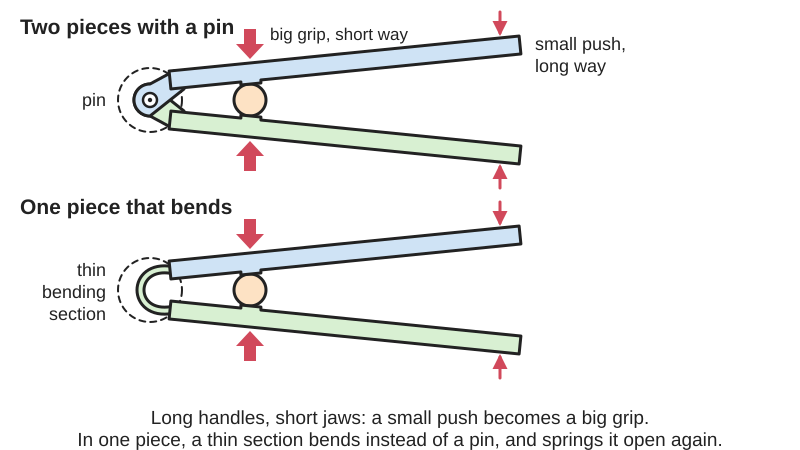
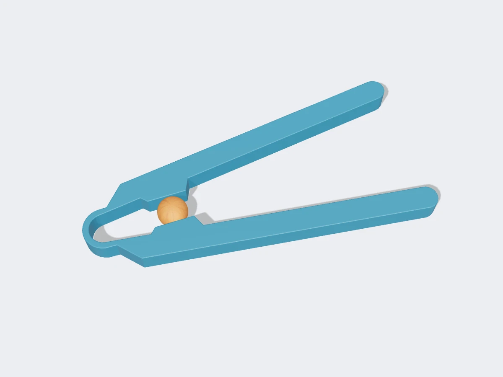
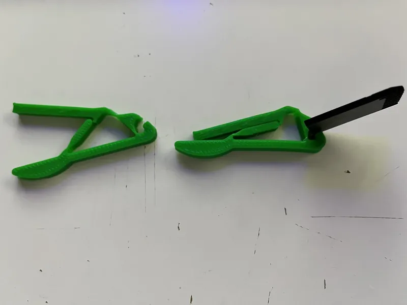
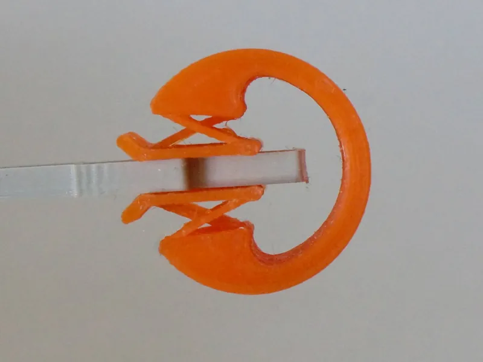
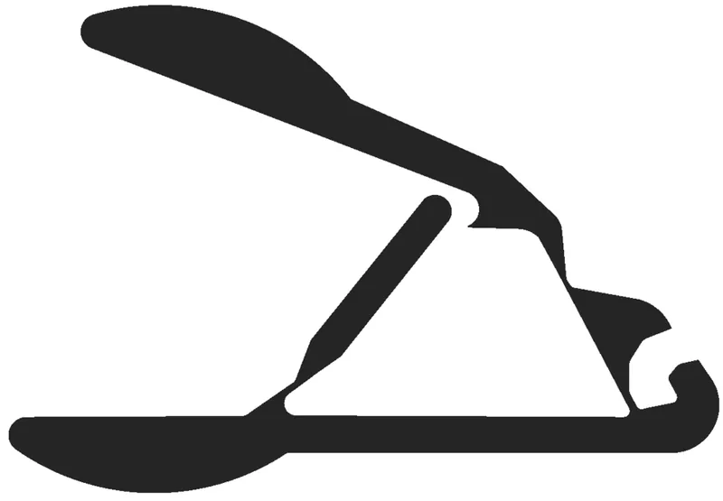

<figure class="eoc-pic eoc-pic-main"><picture><source media="(prefers-reduced-motion: reduce)" srcset="../media/drawn/compliant-gripper-and-force-amplifier.svg"></picture><figcaption><strong>Animation.</strong> Diagram drawn for the encyclopaedia from the research notes. ⚑ Needs confirming: a drawing can simplify or get details wrong; a real photo or a better diagram is welcome.</figcaption></figure>
<figure class="eoc-pic"><figcaption><strong>Render.</strong> A 3D model made for the encyclopaedia, not a photo: a real photo is also shown. ⚑ Needs confirming: a model can simplify or get details wrong.</figcaption></figure>
<figure class="eoc-pic"><figcaption><strong>How it works.</strong> <a href="https://www.printables.com/model/473734-compliant-pliers">Compliant pliers</a> by Codeman3000, <a href="https://creativecommons.org/licenses/by/4.0/">CC BY 4.0</a>, from Printables.</figcaption></figure>
<figure class="eoc-pic"><figcaption><strong>Photo.</strong> <a href="https://www.printables.com/model/499739-compliant-parallel-clamp">Compliant parallel Clamp</a> by Jack, <a href="https://creativecommons.org/publicdomain/zero/1.0/">CC0 1.0</a>, from Printables.</figcaption></figure>
<figure class="eoc-pic"><figcaption><strong>Diagram.</strong> <a href="https://commons.wikimedia.org/wiki/File:Compliant_plier_mechanism.png">Compliant plier mechanism</a> by BYU CMR, <a href="https://creativecommons.org/licenses/by-sa/4.0">CC BY-SA 4.0</a>, from Wikimedia Commons.</figcaption></figure>

A single bending part shaped like a set of levers, so that pushing or squeezing one end makes the jaws at the other end close with more force (or more movement) than you put in, with no pins, springs or hinges to assemble.

**In plain words:** A one-piece plastic tool, such as pliers, tweezers or a robot claw, that grips or squeezes by bending instead of turning on pins, and can be shaped so a gentle squeeze on the handles becomes a strong pinch at the jaws (or a tiny push becomes a big jaw movement). **Proper term:** Compliant gripper (compliant force or displacement amplifier).

**Also called:** compliant gripper or [flexure](../glossary.md#flexure) gripper; monolithic (one-piece) gripper; compliant pliers or fully compliant pliers; compliant crimper or compliant crimping mechanism; compliant tweezers or compliant grabber; compliant microgripper (tiny versions driven by piezo [actuators](../glossary.md#actuator)); compliant force amplifier or force-amplifying [compliant mechanism](../glossary.md#compliant-mechanism); displacement-amplifying compliant mechanism (DaCM); compliant lever amplifier; bridge-type amplifier or bridge-type flexure amplifier; compliant clamp or compliant vise grip; cross-locking tweezers, reverse-action tweezers or self-closing tweezers (spring-closed metal version).

## How it works

The part is really a set of levers (a [linkage](../glossary.md#linkage)) where every pin joint has been replaced by a thin section that bends (a flexure hinge), so the whole thing can be printed or cut as one piece (BYU CMR, Printables; Wikipedia, Compliant mechanism). As with any lever, the ratio of the [lever arms](../glossary.md#lever-arm) sets the trade: a long handle and a short jaw arm multiply force but shrink movement, and the reverse multiplies movement but reduces force ([mechanical advantage](../glossary.md#mechanical-advantage), the law of the lever; Wikipedia, Mechanical advantage). Unlike pinned pliers, some of your squeeze is used up bending the flexures, so a compliant gripper delivers less output force than the lever ratio alone predicts and springs back open when released (Midha, Bapat and Midha 2015; IISc M2D2 collection). Precision versions chain lever and 'bridge' stages to turn a piezo actuator's micrometre movement into a jaw movement tens of times larger (Chen et al. 2019).

## Parts

Single piece: handles or an input point, thin bending sections (flexure hinges) that act as pivots, stiffer arms that act as levers, and jaws; sometimes a built-in stop. Robot versions add a servo or motor to push the input; microgrippers add a piezo actuator.

## Everyday examples

- Tweezers: two levers joined at one fixed end that spring apart until squeezed (Wikipedia, Tweezers); note they trade force for fine control rather than amplifying force
- Cross-locking (self-closing) tweezers that grip without being squeezed (Wikipedia, Tweezers)
- Sugar tongs made from a single band of bent metal (Wikipedia, Tongs)
- Printed one-piece pliers and grabbers shared by BYU and makers (Printables)

## When to use it

Use a compliant gripper when you want a gripping tool, clamp or robot claw that prints in one piece with no pins, springs or assembly; when you need smooth, backlash-free jaw motion; when parts must be cheap, light, washable or scaled down (BYU's surgical grippers keep working when scaled down); or when you need to magnify a tiny actuator movement (piezo, shape-memory wire) or a weak squeeze. It suits small robots and classroom kits where lost screws are a problem (Hackaday, LittleArm v3), pick-up tools, crimp or clamp helpers and fidget-style demonstrators.

## When not to use it

Avoid it for heavy crimping, cutting or gripping forces (use metal pliers, a toggle or [over-centre](../glossary.md#over-centre) linkage, or a screw clamp); for large jaw openings or continuous rotation, which flexures cannot give (Wikipedia, Compliant mechanism); for tools stored clamped shut or under constant load, where plastic [creeps](../glossary.md#creep) (use a pinned mechanism with a metal spring); and for high cycle counts in PLA (use PETG, PP or nylon, or a pinned hinge). If you need the jaws to stay perfectly parallel under load, add parallel leaf-spring flexures or use a rigid parallel gripper.

## Details

- **What it does (jobs):**
  - join and hold: grips or clamps an object between its jaws
  - change speed or turning force: multiplies force (or movement) through built-in levers
  - change the kind of motion: turns a squeeze or push into a pinching jaw movement
  - let it move (turn, slide or bend): all motion comes from bending sections, with no pins
  - store energy: the bent flexures store energy that springs the jaws back open (or shut, in self-closing designs)
- **Movement:** flex: the jaws open and close by bending the flexure hinges, usually over a small range (a few millimetres to a few centimetres at the jaws for printed tools; hundreds of micrometres for piezo microgrippers, e.g. 632 micrometres in Chen et al. 2019)
- **Directions it can move (degrees of freedom):** 1: the jaws open and close along one path; the flexures are designed to be stiff in other directions, though twisting and sideways wobble (parasitic motion) are common in thin printed versions
- **Special behaviour:**
  - motion conversion (e.g. rotary to linear): converts a squeeze or push into a pinch, and trades travel for force or force for travel through its lever ratios
  - over-centre (snaps past a point and stays): only in locking or [bistable](../glossary.md#bistable) versions, e.g. printed vice-grip style pliers that snap shut and bistable keychain grippers that stay open or closed (Printables, Codeman3000 and FabianVeile)
- **How it holds:**
  - friction or clamping ([force-fit](../glossary.md#form-fit--force-fit--material-bond)): the jaws squeeze the object and friction holds it
  - spring force (a spring or springy part presses it in place): the bent flexures keep pressure on the jaws in self-closing and bistable designs
- **Input and output:** Squeeze or linear push -> jaw closing (rotation or near-straight pinch). Force ratio is set by the lever arms (law of the lever) minus the energy lost bending the flexures (Midha et al. 2015). Displacement amplifiers for piezo drives reach about 31.6x (four-stage aluminium microgripper; Chen et al. 2019) to 65x (bridge-type amplifier; Wang et al. 2021), with output force reduced in proportion; how well these ratios carry over to printed plastic versions is ⚑ [uncertain]. Back-drivable: yes, the jaws spring back when the input is released, except in over-centre or bistable locking versions.
- **Power:** passive (no power needed) for hand tools; robot and micro versions are driven by a servo, motor, air or piezo actuator, and when power is lost the jaws simply spring back to their rest position (open or closed, depending on the design) ⚑ [uncertain]
- **Load:** light: printed hand tools grip small objects and give modest force; the force is limited by what the thin flexures can take without yielding (Wikipedia, Compliant mechanism). Strong in the squeezing direction; weak against twisting and sideways loads that bend the flexures out of plane ⚑ [uncertain]
- **Play and precision:** Play: none, because there are no pin joints (no [backlash](../glossary.md#backlash); Wikipedia, Compliant mechanism; Akaki Kuumeri). [Repeatability](../glossary.md#repeatability--accuracy): good while the plastic stays springy, but plastic creep and yielding shift the rest position over time (Akaki Kuumeri). Jaw alignment: jaws may not meet squarely if flexures are too thick or the print is slightly off, and designers work to keep the jaws parallel (BYU surgical grippers; IISc M2D2 collection)
- **Taking it apart:** tool-free quick release: it releases the object as soon as you stop squeezing (or flip the switch on bistable versions); the tool itself is one piece with nothing to take apart
- **How often it can be reused:** many times, as long as the flexures bend only within their springy (elastic) range and the material is tough (PETG, polypropylene, nylon); thin FDM flexures pushed hard can fail in tens of cycles (an FDM [living hinge](../glossary.md#living-hinge) lasted about 25 cycles; Hubs) and resin flexures may wear out quickly (Formlabs forum) ⚑ [uncertain]
- **Sealing:** none
- **Adjustable:** no: the lever ratios and jaw gap are fixed by the shape; changing force or opening means reprinting with different flexure thickness or arm lengths (BYU surgical grippers note thinner flexures need less force)
- **Access needed:** not applicable
- **Materials:** FDM: PETG is the best common filament for BYU's fully compliant pliers, which were originally milled from 1/4 inch polypropylene sheet (BYU CMR, Printables); PLA works for small or occasional-use grippers (BYU surgical grippers, FabianVeile), PLA+ was the most useful in one maker's tests (Akaki Kuumeri); nylon and ABS also used (Igor A, Printables). Resin: Tough 1500 (155% elongation, 8,000 Ross flex cycles) is recommended by Formlabs for compliant mechanisms. Metal: spring steel or stainless tweezers and sugar tongs (Wikipedia); aluminium 7075 for precision piezo-driven microgrippers (Chen et al. 2019; Wang et al. 2021)
- **Heat, cold, water and wear:** Printed plastic flexures yield early and creep: a flexure left bent for a day may not return to centre (Akaki Kuumeri). Repeated bending causes [fatigue](../glossary.md#fatigue) cracks at flexure [stress concentrations](../glossary.md#stress-concentration) (Wikipedia, Compliant mechanism). PLA softens above its glass transition (about 60 to 65 degrees C; An et al. 2018), so PLA grippers can deform in a hot car or dishwasher ⚑ [uncertain]. PETG and resin versions are not immune: resin compliant mechanisms have been reported to 'work OK at first and then break down pretty fast' (Formlabs forum, user report) ⚑ [uncertain].

## Making it

- **Ways to make or get it:**
  - 3D print (FDM): one-piece pliers, tweezers, grippers and robot claws
  - 3D print (resin): tough resins such as Formlabs Tough 1500 for small compliant mechanisms
  - CNC: milled from polypropylene sheet (BYU's fully compliant pliers) or wire-EDM or milled aluminium for precision microgrippers
  - laser cut: flat flexure grippers from polypropylene or acrylic sheet ⚑ [uncertain]
  - sheet metal: bent or joined metal strips for tweezers and sugar tongs
  - off-the-shelf part: tweezers and cross-locking tweezers
- **Printing it in one piece (print in place):** yes: most designs print flat in one piece and work straight off the bed (BYU fully compliant pliers, FabianVeile's tweezers, quibeck's spring pliers), though some need narrow gaps broken free after printing
- **Tools:** none to use; none to assemble (one piece). A ballpoint refill or knife may be needed to free fused gaps after printing (FabianVeile, Printables)
- **Difficulty:** moderate: prints in one piece with no assembly, but flexure thickness, gaps between moving parts and material choice usually need a few test prints to get a gripper that closes fully and lasts

### 3D printing tips

Print the gripper flat so the flexures bend along the [layer lines](../glossary.md#layer-lines), never across them; if a flexure must lie flat, make sure its print lines run lengthwise (Akaki Kuumeri; Hubs recommends building the hinge width layer by layer). Size flexures to the nozzle: a 0.75 mm wall prints as exactly two lines with a 0.4 mm nozzle, and walls over three lines thick behave unpredictably; make them at least 10 mm wide so they don't twist and about 40 mm long so they bend smoothly (Akaki Kuumeri). Hubs gives 0.4 to 0.6 mm (at least two layers) for FDM living hinges. Thinner flexures give better jaw alignment for less squeezing force (BYU surgical grippers). [Fillet](../glossary.md#chamfer--fillet) corners where flexures meet thick parts, and move the slicer seam away from flexures (Akaki Kuumeri). Add end stops so the flexures can't be bent past their limit, and never store the tool clamped shut or under load, because printed plastic yields early and creeps (Akaki Kuumeri; FabianVeile adds a stop to his tweezers). Use PETG for longest life (BYU fully compliant pliers); quibeck recommends PETG with 3 to 4 walls for printed spring pliers. Check narrow gaps: very small [clearances](../glossary.md#clearance) between a moving rod and fixed parts can fuse and need freeing with a thin tool (FabianVeile). Calibrate to avoid over-extrusion and [elephant's foot](../glossary.md#elephants-foot), which make joints stiff (juh, Printables). Add rubber or grippy material to jaws if parts slip, because smooth PLA and PETG have low friction (Hartisch and Haninger 2023).

### Buying one (off-the-shelf parts)

Tweezers (fused or bent-strip) and cross-locking tweezers (also sold as reverse-action or self-closing tweezers) are metal compliant grippers you can buy (Wikipedia, Tweezers). Robot versions use a micro servo (e.g. SG90) or linear actuator to push the input. For precision work, piezo stacks with flexure amplifiers are sold as 'amplified piezo actuators' or 'flexure-guided piezo actuators' ⚑ [uncertain]. The rigid-link equivalents are locking pliers ('Vise-Grip' is a brand) and crimping pliers.

## Rules of thumb

- Law of the lever: force gain = input lever arm / output lever arm, and movement shrinks by the same ratio (Wikipedia, Mechanical advantage)
- In a compliant mechanism, the energy stored in bending the flexures reduces the mechanical advantage, so minimise flexure [stiffness](../glossary.md#stiffness) relative to the lever geometry (Midha, Bapat and Midha, ASME IDETC 2015)
- Bridge-type amplifiers: thinner hinges, a smaller incline angle and a shorter input frame give more amplification but more stress; an optimised aluminium design reached 65x with 0.4 mm hinges and a 0.7 degree incline angle (Wang et al., Micromachines 2021)
- Chaining stages multiplies the ratios: two bridge stages and two lever stages gave 31.6x in a piezo microgripper (Chen et al., Micromachines 2019)
- FDM flexure starting point: 0.75 mm thick (two lines with a 0.4 mm nozzle), at least 10 mm wide and about 40 mm long, printed vertically (Akaki Kuumeri, Core77 webinar)
- FDM living hinges 0.4 to 0.6 mm thick with at least two layers; SLS 0.3 to 0.8 mm; expect tens of cycles, e.g. about 25 in an FDM test (Hubs)
- Thinner flexures give better jaw alignment under less force; thick flexures need hard squeezing and leave the jaws misaligned (BYU CMR, Compliant Surgical Grippers)
- Formlabs Tough 1500 resin: 155% elongation at break and 8,000 Ross flex fatigue cycles, recommended for compliant mechanisms (Formlabs)

## Common failures

Flexures crack at their roots from fatigue or from being bent too far: add fillets and end stops (Wikipedia, Compliant mechanism; Akaki Kuumeri). Layers split when flexures bend across layer lines: reorient the print (Akaki Kuumeri; Hubs). The tool takes a permanent set (stays partly closed) after being stored under load: don't store it clamped (Akaki Kuumeri). Jaws don't meet or need too much force because flexures are too thick: thin them (BYU surgical grippers). Narrow gaps fuse during printing: widen the gap or free it with a thin tool (FabianVeile). Weaker grip than expected, because energy goes into bending the flexures (Midha et al. 2015). Objects slip on smooth plastic jaws: add rubber or texture (Hartisch and Haninger 2023).

## Safety

A force amplifier multiplies your squeeze, so its jaws can pinch skin hard; keep fingers out of the jaws. Thin printed flexures can snap suddenly, and sharp printed edges can cut hands (one maker redesigned BYU's surgical gripper so it 'could be held without drawing blood'; DeansElectronics, Printables).

## Related

- Pinned pliers and locking pliers (over-centre linkage or toggle clamp): the rigid-link version, stronger and more durable but needs pins and a spring
- Living hinge: a single thin bending hinge; compliant grippers are built from several of these
- Flexure hinge (notch, leaf-spring and cross-axis pivots): the individual bending joints used inside compliant grippers; cross-axis flexural pivots can keep clamp jaws parallel
- Parallel leaf-spring flexure: used where the jaws must move in a straight, parallel path
- Bistable compliant mechanism: gives grippers that snap open or shut and stay there without being held
- Fin-ray gripper: a soft finger that wraps around the object, rather than a lever system that multiplies force
- Over-centre linkage: rigid-link force amplifier whose force rises sharply near the straight (toggle) position

## Make it yourself

- [Fully Compliant Pliers (BYU CMR, Printables) (URL from Printables API, page not opened)](https://www.printables.com/model/525989-fully-compliant-pliers): One-piece compliant pliers; PETG recommended; originally designed to be milled from 1/4 inch polypropylene sheet *(licence: CC BY-NC)*
- [Fully Compliant Pliers by BYU_CMR (Thingiverse) (appeared in search results and as the source of the Commons image; page is JavaScript-only and was not read)](https://www.thingiverse.com/thing:3488009): Original Thingiverse upload of BYU's one-piece compliant pliers *(licence: ⚑ [uncertain])*
- [Compliant Surgical Grippers (BYU CMR, Printables) (URL from Printables API, page not opened)](https://www.printables.com/model/664175-compliant-surgical-grippers): Printable version of BYU's inverted L-arm surgical gripper, printed in PLA with no supports; small smooth-jaw or large toothed versions *(licence: CC BY-NC)*
- [Thin Grippers / Tweezers (Compliant Mechanism) (FabianVeile, Printables) (URL from Printables API, page not opened)](https://www.printables.com/model/103548-thin-grippers-tweezers-compliant-mechanism): One-piece thumb-operated grabber for reaching small objects, with a built-in stop; prints in about an hour *(licence: CC BY-NC-SA)*
- [Compliant pliers (Codeman3000, Printables) (URL from Printables API, page not opened)](https://www.printables.com/model/473734-compliant-pliers): Remix of BYU's pliers that snaps shut like a vice grip, in three sizes *(licence: CC BY)*
- [Compliant parallel Clamp (Jack, Printables) (URL from Printables API, page not opened)](https://www.printables.com/model/499739-compliant-parallel-clamp): Clamp that keeps its jaws parallel using cross-axis flexural pivots *(licence: CC0 (Public Domain))*
- [Keychain / fully working compliant Robot Gripper (bistable) (FabianVeile, Printables) (URL from Printables API, page not opened)](https://www.printables.com/model/86228-keychain-fully-working-compliant-robot-gripper-bis): Tiny bistable gripper that snaps open and stays open; PLA, 0.12 mm layers *(licence: CC BY-NC-ND)*

## Pictures, videos and models

- [Compliant plier mechanism.png (Wikimedia Commons)](https://commons.wikimedia.org/wiki/File:Compliant_plier_mechanism.png): Drawing of BYU's single-piece compliant plier (vice grip) mechanism, used as the lead image of the Wikipedia article Compliant mechanism *(licence: CC BY-SA 4.0 (BYU CMR))*
- [Why Machines That Bend Are Better (Veritasium, YouTube)](https://www.youtube.com/watch?v=97t7Xj_iBv0): Video on compliant mechanisms with BYU's Larry Howell (title and channel confirmed via YouTube oEmbed; which grippers are shown not checked ⚑ [uncertain]) *(licence: link only)*
- [Compliant Mechanism Collection (M2D2 Lab, Indian Institute of Science)](https://mecheng.iisc.ac.in/m2d2/CMcollection/): Photo gallery of physical compliant grippers, crimpers and displacement-amplifying mechanisms, with short notes on mechanical advantage *(licence: link only (no licence stated))*
- [Design of a Compliant Mechanism Based Four-Stage Amplification Piezoelectric-Driven Asymmetric Microgripper (Chen et al., Micromachines 2019)](https://pmc.ncbi.nlm.nih.gov/articles/PMC7020048/): Diagrams of bridge and lever amplifier stages and a photo of a one-piece aluminium microgripper *(licence: CC BY 4.0)*
- [Simple 3D Printed Robotic Arm Uses Compliant Mechanism (Hackaday)](https://hackaday.com/2020/02/09/simple-3d-printed-robotic-arm-uses-compliant-mechanism/): Photo of the LittleArm v3, whose gripper and forearm went from 8 parts to one printed compliant part with a zig-zag flexure *(licence: link only)*

## Needs confirming

⚑ marks something nobody has confirmed yet: a fact the research could not confirm from a source, a finder value that is a best guess, or an open point from the research notes. Corrections are welcome (see `research/needs-confirming.md`).

- ⚑ 10 sentences on this page marked [uncertain].

## Sources

- <https://en.wikipedia.org/wiki/Compliant_mechanism>
- <https://commons.wikimedia.org/wiki/File:Compliant_plier_mechanism.png>
- <https://en.wikipedia.org/wiki/Mechanical_advantage>
- <https://en.wikipedia.org/wiki/Tweezers>
- <https://en.wikipedia.org/wiki/Tongs>
- <https://mecheng.iisc.ac.in/m2d2/CMcollection/>
- <https://scholarsmine.mst.edu/mec_aereng_facwork/4214/>
- <https://pmc.ncbi.nlm.nih.gov/articles/PMC7020048/>
- <https://pmc.ncbi.nlm.nih.gov/articles/PMC8620755/>
- <https://s3files.core77.com/images/c77_webinar_series/Akaki-Kuumeri-3D-printed-flexures.pdf>
- <https://www.hubs.com/knowledge-base/how-design-living-hinges-3d-printing/>
- <https://formlabs.com/blog/updated-tough-resins-family/>
- <https://forum.formlabs.com/t/compliant-mechanisms-which-formlabs-resin/30067>
- <https://hackaday.com/2020/02/09/simple-3d-printed-robotic-arm-uses-compliant-mechanism/>
- <https://morphingmatter.org/s/thermorph.pdf>
- <https://arxiv.org/pdf/2301.08431>
- <https://www.youtube.com/watch?v=97t7Xj_iBv0>
- <https://api.printables.com/graphql/>
