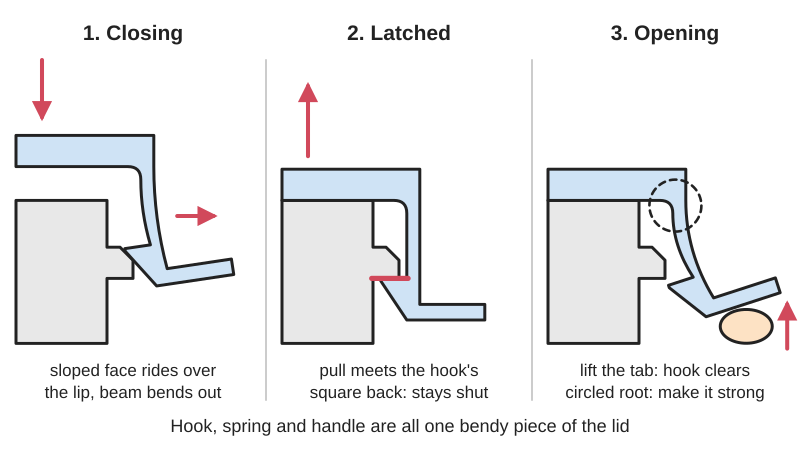
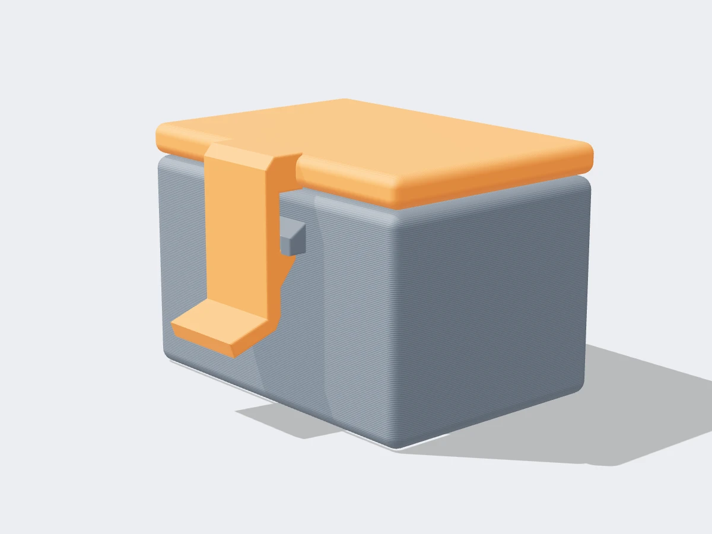
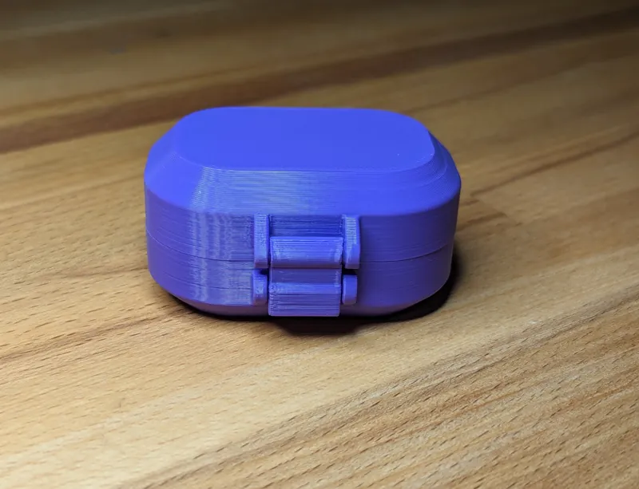
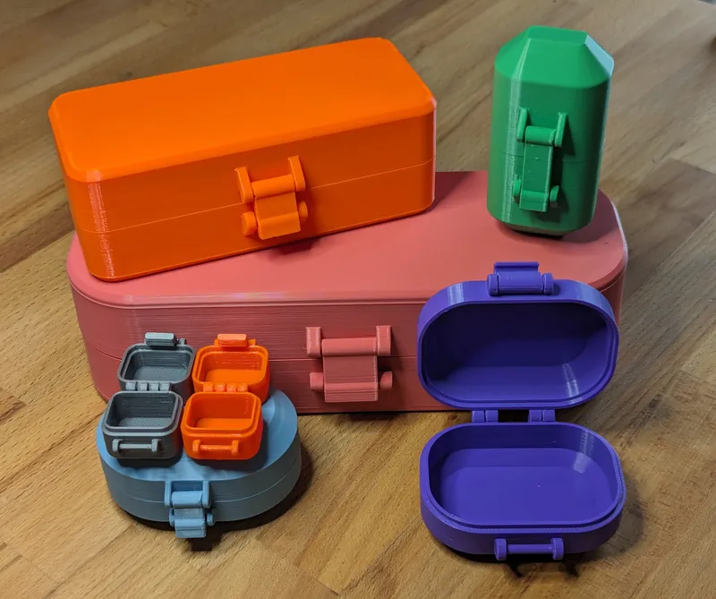

<figure class="eoc-pic eoc-pic-main"><picture><source media="(prefers-reduced-motion: reduce)" srcset="../media/drawn/compliant-one-piece-latch.svg"></picture><figcaption><strong>Animation.</strong> Diagram drawn for the encyclopaedia from the research notes. ⚑ Needs confirming: a drawing can simplify or get details wrong; a real photo or a better diagram is welcome.</figcaption></figure>
<figure class="eoc-pic"><figcaption><strong>Render.</strong> A 3D model made for the encyclopaedia, not a photo: a real one is shown below. ⚑ Needs confirming: a model can simplify or get details wrong.</figcaption></figure>
<figure class="eoc-pic"><figcaption><strong>How it works.</strong> <a href="https://www.printables.com/model/782128-latching-box-parametric-print-in-place">Latching Box, Parametric Print in Place</a> by Windrose, <a href="https://creativecommons.org/licenses/by/4.0/">CC BY 4.0</a>, from Printables.</figcaption></figure>
<figure class="eoc-pic"><figcaption><strong>Photo.</strong> <a href="https://www.printables.com/model/782128-latching-box-parametric-print-in-place">Latching Box, Parametric Print in Place</a> by Windrose, <a href="https://creativecommons.org/licenses/by/4.0/">CC BY 4.0</a>, from Printables.</figcaption></figure>

A latch whose hook, spring and release handle are all one flexible piece of plastic: closing the lid bends the hook over a lip until it snaps behind it, and pressing the handle bends the same springy beam the other way to let go.

**In plain words:** A springy plastic hook that is part of the lid or box itself: it clicks shut on its own, and you press or lift its tab to bend the hook out of the way and open it, with no pins or metal springs. **Proper term:** Compliant latch ([flexure](../glossary.md#flexure) latch).

**Also called:** flexure latch; one-piece latch / integral latch / monolithic latch; compliant hook latch / compliant clasp; releasable (separable) [cantilever](../glossary.md#cantilever) snap fit with a release tab; press-to-release tab / squeeze-to-release latch; spring latch or snap latch (maker names for printed versions, some of which use a separate printed spring); latch with integral spring / molded-in spring latch; [print-in-place](../glossary.md#print-in-place) latch; metamaterial door latch (HPI research name for a latch made from a grid of flexing cells).

## How it works

When you close the lid, the sloped front of the hook slides over the keeper and bends the springy beam aside; once the hook passes the lip the beam springs straight again and the hook drops behind it with a click. Pulling on the lid now pushes against the steep back face of the hook, which does not bend the beam, so it stays shut. To open, you press or lift the handle, which bends the same beam and pulls the hook clear of the lip. Because the bending beam replaces the pin and the spring of an ordinary latch, the whole latch is one moulded or printed part (Wikipedia, [Compliant mechanism](../glossary.md#compliant-mechanism); Covestro snap-fit guide, pp. 3-5). A research version from the Hasso Plattner Institute goes further: a single block of cells turns the rotation of a door handle into the straight-line motion of the latch bolt (HPI, Metamaterial Mechanisms, UIST 2016).

## Parts

Single piece, plus the part it catches on. The latch piece has: a hook (catch) with a sloped front face and a steep back face; a thin springy beam (the flexure) that carries the hook and acts as both hinge and spring; a handle, tab or thumb pad that bends the beam; and a thick root where it joins the lid or box. The other part has a lip, slot or ledge (the keeper or strike) for the hook to catch behind.

## Everyday examples

- The clip on an Ethernet (RJ45) plug: 'a plastic tab on the plug locks against a ridge in the socket' and you press the tab to release it (Wikipedia, Modular connector)
- Backpack buckles and other plastic side-release buckles, whose springy prongs you squeeze to release (Wikipedia, Compliant mechanism lists backpack latches)
- Snap-on equipment covers whose snap arms 'can be released by pressing on the two tongues' (Covestro snap-fit guide, Fig. 3)
- Printed boxes and cases with a built-in springy clasp (e.g. BYU's compliant-latch treasure chest)

## When to use it

Use it for lids, doors, battery covers, cases, drawers and enclosures that you open by hand now and then and that should click shut by themselves, when you want no screws, pins or metal springs and the whole thing to print or mould in one go. It suits light loads, low cost, quick assembly and designs that must stay tidy and flush.

## When not to use it

Avoid it for heavy loads, anything that must not open if dropped or pried, and security or child-resistant closures: use a draw ([over-centre](../glossary.md#over-centre)) latch, a metal spring latch or a lock. Avoid it where the latch must press a lid hard against a seal all the time, because the bent plastic [creeps](../glossary.md#creep) and loosens: use a draw latch or screws. Avoid PLA versions for latches opened many times a day or used in hot places: use PETG, ABS or nylon, or a latch with a metal spring. If the catch must hold without any bending at all, a magnetic catch or ball catch may be simpler.

## Details

- **What it does (jobs):**
  - join and hold: keeps a lid, door, cover or two housing halves shut
  - lock, and release by hand: stays latched until someone presses or lifts the tab
- **Movement:** flex: the hook moves a few millimetres in and out as the beam bends; the latched parts themselves do not move
- **Directions it can move (degrees of freedom):** 1 inside the latch (the hook bends in and out along one direction); 0 between the two latched parts once it is shut
- **Special behaviour:**
  - hand-release only (locks under load, releases when a person operates it): pulling on the lid pushes on the steep back of the hook and cannot open it; only bending the handle does
  - quick-release: one press or flick of the tab opens it, and it latches itself again when pushed shut (a 'compliant hook latch that auto-locks when closed', Printables 1366490)
  - [fail-safe](../glossary.md#fail-safe--fail-secure) or breakaway: optional; if the back face of the hook is sloped instead of square, a hard enough pull pops it open instead of breaking it (a separable snap fit; DuPont p. 73, Covestro p. 14)
- **How it holds:**
  - shape (the parts interlock; [form-fit](../glossary.md#form-fit--force-fit--material-bond)): the hook sits behind the lip
  - spring force (a spring or springy part presses it in place): the springy beam keeps the hook pushed into place
- **Input and output:** not applicable: it is a holding joint, not a motion converter (the HPI metamaterial latch is an exception: handle rotation -> straight-line bolt travel inside one printed block)
- **Power:** passive (no power needed)
- **Load:** Light to medium. Strongest when the pull comes straight against a square back face of the hook; weaker with a sloped back face (it is meant to pop open), when pried from the side, or when the handle is knocked. The beam root is the weak point, and FDM prints are weakest if the beam is built up layer by layer in the height direction (Hubs).
- **Play and precision:** Small to noticeable: the parts need a [clearance](../glossary.md#clearance) to go together (about 0.3 mm for printed moving parts, Prusa; 0.5 mm for FDM snap fits, Hubs), so a latched lid can rattle slightly unless the latch is designed to pull it in. The sloped lead-in face tolerates a little [misalignment](../glossary.md#misalignment) when closing.
- **Taking it apart:** tool-free quick release
- **How often it can be reused:** many times, if the beam is designed for repeated bending: plastics makers allow only about a half to a third of the one-time bending strain for snap arms that are opened frequently (DuPont Table 10.06; Covestro Table 2 suggests about 60%). PLA versions [fatigue](../glossary.md#fatigue) and crack sooner ⚑ [uncertain: no cycle count found for printed latches]
- **Sealing:** none by itself: a latch alone leaves a gap; it can hold a lid against a gasket, but a plastic latch that is kept bent to squeeze a seal will creep and loosen (DuPont, p. 36)
- **Adjustable:** no: the [holding force](../glossary.md#holding-force) is set by the beam thickness and length, hook depth and face angles; parametric models let you change them before printing (e.g. the LatchCutoutAngle parameter of Printables 782128, where lower is tighter)
- **Access needed:** one side only (blind): the handle or tab is on the outside; some hidden versions are released by pressing through a hole or slot
- **Materials:** Injection moulded: acetal (POM, e.g. Delrin), nylon (PA) and other tough thermoplastics (DuPont; Covestro). 3D printed: PETG, ABS or nylon; SLS nylon (PA12) is the best performer, while PLA and standard SLA resins are [brittle](../glossary.md#brittle--ductile) and best avoided (Hubs); one maker recommends PETG 'so the hook doesn't deform over time' (Printables 1366490). Flexible TPU (NinjaFlex) was used for HPI's one-piece door latch (Hackaday, 2016).
- **Heat, cold, water and wear:** Plastic springs creep and lose force if kept bent, and temperature and chemicals change their spring properties (DuPont, p. 36). Nylon's allowable strain changes with moisture (Zytel 101: 4% dry, 6% at 50% relative humidity, for one-time assembly; DuPont Table 10.06). Heat softens printed PLA latches (for example in a hot car) and cold makes plastics more brittle, so the arm may crack when bent ⚑ [uncertain: no temperature figures verified]. Outdoors, sunlight (UV) degrades many plastics over time ⚑ [uncertain].

## Making it

- **Ways to make or get it:**
  - 3D print (FDM): the usual maker method; the latch prints as part of the box or lid
  - 3D print (resin): use tough or durable resins for functional snap latches; standard resins are brittle (Formlabs; Hubs)
  - 3D print (SLS or MJF nylon): the most durable printed option (Hubs)
  - injection moulding: how commercial one-piece latches, snap arms and buckles are made (DuPont; Covestro)
  - laser cut or CNC: flat latches can be cut from tough sheet plastics such as acetal ⚑ [uncertain: no tested example opened]
- **Printing it in one piece (print in place):** yes: the springy beam, hook and handle are printed as part of the box or lid, often together with print-in-place hinges (e.g. the parametric 'Latching Box' prints in place with zero assembly, Printables 782128). Some makers print the latch separately and glue it on (Printables 1469656).
- **Tools:** none: it is part of the printed or moulded part and is worked by hand
- **Difficulty:** moderate: it prints in one piece with the box or lid, but getting the beam [stiffness](../glossary.md#stiffness), hook depth and clearance right usually needs a small test print; using a proven model makes it easy

### 3D printing tips

Orientation: lay the part out so the springy beam bends within the plane of the print bed, so its layers run along the beam and bending never pulls layers apart; avoid a beam that is built up vertically (Z), because layer bonding lowers strength (Hubs). Beam shape: make it at least 5 mm wide (Hubs), [taper](../glossary.md#taper) it towards the hook (Covestro: tapering linearly to half thickness allows more than 60% more [deflection](../glossary.md#deflection); DuPont Fig. 10.22 tapers to three-quarters), and prefer a longer, thinner beam to a short, thick one, because a longer hook reduces stress at the base (Formlabs; DuPont Figs. 10.20-10.21). Root: add a [fillet](../glossary.md#chamfer--fillet) at least half the beam thickness where it joins the part (Hubs). Walls: print the beam solid with enough [perimeters](../glossary.md#perimeters) (3D Printy's spring latch; Printables 146100); one printed spring latch uses a 1.2 mm thick spring (Printables 1510729). Hook: a lead-in slope of about 30-45 degrees makes it close easily (DuPont Fig. 10.22 and p. 73); a square (90 degree) back face holds firmly, a 45 degree back face lets it pop open under a hard pull (DuPont p. 73). Keep the [undercut](../glossary.md#undercut) shallow so the beam bends only a little; for a latch that is opened often, design for the 'used frequently' strain values (DuPont Table 10.06). Rest state: the beam should be straight and unstressed when latched (Covestro p. 3); do not rely on a permanently bent beam to hold a lid tight, because plastic springs held bent creep (DuPont p. 36). Clearance: start at 0.3 mm (Prusa) to 0.5 mm (Hubs) around the hook and handle, and test your printer with a print-in-place [tolerance](../glossary.md#tolerance) test first (Printables 782128). Material: PETG, ABS or nylon for many cycles; PLA works for occasional use (several PLA models) but is a poor spring material (Hackaday, 2026). Typical failures: the beam cracks at its root (add a fillet, taper it, reduce the hook depth, use PETG or nylon), the hook fuses to the keeper (more clearance, fix [elephant's foot](../glossary.md#elephants-foot)), or the latch is too stiff or too loose (tune the hook depth, beam thickness or cut-out angle with small test prints).

### Buying one (off-the-shelf parts)

Usually none: the latch is part of the printed or moulded piece. Ready-made alternatives and search terms: 'side release buckle' (a one-piece compliant catch for straps), 'plastic snap latch', 'push button latch', 'cabinet catch', 'magnetic catch'. To make the spring more durable, some designs swap the plastic beam for a metal one: search 'flat spring', 'leaf spring' or 'spring steel strip'.

## Rules of thumb

- Allowable strain for snap arms (used once / used frequently): acetal Delrin 100: 8% / 2-4%; Delrin 500: 6% / 2-3%; nylon Zytel 101 dry: 4% / 2%, at 50% RH: 6% / 3%; Hytrel elastomer: 20% / 10% (DuPont General Design Principles, Module I, Table 10.06, p. 75).
- For frequent separation and rejoining, use about 60% of the single-assembly strain limit (Covestro, Snap-Fit Joints for Plastics, Table 2, p. 12; e.g. PC 4%, PC/ABS 2.5% for one assembly).
- An arm whose thickness tapers linearly to half at the tip allows more than 60% more deflection than a straight arm (Covestro, p. 12).
- Cantilever lug: taper from t to about 3/4 t with a 30-45 degree lead-in (DuPont Fig. 10.22); for cylindrical snap fits a 45 degree [return angle](../glossary.md#return-angle) suits separable joints and 90 degrees makes them permanent, with a 30 degree lead-in (DuPont p. 73).
- The force to open or close over a sloped face is W = P x (mu + tan a) / (1 - mu tan a), with the lead angle for closing and the return angle for opening; friction coefficients against steel are about 0.20-0.35 for POM, 0.30-0.40 for PA and 0.50-0.65 for ABS, and higher between two parts of the same plastic (Covestro, pp. 14-15).
- After latching, snap features should return to a stress-free state (Covestro, p. 3); plastic springs suit intermittent action, and springs under constant deflection should be spring steel (DuPont, p. 36).
- 3D-printed snap fits: minimum width 5 mm, root fillet at least 0.5 x beam thickness, about 0.5 mm clearance for FDM (0.3 mm for SLA, SLS and MJF), don't build the beam in the Z direction, use tough materials such as ABS, PETG or nylon and avoid PLA and standard resins (Hubs, How to design snap-fit joints for 3D printing).
- Start with at least 0.3 mm clearance between printed moving parts; walls thinner than one perimeter (about 0.45 mm with a 0.4 mm nozzle) cannot be printed (Prusa Knowledge Base).
- For FDM snap-fit enclosures Formlabs suggests a conservative tolerance of 1.5-2.0 mm, versus 0.4 mm for its SLA and SLS printers, and says a longer hook and a lower hook height reduce stress (Formlabs, Designing 3D printed snap-fit enclosures).

## Common failures

Beam cracks at its root after some openings (fatigue at the [stress concentration](../glossary.md#stress-concentration) where flexures bend; Wikipedia, Compliant mechanism): add a fillet, taper the beam, make it longer, reduce the hook depth, and use PETG, ABS or nylon. Beam takes a set so the latch goes loose or won't catch (creep): don't leave it bent; make it rest straight when latched. Snaps on the first bend: the beam is printed with layers across it, the hook is too deep, or the material is brittle (PLA, standard resin); reorient and reduce strain. Won't open, or opens too easily: change the back-face angle or the hook depth. Hook or handle fused to the box: too little clearance or elephant's foot. Lid rattles: add a small [preload](../glossary.md#preload) or a locating lip, accepting some creep.

## Safety

Low hazard. A cracked latch can let a lid fall open unexpectedly, so do not use one to hold anything heavy overhead or anything that must stay shut for safety. Small printed parts are a choking hazard for young children.

## Related

- Cantilever snap fit: the same springy hook, but usually meant to join parts once or rarely, with no release handle
- Side-release buckle: a compliant catch for straps, released by squeezing two prongs
- Draw latch (over-centre latch): pulls a lid tight and holds it by passing a [dead point](../glossary.md#dead-point); stronger and better for seals, but has several parts
- Spring-loaded slide or bolt latch: a separate bolt pushed by a metal spring; stronger and longer lived, more parts
- Printed spring latch with a separate spring and button (e.g. Printables 1510729): all printed but in three parts, so the spring can be swapped
- Push-push latch: opens and closes by pushing, with no handle
- Magnetic catch and ball catch: hold a door by magnet or spring ball with no hook, and release when pulled hard enough
- Compliant [detent](../glossary.md#detent) (flexure click arm): the same springy-arm idea used to click into set positions instead of locking

## Make it yourself

- [Compliant Top-Mount Hook Latch, by Michaël Fortin](https://www.printables.com/model/1366490-compliant-top-mount-hook-latch): A simple one-piece compliant hook latch that locks itself when the container is closed; PETG suggested so the hook doesn't deform over time (read through the Printables API) *(licence: Creative Commons Attribution-NonCommercial-ShareAlike)*
- [Latching Box, Parametric Print in Place, by Windrose](https://www.printables.com/model/782128-latching-box-parametric-print-in-place): A parametric Fusion 360 case with print-in-place hinges and a latching clasp, no assembly; default 0.3 mm tolerance and a LatchCutoutAngle parameter to tune tightness (read through the Printables API) *(licence: Creative Commons Attribution (CC BY))*
- [Treasure Chest (St. Patrick's Day Box), by BYU Compliant Mechanisms Research (BYU CMR)](https://www.printables.com/model/598104-st-patricks-day-box): A self-opening printed chest that stores spring energy in lenticular folds and uses a compliant latch to stay closed (linked from BYU's Maker Resources page; details read through the Printables API) *(licence: Creative Commons Attribution-NonCommercial)*
- [Small hinged box with compliant latch, by Vlado83](https://www.printables.com/model/1469656-small-hinged-box-with-compliant-latch): A small print-in-place hinged box with a separately printed compliant latch glued on lightly with CA glue (read through the Printables API) *(licence: Creative Commons Attribution (CC BY))*
- [Compliant Self Latching Door Stop with Release, by jesslax32](https://www.printables.com/model/626238-compliant-self-latching-door-stop-with-release): A one-piece door holder that latches the door and releases when you flex the stop with your toe; PLA, 3 walls, printed on its side (read through the Printables API) *(licence: Creative Commons Attribution-NonCommercial)*

## Pictures, videos and models

- [Metamaterial Mechanisms (Hasso Plattner Institute, Ion et al., UIST 2016)](https://hpi.de/baudisch/projects/metamaterial-mechanisms.html): Project page with images, paper and video of a one-piece printed door latch in which a grid of flexing cells turns handle rotation into latch-bolt travel *(licence: link only ⚑ [uncertain])*
- [3D Printed Door Latch Has One Moving Part - Itself! (Hackaday, 2016)](https://hackaday.com/2016/09/14/3d-printed-door-latch-has-one-moving-part-itself/): Write-up with pictures of HPI's one-piece door handle and latch printed in NinjaFlex on an Ultimaker 2 *(licence: link only)*
- [Snap-Fit Joints for Plastics: A Design Guide (Covestro)](https://solutions.covestro.com/-/media/covestro/solution-center/brands/downloads/imported/1557218421.pdf): Illustrated design guide; Fig. 3 (p. 5) shows a cover held by snap arms that are released by pressing two tongues, and later pages show tapered arm shapes and lead and return angles *(licence: link only)*
- [3D Printed Springs 'n Things (3D Printy)](https://www.youtube.com/watch?v=Zlntza52REA): Video linked from 3D Printy's printable spring latch, showing printed springs and latches working (title checked with YouTube oEmbed) *(licence: YouTube standard licence; link only)*
- [Compliant mechanism (Wikipedia)](https://en.wikipedia.org/wiki/Compliant_mechanism): Explanation of flexing mechanisms with pictures of a compliant clip, a compliant iris and a bistable switch *(licence: Text CC BY-SA 4.0; each image has its own Commons licence ⚑ [uncertain: image licences not checked])*

## Needs confirming

⚑ marks something nobody has confirmed yet: a fact the research could not confirm from a source, a finder value that is a best guess, or an open point from the research notes. Corrections are welcome (see `research/needs-confirming.md`).

- ⚑ 6 sentences on this page marked [uncertain].

## Sources

- <https://hpi.de/baudisch/projects/metamaterial-mechanisms.html>
- <https://hackaday.com/2016/09/14/3d-printed-door-latch-has-one-moving-part-itself/>
- <https://en.wikipedia.org/wiki/Compliant_mechanism>
- <https://en.wikipedia.org/wiki/Modular_connector>
- <https://compliantmechanisms.byu.edu/maker-resources>
- <https://solutions.covestro.com/-/media/covestro/solution-center/brands/downloads/imported/1557218421.pdf>
- <https://www.distrupol.com/General_Design_Principles_for_Engineering_Polymers.pdf>
- <https://www.hubs.com/knowledge-base/how-design-snap-fit-joints-3d-printing/>
- <https://formlabs.com/blog/designing-3d-printed-snap-fit-enclosures/>
- <https://help.prusa3d.com/article/modeling-with-3d-printing-in-mind_164135>
- <https://hackaday.com/2026/04/27/the-challenges-of-3d-printing-reliable-springs/>
- <https://www.youtube.com/watch?v=Zlntza52REA (verified via YouTube oEmbed)>
- <https://www.printables.com/model/1366490-compliant-top-mount-hook-latch (read via https://api.printables.com/graphql/)>
- <https://www.printables.com/model/782128-latching-box-parametric-print-in-place (read via https://api.printables.com/graphql/)>
- <https://www.printables.com/model/598104-st-patricks-day-box (read via https://api.printables.com/graphql/)>
- <https://www.printables.com/model/1469656-small-hinged-box-with-compliant-latch (read via https://api.printables.com/graphql/)>
- <https://www.printables.com/model/626238-compliant-self-latching-door-stop-with-release (read via https://api.printables.com/graphql/)>
- <https://www.printables.com/model/146100-spring-latch (read via https://api.printables.com/graphql/)>
- <https://www.printables.com/model/1510729-universal-3d-printable-spring-latch-mechanism-no-s (read via https://api.printables.com/graphql/)>
- <https://api.printables.com/graphql/>
