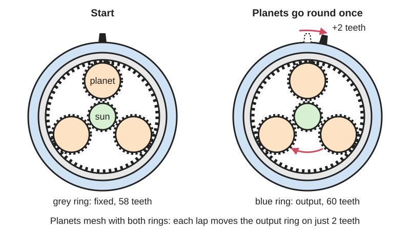
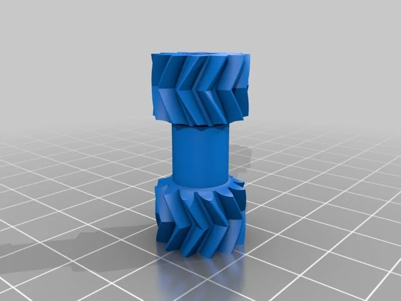

<figure class="eoc-pic eoc-pic-main"><picture><source media="(prefers-reduced-motion: reduce)" srcset="../media/drawn/compound-planetary-gearbox.svg"></picture><figcaption><strong>Animation.</strong> Diagram drawn for the encyclopaedia from the research notes. ⚑ Needs confirming: a drawing can simplify or get details wrong; a real photo or a better diagram is welcome.</figcaption></figure>
<figure class="eoc-pic"><figcaption><strong>Photo.</strong> <a href="https://www.thingiverse.com/thing:2101218">43.3:1 Compound Planetary Gearbox For Robotic Arm Project!</a> by Gear Down For What?, <a href="https://creativecommons.org/publicdomain/zero/1.0/">CC0</a>, from Thingiverse via Openverse.</figcaption></figure>

A planetary gear set whose planet gears mesh with two ring gears that differ by only a few teeth; one ring is fixed and the other is the output, so each trip of the planets round the fixed ring nudges the output ring on by the tooth difference, giving reductions from about 30:1 to over 200:1 in one flat stage.

**In plain words:** A flat gearbox where small gears roll round a centre gear inside two toothed rings that are almost, but not quite, the same size: one ring is held still and the tiny difference makes the other ring [creep](../glossary.md#creep) round very slowly, giving a huge slow-down in one step. **Proper term:** Compound planetary gearbox with two ring gears (split-ring planetary gearbox; Wolfrom planetary gear train, also called a 3K planetary).

**Also called:** split-ring planetary gearbox / split ring planetary gear; split-ring compound epicyclic gearbox; split-ring compound-planet epicyclic gear set; split annulus planetary (name used by Hackaday commenters); differential planetary gearbox (maker usage, e.g. Gear Down For What?; KHK lists 'differential planetary gears' as a family); Wolfrom gearbox / Wolfrom planetary gear train (Wolfrom PGT, WPG); 3K planetary gearbox (3K type); Wolfrom-based compound planetary gear train (C-PGT); high-ratio planetary gearbox; Wolfromgetriebe / Wolfrom-Planetengetriebe (German); 'mystic gearbox' (nickname reported from Japan because of its surprisingly low efficiency); Bilateral Drive (a research variant of the Wolfrom layout).

## How it works

The motor turns the central sun gear, which drives the planets round inside the fixed ring, just as in an ordinary planetary gearbox. The planets also mesh with a second ring stacked next to the first that has a few more or fewer teeth. Because the planets turn by the same amount against both rings, each time they go once round the fixed ring the output ring is pushed on by only the difference in tooth count (for example 2 teeth out of 60), so it turns very slowly and with a lot of force. The total ratio is the ordinary sun-to-planet-carrier reduction multiplied by a large extra factor set by that tooth difference (a differential effect).

## Parts

A small assembly that acts as one unit: a sun gear on the motor shaft; 2 to 6 planet gears (either plain wide gears that reach both rings, or 'compound' double gears with one toothed section for each ring); a fixed ring gear (internal gear) that is part of the housing; a second, turning ring gear that is the output; plus bearings, a planet carrier or spacer plates (some designs have no carrier at all), screws and grease.

## Everyday examples

- The motor units in car power mirrors and [actuators](../glossary.md#actuator) for aircraft wing flaps, and some antique clocks (all named by the CoolEpicyclicGearing README)
- Hobby robot arm joints, e.g. the shoulder of the RR1 desktop robot arm (40:1)
- DIY star trackers for astrophotography, where one very slow, smooth turn is needed (Awesci's 180:1 gearbox)
- Portable radar equipment in World War II, according to Wikipedia (marked 'citation needed' there)

## When to use it

Use it when you need a big slow-down (or a big increase in turning force) in a flat, compact package with the output in line with the motor, especially when you are 3D printing: for example a stepper or brushless motor driving a robot arm joint, a camera or telescope mount, a star tracker, a winch or a slow turntable. One split-ring stage can replace two or three ordinary planetary stages, uses few parts, and prints without special tools.

## When not to use it

Avoid it when efficiency matters most (battery robots, things that run continuously at power), because the ring meshes waste a lot of energy; a two-stage planetary gearbox is often more efficient up to about 30:1 (COMPAct). Avoid it when you need zero play and very accurate positioning under load; a strain-wave gear (harmonic drive) or cycloidal drive does better. For modest ratios (under about 7:1) a simple planetary set is lighter and more efficient. Don't use it as the only thing holding a load that must never drop: add a brake or a [ratchet](../glossary.md#ratchet). If you need a right-angle drive or [self-locking](../glossary.md#self-locking), use a worm drive.

## Details

- **What it does (jobs):**
  - change speed or turning force: a very large slow-down and [torque](../glossary.md#torque) increase (hobby builds typically about 30:1 to 200:1) in one flat stage, with the output on the same line as the motor
- **Movement:** rotate: continuous rotation in at the sun gear, much slower continuous rotation out at the output ring, on the same axis; unlimited range, either direction
- **Directions it can move (degrees of freedom):** 1: with one ring held by the housing, turning the sun gear is the only independent motion; the output ring's position is tied to it by the tooth counts (if neither ring were held it would be a two-input differential)
- **Special behaviour:**
  - none: its job is simply a very large speed reduction. ⚑ [uncertain] High-ratio printed versions can be stiff or impossible to turn from the output, which looks like self-locking, but that comes from friction and is not dependable, so don't use it as a brake; some research designs (the Bilateral Drive, the WOLF actuator) are deliberately made easy to turn backwards
- **How it holds:**
  - not a holding joint (it moves or passes on motion): it transmits rotation
  - shape (the parts interlock; [form-fit](../glossary.md#form-fit--force-fit--material-bond)): the turning force passes through meshing gear teeth
- **Input and output:** Continuous rotation -> slower continuous rotation, shafts in line ([coaxial](../glossary.md#coaxial)). Ratio for sun input, ring 1 fixed and ring 2 as output: G = (1 + R1/S) / (1 - (R1 x P2)/(P1 x R2)), where S, R1 and R2 are the sun and ring tooth counts and P1, P2 the planet teeth meshing ring 1 and ring 2 (COMPAct paper, Singh et al.). With identical planet halves (P1 = P2) this is (1 + R1/S) / (1 - R1/R2). Examples: 34:1 (WOLF actuator), 40:1 (RR1 robot arm shoulder), about 63:1 (regularfry), almost 100:1 (SirekSBurom, 56- and 58-tooth rings), 160:1 (Gear Down For What?), about 180:1 (Awesci), 275:1 (R2poweR research gearbox) and up to 400:1 (Reflex Torque Amplifier). Direction: from the formula, the output turns the same way as the motor when the output ring has more teeth than the fixed ring, and the opposite way when it has fewer ⚑ [uncertain: the CoolEpicyclicGearing README states the opposite rule, so check with a calculator]. Efficiency: the Wolfrom layout is 'known for bad efficiency' because a large 'blind power' circulates through the ring meshes (Höhn et al. 2020); a calculated i = 100 industrial example is about 90% with standard teeth and about 97% with special low-loss teeth, and a 3D-printed plastic research gearbox reached 85% at 275:1 (Power Transmission Engineering 2023), but ordinary hobby prints are often much less efficient ⚑ [uncertain]. Back-drivable: depends on ratio and design: yes for the 34:1 WOLF actuator ('fully backdriveable') and for the 102:1 Bilateral Drive (89.2% backward efficiency); high-ratio plastic prints are usually hard to back-drive, because friction is multiplied and the motor's inertia felt at the output grows with the square of the ratio ⚑ [uncertain for hobby builds].
- **Power:** passive (no power needed). When it is driven by a motor and power is lost, it simply stops being driven; whether the load can then turn it backwards depends on the ratio and friction (see input_output), so add a brake if the load must not move
- **Load:** medium to heavy for its size. Printed examples: a 160:1 gearbox lifted 260 lb (about 118 kg) turned by a drill (Hackaday on Gear Down For What?), SirekSBurom stress-tested his at 20-40 Nm for 12 hours, and the PLA test build of the WOLF actuator gave about 40.8 Nm continuous. Strong against twisting (torque) because many teeth share the load; weak points are the planets tilting ('leaning') under high output torque, which jams the teeth (CoolEpicyclicGearing), the thin teeth of each half-width ring, and side or tilting loads on the output ring, which need a proper output bearing.
- **Play and precision:** Small to noticeable play ([backlash](../glossary.md#backlash)). Play at the motor end is divided by the huge ratio, but play in the ring meshes shows up almost directly at the output, and Hackaday readers doubted that printed plastic can really be 'low backlash'. ⚑ [uncertain] Printed planetary actuators measured in the COMPAct paper had about 0.6 degrees (single-stage) and 2.6 degrees (stepped compound) of no-load backlash; no equivalent figure was found for printed split-ring types. The output moves in very fine, repeatable steps because of the big ratio. It tolerates little [misalignment](../glossary.md#misalignment): the planets must stay square to both rings, or they lean and jam (CoolEpicyclicGearing).
- **Taking it apart:** removable: the gears sit in a screwed-together housing and can be taken apart and refitted; [print-in-place](../glossary.md#print-in-place) demo versions are the exception, as they print as one locked-together assembly
- **How often it can be reused:** many times: it can be opened and reassembled repeatedly; the limits are tooth wear and getting the planets back in the right orientation (phasing)
- **Sealing:** none: the gears themselves seal nothing; a closed housing only keeps grease in and dust out
- **Adjustable:** No in normal use: the ratio is fixed by the tooth counts. Play can be reduced only at design time, by tightening [clearances](../glossary.md#clearance) in CAD or by making the ring gears springy in the [radial](../glossary.md#axial--radial) direction but stiff in twist (LoboCNC's anti-backlash compound planetary gearhead).
- **Access needed:** not applicable: it is a self-contained gearbox mounted on the motor; you reach it wherever its housing opens
- **Materials:** Industrial: steel gears (the Wolfrom layout is used mainly for specialised high-ratio drives). Printed: PLA (Awesci, the WOLF test build), PETG (regularfry), and carbon-fibre-filled polycarbonate blend recommended for the RR1 robot arm gearbox (surynek); SLS-printed nylon or CNC-machined gears are listed as options for WOLF. Steel dowel pins or linear shafts through the planets, ball bearings, and steel screws for the housing. PLA softens above about 60 °C (Prusa).
- **Heat, cold, water and wear:** Heat: PLA softens and deforms above about 60 °C (Prusa), and friction in a high-ratio printed gearbox makes heat; PETG copes with up to about 80 °C (Prusa). Grit gets into greased teeth, so keep it covered. ⚑ [uncertain] Printed plastic gears creep under a constant load, so a gearbox holding a load for long periods may lose position or deform.

## Making it

- **Ways to make or get it:**
  - 3D print (FDM): the usual hobby route; many free models and calculators exist
  - 3D print (SLS nylon) and CNC machining: listed as options for the WOLF actuator
  - CNC: industrial Wolfrom gearboxes are machined steel, but they are rarely made and need tight [tolerances](../glossary.md#tolerance) (Höhn et al. 2020)
  - off-the-shelf part: ⚑ [uncertain] ready-made split-ring or Wolfrom gearboxes are rare for hobbyists; builders usually print them
- **Printing it in one piece (print in place):** yes, for demos: tmackay's 'Solid Core Compound Planetary Gearbox (customizable)' and 'Compound Planetary Gears 1:3915' print fully assembled, relying on exactly one layer gap between the two rings; regularfry's herringbone version is 'print-in-two-places' (one ring is printed separately and squeezed on). Working gearboxes are printed as separate parts and assembled with bearings and screws.
- **Tools:** Hex keys or a screwdriver for the housing screws; often a soldering iron for [heat-set inserts](../glossary.md#heat-set-insert), a vice or press for fitting bearings, and grease. Print-in-place demos need no tools beyond perhaps pliers to break the parts free.
- **Difficulty:** moderate: it prints well and needs few parts, but the tooth-count maths, the planet phasing and the slightly 'cheated' second ring (different tooth size or stretched teeth) are fiddly, and the printer must be well tuned so the planets mesh with both rings

### 3D printing tips

1) Don't design by trial and error: pick tooth counts with a calculator such as Pål Saugstad's Split Ring Planetary Gear Calculator or the CoolEpicyclicGearing spreadsheets, and check the ratio with the formula in input_output. 2) Each ring normally has to satisfy ring = sun + 2 x planet teeth for the planets to fit; the second ring breaks this rule, so makers either give the second ring and its planet section a slightly different tooth size (diametral [pitch](../glossary.md#pitch) or module) (CoolEpicyclicGearing), or stretch the ring's teeth (tmackay: 'easier to stretch than compress and maintain clearance'), or use the same planets and a slightly adjusted ring, as Awesci's 58- and 60-tooth rings with 24-tooth planets do. 3) Planet phasing: if the ring tooth difference equals the number of equally spaced planets, the two halves of every planet can be printed in line; if the difference is 1 with n planets, each successive planet's halves must be twisted by 1/n of a tooth (CoolEpicyclicGearing; regularfry notes a 1-tooth difference would triple the ratio but makes assembly much harder). Print a number on each planet so you fit them in the right places. 4) Print the gears flat on the bed: CoolEpicyclicGearing says flat printing reduces the planets' tendency to lean and jam under torque. 5) Herringbone (double-helical) teeth keep the planets, sun and rings lined up without a separate carrier (regularfry's remix of the print-in-place gear-bearing idea). 6) Tune clearances: Awesci used PLA at 40% [infill](../glossary.md#infill) with -0.15 mm horizontal expansion so the gears meshed well; print-in-place demos use about 0.2 mm tolerance and need exactly one layer gap between the two rings, checked in the slicer's layer view (tmackay). 7) Support the planets on steel: Gear Down For What? runs 8 mm linear shafts inside the planets and uses long teeth (wide gears) for more wearing surface; RR1 uses 625 ball bearings and bearing balls for a DIY output bearing. 8) Material: PLA works for demos and light loads; for robot joints surynek recommends carbon-fibre-filled PC blend, and WOLF plans SLS nylon gears. 9) Grease the teeth, and consider low-friction sliding surfaces where parts rub (SirekSBurom planned PTFE surfaces). 10) Expect low efficiency and don't count on it to hold a load; test with the real load.

### Buying one (off-the-shelf parts)

Ball bearings (e.g. 625, 16 x 5 mm, used in the RR1 gearbox); bearing balls (e.g. 6 mm or 4 mm) for DIY ring (slew) bearings; crossed-roller bearings (WOLF); steel dowel pins or 8 mm linear shafts for the planets; M3 screws, square nuts and heat-set threaded inserts; NEMA 17 or NEMA 23 stepper motors, small 28BYJ-48 steppers, or brushless (BLDC) motors such as the 8318 size used by WOLF; magnetic angle encoders (e.g. AS5047P); gear grease.

## Rules of thumb

- Ratio (sun in, ring 1 fixed, ring 2 out): G = (1 + R1/S) / (1 - (R1 x P2)/(P1 x R2)) (COMPAct, Singh et al., arXiv 2510.07197, eq. 7-8). The closer the two ring tooth counts, the higher the ratio.
- The ring tooth counts usually differ by between 1 tooth (extreme ratios) and the number of planets (CoolEpicyclicGearing README).
- In-phase planets need a ring tooth difference equal to the number of planets; with a 1-tooth difference and n planets, offset each planet's halves by 1/n tooth (CoolEpicyclicGearing README; regularfry on Printables).
- For an ordinary planetary set the ring must have sun + 2 x planet teeth (woodgears.ca: R = 2 x P + S); split-ring designs deliberately bend this rule for the second ring (tmackay).
- Efficiency: Wolfrom gearboxes are 'known for bad efficiency' because of high 'blind power' in the ring meshes; in Höhn et al.'s i = 100 example, overall efficiency rises from about 0.9 to 0.97 when low-loss tooth shapes replace standard ones (MATEC Web of Conferences 317, 01001, 2020).
- In an optimisation for one robot motor, single-stage planetaries were best up to 7.2:1, stepped compound planetaries from 7.2:1 to 15:1, Wolfrom and two-stage planetaries competed from 15:1 to 32:1 (two-stage more efficient), and above 32:1 only the Wolfrom layout was feasible (COMPAct).
- The motor inertia felt at the output grows with the square of the [gear ratio](../glossary.md#gear-ratio), so very high ratios make a joint hard to back-drive (Power Transmission Engineering, April 2023).
- Research Wolfrom gearboxes reached 275:1 at 85% load-dependent efficiency with 3D-printed plastic gears (R2poweR) and 102:1 at 89.9% forward and 89.2% backward efficiency (Bilateral Drive) (Power Transmission Engineering, April 2023).

## Common failures

1) Planets lean under high output torque and jam the teeth: print the gears flat, support the planets on steel shafts and bearings, and keep the housing stiff (CoolEpicyclicGearing; Gear Down For What?). 2) It won't assemble or it binds because the planets are out of phase: follow the phasing rule and number the planets (CoolEpicyclicGearing). 3) The two rings fuse together in print-in-place demos: check for exactly one clear layer between them in the slicer (tmackay). 4) Too much friction or binding from printing errors on small teeth: tune the printer, use horizontal expansion, or add flexible ring gears; don't just open up the clearances, which adds play (LoboCNC; Awesci). 5) Very low efficiency and heat: grease it, choose a less extreme ratio, or use a two-stage planetary instead (Höhn et al.; COMPAct). 6) Worn or skipping teeth on the slightly mismatched ring after heavy use ⚑ [uncertain]: use wider gears, stronger material and a proper output bearing.

## Safety

The huge torque multiplication means even a small motor can crush fingers or break parts, and the gaps between planets and rings are pinch points ⚑ [uncertain], so keep fingers out while it runs. It is not a safety brake: a load may creep or drop. Overloaded PLA parts can break into sharp shards (Prusa).

## Related

- Planetary gear set (epicyclic gearing): the simple version with one ring; lighter and more efficient but only about 3:1 to 7:1 per stage (COMPAct found single-stage feasible up to 7.2:1)
- Stepped-planet compound planetary: each planet has a large and a small gear but there is only one ring; moderate ratios (COMPAct: up to about 18:1), used in the Rohloff bicycle hub (Wikipedia)
- Multi-stage planetary gearbox: stack ordinary stages for high ratios; more parts and length but usually more efficient than a split ring at up to about 30:1 (COMPAct)
- Strain-wave gear (harmonic drive): similar 'small tooth difference' trick using a flexing toothed ring; zero backlash and high ratios, but harder to print (Hackaday readers pointed out that SirekSBurom's 'harmonic' gearbox was really a split ring)
- Cycloidal drive: a lobed disc wobbling inside a ring of pins; lower ratios per stage but low play, stiff and shock-resistant (Roozing and Roozing 2022)
- Eccentric small-tooth-difference planetary (a gear wobbling inside a ring with a couple more teeth, output taken off by pins): the gear-toothed cousin of the cycloidal drive (Nguyen Duc Thang, 'Planetary Reduction Gear 2')
- Worm drive: a high ratio in one step at right angles, often self-locking, but less efficient and not in line

## Make it yourself

- [Split-Ring Planetary Reduction Gear (regularfry, Printables)](https://www.printables.com/model/68392-split-ring-planetary-reduction-gear): OpenSCAD herringbone split-ring gear, about 63:1, remixed from the print-in-place gear-bearing idea; one ring printed separately and squeezed on (tested in PETG) *(licence: CC BY-NC-SA)*
- [Solid Core Compound Planetary Gearbox (customizable) (tmackay, Printables) (URL from Printables API, page not opened)](https://www.printables.com/model/63415-solid-core-compound-planetary-gearbox-customizable): Customizable print-in-place split-ring gearbox; the author suggests about 50:1 to 100:1 as a practical target and explains stretching the ring teeth to allow more tooth-count choices *(licence: CC BY-SA)*
- [Split Ring Planetary Gearbox (surynek, Printables)](https://www.printables.com/model/826668-split-ring-planetary-gearbox): 40:1 split-ring gearbox for the shoulder of the RR1 robot arm with a NEMA 23 stepper; 625 bearings, bearing-ball ring bearing; CAD on GitHub *(licence: GNU GPL v2.0)*
- [WOLF Actuator V1.1 (Wolfrom PGT) (Anthrobotics, Printables) (URL from Printables API, page not opened)](https://www.printables.com/model/939980-wolf-actuator-v11-wolfrom-pgt): 3D-printable brushless robot actuator using a carrier-less Wolfrom gear train, 34:1, back-drivable; includes a planet alignment tool *(licence: CC BY-SA)*
- [Split Ring Planetary Gear Calculator (Pål Saugstad)](https://saugstad.net/gear-animation/calculate.html): Web calculator that searches tooth counts for a wanted split-ring (or split-sun) ratio *(licence: not stated)*
- [CoolEpicyclicGearing (IdeaPropulsionSystems, GitHub)](https://github.com/IdeaPropulsionSystems/CoolEpicyclicGearing): Spreadsheets, 3D models and a plain-English guide to split-ring compound-planet gear sets, including planet phasing *(licence: not stated)*

## Pictures, videos and models

- [Torque Testing 3D Printed Gearboxes! (Gear Down For What?, YouTube)](https://www.youtube.com/watch?v=tgJUiEC9_-A): 3D-printed differential (split-ring) planetary gearboxes loaded until they fail, and what happens when you try to turn them backwards *(licence: link only (standard YouTube licence))*
- [You Won't Believe What This 3DP Gearbox Can Do! (Gear Down For What?, YouTube; linked from Hackaday, title checked via YouTube oEmbed)](https://www.youtube.com/watch?v=b6cDOyxub8w): A 160:1 printed split-ring planetary gearbox, driven by a drill, lifting truck tyres and a 120 lb anvil *(licence: link only (standard YouTube licence))*
- [Unique Planetary Gearbox Can Be Custom Printed For Steppers (Hackaday, 2017)](https://hackaday.com/2017/03/02/unique-planetary-gearbox-can-be-custom-printed-for-steppers/): Photos and explanation of SirekSBurom's printed NEMA 17 gearbox with 56- and 58-tooth rings (almost 100:1) *(licence: link only)*
- [3D Printed Split-Ring Planetary Gearbox (Awesci)](https://awesci.com/3d-printed-split-ring-planetary-gearbox/): Photos, tooth counts (12-tooth sun, 24-tooth planets, 58- and 60-tooth rings) and a plain explanation of how the two rings create a 180:1 reduction under 1 cm thick *(licence: link only)*
- [Split Ring Planetary Gear High Torque (Stuff Gets Made, YouTube)](https://www.youtube.com/watch?v=E-GepBIq_Vk): Building and testing a split-ring compound-planet printed gearbox *(licence: link only (standard YouTube licence))*

## Needs confirming

⚑ marks something nobody has confirmed yet: a fact the research could not confirm from a source, a finder value that is a best guess, or an open point from the research notes. Corrections are welcome (see `research/needs-confirming.md`).

- ⚑ 9 sentences on this page marked [uncertain].
- ⚑ Research note: *Compound planetary gearbox*: output direction conflict: the COMPAct formula says the output turns the same way as the motor when the output ring has more teeth; the CoolEpicyclicGearing README says the opposite. Flagged in `input_output`.

## Sources

- <https://en.wikipedia.org/wiki/Epicyclic_gearing>
- <https://www.powertransmission.com/on-the-potential-of-high-ratio-planetary-gearboxes-for-next-generation-robotics>
- <https://www.matec-conferences.org/articles/matecconf/pdf/2020/13/matecconf_pt2020_01001.pdf>
- <https://arxiv.org/pdf/2510.07197>
- <https://api.semanticscholar.org/graph/v1/paper/2de1d6abb21caff2056ee0e7a6e662e68df474eb?fields=title,authors,year,venue,abstract,externalIds,openAccessPdf>
- <https://khkgears.net/new/gear_knowledge/Types_and_Mechanisms_of_Gear_Reducers.html>
- <https://woodgears.ca/gear/planetary.html>
- <https://hackaday.com/2017/03/02/unique-planetary-gearbox-can-be-custom-printed-for-steppers/>
- <https://hackaday.com/2017/07/27/3d-printed-gearbox-lifts-an-anvil-with-ease/>
- <https://github.com/IdeaPropulsionSystems/CoolEpicyclicGearing>
- <https://raw.githubusercontent.com/IdeaPropulsionSystems/CoolEpicyclicGearing/master/README.md>
- <https://awesci.com/3d-printed-split-ring-planetary-gearbox/>
- <https://saugstad.net/gear-animation/calculate.html>
- <https://www.mattieuzhai.com/split-ring-planetary-gearbox>
- <https://www.youtube.com/watch?v=tgJUiEC9_-A>
- <https://www.youtube.com/watch?v=E-GepBIq_Vk>
- <https://www.youtube.com/watch?v=b6cDOyxub8w>
- <https://cs448m.github.io/lectures/machines/doc/1.pdf>
- <https://api.printables.com/graphql/>
- <https://www.printables.com/model/68392-split-ring-planetary-reduction-gear>
- <https://www.printables.com/model/826668-split-ring-planetary-gearbox>
- <https://help.prusa3d.com/article/pla_2062>
- <https://help.prusa3d.com/article/petg_2059>
