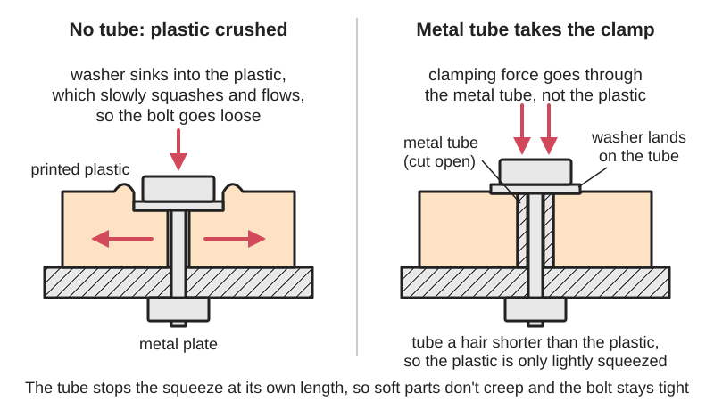
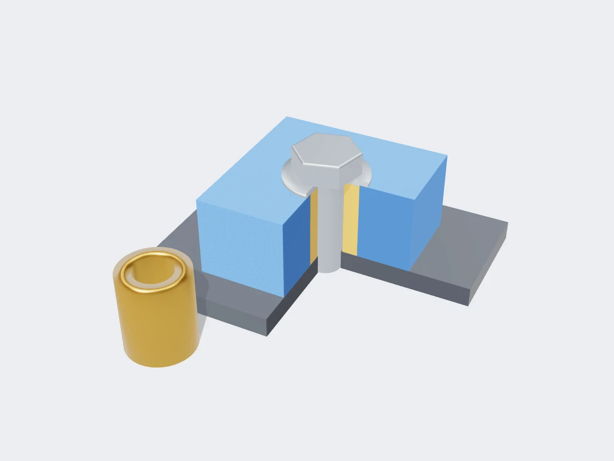

<figure class="eoc-pic eoc-pic-main"><figcaption>Diagram drawn for the encyclopaedia from the research notes. ⚑ Needs confirming: a drawing can simplify or get details wrong; a real photo or a better diagram is welcome.</figcaption></figure>
<figure class="eoc-pic"><figcaption><strong>Cut-away render.</strong> A 3D model made for the encyclopaedia, not a photo: a stand-in until a good real photo is found. ⚑ Needs confirming: a model can simplify or get details wrong; a real photo is welcome.</figcaption></figure>

A compression limiter is a short, stiff metal tube fitted in a bolt hole through a soft or hollow part (plastic, a 3D print, rubber, wood, a composite or cored panel, a box-section tube), sized so the bolt's clamping force is carried by the tube instead of the soft material, which stops it crushing, cracking or slowly creeping until the bolt goes loose.

**In plain words:** A short metal tube that sits in the bolt hole of a plastic, printed or soft part, so when you tighten the bolt it squeezes the metal tube instead of crushing the soft part, and the bolt stays tight. **Proper term:** Compression limiter (crush tube, bolt sleeve, compression sleeve).

**Also called:** compression limiter, CL (SPIROL; Bulten); anti-creep ring (EFC International: 'Compression Limiters, also known as Anti-Creep Rings'); crush tube (motorsport and chassis fabrication, for a tube inside a hollow box section; HP Academy); bolt sleeve, compression sleeve, metal sleeve, spacer tube (general workshop usage; EFC 'Bolt Sleeve Assemblies'); split-seam compression limiter, solid / machined / knurled / headed / oval / moulded-in compression limiter (SPIROL; Bulten); compression limiter assembly (CLA), captive bolt assembly (a limiter with its bolt held in it; Bulten); PressLoc (brand) compression limiters and bolt sleeve assemblies (EFC International); spacer for thin box tube (FRC robotics usage) ⚑ [uncertain: product page could not be opened]; reefing and backfilling / epoxy ring (boat-deck method that does the same job in a cored panel; Cruising World).

## How it works

A bolt clamps by stretching slightly, and that stretch only stays if everything it squeezes stays the same thickness. Plastic and other soft materials slowly squash and flow under a constant squeeze ([creep](../glossary.md#creep) and [stress relaxation](../glossary.md#stress-relaxation)), so the bolt loses its pull and the joint works loose (SPIROL: 'plastic always exhibits stress and strain relaxation under even modest loads'). A metal tube in the hole, made 'slightly shorter than the thickness of the plastic host', lets the plastic be gripped a little until the bolt head or washer lands on the tube; after that the tube carries the extra clamping load and the plastic is only lightly squeezed, so the bolt stays tight (SPIROL). The same idea stops a bolt crushing a hollow box section (a crush tube inside the rail; HP Academy) or the soft core of a [sandwich panel](../glossary.md#sandwich-panel) (an epoxy ring round the bolt; Cruising World).

## Parts

Single piece (a plain, knurled, headed, oval or split-seam metal tube) used with an ordinary bolt, washer and nut; a 'compression limiter assembly' is a few parts (limiter plus captive bolt) supplied as one unit (Bulten). In a cored panel the 'tube' is a ring of cured epoxy filling the hole round the bolt (Cruising World).

## Everyday examples

- the metal sleeves moulded into the bolt holes of plastic car engine covers, intake manifolds and bumpers ⚑ [uncertain: no opened source names these parts]
- the metal tube inside a rubber anti-vibration grommet or bobbin on a mounted panel or radiator ⚑ [uncertain]
- a spacer tube through a hollow box-section chassis rail or robot frame tube (HP Academy; FRC spacer for thin box tube)
- an epoxy-filled bolt hole under a deck fitting on a fibreglass boat (Cruising World)

## When to use it

Whenever a bolt or screw clamps through something that will squash, creep or crack under constant squeeze: 3D-printed brackets and mounts, plastic housings, wood that will shrink, rubber or foam-backed parts, composite or cored sandwich panels, and hollow box-section tube. Use it for any joint that must stay tight for a long time, gets warm, vibrates, or carries a safety-relevant load, and when you want to tighten the bolt properly without guessing how hard the part can take.

## When not to use it

Not needed in solid metal parts or thick, hard laminates. Not a fix for a hole that is too close to an edge or a wall that is too thin, which will still split sideways. Not suitable where the part must flex or float on the bolt (use a shoulder bolt or a rubber isolation mount with its own limiter). Where the bolt goes into the soft part rather than through it, use a threaded insert (heat-set, press-fit or potted insert). Where you just need a set gap between two hard parts, use a spacer or standoff instead.

## Details

- **What it does (jobs):**
  - join and hold: it is part of a bolted joint through a soft part and keeps that joint tight
  - line parts up exactly: a tight-fitting limiter also locates the part on its bolt; oval limiters give extra [clearance](../glossary.md#clearance) in one direction only to allow for [tolerances](../glossary.md#tolerance) (SPIROL; Bulten)
- **Movement:** none
- **Directions it can move (degrees of freedom):** 0: the bolt clamps the parts together through the tube
- **Special behaviour:**
  - none of the listed clever behaviours: it is a passive load path. Its one trick is that it sets a hard stop for how far a bolt can squeeze a soft part, a little like a [torque](../glossary.md#torque) limiter for clamping thickness rather than for torque
- **How it holds:**
  - friction or clamping ([force-fit](../glossary.md#form-fit--force-fit--material-bond)): the bolt clamps the parts, and the limiter keeps that clamp from fading
  - shape (the parts interlock; form-fit): moulded-in limiters have [radial](../glossary.md#axial--radial) grooves, and pressed-in ones have knurls, that lock them into the plastic (SPIROL; Bulten)
  - spring force (a spring or springy part presses it in place): split-seam limiters hold in their hole by their own spring tension (SPIROL)
  - material bond (glue, solvent or melting): home-made sleeves in prints and epoxy rings in cored panels are glued or cast in place (Cruising World)
- **Input and output:** not applicable
- **Power:** passive (no power needed)
- **Load:** Medium to heavy in clamping (compression along the bolt): standard limiters are rated for bolts up to ISO class 8.8, heavy-wall and machined ones up to class 10.9 (SPIROL), so the bolt is usually the weak link, not the limiter. It adds nothing in [shear](../glossary.md#peel-vs-shear) or pull-out of the plastic part itself: the plastic around the tube still takes the sideways and twisting loads, and a short limiter can be pushed out if not knurled or held (Bulten).
- **Play and precision:** Small: the bolt has clearance in the tube to allow for hole [misalignment](../glossary.md#misalignment) (SPIROL: at least 1 mm round the bolt for split-seam CL220, 0.5 mm for the slim CL200; oval types allow 2.25 mm extra on one axis). Once clamped the joint is rigid and repeatable because the clamp stops on the metal.
- **Taking it apart:** removable: the bolt undoes normally; pressed-in, moulded-in, welded or glued limiters stay in the part (semi-permanent), while a loose crush tube may move if the bolt is taken out (HP Academy)
- **How often it can be reused:** many times: the metal tube does not wear when the bolt is undone and re-tightened, as long as it has not been crushed by over-tightening
- **Sealing:** none on its own: it sets the squeeze on a gasket if one is used (see the Gasket entry), and in cored boat decks the epoxy ring also seals the core against water (Cruising World)
- **Adjustable:** no: the limiter's length fixes the final clamped thickness; to change it, change the limiter or add a washer
- **Access needed:** both sides: a through-bolt needs access to the bolt head and nut, unless the bolt goes into a threaded insert or tapped hole on the far side
- **Materials:** Limiter: steel (high-carbon spring steel for split-seam types, low-carbon steel for moulded-in, zinc plated), aluminium 2024 (about 1/3 the weight of brass), brass (chosen where it must be more 'noble' than aluminium on the galvanic scale) (SPIROL); Bulten lists steel, brass and aluminium. Home-made: steel or aluminium tube, brass hobby tube, or a cured epoxy ring. Host (what it protects): thermoplastics and thermosets, 3D prints, plastic, wood and rubber parts (Vogelsang via Design World), composite and cored sandwich panels (Cruising World), hollow steel or aluminium box sections (HP Academy). Not needed where the part itself is a stiff metal or solid laminate that won't creep under the bolt.
- **Heat, cold, water and wear:** The metal limiter itself is unaffected by heat and cold in hobby use; the point is that the plastic round it creeps faster when warm, so limiters matter most in hot places (engine bays, sunny windows, near heaters) ⚑ [uncertain: no opened source gives temperatures]. Corrosion: SPIROL's formed limiters are zinc plated with a sealer (144 hours to white corrosion and 384 hours to red corrosion in salt spray) or ArmorGalv-coated for 1000+ hours (CL220); aluminium and brass need no coating (SPIROL). [Galvanic corrosion](../glossary.md#galvanic-corrosion): choose brass where an aluminium limiter would sit against a more noble metal (SPIROL). Vibration: a limiter keeps bolt tension, which helps resist loosening, but still use thread-locking hardware where it shakes.

## Making it

- **Ways to make or get it:**
  - off-the-shelf part (split-seam, solid, knurled, headed, oval and moulded-in compression limiters)
  - 3D print (FDM) or 3D print (resin): print the part with a hole sized for a metal tube, then press or glue the tube in (the tube itself should be metal)
  - CNC: machine a part's bolt [bosses](../glossary.md#boss) to take a pressed-in limiter
  - sheet metal: crush tubes welded into box sections (HP Academy)
  - composite [lay-up](../glossary.md#lay-up): overdrill, fill with thickened epoxy and redrill to make an epoxy ring in a cored panel (Cruising World)
- **Printing it in one piece (print in place):** partly: the printed part can be designed with a hole or a pause-and-drop pocket for the tube, but the limiter must be an added metal tube; a printed tube would creep just like the part it is meant to protect
- **Tools:** none extra beyond the bolt's spanner or driver. To fit: an arbor press, vice or a bolt and washers to press knurled or split limiters in; epoxy for glued sleeves; a saw and file or linisher to cut home-made tube square; a drill to open the hole; a welder for welded-in crush tubes in steel rails (HP Academy). Factories use press machines or mould the limiter in (SPIROL).
- **Difficulty:** easy: cut a metal tube square to just under the part's thickness and press or glue it into the hole; buy standard limiters if you need precise lengths

### 3D printing tips

Use a metal tube, not a printed one: limiters are metal 'because plastic always exhibits stress and strain relaxation under even modest loads' (SPIROL), and printed parts 'deform over a few days' under constant bolt pressure ('plastics will creep under continuous compression, and the opposing force on the bolt will drop. Metal standoffs would be better', Langmuir Systems forum). Length: make the tube no longer than the printed part's thickness, ideally a little shorter, so the bolt head or washer seats on both the print and the tube (SPIROL; Bulten); measure the real printed thickness, because prints are rarely exactly the CAD size. Hole: size it for a light press fit or a glue fit to the tube's outside diameter; test with a short coupon first, since FDM holes usually print undersize ⚑ [uncertain: no opened source gives a printed-hole allowance for limiters]. Wall round the hole: at least half the bolt diameter (e.g. 3 mm for M6) (Bulten). Fitting: press in with a vice or a bolt and washers, or glue with epoxy; a knurled tube grips better in plastic (Bulten). Material of the print: PLA 'deforms over time under load'; PETG or nylon hold better (Printables 954045 designer notes). Add a washer under the bolt head so the load spreads over both tube and print. Hollow prints or sparse [infill](../glossary.md#infill) crush easily round a bolt: use solid walls or many [perimeters](../glossary.md#perimeters) there ⚑ [uncertain: general FDM practice].

### Buying one (off-the-shelf parts)

Search 'compression limiter' (split seam, solid, knurled, headed, oval, moulded-in; e.g. SPIROL Series CL200, CL220, CL6000, CL8000 (brand)), 'anti-creep ring', 'PressLoc compression limiter' (brand, EFC International), 'compression limiter assembly' or 'captive bolt assembly' (Bulten), 'bolt sleeve', 'spacer tube', 'crush tube', 'spacer for thin box tube' (FRC robotics). Home-made: 'brass tube' or 'aluminium tube' hobby stock cut to length; 'thickened epoxy' (e.g. West System 404 or 406 filler (brand)) for cored panels. See the supplier catalogues (SPIROL and Bulten design guides) for sizes rather than copying tables.

## Rules of thumb

- Length: the limiter should be 'slightly shorter than the thickness of the plastic host' (SPIROL); 'the minimum plastic thickness equals the maximum compression limiter length' (Bulten).
- The bolt head or washer 'should always seat against both the plastic host and the Compression Limiter under load', which stops loss of clamp from plastic creep (SPIROL).
- The limiter's proof load should be at least the bolt's, so the limiter never yields before the bolt (SPIROL).
- Tighten to a bolt load of 25% to 75% of the bolt's proof load; actual load from a given torque can vary by about plus or minus 25% (SPIROL).
- Allowing 3-5% compression of an engineering thermoplastic is a safe, conservative limit; most plastics tolerate 5-7% (SPIROL).
- Plastic boss wall round the limiter: at least 50% of the bolt diameter, e.g. 3.0 mm for M6 (Bulten).
- Moulded holes for pressed-in limiters: about 1 degree inclusive [taper](../glossary.md#taper), larger at the insertion side; for long limiters an [interference fit](../glossary.md#interference-fit) may only be needed over part of the length (Bulten). Example of the press fit: Bulten's standard M6 limiter is 9.20 mm outside diameter for a 9.00-9.10 mm hole.
- Crush tube in a hollow rail: cut it square and to the inside height; too long and it won't fit, too short and the rail still crushes; tack or fully weld it so it can't move when the bolt is out (HP Academy).
- Cored deck (epoxy ring): redrill the top skin about half again as large (1/4 in to 3/8 in), dig out the core about 1/2 in round the hole, fill with epoxy thickened to mayonnaise consistency, then redrill; 'the epoxy ring prevents the fastener from crushing the core. A 1/4-inch fastener can exert more than 500 pounds of pressure on the core' (Cruising World).

## Common failures

1) Limiter too long: the bolt clamps only on the tube and the soft part rattles loose (Bulten: minimum plastic thickness equals maximum limiter length). 2) Limiter too short or missing: the part still crushes and creeps, and the bolt loosens (SPIROL; HP Academy). 3) Limiter pushed out of the part when the bolt is undone, or never fully seated: use knurled or headed limiters or glue them in (Bulten). 4) Boss wall too thin: the plastic splits as the limiter is pressed in (Bulten: wall at least half the bolt diameter). 5) Mating part too soft: the limiter digs into an aluminium or plastic part on the other side; use a headed limiter or a washer to spread the load (SPIROL; Bulten). 6) Tube end cut at an angle: only part of it bears and the rail or part still deforms (HP Academy). 7) Printed tube used as a limiter: it creeps too (Langmuir Systems forum).

## Safety

A crushed or crept joint loosens without warning: plastic parts 'are destroyed during fastening' without limiters, and tightening 'causes compression, which can lead to cracking and creep' (Vogelsang via Design World; EFC International). On anything that carries people (seats, bike or scooter parts, climbing or play structures), re-check bolts after the first days of use and regularly after that, and don't rely on printed parts alone. Over-tightening to the bolt's proof load will break the bolt (SPIROL). When cutting and welding crush tubes, wear eye protection (Cruising World and HP Academy demonstrations use drills, grinders and welders).

## Related

- Shims, spacers and standoffs: also set a distance with a tube, but between two hard parts; a compression limiter protects a soft part that is clamped
- Panel standoff (sign standoff): a decorative threaded barrel that holds a sheet off a wall
- Heat-set threaded insert and press-fit inserts: give a strong metal thread inside a plastic part; a limiter has no thread and takes clamping load through the part
- Potted insert (sandwich-panel insert, hard point): the cored-panel version, an insert set in epoxy so the core is not crushed
- Elastomer isolation mount (rubber bobbin mount, isolator grommet): a rubber mount, often with a metal sleeve in its centre doing the limiter's job
- Gasket: a compression limiter can set how hard a gasket is squeezed under a screw
- Ordinary screw joint (bolt and nut): the joint the limiter protects
- Thread-locking hardware: stops a bolt turning loose; a limiter stops it losing tension through creep
- Shoulder bolt ⚑ [uncertain: no opened source; mentioned as the one-piece alternative]: a bolt with a plain shoulder that sets the clamp length itself

## Pictures, videos and models

- [Compression Limiters design guide (SPIROL UK, PDF)](https://uk.spirol.com/assets/files/cmpl-compression-limiter-design-guide-uk.pdf): Drawings of split-seam, oval, moulded-in, knurled and headed limiters, how a limiter sits in a plastic boss under a bolt, and the design rules for length and loading *(licence: link only)*
- [Compression Limiters & Captive Bolt Assemblies design guide (Bulten, PDF)](https://www.bulten.com/media/luvfra41/compression-limiters-bulten.pdf): Pictures of solid, headed, knurled, oval, split and captive-bolt limiters, with hole design, length and boss wall rules *(licence: link only)*
- [Motorsport Fabrication Fundamentals: Crush Tubes (HP Academy, video lesson)](https://hpacademy.com/courses/motorsport-fabrication-fundamentals/skills-tubes): Video demonstration of a bolt crushing a box-section chassis rail, then crush tubes fitted loose and welded in so the rail doesn't deform *(licence: link only)*
- [Core Concerns: Reefing and Backfilling (Cruising World)](https://www.cruisingworld.com/?p=40890): How to dig out a cored deck round a bolt hole and fill it with epoxy so the bolt can't crush the core *(licence: link only)*

## Needs confirming

⚑ marks something nobody has confirmed yet: a fact the research could not confirm from a source, a finder value that is a best guess, or an open point from the research notes. Corrections are welcome (see `research/needs-confirming.md`).

- ⚑ 7 sentences on this page marked [uncertain].
- ⚑ Research note: *Compression limiter* (438): no printable model found (a MakerWorld page was 403).

## Sources

- <https://uk.spirol.com/assets/files/cmpl-compression-limiter-design-guide-uk.pdf>
- <https://www.bulten.com/media/luvfra41/compression-limiters-bulten.pdf>
- <https://efc-intl.com/category/metal-compression-limiters>
- <https://fastenerengineering.com/compression-limiters-that-protect-plastic-wood-and-rubber-parts/>
- <https://hpacademy.com/courses/motorsport-fabrication-fundamentals/skills-tubes>
- <https://www.cruisingworld.com/?p=40890>
- <https://forum.langmuirsystems.com/t/economical-rail-covers/32141>
- <https://api.printables.com/graphql/ (model 954045 'Sign standoff' designer notes on PLA deforming under load; searches 'compression limiter', 'crush tube', 'bolt sleeve' found no limiter test models)>
