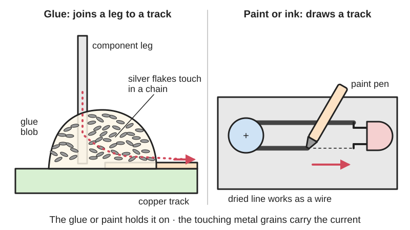
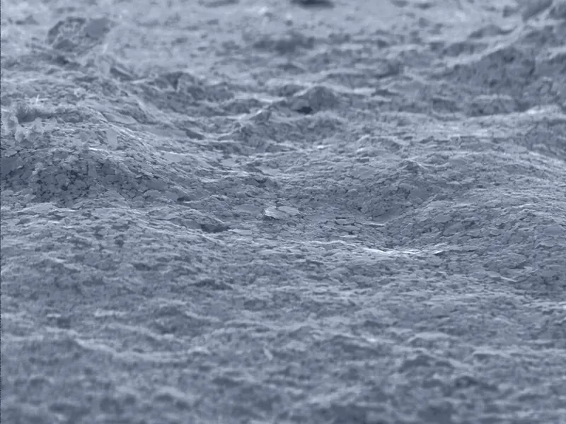

<figure class="eoc-pic eoc-pic-main"><figcaption>Diagram drawn for the encyclopaedia from the research notes. ⚑ Needs confirming: a drawing can simplify or get details wrong; a real photo or a better diagram is welcome.</figcaption></figure>
<figure class="eoc-pic"><figcaption><strong>How it works.</strong> <a href="https://commons.wikimedia.org/wiki/File:Conductive_silver.jpg">Conductive silver</a> by PhysikingerC, Public domain, from Wikimedia Commons.</figcaption></figure>

Conductive glue, paint and ink are adhesives, paints and inks loaded with silver, copper, nickel or carbon particles that touch each other once dry or cured, so they stick a part on or draw a track that carries a small current where solder can't be used, such as on heat-sensitive parts, glass, paper, fabric or 3D prints.

**In plain words:** Glue, paint or ink packed with tiny grains of silver, copper, nickel or carbon, so that once it dries or sets it carries electricity: you can glue a part on, paint or draw a wire, or mend a broken track where a soldering iron can't be used. **Proper term:** Conductive glue, paint and ink (electrically conductive adhesive, silver epoxy).

**Also called:** electrically conductive adhesive (ECA) (Wikipedia 'Electrically conductive adhesive'); silver conductive epoxy / silver epoxy / conductive epoxy (two-part epoxy filled with silver; e.g. MG Chemicals 8331 and 8330, brand) (MG Chemicals data sheets; SparkFun); silver conductive paint / silver paint (e.g. Electrolube Silver Conductive Paint, brand) (Electrolube safety data sheet; Wikipedia 'Electrically conductive adhesive'); conductive paint / electric paint (carbon-based, water-based; e.g. Bare Conductive Electric Paint, brand) and copper paint (e.g. CuPro-Cote, brand) (SparkFun 'Great Big Guide to Paper Circuits'; Bare Conductive data sheet); conductive ink / conductive ink pen / silver ink pen (e.g. Circuit Scribe and AgIC, brands) (Wikipedia 'Conductive ink'; SparkFun); conductive pen / circuit trace repair pen (e.g. CircuitWorks CW2200, brand) (Chemtronics data sheet); cold solder / cold soldering (using conductive paint or epoxy in place of solder) (SparkFun; MG Chemicals 8331 data sheet: 'quick, cold-soldering repairs'); rear window defogger (defroster) grid repair / tab adhesive (e.g. Permatex, brand) (Wikipedia 'Defogger'; Permatex data sheet); rubber keypad repair kit (silver and carbon coating for remote-control buttons; CircuitWorks CW2605, brand) (Chemtronics data sheet); conductive filament / conductive PLA / carbon-filled filament (e.g. Protopasta Conductive PLA, brand) and copper-filled filament (e.g. Electrifi, brand) (Protopasta data sheet; filament2print); anisotropic conductive film (ACF) / anisotropic conductive adhesive: the factory version that conducts only straight through the joint, used to bond display flex cables (Wikipedia 'Anisotropic conductive film'); z-axis tape is the hobby tape form (SparkFun).

## How it works

A glue, varnish, resin, silicone or water-based binder holds a large amount of conductive powder, about 80% of the total mass in a conductive adhesive (Wikipedia 'Electrically conductive adhesive'). When the solvent has evaporated or the epoxy has cured, 'the particles of the conductive component are in contact to each other and in this way make electric current possible' (Wikipedia). Because current has to hop from grain to grain, the result conducts far worse than solid metal, and paint is 'not conductive until fully dry' (SparkFun). The binder also does the sticking, so one blob both holds a part and connects it, which is why it is called 'cold solder' (MG Chemicals; SparkFun). Conductive filament works the same way, with carbon black or copper grains in printable plastic (Protopasta; filament2print).

## Parts

Single material in one of three forms: a one-part paint, ink or pen that dries as its solvent or water evaporates; a two-part epoxy (silver-filled resin plus hardener) that [cures](../glossary.md#cure); or a conductive 3D-printing filament (plastic filled with carbon black or copper) (Wikipedia; MG Chemicals; Protopasta; filament2print). Used with a mixing stick, toothpick or syringe, a fine brush or stencil, isopropyl alcohol for cleaning, and sometimes a heat lamp or oven for curing (MG Chemicals; Bare Conductive; Permatex; SparkFun).

## Everyday examples

- the thin heater lines on a car's rear window, often a silver-ceramic material printed onto the glass, which are mended with a copper-coloured conductive paint kit (Wikipedia 'Defogger'; Permatex)
- TV remote-control buttons whose worn carbon contacts are restored with a keypad repair coating (CircuitWorks CW2605 data sheet)
- computer keyboard membranes and transit-card RFID tags, which have printed silver-ink circuits (Wikipedia 'Conductive ink')
- painted light-up cards and interactive paintings made with conductive paint (SparkFun 'Great Big Guide to Paper Circuits')

## When to use it

When solder can't be used: on parts that can't take the heat, on glass, soft metals or plastics (MG Chemicals 8331), on paper, card, fabric and prints (SparkFun), to mend a broken track on a circuit board or make a jumper (MG Chemicals; CircuitWorks CW2200), to mend a car's rear-window heater line or reattach its tab (Permatex), or to restore worn rubber keypad contacts (CircuitWorks CW2605). Choose silver epoxy for a strong, low-resistance permanent joint; a silver pen for neat, quick-drying repair tracks; carbon paint for art, touch and proximity sensors and painted resistors (Bare Conductive data sheet); and conductive filament for printed touch pads and simple low-current tracks (Protopasta). Painting the inside of a plastic box with conductive paint can also shield it (Wikipedia 'Electrically conductive adhesive').

## When not to use it

For power wiring, motors, heaters, chargers or anything on mains: use a Soldered wire joint, Crimp terminals or a Screw terminal. Where solder works: solder is far lower in resistance, quicker and cheaper (see the resistivity rule of thumb). On parts that flex or fold: paint 'will mostly likely fail with repeated movement' (SparkFun); use Conductive thread, conductive fabric tape (Conductive tape) or thin flexible wire. On polypropylene or polyethylene, which silver epoxy doesn't bond (MG Chemicals). Where a joint must come apart: use a plug (Wire-to-board plug connectors, Pogo pin). For long thin carbon-paint or carbon-filament lines that must carry more than a few milliamps, since resistance adds up with length (Bare Conductive data sheet; Printables 1423421).

## Details

- **What it does (jobs):**
  - glue or bond: one blob both sticks a part on and makes the electrical connection
  - join and hold: paints, draws or prints a track that carries current between parts, or mends a broken track (the finder reaches this entry through the 'electrical connections' family)
- **Movement:** none: once dry or cured it is rigid; paint 'can crack or break under repeated stress' and traces over folds 'will mostly likely fail with repeated movement' (SparkFun)
- **Directions it can move (degrees of freedom):** 0: a cured joint holds the part fixed
- **Special behaviour:**
  - none: it is a passive conductor that sets in place
- **How it holds:** [material bond](../glossary.md#form-fit--force-fit--material-bond) (glue, solvent or melting): the binder sticks to both surfaces and the conductive grains inside it carry the current (Wikipedia; MG Chemicals)
- **Input and output:** not applicable
- **Power:** passive (no power needed)
- **Load:** Electrical: signal only, extra-low voltage only. Conductive adhesives are for when 'just a small current is needed' (Wikipedia 'Electrically conductive adhesive'), and Bare Conductive's paint is 'intended for applications with circuits using low DC voltages at low currents' (Bare Conductive data sheet). Resistivity compared with tin, the main metal in most solder (1.09 x 10^-5 ohm cm, Wikipedia 'Electrical resistivity and conductivity'): silver pen 5 x 10^-5 to 1.25 x 10^-4 ohm cm (CircuitWorks CW2200), silver epoxy 5.3 x 10^-4 to 6.0 x 10^-3 ohm cm (MG Chemicals range), copper-filled filament about 0.006 ohm cm (Electrifi, filament2print), carbon paint about 0.28 ohm cm (calculated from 55 ohm per square at 50 microns, Bare Conductive), and carbon-filled PLA 30-115 ohm cm when printed (Protopasta). So silver glue is roughly 50-550 times worse than tin and carbon materials thousands to millions of times worse (calculated). Worked example (calculated): a silver-epoxy bridge 10 mm long, 2 mm wide and 0.1 mm thick at 1.8 x 10^-3 ohm cm measures about 0.9 ohm, so 1 A would waste about 0.9 W in it. A short glued joint under a component lead is far lower and fine for small loads. The one higher-current everyday use is patching a short break in a car's rear-window heater line, where the repair carries the line's own heater current (Permatex: 'designed to conduct electricity and distribute heat'). Never for mains or power wiring. Mechanical: light to medium for silver epoxy (lap [shear](../glossary.md#peel-vs-shear) 1.2-7.1 N/mm² depending on product and metal, MG Chemicals category data sheet); light for paints and inks, which crack when bent (SparkFun).
- **Play and precision:** not applicable
- **Taking it apart:** permanent for silver epoxy ('strong permanent electrical connections', MG Chemicals); semi-permanent for paints and inks, which can be scraped or dissolved off (Bare Conductive Electric Paint cleans up with warm water and soap; Permatex's grid repair cleans off with acetone) (Bare Conductive data sheet; Permatex data sheet)
- **How often it can be reused:** once
- **Sealing:** none: it is not a seal, though cured silver epoxy has 'strong resistance to humidity, salt water' (MG Chemicals 8331) and water-based paint can be over-painted with acrylic to protect it (SparkFun)
- **Adjustable:** no; an unreliable painted joint can be fixed by layering more paint on top (SparkFun)
- **Access needed:** one side only (blind)
- **Materials:** Fillers: silver, nickel, copper or graphite (Wikipedia), carbon black (Protopasta) or copper (Electrifi); binders: varnish, synthetic resin or silicone (Wikipedia), two-part epoxy (MG Chemicals), acrylic resin (Permatex) or water-based binders (Bare Conductive). MG Chemicals 8331 sticks best to aluminium, then steel, fibreglass, wood, paper, glass, rubber, polycarbonate and acrylic (weaker), and 'does not bond' to polypropylene; MG's range also bonds to gold, brass, bronze, glass, conductive polymers and flexible circuits (MG Chemicals data sheets). Bare Conductive paint 'adheres to a wide variety of substrates' (data sheet); conductive inks 'will not adhere to some types of paper. Photo paper works best', and don't stick well over printer toner (SparkFun). Copper-based paints 'will oxidize quickly and can have a short shelf life' (SparkFun). On PLA prints, use room-temperature cure, because heat cures at 65 °C or more (MG Chemicals) are above the 60 °C at which PLA 'gets soft and deforms' (Prusa 'PLA'). Not for PE or PP (MG Chemicals: polypropylene 'does not bond').
- **Heat, cold, water and wear:** Heat: silver epoxy is rated for service from about -50 to 150 °C (MG Chemicals), but its glass transition (where it starts to soften) is only 34-40 °C for MG's current two-part grades and 50 °C for the older 8331, whose heat-deflection temperature is 48 °C (MG Chemicals data sheets), so don't rely on it to hold a load when warm; the silver pen is rated to 205 °C (CircuitWorks CW2200); Permatex's grid repair is rated -30 to +180 °F (about -34 to 82 °C). PLA prints soften above 60 °C (Prusa). Water: Bare Conductive paint is water-based and 'water soluble' (data sheet), so it needs a protective coat where it may get damp ⚑ [uncertain: protective coat advice is general]; cured 8331 epoxy resists water and salt but not long contact with solvents, strong acids, bases or oxidisers (MG Chemicals). Ageing: copper paints oxidise quickly (SparkFun); Bare Conductive paint keeps 6 months after opening (data sheet). Flexing: paint cracks under strain (SparkFun). Textiles: printed inks 'must stand up to regular wear and washing', which is still a problem being researched (Wikipedia 'Conductive ink').

## Making it

- **Ways to make or get it:**
  - off-the-shelf part (silver epoxy, conductive paint, conductive ink pens, repair kits, conductive filament)
  - hand-applied by brush, pen, syringe or stencil; screen printing for paint (Bare Conductive data sheet)
  - 3D print (FDM): conductive filament traces and touch pads (Protopasta; Hackaday 2022)
  - 3D print (FDM), woodwork or sheet enclosures painted inside as an electrical shield (Wikipedia 'Electrically conductive adhesive'; Wikipedia 'Electromagnetic shielding')
- **Printing it in one piece (print in place):** partly: conductive-filament traces can be printed in the same job as the plastic part on a dual-extruder or colour-change print (Printables 1423421; Printables 425558), but parts and wires still have to be added afterwards; glue, paint and ink are applied after printing
- **Tools:** toothpick, mixing stick or syringe (SparkFun recommends a syringe to cut down mess), fine brush, squeeze bottle or pen, a stencil or masking tape for straight lines (Permatex kit includes a stencil and brush), isopropyl alcohol to degrease surfaces (MG Chemicals), fine sandpaper (MG Chemicals; Permatex), a hair dryer, heat lamp or oven to speed drying or curing (SparkFun; Bare Conductive; MG Chemicals), a multimeter to check for near-zero resistance across a repair (Permatex), gloves and ventilation for solvent-based paints (Electrolube safety data sheet)
- **Difficulty:** easy for paints and ink pens ('Beginner - Intermediate', SparkFun), though paint is messy and slow to dry; moderate for silver epoxy, 'one of the more expensive ways' to attach parts that 'can be difficult to work with' and needs 'a long dry time or to be heat set' (SparkFun); moderate for conductive filament, which is [brittle](../glossary.md#brittle--ductile) and resistive (Printables 1423421)

### 3D printing tips

Conductive filament: print traces flat, along the layers. Protopasta's carbon PLA measures 30 ohm cm along the layers but 115 ohm cm through them (data sheet), and Hackaday has found conductive filament 'isn't reliably resistive across vertical layers' ⚑ [uncertain: Hackaday writer's own experience]. Protopasta's settings: 215 °C nozzle, 60 °C bed, 25-45 mm/s, extrusion width 0.05 mm wider than the nozzle (data sheet). Copper-filled Electrifi prints much cooler, 140-180 °C nozzle and bed at 50 °C or less, from a brass or hardened-steel nozzle (filament2print). Carbon filament is brittle, so feed it straight into the extruder rather than through a long PTFE tube; even a thick printed trace only just lights a white LED from 9 V (Printables 1423421). Use a dab of silver paint or paste where wires meet a printed trace: filament2print notes that silver paste improves resistance measurements of Electrifi prints by 'reducing contact resistance', and says Electrifi 'works best as a conductive structural material, not as a solder replacement'. Hackaday 2022 describes printing a non-conductive PLA layer over conductive traces 'like a PCB solder mask'. Glue and paint on prints: degrease with isopropyl alcohol and lightly sand for better grip (MG Chemicals), cure at room temperature on PLA (Prusa: PLA softens over 60 °C), and avoid PP (MG Chemicals). Painting the inside of a printed box with conductive paint and connecting it to ground makes a shield (Wikipedia 'Electrically conductive adhesive'; Wikipedia 'Electromagnetic shielding'). Design small holes so component legs pass through the part before being painted over, which gives 'some strain relief' as SparkFun recommends for paper ⚑ [uncertain: applied to prints by analogy].

### Buying one (off-the-shelf parts)

Search terms: 'silver conductive epoxy' (e.g. MG Chemicals 8331D, 8330D, brand; 'syringe kit'), 'silver conductive paint', 'conductive pen' or 'circuit trace repair pen' (e.g. CircuitWorks CW2200, brand), 'conductive ink pen' (e.g. Circuit Scribe, brand), 'Electric Paint' (Bare Conductive, brand, carbon, water-based), 'copper conductive paint', 'nickel conductive paint' or 'shielding paint', 'rear window defogger repair kit' (e.g. Permatex, brand), 'rubber keypad repair kit' (e.g. CircuitWorks CW2605, brand), 'conductive PLA filament' (e.g. Protopasta, brand), 'copper conductive filament' (e.g. Electrifi, brand), 'z-axis conductive tape', 'isopropyl alcohol'.

## Rules of thumb

- Resistivity side by side (lower is better): copper 1.68 x 10^-6 and tin 1.09 x 10^-5 ohm cm (Wikipedia, https://en.wikipedia.org/wiki/Electrical_resistivity_and_conductivity); silver pen 5 x 10^-5 to 1.25 x 10^-4 ohm cm (CircuitWorks CW2200, https://www.farnell.com/datasheets/2792788.pdf); silver epoxy 5.3 x 10^-4 (8330D), 1.8 x 10^-3 (8331D) up to 6.0 x 10^-3 ohm cm (8331S) (MG Chemicals, https://mgchemicals.com/downloads/category-data-sheets/CDS-ElectricallyConductiveAdhesives.pdf), and 0.007 ohm cm for the older 8331 (2018 data sheet, https://www.farnell.com/datasheets/2614609.pdf); rear-window grid repair 1.01 x 10^-3 ohm cm minimum (Permatex, https://cdn.amplifi.pattern.com/69210793-d726-4c85-9584-3b22296b7321); copper-filled filament about 0.006 ohm cm (https://filament2print.com/en/advanced/4451-conductive-filament-electrifi.html); carbon PLA 15 ohm cm moulded, 30 along and 115 through printed layers (Protopasta, https://www.farnell.com/datasheets/3179312.pdf).
- Carbon paint line resistance: Bare Conductive Electric Paint is 55 ohm per square at 50 microns, about 32 ohm per square when brushed or screen printed, and R ≈ 19.77 x (length / width) + 12 ohm for a screen-printed line, e.g. about 2500 ohm for a 1250 mm x 10 mm line (Bare Conductive data sheet, https://cdn.sparkfun.com/assets/8/e/2/6/5/ElectricPaint_TechnicalDataSheet.pdf). Worked example (calculated): a 100 mm x 5 mm painted line is about 400 ohm, fine for a touch sensor, too much to power a motor.
- About 80% of a conductive adhesive's mass is the conductive filler (Wikipedia, https://en.wikipedia.org/wiki/Electrically_conductive_adhesive).
- Paint is 'not conductive until fully dry' and may need to dry overnight; a hair dryer or heat gun speeds it up (SparkFun, https://learn.sparkfun.com/tutorials/the-great-big-guide-to-paper-circuits/all). Bare Conductive dries in 5-15 minutes at room temperature (data sheet).
- Push parts into paint while it is still wet and let it dry completely before powering; attach parts to a painted trace while the trace is still wet for the best connection (SparkFun).
- Silver epoxy cure: MG Chemicals 8331 works for 10 minutes and fully cures in 24 hours at 22 °C or 15 minutes at 65 °C (2018 data sheet); the current 8331D has 20 minutes [working time](../glossary.md#pot-life--working-time) and cures in 6 hours at room temperature or 10 minutes at 65 °C (category data sheet).
- Rear-window heater line repair: brush on four coats inside the stencil, letting each go tack-free; the repair must look completely opaque with 'essentially zero (0)' ohms across it; remove the stencil after 30 minutes and wait 24 hours before switching the heater on (Permatex, https://cdn.amplifi.pattern.com/69210793-d726-4c85-9584-3b22296b7321).
- Clean surfaces first: 8331 'is not compatible with contaminants like water, oil, or greasy [flux](../glossary.md#flux) residues'; clean with isopropyl alcohol, and sand or prime weak surfaces (MG Chemicals, https://www.farnell.com/datasheets/2614609.pdf).
- Glue parts down first with superglue, then paint over their pads, keeping glue out from between the ink and the pads (SparkFun, https://learn.sparkfun.com/tutorials/the-great-big-guide-to-paper-circuits/all).

## Common failures

(1) Nothing works because the paint isn't fully dry or the epoxy isn't fully cured; wait (SparkFun) or follow the cure schedule (MG Chemicals). (2) Joint fails because of oil, water or flux residue on the surface; clean with isopropyl alcohol first (MG Chemicals). (3) Cracked trace after bending or folding (SparkFun). (4) Dim LED or a circuit that misbehaves because a long carbon trace has too much resistance (Bare Conductive; Printables 1423421). (5) Ink doesn't stick to the paper or toner (SparkFun). (6) Copper paint stops conducting as it oxidises (SparkFun). (7) Printed conductive part conducts poorly between layers (Protopasta: 115 versus 30 ohm cm). (8) A smear of glue or paint bridges neighbouring pins and shorts them ⚑ [uncertain: general experience, not on an opened page]. (9) Rear-window repair fails because the stencil leaked or too few coats were applied; Permatex calls for four coats until no light shows through (Permatex).

## Safety

SOLVENT FUMES AND FIRE: some silver paints are solvent-based. Electrolube's Silver Conductive Paint is classed 'Highly flammable liquid and vapor' (H225) and 'May cause drowsiness or dizziness' (H336), with ethanol, acetone, ethyl acetate and 1-ethoxypropan-2-ol as solvents; 'Use only outdoors or in a well-ventilated area' and wear gloves and eye protection (Electrolube safety data sheet). Permatex's grid repair has a solvent smell and a flash point of 94 °F (about 34 °C) (Permatex data sheet). Keep these away from soldering irons and flames. Water-based carbon paint is the low-hazard choice: Bare Conductive's is 'nontoxic, water based' (data sheet). EPOXY: read the safety data sheet, as MG Chemicals directs; the hardener has an amine smell (MG Chemicals 8331 data sheet); wear gloves, since uncured epoxy can irritate skin ⚑ [uncertain: general epoxy advice, not from an opened data sheet]. NOT FOR POWER: high resistance makes joints heat up under load (see load); never use these on mains or for power wiring. Mains work must follow local law (in England, Approved Document P covers electrical installation work in homes); extra-low voltage means not more than 50 V AC or 120 V ripple-free DC (Approved Document P). NOT ON SKIN: research inks are being made for 'smart tattoos' and sensors on skin (Wikipedia 'Conductive ink'), but hobby paints, inks and epoxies must never be put on or in the body or used as medical electrodes. COIN CELLS in paper circuits are a swallowing hazard for small children (see Conductive tape).

## Related

- Soldered wire joint (soldered splice): the normal, much lower-resistance joint when heat is acceptable
- Conductive tape (copper foil tape, conductive fabric tape): ready-made flat conductors; conductive glue is the way to attach parts to fabric tape
- Conductive thread (sewn circuit, e-textile stitching): flexible stitched conductors for fabric
- Two-part epoxy: the same kind of glue without metal filler; stronger, but it insulates
- Cyanoacrylate (superglue): used to tack parts down before painting over their pads (SparkFun)
- Crimp terminals and Crimped butt splice: cold, heat-free joints that do carry real current
- Wire wrap (wire-wrapped connection): another solder-free connection, for solid wire on square posts
- Mid-print embedding ([captive nuts](../glossary.md#captive-nut), magnets and bearings): embedding wires or metal contacts in a print, an alternative to printed conductive tracks

## Make it yourself

- [Conductive filament - test sample (Printables 1423421; URL from Printables API, page not opened)](https://www.printables.com/model/1423421-conductive-filament-test-sample): A two-material test print with a conductive-filament trace on a PLA base, to measure resistance and light an LED *(licence: CC BY-NC-SA (Creative Commons Attribution-NonCommercial-ShareAlike))*
- [Flashlight with Conductive Filament - Limited Success - Learning Experience (Printables 425558; URL from Printables API, page not opened)](https://www.printables.com/model/425558-flashlight-with-conductive-filament-limited-succes): A printed torch whose current path is conductive filament, made with colour changes in PrusaSlicer; documents why it barely lit *(licence: CC BY-SA (Creative Commons Attribution-ShareAlike))*
- [The Great Big Guide to Paper Circuits (SparkFun Learn)](https://learn.sparkfun.com/tutorials/the-great-big-guide-to-paper-circuits/all): How-to for painted and inked paper circuits, including attaching parts with wet paint, conductive glue or z-axis tape *(licence: link only)*

## Pictures, videos and models

- [Conductive silver.jpg (Wikimedia Commons, by PhysikingerC, University of Konstanz)](https://commons.wikimedia.org/wiki/File:Conductive_silver.jpg): Scanning electron microscope image of conductive silver, showing the touching flakes that carry the current (picture width 434 µm) *(licence: Public domain (released by the copyright holder))*
- [Making Conductive Ink.JPG (Wikimedia Commons, by Klosito)](https://commons.wikimedia.org/wiki/File:Making_Conductive_Ink.JPG): Graphite, glue and paint laid out for making a home-made conductive ink *(licence: CC BY-SA 3.0 (reuse with credit))*
- [The Great Big Guide to Paper Circuits (SparkFun Learn)](https://learn.sparkfun.com/tutorials/the-great-big-guide-to-paper-circuits/all): Photos of painting traces with conductive paint, drawing with a silver ink pen, cold-soldering parts into wet paint and a conductive epoxy syringe *(licence: link only)*
- [Add Conductive Traces On Vacuum Formed Plastic With 3D Printing (Hackaday, 2022)](https://hackaday.com/2022/04/22/add-conductive-traces-on-vacuum-formed-plastic-with-3d-printing/): Six-panel diagram of printing conductive-PLA traces onto a plastic sheet and vacuum forming it into a touch-sensing tray *(licence: link only)*

## Needs confirming

⚑ marks something nobody has confirmed yet: a fact the research could not confirm from a source, a finder value that is a best guess, or an open point from the research notes. Corrections are welcome (see `research/needs-confirming.md`).

- ⚑ 5 sentences on this page marked [uncertain].
- ⚑ Finder value `tools` = hand tools (best guess): no tool named in `tools_needed`; defaulted to hand tools
- ⚑ Finder value `load_max` = light (best guess): electrical entry whose mechanical load has no light/medium/heavy band; set to light

## Sources

- <https://en.wikipedia.org/wiki/Electrically_conductive_adhesive>
- <https://en.wikipedia.org/wiki/Conductive_ink>
- <https://en.wikipedia.org/wiki/Defogger>
- <https://en.wikipedia.org/wiki/Anisotropic_conductive_film>
- <https://en.wikipedia.org/wiki/Electromagnetic_shielding>
- <https://en.wikipedia.org/wiki/Electrical_resistivity_and_conductivity>
- <https://learn.sparkfun.com/tutorials/the-great-big-guide-to-paper-circuits/all>
- <https://mgchemicals.com/downloads/category-data-sheets/CDS-ElectricallyConductiveAdhesives.pdf>
- <https://www.farnell.com/datasheets/2614609.pdf>
- <https://www.farnell.com/datasheets/2615500.pdf>
- <https://cdn.sparkfun.com/assets/8/e/2/6/5/ElectricPaint_TechnicalDataSheet.pdf>
- <https://www.farnell.com/datasheets/2792788.pdf>
- <https://www.farnell.com/datasheets/1728860.pdf>
- <https://cdn.amplifi.pattern.com/69210793-d726-4c85-9584-3b22296b7321>
- <https://www.farnell.com/datasheets/3179312.pdf>
- <https://filament2print.com/en/advanced/4451-conductive-filament-electrifi.html>
- <https://hackaday.com/2022/04/22/add-conductive-traces-on-vacuum-formed-plastic-with-3d-printing/>
- <https://help.prusa3d.com/article/pla_2062>
- <https://assets.publishing.service.gov.uk/government/uploads/system/uploads/attachment_data/file/441872/BR_PDF_AD_P_2013.pdf>
- <https://commons.wikimedia.org/wiki/File:Conductive_silver.jpg>
- <https://commons.wikimedia.org/wiki/File:Making_Conductive_Ink.JPG>
- <https://api.printables.com/graphql/>
