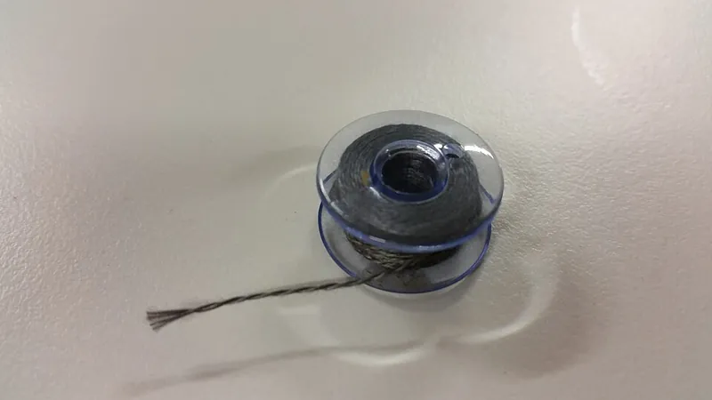
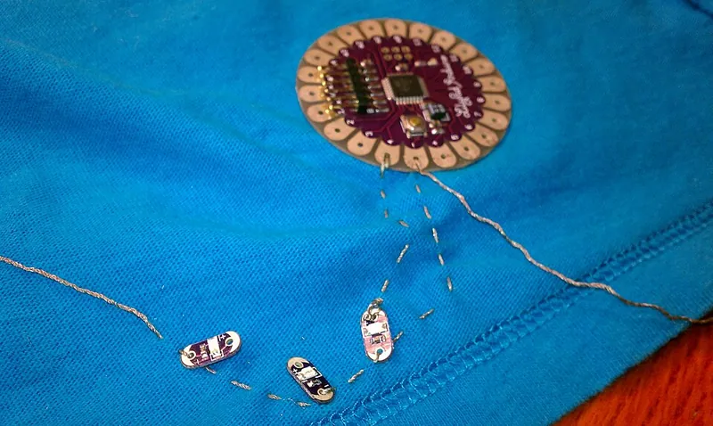
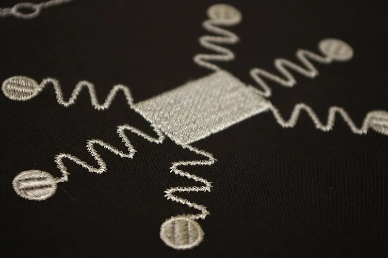

<figure class="eoc-pic eoc-pic-main"><figcaption><strong>Photo.</strong> <a href="https://commons.wikimedia.org/wiki/File:Conductive_thread.jpg">Conductive thread</a> by Mosborne01, <a href="https://creativecommons.org/licenses/by-sa/3.0">CC BY-SA 3.0</a>, from Wikimedia Commons.</figcaption></figure>
<figure class="eoc-pic"><figcaption><strong>How it works.</strong> <a href="https://commons.wikimedia.org/wiki/File:Redoing_Threading.jpg">Redoing Threading</a> by Christopher.nunez, <a href="https://creativecommons.org/licenses/by-sa/3.0">CC BY-SA 3.0</a>, from Wikimedia Commons.</figcaption></figure>
<figure class="eoc-pic"><figcaption><strong>Photo.</strong> <a href="https://commons.wikimedia.org/wiki/File:Gestickte_Textile_Sensorfl%C3%A4chen.jpg">Gestickte Textile Sensorflächen</a> by Forster Rohner AG, <a href="https://creativecommons.org/licenses/by-sa/3.0/de/deed.en">CC BY-SA 3.0 de</a>, from Wikimedia Commons.</figcaption></figure>

Conductive thread is sewing thread made from stainless-steel fibres or silver-plated filaments that is stitched through the holes (sew tabs) of sewable boards, LEDs and battery holders, so the tight loops make the electrical contacts and the lines of stitching act as bare wires across the fabric.

**In plain words:** Sewing thread with metal in it, so that when you sew small lights, a battery holder and a little circuit board onto fabric, the stitches themselves are the wires. **Proper term:** Conductive thread (sewn circuit, e-textile stitching).

**Also called:** conductive thread / conductive sewing thread / conductive yarn (Adafruit 'Conductive Thread'; SparkFun 'LilyPad Basics: E-Sewing'); stainless steel thread / stainless steel conductive thread (spun from stainless fibres) (Adafruit; SparkFun); silver-plated conductive thread (e.g. Madeira HC, brand; Electro-Fashion, Kitronik brand) (Rapid Electronics; Wiltronics product pages); e-textiles / electronic textiles / sewable electronics / wearable electronics (Wikipedia 'E-textiles'; SparkFun); sewn circuit / soft circuit / stitched circuit ⚑ [uncertain: 'soft circuit' and 'stitched circuit' not seen on an opened page]; sew tabs (the big plated holes on sewable boards) (SparkFun); LilyPad (SparkFun, brand: sewable boards, LEDs, switches and coin-cell holders designed by Leah Buechley); FLORA and Gemma (Adafruit, brands: sewable microcontroller boards) (SparkFun; Adafruit); sewable snaps (small metal press studs used as plug-and-unplug connectors) (Adafruit 'Flora Snaps'); conductive fabric / conductive textile; lamé (conductive fencing jacket fabric) (Wikipedia 'Conductive textile').

## How it works

The thread contains metal, either spun stainless-steel fibres or filaments coated with silver, so it conducts like a very thin, flexible, uninsulated wire (Adafruit; SparkFun; Wikipedia 'Conductive textile'). At each part, three or four tight loops through the plated sew-tab hole press the thread against the metal pad, giving both the electrical and the mechanical connection; a running stitch then carries the 'wire' to the next part (SparkFun 'LilyPad Basics: E-Sewing'). Knots at the back are sealed with clear nail polish or Fray Check so the springy metal thread can't untie (Adafruit). The thread has noticeable resistance per length, so a long run behaves like a resistor in series with the circuit (Adafruit; Wiltronics).

## Parts

Single piece (the thread) used with a few bought parts: conductive thread, needle, sewable boards and LEDs with sew tabs, a sew-on coin-cell battery holder, knots sealed with clear nail polish or Fray Check, and optionally sewable snaps as connectors and an insulating cover of fabric paint, fabric glue or a fabric layer (Adafruit; SparkFun).

## Everyday examples

- light-up costumes, badges, masks and soft toys sewn with LilyPad LEDs and a coin-cell holder (SparkFun LilyPad projects; Wikimedia Commons 'Wearable electronics dinosaur.jpg')
- touchscreen-friendly gloves with conductive yarn sewn into the fingertips (Adafruit)
- the conductive lamé jacket a fencer wears so that hits are detected (Wikipedia 'Conductive textile')
- embroidered touch or sensor areas on fabric (Wikimedia Commons 'Gestickte Textile Sensorflächen.jpg')

## When to use it

For soft, flexible projects where ordinary wires would be stiff, would snag or would look out of place: clothing, bags, costumes, soft toys, quilts and banners, with low-current parts such as LEDs, small sensors and sewable microcontroller boards powered from a coin cell or a small battery pack (Adafruit; SparkFun). It is also a good way to teach circuits through craft (SparkFun LilyPad). Use sewable snaps where the electronics must come off for washing or reuse (Adafruit 'Flora Snaps'), and conductive fabric for larger touch pads and switches (Wikipedia 'E-textiles'; SparkFun).

## When not to use it

For more than about 100 mA, such as motors, heaters (unless heating is the aim), long LED strips or many bright LEDs: the thread's resistance wastes voltage and warms the thread (Adafruit; Wikipedia notes higher-resistance conductive textiles are used as heaters); use thin, flexible stranded wire soldered to the parts, or Conductive tape (copper foil tape, conductive fabric tape) on stiffer backings. For long runs, where resistance adds up (Adafruit; Wiltronics). For higher voltages or large battery packs (SparkFun warns these 'could be dangerous'). For closely spaced connections or fine-pitch parts, where stray fibres can short (SparkFun); use a board with a plug, a Wire-to-board plug connector or a Flat flexible cable. For things washed often with the electronics in place: remove boards using snaps, and prefer stainless over silver-plated thread (Adafruit; Wiltronics).

## Details

- **What it does (jobs):**
  - join and hold: carries current between sewn-on parts and holds them on the fabric
- **Movement:** flex: the stitched lines bend and fold with the fabric
- **Directions it can move (degrees of freedom):** 0 at each sew tab once the loops are pulled snug; the stitched line between parts is flexible and follows the fabric, but does not give a controlled movement
- **Special behaviour:**
  - none for plain stitching
  - quick-release: when sewable snaps are used as connectors, a board can be snapped off before machine washing or moved to another project (Adafruit 'Flora Snaps')
- **How it holds:** shape (the parts interlock; [form-fit](../glossary.md#form-fit--force-fit--material-bond)): loops pass through the sew-tab holes and are tied off; friction or clamping (force-fit): snug loops press the thread onto the pads; material bond: knots are sealed with nail polish or Fray Check, and parts are often tacked to the fabric with a dot of hot glue or fabric glue before sewing (Adafruit; SparkFun)
- **Input and output:** not applicable
- **Power:** passive (no power needed): the thread only carries the battery's current
- **Load:** Electrical: signal only (small loads: Adafruit's 2-ply stainless thread is for parts using 'under ~50mA' and its 3-ply for 'under ~100mA'; typical loads are LEDs, sensors and small sewable boards) (Adafruit 'Conductive Thread'); extra-low voltage only: coin-cell projects 'shouldn't burn or shock you... but higher voltage projects or power sources could be dangerous' (SparkFun). Mechanical: light; the thread itself is strong in a straight pull (one silver-plated thread breaks at about 4.2 kg, Wiltronics), but the loops at sew tabs loosen if the project moves and the thread pulls away from the tab (SparkFun).
- **Play and precision:** not applicable
- **Taking it apart:** semi-permanent: stitches can be cut and unpicked, but the thread is usually spoiled and the part re-sewn; sewable snaps give a tool-free quick release (Adafruit 'Flora Snaps')
- **How often it can be reused:** once for stitched joints; many times for sewable snaps
- **Sealing:** none: the thread is uninsulated and 'behaves like bare wire'; covering it with fabric paint, stretch fabric glue, embroidery, a fabric layer or fusible interfacing insulates it against shorts and wear but does not make it waterproof (SparkFun 'LilyPad Basics: E-Sewing'; SparkFun 'Insulation Techniques for e-Textiles')
- **Adjustable:** no; a loose connection is fixed by pulling the loops tighter or sewing over them again (SparkFun)
- **Access needed:** both sides: the needle passes through the front and back of the fabric
- **Materials:** Thread: 316L stainless-steel fibres (Adafruit), or filaments plated with silver (Madeira HC, Rapid; Kitronik Electro-Fashion, about 96 filaments each 'coated with a micron-thick layer of natural silver', Wiltronics); SparkFun's silver-plated thread has a nylon core, which its stainless thread lacks; the stainless thread is harder to solder but 'won't burn up when you touch it with a soldering iron' (SparkFun product page), and does not oxidise (Adafruit); silver conducts well but tarnishes and wears off (Adafruit; Wiltronics). Conductive fabrics are coated or woven with carbon, nickel, copper, silver and other metals (Wikipedia 'Conductive textile'). Sewable snaps: tin-plated brass (Adafruit). Suits woven fabric, felt and garments held flat in a hoop; stretchy knits can open the stitches ⚑ [uncertain].
- **Heat, cold, water and wear:** Washing: stainless thread 'will not oxidize like silver does... and its safe to wash' (Adafruit); silver plating deteriorates, 'especially if washed', with resistances over 280 ohms measured on older samples (Wiltronics). Remove the battery, hand wash with mild detergent and air dry; 'a dryer can damage the LilyPad pieces or stitching' (SparkFun). Movement and flexing: if the project moves, the thread may pull away from the sew tab and disconnect (SparkFun). Heat: SparkFun contrasts its stainless thread, which 'won't burn up when you touch it with a soldering iron', with its silver-plated, nylon-core thread, so keep irons away from plated thread (SparkFun product page). Silver tarnishes in air over months, raising resistance (Adafruit).

## Making it

- **Ways to make or get it:**
  - off-the-shelf part (conductive thread, sewable boards, LEDs, coin-cell holders, sewable snaps, conductive fabric)
  - sewing by hand, or by sewing or embroidery machine (Adafruit; SparkFun)
  - 3D print (FDM): sewable covers, buttons and coin-cell holders with sew holes
- **Printing it in one piece (print in place):** no: thread joints are sewn; printed parts are separate sew-on covers and holders
- **Tools:** hand-sewing needle with a medium eye, scissors, embroidery hoop, multimeter with continuity beeper, clear nail polish or Fray Check, water-soluble marker or tailor's chalk, hot glue or fabric glue to tack parts down (Adafruit; SparkFun); optional sewing or embroidery machine (2-ply thread in the bobbin, Adafruit); soldering iron only to fit snaps to a board (Adafruit 'Flora Snaps')
- **Difficulty:** easy to moderate: a first LED-and-coin-cell circuit is a beginner kit project (SparkFun LilyPad kit), but tight sew-tab loops, sealed knots and keeping positive and negative lines apart take practice

### 3D printing tips

Printed sew-on parts need holes big enough for a medium needle and several passes of thread, like the large plated sew tabs on bought boards (Adafruit; SparkFun), and rounded edges so they don't snag fabric or cut thread (SparkFun on the LilyPad shape); see the Sew-on part entry for hole design. Example settings from published models: a sewable button cover printed in PETG at 100% [infill](../glossary.md#infill) (Printables 372865); a sewable cover for a LilyPad slide switch at 0.1 mm layers and 100% infill (Printables 372868); a sewable coin-cell holder that must be printed in a flexible filament or the cell can't be pushed in, best printed standing on edge at 45° to the bed, 100% infill, no supports, with a flanged version that is sewn through its own material (Printables 199828, 199827). Keep conductive stitching from rubbing on sharp printed edges or [layer lines](../glossary.md#layer-lines), which can fray it ⚑ [uncertain]. Tack printed parts and boards to the fabric with a small dot of hot glue first, without blocking the sew holes (SparkFun).

### Buying one (off-the-shelf parts)

Search terms: 'conductive thread' ('stainless steel conductive thread' 2-ply or 3-ply, 'smooth conductive thread', 'silver-plated conductive thread', e.g. Madeira HC, brand), 'conductive yarn', 'LilyPad' (SparkFun, brand) parts such as 'LilyPad coin cell battery holder' (switched), 'LilyPad LED', buttons and switches, 'sewable LED' or 'LED sequin', Adafruit 'FLORA', 'Gemma' or 'Circuit Playground' (brands) sewable boards, 'sewable snaps' (5 mm tin-plated brass), 'conductive fabric', 'conductive fabric tape', 'Fray Check' (brand) or clear nail polish, 'embroidery hoop', 'water-soluble fabric marker', 'stretch fabric glue', 'fusible interfacing', 'dimensional fabric paint'.

## Rules of thumb

- Stainless thread resistance and current: Adafruit 2-ply 16 ohms per foot (about 52 ohms per metre) for parts under about 50 mA; 3-ply 10 ohms per foot (about 33 ohms per metre) for parts under about 100 mA (Adafruit, https://learn.adafruit.com/conductive-thread?view=all). SparkFun's 60 g stainless spool is 28 ohms per foot (about 92 ohms per metre) (https://www.sparkfun.com/conductive-thread-60g-smooth-stainless-steel.html). Worked example (calculated): 1 m of 2-ply thread carrying 20 mA to an LED drops about 1 V, a large share of a 3 V coin cell, so keep runs short.
- Silver-plated thread: 40-160 ohms per metre depending on thread tension, usually mid-range once sewn, rising to over 280 ohms on older, washed samples (Kitronik Electro-Fashion thread, Wiltronics, https://www.wiltronics.com.au/product/51818/electro-fashion-conductive-thread/); Madeira HC12 is under 100 ohms per metre (Rapid, https://rapidonline.com/madeira-hc12-conductive-thread-150m-spool-87-6098). Figures from different makers are not measured the same way, so test your own thread with a meter.
- Make three to four loops around each sew tab, pulling each snug, then use a running stitch of about 1/4 in (6 mm) to travel to the next part (SparkFun, https://learn.sparkfun.com/tutorials/lilypad-basics-e-sewing/all).
- Work with a length of about one arm (Adafruit) or about 2 ft (60 cm) (SparkFun); longer thread tangles and twists (https://learn.adafruit.com/conductive-thread?view=all).
- Knots: tie the two ends in a tight reef or square knot (ABOK #1204) at the back of the fabric (Adafruit), or start with a simple overhand knot (ABOK #46) or a quilter's knot (SparkFun); seal each knot with clear nail polish or Fray Check and trim the tail close once dry (Adafruit). ABOK numbers from Wikipedia, https://en.wikipedia.org/wiki/Reef_knot and https://en.wikipedia.org/wiki/Overhand_knot; quilter's knot: no ABOK number found.
- Keep power and ground lines far apart, never let stitches cross or touch another line, and check for shorts with a continuity tester after finishing each line (Adafruit, https://learn.adafruit.com/conductive-thread?view=all; SparkFun).
- Stainless thread is slightly 'hairy': wax it for hand sewing, and avoid sewing close parallel lines by machine, because loose fibres 'could potentially short across small distances' (SparkFun, https://www.sparkfun.com/conductive-thread-60g-smooth-stainless-steel.html).
- For machine sewing, put 2-ply conductive thread in the bobbin with plain thread in the needle and adjust the tension on scrap first (Adafruit, https://learn.adafruit.com/conductive-thread?view=all).

## Common failures

(1) Short circuits from loose tails, frayed fibres or stitches crossing another line, often next to the battery holder (SparkFun); trim tails, seal knots, keep lines apart and test after each line (Adafruit). (2) Intermittent connection where the loops around a sew tab are loose or the fabric flexes; pull loops tight with tweezers or a needle, or sew over them again (SparkFun). (3) Knots working undone in springy metal thread; seal them with nail polish or Fray Check (Adafruit). (4) LEDs dim at the far end of a long run because of thread resistance (Adafruit; Wiltronics) ⚑ [uncertain: dimming not described on an opened page, inferred from the resistance figures]. (5) Silver-plated thread losing conductivity from tarnish and washing (Adafruit; Wiltronics). (6) Thread breaking mid-line; stitch onto the existing thread to continue the connection (SparkFun). (7) Polarised parts sewn the wrong way round, a dead battery, or a switch left off (SparkFun troubleshooting). (8) Shorts after the project is folded or worn, because the fabric lets lines touch; insulate finished lines (SparkFun 'Insulation Techniques for e-Textiles').

## Safety

SHORT CIRCUITS: the thread is bare and uninsulated, so a loose tail or two crossing stitches between positive and negative short the battery; 'One of the most common short circuits in e-sewing happens when a loose thread tail near the negative tab on the battery holder touches the battery' (SparkFun). A short 'may even cause your battery to heat up' (Adafruit); coin-cell projects 'shouldn't burn or shock you... but higher voltage projects or power sources could be dangerous' (SparkFun). Seal and trim knot tails, keep power and ground far apart, check with a continuity tester, cover finished lines with an insulating layer, remove the battery while working, and 'Never work on a metal surface' (SparkFun). Never connect conductive-thread circuits to mains or chargers, and treat rechargeable lithium packs with extra care because a short through the thread can overheat the cell ⚑ [uncertain: lithium advice is general, not from an opened e-textile page]. COIN CELLS: coin cells are dangerous to small children; swallowed, they 'can cause severe internal burns and significant injury or death', especially cells 20 mm or more across (Wikipedia 'Button cell'); use holders a child can't open in anything for children, and keep spares away from them. NOT MEDICAL: conductive fabrics are used for medical electrodes such as EEG (Wikipedia 'Conductive textile'), but a home-sewn patch is not a medical electrode; never use a sewn circuit to stimulate or monitor the body. NOT LOAD-BEARING: stitched circuits hold small parts only; never rely on home-made stitching or knots to hold a person.

## Related

- Sew-on part (sewing holes, loops and slots on a rigid part): how to design printed or bought parts with sew holes, which conductive thread passes through
- Sewn seams and hand stitches (lockstitch, saddle stitch, flat-felled seam): the stitches themselves; conductive thread mostly uses a running stitch
- Basic knots (overhand knot, half hitch, reef knot): the knots used to start and finish conductive thread
- Press stud (snap fastener, popper): metal snaps double as plug-and-unplug connectors in e-textiles (Adafruit 'Flora Snaps')
- Conductive tape (copper foil tape, conductive fabric tape): flat sticky conductors for paper, card or fabric, lower resistance than thread
- Conductive glue, paint and ink (electrically conductive adhesive, silver epoxy): painted or printed traces instead of stitched ones
- Battery holder and battery contacts (spring battery contact, coin-cell holder): sew-on coin-cell holders power most thread circuits
- Soldered wire joint (soldered splice): thin flexible wire soldered to the parts is the alternative for higher currents; snaps are soldered to boards
- Printing onto fabric (fabric embedded in a 3D print): another way to fix rigid parts to fabric
- Twisted-and-coiled polymer muscle (fishing-line artificial muscle): uses conductive thread as a heater rather than a wire

## Make it yourself

- [Sewable Flexible Coin Cell Holder (Printables 199828; URL from Printables API, page not opened)](https://www.printables.com/model/199828-sewable-flexible-coin-cell-holder): Printed coin-cell holder for sewable projects, printed in flexible filament on edge at 45°; a flanged remix (Printables 199827) is sewn through its own material *(licence: CC BY (Creative Commons Attribution))*
- [Sewable Cover for LilyPad Sliding Swich (Printables 372868; URL from Printables API, page not opened)](https://www.printables.com/model/372868-sewable-cover-for-lilypad-sliding-swich): Printed sew-on cover for a LilyPad slide switch, part of a 'Learning Platform for E-textiles' project *(licence: CC BY-SA (Creative Commons Attribution-ShareAlike))*
- [Sewable Button for E-Textile projects (Printables 372865; URL from Printables API, page not opened)](https://www.printables.com/model/372865-sewable-button-for-e-textile-projects): Printed sew-on cover for a 12 mm push button, printed in PETG at 100% infill *(licence: CC BY-SA (Creative Commons Attribution-ShareAlike))*
- [Flora Snaps (Adafruit Learning System)](https://learn.adafruit.com/flora-snaps?view=all): Step-by-step guide to soldering snap studs to a sewable board and sewing the sockets with conductive thread, so the board unsnaps for washing *(licence: link only)*
- [Insulation Techniques for e-Textiles (SparkFun Learn)](https://learn.sparkfun.com/tutorials/insulation-techniques-for-e-textiles/all): Five ways to cover finished conductive-thread lines: stretch fabric glue, fabric paint, a fabric layer, embroidery and fusible interfacing *(licence: link only)*

## Pictures, videos and models

- [Conductive thread.jpg (Wikimedia Commons, by Mosborne01)](https://commons.wikimedia.org/wiki/File:Conductive_thread.jpg): A bobbin of conductive thread *(licence: CC BY-SA 3.0 (reuse with credit))*
- [Lilypad Arduino with fading LEDs.jpg (Wikimedia Commons, by Osamu Iwasaki)](https://commons.wikimedia.org/wiki/File:Lilypad_Arduino_with_fading_LEDs.jpg): A LilyPad board sewn into fabric with 20 LEDs, the stitched conductive lines visible *(licence: CC BY-SA 2.0 (reuse with credit))*
- [Wearable electronics dinosaur.jpg (Wikimedia Commons, by Mosborne01)](https://commons.wikimedia.org/wiki/File:Wearable_electronics_dinosaur.jpg): A soft e-textile piece made with conductive thread *(licence: CC BY-SA 3.0 (reuse with credit))*
- [Gestickte Textile Sensorflächen.jpg (Wikimedia Commons, by Forster Rohner AG)](https://commons.wikimedia.org/wiki/File:Gestickte_Textile_Sensorfl%C3%A4chen.jpg): Embroidered conductive-thread sensor areas on fabric *(licence: CC BY-SA 3.0 DE (reuse with credit))*
- [LilyPad Basics: E-Sewing (SparkFun Learn)](https://learn.sparkfun.com/tutorials/lilypad-basics-e-sewing/all): Photos of loops around sew tabs, running and hidden stitches, knots, and the typical short circuit at the battery holder *(licence: link only)*

## Needs confirming

⚑ marks something nobody has confirmed yet: a fact the research could not confirm from a source, a finder value that is a best guess, or an open point from the research notes. Corrections are welcome (see `research/needs-confirming.md`).

- ⚑ 5 sentences on this page marked [uncertain].
- ⚑ Finder value `load_max` = light (best guess): electrical entry whose mechanical load has no light/medium/heavy band; set to light
- ⚑ Finder value `wire_use` = on fabric, paper or a print (best guess): carried over from the finder's old rule on entry names (R33), for "What are you connecting?" under "Connect wires or power"
- ⚑ Research note: *Conductive thread*: resistance per length recorded side by side (Adafruit stainless 16 and 10 Ω/ft; SparkFun 28 Ω/ft; Kitronik silver-plated 40-160 Ω/m, over 280 Ω after washing; Madeira HC12 under 100 Ω/m). No ABOK number was found for the quilter's knot. Where LilyPad began differs (Wikipedia: MIT Media Lab; SparkFun: Leah Buechley's PhD at CU Boulder); left out.

## Sources

- <https://learn.adafruit.com/conductive-thread?view=all>
- <https://learn.adafruit.com/flora-snaps?view=all>
- <https://www.adafruit.com/product/1126>
- <https://learn.sparkfun.com/tutorials/lilypad-basics-e-sewing/all>
- <https://learn.sparkfun.com/tutorials/insulation-techniques-for-e-textiles/all>
- <https://www.sparkfun.com/conductive-thread-60g-smooth-stainless-steel.html>
- <https://www.wiltronics.com.au/product/51818/electro-fashion-conductive-thread/>
- <https://rapidonline.com/madeira-hc12-conductive-thread-150m-spool-87-6098>
- <https://www.rapidonline.com/Catalogue/Product/87-6099>
- <https://en.wikipedia.org/wiki/Conductive_thread>
- <https://en.wikipedia.org/wiki/Conductive_textile>
- <https://en.wikipedia.org/wiki/E-textiles>
- <https://en.wikipedia.org/wiki/Button_cell>
- <https://en.wikipedia.org/wiki/Reef_knot>
- <https://en.wikipedia.org/wiki/Overhand_knot>
- <https://commons.wikimedia.org/wiki/File:Conductive_thread.jpg>
- <https://commons.wikimedia.org/wiki/File:Lilypad_Arduino_with_fading_LEDs.jpg>
- <https://commons.wikimedia.org/wiki/File:Wearable_electronics_dinosaur.jpg>
- <https://commons.wikimedia.org/wiki/File:Gestickte_Textile_Sensorfl%C3%A4chen.jpg>
- <https://api.printables.com/graphql/>
