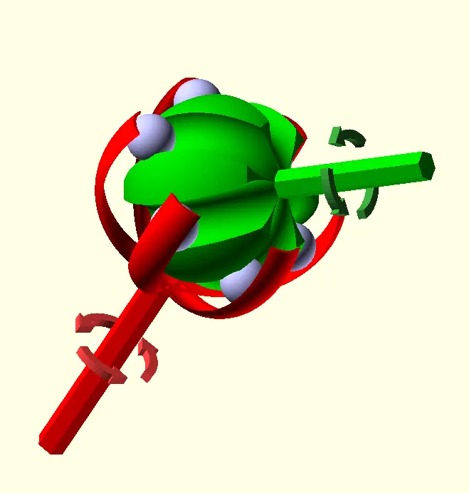
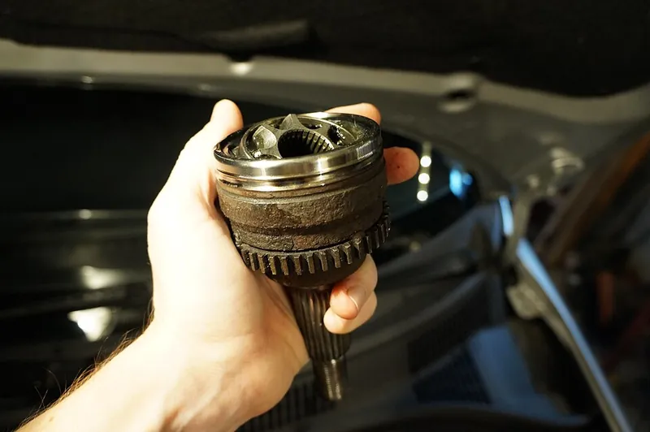
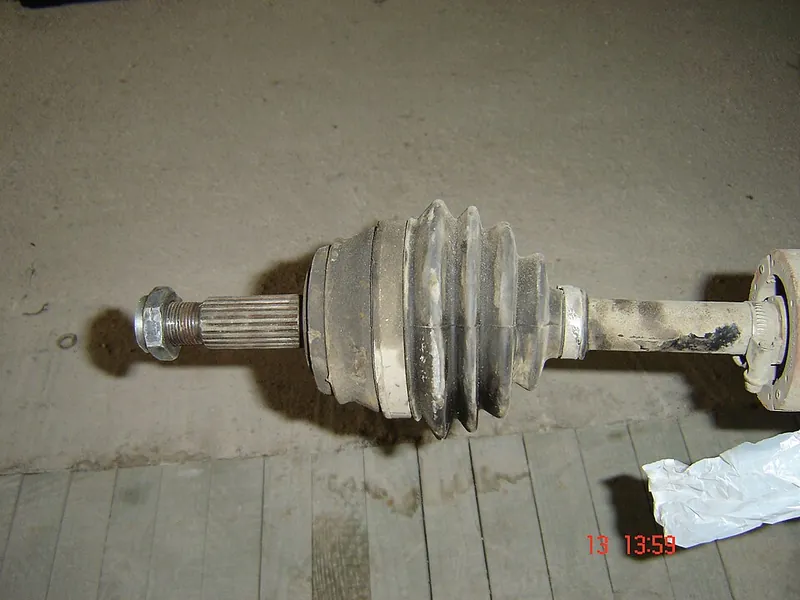

<figure class="eoc-pic eoc-pic-main"><picture><source media="(prefers-reduced-motion: reduce)" srcset="../media/constant-velocity-joint-9f8ee6.still.webp"></picture><figcaption><strong>Animation.</strong> <a href="https://commons.wikimedia.org/wiki/File:CV_Joint_Animation_with_Arrrows.gif">CV Joint Animation with Arrrows</a> by Original: User:Pwld recreated in OpenSCAD: MichaelFrey, <a href="https://creativecommons.org/licenses/by-sa/4.0">CC BY-SA 4.0</a>, from Wikimedia Commons.</figcaption></figure>
<figure class="eoc-pic"><figcaption><strong>How it works.</strong> <a href="https://commons.wikimedia.org/wiki/File:CV_Joint_with_broken_tone_ring.JPG">CV Joint with broken tone ring</a> by Kiwiev, <a href="http://creativecommons.org/publicdomain/zero/1.0/deed.en">CC0</a>, from Wikimedia Commons.</figcaption></figure>
<figure class="eoc-pic"><figcaption><strong>Photo.</strong> <a href="https://commons.wikimedia.org/wiki/File:CV_joint_half_axle.jpg">CV joint half axle</a> by BiH, Public domain, from Wikimedia Commons.</figcaption></figure>

A joint between two spinning shafts that lets them meet at an angle, even a changing one, while the output shaft turns at exactly the same speed as the input at every moment of each turn.

**In plain words:** A bendy joint for a spinning shaft, usually a ball-shaped joint with steel balls rolling in curved grooves, that passes turning force round a bend while keeping the output turning perfectly smoothly, with none of the speeding up and slowing down a simple cross-type universal joint gives. **Proper term:** Constant-velocity joint (CV joint, homokinetic joint).

**Also called:** CV joint; CV axle or half-shaft (a drive shaft with a CV joint at each end); CV boot or CV gaiter (its rubber cover); homokinetic joint; Gleichlaufgelenk (German); 等速万向节, 球笼万向节 (Chinese); Rzeppa joint (six balls in a cage between two grooved ball-shaped races); Birfield joint (a Rzeppa with offset tracks, the common outer joint on cars); ball fixed joint / BJ, EBJ (NTN (brand) names); fixed CV joint (outboard or wheel-side joint, large angle) and plunging or sliding CV joint (inboard, also lets the shaft change length); tripod joint / tripode joint (three rollers on a three-pointed spider in a three-groove cup; a plunging joint); double offset joint (DOJ) and cross-groove joint (plunging ball joints); Weiss joint / Bendix-Weiss joint (four balls in crossed grooves, no cage); Tracta joint (two interlocking swivels, used on 1920s-30s front-wheel-drive cars); double Cardan joint (two universal joints back to back; constant speed only when both angles are equal); Thompson coupling (two Cardan joints nested inside each other with a control yoke); CVD / 'CV-style driveshaft' (RC car term; a universal-joint variant, not a true CV joint, per RC Car Action); LEGO Technic (brand) 'steering / CV joint' parts.

## How it works

In a simple cross-type universal joint the output speeds up and slows down twice each turn when the shafts are at an angle. A CV joint avoids this because the parts that carry the drive (the balls) are always kept in the plane that exactly halves the angle between the two shafts (the bisecting or homokinetic plane), so the geometry looks the same from both shafts and their speeds stay equal (Wikipedia; Thang's 'Rzeppa joint 1' and 'Birfield joint 1'). In a Rzeppa joint the balls sit half in grooves on the inner ball and half in grooves in the outer bowl, and a cage keeps them in that halfway plane as the joint bends. A tripod joint's rollers slide in straight grooves instead, so it also lets the shaft slide in and out (plunge), though over a smaller angle (Wikipedia).

## Parts

A small assembly that acts as one unit. Rzeppa (ball) type: an inner race (a grooved ball fixed to one shaft), an outer race or cup (a grooved bowl on the other shaft), usually six steel balls, a cage with windows that holds the balls, grease, and a rubber boot with clamps. Tripod type: a three-pointed spider with three barrel-shaped rollers, a cup with three straight grooves, grease and a boot.

## Everyday examples

- The drive shafts to the front wheels of a front-wheel-drive car, visible behind the wheels as black ribbed rubber boots (Wikipedia; Wikimedia Commons photos)
- Radio-controlled car drive shafts (though most RC 'CVDs' are really a universal-joint variant, per RC Car Action)
- LEGO Technic steering CV joints in model cars with steered, driven wheels (Printables LEGO-compatible CV joint parts; Lego Technic Mastery video)
- Drive shafts in industrial machines such as printing presses, rolling mills and tractor tillers (NTN catalogue applications list)

## When to use it

Use it when a spinning shaft must drive something at an angle, especially a large or changing angle, and the output must turn smoothly: a steered and driven wheel on a robot or vehicle, a wheel on moving suspension, a drive that must bend round an obstacle, or a knob or control turned through an angle (the Printables CV LCD knob). It is the right choice when a single universal joint would cause vibration or jerky motion because the angle is more than a few degrees (Wikipedia). A plunging CV joint is a good choice when the shaft must also change length under [torque](../glossary.md#torque), because it slides far more easily than a [spline](../glossary.md#spline) (NTN).

## When not to use it

For very small [misalignment](../glossary.md#misalignment) between nearly in-line shafts, use a flexible coupling (beam, jaw or Oldham) instead; it is simpler and has no play. For slow drives at small angles, a single universal joint is cheaper and easier to make; for larger angles a pair of universal joints (double Cardan) is easier to print and build than a ball-type CV joint (Printables educational double Cardan model). For a fixed 90° turn use bevel gears. For angles beyond about 45-50°, or bends round corners, use a flexible drive shaft or gears. Avoid ball-type CV joints in harsh, dirty places where the boot can be torn, unless it is protected; an all-metal universal joint inside a housing may be better there (Wikipedia).

## Details

- **What it does (jobs):**
  - let it move (turn, slide or bend): passes rotation from one shaft to another at an angle that can change while it turns, e.g. to a steered, bouncing car wheel (Wikipedia)
  - let it move (turn, slide or bend): plunging types (tripod, double-offset) also let the shaft change length, replacing a separate sliding spline (NTN catalogue)
- **Movement:** rotate: continuous rotation passed through an angle; the shafts can swivel relative to each other up to about 45-48° (Rzeppa or Birfield fixed joints, some to 54°) or about 20-26° for plunging joints, which also slide in and out about 50 mm (rotate+slide) (Wikipedia; NTN)
- **Directions it can move (degrees of freedom):** Fixed CV joint: 2 (the output shaft can tilt in any direction, up and down or side to side), while turning is locked so both shafts rotate together at the same speed. Plunging CV joint: 3 (the same two tilts plus sliding in and out along the shaft).
- **Special behaviour:**
  - self-aligning or self-centring: the cage or track geometry automatically keeps the balls in the plane halfway between the two shafts as the angle changes, which is what makes the speed constant (Wikipedia; Thang)
  - none of the other listed behaviours: it doesn't slip, lock or index; its special trick is constant output speed through a bend
- **How it holds:**
  - shape (the parts interlock; [form-fit](../glossary.md#form-fit--force-fit--material-bond)): turning force passes from the grooves of one race through the balls (or rollers) to the grooves of the other
  - not a holding joint (it moves or passes on motion): it is a drive joint, free to bend and, in plunging types, to slide
- **Input and output:** Continuous rotation in -> continuous rotation out at the same speed (1:1) with no speed ripple, between shafts that intersect at an angle of 0° up to about 45-48° for fixed ball joints or about 20-26° for plunging joints (Wikipedia; NTN). Efficiency is high: NTN lists 'high transmission efficiency' and tripod joints are described as more efficient than many other types, but no single figure was found ⚑ [uncertain]; NTN reports newer ball joints cut the torque loss of older designs by 30 to over 50% (NTN Technical Review 89). Back-drivable: yes, it drives equally well in either direction and from either shaft.
- **Power:** passive (no power needed)
- **Load:** Heavy in twist: car CV joints carry full engine torque to the front wheels (Wikipedia). The torque it can carry for a given life falls as the working angle rises (NTN uses an operating-angle factor in its life calculation). Fixed joints also hold the two shafts together along their length; plunging joints carry no pull or push along the shaft, they slide. Printed plastic joints are light-duty only and are the weak link in printed RC cars unless steel balls are used ⚑ [uncertain].
- **Play and precision:** Small or no play: CV joints work 'without an appreciable increase in friction or [backlash](../glossary.md#backlash)' (Wikipedia), and the Weiss joint uses two of its four balls to [preload](../glossary.md#preload) the joint so there is no backlash when the load reverses. Angle following is exact (constant velocity), unlike a single universal joint, which gives a small cyclic position error (Slocum). Misalignment [tolerance](../glossary.md#tolerance): large angles, from about 5° for NTN coupling-type joints (which also take 3.5-11.5 mm of sideways offset) up to about 45-48° for fixed ball joints; plunging types also take length change (NTN; Wikipedia). A single fixed joint cannot take sideways offset between parallel shafts; that needs a joint at each end of a shaft.
- **Taking it apart:** removable: the joint is usually pushed onto a splined shaft and held by a [circlip](../glossary.md#circlip), and the outer joint's shaft is held by the wheel-bearing nut (Wikipedia), so it can be taken off and refitted; the joint itself is normally replaced as a unit rather than rebuilt (YourMechanic: most CV joints are not serviceable)
- **How often it can be reused:** many times: the joint can be removed from and refitted to its shaft repeatedly; opening the joint itself (balls, cage) is done only occasionally, for cleaning and regreasing
- **Sealing:** dust-resistant: the joint is not sealed itself, but a flexible rubber boot (CV boot or gaiter) with clamps covers it to keep dirt and water out and grease in (Wikipedia); NTN says its boot-sealed industrial joints can be used where water splashes, humidity and dust occur, while its open disc-type joints are not fully sealed
- **Adjustable:** no: nothing is adjusted after assembly; plunging types take up changes in length automatically
- **Access needed:** end of a tube or shaft: each half fits onto the end of a shaft, usually on a spline with a circlip or a bolted flange
- **Materials:** Hardened steel races, cage and balls (NTN changed its outer races from carburised steel to induction-hardened medium-carbon steel), packed with CV-joint grease (molybdenum disulfide grease per Wikipedia; NTN moved from lithium-based to urea-based grease for longer life), under a rubber boot. Maker and RC versions: PLA or PETG printed races and cage with steel balls (about 3 mm in a 15 mm printed Rzeppa, about 6 mm in Tarmo5-style RC joints), or printed balls for light demonstrators (Printables model notes).
- **Heat, cold, water and wear:** Dirt and water are the main enemies: the rubber boot keeps them out and grease in, but boots can crack from age, heat, chemicals or physical damage, after which the joint wears fast (Wikipedia; Commons 'Cracked CV boot' photo; YourMechanic). Boot durability also limits the speed and angle allowed (NTN). Grease type matters for life; NTN switched from lithium to urea grease for longer life. Printed joints: PLA softens above about 60 °C and PETG is rated to about 80 °C (Prusa); friction in a printed joint running fast can warm it ⚑ [uncertain].

## Making it

- **Ways to make or get it:**
  - 3D print (FDM): demonstration joints, LCD and panel knobs, fischertechnik and LEGO-compatible joints, and RC-car CV joints with steel balls (Printables models)
  - 3D print (resin): ⚑ [uncertain] possible for small, accurate demonstrators; no tested example found
  - CNC: ⚑ [uncertain] possible but hard, because the ball tracks are curved grooves inside a sphere; real joints are made by specialist machining, hardening and grinding
  - off-the-shelf part: car CV joints and axles, RC-car CVD drive shafts, LEGO Technic CV joints, industrial CV joint shafts (NTN)
- **Printing it in one piece (print in place):** no: working printed CV joints are printed as separate races, cage and balls and then assembled, often with steel balls; [print-in-place](../glossary.md#print-in-place) 'angular joints' exist but the one checked turned out not to be constant-velocity (Printables 'Print in place angular joint for fischertechnik' note)
- **Tools:** Circlip (retaining ring) pliers, boot-band (clamp) pliers, spanners or sockets for the axle nut or flange bolts, and CV-joint grease. Printed joints: files, a drill bit to clean the tracks, and sometimes glue for printed ball halves (Printables LCD-knob and mini Rzeppa notes).
- **Difficulty:** hard: the curved ball tracks and the cage must be accurate and smooth, so a load-carrying joint is best bought (from a car, RC or industrial supplier); a working demonstrator or light-duty joint can be printed with steel balls, but needs fine layers, careful clean-up and patience to assemble

### 3D printing tips

1) Use real steel balls where you can: printed balls work in a demonstrator, but the Printables CV LCD-knob designer notes 8 mm steel balls 'roll much better' than printed ones; the 15 mm mini Rzeppa for fischertechnik uses six 3 mm steel balls, and Tarmo5-derived RC CV joints use 6 mm steel balls. 2) Print fine and solid: the mini Rzeppa is printed at 0.12 mm layers or less with 100% [infill](../glossary.md#infill) and a brim if needed, and its tracks are cleaned out with a 3 mm drill, round and flat files and a small ball-shaped rotary file so the balls run freely. 3) The cage is the weakest part: print it in PETG at a high temperature for strength, and when assembling always push it from the outside rather than pulling from inside a hole, or it can break between two windows (mini Rzeppa notes). 4) [Clearance](../glossary.md#clearance): a University of Wisconsin-Madison student project found its first printed Tracta joint had interference at critical dimensions and sliding was stiff because of rough [layer lines](../glossary.md#layer-lines); they filed the parts and planned more clearance and different print orientations for the next build (UW-Madison ME 514 blog). Print-in-place designs use gaps of about 0.15 to 0.25 mm and fail if the printer over-extrudes (Printables fischertechnik angular joint). 5) Smooth and grease the sliding spheres: sand the spherical surfaces lightly and add a little grease for smoother running (CV LCD-knob notes). If the fit is loose or tight, scale the balls slightly up or down (same notes). 6) Assembly trick: turn the inner race 90° to the cage and feed it in through a cage window, then turn it back; do the same to put the cage into the outer race; then tilt the joint to drop each ball into its track through the cage window (CV LCD-knob notes). 7) Check the design really is constant-velocity: the balls must stay in the halfway plane; a nearby print-in-place angular joint was found not to be CV after a comment (Printables). 8) For RC or robot drives, make the joint's connection to the shaft or wheel strong; one Tarmo 5 builder kept stripping hex connections in plastic and switched to a square drive (Printables 'Rim and Rear CV joint for TARMO 5'). Add a guard to keep dirt out (the Cramer truggy remix adds mudguards for its CV joints). 9) Material: PETG or nylon rather than PLA for anything that gets warm or takes shocks; PLA softens above about 60 °C (Prusa).

### Buying one (off-the-shelf parts)

Search for: 'CV joint', 'CV axle' or 'half shaft' (car parts, sold as inner and outer joints with 'CV boot kit' and 'CV joint grease'); 'Rzeppa joint', 'Birfield joint', 'tripod joint' or 'tripode joint', 'double offset joint (DOJ)', 'cross groove joint'; industrial 'constant velocity joint shafts' (NTN (brand) fixed disc, fixed cup, sliding and coupling types); RC 'CVD drive shaft' or 'universal driveshaft' (note: not true CV); 'double Cardan joint'; LEGO Technic (brand) 'steering CV joint'; steel balls (e.g. 3 mm or 6 mm 'steel ball bearings' / 'loose balls') for printed joints; boot clamps ('CV boot clamp', 'ear clamp').

## Rules of thumb

- Typical Rzeppa (ball) joints allow 45° to 48° of bend, and some special ones 54° (Wikipedia, citing NTN Technical Review 75); NTN's own fixed ball joints went from 42.5° (BJ) to 46.5° (BJ-L), with high-angle versions of 50° and 52° (NTN Technical Review 89).
- A typical tripod (plunging) joint has up to 50 mm of plunge and 26° of angle; it is cheaper and more efficient than ball joints but has less angle, so it is used at the gearbox end of front-wheel-drive shafts (Wikipedia, citing GKN).
- NTN industrial CV joints: fixed cup type up to 42° for the bare joint, but only 25° while turning and 38° standing still once a boot is fitted; fixed disc type 14° to 18°; sliding (plunging) type 20° for small sizes and 8° to 10° for large ones; coupling type 5°, with 3.5 to 11.5 mm of sideways offset on short-shaft versions (NTN catalogue 5603E). The allowed angle is limited by the boot and the speed, not just the joint.
- Plunging CV joints slide by the balls rolling, so their sliding friction under torque is much lower than that of a sliding spline shaft, and they can absorb end-to-end vibration (NTN catalogue 5603E, 'Sliding Type').
- Why it matters: in a single universal joint the output-to-input speed ratio swings between cos(angle) and 1/cos(angle) twice per turn (Wikipedia 'Universal joint' formula); at 30° that is roughly 0.87 to 1.15 times the input speed. A CV joint keeps the ratio at 1.
- A double Cardan joint (two universal joints back to back) gives constant speed only if both joint angles are equal; to be truly constant-velocity it needs a centring element (Wikipedia).
- Real 'nearly CV' designs still have small errors: in Thang's simulations his Rzeppa model's output speed varied by up to 1.5% at 30° and his tripod model by up to 3.4% at 15° (Nguyen Duc Thang, 2700 Animated Mechanical Mechanisms, Part 1, p. 10).
- Always keep the joint covered and greased: a CV joint is usually lubricated with molybdenum disulfide grease under a rubber boot, and cracks in the boot let dirt in so the joint wears quickly or fails (Wikipedia; YourMechanic).
- Put fixed CV joints where the angle is largest (the steered wheel end) and plunging joints where the shaft must change length (the gearbox end) (NTN Technical Review 89; Wikipedia).

## Common failures

1) Torn or cracked boot, grease thrown out and dirt let in, leading to wear, play and a clicking noise when turning (Wikipedia; YourMechanic); inspect boots and replace them early. 2) Running beyond the allowed angle or speed, which damages the boot or makes the joint bind (NTN). 3) Plunging joint pulled apart or bottoming out when the shaft length changes more than it allows (NTN caution on the free side). 4) Printed joints: the cage cracks between windows during assembly (mini Rzeppa notes); parts too tight or rough to slide (UW-Madison); printed balls skid instead of rolling (CV LCD-knob notes); the shaft or wheel connection strips before the joint does (Tarmo 5 rim and CV remix). 5) A design that looks like a CV joint but isn't constant-velocity, which vibrates like a universal joint (Printables fischertechnik angular joint note).

## Safety

Spinning drive shafts and joints can catch clothing, hair or cords; keep them guarded (eXtension ag-safety PTO guidance on rotating drivelines). The free end of a plunging joint can slide off its splined shaft when handled, so support it (NTN caution). Fingers can be pinched between the races and cage when bending a joint by hand, and loose small steel balls are a swallowing hazard for small children ⚑ [uncertain]. When working on a car's CV joints, support the vehicle properly ⚑ [uncertain].

## Related

- Universal joint (Hooke's or Cardan joint): simpler and strong, but the output speed wobbles twice per turn at an angle and it gets 'notchy' at large angles (Wikipedia)
- Double Cardan joint: two universal joints back to back; constant speed if both angles are equal; common in steering columns and off-road drive shafts (Wikipedia)
- Tracta joint: an early CV joint with two interlocking swivels (Wikipedia; Thang 'Tracta joint 1')
- Weiss (Bendix-Weiss) joint: four balls in crossed grooves with no cage, preloaded for no backlash (Wikipedia)
- Thompson coupling: two nested Cardan joints with a control yoke; needs at least about 2° of angle to avoid wear (Wikipedia)
- Spline shaft (sliding spline): lets a drive shaft change length; plunging CV joints do this with far less friction (NTN)
- Flexible beam, jaw and Oldham couplings: for small misalignment between nearly in-line shafts only
- Bevel gears: turn drive through a fixed angle, usually 90°, and can change speed too
- Flexible drive shaft (rotating cable): carries rotation round real bends, but twists under load
- Ball-and-socket joint: moves in the same directions but passes no turning force
- RC car dogbone and CVD drive shafts: cheap pin-in-slot or universal-joint variants that bind at extreme angles (RC Car Action)

## Make it yourself

- [HUANGYAN920 Mechanical: 'CV-JOINT' (球笼万向节机构, no. 93), 'TRIPOD-JOINT' (三销式等速节, no. 210) and 'BALL-FORK-JOINT' (球叉式等速节, no. 217)](https://huangyan920.github.io/Mechanical/): Interactive, adjustable browser animations of a ball-cage (Rzeppa-type) CV joint, a tripod joint and a ball-fork (Weiss-type) joint *(licence: MIT)*
- [Constant Velocity Joint LCD-Knob (JBoe, Printables) (URL from Printables API, page not opened)](https://www.printables.com/model/243490-constant-velocity-joint-lcd-knob): A fully printable Rzeppa-style CV joint used as a 3D-printer display knob, with printed or 8 mm steel balls, step-by-step assembly instructions and print settings (0.15 mm layers, support only for the cage) *(licence: CC BY-NC)*
- [Mini Rzeppa constant velocity joint for fischertechnik (juh, Printables) (URL from Printables API, page not opened)](https://www.printables.com/model/639420-mini-rzeppa-constant-velocity-joint-for-fischertec): A working 15 mm Rzeppa joint using six 3 mm steel balls, with detailed notes on fine printing, filing the tracks and handling the fragile cage *(licence: CC BY-NC-SA)*
- [3D Printed RC car Tarmo5 (Engineering Nonsense, Printables)](https://www.printables.com/model/348623-3d-printed-rc-car-tarmo5): A mostly printed 40 mph RC car with printed CV joints (the design remixed in the Cramer truggy below, which uses 6 mm steel balls); build video at https://youtu.be/r2UDc4A8huY (details read via the Printables API) *(licence: CC BY-NC-SA)*
- [Cramer RC Truggy - upgraded axle / driveshaft / CV joints (shane, Printables)](https://www.printables.com/model/512061-cramer-rc-truggy-upgraded-axle-driveshaft-cv-joint): Remix that swaps binding dogbone drive shafts for Tarmo5-style printed CV joints (PLA races and cages, 6 mm steel balls, TPU torque dampers); the builder reports less binding and no breakages so far (details read via the Printables API) *(licence: CC BY-NC)*
- [Reproduction Constant velocity joint M.GECIK (NOP21, Printables) (URL from Printables API, page not opened)](https://www.printables.com/model/48771-reproduction-constant-velocity-joint-mgecik): Printed PLA reproduction of a linkage-type constant-velocity joint with 13 small bearings and M4 screws; video at https://www.youtube.com/watch?v=T3EsRXmOTlA *(licence: CC BY-NC-ND)*
- [Educational Model of Double Cardan Universal Joint (osamutake, Printables) (URL from Printables API, page not opened)](https://www.printables.com/model/1498409-educational-model-of-double-cardan-universal-joint): Printable teaching model of a double Cardan joint, the easier-to-print way to get constant speed at an angle, on an 80 x 80 mm base plate *(licence: CC BY)*

## Pictures, videos and models

- [Simple CV Joint animated.gif (Wikimedia Commons, by Pwld)](https://commons.wikimedia.org/wiki/File:Simple_CV_Joint_animated.gif): Animation of a Rzeppa-type CV joint turning while bent, used at the top of Wikipedia's 'Constant-velocity joint' article *(licence: Public domain)*
- [CV-Joint-WithTransparency.gif (Wikimedia Commons, by MichaelFrey, made in OpenSCAD)](https://commons.wikimedia.org/wiki/File:CV-Joint-WithTransparency.gif): Animation of a constant-velocity joint drawn partly transparent so the balls and inner parts can be seen *(licence: CC BY-SA 4.0)*
- [Tripod half axle.png (Wikimedia Commons, by Martin Jediny)](https://commons.wikimedia.org/wiki/File:Tripod_half_axle.png): A tripod joint on a car half axle: the three-pointed spider with rollers on a splined shaft end *(licence: CC BY-SA 4.0)*
- [2008-04-23 Cracked CV boot.jpg (Wikimedia Commons, by Ildar Sagdejev)](https://commons.wikimedia.org/wiki/File:2008-04-23_Cracked_CV_boot.jpg): Photo of a cracked rubber CV boot on a car axle, the most common start of CV joint failure *(licence: CC BY-SA 4.0)*
- [Rzeppa joint 1 (Nguyen Duc Thang, YouTube thang010146)](https://youtu.be/6thw8xPt6ro): CAD animation of a Rzeppa joint running straight and then at 30°, showing how the balls stay in the halfway plane *(licence: link only (standard YouTube licence))*

## Needs confirming

⚑ marks something nobody has confirmed yet: a fact the research could not confirm from a source, a finder value that is a best guess, or an open point from the research notes. Corrections are welcome (see `research/needs-confirming.md`).

- ⚑ 7 sentences on this page marked [uncertain].
- ⚑ Finder value `connects` = shaft (best guess): worked out from its name, but joining parts is not one of its two main jobs

## Sources

- <https://en.wikipedia.org/wiki/Constant-velocity_joint>
- <https://en.wikipedia.org/wiki/Universal_joint>
- <https://commons.wikimedia.org/wiki/Category:Constant-velocity_joints>
- <https://commons.wikimedia.org/wiki/File:Simple_CV_Joint_animated.gif>
- <https://commons.wikimedia.org/wiki/File:CV-Joint-WithTransparency.gif>
- <https://commons.wikimedia.org/wiki/File:Tripod_half_axle.png>
- <https://commons.wikimedia.org/wiki/File:2008-04-23_Cracked_CV_boot.jpg>
- <https://www.ntnglobal.com/en/products/catalog/pdf/5603E.pdf>
- <https://www.ntnglobal.com/en//products/review/pdf/NTN_TR89_en_11.pdf>
- <https://cs448m.github.io/lectures/machines/doc/1.pdf>
- <https://youtu.be/6thw8xPt6ro>
- <https://youtu.be/U5TV5NC5YOg>
- <https://youtu.be/OSTdCr-BcPc>
- <https://youtu.be/IFQgH73W2Ao>
- <https://pergatory.mit.edu/resources/FUNdaMENTALs%20Book%20pdf/FUNdaMENTALs%20Topic%205.PDF>
- <https://www.yourmechanic.com/article/symptoms-of-a-bad-or-failing-cv-boot>
- <https://www.rccaraction.com/drivetrains-driveshafts/>
- <https://additive-mfg.me.wisc.edu/?p=968>
- <https://additive-mfg.me.wisc.edu/?p=930>
- <https://ag-safety.extension.org/power-take-off-safety/>
- <https://help.prusa3d.com/article/pla_2062>
- <https://help.prusa3d.com/article/petg_2059>
- <https://huangyan920.github.io/Mechanical/>
- <https://raw.githubusercontent.com/HUANGYAN920/Mechanical/master/README.md>
- <https://api.printables.com/graphql/>
- <https://www.printables.com/model/348623-3d-printed-rc-car-tarmo5>
- <https://www.printables.com/model/512061-cramer-rc-truggy-upgraded-axle-driveshaft-cv-joint>
- <https://www.printables.com/model/877966-rim-and-rear-cv-joint-for-tarmo-5-rc-car>
- <https://www.youtube.com/watch?v=T3EsRXmOTlA>
- <https://youtu.be/r2UDc4A8huY>
- <https://www.youtube.com/watch?v=nYLRZBvCwPE>
