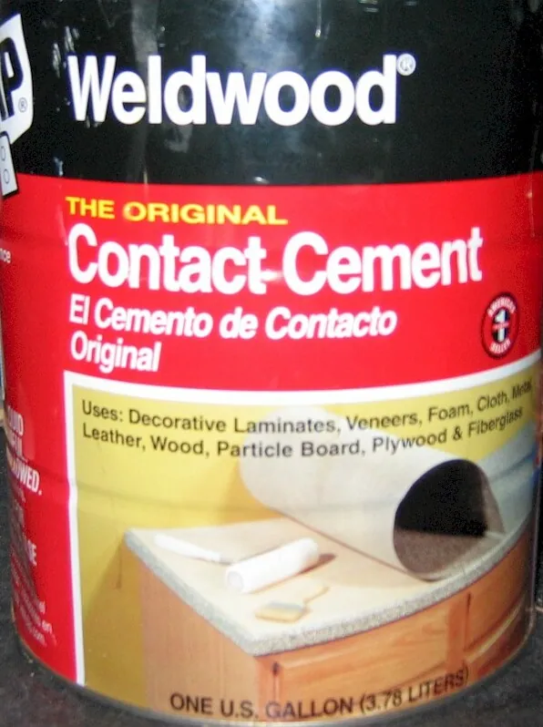
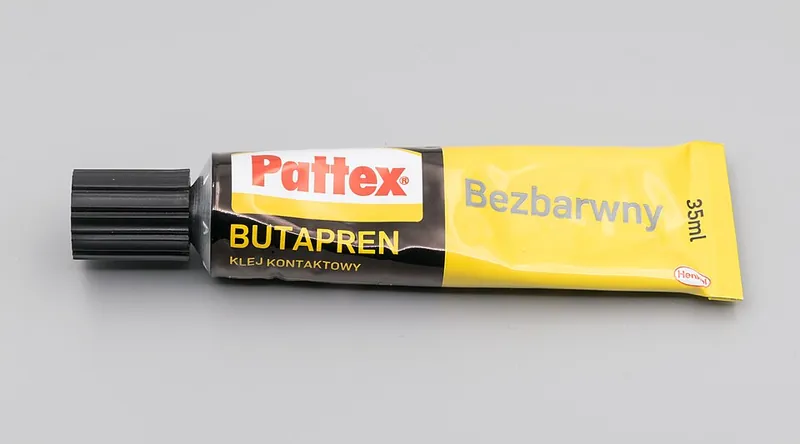

<figure class="eoc-pic eoc-pic-main"><figcaption><strong>Photo.</strong> <a href="https://commons.wikimedia.org/wiki/File:Contact-cement_000000.jpg">Contact-cement 000000</a> by Mwnuk, <a href="https://creativecommons.org/licenses/by-sa/3.0">CC BY-SA 3.0</a>, from Wikimedia Commons.</figcaption></figure>
<figure class="eoc-pic"><figcaption><strong>Photo.</strong> <a href="https://commons.wikimedia.org/wiki/File:2023_Butapren.jpg">2023 Butapren</a> by Jacek Halicki, <a href="https://creativecommons.org/licenses/by-sa/4.0">CC BY-SA 4.0</a>, from Wikimedia Commons.</figcaption></figure>

A rubber-based glue spread on both mating surfaces and allowed to dry until tacky, so that when the surfaces touch the two rubber films fuse at once, bonding large sheets, laminate, veneer, rubber, foam, leather and fabric without clamps.

**In plain words:** A rubbery glue you paint thinly on both surfaces, leave until it feels dry to the touch, and then press together, when the two glue layers grab each other instantly and permanently without clamps. **Proper term:** Contact adhesive (contact cement), usually a polychloroprene (neoprene) or natural-rubber solution or water-based dispersion.

**Also called:** contact cement; contact glue; impact glue; impact adhesive; neoprene glue (Wikipedia 'Impact glue'); neoprene contact adhesive; polychloroprene contact adhesive; elastomeric contact adhesive (FPL Wood Handbook ch.10 Table 10-1; 3M Fastbond 30-NF data sheet); water-based contact adhesive (waterborne, solvent-free) and solvent-based contact cement (FPL Wood Handbook ch.10; 3M; thisTOthat); spray contact adhesive (thisTOthat, which notes some spray glues can be used as contact adhesives); laminate adhesive; shoe glue; leather cement ⚑ [uncertain: trade descriptions, not checked in a single source]; brand names beginners search for (brands): Weldwood Contact Cement (DAP), Fastbond (3M), Barge cement ⚑ [uncertain: Barge seen only in search results, as a shoe glue].

## How it works

The glue is a rubber, most often polychloroprene (neoprene) or natural rubber, dissolved in solvent or dispersed in water (Wikipedia 'Impact glue'; FPL Table 10-1). You coat both surfaces and let the solvent or water evaporate until the film is tacky but no longer wet; the rubber molecules in the two dry films then stick to each other the moment they are pressed together, so the bond forms instantly and needs no clamping (Wikipedia 'Impact glue'; FPL Wood Handbook ch.10: 'the solvent evaporates until both sides become tacky and then the bond is formed'). Firm pressure over every part of the surface makes full contact; strength keeps rising over days to weeks as the rubber crystallises and the last solvent leaves (DAP: maximum strength in 7 days; FPL: 'increases slowly over a period of weeks'; Wikipedia notes neoprene and natural rubber 'undergo strain crystallization').

## Parts

Single piece (a one-part liquid, gel or spray); used with a brush or roller, and a hand roller (J-roller) to press the parts together (DAP Weldwood data sheet; 3M Fastbond 30-NF data sheet).

## Everyday examples

- Plastic laminate (e.g. Formica, brand) on kitchen countertops and tabletops (Wikipedia 'Impact glue'; FPL Table 10-1)
- The soles of shoes glued to the uppers, and shoe repairs (Wikipedia 'Impact glue'; Prusa)
- EVA foam cosplay armour and props glued at the seams (Lumin's Workshop; CosplayShop video)
- Cork boards, rubber mats and foam upholstery glued to boards ⚑ [uncertain: examples from the material lists in DAP and 3M, not named as products]

## When to use it

Use contact adhesive when you need to bond large flat areas that are hard to clamp, such as laminate, veneer, cork, foam or fabric onto board (thisTOthat: 'ideal when it is awkward to clamp, or when you have large surface area'; FPL); when you want an instant bond with no waiting in clamps, so the work can be trimmed straight away (DAP; 3M); and for flexible or dissimilar materials, such as leather, rubber, EVA foam, fabric and shoe soles, where a rigid glue would crack (Wikipedia; Lumin's Workshop). Choose a water-based type for foams, indoor work and less fire risk, and a solvent type for faster drying and wider material range, following each can's list (3M; DAP).

## When not to use it

Not for load-bearing or structural joints, or anything that will carry a constant load, because it [creeps](../glossary.md#creep) and is much weaker than wood glue or epoxy (FPL Table 10-1; DAP): use PVA for wood joints and epoxy or structural adhesives elsewhere. Not where you need to slide parts into position after contact: use PVA, epoxy or double-sided tape with a liner. Not on polystyrene foam with a solvent type (use a water-based contact adhesive or foam-safe glue) (DAP; 3M). Not for rigid plastic-to-plastic joints such as 3D prints: use CA, epoxy or solvent welding (Prusa). Not for small, tight-fitting joinery such as dowels or mortise and tenon, where the parts would grab before they are home ⚑ [uncertain: reasoning]. Not near sparks or flames, or in small unventilated rooms, with a solvent type: use a non-flammable water-based type (FPL; Rockler; 3M). Not for permanently wet or hot places, such as behind a stove or outdoors in full sun, without checking the rating (FPL; DAP).

## Details

- **What it does (jobs):**
  - glue or bond: laminates and veneers onto boards, rubber, cork, foam, leather, fabric and shoe soles, and many dissimilar materials (Wikipedia 'Impact glue'; DAP; 3M)
  - join and hold: holds large flat sheets flat without clamps, for example plastic laminate on kitchen counters (FPL Table 10-1)
- **Movement:** none: a fixed joint, though the rubbery glue film lets flexible materials such as leather, foam and fabric keep bending (Lumin's Workshop: 'a flexible adhesive')
- **Directions it can move (degrees of freedom):** 0: once the films touch, the parts are locked together; 'no adjustment is possible after the adhesive films make contact' (3M Fastbond 30-NF)
- **Special behaviour:**
  - none: it has none of the listed behaviours. Its own tricks: it bonds instantly on contact with no clamping time, the glue only sticks to itself once dry (so dry-coated parts can be laid on clean dowels or paper and slid into position), and the bond can be trimmed or machined straight away (Wikipedia 'Impact glue'; 3M; DAP)
- **How it holds:**
  - [material bond](../glossary.md#form-fit--force-fit--material-bond) (glue, solvent or melting): two dried rubber films fuse into one layer that sticks to both surfaces (Wikipedia 'Impact glue'; FPL Wood Handbook ch.10)
- **Input and output:** not applicable
- **Power:** passive (no power needed): it works by evaporation of solvent or water; heat lamps are only used to speed drying (3M Fastbond 30-NF)
- **Load:** light to medium: the FPL says dry strengths are 'much lower than those of conventional wood adhesives' and the joints 'creep under static load' (FPL Table 10-1). For example, 3M's water-based Fastbond 30-NF gives about 480 psi (3.3 MPa) overlap shear on birch at 23 °C, against about 3,600 psi for a yellow PVA wood glue, and about 26-62 N/cm (240-560 oz/in, roughly 15-35 lb per inch of width) 180° [peel](../glossary.md#peel-vs-shear) strength for canvas on steel after 1-3 weeks (3M Fastbond 30-NF data sheet; Titebond Original). It is good for large bonded areas loaded in shear, such as laminate and veneer, and its flexible film suits materials that bend (Wikipedia 'Impact glue': 'high shear resistance'; Lumin's Workshop). Manufacturers say it is not for structural applications (DAP).
- **Play and precision:** not applicable (nothing moves). Alignment must be right first time, so pre-fit all parts and use spacers or slip sheets to position large pieces (DAP; 3M). It copes with rough or porous surfaces better than thin wood glues because a thick glossy film is built up on each face ⚑ [uncertain: inferred from coating advice], but it is not a gap filler.
- **Taking it apart:** semi-permanent (can be undone but may damage parts): the bond is meant to be permanent (DAP) and dried adhesive must be cut or scraped away (DAP), but solvent attacks the glue line and weakens the bond, which 3M warns about ('Never pour solvent onto a bonded surface; it will attack the adhesive line'), so solvents or heat can sometimes be used to peel parts apart ⚑ [uncertain: heat-release not stated by a source].
- **How often it can be reused:** once: the glue can't be reused; parts that come apart need the old film cleaned off or recoated before rebonding (DAP; 3M)
- **Sealing:** none: it is not a sealant. Solvent neoprene types claim resistance to heat, water and weather once cured (DAP), and 3M's water-based Fastbond 30 is approved to the ANSI/HPMA Type II water-resistance test, but the FPL rates elastomeric contact adhesives as having 'low resistance to water and damp atmospheres' (FPL Table 10-1; 3M).
- **Adjustable:** no: parts cannot be shifted once the glue films touch (DAP; 3M). Position them first on dry spacers, then pull the spacers out one at a time (DAP; Rockler).
- **Access needed:** not applicable: both faces are coated before assembly
- **Materials:** Bonds well: plastic laminate (e.g. Formica, brand) to particleboard, MDF and plywood; wood and plastic veneers (backed veneers for water-based types); wood; rubber; cork; leather and pleather; felt, fabric and canvas; EVA foam; polyurethane foam and 'most foamed plastics' (water-based); paper and cardboard; tile; metal; 'some plastics and vinyls'; shoe soles to uppers (DAP; 3M Fastbond 30-NF; Wikipedia 'Impact glue'; Lumin's Workshop). Flexible 3D prints (TPU/TPE): Prusa suggests contact cements 'might be good especially for flexible filament materials!' Poor or damaged: polystyrene foam (the solvents in solvent types dissolve it), copper and copper alloys (DAP); drywall laminating and metal with water-based types unless the metal is force-dried and protected (3M); un-backed wood veneer with water-based types (3M); painted surfaces, vinyls and some plastics can be stained or softened by the solvents, so test first (DAP). For best results at least one surface should be porous, and painted or non-porous surfaces should be roughened (DAP). Slippery plastics such as polyethylene, polypropylene and silicone ⚑ [uncertain: not tested in an opened source; generally poor for most glues].
- **Heat, cold, water and wear:** Heat: it softens as it warms; DAP rates its solvent cement for service from -40 °F to 150 °F (-40 to 66 °C), and 3M's water-based Fastbond 30-NF drops from about 480 psi overlap shear at 23 °C to 60 psi at 82 °C (180 °F) (DAP; 3M). Creep: bonds 'creep under static load' (FPL Table 10-1), and 3M's laminate static-shear results fall with time at 82 °C. Water: solvent neoprene types claim resistance to water and weather, while FPL rates elastomeric contact adhesives as having low resistance to water and damp atmospheres (DAP; FPL). Cold: apply above 65 °F (18 °C); cured 3M film is stronger in shear at -34 °C but its peel strength drops to about 8.8 N/cm (DAP; 3M). Sunlight: keep new bonds out of direct sun for 72 hours (DAP); long-term UV ageing ⚑ [uncertain: no data found]. Solvents: cleaning a bonded joint with solvent weakens it (3M). Shelf life about 12 months for DAP's solvent cement (DAP).

## Making it

- **Ways to make or get it:**
  - woodwork: plastic laminate on countertops and tabletops, veneering, and edge banding (FPL Table 10-1; DAP; Rockler)
  - sheet materials and upholstery: foam, fabric and canvas panels, cork, rubber sheet (3M Fastbond 30-NF; DAP)
  - leatherwork, shoe repair and cosplay: leather, pleather, felt and EVA foam armour (Wikipedia 'Impact glue'; Lumin's Workshop)
  - 3D print (FDM): bonding flexible TPU or TPE prints, or bonding prints to foam, leather, rubber or fabric (Prusa) ⚑ [uncertain: Prusa only suggests it 'might be good'; no test found]
  - laser cut: bonding laser-cut foam, leather, felt or rubber gaskets ⚑ [uncertain: common maker practice, no source opened]
- **Printing it in one piece (print in place):** no: it is a glue, not a printed part
- **Tools:** A brush (nylon or chip brush), small foam or texturing paint roller, or spray gun to spread it (3M; thisTOthat; This Old House); clean dowels, wood strips or paper slip sheets as spacers for large sheets (DAP; 3M; Rockler); a small hand roller no wider than 3 in (a 'J-roller'), or a towel-wrapped piece of 2x4, to press it down (3M; Rockler); a router with a flush-trim or laminate bit for trimming laminate (Rockler; This Old House); mineral spirits for wet solvent cement, or soapy water for wet water-based cement (DAP; 3M); good ventilation or a vapour respirator for solvent types (Rockler).
- **Difficulty:** easy to moderate: no mixing and no clamps, but you must wait for the right dryness, get the alignment right first time, press hard everywhere, and handle flammable fumes safely (thisTOthat; DAP; 3M; Rockler).

### 3D printing tips

1) Contact cement is one of the few glues that stays flexible, so it is worth trying for TPU and TPE prints that must bend: Prusa's gluing guide lists 'contact cements, typically for shoe repairs, etc. (might be good especially for flexible filament materials!)'; test it on offcuts first (see Peter Solomon's video 'Methods of gluing Flexible Prints in TPU together!'). 2) It is also handy for fixing printed parts to EVA foam, leather, rubber or fabric, e.g. printed details on cosplay armour, since the rubbery film follows the flexible side (Lumin's Workshop) ⚑ [uncertain: printed-part use is inferred]. 3) Watch for solvent attack: solvent contact cements can contain acetone and MEK (DAP), which soften or dissolve ABS, ASA and polystyrene-based prints and foams; DAP warns the solvents may damage 'some plastics' and that it must not be used on polystyrene foam. Use a water-based contact adhesive or test on a scrap print ⚑ [uncertain: effect on specific filaments not tested in a source]. 4) Printed layers give some grip, but for smooth printed faces roughen them, since DAP says non-porous surfaces must be roughened and at least one surface should ideally be porous. 5) Apply a thin, even coat to both parts, wait until it is touch-dry (it doesn't come off on your finger) and press hard with a small roller; thicker coats take longer to dry and bonding too soon is the most common mistake (thisTOthat; 3M). 6) For rigid plastic-to-plastic joints, CA, epoxy or solvent welding are stronger (see those entries). 7) A small printed seam roller (Sagittario's 20 mm roller; vega480's roller on 608 bearings) can serve as a J-roller for pressing small bonded parts; 3M recommends a roller no wider than about 3 in with heavy pressure ⚑ [uncertain: these rollers were designed for sewing and wallpaper].

### Buying one (off-the-shelf parts)

Search for: 'contact cement', 'contact adhesive', 'neoprene contact adhesive', 'solvent-based contact cement', 'water-based contact adhesive' or 'non-flammable contact cement' (safer indoors and for foam), 'gel contact cement' (thixotropic, for vertical surfaces; Wikipedia 'Impact glue'), 'spray contact adhesive', 'laminate adhesive', 'leather cement' or 'shoe contact cement'. Tools: 'J-roller' or 'laminate roller', 'seam roller', foam or texturing paint roller, chip brush, 'laminate trimmer' with 'flush-trim bit', dowels or slip sheets (DAP; 3M; Rockler; This Old House).

## Rules of thumb

- Coat BOTH surfaces with an even film; porous materials may need two coats, letting each dry fully in between (3M Fastbond 30-NF; thisTOthat; DAP). A uniform glossy film means enough glue; dull spots mean too little (3M; DAP).
- Use about 3.0-3.5 g of dry adhesive per square foot per surface on wood, particleboard and laminate, and more on soft wood, fabric and foam (3M Fastbond 30-NF).
- Wait until it is touch-dry before joining: if it doesn't come off on your finger it is ready (thisTOthat); a water-based adhesive turns from milky to clear, typically in about 30 minutes (3M). Guides give roughly 15-20 minutes for solvent cement in normal conditions, longer when cool or humid and for thicker coats (This Old House; Rockler; thisTOthat).
- Join within the bonding window: up to 4 hours for 3M's water-based Fastbond 30-NF; recoat solvent cement if not assembled within 2-3 hours (DAP); in a dusty shop bond within about 2 hours (thisTOthat). If the surfaces don't grab on contact, apply another coat (3M).
- Work at 65 °F (18 °C) or warmer: adhesive, surfaces and room (DAP; 3M).
- Position large sheets on clean dowels or strips every 6-12 in, or on paper slip sheets, then remove them from the centre outwards (DAP; 3M; This Old House; Rockler).
- Press hard everywhere: at least 25 psi, equal to about 75 lb on a 3 in J-roller, working from the centre to the edges; don't use a rolling pin or wide roller, which bridges low spots (DAP; 3M). Insufficient pressure lets blisters form later (DAP).
- You can trim straight after bonding, but it reaches full strength in about 7 days; keep bonded work out of direct sun or above 150 °F (66 °C) for 72 hours (DAP).
- Don't roll over a laminate edge with the J-roller, which can snap it (This Old House).
- Don't thin water-based contact adhesive (3M).

## Common failures

1) Bonding too soon, while the film is still wet: 'the most common mistake', leading to weak bonds, bubbles and blisters; wait until touch-dry (thisTOthat). 2) Surfaces won't grab: glue left too long, dust on it, or too little glue; apply another coat (3M; thisTOthat). 3) Dull, starved patches on porous materials: not enough glue; apply two coats (3M; DAP). 4) Blisters or bubbles appear later: not enough rolling pressure, or air trapped; roll hard from the centre out (DAP; Rockler). 5) Sheet lands in the wrong place and can't be moved: use dowels or slip sheets (DAP; 3M). 6) Foam or plastic melts or distorts: solvent attack; use a water-based type and test first (DAP). 7) Edges lift or laminate creeps near heat or in sun, or under constant load (FPL; DAP). 8) Cracked laminate edge from rolling over the edge (This Old House). 9) Poor bond in a cold room: below 65 °F (DAP; 3M). 10) Seams on EVA foam pop open when heat-shaped after gluing ⚑ [uncertain: reported in cosplay guides seen only in search results].

## Safety

Solvent contact cements are highly flammable: DAP's contains acetone, ethyl acetate, petroleum spirits and methyl ethyl ketone with a flash point of -10 °C (14 °F), and the FPL warns that in small, unventilated spaces the solvent vapour can build up and explode if ignited. Work with doors or windows open, or wear a vapour respirator, and keep away from sparks, flames and pilot lights (Rockler; 3M; Wikipedia 'Impact glue'). The solvents are generally toxic if breathed; follow the label and SDS (FPL). Neoprene glue is abused as an inhalant, which can cause brain damage or death, and in the UK it is illegal to sell it to people likely to use it that way, so store it away from children (Wikipedia 'Impact glue'). Don't clean skin with solvents; use soap and warm water (DAP). Water-based types are non-flammable when wet and low-emitting (3M). Parts grab instantly, so keep fingers out from between large coated sheets while positioning ⚑ [uncertain: general advice].

## Related

- Rubber cement: a similar rubber-in-solvent glue used for paper crafts; peels off cleanly when used on one side, and can act as a contact adhesive when put on both
- Elastomeric solvent glue (flexible craft glue): also rubbery and flexible but applied wet to one side and positioned before it sets
- Double-sided foam tape (acrylic foam PSA): also sticks instantly on contact, with no solvent and no drying wait
- PVA wood glue: stronger and cheaper for wood-to-wood joints, but needs clamping and doesn't suit non-porous or flexible materials
- Two-part epoxy: much stronger and gap-filling for rigid, loaded joints
- Hot-melt adhesive (glue gun): also fast, but a thick, heat-sensitive bead rather than a thin film
- Polyurethane glue: a moisture-curing glue that also bonds foam and many materials, but foams and needs clamping
- Silicone and MS-polymer adhesive sealants: flexible and waterproof, for joints that must also seal

## Make it yourself

- [Seam Roller (Sagittario, Printables) (URL from Printables API, page not opened)](https://www.printables.com/model/321669-seam-roller): A small printed hand roller (20 mm diameter, 25 mm wide) on a 5 mm bolt, made for sewing and wallpaper seams; usable as a mini J-roller for pressing small contact-cemented parts. Read through the Printables public API. *(licence: CC BY-NC-SA (Creative Commons Attribution-NonCommercial-ShareAlike))*
- [Seam Roller with 608 bearings (vega480, Printables) (URL from Printables API, page not opened)](https://www.printables.com/model/1130696-seam-roller-with-608-bearings): A printed seam roller running on 608 skateboard bearings, printed in PLA or PETG and 'strong enough to put some force behind the roller'. Read through the Printables public API. *(licence: CC BY-NC-SA (Creative Commons Attribution-NonCommercial-ShareAlike))*
- [Textured Glue Roller (blecheimer, Printables) (URL from Printables API, page not opened)](https://www.printables.com/model/1065435-textured-glue-roller): Printable TPU-tyred glue roller for spreading glue over large panels; contact cement is also spread with rollers (3M recommends a texturing-type roller). Read through the Printables public API. *(licence: CC BY-NC-SA (Creative Commons Attribution-NonCommercial-ShareAlike))*
- [Glue strength test pieces (MethodicalMaker, Printables) (URL from Printables API, page not opened)](https://www.printables.com/model/236948-glue-strength-test-pieces): Printable specimens for comparing glues in torque, shear and tension with a hanging scale, e.g. contact cement against CA or epoxy on your own filament. Read through the Printables public API. *(licence: CC BY (Creative Commons Attribution))*

## Pictures, videos and models

- [Contact-cement 000000.jpg (Mwnuk, Wikimedia Commons, 2012)](https://commons.wikimedia.org/wiki/File:Contact-cement_000000.jpg): A can of Weldwood contact cement (used on Wikipedia's 'Impact glue' article) *(licence: CC BY-SA 3.0)*
- [How to Apply Plastic Laminate (Rockler, 2020)](https://www.rockler.com/learn/how-to-apply-plastic-laminate): Step-by-step photos of rolling contact cement onto laminate and board, positioning on spacer strips, rolling with a J-roller and trimming with a router *(licence: link only)*
- [How To Laminate a Countertop (This Old House)](https://www.thisoldhouse.com/kitchens/21016508/how-to-laminate-a-countertop): Photos of coating a countertop and laminate with contact cement, laying the sheet on dowels every 12 in, and pressing it with a J-roller *(licence: link only)*
- [Contact Cement Basics - Cosplay Tutorial (CosplayShop, YouTube)](https://www.youtube.com/watch?v=iPHEUvkJPGE): Video on using contact cement for EVA foam seams (title and channel checked via YouTube oEmbed; not watched) *(licence: link only (standard YouTube licence))*
- [Methods of gluing Flexible Prints in TPU together! (Peter Solomon, YouTube)](https://www.youtube.com/watch?v=Oqh01j7ZG_s): Video comparing ways of gluing flexible TPU 3D prints (title and channel checked via YouTube oEmbed; not watched, so whether contact cement is shown is unverified) *(licence: link only (standard YouTube licence))*

## Needs confirming

⚑ marks something nobody has confirmed yet: a fact the research could not confirm from a source, a finder value that is a best guess, or an open point from the research notes. Corrections are welcome (see `research/needs-confirming.md`).

- ⚑ 15 sentences on this page marked [uncertain].
- ⚑ Finder value `bonds_well` = TPU or flexible prints, wood, paper or card, metal, rubber, fabric or leather, foam (source uncertain): `materials` is marked ⚑ [uncertain] here: "…). Slippery plastics such as polyethylene, polypropylene and silicone ⚑ [uncertain: not tested in an opened sour…"
- ⚑ Finder value `bonds_poorly` = slippery plastics (PE or PP), silicone (source uncertain): `materials` is marked ⚑ [uncertain] here: "…). Slippery plastics such as polyethylene, polypropylene and silicone ⚑ [uncertain: not tested in an opened sour…"

## Sources

- <https://en.wikipedia.org/wiki/Contact_cement>
- <https://en.wikipedia.org/wiki/Wood_glue>
- <https://en.wikipedia.org/wiki/Rubber_cement>
- <https://research.fs.usda.gov/treesearch/62250>
- <https://research.fs.usda.gov/download/treesearch/62250.pdf>
- <https://www.buildsite.com/pdf/dap/DAP-WELDWOOD-Original-Contact-Cement-Product-Data-2217932.pdf>
- <https://multimedia.3m.com/mws/media/2366610O/3m-fastbond-contact-adhesive-30-nf.pdf>
- <https://www.thistothat.com/glue/contact.shtml>
- <https://blog.prusa3d.com/the-great-guide-to-gluing-and-assembling-3d-prints_44908/>
- <https://www.luminsworkshop.com/en-us/blogs/news/glue-guide>
- <https://www.rockler.com/learn/how-to-apply-plastic-laminate>
- <https://www.thisoldhouse.com/kitchens/21016508/how-to-laminate-a-countertop>
- <https://www.titebond.com/product/glues/d4d28015-603f-4dfc-a7d9-f684acc71207>
- <https://commons.wikimedia.org/wiki/File:Contact-cement_000000.jpg>
- <https://www.youtube.com/watch?v=iPHEUvkJPGE>
- <https://www.youtube.com/watch?v=Oqh01j7ZG_s>
- <https://api.printables.com/graphql/ (models 321669, 1130696, 1065435, 236948)>
