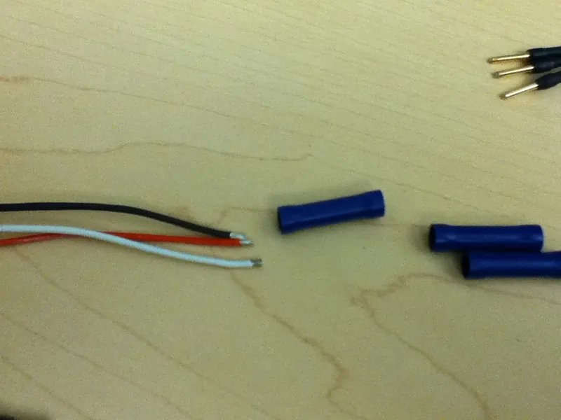
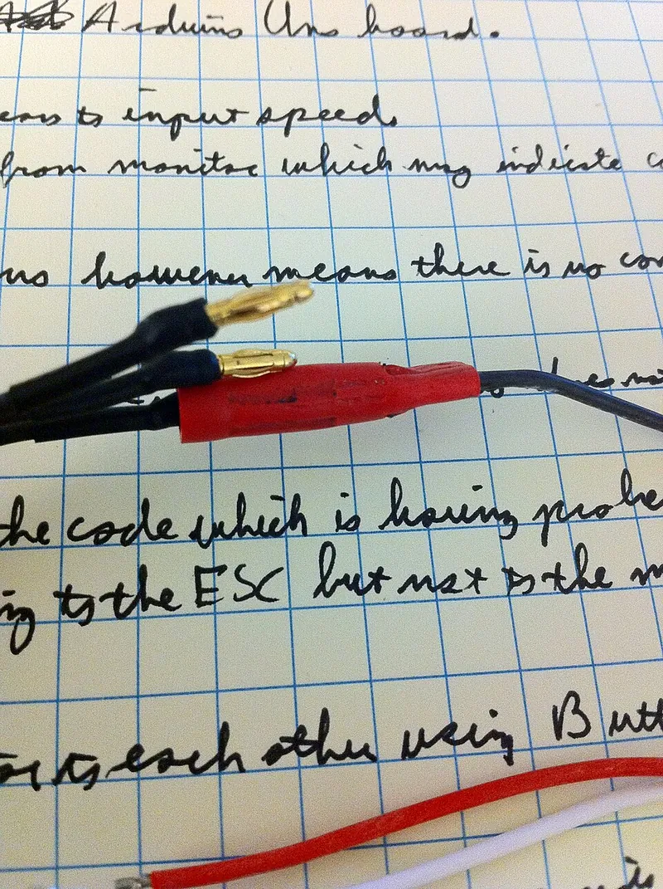
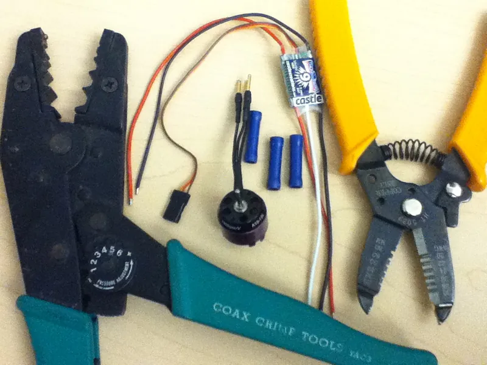

<figure class="eoc-pic eoc-pic-main"><figcaption><strong>Photo.</strong> <a href="https://commons.wikimedia.org/wiki/File:ESC_and_Motor_Wires_and_Butt_Connectors.JPG">ESC and Motor Wires and Butt Connectors</a> by Shatton8111, <a href="https://creativecommons.org/licenses/by-sa/3.0">CC BY-SA 3.0</a>, from Wikimedia Commons.</figcaption></figure>
<figure class="eoc-pic"><figcaption><strong>How it works.</strong> <a href="https://commons.wikimedia.org/wiki/File:First_Butt_Splice_Completed.jpg">First Butt Splice Completed</a> by Rhorton4549, <a href="https://creativecommons.org/licenses/by-sa/3.0">CC BY-SA 3.0</a>, from Wikimedia Commons.</figcaption></figure>
<figure class="eoc-pic"><figcaption><strong>Photo.</strong> <a href="https://commons.wikimedia.org/wiki/File:Crimper_Thunderbird_9_ESC_Butt_Connectors_Motor_and_Wire_Strippers.JPG">Crimper Thunderbird 9 ESC Butt Connectors Motor and Wire Strippers</a> by Shatton8111, <a href="https://creativecommons.org/licenses/by-sa/3.0">CC BY-SA 3.0</a>, from Wikimedia Commons.</figcaption></figure>

A crimped butt splice joins two wires end to end: each stripped end goes into one half of a short metal tube, a ratcheting crimp tool squeezes the tube so hard that metal and strands cold-weld into a gas-tight joint, and the plastic or glue-lined heat-shrink sleeve outside insulates it (and, for the glue-lined kind, seals it against water).

**In plain words:** A short metal tube, usually inside a coloured plastic sleeve, with one stripped wire pushed into each end; a crimping tool squeezes the tube flat onto both wires so they are joined end to end for good, with no heat or solder. **Proper term:** Crimped butt splice (butt splice connector, crimp splice connector).

**Also called:** butt splice, butt connector, butt splice connector: 'A tube-shaped connector with two crimps for splicing wires in-line is called a butt splice connector' (Wikipedia 'Crimp (joining)'); crimp splice, crimp splice connector, in-line crimp splice, crimped splice (NASA-STD-8739.4A §19.9 'Crimped Splices'); insulated (pre-insulated) butt connector with a vinyl or nylon sleeve, and non-insulated (bare) butt splice: NASA says the butt splice 'is available in both an insulated and uninsulated version' (NASA-STD-8739.4A §19.12); 3M lists 'non-insulated brazed seam, vinyl insulated butted seam, nylon insulated seamless' constructions (3M MH-series data sheet); heat-shrink butt connector, heat-shrink butt splice, glue-lined (adhesive-lined) heat-shrink butt splice, environment-resistant (sealed) crimp splice; product names include Scotchlok (3M, brand) and DuraSeal (TE Connectivity / Raychem, brand) (3M data sheet; TE drawing D-406-00XX; Gardner Bender AMT-123); closed-end splice, closed-end connector, pigtail crimp connector: one cup-shaped barrel that takes two or more wires from the same side (Gardner Bender 20-090); NASA calls this layout an 'end type' splice, used 'to terminate two or more conductors in a pig-tail configuration' (NASA-STD-8739.4A §19.11); parallel splice: 'used to dress and terminate multiple conductors, of the same or different gauges, in a parallel configuration' (NASA-STD-8739.4A §19.11); crimp ferrule splice: wires crimped together inside a small metal ferrule (NASA-STD-8739.4A §19.11); red, blue and yellow connectors: everyday names from the sleeve colour code for wire size (TE drawing D-406-00XX; Wikipedia 'Electrical connector', DIN 46245); wire in-line junction device, 'Jiffy Junction': crimped pin contacts pushed into a shared splice tube, an aerospace relative (NASA-STD-8739.4A §19.13).

## How it works

Each stripped wire is pushed into its half of the tube until it reaches the stop, and a crimp tool with the right-sized die squeezes the tube onto it. The squeeze bends the metal past the point where it would spring back (its yield point), so the round strands are crushed into a tight honeycomb, their surface oxide is broken off, and they cold-weld to each other and to the tube, giving 'cold-welded, gas-tight junctions' (Hackaday 2017). Because wire and tube are both still slightly springy, they keep pressing on each other, creating 'a high degree of static friction' that holds the wire and makes the joint 'highly resistant to vibration and thermal shock'; being gas-tight, it 'prevents oxygen and moisture from reaching the metals' so they don't corrode (Wikipedia 'Crimp (joining)', 'Electrical connector'). In a glue-lined heat-shrink splice a hot-air gun then shrinks the sleeve and melts its glue lining onto the wire insulation, sealing the joint (TE drawing D-406-00XX; 3M data sheet).

## Parts

A few parts, bought as one: a short tin-plated copper tube (the barrel), seamless or with a brazed or butted seam, usually with a centre stop so each wire goes in only halfway (3M data sheet: 'double-length, round seamless barrel with a center stop'); an insulating sleeve of vinyl, nylon or heat-shrink plastic, sometimes lined with hot-melt glue (TE drawing D-406-00XX; Gardner Bender AMT-123); and the two stripped wire ends. A closed-end splice is a single cup-shaped barrel in a nylon cap (Gardner Bender 20-090).

## Everyday examples

- Joining a radio-control model's motor wires to its speed controller (photos on Wikimedia Commons)
- Car, trailer, motorbike and boat wiring repairs, where glue-lined heat-shrink splices resist 'salt water, oil, gasoline' (Gardner Bender AMT-123)
- The red, blue and yellow crimp connectors sold in hardware-store and car-accessory kits (TE drawing; 3M data sheet)
- Closed-end 'pigtail' connectors capping several wires together in light fittings and appliances (Gardner Bender 20-090)

## When to use it

When two wires must be joined permanently and the joint will be shaken, heated or cooled: vehicles, robots, boats, radio-control models and appliances. Crimps are 'highly resistant to vibration and thermal shock' (Wikipedia 'Crimp (joining)') and are 'credited in some contexts with being more reliable than solder joints, too, particularly in applications like aerospace or motorsport' (Hackaday 2023). Also when you can't or don't want to use heat near the work: crimping is done 'with zero heat' (Hackaday 2023) and avoids soldering's 'aggressive cleaning, high heat, and possibly toxic solders' (Wikipedia 'Crimp (joining)'). Choose glue-lined heat-shrink splices outdoors or where water, salt or oil can reach the joint (Gardner Bender AMT-123), closed-end splices to cap several wires together (Gardner Bender 20-090), and parallel splices to gather several wires side by side (NASA-STD-8739.4A §19.11).

## When not to use it

Not when you will want to undo the joint: use a Spring-clamp wire connector (lever connector), a Screw terminal or a plug-and-socket connector. Not without the right crimp tool and splice size: a pliers-squashed crimp is worse than a soldered joint (SparkFun; Hackaday 2023), so use a Soldered wire joint or a Solder sleeve instead. Not inside a cable that keeps bending (NASA-STD-8739.4A §7.2.36): move the joint to a fixed spot or run a continuous wire. Not where the slimmest, lightest joint matters: soldered splices give 'a smaller, more compact splice termination, with significant weight reductions over crimp-style splices' (NASA §19.3). Be wary on solid-core wire, where crimps may weaken the wire or loosen (SparkFun); a lever or push-in connector suits solid wire better. Not on aluminium wire unless the splice is marked for it ⚑ [uncertain: no aluminium-rated splice data opened]. For mains wiring use only a joint your local rules allow (see safety_notes).

## Details

- **What it does (jobs):**
  - join and hold: joins two wires end to end (or several wires, in a closed-end or parallel splice) permanently and without heat; the finder reaches it through the 'electrical connections' family
  - seal it, or pass cables or fluid through: only the glue-lined heat-shrink type, which 'waterproofs and environmentally seals electrical connections' (Gardner Bender AMT-123)
- **Movement:** none: the splice is rigid, and it must not sit where the cable bends: 'Splices shall not be located in areas of the cable where flexing may occur' (NASA-STD-8739.4A §7.2.36).
- **Directions it can move (degrees of freedom):** 0: the wires are locked into the tube and can't move relative to each other.
- **Special behaviour:**
  - none: it simply joins two wires; it doesn't move, lock or release.
- **How it holds:**
  - friction or clamping ([force-fit](../glossary.md#form-fit--force-fit--material-bond)): the crimp deforms the tube past its yield point so that 'the compressed wire causes tension in the surrounding connector, and these forces counter each other to create a high degree of static friction' (Wikipedia 'Electrical connector'); where the strands are pressed hardest they also cold-weld to the tube (Hackaday 2017; SparkFun 'How to Crimp')
  - material bond (glue, solvent or melting): only in glue-lined heat-shrink types, whose 'polyamide-based hot-melt adhesive liner' melts onto the wire insulation (TE drawing D-406-00XX); this seals the joint, while the crimp still carries the load
- **Input and output:** not applicable
- **Power:** passive (no power needed): heat is used only to shrink the sleeve of heat-shrink types, not to make the electrical joint.
- **Load:** Electrical: up to about 30 A (the splice has no current rating of its own: 3M lists 'Max. Current: Same as Wire', and the common colour-coded sizes take 22-10 AWG wire (3M data sheet; TE drawing D-406-00XX); bare splices for heavy battery or welding cable go higher ⚑ [uncertain: no heavy-cable splice data opened]); rated for mains (listed splices are marked e.g. '600 V Building Wire, 1000 V Signs, Fixtures' (3M data sheet) or 600 V max (Gardner Bender AMT-123); closed-end connectors 300 V (Gardner Bender 20-090); but mains work must follow local law, see safety_notes). Mechanical: medium in a straight pull when made with the right tool: NASA's minimum crimp pull-out forces are 57 N (13 lb) for 22 AWG, 142 N (32 lb) for 18 AWG, 290 N (65 lb) for 14 AWG, 459 N (103 lb) for 12 AWG and 707 N (159 lb) for 10 AWG, or 60% of the wire's own tensile strength for sizes not listed (NASA-STD-8739.4A Table 12-1 and §12.3.5.c(4)). With the wrong tool or size 'You'll get pullouts and failures' (Hackaday 2023). Weak against repeated bending at the barrel ends: keep splices out of flexing parts of a cable (NASA §7.2.36).
- **Play and precision:** not applicable
- **Taking it apart:** permanent: 'Crimped contacts are permanent (i.e. the connectors and wire ends cannot be reused)' (Wikipedia 'Crimp (joining)'); to undo it, cut the splice out and strip fresh wire.
- **How often it can be reused:** once: each splice is used once, and every repair shortens the wires by the length cut out.
- **Sealing:** none for bare, vinyl- and nylon-insulated splices (the sleeve only insulates); watertight for glue-lined heat-shrink splices, where the melted glue lining 'waterproofs and environmentally seals electrical connections' (Gardner Bender AMT-123), but only if the wire's insulation diameter is within the sleeve's stated range (TE drawing D-406-00XX, note 2).
- **Adjustable:** no: once crimped it can only be cut out and replaced.
- **Access needed:** both sides: you need both wire ends free to strip and insert (and, for heat-shrink types, the sleeve slid over), room round the splice for the crimp tool's jaws, and room to heat the sleeve.
- **Materials:** Barrel: tin-plated annealed copper ('ETP Copper', 3M data sheet; 'Copper alloy C11000', TE drawing), seamless or seamed. Sleeve: vinyl (PVC), nylon, or heat-shrink polyolefin or cross-linked polyamide with a hot-melt glue lining (3M; TE; Gardner Bender). Wire: stranded copper is the normal partner ('Crimp connectors are typically used to terminate stranded wire', Wikipedia 'Crimp (joining)'). Solid wire is accepted by some types (closed-end connectors are 'designed to be used with both solid and stranded wire', Gardner Bender 20-090), but SparkFun warns that crimps on solid wire may create a weak point and are more likely to come loose. Size colour code: red 0.5-1.0 mm² (22-18 AWG), blue 1.5-2.5 mm² (16-14 AWG), yellow 3.0-6.0 mm² (12-10 AWG) (TE drawing D-406-00XX; 3M data sheet), matching DIN 46245 (Wikipedia 'Electrical connector'). Copper wire only unless the splice is marked for aluminium ⚑ [uncertain: no aluminium-rated butt splice data opened].
- **Heat, cold, water and wear:** Heat: set by the sleeve and the wire: 3M heat-shrink splices are rated to 105 °C (3M data sheet); TE DuraSeal sealed splices are for wire rated at least 85 °C (TE drawing); polyolefin heat-shrink in general is rated −55 to 135 °C (Wikipedia 'Heat-shrink tubing'). Vibration and thermal cycling: good, because the crimp's springy pressure keeps it tight (Wikipedia 'Crimp (joining)'), though closed-barrel crimps (which a butt splice is) are 'less resilient to vibration' than open-barrel ones (same article), and the wire still breaks if it is flexed at the barrel end (NASA §7.2.36). Water and corrosion: a gas-tight crimp keeps oxygen and moisture out of the metal joint (Wikipedia), but plain insulated splices let water into the barrel ends; glue-lined heat-shrink types resist 'salt water, oil, gasoline and other environmental contaminants' (Gardner Bender AMT-123). Sunlight: coloured heat-shrink resists UV less well, and 'only black is recommended for outdoor applications' (Wikipedia 'Heat-shrink tubing'). Shelf life: 3M gives its heat-shrink splices a 5-year shelf life in humidity-controlled storage (3M data sheet).

## Making it

- **Ways to make or get it:**
  - off-the-shelf part: splices are bought and crimped by hand with a matching tool
  - 3D print (FDM): printed moulds, covers and clips that add strain relief over a finished splice (Printables models in make_it_yourself)
- **Printing it in one piece (print in place):** no: the joint is cold-formed metal and can't be printed; only covers, jigs and strain-relief parts are printed.
- **Tools:** A crimp tool matched to the splice. Best is a ratcheting crimper with die positions colour-coded red, blue and yellow to match the sleeves: 'it will [ratchet](../glossary.md#ratchet) and prevent the jaws from opening back up. When enough pressure has been applied, the ratchet will disengage' (SparkFun 'How to Crimp'); NASA requires full-cycle ratcheting tools (NASA-STD-8739.4A §12.3.1). Makers name tools for their own splices, e.g. 3M TH-440 or TH-450 scissor-style tools for Scotchlok heat-shrink splices and TE AD-1522 'or equivalent' for DuraSeal (3M data sheet; TE drawing D-406-00XX). 'Pliers are not crimpers! Neither are hammers, vises, needle nose pliers or flat rocks' (SparkFun). Also wire strippers, and a hot-air (heat) gun for heat-shrink types (TE; 3M).
- **Difficulty:** easy to moderate: no soldering skill or heat is needed and splices are cheap, but a reliable joint depends on a proper crimper with the right die and on matching splice size to wire size; with 'crappy crimp tools or crimps' or mismatched parts 'you're in for a lot of pain' (Hackaday 2023).

### 3D printing tips

The splice itself can't be printed, but prints help around it. 1) Route cables so splices sit in a fixed part of the harness, never in wire that bends with a printed hinge, carriage or drag chain: 'Splices shall not be located in areas of the cable where flexing may occur' (NASA-STD-8739.4A §7.2.36). 2) Make printed channels, clips and enclosures wide enough for the splice, which is much fatter than the wire, and stagger several splices along a bundle so they don't stack up: 'Splices shall be staggered to minimize buildup of the wire bundle diameter' (NASA §7.2.35). 3) Add strain relief: clamp the cable to the printed part on each side of the splice, or pot it in a printed two-part mould filled with hot glue; one popular mould 'should handle most types of slim splices including crimp and heat-gun-solder types' (Printables 736625). 4) Keep the heat gun off nearby printed parts while shrinking heat-shrink splices: polyolefin heat-shrink shrinks at about 143 °C (Wikipedia 'Heat-shrink tubing'), while PLA 'gets soft and deforms at temperatures over 60 °C' (Prusa knowledge base 'PLA'); shrink the sleeve before fitting the splice into a printed housing, or shield the print. 5) Never print the barrel or the insulating sleeve for a current-carrying joint; the metal tube and the listed sleeve are what make it safe.

### Buying one (off-the-shelf parts)

Insulated butt splices (butt connectors) with vinyl or nylon sleeves in red (22-18 AWG), blue (16-14 AWG) and yellow (12-10 AWG); heat-shrink and glue-lined (adhesive-lined) heat-shrink butt connectors, e.g. 3M Scotchlok MH18BC, MH14BC, MH10BC and TE Raychem DuraSeal (brands) (3M data sheet; TE drawing D-406-00XX); non-insulated (bare) butt splices; step-down butt splices with a different size at each end ⚑ [uncertain: seen only in search-result titles]; closed-end (pigtail) connectors (Gardner Bender 20-090); crimp ferrules for parallel splices (NASA §19.11); ratcheting crimp tools with colour-coded dies; wire strippers; hot-air guns. Search terms: 'butt splice', 'butt connector', 'heat shrink butt connector', 'closed end connector', 'ratcheting crimper insulated terminals'.

## Rules of thumb

- Pick the splice by wire size: red 0.5-1.0 mm² (22-18 AWG), blue 1.5-2.5 mm² (16-14 AWG), yellow 3.0-6.0 mm² (12-10 AWG) (TE drawing D-406-00XX; 3M data sheet). Wikipedia gives the DIN 46245 bands as red 0.5-1, blue 1.5-2.5 and yellow 'over 4 to 6' mm² (Wikipedia 'Electrical connector'), so read the range printed on the pack.
- Strip length is about the length of the barrel half, so the wire reaches the centre stop and the insulation butts against the barrel: SparkFun says it 'should be equal to the length of the metal barrel on the connector, usually around 1/4 inch'; 3M says 3/8 inch for its heat-shrink splices; TE says 6-10 mm for 22-14 AWG and 10-13 mm for 12-10 AWG DuraSeal splices (SparkFun 'How to Crimp'; 3M data sheet; TE drawing).
- Gap between the end of the insulation and the barrel: at least 0.25 mm, and no more than 0.75 mm for 20 AWG and thinner or 1.25 mm for 18 AWG and thicker; the wire ends should be 'visible in the wire inspection hole' (NASA-STD-8739.4A §10.1.4.b, §19.12.1a).
- Several wires in one end: add up their cross-section areas (circular-mil areas) and multiply by 1.25 to get the 'equivalent wire size' for choosing the splice; insert the wires parallel, not twisted (NASA-STD-8739.4A §19.12.1c-d, §19.10.1b). SparkFun: make sure the combined wires fit and the connector can carry the current.
- Pull-test every crimp. NASA's minimum pull-out forces: 57 N (13 lb) for 22 AWG, 92 N (21 lb) for 20 AWG, 142 N (32 lb) for 18 AWG, 183 N (41 lb) for 16 AWG, 290 N (65 lb) for 14 AWG, 459 N (103 lb) for 12 AWG, 707 N (159 lb) for 10 AWG (NASA-STD-8739.4A Table 12-1). At home, a firm hand pull is the practical check: 'If the connection can be pulled apart, the crimp was not done correctly' (SparkFun).
- Crimp indents should be symmetrical and centred on each half of the barrel, and a single indent goes opposite the barrel's seam (NASA-STD-8739.4A §19.12.1g-h).
- Cover bare splices with tubing that reaches past the splice onto the wire insulation by at least 2 x the largest wire's diameter at each end (NASA-STD-8739.4A §19.2.6).
- Heat-shrink splices: heat the sleeve along its whole length 'until the crimp marks are gone and the ends of the sleeve recover onto the wires' (TE drawing D-406-00XX), or 'until tubing is completely shrunk and adhesive protrudes slightly from the tubing' (3M data sheet). The sealed type seals only on wire whose insulation diameter is within its stated range, and TE asks for wire rated at least 85 °C.

## Common failures

Wire pulls out: wrong die or tool, splice too big for the wire, or wire not pushed fully in; check that the wire ends show in the inspection hole (NASA §19.12.1a) and tug every crimp; one Hackaday commenter: 'always tug on them to make sure it's a sound connection… half the time they fall apart in your hand' (Hackaday 2023 comments). Squeezed with pliers: the barrel is crushed unevenly and leaves air pockets that corrode and heat up (SparkFun). Wrong squeeze: 'The compression force is not too light, nor too strong' and 'The connector body is not overly deformed' are quality criteria (Wikipedia 'Crimp (joining)'); SparkFun says over-crimping is almost impossible with a matched tool, so the usual cause is a mismatched die. Insulation caught in the crimp, or too much bare wire outside the barrel (NASA §10.1.4.b). Nicked or cut strands from stripping, or too few strands in the barrel, leaving voids (Wikipedia 'Crimp (joining)'; NASA §10.1.4). Heat-shrink not fully shrunk, or wire too thin for the sealed sleeve's range, so water gets in (TE drawing). A sleeve pierced by a sharp die ⚑ [uncertain: general caution, no source opened]. Wire snapping just outside the barrel after repeated bending: add strain relief and keep splices out of moving cable (NASA §7.2.36). Solder added on top of a crimp: SparkFun says it 'will add stress to the joint due to mechanical vibrations and thermal cycling', and Hackaday commenters disagree about whether it ever helps.

## Safety

PULL-OUTS: the wrong tool, a mismatched splice or the wrong wire size gives crimps that pull out or work loose: 'You'll get pullouts and failures and all kinds of issues' (Hackaday 2023). Pull-test every crimp by hand before covering it: 'It is better to have the crimp fail now, versus after it has been installed in its application' (SparkFun). HEAT AND FIRE: a poor crimp 'leaves air pockets'; 'moisture causes corrosion, corrosion causes resistance, resistance causes heat' (SparkFun), and loose or poor connections can get hot enough to start a fire that fuses and RCDs 'cannot detect' (Wikipedia 'High resistance connection'). HEAT GUN: risk of burns; overheating scorches the sleeve, and hot air softens nearby printed parts (Wikipedia 'Heat-shrink tubing'; Prusa 'PLA'). MAINS: this entry gives no mains wiring steps, and mains work must follow local law. In England, electrical installation work in homes must meet Part P of the Building Regulations and some of it must be notified (Approved Document P, 2013 edition). UK wiring rules require every connection to stay accessible for inspection, with a few exceptions that include 'A joint made by welding, soldering, brazing or appropriate compression tool' (BS 7671 regulation 526.3(iv), quoted in IET Wiring Matters, Spring 2012). In US workplaces OSHA requires conductors to be joined with 'splicing devices identified for the use' and covered with insulation equivalent to the wire's (29 CFR 1910.303(c)(3)). Use only listed splices, crimped with the tool the maker names.

## Related

- Crimp terminals (ring, fork and spade terminals, blade quick-disconnect): the same crimp, but ending in a ring, fork or blade for a screw or tab instead of joining two wires
- Soldered wire joint (soldered splice): smaller and lighter, but needs heat and skill and is weaker against vibration
- Solder sleeve (solder-seal splice): heat-shrink with a solder ring and glue rings that solders and seals in one step with a heat gun, no crimper
- Heat-shrink tubing (heat-shrink sleeve, adhesive-lined heat-shrink): the cover for bare splices; glue-lined tubing also seals
- Wire-end ferrule (bootlace ferrule, end sleeve): a crimped tube on a single wire end, for screw and spring terminals
- Spring-clamp wire connector (lever connector, push-in wire connector): tool-free and reusable, joins different wire types, but much bulkier
- Twist-on wire connector (wire nut): screwed on by hand over twisted wires; not for vibration
- Screw terminal (terminal block, barrier strip, connector strip): joins wires so they can be undone with a screwdriver
- Insulation-displacement connector (IDC, ribbon-cable plug, punch-down, T-tap): taps or joins without stripping; small currents only
- Cable [gland](../glossary.md#gland) and strain relief: stops a pull or bend on the cable from reaching the splice
- Clinching (press joining without rivets): the same idea of cold-forming metal into a lasting joint, but for sheet metal

## Make it yourself

- [Wire Splice Mold - Slightly Modified (MushyUniverse, Printables) (URL from Printables API, page not opened)](https://www.printables.com/model/736625-wire-splice-mold-slightly-modified): Two-part printed mould that clamps round a finished splice (crimp or solder) and is filled with hot glue to give strain relief; sized for 14 AWG, with a 1-to-1 and a 1-to-2 side *(licence: Creative Commons Attribution-ShareAlike)*
- [Cover for spliced cable (Printables) (URL from Printables API, page not opened)](https://www.printables.com/model/796341-cover-for-spliced-cable): Scalable printed cover that slips over a spliced cable and can be filled with epoxy or hot glue *(licence: Creative Commons Attribution-NonCommercial)*
- [Strain Relief wire splice (Beefdip, Printables) (URL from Printables API, page not opened)](https://www.printables.com/model/829238-strain-relief-wire-splice): Printed strain-relief housing for joining three cables, with FreeCAD sources that scale to other cable sizes; filled with epoxy or hot glue after joining *(licence: Creative Commons Attribution)*

## Pictures, videos and models

- [ESC and Motor Wires and Butt Connectors.JPG (Wikimedia Commons, by Shatton8111)](https://commons.wikimedia.org/wiki/File:ESC_and_Motor_Wires_and_Butt_Connectors.JPG): Wires from a radio-control speed controller and motor laid out ready to be joined with insulated butt connectors *(licence: CC BY-SA 3.0)*
- [First Butt Splice Completed.jpg (Wikimedia Commons, by Rhorton4549)](https://commons.wikimedia.org/wiki/File:First_Butt_Splice_Completed.jpg): A finished crimped butt splice joining two cables *(licence: CC BY-SA 3.0)*
- [NASA-STD-8739.4A Workmanship Standard for Crimping, Interconnecting Cables, Harnesses, and Wiring (2016), §19.9-19.13 and Fig. 12-1, pp. 54 and 74-79](https://nepp.nasa.gov/files/27631/nstd87394a.pdf): Photos of crimped modified-contact, end-type (pigtail), parallel and butt splices before and after crimping and sleeving, plus a figure of crimp pull-test failure types *(licence: US government (NASA) publication, generally public domain in the US ⚑ [uncertain])*
- [Working with Wire, section 'How to Crimp an Electrical Connector' (SparkFun Learn)](https://learn.sparkfun.com/tutorials/working-with-wire/all): Photos of an insulated splice connector and other crimp terminals, ratcheting and manual crimp tools, correct strip length and a pull check *(licence: CC BY-SA 4.0)*
- [Good In A Pinch: The Physics Of Crimped Connections (Hackaday, 2017)](https://hackaday.com/2017/02/09/good-in-a-pinch-the-physics-of-crimped-connections/): A polished cross-section of a good crimp with the strands squeezed into a gas-tight honeycomb, and an explanation of crimp height *(licence: link only)*

## Needs confirming

⚑ marks something nobody has confirmed yet: a fact the research could not confirm from a source, a finder value that is a best guess, or an open point from the research notes. Corrections are welcome (see `research/needs-confirming.md`).

- ⚑ 6 sentences on this page marked [uncertain].
- ⚑ Finder value `load_max` = light (best guess): electrical entry whose mechanical load has no light/medium/heavy band; set to light
- ⚑ Finder value `wire_use` = splice (best guess): carried over from the finder's old rule on entry names (R33), for "What are you connecting?" under "Connect wires or power"
- ⚑ Research note: *Crimped butt splice*: over-crimping (SparkFun: 'almost impossible to over crimp'; Wikipedia: the squeeze must be 'not too light, nor too strong'), both recorded; whether to add solder over a crimp (Hackaday commenters disagree); twisting wires before crimping (Gardner Bender: join them first; NASA: insert them parallel, not twisted), only NASA's rule is in the entry. No data found on aluminium-rated butt splices or splices with a different wire size at each end.

## Sources

- <https://en.wikipedia.org/wiki/Crimp_(joining)>
- <https://en.wikipedia.org/wiki/Electrical_connector>
- <https://en.wikipedia.org/wiki/Heat-shrink_tubing>
- <https://en.wikipedia.org/wiki/High_resistance_connection>
- <https://nepp.nasa.gov/files/27631/nstd87394a.pdf>
- <https://hackaday.com/2017/02/09/good-in-a-pinch-the-physics-of-crimped-connections/>
- <https://hackaday.com/2023/12/18/ask-hackaday-what-do-you-do-when-you-cant-solder/>
- <https://learn.sparkfun.com/tutorials/working-with-wire/all>
- <https://docs.rs-online.com/1969/0900766b813b0db0.pdf>
- <https://assets.rs-online.com/v1698805178/Datasheets/84f1c9b9de59e2c68b8331c2185cc2a5.pdf>
- <https://www.gardnerbender.com/en/p/AMT-123/Splice-Butt-He-Shrink-Adhesive-lined>
- <https://www.gardnerbender.com/en/p/20-090/22-10-AWG-Closed-End-Pigtail-Crimp>
- <https://help.prusa3d.com/article/pla_2062>
- <https://electrical.theiet.org/media/1534/accessibility-of-connections-and-maintenance-free-junction-boxes.pdf>
- <https://assets.publishing.service.gov.uk/government/uploads/system/uploads/attachment_data/file/441872/BR_PDF_AD_P_2013.pdf>
- <https://www.osha.gov/laws-regs/regulations/standardnumber/1910/1910.303>
- <https://commons.wikimedia.org/wiki/File:ESC_and_Motor_Wires_and_Butt_Connectors.JPG>
- <https://commons.wikimedia.org/wiki/File:First_Butt_Splice_Completed.jpg>
- <https://api.printables.com/graphql/>
