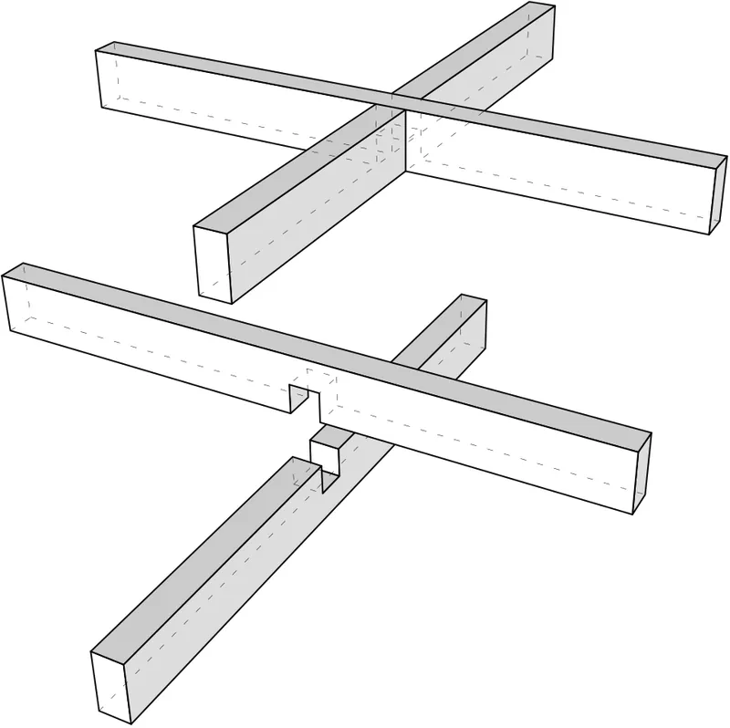

<figure class="eoc-pic eoc-pic-main"><figcaption><strong>Diagram.</strong> <a href="https://commons.wikimedia.org/wiki/File:Joinery-SimpleHalved.svg">Joinery-SimpleHalved</a> by Crati, <a href="https://creativecommons.org/licenses/by-sa/3.0">CC BY-SA 3.0</a>, from Wikimedia Commons.</figcaption></figure>

Two flat parts each get a slot as wide as the other part is thick and half as deep as the part is tall, so they slot together into a flush cross that needs no glue or fasteners.

**In plain words:** Two flat pieces that each have a slot cut halfway across, one from the top edge and one from the bottom edge, so they slide into each other and cross like a plus sign; repeat it and you get the grid of dividers in a drawer organiser or the cross-shaped stand of a flat-pack cardboard or plywood model. **Proper term:** Cross-halving joint (halved joint, egg-crate joint).

**Also called:** halved joint or halving joint (Wikipedia 'Halved joint': joined on edge; a halving lap on the flat is the related half-lap joint); cross halving joint (WoodWorkers Guild of America); egg-crate joint or egg-crate joinery (Popular Woodworking; the grid it makes is an 'egg crate'); half-lap joint (Popular Woodworking 'Egg Crate Shelves' uses this name; strictly a half lap is cut on the flat face); edge half lap joint (What Make Art); edge cross lap, cross-halved or cross lap joint (Cassell's Carpentry and Joinery, 1907, for the flat version); notch joint or cross joint (springFit, Hasso Plattner Institute); slot joint, slotting joint, slot-together (Ponoko; Printables model names); interlocked slices, waffle or egg-crate structure (Autodesk Slicer for Fusion 360 'Interlocked Slices'); planar sections joined by slits (FlatFitFab / flatfab); bottle dividers or divider grid (Popular Woodworking; Boxes.py TrayInsert).

## How it works

Each part is cut with a slot as wide as the other part is thick, reaching halfway through its height: one part is slotted down from its top edge and the other up from its bottom edge (Wikipedia 'Halved joint'; Boxes.py TrayInsert cuts slots half the wall height). When they are pushed together the solid half of each part fills the other's slot, so both parts end up flush at the top and bottom and locked at a fixed angle. The slot walls grip the faces of the other part, and the parts can only come apart by sliding straight back out along the slot, which is resisted by friction and by any other crossings in a grid (Popular Woodworking 'Egg Crate Shelves'). In a grid, every divider crosses several others, so the whole egg crate braces itself even though each single joint is weak against twisting (Wikipedia).

## Parts

A few parts: two (or more) flat parts, each with one straight slot per crossing; nothing else. Glue is optional.

## Everyday examples

- Divider grids in drawers, trays and storage boxes (Wikipedia 'Halved joint': partitions in trays and drawers; Boxes.py TrayInsert)
- Bottle dividers in a wine cabinet or cellarette (Popular Woodworking, Glen Huey) and cardboard dividers in wine and bottle shipping boxes ⚑ [uncertain]
- Flat-pack slot-together decorations and stands, such as a two-piece Christmas tree that slides together into a cross (Printables 'Flat-Pack Fir')
- Egg-crate bookshelves and cubby shelves (Popular Woodworking 'Egg Crate Shelves')

## When to use it

Use it whenever two flat parts cross each other: grids and dividers, the ribs of a sliced 'waffle' sculpture or model, slot-together stands, and flat-pack furniture or displays that should pack flat and assemble without tools. It needs only one straight cut per part, so it is quick on a laser, CNC or table saw, uses little material compared with stacked slices (Slicer for Fusion 360 help), and is forgiving for beginners: Popular Woodworking says the joints 'don't have to fit perfectly to work effectively'.

## When not to use it

Avoid it where the parts will be pulled apart along the slot direction or twisted with nothing else to hold them, since a lone halved joint has no shoulders and is weak and prone to splitting (Wikipedia); add glue, a frame, or use a tab-and-slot, mortise-and-tenon or a bolted T-slot joint. Avoid deep slots near the end of a board (it splits; Popular Woodworking) and in narrow parts that are loaded in bending, because the slot halves the part's strength at the joint (FlatFitFab). For joining two boards on their flat faces (frames), use a half-lap joint instead. If you want it to click and stay without glue, add springy fingers (springFit) or friction bumps (Ponoko).

## Details

- **What it does (jobs):**
  - join and hold: joins flat parts where they cross, to make grids, dividers, stands and slot-together furniture and models without fasteners
- **Movement:** none
- **Directions it can move (degrees of freedom):** 1 in principle: the parts can slide apart along the direction of the slots, held back only by friction (or by glue, gravity or other crossings); 0 once glued or held in a frame.
- **Special behaviour:**
  - self-aligning or self-centring: the slots guide the parts into one position, at the planned angle with top and bottom edges flush, so a whole grid squares itself as it is pushed together (flaring the slot mouths helps them find each other; Slicer for Fusion 360 'Notch Factor and Notch Angle')
- **How it holds:**
  - shape (the parts interlock; [form-fit](../glossary.md#form-fit--force-fit--material-bond)): each part sits in the other's slot, which stops sliding and turning in the plane of the parts
  - friction or clamping (force-fit): a snug slot grips the other part's faces and stops it sliding back out (Ponoko nodes; FlatFitFab 'friction fit together along slits')
- **Input and output:** not applicable
- **Power:** passive (no power needed)
- **Load:** light to medium: Popular Woodworking calls a set of egg-crate joints 'a very strong and stable structure', but a single halved joint 'is relatively weak and prone to splitting' because it has no shoulders to stop twisting (Wikipedia, citing Rogowski). Strong when the load pushes the parts further into their slots (e.g. a shelf resting on a notched upright) and in the plane of the grid; weak when pulled apart along the slot direction (friction only) and against twisting. Each part is cut halfway through at the joint, so it is weaker in bending there; FlatFitFab found planar parts 'tend to fracture local to slits'.
- **Play and precision:** small to noticeable, depending on the slot width against the real sheet thickness: sheet sold as 1/4 in acrylic is often 6 mm and acrylic is commonly made to a thickness [tolerance](../glossary.md#tolerance) of plus or minus 0.02 in (McMaster-Carr figures quoted by Charles Guan), so slots drawn to the nominal size can be loose or too tight. The joint locates the parts repeatably once the fit is right; bumps (nodes) or springy fingers beside the slot remove the play (Ponoko; springFit).
- **Taking it apart:** removable: dry-fitted joints pull apart by sliding the parts back along the slots, which is why slot-together furniture and models pack flat (flatfab); glued joints are permanent.
- **How often it can be reused:** many times for acrylic, metal or well-fitted printed parts; plywood, MDF and card slots gradually crush and loosen with repeated assembly ⚑ [uncertain].
- **Sealing:** none
- **Adjustable:** no
- **Access needed:** not applicable: nothing is fastened from behind; you just need room to slide one part onto the other along the direction of the slots.
- **Materials:** Plywood, MDF, solid wood, acrylic and other sheet plastics, cardboard and card, sheet metal, and 3D-printed plates. Cardboard tolerates slightly narrow slots that squeeze, while plywood needs slightly wide ones because its thickness varies (Slicer for Fusion 360 help); acrylic needs rounded slot corners because it cracks at sharp ones (Ponoko); flatfab lists paper, plastic, wood, steel and even stone.
- **Heat, cold, water and wear:** Friction-fit wooden joints change with humidity: MDF can swell and break when wet and warp in humid air if unsealed (Wikipedia 'Medium-density fibreboard'), and solid wood swells and shrinks with moisture so a snug joint can become tight or loose ⚑ [uncertain]. Acrylic softens above about 105 C (85 to 165 C for commercial grades) and laser-cut acrylic edges can craze when exposed to solvents, even glass cleaner (Wikipedia 'Poly(methyl methacrylate)'). Printed plastic friction fits may relax ([creep](../glossary.md#creep)) and loosen over time ⚑ [uncertain]. Vibration can walk a loose dry-fit joint apart ⚑ [uncertain].

## Making it

- **Ways to make or get it:**
  - laser cut: the most common maker method; the laser can cut almost square inside corners (What Make Art; Ponoko)
  - CNC: router or waterjet; inside corners need dogbone or T-bone reliefs because the cutter leaves rounded corners (Fablab RUC)
  - woodwork: hand saw and chisel, table saw with a dado set or repeated blade passes, router or spindle moulder (Wikipedia 'Halved joint'; Popular Woodworking)
  - 3D print (FDM): flat printed plates slotted together, printed lying flat (Printables examples)
  - sheet metal: laser- or waterjet-cut plates slotted together ⚑ [uncertain]
  - off-the-shelf part: none needed
- **Printing it in one piece (print in place):** no: the parts are printed flat as separate pieces and slid together afterwards.
- **Tools:** none to assemble: push together with firm hand pressure (Popular Woodworking); a rubber mallet for deliberately tight fits (Ponoko). To make the slots: laser cutter, CNC router, or saw and chisel, table saw with dado or a router in the woodshop (Wikipedia 'Halved joint').
- **Difficulty:** easy: two straight slots per crossing, cut on a laser, CNC, saw or even with scissors for card; the only skill is matching the slot width to the real sheet thickness

### 3D printing tips

1) Print each part lying flat on the bed: the slots are then cut through the layers, the parts are strongest in their own plane and no supports are needed (edditive 'Slot Together Model Aircraft Stand'; Printables 'Flat-Pack Fir' prints flat). 2) Slot [clearance](../glossary.md#clearance): Hubs suggests 0.5 mm for interlocking FDM parts (0.2 mm for SLA and SLS); a maker who started at 0.5 mm found it loose and went down to 0.3 mm (Printables 'Weight Rack (Slot-Together Design, No Hardware)', read via the Printables API). Print a test pair first, because printers differ. 3) The same maker removed [chamfers](../glossary.md#chamfer--fillet) from the slot edges because they made the parts come loose more easily; a small flare only at the slot mouth (Slicer for Fusion 360's notch flaring) helps find the slot without loosening the fit ⚑ [uncertain for printed parts]. 4) Measure the printed plate's real thickness and make the slot match it; [elephant's foot](../glossary.md#elephants-foot) on the first layers can make the bottom of a plate thicker and jam the slot ⚑ [uncertain]. 5) Leave plenty of solid material beyond the end of each slot, since parts tend to break at the slot (FlatFitFab). 6) If the fit is tight, trim with a file or knife rather than forcing it (edditive).

### Buying one (off-the-shelf parts)

None needed. Optional: wood glue for permanent joints. Parametric generators and apps (Boxes.py TrayInsert, flatfab, Slicer for Fusion 360) produce the cutting files.

## Rules of thumb

- Slot depth: half the height of each part, one slot from the top edge and one from the bottom (Wikipedia 'Halved joint': 'most commonly ... half the width of the members'; Boxes.py TrayInsert cuts slots 0.5 x wall height).
- Slot width equals the real thickness of the mating sheet; decrease it slightly so card squeezes, increase it slightly for plywood whose thickness varies (Autodesk Slicer for Fusion 360 help, 'Slot Offset').
- Example laser allowance: for 6 mm plywood CMU draws slots 6.2 mm wide, which cut about 6.4 mm wide with a 0.2 mm [kerf](../glossary.md#kerf), to allow for thickness variation (CMU 16-223 'Flat-Pack Joinery').
- Flare the mouths of the slots (Slicer for Fusion 360 uses a notch angle of 45 degrees) so large grids do not rack and jam during assembly (Slicer for Fusion 360 help).
- Acrylic: never leave sharp inside corners at the bottom of a slot; a radius of 0.5 mm or more greatly reduces cracking, and friction bumps (nodes) should be under 0.15 mm per side (Ponoko, 2010 and 2016).
- In a cross (slotting) joint the gripping faces are the sheet's surfaces, whose spacing varies with sheet thickness, so fits are less predictable than tab joints where both gripping edges are laser-cut (Ponoko).
- CNC routing: a round cutter leaves inside corners with a radius of half its diameter (3 mm for a 6 mm mill), so add dogbones; with a 3 mm mill, stopping about 0.3 mm short of the corner gives almost invisible dogbones (Fablab RUC 'More elegant CNC dogbones', 2017).
- Wood: leave at least 2 in (about 50 mm) of board beyond any joint so the end does not split, and keep joints less than 24 in (about 600 mm) apart to ease assembly and prevent sagging; the parts should go together with firm hand pressure (Popular Woodworking 'Egg Crate Shelves').
- Measure your sheet: '1/4 in' acrylic is often 6 mm (0.236 in) and common laser-cuttable acrylic is made to a thickness tolerance of plus or minus 0.02 in (McMaster-Carr figures); cut a kerf gauge of test slots for your machine and material (Charles Guan, 'How to Build Your Everything Really Really Fast', step 6).
- FDM slot clearance about 0.5 mm as a start (Hubs, interlocking joints), tightened to about 0.3 mm in one maker's slot-together print (Printables Weight Rack).
- A springy finger cut beside the slot (springFit 'cross joint') keeps the joint tight across kerfs of 0.12 to 0.20 mm; do not put it right at the edge of the part, which weakens it against twisting (springFit, UIST 2019).
- Slits concentrate stress; FlatFitFab estimates stress at a slit with a concentration factor 'rarely above five' (FlatFitFab, UIST 2014).

## Common failures

1) Too tight, so the part splits at the notch when forced: trim the slot with a rasp or file and push by hand; a split can be glued (Popular Woodworking). 2) Acrylic cracks at the sharp inside corners of the slot: round the corners (Ponoko). 3) Too loose, so the grid wobbles or falls apart: slots drawn to the nominal thickness while the real sheet is thinner, or the laser kerf widened them (Charles Guan; springFit); add nodes or springs, or glue. 4) The end of a board beyond the joint splits off: leave at least 2 in (Popular Woodworking). 5) CNC-cut slots will not let the other part seat fully because of rounded inside corners: add dogbones (Fablab RUC). 6) Large grids rack and twist so the parts will not go together: flare the slot mouths (Slicer for Fusion 360 help). 7) Parts break at the slits under load (FlatFitFab) or twist because there are no shoulders (Wikipedia). 8) Design errors: a notch blocked by another part or a slice left unconnected, so the model cannot be assembled (Slicer for Fusion 360 help); slots cut in the wrong place, avoided by marking matching parts clamped together (Popular Woodworking).

## Safety

None known for the joint itself. Cutting deep slots uses table saws, routers or lasers, each with its own hazards; forcing a too-tight acrylic or wooden joint can split or snap a part and leave sharp edges (Popular Woodworking notes wood 'might split and break at the notch') ⚑ [uncertain for sharp edges].

## Related

- Butt and lap wood joints (screwed, pocket-hole, half-lap): the half-lap and cross-lap are the same idea cut on the flat face of two boards instead of on edge (Wikipedia 'Lap joint')
- Tab-and-slot joint (self-fixturing sheet joint): a tab on the edge of one sheet goes into a slot in the face of the other, usually at a corner, rather than two slots crossing
- Finger joint (box joint): interlocking fingers along two edges at a corner; used for box walls where the cross-halving is used for inner dividers (Boxes.py)
- Snap-lock sheet joint (barbed or spring finger): adding a springy finger beside the slot turns a cross-halving into a joint that clicks tight (springFit 'cross joint')
- Crush ribs and spring-fit features (compliant press fit): small bumps or springy features that make any slot grip tighter (Ponoko nodes)
- Mortise and tenon (incl. wedged, drawbored and tusk tenons): stronger against pulling apart and twisting because the tenon has shoulders and can be wedged or pinned
- T-slot joint ([captive nut](../glossary.md#captive-nut) and bolt joint): when the crossing parts must be clamped rather than just friction-fitted
- Bridle joint: a woodworking relative listed alongside the halved joint, where one member's slot wraps around the other (Wikipedia 'Halved joint' see also)

## Make it yourself

- [Boxes.py TrayInsert generator (online, Florian Festi and contributors)](https://boxes.hackerspace-bamberg.de/TrayInsert?language=en): Free online generator for an egg-crate divider insert: enter the cell sizes, height, sheet thickness and burn (kerf) correction and it outputs SVG, DXF or PDF cutting files with half-height cross slots *(licence: GPL-3.0 or later (software))*
- [flatfab (FlatFitFab) fabrication design software (James McCrae, Nobuyuki Umetani, Karan Singh)](https://www.dgp.toronto.edu/~mccrae/projects/flatfitfab/): Free desktop app for Windows, Mac and Linux for sketching 3D objects out of slotted flat sections that friction-fit together, with a stress check, exported as 2D cutting plans (source on GitHub JamesMcCrae/flatfab) *(licence: GPL-3.0)*
- [Slicer for Fusion 360 (Tampa Hackerspace wiki page)](https://wiki.tampahackerspace.com/Software:_Slicer_for_Fusion_360): Notes and download pointer for Autodesk's free Slicer for Fusion 360, whose 'Interlocked Slices' mode turns a 3D model into a waffle of cross-slotted slices; Autodesk no longer maintains it but still offers the final release *(licence: freeware (Autodesk), no longer supported)*
- [Flat-Pack Fir - A Slot-together Christmas Tree Decoration (Matt Haigh, Printables) (URL from Printables API, page not opened)](https://www.printables.com/model/1495489-flat-pack-fir-a-slot-together-christmas-tree-decor): Two flat printed tree halves that slide together into a cross and press into a base; prints flat without supports; a quick way to try the joint. Read through the Printables public API. *(licence: Standard Digital File License)*

## Pictures, videos and models

- [Joinery-SimpleHalved.svg (Wikimedia Commons, by Crati, used in Wikipedia 'Halved joint')](https://commons.wikimedia.org/wiki/File:Joinery-SimpleHalved.svg): Clear drawing of two members, each slotted halfway on opposite edges, slipping together into a simple halved (egg-crate) joint *(licence: CC BY-SA 3.0)*
- [Cross-halved (or Cross Lap) Joint (Wikimedia Commons, from Cassell's Carpentry and Joinery, 1907)](https://commons.wikimedia.org/wiki/File:Cassells_Carpentry.181_Cross-halved_(or_Cross_Lap)_Joint.png): Historic engraving of a cross-halved joint, the flat-face version of the same halving idea *(licence: Public domain)*
- [Egg Crate Shelves (Popular Woodworking, Robert W. Lang)](https://www.popularwoodworking.com/projects/egg_crate_shelves/): Photos of a beginner-built shelf unit held together only by egg-crate notches, with layout and cutting tips *(licence: link only)*
- [springFit: Joints and Mounts that Fabricate on Any Laser-Cutter (Hasso Plattner Institute, UIST 2019)](https://hpi.de/baudisch/projects/springfit.html): Figures of laser-cut notch (cross) joints with a springy finger beside the slot, alongside finger joints and T-joints, and how they assemble *(licence: link only)*
- [Halved joint (Wikipedia)](https://en.wikipedia.org/wiki/Halved_joint): Short article with the halved-joint drawing, typical uses (partitions in trays and drawers, torsion boxes) and ways to cut it, including by laser cutter *(licence: CC BY-SA 4.0 (text))*

## Needs confirming

⚑ marks something nobody has confirmed yet: a fact the research could not confirm from a source, a finder value that is a best guess, or an open point from the research notes. Corrections are welcome (see `research/needs-confirming.md`).

- ⚑ 9 sentences on this page marked [uncertain].

## Sources

- <https://en.wikipedia.org/wiki/Halved_joint>
- <https://en.wikipedia.org/wiki/Lap_joint>
- <https://commons.wikimedia.org/wiki/File:Joinery-SimpleHalved.svg>
- <https://commons.wikimedia.org/wiki/File:Cassells_Carpentry.181_Cross-halved_(or_Cross_Lap)_Joint.png>
- <https://www.popularwoodworking.com/projects/egg_crate_shelves/>
- <https://www.popularwoodworking.com/editors-blog/a-simple-jig-for-bottle-dividers-or-egg-crate-joints/>
- <https://www.wwgoa.com/video/cross-halving-joint-narrow-stock-017309>
- <https://whatmakeart.com/digital-fabrication/laser-cutting/laser-cut-joints/>
- <https://www.ponoko.com/blog/how-to-make/how-to-make-glue-less-interlocking-parts/>
- <https://www.ponoko.com/blog/how-to-make/how-to-make-snug-joints-in-acrylic/>
- <https://www.ponoko.com/blog/how-to-make/how-to-make-laser-cut-interlocking-acrylic-designs/>
- <https://courses.ideate.cmu.edu/16-223/f2021/text/reference/joinery.html>
- <https://www.instructables.com/How-to-Build-your-Everything-Really-Really-Fast/>
- <https://www.instructables.com/json-api/showInstructableModel?urlString=How-to-Build-your-Everything-Really-Really-Fast>
- <http://fablab.ruc.dk/more-elegant-cnc-dogbones/>
- <https://hpi.de/baudisch/projects/springfit.html>
- <https://hpi.de/oldsite/fileadmin/user_upload/fachgebiete/baudisch/projects/springFit/Roumen-Shigeyama-springfit-joints-and-mounts-that-fabricate-on-any-laser-cutter-UIST2019>
- <https://www.dgp.toronto.edu/~mccrae/projects/flatfitfab/paper/flatfitfab_2014_07_17.pdf>
- <https://www.dgp.toronto.edu/~mccrae/projects/flatfitfab/>
- <https://raw.githubusercontent.com/JamesMcCrae/flatfab/master/LICENSE.md>
- <https://boxes.hackerspace-bamberg.de/TrayInsert?language=en>
- <https://raw.githubusercontent.com/florianfesti/boxes/master/boxes/generators/trayinsert.py>
- <https://raw.githubusercontent.com/florianfesti/boxes/master/LICENSE.txt>
- <https://archive.org/stream/slicer-for-fusion-360/Slicer%20for%20Fusion%20360%20Help_djvu.txt>
- <https://wiki.tampahackerspace.com/Software:_Slicer_for_Fusion_360>
- <https://www.hubs.com/knowledge-base/how-design-interlocking-joints-fastening-3d-printed-parts/>
- <https://edditiveblog.wordpress.com/2020/01/24/3d-printed-model-aircraft-stand/>
- <https://api.printables.com/graphql/>
- <https://en.wikipedia.org/wiki/Medium-density_fibreboard>
- <https://en.wikipedia.org/wiki/Poly(methyl_methacrylate)>
