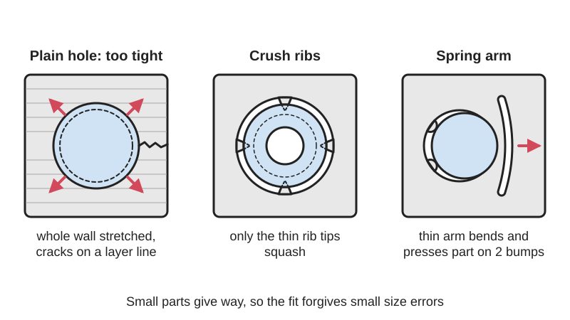
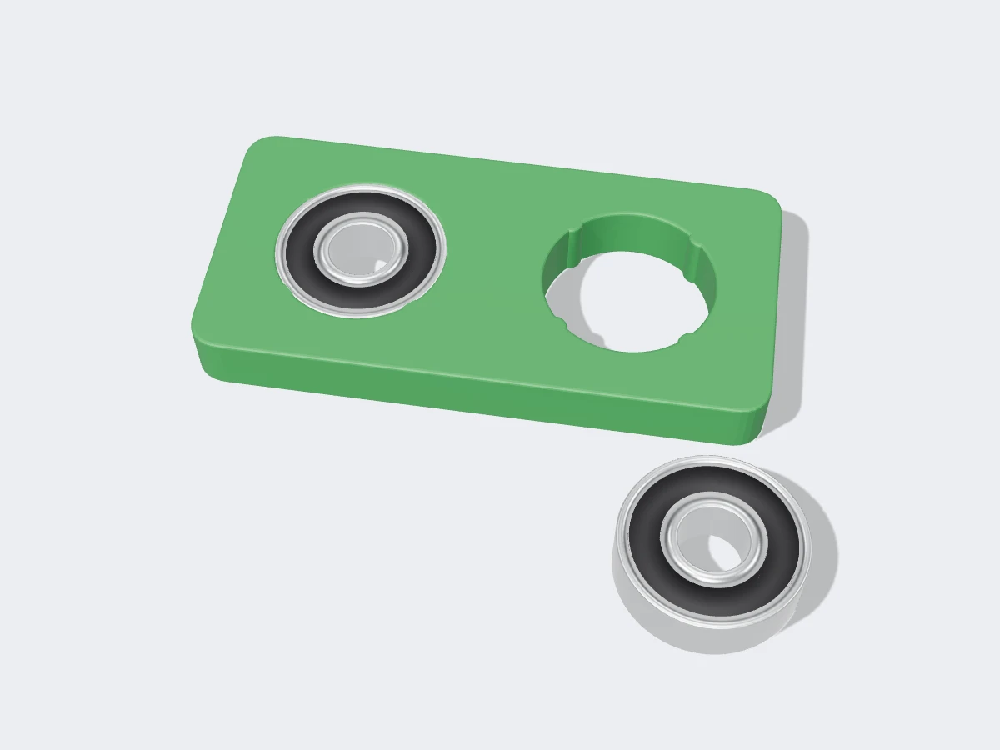

<figure class="eoc-pic eoc-pic-main"><figcaption>Diagram drawn for the encyclopaedia from the research notes. ⚑ Needs confirming: a drawing can simplify or get details wrong; a real photo or a better diagram is welcome.</figcaption></figure>
<figure class="eoc-pic"><figcaption><strong>Render.</strong> A 3D model made for the encyclopaedia, not a photo: a stand-in until a good real photo is found. ⚑ Needs confirming: a model can simplify or get details wrong; a real photo is welcome.</figcaption></figure>

A press fit made forgiving: instead of the whole hole gripping the part, a few narrow ribs squash or a thin springy arm bends, so the grip stays about right over a much wider range of sizes.

**In plain words:** Little ridges or bendy tabs inside a hole that squash or flex when you push a part in, so a bearing, magnet, peg or panel ends up held tight even if your printer or laser cutter made the hole a bit too big or too small. **Proper term:** Crush ribs and spring-fit features (compliant press fit).

**Also called:** crush ribs (injection-moulding term; Protolabs, RapidDirect); compression ribs, press-fit ribs (Hackaday 'Adding crush ribs to 3D printed parts'); nodes or bumps: little bumps in the slots of laser-cut parts that squash to take up [kerf](../glossary.md#kerf) and thickness variation (Ponoko); cantilever-based mounts and joints, SpringFit (spring-fit): a thin springy arm that presses the part in place, from Hasso Plattner Institute's SpringFit tool for laser cutting; magnet crush ribs, wavy magnet pocket (Gridfinity generators' press-fit magnet holes); transition-fit crush ribs vs press-fit crush ribs (AON3D's two versions); compliant pin, eye-of-the-needle press-fit pin (the electronics version: a split pin that springs against a circuit-board hole; ConnectorTips); [tolerance](../glossary.md#tolerance) ring (a bought wavy metal band that does the same job; separate entry).

## How it works

In a plain press fit the whole hole is a little smaller than the part and the surrounding material must be squeezed; that material is very stiff, so a tiny size error means either no grip or so much force that the part cracks (SpringFit paper, UIST 2019). Crush ribs make only a few thin lines touch the inserted part: the ribs are narrow, so they deform (and in FDM prints the thin walls behind them bend) instead of the whole wall, and the fit tolerates small size errors (Hackaday; Protolabs; Printables 'Test Print - Crush Ribs' by kaje). Spring-fit features go further: a long, thin arm ([cantilever](../glossary.md#cantilever) spring) bends to press on the part, and because bending is much softer than squeezing, it keeps a useful [holding force](../glossary.md#holding-force) over a much wider range of sizes; making the arm longer lets it take up more variation (SpringFit paper).

## Parts

Single piece plus the part being held: the ribs or springy tabs are printed, moulded or cut as part of the holder (a hole, pocket or slot), and a separate part is pushed in (a ball bearing, magnet, metal pin, printed peg, button or plywood panel). Laser-cut spring mounts often add two small fixed bumps opposite the spring so the part sits in a stable triangle (SpringFit paper).

## Everyday examples

- Magnet pockets in Gridfinity-style storage bins and baseplates made with the generators' 'crush ribs' option (Extrabold Gridfinity baseplate generator)
- Laser-cut plywood kits whose slots have little bumps so the pieces hold without glue (Ponoko 'nodes')
- Ball bearings pushed into 3D-printed rover and robot parts, e.g. Sawppy the Rover (New Screwdriver)
- Connector pins pressed into computer circuit boards without solder (eye-of-the-needle compliant pins; ConnectorTips)

## When to use it

Use crush ribs or spring features whenever something must be pushed into a printed, moulded or laser-cut hole and stay put without glue or screws, especially when you will share the file and other people's printers, lasers or materials will make the hole a slightly different size: bearings in printed housings, magnets in bins, pins and pegs, buttons and switches in panels, and slot-together plywood or acrylic parts. Transition-fit ribs and spring tabs suit parts you may need to remove again.

## When not to use it

Avoid relying on them alone for heavy, hammering or vibrating loads, precision bearing seats, or hot places where plastic [creeps](../glossary.md#creep); add a shoulder, retaining clip, screw or glue, or use a metal housing. For parts that must come out often, use a snap fit, a clip or a screw instead of squashable ribs. For very [brittle](../glossary.md#brittle--ductile) materials (standard resin, acrylic) prefer a longer spring tab or a [clearance](../glossary.md#clearance) hole with glue over a tight rib fit. If you need a sealed or airtight joint, use an [O-ring](../glossary.md#o-ring) or glue.

## Details

- **What it does (jobs):**
  - join and hold: holds a bearing, magnet, pin, shaft, button or panel in a hole or slot by friction, with no glue or screws
  - line parts up exactly: three or more evenly spaced ribs centre a round part in its hole (Protolabs: ribs keep a tight fit and alignment; Creative3DP blog: the fit self-centres)
- **Movement:** none: it is a fixed fit; the ribs squash or the tab flexes only while the part is pushed in
- **Directions it can move (degrees of freedom):** 0: once pushed home the part cannot move (unless pulled out with enough force)
- **Special behaviour:**
  - self-aligning or self-centring: evenly spaced ribs push equally from all sides, so a bearing or pin centres itself in the hole (Protolabs; Creative3DP blog)
  - none of the other clever behaviours; its real trick, absorbing size errors, is not in the list: it keeps working when printer, laser cutter or material changes (SpringFit paper; Hackaday)
- **How it holds:**
  - friction or clamping ([force-fit](../glossary.md#form-fit--force-fit--material-bond)): the squashed ribs or pressed tab create a gripping force, and friction holds the part
  - spring force (a spring or springy part presses it in place): in spring-fit (cantilever) versions a bending arm keeps pushing on the part
- **Input and output:** not applicable
- **Power:** passive (no power needed)
- **Load:** light to medium: it holds only by friction, and only the rib lines touch the part, so heavy or pounding loads can crush the ribs further until a bearing works loose (New Screwdriver; Hackaday commenters). Spring mounts come apart more easily than a hard press fit hammered in with a rubber mallet (SpringFit paper). Strongest against slipping along the hole when there are more and longer ribs; weakest against being pulled straight out.
- **Play and precision:** none to small once fitted: the part is held tight. Its exact position is a little less predictable than in a perfect round hole, because it rests on a few rib lines (New Screwdriver). Tolerates size variation: crush ribs typically about 0.2-0.3 mm proud (AON3D; kaje); SpringFit mounts handled holes eroded by 0.2 mm and a button 0.3 mm larger, and long springs up to 1.5 mm (SpringFit paper).
- **Taking it apart:** semi-permanent for crush ribs: the part can be pushed out again, but the ribs stay squashed and grip less next time (AON3D: press-fit crush ribs are for one-time assembly). Removable for spring-fit tabs and for tapered 'transition-fit' crush ribs, which do not deform permanently (AON3D; SpringFit).
- **How often it can be reused:** once to a few times for crush ribs that are squashed flat (AON3D); many times for cantilever spring tabs and transition-fit ribs, as long as the tab does not crack or take a set ⚑ [uncertain]
- **Sealing:** none: the gaps between the ribs are open
- **Adjustable:** no: the grip is set by the rib height or spring [stiffness](../glossary.md#stiffness); to change it you reprint or recut the part
- **Access needed:** one side only (blind): the part is pushed in from the open side of the hole or slot
- **Materials:** Holder: injection-moulded thermoplastics such as ABS, PC, nylon and POM (RapidDirect); 3D prints in PLA, PETG, ABS/ASA or nylon; laser-cut plywood and MDF, where little bumps compress well (Ponoko says nodes work best in wood); acrylic is brittle and tends to crack in a plain press fit, which is where cantilever springs help (SpringFit paper). Inserted part: steel ball bearings, neodymium magnets, metal dowel pins and shafts, printed pegs, arcade buttons.
- **Heat, cold, water and wear:** Friction fits in plastic loosen over time as the plastic creeps and relaxes, faster when warm (DuPont design guide); 3D-printed PLA lost about 11-13% of its stress in 500 seconds in stress-relaxation tests (Bertocco et al., Materials 2022). PLA begins to soften at about 60 °C, PETG at about 80 °C and ASA at about 110 °C (CNC Kitchen oven test), so a bearing or magnet in a PLA part left in a hot car may loosen or shift. Metal parts in plastic expand less with heat, so temperature swings change the grip (DuPont). Vibration and shock loads can crush ribs further (New Screwdriver).

## Making it

- **Ways to make or get it:**
  - injection moulding: where crush ribs come from; they let a drafted (tapered) hole still grip a part tightly (Protolabs)
  - 3D print (FDM): ribs or flexible tabs printed inside holes for bearings, magnets and pegs (Hackaday; New Screwdriver)
  - 3D print (resin): the same geometry works, but standard resins are more brittle, so keep interference small ⚑ [uncertain]
  - laser cut: bumps (nodes) in slots and cantilever-spring mounts and joints in plywood, MDF and acrylic (Ponoko; SpringFit)
  - CNC: rounded ribs are cut into moulds with an end mill (Protolabs)
- **Printing it in one piece (print in place):** no: the ribs or spring tabs print as part of the holder, and the bearing, magnet or other part is pushed in after printing
- **Tools:** none for small parts (push in by hand; SpringFit parts go in best at an angle); a vice, arbor press or a bolt-and-washer puller is kinder than a hammer for pressing bearings ⚑ [uncertain]; a lead-in [chamfer](../glossary.md#chamfer--fillet) on the hole helps (Gridfinity layout tool: 45 degrees, 0.8 mm)
- **Difficulty:** easy: a few small ridges or a slot-cut spring arm are quick to add in CAD, print or cut with the part, and save the trial-and-error of tuning an exact hole size for every printer

### 3D printing tips

1) Why: printed holes usually come out 0.1-0.3 mm undersize and vary between printers and filaments, so a plain press fit tuned on one printer fails on another (Creative3DP blog; Hackaday); crush ribs let one file work on many printers (Marginally Clever). 2) Make the hole a little larger than the part (a clearance fit) and add at least three narrow ribs, evenly spaced, running along the hole in the direction the part is pushed in (Protolabs; AON3D). In FDM, ribs standing about 0.2 mm proud of the hole are common (AON3D; Creative3DP blog); kaje's tests used four 0.3 mm ribs around an 8 mm peg. 3) Choose press-fit or transition-fit: straight 0.2 mm ribs along the full length make a true press fit for one-time assembly; tapering the hole by about 2 degrees plus 0.2 mm ribs gives a snug fit that can be taken apart and refitted (AON3D). In kaje's tests a hole tapered by 1 degree gave a good firm fit, 0.5 degree was very tight and 2 degrees was loose. 4) Rounded or half-round rib tips crush more predictably than sharp ones (Protolabs recommends rounded ribs for moulding). 5) Print holes for vertical parts with the hole axis vertical so the ribs are built as clean vertical lines ⚑ [uncertain]; test both upright and upside down, since printer Z errors change the hole size (Printables 'Press fit tolerance test for 6 x 2 mm magnets'). 6) Add a small 45-degree chamfer or lead-in at the mouth, e.g. 0.8 mm (Gridfinity layout tool), or 0.5 mm x 45 degrees on a 22 mm bearing pocket (Creative3DP blog), so the part starts straight and doesn't shave the ribs off. 7) For magnets, a wavy pocket works well: eight ribs forming a wave between the nominal diameter and 0.6 mm under it (Gridfinity layout tool); for plain holes, one maker found 6.05-6.15 mm holes held 6 x 2 mm magnets by hand in PLA (Printables, sk7fast). 8) Give the ribs somewhere to go: thin walls behind the ribs that can bend a little help, since kaje found the peg walls bending inward did more of the work than the ribs crushing; but keep enough solid material and extra [perimeters](../glossary.md#perimeters) around bearing pockets so the housing doesn't split. 9) Spring tabs: make a slot beside the hole to leave a thin arm that presses on the part; a longer arm tolerates more size error, a thicker one grips harder (stiffness rises with thickness cubed and falls with length cubed; SpringFit paper). Keep the arm's bending direction across the layers, not along a single layer line, so it doesn't split ⚑ [uncertain]. 10) Don't count on ribs alone for heavy or long-term loads: add a shoulder, a clip or glue as backup (Creative3DP blog; DuPont).

### Buying one (off-the-shelf parts)

Parts commonly pushed into crush-rib holes: deep-groove ball bearings such as 608 (8 x 22 x 7 mm) and 623 (New Screwdriver), neodymium disc magnets such as 6 x 2 mm, steel dowel pins, arcade buttons. Bought alternatives that do the same job: a tolerance ring (wavy metal band), compliant press-fit pins (eye-of-the-needle pins) for circuit boards, and press-fit or knurled inserts.

## Rules of thumb

- Use three or more undrafted crush ribs along the hole; rounded ribs are cheaper to cut into a mould than sharp V ribs (Protolabs 'Crush rib design guidelines for injection molding').
- Moulding sizes: ribs about 2.5 mm (0.1 in) across with about 0.25 mm (0.01 in) interference; rib thickness 40-60% of the wall thickness; spacing about twice the wall thickness; at least three ribs per fitting (RapidDirect 'Crush ribs in injection molding').
- 3D printing: 0.2 mm ribs along the full hole length for a one-time press fit; a 2-degree [taper](../glossary.md#taper) plus 0.2 mm ribs for a reusable transition fit (AON3D 'Engineering fits').
- Test data (PLA, 8 mm peg, four 0.3 mm ribs): hole taper 0.5 degree = very tight, 1 degree = good firm fit, 2 degrees = loose (kaje, Printables 'Test Print - Crush Ribs - Version02').
- Magnet pockets: eight-rib wavy bore between the nominal diameter and 0.6 mm under it, with a 45-degree, 0.8 mm lead-in chamfer (andymai gridfinity-layout-tool pull request 4316).
- A cantilever spring's stiffness rises 8 times if its thickness is doubled or its length halved; a spring designed for about 0.1 mm of kerf variation at 10 N can be made longer (and thicker) to accept up to 1.5 mm, 7.5 times more (Roumen et al., 'SpringFit', UIST 2019).
- Plain laser-cut press fits leave little margin: about 0.001-0.002 in (0.025-0.05 mm) of overlap for acrylic and 0.002-0.004 in for MDF (University of Pennsylvania MEAM 'Laser cutting fits'); this is why bumps or springs are added.
- Plastics creep and stress-relax, so any press fit loosens somewhat over time; test at the expected temperatures and apply a safety factor of 1.5-2 to the maximum interference (DuPont 'General Design Principles for Engineering Polymers', Module I, press fitting, pp. 68-71).

## Common failures

Too tight: the holder splits along a layer line or the part won't go in; plain round interference holes concentrate stress and crack along [layer lines](../glossary.md#layer-lines), which ribs reduce (Creative3DP blog). Too loose: ribs too small or the hole too big, so the part falls out. Ribs shaved off rather than squashed when the part enters crooked; fix with a chamfered lead-in. Ribs flattened after several insertions, so the fit gets looser each time (AON3D). Heavily loaded bearings working loose as the ribs crush further (New Screwdriver). Spring tabs cracking where they join the part, or weakening the structure around them (SpringFit paper limitation). A peg snapping when being pulled back out of a tight rib fit (kaje's tests).

## Safety

Pressing parts in can crack the holder and send sharp fragments or brittle acrylic pieces flying (SpringFit paper notes acrylic 'pops'); press slowly, wear eye protection ⚑ [uncertain]. Small neodymium magnets are a serious hazard if swallowed by children, and magnets snapping together can pinch skin or shatter (Wikipedia 'Neodymium magnet').

## Related

- Press fit ([interference fit](../glossary.md#interference-fit)): the plain version, a whole hole slightly smaller than the part; stronger but needs exact sizes
- Tolerance ring (wavy-band press fit): a bought metal band with springy waves that does the same job between a shaft and a hole
- [Elastic averaging](../glossary.md#elastic-averaging) (many-feature alignment): many small springy contacts that together locate a part accurately
- Cantilever snap fit and annular snap fit: springy features that hook behind a lip instead of just gripping by friction
- Mid-print embedding ([captive nuts](../glossary.md#captive-nut), magnets and bearings): traps the part inside the print instead of pushing it into a hole
- Heat-set threaded insert and press-fit and expanding inserts: other ways of holding metal parts in plastic
- Magnet joint (embedded magnets, magnetic catch): what the magnets in rib pockets are often used for
- Kerf-canceling mechanisms (HPI): laser-cut wedge designs that stay tight whatever the cutter's kerf, a cousin of SpringFit

## Make it yourself

- [Test Print - Crush Ribs - Version02 (kaje, Printables)](https://www.printables.com/model/43599-test-print-crush-ribs-version02): An 8 mm peg and a block of holes with four 0.3 mm ribs and different tapers (0.5, 1 and 2 degrees) and depths, with the designer's fit results; Onshape CAD included. URL seen in search results; details read through the Printables public API. *(licence: Creative Commons Public Domain)*
- [Test Print - Crush Ribs - Version04 (kaje, Printables) (URL from Printables API, page not opened)](https://www.printables.com/model/43636-test-print-crush-ribs-version04): Square peg-and-hole version of the crush-rib test; the designer found the peg walls bending inward did much of the gripping. *(licence: Creative Commons Public Domain)*
- [Press fit tolerance test for 6 x 2 mm magnets (sk7fast, Printables) (URL from Printables API, page not opened)](https://www.printables.com/model/1759114-press-fit-tolerance-test-for-6-x-2-mm-magnets): Quick test of hole sizes for pushing 6 x 2 mm magnets in by hand; 6.05-6.15 mm worked in PLA at 0.2 mm layers; print upright and upside down. *(licence: Creative Commons Public Domain)*
- [Gridfinity Baseplate Generator (Extrabold tools)](https://www.extrabold.tools/docs/gridfinity-baseplate): Online generator for Gridfinity baseplates with an experimental 'crush ribs' magnet-hole option (a wavy pocket that grips magnets without glue), magnet sizes 3-12 mm *(licence: ⚑ [uncertain] (not stated on the page))*
- [feat(generation): crush ribs and a chamfered mouth for magnet holes (andymai/gridfinity-layout-tool, GitHub pull request)](https://github.com/andymai/gridfinity-layout-tool/pull/4316): Code change adding an eight-rib wavy magnet bore and a 45-degree lead-in chamfer to a Gridfinity layout generator; useful as a worked parametric example *(licence: ⚑ [uncertain] (repository licence not checked))*

## Pictures, videos and models

- [Adding Crush Ribs To 3D Printed Parts For A Better Press Fit (Hackaday, Donald Papp, 2020)](https://hackaday.com/2020/10/15/adding-crush-ribs-to-3d-printed-parts-for-a-better-press-fit/): Photos of crush ribs inside printed bearing holes and the embedded video from Dan Royer (Marginally Clever Robots) *(licence: link only)*
- [Why Crush Ribs are great! (YouTube, Dan Royer / Marginally Clever Robots)](https://www.youtube.com/watch?v=0h6dCeATkrU): Video explaining where crush ribs come from, why they make press fits work on any printer, and how to model them *(licence: link only (standard YouTube licence))*
- [SpringFit: Joints and Mounts that Fabricate on Any Laser-Cutter (YouTube, Hasso Plattner Institute HCI)](https://www.youtube.com/watch?v=NO_UBPPEX1c): Video demo of cantilever-spring mounts and finger, notch and T-joints in laser-cut plywood and acrylic, compared with press fits that fail *(licence: link only (standard YouTube licence))*
- [Crush Rib Design Guidelines for Injection Molding (Protolabs)](https://www.protolabs.com/resources/design-tips/adding-crush-ribs-to-molded-parts/): Illustrations of traditional sharp V crush ribs and Protolabs' recommended rounded ribs in a drafted hole *(licence: link only)*
- [SpringFit project page (Hasso Plattner Institute, Baudisch lab)](https://hpi.de/baudisch/projects/springfit.html): Pictures of laser-cut models before and after conversion to cantilever-spring mounts and joints, with links to the paper and video *(licence: link only)*

## Needs confirming

⚑ marks something nobody has confirmed yet: a fact the research could not confirm from a source, a finder value that is a best guess, or an open point from the research notes. Corrections are welcome (see `research/needs-confirming.md`).

- ⚑ 8 sentences on this page marked [uncertain].
- ⚑ Finder value `tools` = none, press or vice, hand tools (source uncertain): `tools_needed` is marked ⚑ [uncertain] here: "…bolt-and-washer puller is kinder than a hammer for pressing bearings ⚑ [uncertain]; a lead-in chamfer on the ho…"
- ⚑ Finder value `usual_process` = off-the-shelf part (best guess): first-listed process "injection moulding: where crush ribs come from; th" not recognised; defaulted

## Sources

- <https://www.protolabs.com/resources/design-tips/adding-crush-ribs-to-molded-parts/>
- <https://www.rapiddirect.com/blog/crush-ribs/>
- <https://hackaday.com/2020/10/15/adding-crush-ribs-to-3d-printed-parts-for-a-better-press-fit/>
- <https://hackaday.com/tag/crush-ribs/>
- <https://www.marginallyclever.com/2020/09/have-you-heard-of-crush-ribs/>
- <https://www.youtube.com/watch?v=0h6dCeATkrU>
- <https://newscrewdriver.com/2020/12/31/accommodate-3d-printer-variation-with-crush-ribs/>
- <https://www.aon3d.com/applications/engineering-fits-how-to-design-for-3d-printed-assemblies/>
- <https://tools.creative3dp.com/blog/press-fit-tolerances-3d-printing/>
- <https://formlabs.com/global/blog/3D-printing-tolerances-for-engineering-fit/>
- <https://hpi.de/baudisch/projects/springfit.html>
- <https://hpi.de/oldsite/fileadmin/user_upload/fachgebiete/baudisch/projects/springFit/Roumen-Shigeyama-springfit-joints-and-mounts-that-fabricate-on-any-laser-cutter-UIST2019>
- <https://www.youtube.com/watch?v=NO_UBPPEX1c>
- <https://hpi.de/baudisch/projects/kerf-canceling-mechanisms.html>
- <https://help.ponoko.com/en/articles/4527166-interlocking-3d-laser-cut-designs>
- <https://www.ponoko.com/blog/how-to-make/how-to-make-glue-less-interlocking-parts/>
- <https://medesign.seas.upenn.edu/index.php/Guides/LaserCuttingFits>
- <https://github.com/andymai/gridfinity-layout-tool/pull/4316>
- <https://www.extrabold.tools/docs/gridfinity-baseplate>
- <https://en.wikipedia.org/wiki/Interference_fit>
- <https://www.connectortips.com/use-compliant-pins-connector-designs/>
- <https://www.distrupol.com/General_Design_Principles_for_Engineering_Polymers.pdf>
- <https://pmc.ncbi.nlm.nih.gov/articles/PMC9147248/>
- <https://www.cnckitchen.com/blog/comparing-pla-petg-amp-asa-feat-prusament>
- <https://en.wikipedia.org/wiki/Neodymium_magnet>
- <https://api.printables.com/graphql/>
- <https://www.printables.com/model/43599-test-print-crush-ribs-version02>
