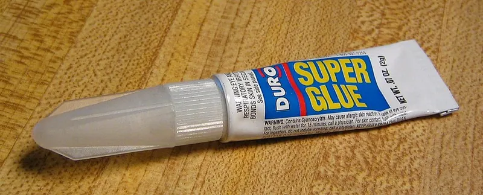

<figure class="eoc-pic eoc-pic-main"><figcaption><a href="https://commons.wikimedia.org/wiki/File:Super_glue.jpg">Super glue</a> by unknown, <a href="https://creativecommons.org/licenses/by-sa/3.0">CC BY-SA 3.0</a>, from Wikimedia Commons.</figcaption></figure>

Cyanoacrylate (superglue) is a one-part liquid glue that hardens in seconds in a thin film between tight-fitting parts, triggered by traces of moisture, giving a strong but [brittle](../glossary.md#brittle--ductile) bond on most plastics, metal, rubber and wood.

**In plain words:** A runny or jelly-like 'instant' glue that grabs in seconds when two close-fitting parts are pressed together, because the moisture on their surfaces makes it harden; very strong when you pull or slide the parts, but brittle, so it can crack if you [peel](../glossary.md#peel-vs-shear), bend or knock the joint. **Proper term:** Cyanoacrylate adhesive (CA glue, instant adhesive).

**Also called:** superglue, super glue, CA glue, CA (Wikipedia; Prusa); instant glue, instant adhesive, power glue (Wikipedia); Super Glue, Krazy Glue (brands; Wikipedia), Loctite Super Glue / Super Bonder (brands; Wikipedia), Zap, Zap-a-Gap (brands; thisTOthat); Eastman 910, Permabond 910 (brands; the original formula, named because it set in 9 to 10 seconds, per Permabond); ethyl cyanoacrylate (ECA), methyl cyanoacrylate (MCA); n-butyl and 2-octyl cyanoacrylate for medical 'skin glue', e.g. Dermabond (brand) (Wikipedia); thin (water-thin, wicking), medium and thick or gel CA; rubber-toughened (usually black) CA; odourless or low-bloom, 'foam-safe' CA; surface-insensitive CA (Prusa; Loctite design guide); Sekundenkleber (German; Hackaday); nail glue (cosmetic use; Wikipedia).

## How it works

The glue in the bottle contains a weak acid that keeps it liquid. Almost every surface carries a trace of water, and when the glue is squeezed into a thin film between two parts that water neutralises the acid and sets off a very fast chain reaction (anionic polymerisation) that links the small liquid molecules into long, solid plastic chains (Loctite design guide; Wikipedia). Because the reaction starts at the surfaces, thin layers bond well and thick blobs or wide gaps set slowly and weakly (Wikipedia: 'Thin layers bond effectively, thick layers much less so'; Loctite: 'limited gap [cure](../glossary.md#cure)'). It grabs within seconds to about a minute and reaches full hardness over 8-24 hours (Prusa; 3M CA100 data sheet: handling strength in 20-70 s). The result is a hard, glassy plastic: strong in shear and tension, but brittle, with poor peel strength (Loctite design guide).

## Parts

Single piece: one liquid or gel, no mixing. Optional helpers: an accelerator (activator) spray to make it set instantly, a [primer](../glossary.md#primer) that lets it stick to polyethylene and polypropylene, and a debonder that dissolves it (Loctite design guide; Prusa).

## Everyday examples

- The small tube of 'super glue' used for quick household and model repairs (Wikipedia)
- Nail glue for artificial nail tips (Wikipedia)
- Hospital 'skin glue' used to close small cuts instead of stitches, e.g. Dermabond (brand) (Wikipedia)
- Model aircraft, miniatures and aquarium coral fragments glued to rock (Wikipedia)

## When to use it

Use CA for small, well-fitting parts that you want joined right now: snapping a broken printed part back together, assembling multi-part prints and models, gluing small rubber parts, fixing small plastic, metal, wood or rubber parts, and tacking parts in place while a slower glue cures (Prusa; Wikipedia). It works on almost all common printing plastics (PLA, PETG, ASA, ABS, resin) and is often the strongest simple option for them (Prusa; Loctite design guide). Water-thin CA is ideal for dribbling into a tight crack; gel CA for vertical surfaces and slightly gappy joints (Prusa).

## When not to use it

Avoid it for loose-fitting or gappy joints and large areas: use two-part epoxy, which fills gaps and gives more [working time](../glossary.md#pot-life--working-time). Avoid it for joints that will be peeled, bent, twisted or knocked: use rubber-toughened CA, epoxy or a flexible adhesive (Loctite design guide; Prusa). Don't use it on polyethylene or polypropylene without a primer (Loctite design guide), on expanded polystyrene foam unless it's foam-safe CA, or on clear parts where frosting would show (use odourless CA or UV-curing glue) (Prusa). Avoid it where parts get hot (e.g. near an extruder), stay wet or are outdoors in freezing weather; use epoxy, high-temperature or water-resistant grades, or screws (Prusa; Wikipedia). For ABS or ASA, solvent welding with acetone fuses the plastic itself (Prusa). If you may need to take it apart, use screws, magnets or threaded inserts (Prusa).

## Details

- **What it does (jobs):**
  - glue or bond: joins parts permanently in seconds
  - join and hold: also used to 'tack' parts in position quickly while a slower, tougher glue such as epoxy sets (Wikipedia; Prusa)
- **Movement:** none: a rigid joint with no movement
- **Directions it can move (degrees of freedom):** 0: the glued parts are locked together
- **Special behaviour:**
  - none: it has none of the listed behaviours. Its own tricks are setting in seconds without mixing or clamping, wicking by itself into a tight crack when a thin grade is dripped on the seam (capillary action), and being partly reversible: acetone or a debonder softens it so parts can be separated (Prusa; thisTOthat; Wikipedia)
- **How it holds:**
  - [material bond](../glossary.md#form-fit--force-fit--material-bond) (glue, solvent or melting): the cured glue sticks to both surfaces
- **Input and output:** not applicable
- **Power:** passive (no power needed): it cures by itself at room temperature from surface moisture; accelerators or UV-curing versions only speed this up (Loctite design guide; Permabond).
- **Load:** medium: in a tight lap joint general-purpose CA is very strong in shear and tension: Loctite's tests reached more than 24 MPa on ABS and about 28 MPa on nylon 6, often breaking the plastic before the glue, and Prusa measured about 10-13 MPa pulling apart glued PLA, PETG and ASA test prints (Loctite design guide; Prusa). It is weak in peel and impact, and hobby testers find parts 'much easier twisted or peeled than pulled apart' (Prusa; Loctite: 'poor peel strength'). Note the conflict: Wikipedia calls CA's shear strength 'low', while industrial lap-shear tests rate it 'excellent'; the difference is probably brittleness under knocks and twisting ⚑ [uncertain]. Without a primer it holds almost nothing on polyethylene or polypropylene (about 0.3-1 MPa) (Loctite design guide).
- **Play and precision:** not applicable (nothing moves). It needs close-fitting parts: cyanoacrylate grades cover gaps of about 0.015-0.5 mm, with water-thin grades for the tightest joints and gels for the largest (Permabond); a thick 3,000 cP grade fills gaps up to 0.020 in (0.5 mm) (3M CA100 data sheet).
- **Taking it apart:** semi-permanent (can be undone but may damage parts): acetone, some nail-polish removers or a commercial debonder soften cured CA so a model can be taken apart 'with little or no damage'; test first, as some debonders also attack plastic. Cooling the part in a freezer makes CA brittle enough to snap joints apart (Prusa; Wikipedia).
- **How often it can be reused:** once: the glue itself can't be reused; to redo a joint, clean off the old glue and apply fresh
- **Sealing:** none: it is not a sealant. Ordinary CA has only 'weak' resistance to moisture, although special water-resistant grades exist (Wikipedia; Permabond).
- **Adjustable:** no: it grabs in seconds, and moving the parts after that weakens the bond; if the fit isn't right within a few seconds, clean off the glue and start again (Prusa).
- **Access needed:** not applicable: glue is put on the joint faces before assembly, or a thin grade is dripped along the seam of parts already held together, from one side (thisTOthat; Prusa).
- **Materials:** Bonds well: most rigid plastics including ABS, ASA, PLA, PETG, PET, nylon, polycarbonate, PVC and resin prints; rubber; metals when clean and tight-fitting; wood (surface-insensitive grades cure better on acidic surfaces such as wood); ceramics; leather and natural fibres (but see the heat warning below); TPU if the parts are stiff enough (Loctite design guide; Prusa; Wikipedia; Permabond). Poor or needs a primer: polyethylene (PE), polypropylene (PP), PTFE and acetal (POM), where primers can raise bond strength up to 20 times (Loctite design guide). Other problems: glass (poor long-term durability, Loctite); very smooth glass, ceramic or metal can be difficult (Prusa); expanded polystyrene foam is melted by ordinary CA, so use foam-safe CA (Prusa); clear styrene can turn brittle, and acrylic, polycarbonate, ABS and PVC can crack from uncured CA under stress, so test first (Prusa; Loctite stress-cracking table); cotton, wool and leather react in a fast, hot reaction when soaked with CA (Wikipedia).
- **Heat, cold, water and wear:** Heat: ordinary CA reportedly keeps about 50% of its strength at 80 °C and only about 20% at 100 °C (Prusa); industrial grades are rated around 100 °C long term (3M CA100), and heat-resistant grades up to 120-250 °C (Permabond; Prusa). Heating cured CA breaks it down into irritating gases (Wikipedia). Cold: CA 'becomes brittle when frozen, so it's not suitable for outdoor use in temperate/arctic climates' (Prusa). Water: traditional CA has 'weak' resistance to moisture and heat (Wikipedia), but water-resistant grades keep 75% of their strength after 1,000 hours in 60 °C water (Permabond 712). Chemicals: poor solvent resistance, and acetone dissolves it (Loctite design guide; Wikipedia). Glass bonds lose strength over time (Loctite). Unused glue thickens and goes off within months, faster once opened (Prusa; Wikipedia).

## Making it

- **Ways to make or get it:**
  - off-the-shelf part: bottles, tubes and pens of thin, medium and gel CA, plus accelerator sprays, primers and debonders
  - 3D print (FDM): gluing printed parts together, filling seams and small repairs (Prusa)
  - 3D print (resin): bonds resin prints almost instantly (Prusa)
  - woodwork: thin CA as a hard, glossy finish (e.g. on turned pens), and mixed with sawdust to fill cracks (Wikipedia)
  - CNC: as a temporary hold, e.g. gluing a workpiece to a sacrificial block on a lathe and breaking it off afterwards (Wikipedia)
  - model making and electronics: models, miniatures, and tacking wires in place (Wikipedia; Loctite design guide)
- **Printing it in one piece (print in place):** no: it is a glue for joining separately printed parts, although you can design pins, keys and flat mating faces into the prints to make gluing easier.
- **Tools:** The glue (a nozzle, precision tips or a cocktail stick for small amounts), sandpaper and isopropyl alcohol to prepare surfaces, and optionally accelerator spray, primer (for PE, PP and similar plastics) and debonder or acetone for clean-up (Prusa; Loctite design guide; 3M CA100 data sheet). Clamps are rarely needed. Wear non-cotton gloves: cotton reacts dangerously with CA (Wikipedia).
- **Difficulty:** easy: no mixing and it sets in seconds. The main difficulties are lining parts up before it grabs, keeping it off fingers, and making the parts fit closely enough (Prusa).

### 3D printing tips

1) Make the mating faces flat and close-fitting: CA fills only small gaps (about 0.015-0.5 mm, Permabond), so sand faces flat, remove sanding dust, grease and old glue (Prusa), and wipe with isopropyl alcohol (3M CA100 data sheet). A slightly rough or layered surface helps it grip (Prusa). 2) Use only a little and spread it on one face; press and line up within a few seconds. If it isn't right, pull apart, clean off and restart rather than wiggling it (Prusa; thisTOthat). 3) For clean joints, hold the parts together and run water-thin CA along the seam so it wicks in by capillary action, but on rough FDM prints it can also run along [layer lines](../glossary.md#layer-lines) and fingerprints and spoil the surface (Prusa). 4) For gaps or poorly fitting prints, use gel CA (it sets a little slower, which also gives more time to align, but is slightly weaker and frosts more), or mix CA with talc, microballoons or baking soda as a quick filler (Prusa; Wikipedia). 5) Accelerator sets it instantly, but the faster reaction gives off more heat, which can slightly warp low-temperature plastics like PLA; use a light mist (Prusa). 6) Stop white 'frosting' (blooming) with good ventilation: don't shut freshly glued parts in a box, and use odourless / low-bloom CA on clear or visible parts (Prusa; Loctite design guide). 7) Design joints to be loaded in shear or compression, not peel: overlapping or stepped joints, pins and keys; make the joint wider rather than longer, because the ends of an overlap take most of the load (Loctite design guide). 8) PETG can't be solvent-welded with hobby chemicals, so CA is a common choice for it (Prusa); in one long-term test some superglues seemed to weaken PETG over time, while polyurethane construction glue and methacrylate glues scored highest (Hackaday on Cosel's test) ⚑ [uncertain]. 9) Soaking prints in thin CA to make them stronger barely helps: CNC Kitchen's hooks went from about 53 kg to 58 kg (Hackaday). 10) Keep bottles clean and upright, work from a small puddle on a non-porous scrap, and let refrigerated, unopened bottles warm up before opening (Prusa).

### Buying one (off-the-shelf parts)

Search for 'cyanoacrylate adhesive', 'CA glue' or 'instant adhesive' in thin (low viscosity, wicking), medium, thick and gel grades; 'rubber-toughened CA' for impact and peel; 'surface-insensitive CA' for wood and acidic surfaces; 'low-odor / low-bloom' or 'foam-safe' CA; 'water-resistant' and 'high-temperature' CA; 'CA accelerator' or 'activator' spray; 'polyolefin primer' (e.g. Loctite 770, brand) for PE and PP; 'CA debonder'; and replacement 'precision tips' for bottles (Loctite design guide; Permabond; Prusa). Industrial ranges include Loctite 401 / 414, 3M Scotch-Weld CA100 and Permabond 910 (brands).

## Rules of thumb

- Keep the glue line thin: 'thin layers bond effectively, thick layers much less so' (Wikipedia). Cyanoacrylate grades fill gaps of about 0.015-0.5 mm (0.006-0.02 in), gels at the top of that range (Permabond 'About Cyanoacrylate Adhesives'; 3M CA100 data sheet: up to 0.020 in).
- Handling strength comes in seconds to about a minute (3M CA100: 20-70 s; Permabond 910 sets in 9-10 s), but full hardness takes 8-24 hours (Prusa 'The Great Guide to Gluing and Assembling 3D Prints').
- Design for shear and compression, avoid peel and cleavage, and make an overlap joint wider rather than longer (Loctite 'Design Guide for Bonding Plastics', vol. 6, pp. 77-79).
- Accelerator is applied to one surface first; its solvent needs 10-60 s to evaporate and the active part stays effective for 1 minute to 72 hours (Loctite design guide, p. 6).
- Polyolefin primer can raise CA bond strength on hard-to-bond plastics up to 20 times; e.g. on low-density polyethylene general-purpose CA gave about 1.0 MPa and primed CA about 3.5 MPa, and on polypropylene primed CA typically broke the plastic (Loctite design guide, pp. 6, 51, 63).
- Heat: ordinary CA reportedly keeps about 50% of its strength at 80 °C and 20% at 100 °C, while heat-resistant grades keep 80% at 120 °C (Prusa). A general industrial grade is rated for 100 °C long term and -54 °C (3M CA100); special grades reach 200-250 °C (Permabond).
- Shelf life: about one year unopened and one month once opened (Wikipedia). Store unopened glue cold (2-8 °C per the Loctite design guide; 4 °C or below per 3M), never refrigerate an opened bottle, and let it reach room temperature before opening to avoid condensation (Wikipedia; Prusa).
- In Prusa's quick one-sample pull test on printed PLA, PETG and ASA, good CA glues reached about 10-13 MPa, more than two 5-minute epoxies (about 2-6 MPa) (Prusa).

## Common failures

The joint snaps when knocked, bent or peeled because cured CA is hard and brittle; design the joint for shear, or use rubber-toughened CA or epoxy (Loctite design guide; Prusa). Weak or slow bonds in gappy joints or thick blobs; improve the fit or switch to gel CA or epoxy (Wikipedia; Loctite). Parts that simply pop off polyethylene, polypropylene or acetal because nothing wets the surface; use a primer or another joining method (Loctite design guide). White frosting around the joint from fumes in still air (Prusa; Loctite). Cracking or crazing of acrylic, polycarbonate, ABS or clear styrene near uncured glue, especially where the plastic is under stress; use as little glue as possible and cure it quickly (Loctite design guide; Prusa). Weak bonds from old, thickened or cheap glue, or from repositioning after it has grabbed (Prusa). Thin glue wicking along layer lines and fingerprints and marking the print (Prusa). Accelerator heat slightly [warping](../glossary.md#warping--shrinkage) thin PLA parts (Prusa). Bonds on glass, or in wet or hot places, failing over time (Loctite; Wikipedia).

## Safety

It bonds skin in seconds: don't pull stuck skin apart; soak with warm soapy water, vegetable oil or acetone, and the glue comes away by itself within a few days (Wikipedia). If it gets in an eye, rinse with lukewarm water for 15 minutes and get medical help; nail-glue bottles have been mistaken for eye drops (Wikipedia). The fumes irritate eyes and nose, so ventilate; about 5% of people become sensitised to them after repeated exposure, with flu-like symptoms, and rarely asthma (Wikipedia; Prusa). Cotton, wool, leather and similar fibres react with CA in a fast, hot reaction that can cause burns or smoke, so never wear cotton gloves, and wipe nozzles with a non-cotton cloth (Wikipedia; 3M CA100 data sheet; Prusa). Accelerators make the reaction, and the heat, faster (Prusa). Heating cured CA, e.g. burning out a clogged metal nozzle, gives off irritating fumes (Wikipedia; Prusa).

## Related

- Two-part epoxy: slower to set but fills gaps, handles knocks and peel better, bonds metal, wood and glass very well; usually weaker than CA on smooth plastics
- Solvent welding (solvent cement): softens and fuses the plastic itself, e.g. acetone on ABS or ASA; doesn't work on PETG or PLA with hobby solvents (Prusa)
- UV-curing adhesive: stays liquid until lit by UV, so there is time to line parts up; good for clear parts
- Hot-melt adhesive (glue gun): fills gaps and is quick, but weak and softens with heat
- Double-sided foam tape (pressure-sensitive adhesive): sticks on contact and stays flexible; good for mounting
- Rubber-toughened CA: a CA variant with rubber added for better peel and impact strength (Loctite; Permabond)
- Structural methacrylate (MMA) and polyurethane construction adhesives: scored highest on PETG in Cosel's long-term test (Hackaday)
- Heat staking and plastic welding with a soldering iron: join printed parts by melting them together, no glue needed
- Screws, threaded inserts and magnets: when the parts must come apart again (Prusa)

## Make it yourself

- [Glue strength test pieces (MethodicalMaker, Printables) (URL from Printables API, page not opened)](https://www.printables.com/model/236948-glue-strength-test-pieces): Printable specimens for comparing glues in torque, shear and tension; the designer sands glue faces with 80-grit, washes them, clamps and waits 5 days before testing with a hanging scale. Read through the Printables public API. *(licence: CC BY (Creative Commons Attribution))*
- [Glue Adhesion Strength Tester (TinkerTiger, Printables) (URL from Printables API, page not opened)](https://www.printables.com/model/327466-glue-adhesion-strength-tester): Two printed testers glued face to face and pulled apart with a luggage scale; print flat or on their side to test different directions. Read through the Printables public API. *(licence: CC BY-SA (Creative Commons Attribution-ShareAlike))*
- [Glue Test Strips (kaje, Printables) (URL from Printables API, page not opened)](https://www.printables.com/model/30133-glue-test-strips): Strips with flat faces and nesting hemispheres for testing glues on PLA; the designer's results favoured a 10-minute adhesive and gel superglue. Read through the Printables public API. *(licence: Public domain (Creative Commons Public Domain))*
- [Baking soda and super glue test block (Jajaxjai, Printables) (URL from Printables API, page not opened)](https://www.printables.com/model/1708768-baking-soda-and-super-glue-test-block): A small test block for trying the superglue-plus-baking-soda gap-filling trick. Read through the Printables public API. *(licence: Public domain (Creative Commons Public Domain))*

## Pictures, videos and models

- [The Great Guide to Gluing and Assembling 3D Prints (Prusa Research blog)](https://blog.prusa3d.com/the-great-guide-to-gluing-and-assembling-3d-prints_44908/): Photos of CA types and bottles, CA frosting (blooming) around a joint, glued printed models, and a table of pull-test results for CA, epoxy and solvent glues on PLA, PETG and ASA *(licence: link only)*
- [Cyanacrylat polymerisation.svg (Wikimedia Commons, by Roland Mattern)](https://commons.wikimedia.org/wiki/File:Cyanacrylat_polymerisation.svg): Diagram of how cyanoacrylate molecules join into a polymer chain when triggered by water (hydroxide ions) *(licence: Public domain)*
- [Super glue.jpg (Wikimedia Commons)](https://commons.wikimedia.org/wiki/File:Super_glue.jpg): Photo of a tube of 'Super Glue' cyanoacrylate glue *(licence: CC BY-SA 3.0)*
- [Adam Savage's Favorite Tools: Superglue and Glue Accelerators! (YouTube, Adam Savage's Tested)](https://www.youtube.com/watch?v=VZqf5rOJNCE): Video about using superglue and accelerators in a maker workshop (title and channel checked via YouTube oEmbed; not watched) *(licence: link only (standard YouTube licence))*

## Needs confirming

⚑ marks something nobody has confirmed yet: a fact the research could not confirm from a source, a finder value that is a best guess, or an open point from the research notes. Corrections are welcome (see `research/needs-confirming.md`).

- ⚑ 2 sentences on this page marked [uncertain].

## Sources

- <https://en.wikipedia.org/wiki/Cyanoacrylate>
- <https://blog.prusa3d.com/the-great-guide-to-gluing-and-assembling-3d-prints_44908/>
- <https://www.ellsworth.com/globalassets/literature-library/manufacturer/henkel-loctite/henkel-loctite-design-guide-plastic-bonding.pdf>
- <https://permabond.com/products/cyanoacrylate-adhesives/>
- <https://multimedia.3m.com/mws/media/2365937O/3M-Scotch-Weld-Instant-Adhesive-CA100.pdf>
- <https://www.thistothat.com/glue/cyan.shtml>
- <https://hackaday.com/2025/01/30/comparing-adhesives-for-gluing-petg-prints/>
- <https://hackaday.com/2019/12/28/stronger-3d-prints-glue-or-carbon-fiber/>
- <https://api.printables.com/graphql/>
- <https://commons.wikimedia.org/wiki/File:Cyanacrylat_polymerisation.svg>
- <https://commons.wikimedia.org/wiki/File:Super_glue.jpg>
- <https://www.youtube.com/watch?v=VZqf5rOJNCE>
