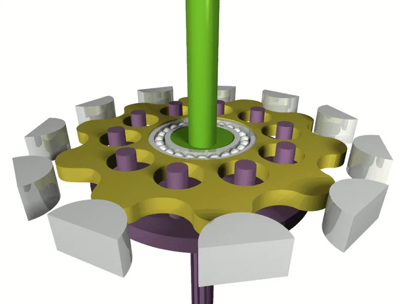
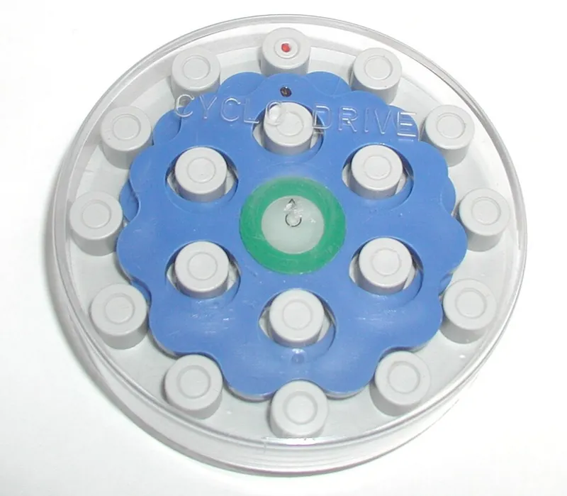
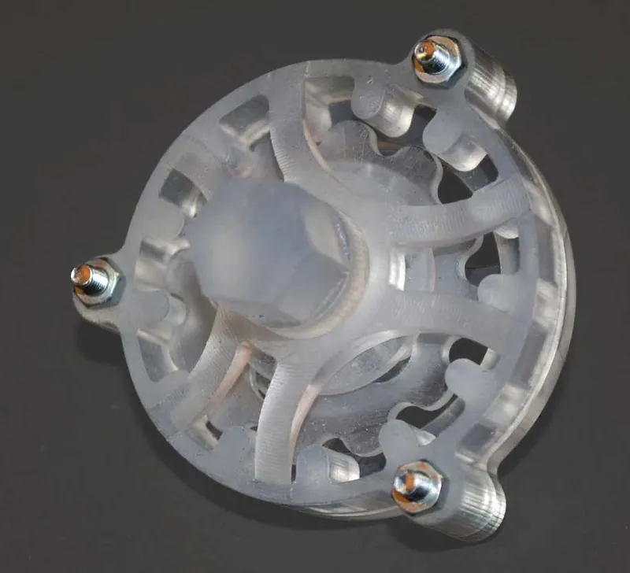

<figure class="eoc-pic eoc-pic-main"><picture><source media="(prefers-reduced-motion: reduce)" srcset="../media/cycloidal-drive.still.webp"></picture><figcaption><strong>Animation.</strong> <a href="https://commons.wikimedia.org/wiki/File:Cycloidal_drive.gif">Cycloidal drive</a> by Petteri Aimonen, Public domain, from Wikimedia Commons.</figcaption></figure>
<figure class="eoc-pic"><figcaption><strong>How it works.</strong> <a href="https://commons.wikimedia.org/wiki/File:Zyklo-Getriebe-Modell.jpg">Zyklo-Getriebe-Modell</a> by 1-1111 at German Wikipedia, Public domain, from Wikimedia Commons.</figcaption></figure>
<figure class="eoc-pic"><figcaption><strong>Photo.</strong> <a href="https://commons.wikimedia.org/wiki/File:Stereolithography_cycloidal_drive.JPG">Stereolithography cycloidal drive</a> by Clemenspool, <a href="https://creativecommons.org/licenses/by-sa/3.0">CC BY-SA 3.0</a>, from Wikimedia Commons.</figcaption></figure>

An eccentric cam on the input shaft rolls a lobed disc (cycloidal disc) round inside a fixed ring of pins or rollers; with one lobe fewer than pins, the disc turns backwards by one lobe per input turn, and output pins in oversized holes in the disc turn this slow wobbling spin into a steady output rotation, giving about 10:1 to 100:1 per stage with low play and high shock resistance.

**In plain words:** A gearbox where a wavy-edged disc, pushed round off-centre by the motor, wobbles inside a ring of pins; because the disc has one bump fewer than there are pins, it slowly turns backwards as it wobbles, and pins poking through holes in the disc pick up that slow turn. **Proper term:** Cycloidal drive (cycloidal speed reducer).

**Also called:** cycloid reducer / cycloidal reducer; cycloidal gearbox / cycloidal gear reducer; Cyclo drive / Cyclo speed reducer (Sumitomo, brand; the original commercial name); pin gear drive / pin-wheel reducer (cycloidal pin-wheel reducer); eccentric planetary reducer with a one-tooth difference (KHK's description); trochoidal curved-plate reducer (after the disc's tooth shape); cycloidal disc drive / lobed disc drive; three-phase or three-ring cycloidal drive (a variant with three plates 120 degrees apart); cycloidal drive with intermediate rollers or balls (a variant using rolling elements in a cage).

## How it works

The input shaft carries an off-centre cam, so as it spins it pushes the disc round in a small circle (the eccentricity), pressing its lobes against the pins of the fixed ring. The ring has one more pin than the disc has lobes, so as the contact point runs round, the disc is forced to roll backwards by one lobe for every turn of the input, turning slowly in the opposite direction. The disc's holes are bigger than the output pins by exactly twice the eccentricity, so the pins can follow the wobble while picking up only the slow turn. Because about half the lobes touch pins at once and the contacts roll rather than slide, it carries large and shock loads for its size.

## Parts

A small assembly that acts as one unit: input shaft with an eccentric cam and bearing; one, two or three cycloidal discs (lobed plates with holes); a ring of fixed pins or rollers (often ball bearings or roller sleeves) set in the housing; an output disc or flange carrying output pins (often with bearings or rollers) that pass through the disc's holes; output bearing, housing, screws and grease.

## Everyday examples

- Robot [actuators](../glossary.md#actuator) and joints (Wikipedia), including the Cassie biped robot, reported to use cycloidal drives (Roozing and Roozing 2022)
- Industrial gear motors sold under the Cyclo name since the 1930s (Wikipedia)
- DIY 3D-printed robot arms, robot dogs and telescope mounts (e.g. 'Cycloidal Drive Equatorial Mount' on Printables)
- Classroom and desk models that show the wobbling disc (osamutake's educational model)

## When to use it

Use it when you need a strong, compact, low-play slow-down in line with the motor that can take knocks, for example robot arm, leg or exoskeleton joints, rotating platforms, winches, and telescope or camera mounts. It prints well because the load is spread over many contacts, and low-ratio versions (about 8:1 to 20:1) stay back-drivable, which suits robots that interact with people or the ground.

## When not to use it

Avoid it for very high ratios in one stage in a small printed package (a strain-wave gear or split-ring planetary goes higher), for high input speeds unless it has two or more balanced discs, or where you need very accurate positioning from the motor encoder alone under heavy load (a printed one twists and its ratio varies slightly round a turn; add an output encoder). For very low ratios (under about 5:1) a simple planetary or belt drive is simpler. Don't use it as a brake or to hold a load; add a brake or [ratchet](../glossary.md#ratchet).

## Details

- **What it does (jobs):**
  - change speed or turning force: a large slow-down and [torque](../glossary.md#torque) increase (hobby prints typically about 8:1 to 40:1, commercial units up to 119:1 per stage) with the output in line with the motor, low play and good shock resistance
- **Movement:** rotate: continuous rotation in, slower continuous rotation out on the same axis (in the usual fixed-pin arrangement the output turns the opposite way); unlimited range, either direction. Inside, the disc wobbles (moves in a small circle) as well as turning
- **Directions it can move (degrees of freedom):** 1: with the pin ring fixed to the housing, turning the input shaft is the only independent motion; the output is tied to it by the lobe and pin counts
- **Special behaviour:**
  - none of the listed behaviours: its special properties are low play, [stiffness](../glossary.md#stiffness) and resistance to shock and overload (KHK; Roozing and Roozing 2022). It is not [self-locking](../glossary.md#self-locking): low-ratio printed versions are back-drivable (HowToMechatronics; Roozing and Roozing), so don't use it as a brake
- **How it holds:**
  - not a holding joint (it moves or passes on motion): it transmits rotation
  - shape (the parts interlock; [form-fit](../glossary.md#form-fit--force-fit--material-bond)): the turning force passes through the disc's lobes pressing on the ring pins and through the output pins in the disc's holes
- **Input and output:** Continuous rotation -> slower continuous rotation, shafts in line ([coaxial](../glossary.md#coaxial)). Ratio: with L lobes and P ring pins, reduction = L / (P - L); normally P - L = 1 to maximise contact, so the ratio equals the number of lobes (= pins - 1), and the output turns opposite to the input (Roozing and Roozing 2022; Wikipedia; Nguyen Duc Thang). Examples: 8:1 (Advanced Hobby Lab, 9 pins), 10:1 (Petteri Aimonen's Commons model; osamutake's educational model), 11:1 (Roozing and Roozing), 15:1 (HowToMechatronics, 16 rollers), 40:1 (Mickey666Maus); commercial units up to 119:1 in one stage and 7,579:1 in two (KHK; Wikipedia gives 7,569:1). Efficiency: about 93% single-stage and 86% two-stage (Wikipedia); about 98% for one stage and 94% for three (KHK, for Cyclo reducers); fitting bearings to the pins raises peak efficiency to about 90%, like planetary gears (Roozing and Roozing, citing Sensinger 2013). Printed: 92% measured for Advanced Hobby Lab's 8:1 NEMA 17 gearbox (Hackaday 2026); HowToMechatronics' PLA 15:1 drive gave about 10 times the motor torque (roughly 66% of the ideal). Back-drivable: yes for low-ratio designs (HowToMechatronics' 15:1; Roozing and Roozing's 11:1 demonstrates back-drivability) ⚑ [uncertain] (no source was found on whether high-ratio industrial units can be back-driven).
- **Power:** passive (no power needed). When it is driven by a motor and power is lost, a low-ratio cycloidal drive can be turned backwards by the load, so add a brake if the load must be held
- **Load:** heavy for its size: many lobes share the load at once, so KHK calls it 'very strong against shock and overload for its size'. Printed examples: Roozing and Roozing's PLA 11:1 gearbox was tested to 44 Nm static load and survived impacts at motor accelerations over 6,600 rad/s2; HowToMechatronics' PLA 15:1 drive gave 260 Ncm; Sergei Mishin's 20:1 three-plate drive took 9.8 Nm before skipping. Weak points: printed pins (use steel), the pin ring being pushed outwards (a Hackaday reader suggests a backing ring), the eccentric shaft slipping on the motor shaft (Me Virtuoso), and output side loads without a good output bearing.
- **Play and precision:** Very small play: industrial units can have zero [backlash](../glossary.md#backlash) (Wikipedia); Roozing and Roozing's printed prototypes measured about 0.35 degrees worst-case play (0 and 0.7 degrees on two others), with friction about 1% of maximum torque and stiffness about 633 Nm/rad. However the effective ratio varied by about 9% round a turn (up to 1.8 degrees position error), from output pin and hole [tolerances](../glossary.md#tolerance). Repeatable, but under heavy load the printed drive twists noticeably. It needs accurate alignment: the pin ring, input shaft and output must be concentric, and the input shaft is best supported at both ends (Roozing and Roozing).
- **Taking it apart:** removable: the discs, pins and bearings sit in a screwed-together housing and can be taken apart and refitted; [print-in-place](../glossary.md#print-in-place) demos are the exception
- **How often it can be reused:** many times: it can be dismantled and reassembled repeatedly; the limits are wear of the pins, holes and disc lobes
- **Sealing:** none: the mechanism seals nothing; a closed housing keeps grease in and dirt out
- **Adjustable:** No in normal use: the ratio is fixed by the lobe and pin counts. Play and friction are set at design time by the [clearances](../glossary.md#clearance); a small [preload](../glossary.md#preload) is easy with plastics (Roozing and Roozing).
- **Access needed:** not applicable: it is a self-contained gearbox mounted on the motor; you reach it wherever its housing opens
- **Materials:** Industrial: hardened steel discs, pins and rollers, run in grease or oil. Printed: discs and housings in PLA (Roozing and Roozing; HowToMechatronics), ABS, PETG or PLA (Mickey666Maus prints in ABS but suggests PLA or PETG for discs), or resin (a stereolithography cycloidal drive photo on Wikimedia Commons), always with steel pins, dowels or shoulder screws and small ball bearings for the rollers and output pins. Flat discs can also be laser cut from a DXF profile (Me Virtuoso's simulator exports DXF). PLA softens above about 60 °C (Prusa).
- **Heat, cold, water and wear:** Heat: PLA softens and deforms above about 60 °C (Prusa), and PETG is rated for use below about 80 °C (Prusa). Vibration: a single disc wobbles off-centre and shakes at speed; balance it with two or three discs (Roozing and Roozing; Wikipedia). ⚑ [uncertain] Printed plastic discs and pins [creep](../glossary.md#creep) and wear under constant heavy load, so play can grow over time.

## Making it

- **Ways to make or get it:**
  - 3D print (FDM): very popular for robot arm and leg joints and telescope mounts; discs print flat
  - 3D print (resin): possible (stereolithography example on Wikimedia Commons)
  - laser cut: flat discs and plates from a DXF profile (Me Virtuoso simulator exports DXF)
  - CNC: industrial discs are ground steel
  - off-the-shelf part: industrial cycloidal reducers and gear motors (e.g. Cyclo (brand))
- **Printing it in one piece (print in place):** yes, for demos: Ole Brouer's 'PiP Two Stage Cycloidal Drive' (36:1) prints assembled with 0.15 mm tolerances on a well-tuned printer. Working drives are printed as separate parts and assembled with steel pins and bearings.
- **Tools:** Hex keys or a screwdriver for housing and shoulder screws; a vice or press for fitting bearings; often a soldering iron for [heat-set inserts](../glossary.md#heat-set-insert); grease. Print-in-place demos need none beyond pliers to free the parts (Ole Brouer).
- **Difficulty:** moderate: the disc profile comes from free generators and prints flat without supports, but it needs accurate holes, steel pins and several small bearings, and the eccentric shaft and tolerances need care to run smoothly

### 3D printing tips

1) Generate the disc profile rather than drawing it: Roozing and Roozing's MIT-licensed Python code checks wall thicknesses and collisions, Sergei Mishin's wdirfc script and the cycloidgen app export DXF, and HowToMechatronics draws it from the epitrochoid equations in SOLIDWORKS. Don't confuse these with cycloidal clock-gear generators, which make a different tooth shape (e.g. Hessmer's Cycloidal Gear Builder follows BS 978 Part 2 for clock gears). 2) Use one lobe fewer than pins; with two discs the pin count must be even, so the ratio is odd (Roozing and Roozing). 3) Choose the eccentricity relative to the roller size: HowToMechatronics keeps it below half the roller diameter (1.5 mm with 13 mm rollers); Roozing and Roozing used 0.45 x roller radius and warn that larger values weaken the disc and add inertia, while smaller ones add play. 4) Make each output hole's radius = output pin radius + eccentricity (Roozing and Roozing; Nguyen Duc Thang), and use as many output pins as fit, as far out as possible, to share the load. 5) Use two discs 180 degrees apart to cancel the wobble's vibration and halve the forces (Roozing and Roozing; HowToMechatronics); fast drives use three or more (Wikipedia). 6) Put small ball bearings on the ring pins and output pins (e.g. 686 bearings, 6 x 13 x 5 mm, as rollers) instead of bare printed pins, for efficiency and wear; HowToMechatronics replaced printed pins with metal shafts. 7) Print discs flat on the bed and compensate for size errors: HowToMechatronics used 0.07 mm hole horizontal expansion and 0.02 mm horizontal expansion in PLA. 8) Support the input shaft at both ends (a second bearing inside the output) and add a ring tying the ends of the output pins together for stiffness (Roozing and Roozing). 9) Clamp the eccentric firmly to the motor shaft; a C-clamp style coupling stops it slipping (Me Virtuoso). 10) Tune clearances between low play and low friction; a slight preload is easy in plastic (Roozing and Roozing). 11) Grease the lobes and pins.

### Buying one (off-the-shelf parts)

Small deep-groove ball bearings used as ring rollers and output-pin rollers (e.g. 686-2RS 6 x 13 x 5 mm; 4 x 7 x 2.5 mm), eccentric and input bearings (e.g. 6802-2RS 15 x 24 x 5 mm, 12 x 18 x 4 mm), thin-section or four-point contact output bearings (e.g. 30 x 37 x 4 mm, 40 x 52 x 7 mm), steel dowel pins (e.g. 2 x 20 mm, 3 x 22 mm) and shoulder screws, heat-set inserts, M3 screws and nuts; NEMA 17 steppers or brushless motors (e.g. Tarot 4108, T-Motor 8012), magnetic encoders (AS5048A, AMT102); industrial cycloidal gear reducers and gear motors (Cyclo (brand)).

## Rules of thumb

- Reduction = lobes / (pins - lobes); with a one-lobe difference, ratio = pins - 1, and the output turns opposite to the input (Roozing and Roozing 2022, eq. 1-2; Wikipedia 'Cycloidal drive'; Nguyen Duc Thang 'Pin gear drive 3A').
- Output hole radius = output pin radius + eccentricity (Roozing and Roozing 2022; Nguyen Duc Thang 'Pin gear drive 3A').
- About half of the disc's lobes are in mesh at once in theory, against one or two teeth for ordinary (involute) gears, which is why it is strong against shock and overload for its size (KHK).
- Eccentricity: below half the roller diameter (HowToMechatronics); Roozing and Roozing chose 0.45 x roller radius as a good trade-off between disc strength and play.
- Use two discs 180 degrees apart to cancel the imbalance and halve the forces; with two discs the number of rollers must be even (Roozing and Roozing 2022). High-speed drives use three or more discs (Wikipedia).
- Bearings on the pins instead of bushings or loose rollers raise peak efficiency to about 90% (Roozing and Roozing 2022, citing Sensinger 2013).
- Efficiency about 93% single-stage and 86% two-stage (Wikipedia); about 98% per stage for Cyclo reducers (KHK).
- Commercial ratios: up to 119:1 in one stage and 7,579:1 in two stages (KHK).
- A printed PLA 11:1 drive with steel pins and bearings reached more than 40 Nm, 0.35 degrees play and 633 Nm/rad stiffness for about 98 euros of parts (Roozing and Roozing 2022).

## Common failures

1) Binding or stiffness from printing tolerances: tune horizontal expansion and clearances, or scale up print-in-place demos (HowToMechatronics; Ole Brouer). 2) Printed pins break or wear: use steel pins, dowels or shoulder screws with bearings (HowToMechatronics; Roozing and Roozing). 3) The eccentric slips on the motor shaft: use a clamping coupling (Me Virtuoso). 4) Vibration and noise at speed from a single disc: use two discs 180 degrees apart (Roozing and Roozing). 5) Skipping over the pins when overloaded (Sergei Mishin's 20:1 drive at 9.8 Nm): add support and stiffness, or choose a larger size. 6) The pin ring bulges outwards under load: back it with a stiff ring (Hackaday reader suggestion). 7) Position error from ratio variation and twist under load: tighten output pin and hole tolerances, stiffen the output, or add an output encoder (Roozing and Roozing).

## Safety

The torque multiplication means a small motor can crush fingers or break parts, and the wobbling disc and pins are pinch points ⚑ [uncertain]; keep it enclosed. It is not a brake: low-ratio drives let the load run back when power is lost. Overloaded PLA parts can break into sharp shards (Prusa).

## Related

- Eccentric small-tooth-difference planetary gear (a gear wobbling inside an internal gear with a couple more teeth): same idea with ordinary teeth; KHK explains that involute teeth with a one-tooth difference clash at the tips, which is why cycloidal discs use a smooth trochoid profile with round pins
- Strain-wave gear (harmonic drive): higher ratios and zero backlash in a thin package, but springier, less shock-tolerant and harder to make; Roozing and Roozing note low-ratio harmonic drives are difficult and inefficient
- Split-ring (Wolfrom) compound planetary gearbox: higher ratios from rigid gears, easy to print, but less efficient and with more play
- Planetary gearbox: efficient and back-drivable; needs several stages for high ratios; Roozing and Roozing call its shock robustness and backlash more limited
- Three-phase cycloidal drive: three plates 120 degrees apart with the input and output shafts offset, no bearings needed round the pins (Sergei Mishin, Hackaday 2025)
- Pin gear or pin-wheel drive: an ordinary gear meshing with a wheel of round pins, the tooth shape from which cycloidal drives grew (Nguyen Duc Thang)
- Worm drive: a big ratio at right angles, often self-locking but much less efficient

## Make it yourself

- [2022-cycloidal-drive (W. Roozing and G. Roozing, GitHub README)](https://raw.githubusercontent.com/geez0x1/2022-cycloidal-drive/master/README.md): Python code for choosing and checking cycloidal drive parameters, plus CAD files of the 11:1 printed gearbox from the IROS 2022 paper *(licence: MIT)*
- [wdirfc: Cycloidal Drive with Intermediate Rollers and Free Cage (Sergei Mishin, GitHub README)](https://raw.githubusercontent.com/mshndev/wdirfc/main/README.md): Python script that animates a cycloidal drive and exports the profiles to DXF *(licence: MIT)*
- [cycloidgen (Medinstech, GitHub README)](https://raw.githubusercontent.com/medinstech/cycloidgen/main/README.md): Desktop app that designs a cycloidal drive from parameters or requirements, runs self-checks and exports DXF, SVG, STEP, STL and 3MF *(licence: Apache-2.0)*
- [Educational model of Cycloidal Drive (osamutake, Printables) (URL from Printables API, page not opened)](https://www.printables.com/model/1453110-educational-model-of-cycloidal-drive): Hand-turned 1:10 demonstration model (10 lobes) on an 80 x 80 mm base *(licence: CC BY)*
- [PiP Two Stage Cycloidal Drive (Ole Brouer, Printables) (URL from Printables API, page not opened)](https://www.printables.com/model/1092272-pip-two-stage-cycloidal-drive): Print-in-place two-stage 36:1 demo with 0.15 mm tolerances *(licence: CC BY-NC-SA)*
- [Nema 17 Cycloidal Gearbox (Advanced Hobby Lab, Printables) (URL from Printables API, page not opened)](https://www.printables.com/model/1772202-nema-17-cycloidal-gearbox): 8:1 gearbox for a NEMA 17 stepper using dowel pins and ball bearings; measured at 92% efficiency (Hackaday 2026) *(licence: CC BY-NC-SA)*
- [HUANGYAN920 Mechanical: interactive mechanism animations (cycloidal pin-wheel reducer entry in the gear mechanisms section)](https://huangyan920.github.io/Mechanical/): Browser-based parametric animation of a cycloidal pin-wheel reducer among 257 mechanisms *(licence: MIT)*

## Pictures, videos and models

- [Cycloidal drive.gif (Wikimedia Commons, by Petteri Aimonen)](https://commons.wikimedia.org/wiki/File:Cycloidal_drive.gif): Rendered animation of the eccentric input, wobbling lobed disc, fixed pin ring and output pins *(licence: Public domain)*
- [Cycloidal drive parts.png (Wikimedia Commons, by Petteri Aimonen)](https://commons.wikimedia.org/wiki/File:Cycloidal_drive_parts.png): Exploded view of the parts of a 1:10 cycloidal speed reducer *(licence: Public domain)*
- [Stereolithography cycloidal drive.JPG (Wikimedia Commons, by Clemenspool)](https://commons.wikimedia.org/wiki/File:Stereolithography_cycloidal_drive.JPG): Photo of an assembled cycloidal drive made from resin-printed (stereolithography) parts *(licence: CC BY-SA 3.0)*
- [What is Cycloidal Drive? Designing, 3D Printing and Testing (How To Mechatronics, YouTube)](https://www.youtube.com/watch?v=OsS9-FzKN6s): Animated explanation, CAD design from the profile equations, PLA printing with bearings as rollers, and torque testing of a 15:1 drive *(licence: link only (standard YouTube licence))*
- [Pin gear drive 3A (Nguyen Duc Thang, YouTube thang010146; title checked via YouTube oEmbed)](https://www.youtube.com/watch?v=h1l82ose0w4): CAD animation of a cycloidal speed reducer: an 8-pin wheel on an eccentric crank inside a 9-tooth ring, output pins in holes (8:1, output reversed) *(licence: link only (standard YouTube licence))*

## Needs confirming

⚑ marks something nobody has confirmed yet: a fact the research could not confirm from a source, a finder value that is a best guess, or an open point from the research notes. Corrections are welcome (see `research/needs-confirming.md`).

- ⚑ 3 sentences on this page marked [uncertain].

## Sources

- <https://en.wikipedia.org/wiki/Cycloidal_drive>
- <https://commons.wikimedia.org/wiki/Category:Cycloidal_gears>
- <https://commons.wikimedia.org/wiki/File:Cycloidal_drive.gif>
- <https://commons.wikimedia.org/wiki/File:Cycloidal_drive_parts.png>
- <https://commons.wikimedia.org/wiki/File:Stereolithography_cycloidal_drive.JPG>
- <https://khkgears.net/new/gear_knowledge/Types_and_Mechanisms_of_Gear_Reducers.html>
- <https://ris.utwente.nl/ws/portalfiles/portal/295490006/3D_printable_low_reduction_cycloidal_gearing_for_robotics.pdf>
- <https://raw.githubusercontent.com/geez0x1/2022-cycloidal-drive/master/README.md>
- <https://raw.githubusercontent.com/geez0x1/2022-cycloidal-drive/master/LICENSE>
- <https://howtomechatronics.com/how-it-works/what-is-cycloidal-driver-designing-3d-printing-and-testing/>
- <https://www.youtube.com/watch?v=OsS9-FzKN6s>
- <https://hackaday.com/2026/08/01/testing-a-3d-printed-cycloidal-gearbox-design/>
- <https://hackaday.com/2025/12/11/designing-a-simpler-cycloidal-drive/>
- <https://mevirtuoso.com/projects/cycloidal-drive/>
- <https://mevirtuoso.com/cycloidal-drive/>
- <http://www.hessmer.org/gears/CycloidalGearBuilder.html>
- <https://raw.githubusercontent.com/mshndev/wdirfc/main/README.md>
- <https://raw.githubusercontent.com/mshndev/wdirfc/main/LICENSE>
- <https://raw.githubusercontent.com/medinstech/cycloidgen/main/README.md>
- <https://raw.githubusercontent.com/medinstech/cycloidgen/main/LICENSE>
- <https://cs448m.github.io/lectures/machines/doc/1.pdf>
- <https://www.youtube.com/watch?v=h1l82ose0w4>
- <https://huangyan920.github.io/Mechanical/>
- <https://raw.githubusercontent.com/HUANGYAN920/Mechanical/main/README.md>
- <https://api.printables.com/graphql/>
- <https://help.prusa3d.com/article/pla_2062>
- <https://help.prusa3d.com/article/petg_2059>
