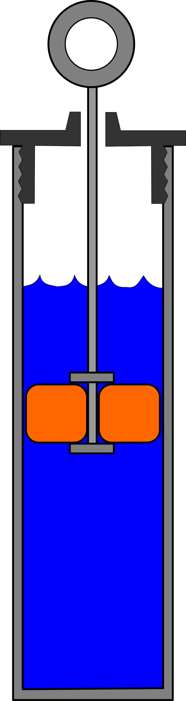
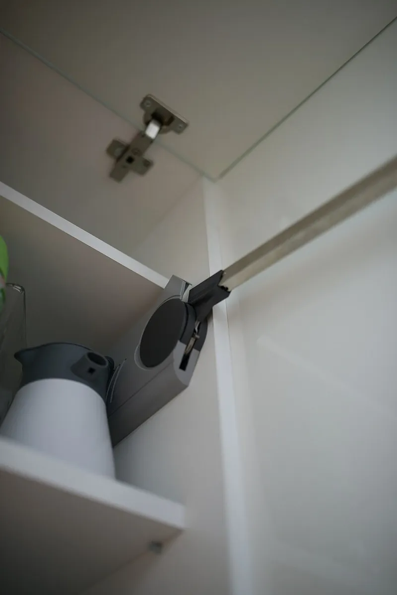

<figure class="eoc-pic eoc-pic-main"><figcaption><strong>Diagram.</strong> <a href="https://commons.wikimedia.org/wiki/File:Dashpot.svg">Dashpot</a> by Egmason, <a href="https://creativecommons.org/licenses/by-sa/3.0">CC BY-SA 3.0</a>, from Wikimedia Commons.</figcaption></figure>
<figure class="eoc-pic"><figcaption><strong>How it works.</strong> <a href="https://commons.wikimedia.org/wiki/File:Hinge_on_kitchen_cabinet_with_soft_closing_mechanism.jpg">Hinge on kitchen cabinet with soft closing mechanism</a> by Shixart1985, <a href="https://creativecommons.org/licenses/by/2.0">CC BY 2.0</a>, from Wikimedia Commons.</figcaption></figure>

A damper is a sealed oil- or air-filled part whose resistance grows with speed, fitted at a hinge or along a slide so that a falling lid, a sprung drawer or a closing door slows down and settles quietly instead of slamming.

**In plain words:** A small sealed part filled with thick oil or air that pushes back harder the faster you move it, so a lid, drawer or door drifts shut gently instead of slamming. **Proper term:** Damper (dashpot): rotary damper and linear damper, as used for soft-close.

**Also called:** dashpot, viscous damper, hydraulic damper, oil damper; rotary damper, rotational damper, rotary speed limiter (McMaster-Carr's name), rotary dashpot; vane damper or partial rotation angle damper (limited swing, high [torque](../glossary.md#torque)); continuous rotation damper, gear damper, barrel damper (spins endlessly, often with a small gear); one-way damper, uni-directional damper (built-in one-way clutch); linear damper, soft-close damper, drawer damper, door damper, cabinet door buffer, speed limiter; air dashpot, pneumatic damper, air damper; soft-close hinge, damped hinge, soft-down lid support, slow-close toilet seat hinge; door closer (a spring plus an oil damper); BLUMOTION (Blum brand) soft-close.

## How it works

Moving the shaft or rod forces oil (or air) to squeeze through a narrow gap or hole, or [shears](../glossary.md#peel-vs-shear) a thin film of oil between a spinning rotor and the housing; this fluid friction turns the motion's energy into a little heat, and the faster you push, the harder it pushes back (Wikipedia 'Dashpot'; ACE rotary damper catalogue). A spring, or the lid's own weight, still does the closing: the damper only limits how fast it happens, so it cannot hold anything still. Many dampers work in one direction only, using a [check valve](../glossary.md#check-valve) (linear) or a one-way clutch (rotary), so the part opens freely and only closing is slowed (Wikipedia 'Dashpot'; TOK).

## Parts

A small sealed assembly that acts as one unit. Rotary damper: a housing, a shaft with a rotor or vane, silicone oil, [O-ring](../glossary.md#o-ring) seals and a cap; often a small gear on the shaft, and sometimes a one-way clutch inside the rotor (TOK; ACE). Linear damper: a cylinder, a piston with a tiny hole or gap (orifice), a rod, oil or air, seals and often a return spring and a check valve (Wikipedia 'Dashpot'; Airpot). In furniture it is usually paired with a spring or catch that pulls the part shut.

## Everyday examples

- A soft-close toilet seat, slowed by a small rotary damper inside the hinge (TOK)
- Soft-close kitchen cabinet hinges and drawer runners (Blum BLUMOTION; Wikimedia Commons hinge photo)
- A piano fallboard or step-bin lid that lowers itself slowly (TOK)
- A door closer on a public building door, which is a spring plus an oil damper with adjustable valves (Wikipedia 'Door closer')

## When to use it

Use a damper when something closes by gravity or a spring and you want it to arrive slowly and quietly: box and case lids, printer or enclosure doors, flaps, drawers, toilet-seat style hinges, spring-rewind reels (a one-way rotary damper lets a tape measure pull out lightly and rewind slowly; TOK), and the end of travel of a slide or arm. Pick a rotary damper when you have a hinge axis and little room; a linear damper when there is space for a [stroke](../glossary.md#stroke) or the motion is straight (TOK). Pick a one-way damper so opening stays easy. Dampers also make good mechanical timers (a viscous rotary timer releases a model glider's dethermaliser; Thingiverse) and settle wobbly or bouncing parts.

## When not to use it

Don't use a damper to hold a lid open or stop something drifting: it only slows motion and a steady load will still [creep](../glossary.md#creep); use a friction hinge, a lid stay, a gas spring or a [detent](../glossary.md#detent) instead. Don't use it as an end stop or as the hinge itself (ACE; Airpot). For a mechanism that must run at a steady speed for a long time (a music box), use a speed governor. For smooth braking without fluids or wear, an eddy-current brake is an alternative. For soaking up vibration rather than slowing a motion, use rubber isolation mounts. For a single hard hit rather than a repeated movement, use a one-shot crush absorber instead: crushable foam, honeycomb, or metal that flattens or splits, as in road crash cushions that use 'crushable materials (like various kinds of foam)', flatten a corrugated guard rail or split a steel box beam (Wikipedia 'Impact attenuator'), and racing-car impact attenuators of aluminium or carbon-fibre honeycomb or foam (Wikipedia 'Crumple zone'). These parts are sacrificial (Wikipedia 'Crumple zone'), so replace them after each hit.

## Details

- **What it does (jobs):**
  - slow it, stop it or keep its speed steady: slows a closing lid, drawer or door so it arrives gently and quietly, and soaks up bumps at the end of travel
- **Movement:** rotate (rotary dampers: vane or partial-angle types work over a limited swing, basically 110 degrees for toilet-seat dampers, with other models up to 180 to 290 degrees; continuous types turn endlessly; TOK) or slide (linear dampers); a rotary damper with a gear on a rack also damps sliding motion (TOK)
- **Directions it can move (degrees of freedom):** 1: the shaft turns or the rod slides along its axis; the damper only resists speed, it does not add or remove a way of moving
- **Special behaviour:**
  - one-way (moves freely one way, locks the other): many versions damp only one direction, using a check valve (linear) or a one-way clutch (rotary), so the lid lifts or the door opens with no extra effort and only the closing is slowed (Wikipedia 'Dashpot'; TOK one-way rotary damper; Airpot push or pull dampers). It never locks: it only slows.
  - none of the other listed behaviours: its trick is speed-dependent resistance (force rises with speed), so slow motion is easy and fast motion is resisted
- **How it holds:**
  - not a holding joint (it moves or passes on motion): it resists speed only, so a steady load still creeps through it; the housing and shaft are fixed to the two parts with screws, clips or a keyed (D or square) shaft
- **Input and output:** Input: rotation of the shaft (rotary) or push or pull of the rod (linear). Output: a resisting torque or force that rises with speed; ideally force = c x speed, but real dampers follow force = c x speed to a power between 0.2 and 2 (Wikipedia 'Dashpot'). Rated torque is quoted at a set speed and temperature, e.g. 20 rpm and 23 °C (ACE). Gearing: a continuous damper driven through a gear multiplies its torque by the [gear ratio](../glossary.md#gear-ratio) and divides the lid's speed by the same ratio (TOK example: 11-tooth pinion on a 22-tooth segment gear doubles the torque). Efficiency: not the point; all the absorbed energy becomes heat. Shaft arrangement: in line with the hinge axis (rotary), or at right angles through a rack and pinion. Back-drivable: yes, it never locks; the load can always move it slowly.
- **Power:** passive (no power needed): works purely from fluid friction; a spring or gravity does the moving
- **Load:** Light to medium, and only in the direction of motion. Small rotary dampers range from about 0.002 N·m to over 5 N·m (TOK product selector); flat disc-brake types reach 2 to 8.7 N·m (ACE FDT). Small air dashpots work best up to about 30 lb (about 130 N) (Airpot). Weak points: sideways (radial) and end ([axial](../glossary.md#axial--radial)) loads on the shaft, and use as a support or end stop; 'Do not use rotary dampers as supports' (ACE).
- **Play and precision:** not applicable for locating; what matters is fitting it the right way round and at the right angle. A rotary damper must be installed at the closed position of the lid and in the correct turning direction (CW or CCW), or the lid feels heavy to open and slams shut (TOK installation mistakes). A one-way clutch type reacts immediately when the direction reverses (TOK). The shaft must not carry side or end loads, so the moving part needs its own hinge or guide (ACE).
- **Taking it apart:** removable: screwed, clipped or pressed onto its shaft and housing mounts; clip-on soft-close units click onto some cabinet hinges (Blum). The damper itself is sealed and cannot be refilled or repaired (ACE FDT instructions).
- **How often it can be reused:** many times for fitting and removal; the damper's own working life is finite, e.g. 50,000 cycles with at least 80% of the original torque left for ACE FDT dampers (ACE), while glass-and-graphite air dashpots can last hundreds of millions of cycles (Airpot)
- **Sealing:** none: it does not seal the joint it sits in. Internally it is sealed with O-rings and a cap to keep its oil in; over-rotating it can make it leak (TOK)
- **Adjustable:** Sometimes. Air dashpots and door closers have a needle valve or adjusting screw that sets the orifice size (Airpot; Wikipedia 'Door closer'); McMaster-Carr sells adjustable-torque rotary speed limiters with a control knob. Most small rotary dampers have a fixed torque: change the damper, the gear ratio, or (in a DIY damper) the oil viscosity. Blum lets you switch off the soft-close on one hinge of a light door (Blum hinge specifications).
- **Access needed:** not applicable: the housing screws to the fixed part and the shaft or rod to the moving part, usually at the hinge axis or inside the drawer runner
- **Materials:** Housings in PBT plastic, zinc die-cast or steel with nylon shaft sleeves (TOK; ACE), filled with silicone oil because it is thick, very shear-resistant and keeps its viscosity over temperature (TOK uses 3,000 to 4.5 million mm²/s); air dashpots with a carbon-graphite piston in a borosilicate glass cylinder and no seals (Airpot). Printed dampers: PLA or PETG housings with an O-ring and RC-car silicone shock oil (Printables 'Rotary Damper v1.0'), or a PLA/PETG air piston wrapped in tape for a smooth, quiet fit (Printables 'Soft Close Door Damper').
- **Heat, cold, water and wear:** Oil dampers get stiffer and slower in the cold and faster in the heat because oil viscosity changes: ACE rates its small dampers for 0 to 50 °C operation (storage -20 to 60 °C) and the FDT for -10 to +50 °C; Blum's soft-close hinges are designed for 65 to 85 °F (about 18 to 29 °C), with closing speed changing outside that range but no damage (ACE; Blum hinge specifications). Torque falls slowly with wear (at least 80% after 50,000 cycles for ACE FDT). Seals can leak if the damper is over-rotated (TOK). Printed PLA housings soften in heat and creep under constant load ⚑ [uncertain].

## Making it

- **Ways to make or get it:**
  - off-the-shelf part: the usual route; rotary dampers, gear dampers, linear soft-close dampers, air dashpots, soft-close hinges and drawer runners
  - 3D print (FDM): brackets, adapters and gears to fit bought dampers; DIY air dashpots and silicone-oil rotary dampers (Printables examples)
  - 3D print (resin): smooth, dense housings for DIY oil dampers ⚑ [uncertain]
  - CNC: machined housings and pistons for custom dampers
  - woodwork: fitting soft-close hinges, lid supports and door dampers into cabinets and boxes
- **Printing it in one piece (print in place):** no: a working damper needs a separate rotor or piston, a seal and a fluid, so it is printed in parts and assembled (the Printables DIY rotary damper glues its lid on after filling with oil)
- **Tools:** Usually a screwdriver; none for clip-on and press-fit types; for a DIY oil damper a syringe, silicone oil, an O-ring and glue (Printables 'Rotary Damper v1.0')
- **Difficulty:** easy to fit a bought damper (screw it on, the right way round); moderate to make one: a printed air dashpot or a silicone-oil rotary damper works, but needs an O-ring, a leak-tight housing and some trial and error with oil thickness or orifice size

### 3D printing tips

1) Buying is easiest: design printed brackets or gears around a bought rotary or gear damper, fixing the housing to the fixed part and the shaft to the moving part (TOK). 2) Size it: needed torque = half the lid length x lid weight x cos(angle), largest when the lid is horizontal (ACE; TOK). Too little torque and it still slams; too much and a light lid stops half way (TOK). Gear a weak continuous damper up with a printed segment gear (TOK). 3) DIY silicone-oil rotary damper (Printables 'Rotary Damper v1.0', public domain): PLA housing and rotor, an 8 x 1.5 mm O-ring on the shaft, about 3 ml of silicone oil filled with a syringe, leave about 0.5 mm unfilled so glue can hold the lid, then superglue the lid; the maker used 30,000 cSt as the minimum and got good results with 500,000 cSt RC shock oil. 4) DIY air dashpot (Printables 'Soft Close Door Damper', CC BY-NC-ND): PLA or PETG, a pencil spring for return, one or two layers of office tape around the piston for a smooth, quiet seal, and a screw-in plug to set the resistance. 5) Make oil housings leak-tight: at least 3 to 4 [perimeters](../glossary.md#perimeters), nozzle 5 to 10 °C hotter, 5 to 10% more extrusion, 0.15 to 0.2 mm layers, and 25 to 35% infill-perimeter overlap if it still leaks (Prusa 'Watertight prints'). 6) Keep the fluid clean and avoid dried residue in air dashpots (Airpot). 7) Never let the damper be the end stop: add a hard stop so the piston or vane never bottoms out (Airpot; ACE). 8) Carry the lid on its own hinge; the damper shaft should not take side loads (ACE). 9) Mark the direction and the closed position on printed mounts so it cannot be fitted wrongly (TOK suggests colour or groove poka-yoke).

### Buying one (off-the-shelf parts)

Rotary damper (search 'rotary damper', 'rotary speed limiter', 'vane damper', 'lid damper', 'barrel damper', 'gear damper' or 'damper with gear' for CD-tray style parts, 'one-way rotary damper', 'continuous rotation damper', 'adjustable torque rotary damper'); linear damper (search 'linear damper', 'soft close damper', 'cabinet door damper' or 'door buffer', 'drawer damper', 'air dashpot', 'hydraulic speed limiter', 'adjustable air damper'); furniture versions: 'soft close hinge' (35 mm cup hinge), 'soft close adapter' or clip-on damper, 'soft close drawer slide', 'soft-down lid support' or 'soft close lid stay', 'soft close toilet seat hinge'; door closers; RC-car silicone shock oil (for DIY dampers, sold by viscosity in cSt).

## Rules of thumb

- Torque for a lid: T = (L / 2) x W x cos(theta), where L is the lid length from the pivot, W its weight and theta its angle above horizontal; the worst case is the horizontal position (ACE rotary damper catalogue p. 5; ACE FDT instructions; TOK torque calculator).
- Choose by speed as well as torque: if the lid closes too fast pick the next higher torque, if too slow the next lower (ACE catalogue p. 5). Rated torques are measured at 20 rpm and 23 °C; torque rises with speed and falls as temperature rises (ACE).
- Two dampers on one lid should have equal torque, or split the torque by the centre-of-gravity position (a lid whose centre of gravity is 50 mm off-centre on a 300 mm width: 4 N·m and 2 N·m instead of 3 and 3), or the lid twists (TOK).
- Gearing a continuous-rotation damper: torque multiplies and speed divides by the gear ratio (TOK example: a small lid needing about 57.6 mN·m uses an 11-tooth pinion on a 22-tooth segment gear, so a damper of about 28.8 mN·m is enough; they chose a 30 mN·m model, and the lid closes at half the damper's speed).
- Vane (partial-angle) dampers give higher torque in a smaller size but only over a limited angle (toilet-seat types about 110 degrees); continuous types spin endlessly but give less torque for their size (TOK).
- Air dashpot pull [damping](../glossary.md#damping) works by vacuum, so it can never exceed atmospheric pressure (14.7 psi) x piston area, e.g. 4.5 lbf for a 0.309 in² piston (Airpot FAQ).
- Never use a damper as a stop; leave [clearance](../glossary.md#clearance) at both ends of travel, at least 1 mm for Airpot's Airpel (Airpot FAQ).
- Real dampers follow force = c x speed^alpha with alpha between 0.2 and 2, not a perfectly straight line (Wikipedia 'Dashpot').

## Common failures

1) Fitted in the wrong direction: the lid is heavy to open and slams shut; fit the CW or CCW version for the closing direction (TOK). 2) Fitted at the wrong angle, so the working range does not match the lid's travel and it will not open fully or does not damp (TOK). 3) Turned beyond its angle limit: internal damage or oil leak and no damping (TOK). 4) Wrong torque: too low and it still slams, too high and a light door stops short (TOK; Blum lets you disable one hinge's damper on light doors). 5) Used as a stop or support, or side-loaded: the piston, vane or shaft breaks (Airpot; ACE). 6) Uneven dampers on a wide lid: it twists (TOK). 7) Cracked plastic mounting lugs or [actuators](../glossary.md#actuator) (a broken tape-transport dashpot on Wikimedia Commons; a printed replacement actuator for drawer dampers on Printables). 8) Worn out: torque fades after tens of thousands of cycles; replace the unit (ACE). 9) DIY oil dampers leak at the lid or shaft: use an O-ring and watertight print settings (Printables; Prusa).

## Safety

A heavy lid or flap can crush fingers while you fit or remove its damper: support it first (ACE). Where a failure could hurt someone, add a separate safety device, because a damper that loses its oil gives no warning until the lid slams (ACE; TOK). Gas springs and door closers store spring energy. Silicone oil is slippery if spilled; dispose of dampers as oil-containing parts (ACE).

## Related

- Speed governor (fly fan, centrifugal governor): keeps a continuously running spring or weight drive at a steady speed, rather than slowing one closing movement
- Eddy-current brake (magnetic brake): drag that grows with speed but with no fluid or contact; cannot hold still either
- Friction hinge (torque hinge): constant friction that holds a lid at any angle, instead of speed-dependent resistance
- Lid and flap stays (folding stay, friction stay): hold a lid open; some 'soft-down' stays include a damper
- Self-closing hinges (spring hinge, rising butt hinge): provide the closing force that a damper then slows
- Gas spring (gas strut): pushes a lid open or holds it up; some add small holes for extra damping (Wikipedia 'Gas spring')
- Elastomer isolation mount (rubber bobbin mount): soaks up vibration with rubber rather than slowing a movement
- Shock absorber: a heavy-duty linear damper used with a spring in vehicle suspensions (Wikipedia 'Shock absorber')
- One-shot crush absorber (crushable foam or honeycomb, crumple zone, impact attenuator): soaks up a single impact by being crushed, making the stop last longer, and must then be replaced, whereas a damper and an Elastomer isolation mount work again and again (Wikipedia 'Impact attenuator', 'Crumple zone'); a maker use is a crushable bumper on a drone or robot, or the padding of an egg-drop capsule

## Make it yourself

- [Rotary Damper v1.0 for Mark Ayton's Speedbrake and Flaps mechanism (Günther Tomschik, Printables) (URL from Printables API, page not opened)](https://www.printables.com/model/1637307-rotary-damper-v10-for-mark-aytons-speedbrake-and-f): Printed silicone-oil rotary damper with a gear: PLA housing and rotor, 8 x 1.5 mm O-ring, about 3 ml of RC shock oil (30,000 to 500,000 cSt), lid superglued on *(licence: Creative Commons Public Domain (as listed by Printables))*
- [Soft Close Door Damper (Settable Resistance) (Wilko_SLO, Printables) (URL from Printables API, page not opened)](https://www.printables.com/model/623995-soft-close-door-damper-settable-resistance): Printed air dashpot for cabinet doors with a pencil spring, tape-wrapped piston and a screw plug to set the resistance *(licence: CC BY-NC-ND)*
- [Rotary damper viscous timer for free flight dethermalizer (concifederico, Thingiverse)](https://www.thingiverse.com/thing:4761649): 0.92 g printed viscous rotary damper used as a timer; a pin axle, a disk in a thick fluid (the maker found an epoxy component worked best) and a glued cap *(licence: CC BY 4.0)*
- [HUANGYAN920/Mechanical interactive mechanism animations](https://huangyan920.github.io/Mechanical/): Browser animation of a hydraulic buffer damper (液压缓冲器, no. 146): a piston throttled through a small hole *(licence: MIT (code))*

## Pictures, videos and models

- [Dashpot.svg (Wikimedia Commons, by Egmason)](https://commons.wikimedia.org/wiki/File:Dashpot.svg): Simplified cutaway diagram of a dashpot: a piston in a fluid-filled cylinder *(licence: CC BY-SA 3.0)*
- [Hinge on kitchen cabinet with soft closing mechanism.jpg (Wikimedia Commons, by Shixart1985)](https://commons.wikimedia.org/wiki/File:Hinge_on_kitchen_cabinet_with_soft_closing_mechanism.jpg): Photo of a kitchen cabinet cup hinge with its soft-close damper *(licence: CC BY 2.0)*
- [Revox B215 - tape transport - broken dashpot 01.jpg (Wikimedia Commons, by Retired electrician)](https://commons.wikimedia.org/wiki/File:Revox_B215_-_tape_transport_-_broken_dashpot_01.jpg): A small two-part plastic dashpot (about 18.5 mm across) from a cassette deck, with its cracked mounting lug *(licence: CC0)*
- [Rotary Dampers | How Does It Work? (TOK, Inc.)](https://rotarydamper-tok-inc.com/technicalinformation-4/): Where a rotary damper mounts on a lid, CW and CCW types, and GIF animations of a lid closing with and without a damper *(licence: link only)*
- [ACE Controls Rotary Dampers catalogue (revised 04/2017)](https://www.acecontrols.com/media/acedownloads/ACE_Catalog_Rotary_Damper_US_2017.pdf): Cutaway diagrams of a continuous rotary damper (rotor in silicone oil) and a vane damper, the lid-torque formula, torque vs speed and temperature curves, and mountings to avoid *(licence: link only)*

## Needs confirming

⚑ marks something nobody has confirmed yet: a fact the research could not confirm from a source, a finder value that is a best guess, or an open point from the research notes. Corrections are welcome (see `research/needs-confirming.md`).

- ⚑ 2 sentences on this page marked [uncertain].
- ⚑ Finder value `motion_in` = steady turning, straight push or pull (best guess): read from the "Input: ... Output: ..." wording of `input_output`, not the usual "in -> out" form
- ⚑ Finder value `motion_out` = steady turning (best guess): read from the "Input: ... Output: ..." wording of `input_output`, not the usual "in -> out" form
- ⚑ Finder value `shaft_layout` = at an angle, in line (best guess): read from the "Input: ... Output: ..." wording of `input_output`, not the usual "in -> out" form
- ⚑ Research note: *Dampers* (214): the maker uses of crush absorbers (drone and robot bumpers, egg-drop padding) are written as advice with no source found; check them.

## Sources

- <https://en.wikipedia.org/wiki/Dashpot>
- <https://en.wikipedia.org/wiki/Door_closer>
- <https://en.wikipedia.org/wiki/Gas_spring>
- <https://en.wikipedia.org/wiki/Shock_absorber>
- <https://rotarydamper-tok-inc.com/mechanism/>
- <https://rotarydamper-tok-inc.com/technicalinformation-1/>
- <https://rotarydamper-tok-inc.com/technicalinformation-2/>
- <https://rotarydamper-tok-inc.com/technicalinformation-4/>
- <https://rotarydamper-tok-inc.com/technicalinformation-7/>
- <https://rotarydamper-tok-inc.com/technicalinformation-10/>
- <https://rotarydamper-tok-inc.com/technicalinformation-15/>
- <https://rotarydamper-tok-inc.com/technicalinformation-17/>
- <https://rotarydamper-tok-inc.com/technicalinformation-19/>
- <https://rotarydamper-tok-inc.com/technicalinformation-21/>
- <https://rotarydamper-tok-inc.com/torque-calculation/>
- <https://www.acecontrols.com/media/acedownloads/ACE_Catalog_Rotary_Damper_US_2017.pdf>
- <https://www.acecontrols.com/media/msimages/pdf/ACE_FDT_Operating-Mounting_EN_21_22_0019.pdf>
- <https://www.airpot.com/faqs/>
- <https://www.mcmaster.com/products/rotary-dampers/>
- <https://www.mcmaster.com/products/dampers/>
- <https://www.blum.com/us/en/products/motion-technologies/blumotion/overview/>
- <https://cabinotch.us/media/wysiwyg/FAQ/BlumHingeSpecifications.pdf>
- <https://help.prusa3d.com/article/watertight-prints_112324>
- <https://api.printables.com/graphql/>
- <https://www.thingiverse.com/thing:4761649>
- <https://huangyan920.github.io/Mechanical/>
- <https://commons.wikimedia.org/wiki/File:Dashpot.svg>
- <https://commons.wikimedia.org/wiki/File:Hinge_on_kitchen_cabinet_with_soft_closing_mechanism.jpg>
- <https://commons.wikimedia.org/wiki/File:Revox_B215_-_tape_transport_-_broken_dashpot_01.jpg>
- <https://en.wikipedia.org/wiki/Impact_attenuator>
- <https://en.wikipedia.org/wiki/Crumple_zone>
