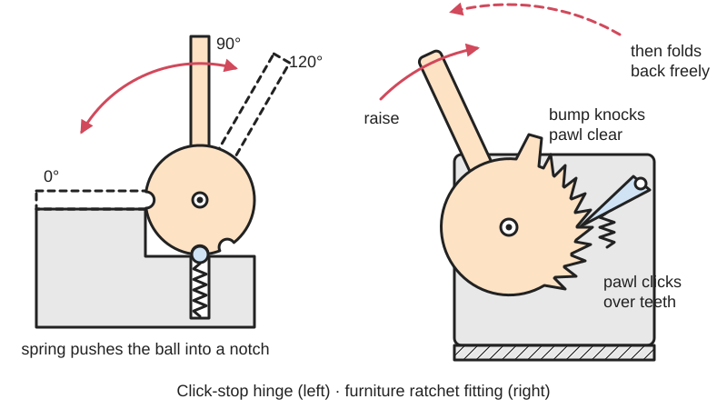
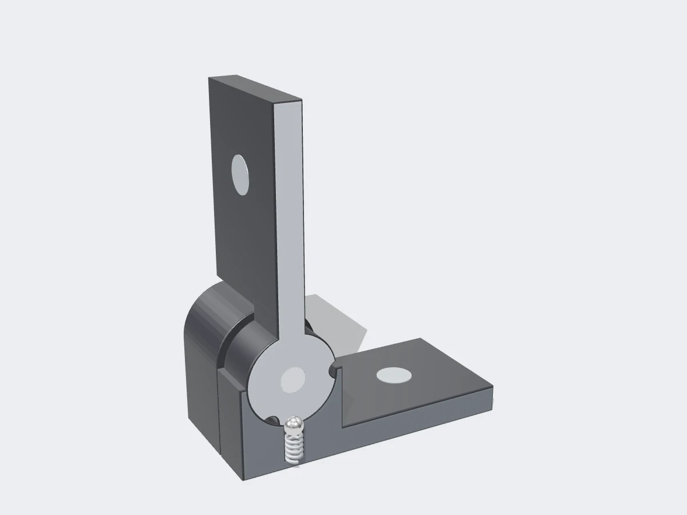

<figure class="eoc-pic eoc-pic-main"><picture><source media="(prefers-reduced-motion: reduce)" srcset="../media/drawn/detent-hinge.svg"></picture><figcaption><strong>Animation.</strong> Diagram drawn for the encyclopaedia from the research notes. ⚑ Needs confirming: a drawing can simplify or get details wrong; a real photo or a better diagram is welcome.</figcaption></figure>
<figure class="eoc-pic"><figcaption><strong>Cut-away render.</strong> A 3D model made for the encyclopaedia, not a photo: a stand-in until a good real photo is found. ⚑ Needs confirming: a model can simplify or get details wrong; a real photo is welcome.</figcaption></figure>

A hinge with a built-in click mechanism (a spring pressing a ball, wedge, tooth or springy arm into notches, or a [pawl](../glossary.md#pawl) in a toothed segment) that holds a lid, door, leg or backrest at preset angles until it is pushed firmly on.

**In plain words:** A hinge that clicks and stays put at one or more set angles, such as a cabinet door that clicks open at 90° or a sofa headrest that clicks up a notch at a time. **Proper term:** [Detent](../glossary.md#detent) hinge (positioning hinge).

**Also called:** click hinge; position hinge / positioning hinge (Southco's category name, which also covers friction hinges); hinge with indexing function (Elesa+Ganter); [ratchet](../glossary.md#ratchet) hinge / ratchet fitting (furniture: sofa headrests, armrests, backrests); adjustable hinge fitting (reclining chairs and folding stands; patent US3232136); angle-adjustable hinge (patent EP2389839); [bistable](../glossary.md#bistable) hinge (a detent variant with a spring that drives the door to its open or closed position; Southco); locking hinge (maker name, often for a hinge that locks at one angle); click hinge or locking hinge plate (LEGO (brand) hinge plates that click through set positions).

## How it works

Two main kinds exist. In a click-stop detent hinge, a spring presses something (a ball, roller, wedge, toothed ring or springy arm) against notches that turn with the other leaf; at each preset angle it drops into a notch and holds the door there, and pushing the door firmly bends or compresses the spring so it rides out and on to the next notch, in either direction (Southco: 'opens and locks into place at a pre-set angle, usually with a distinctive click'; Elesa). In a ratchet-fitting hinge (sofas, headrests, reclining chairs), a pawl clicks over teeth as you raise the part so it holds at each step and can't fold back down; to lower it you move it all the way past the last step, where a projection knocks the pawl out of the teeth and a spring holds it clear, so the part can swing freely back to its starting position (Lear headrest patent US5236245A; US3232136 describes a similar release at the end of travel). A bistable variant uses a spring that pushes the door to one of two end positions (Southco). Hinges that must lock solid, not just click, can borrow three classic locks from leg-brace (orthotic) knee joints, described here only as hinge-lock ideas for maker projects: the drop-ring lock (ring catch), a sliding ring that is lowered over the joint to lock it and lifted to release it; the bail lock (also called a Swiss, French, pawl or bar lock), where one bar joins the release levers of a pair of side hinges so a single push unlocks both at once; and the dial lock (variable-position locking joint), which can be locked at a chosen angle rather than only when straight (EP0016268; 'Orthotic Knee Joints' slides 12-14).

## Parts

A small assembly that acts as one unit: two hinge leaves joined by a pin or knuckle, plus a detent inside the knuckle. Common detents: a spring pushing a ball, roller, wedge or toothed part into notches (Elesa: 'an applied force from the internal spring'); a steel detent tube (Southco C6); spring wires pushing toothed floating wedges against gear teeth (patent EP2389839); or a pawl and toothed segment (furniture ratchet fittings). Printed versions: two leaves plus a flexible (TPU) toothed ring or a springy printed arm (Printables 'Clicking Hinge').

## Everyday examples

- Sofa headrests, armrests and footrests that click through several angles (angle-adjustable sofa hinge, patent EP2389839), and seat headrests that click forward in steps and release when tilted fully forward (Lear patent US5236245A)
- Reclining chairs and folding stands with a backrest that clicks to set angles (US3232136)
- Cabinet doors, machine covers and access panels that click open and stay at 90° (Southco; Elesa)
- LEGO (brand) click hinge plates, which step through set positions (e.g. a '1 x 2 Locking 9-Position' hinge plate, as named on Printables) ⚑ [uncertain]
- Adjustable laptop stands and folding table legs that click at several angles ⚑ [uncertain] (not checked on an opened page)

## When to use it

Use a detent hinge when a lid, door, flap, leg or backrest should stop and stay at one or a few known angles without a separate stay or catch, and when a click that tells the user 'this is the right position' is helpful: equipment covers opened for service, display stands, folding supports, adjustable headrests and backrests. It is quicker than tightening a knob and more repeatable than a friction hinge. For 3D-printed boxes and stands, a detent hinge with a flexible insert or springy arm adds positions without metal parts.

## When not to use it

Avoid it when the user needs any angle in between (use a friction or [torque](../glossary.md#torque) hinge), when the lid is heavy or long, because the detent may be overcome and the lid drop (use a counterbalance hinge, gas strut or lid stay), when the position must be locked against being knocked (use an indexing plunger through the hinge or a locking brace), or when you need fine, play-free angle steps under load (use a Hirth joint clamped by a bolt). For a single end position that must hold firmly, a latch or [over-centre](../glossary.md#over-centre) lock is better.

## Details

- **What it does (jobs):**
  - let it move (turn, slide or bend): it is still a hinge that swings
  - click into set positions: holds the lid, door or backrest at preset angles
  - stop it moving back (one-way): ratchet-fitting types hold against folding back down until they are reset at the end of travel
- **Movement:** rotate, usually within about 180° (e.g. Southco C6/G6 detent hinges: 180° range of motion with detents at 80°, 115°, 150° or 120° and 170°; Elesa: detents at -90°, 0°, +70° and +115°)
- **Directions it can move (degrees of freedom):** 1: rotation about the hinge pin
- **Special behaviour:**
  - indexing (clicks into set positions): holds at preset angles with a click you can feel
  - one-way (moves freely one way, locks the other): ratchet-fitting hinges click up but won't fold down until reset (US5236245A)
  - over-centre (snaps past a point and stays): bistable hinges drive the door to a preset open or closed position by themselves (Southco)
- **How it holds:**
  - spring force (a spring or springy part presses it in place): click-stop types; the holding torque is set by the spring and notch shape
  - shape (the parts interlock; [form-fit](../glossary.md#form-fit--force-fit--material-bond)): ratchet-fitting types, where the pawl's locking face sits against a tooth
- **Input and output:** not applicable
- **Power:** passive (no power needed)
- **Load:** light to medium: the hinge pin carries the door's weight well, but the detent only resists a small turning force; e.g. 0.70 Nm forward and reverse detent torque for a Southco C6-227 and around 3 Nm for Elesa detent hinges. Furniture ratchet fittings are built to hold a person leaning on a backrest (US3232136, US5236245A) ⚑ [uncertain] (no load figures found).
- **Play and precision:** small to noticeable: returns to the same angle every time, but a spring detent has some give either side of each position, and ratchet fittings can move back a little before the pawl catches a tooth ⚑ [uncertain]. Needs the two leaves mounted in line; a bent or misaligned mounting makes the detent stiff or uneven ⚑ [uncertain].
- **Taking it apart:** removable: screwed, bolted or riveted to the two parts like an ordinary hinge (rivets make it semi-permanent)
- **How often it can be reused:** many times: can be unscrewed and refitted; commercial detent hinges are tested for tens of thousands of open-close cycles, e.g. more than 20,000 (Elesa) and up to 20,000 (Southco C6/G6)
- **Sealing:** none
- **Adjustable:** Only between the built-in positions: the detent angles are fixed by the design (e.g. 80°, 115°, 150° or 120° and 170° in Southco's C6 range). Holding strength is chosen when buying (Southco offers three positioning torque ratings in the C6 series; printed designs can swap a softer or harder detent ring, Printables 'Clicking Hinge').
- **Access needed:** one side only (blind) when the leaves are screwed into thick parts; both sides when bolts and nuts go through thin panels
- **Materials:** Technopolymer (glass-filled nylon), zinc die-cast and stainless steel (Elesa); acetal copolymer leaves with a stainless steel detent tube, polyamide and zinc alloy (Southco); zinc-plated steel for furniture ratchet hinges (redesignstore). Printed versions: PLA or PETG leaves with a TPU (flexible) detent gear (Printables 'Clicking Hinge').
- **Heat, cold, water and wear:** Southco's C6/G6 detent hinges are rated for -40 °C to 80 °C. Printed PLA leaves soften from about 60 °C (CNC Kitchen), and plastic springs or detent arms kept under load [creep](../glossary.md#creep) and lose their hold (DuPont; thrinter). Stainless steel and technopolymer versions suit wet, food and pharmaceutical settings (Elesa). Dirt and wear in the teeth or notches weaken the click over time ⚑ [uncertain]; manufacturers suggest light [lubrication](../glossary.md#lubrication) for steel ratchet hinges (redesignstore).

## Making it

- **Ways to make or get it:**
  - off-the-shelf part: detent hinges, positioning hinges and ratchet fittings in plastic, zinc and steel
  - 3D print (FDM): small clicking hinges for boxes, stands and enclosures, often with a TPU detent insert
  - woodwork: fitting bought detent or ratchet hinges to cabinets, lids and furniture
  - sheet metal: stamped steel ratchet fittings for furniture
  - injection moulding: plastic detent hinges and toy click hinges (e.g. LEGO (brand)) ⚑ [uncertain]
- **Printing it in one piece (print in place):** partly: several printed designs need assembly, e.g. BaGooN's 'Clicking Hinge' (Printables) has a separately printed flexible TPU inner gear that is snapped into a two-part case; some [print-in-place](../glossary.md#print-in-place) hinges lock at a single angle by sliding along their axis (chandler's 'Locking Hinge 90' and 'Locking Hinge 180', Printables), which is a lock rather than a multi-click detent.
- **Tools:** screwdriver or hex key (or a rivet tool); none to operate
- **Difficulty:** easy to moderate: easy to buy and screw on, or to print a small clicking hinge with a flexible insert; moderate to make one that holds a heavy lid firmly for many cycles

### 3D printing tips

1) Easiest printable detent: make the detent part flexible. BaGooN's clicking hinge prints its toothed inner gear in TPU and the leaves in PLA or PETG at 0.3 mm layers, 2 [perimeters](../glossary.md#perimeters) and 15% [infill](../glossary.md#infill) with no supports, and offers a harder gear for stronger holding (Printables 'Clicking Hinge'). 2) Or use a springy printed arm pressing on a notched ring inside the knuckle (a compliant detent); lay the arm flat on the bed, [fillet](../glossary.md#chamfer--fillet) its root to at least half its thickness and avoid building it vertically in Z (Protolabs/Hubs snap-fit guide). 3) Make the arm or spring sit relaxed (unbent) at each detent position, because plastic springs held bent creep and relax (DuPont design guide, pp. 36 and 47) and PLA creeps most (thrinter test); otherwise the hinge will slowly lose its hold. 4) Work out the turning load the detent must resist: the lid's weight times the sideways distance from the hinge pin to its centre of gravity; a light but long lid can need as much holding as a heavy short one (Southco). Printed detents hold only small torques, so add a stay or use two hinges for heavier lids ⚑ [uncertain]. 5) Print the leaves flat with the knuckle axis horizontal so the knuckle's layers aren't split by bending loads (layer adhesion is roughly half the in-plane strength; CNC Kitchen) ⚑ [uncertain] (orientation depends on design). 6) For print-in-place pins, keep at least about 0.3 mm [clearance](../glossary.md#clearance) (Prusa) to 0.5 mm (Protolabs/Hubs FDM) between moving surfaces; the first movements may be stiff and loosen with use (chandler, Printables 'Locking Hinge 90'). 7) PETG is a good all-round choice for leaves (used by several of these designs); PLA softens from about 60 °C (CNC Kitchen), so avoid it for hinges in cars or sunny windows.

### Buying one (off-the-shelf parts)

Search for: 'detent hinge', 'positioning hinge', 'hinge with detent', 'hinge with indexing function', 'bistable hinge', 'ratchet hinge' or 'ratchet fitting' (sofa or headrest hinge, lift-up support), 'adjustable angle hinge', 'friction hinge' or 'torque hinge' (holds at any angle instead), 'lid stay'. Makers: Southco C6/G6 series (brand), Elesa CFA-F and Elesa+Ganter detent hinges (brand); CAD models of detent plastic hinges on TraceParts (via Printables).

## Rules of thumb

- Choose a detent hinge for preset angles with a click, a constant-torque (friction) hinge for any angle, and a free-swinging hinge only for panels light enough to fall open under gravity (Southco 'How to Improve Function with Torque Hinges').
- Detent hinges are usually set at 90° for cabinet doors and access panels (Southco).
- Typical commercial holding torque per hinge: about 0.70 Nm (Southco C6-227) to about 3 Nm (Elesa); tested for more than 20,000 cycles (Elesa) or up to 20,000 (Southco C6/G6).
- The load the detent must hold depends on the lid's weight and how far its centre of gravity is from the hinge axis: a light lid with a far centre of gravity can feel like a heavier lid with a near one (Southco 'How to Select the Right Level of Torque').
- Southco C6/G6 detent hinges are rated from -40 °C to 80 °C (Southco product page).
- Plastic springs used continuously under load creep and relax; springs under constant load should be steel (DuPont, p. 36).
- Spring-load a hinge lock into its locked position: plain manual ring catches without a spring 'may accidentally be shaken out of engagement' (EP0016268), and a bail lock 'can unlock accidently if bumped' ('Orthotic Knee Joints' slides, slide 13); a spring that pushes the drop ring down also means it locks by itself ('Orthotic Knee Joints' slides, slide 12).
- A spring-loaded locking plunger whose face is a slight wedge (about 10 degrees in EP0016268) wedges against its lock face with 'minimal play', and as the faces wear it simply slides further in, so wear is taken up instead of turning into play (EP0016268, which allows 1.5 mm or more of extra travel for this).

## Common failures

The detent wears or the spring weakens, so the click becomes mushy and the lid drifts down ⚑ [uncertain]; a printed detent arm or plastic spring creeps if held bent (DuPont). The lid is too heavy or too long for the hinge's holding torque, so it won't stay open (Southco's centre-of-gravity point). The flexible TPU insert wears or is too soft, fixed by printing a harder version (Printables 'Clicking Hinge'). A ratchet fitting doesn't reset, or releases unexpectedly at the top of its travel (US5236245A). Printed knuckles crack along [layer lines](../glossary.md#layer-lines) ⚑ [uncertain]. Avoid these by checking the torque needed, using two hinges or a stay for big lids, letting springs rest unloaded in each position, and choosing tough materials.

## Safety

Hinges are pinch points, especially ratchet fittings with teeth and moving pawls. A detent only holds a small turning force, so a lid or panel propped by a detent can fall if bumped or overloaded; keep heads and fingers clear of heavy lids and add a stay ⚑ [uncertain]. On reclining furniture the reset action matters: early backrests could collapse under a seated person, which the ratchet fitting in US3232136 was designed to prevent. Moving a ratchet-fitted headrest to the end of its travel releases the pawl, so it will then swing freely back (US5236245A). The drop-ring, bail and dial locks described above come from leg braces; a printed or home-made hinge lock is not a brace and must never be used to support a person's limb.

## Related

- Friction hinge (torque hinge): holds at any angle by friction, with no clicks
- Ratchet and pawl: the one-way toothed mechanism inside ratchet-fitting hinges
- Compliant detent: a springy arm clicking into notches, which can be built into a printed hinge
- Ball detent (spring plunger): a spring-loaded ball in dimples, a common detent inside hinges and levers
- Indexing plunger: a pull-knob pin through holes in the hinge knuckle locks positions far more firmly
- Hirth joint: toothed faces clamped by a bolt, for many fine, firmly locked angles
- Bistable [compliant mechanism](../glossary.md#compliant-mechanism): a one-piece [flexure](../glossary.md#flexure) that snaps to one of two stable positions
- Print-in-place hinge: a plain printed hinge with no holding positions
- Folding-blade lock (slip joint): a spring bar gives a pocket-knife blade detent positions at open and closed
- Clevis joint with thumbscrew: holds any angle by clamping, as on action-camera mounts

## Make it yourself

- [Clicking Hinge (BaGooN, Printables)](https://www.printables.com/model/180362-clicking-hinge): A snap-together hinge that clicks and holds its angle, using a toothed inner gear printed in flexible TPU (soft or hard version) inside a PLA or PETG case. Details read through the Printables public API because the web page blocks automated access. *(licence: CC BY)*
- [Locking Hinge 90 - Scharnier mit 90° Fixierung (chandler, Printables)](https://www.printables.com/model/1111666-locking-hinge-90-scharnier-mit-90deg-fixierung): A print-in-place PETG hinge that locks a door at 90° when slid sideways along its axis (a 180° version also exists, model 1751227); a single-position lock rather than a multi-click detent. Read through the Printables public API. *(licence: CC BY-NC-SA)*
- [Detent plastic hinges (TraceParts, Printables)](https://www.printables.com/model/201486-detent-plastic-hinges): CAD/STL models of commercial detent plastic hinges, useful for sizing a bought hinge into a design. Read through the Printables public API. *(licence: CC BY)*
- [Lego Compatible (60471.dat) Hinge Plate 1 x 2 Locking 9-Position with Dual Finger on Side (thall72, Printables)](https://www.printables.com/model/923826-lego-compatible-60471dat-hinge-plate-1-x-2-locking): A printable copy of a toy click hinge that steps through set positions. Read through the Printables public API. *(licence: CC0 / public domain (Printables: Creative Commons Public Domain))*

## Pictures, videos and models

- [C6 / G6 Detent Hinges (Southco)](https://southco.com/en_us_int/hinges/positioning-hinges/c6-g6-detent-hinges): Product photos and drawings of plastic and stainless detent hinges with detent angles of 80°, 115°, 150° and 120°/170° *(licence: link only)*
- [Friction and detent hinges (Elesa)](https://www.elesa.com/en/elesab2bstoreuk/friction-and-detent-hinges): Photos of technopolymer, zinc and stainless detent and friction hinges; describes four detent positions (-90°, 0°, +70°, +115°) *(licence: link only)*
- [US5236245A Tilt-adjustable headrest having central ratcheting mechanism (Lear, Google Patents)](https://patents.google.com/patent/US5236245A/en): Patent drawings of a pawl and toothed rack that hold a headrest at stepped angles and release when tilted fully forward *(licence: link only (US patent drawings are generally public domain) ⚑ [uncertain])*
- [EP2389839A1 Angle-adjustable hinge (Koyo Giken, Google Patents)](https://patents.google.com/patent/EP2389839): Patent drawings of a sofa hinge in which spring wires push toothed wedges against gear teeth to give click-stop angles *(licence: link only)*
- [Spring toggle mechanism 6b (YouTube, Nguyen Duc Thang, thang010146)](https://www.youtube.com/watch?v=VftCJ6mScNQ): CAD animation of a spring indexing device that snaps a pivoting lever into three positions and holds it there, the principle of a click-stop hinge *(licence: link only (standard YouTube licence))*

## Needs confirming

⚑ marks something nobody has confirmed yet: a fact the research could not confirm from a source, a finder value that is a best guess, or an open point from the research notes. Corrections are welcome (see `research/needs-confirming.md`).

- ⚑ 13 sentences on this page marked [uncertain].
- ⚑ Finder value `connects` = lid, door or cover (best guess): worked out from its name, but joining parts is not one of its two main jobs
- ⚑ Finder value `made_of` = 3D prints, plastic sheet, tube or moulded parts, wood, metal (best guess): proposed from the words in the research text (R37); not yet checked

## Sources

- <https://southco.com/en_us_int/resources/Key-Decision-Points-in-Hinge-Hardware-for-Design-Engineers>
- <https://southco.com/en_us_int/resources/Determining-the-Right-Level-of-Torque-When-Specifying-Hinges>
- <https://southco.com/en_us_int/hinges/positioning-hinges/c6-g6-detent-hinges>
- <https://southco.com/en_us_int/c6-227>
- <https://southco.com/en_any_int/hinges/positioning-hinges>
- <https://www.elesa.com/en/elesab2bstoreca/friction-and-detent-hinges-us--1>
- <https://www.elesa.com/en/elesab2bstoreuk/friction-and-detent-hinges>
- <https://www.elesa-ganter.com/en/www/hinges-with-indexing-function>
- <https://patents.google.com/patent/US5236245A/en>
- <https://patents.google.com/patent/US3232136>
- <https://patents.google.com/patent/EP2389839>
- <https://redesignstore.com/products/adjustable-steel-ratchet-hinge>
- <https://www.youtube.com/watch?v=VftCJ6mScNQ>
- <https://cs448m.github.io/lectures/machines/doc/3.pdf>
- <https://api.printables.com/graphql/>
- <https://www.printables.com/model/180362-clicking-hinge>
- <https://www.printables.com/model/1111666-locking-hinge-90-scharnier-mit-90deg-fixierung>
- <https://www.printables.com/model/1751227-locking-hinge-180-scharnier-mit-180deg-fixierung>
- <https://www.printables.com/model/201486-detent-plastic-hinges>
- <https://www.printables.com/model/923826-lego-compatible-60471dat-hinge-plate-1-x-2-locking>
- <https://www.hubs.com/knowledge-base/how-design-snap-fit-joints-3d-printing/>
- <https://www.distrupol.com/General_Design_Principles_for_Engineering_Polymers.pdf>
- <http://thrinter.com/creep-abs-pla-petg-alloy-910/>
- <https://www.cnckitchen.com/blog/comparing-pla-petg-amp-asa-feat-prusament>
- <https://www.cnckitchen.com/blog/stop-printing-flat-the-45-secret-for-stronger-parts>
- <https://help.prusa3d.com/article/modeling-with-3d-printing-in-mind_164135>
- <https://data.epo.org/publication-server/rest/v1.2/patents/EP0016268NWB1/document.html>
- <https://www.slideshare.net/slideshow/orthotic-knee-joints/233011007>
