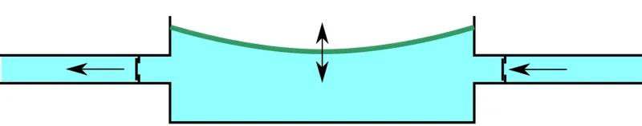

<figure class="eoc-pic eoc-pic-main"><figcaption><a href="https://commons.wikimedia.org/wiki/File:Membraanpomp.svg">Membraanpomp</a> by Sjoerder, <a href="https://creativecommons.org/licenses/by-sa/3.0">CC BY-SA 3.0</a>, from Wikimedia Commons.</figcaption></figure>

A chamber with one flexible wall (a rubber diaphragm, a squeezable bulb or a folding bellows) or a sliding piston, fitted with an inlet and an outlet one-way valve: making the chamber bigger sucks fluid in through the inlet, making it smaller pushes it out through the outlet, so in-and-out movement becomes one-way flow of air or liquid.

**In plain words:** A pump that works like a heart or a squeezed rubber bulb: a springy rubber disc, bulb or bellows is pushed in and let back out over and over, and two little one-way flaps make the air or water go in one side and out the other. The same idea, with a piston sliding in a tube instead of a flexing disc, is a bike pump. **Proper term:** Diaphragm pump (membrane pump), with the squeeze-bulb pump, piston hand pump (bike pump) and bellows pump as close relatives.

**Also called:** membrane pump (Wikipedia); micro diaphragm pump, mini air pump, micro vacuum pump, DC air pump; often sold under model names with a size number such as 370 (e.g. ZR370-02PM, Adafruit; AM370FPW, Wikimedia Commons); booster pump or medical-grade booster pump (the small pumps used in Programmable-Air; Hackaday); aquarium air pump (Wikipedia gives it as the typical small diaphragm compressor; its diaphragm is vibrated magnetically, aquarium-essentials); air-operated double diaphragm pump (AODD), a large industrial version driven by compressed air (Wikipedia); diaphragm compressor (small diaphragm pumps used as air compressors and low-grade vacuum pumps; Wikipedia); squeeze bulb, hand bulb, rubber bulb pump, blower bulb or air blower (lens and keyboard dusters), inflation bulb of a blood-pressure cuff (Wikipedia 'Sphygmomanometer'), [primer](../glossary.md#primer) bulb (boat and engine fuel lines; Wikipedia 'Fuel line'), bulb pump or siphon bulb (Wikipedia 'Hand pump'); piston pump, [reciprocating](../glossary.md#reciprocating) pump, hand piston pump, suction (lift) pump, force pump (Wikipedia 'Reciprocating pump', 'Hand pump'); bicycle pump: floor pump or track pump, frame pump, mini pump, foot pump, double-action pump (Wikipedia 'Bicycle pump'); bellows: hand bellows, accordion bellows, double-acting piston bellows (Wikipedia 'Bellows'); foot pump (a diaphragm pump stepped on, e.g. for air beds; Wikipedia 'Air pump').

## How it works

When the diaphragm, bulb or piston moves so the chamber gets bigger, the pressure inside drops, the inlet valve opens and fluid is drawn in; when it moves back and the chamber gets smaller, the pressure rises, the inlet valve is pressed shut and the outlet valve opens to let the fluid out (Wikipedia 'Diaphragm pump': 'A pair of non-return [check valves](../glossary.md#check-valve) prevent reverse flow'). In a micro air pump a small DC motor drives the diaphragm through a [crank](../glossary.md#crank), in an aquarium pump a magnetic field makes the diaphragm vibrate 50-60 times a second, and in a squeeze bulb your hand squeezes and the bulb's own springiness refills it (Wikipedia; aquarium-essentials; tuyere, Printables 1133240). A bike pump does the same with a piston: on the up-stroke air comes in through a one-way valve, and on the down-stroke the air is forced through the tyre valve; simple pumps use a cupped piston seal that the air presses against the cylinder wall, so the piston acts as its own valve (Wikipedia 'Bicycle pump').

## Parts

A few parts, or a small assembly that acts as one unit. Parts: a pump chamber; the moving wall (rubber, thermoplastic or PTFE diaphragm; rubber or TPU bulb; leather or rubber bellows; or a piston with a cup seal); an inlet check valve and an outlet check valve; inlet and outlet ports or hose barbs; and a driver: an electric motor with a crank or wobble plate, a mains electromagnet that vibrates the diaphragm, a hand, a foot or a lever (Wikipedia 'Diaphragm pump', 'Hand pump', 'Bellows', 'Bicycle pump'; Thang, 2700 Animated Mechanical Mechanisms part 4 pp. 100-101). A printed squeeze-bulb duster has four TPU parts: two duckbill valves, the bulb and a nozzle (tuyere, Printables 1133240).

## Everyday examples

- The humming aquarium air pump that bubbles air through an airstone (Wikipedia 'Diaphragm pump', 'Air pump')
- A bike pump, or the foot pump for an air bed (Wikipedia 'Bicycle pump', 'Air pump')
- The rubber bulb you squeeze to inflate a blood-pressure cuff; automatic cuffs use a tiny electric air pump instead (Wikipedia 'Sphygmomanometer'; Commons photo of a Beurer BC-18 pump unit)
- Fireplace bellows and the rubber blower bulb used to dust camera lenses (Wikipedia 'Bellows'; MattoDesign, Printables 225914)

## When to use it

Use a diaphragm pump when you need a small, cheap, clean source of air pressure or suction: inflating soft robot fingers, balloons and air bags, powering small suction cups and vacuum pick-up tools, bubbling air into an aquarium, or moving dirty or chemical liquids without them touching the motor (Wikipedia 'Diaphragm pump'; Programmable-Air; Adafruit). It primes itself and doesn't mind running dry (Wikipedia). Choose a squeeze bulb, bellows or hand piston pump when there's no electricity or you want direct control by hand: dusting, priming a fuel line, pumping a tyre or emptying a can (Wikipedia 'Hand pump', 'Fuel line', 'Bicycle pump').

## When not to use it

1) Exact doses or very steady flow: the flow pulses and the [stroke](../glossary.md#stroke) volume drifts; use a syringe pump or a peristaltic pump. 2) Lots of water at low pressure (fountains, aquariums' water circulation): use a centrifugal pump. 3) High flow of air (airbrushes need about 10 L/min; Programmable-Air README) or high stored pressure: use a proper compressor with a rated air tank. 4) Liquids in an air-only micro pump (Adafruit). 5) Continuous running of an intermittent-duty micro pump (Adafruit). 6) Both blowing and sucking from one pump without valves (Adafruit). 7) Lifting water more than about 7 m by suction (Wikipedia 'Hand pump').

## Details

- **What it does (jobs):**
  - seal it, or pass cables or fluid through: moves air or liquid along a tube, in one direction, through sealed valves (Wikipedia 'Diaphragm pump')
  - hold or release using power: supplies the air pressure or suction that inflates soft [actuators](../glossary.md#actuator) and balloons and holds suction cups and vacuum grippers (Programmable-Air; Hackaday)
  - stop it moving back (one-way): its two check valves let fluid go one way only, so a tyre, bag or vacuum line stays pumped when the pumping stops (Wikipedia 'Bicycle pump', 'Check valve')
- **Movement:** multiple: the diaphragm, bulb or bellows flexes in and out (flex); in a piston pump the piston slides (slide); motor-driven pumps take in continuous rotation and turn it into this short back-and-forth stroke
- **Directions it can move (degrees of freedom):** 1: the moving wall or piston only goes in and out along one path; each valve opens and shuts by itself
- **Special behaviour:**
  - one-way (moves freely one way, locks the other): the inlet and outlet check valves let fluid through in one direction only (Wikipedia 'Diaphragm pump'; 'Hand pump': check valves 'operating in opposing directions')
  - motion conversion (e.g. rotary to linear): a crank, eccentric or wobble plate turns motor rotation into the diaphragm's in-and-out stroke (Wikipedia 'Diaphragm pump'; Thang part 4 p. 101, wobbling-disk pump)
  - torque-limiting (slips or clicks at a set force/[torque](../glossary.md#torque)), in a loose sense: a pump can only reach its 'stall' pressure, e.g. -55 kPa for a ZR370 micro pump (Adafruit), and an air-driven diaphragm pump simply stops when its outlet is closed and restarts when it is opened, without overheating (Wikipedia)
- **How it holds:**
  - not a holding joint (it moves or passes on motion): it moves air or liquid
  - suction or air pressure: the pressure or suction it makes is what holds suction cups and inflates actuators (Programmable-Air)
  - spring force (a spring or springy part presses it in place): a squeeze bulb refills because its walls spring back (tuyere: a light gyroid [infill](../glossary.md#infill) makes the printed bulb springy; a hollow bulb 'doesn't refill with air well'), and the check valves are held shut by springs or their own springiness
- **Input and output:** In-and-out (reciprocating) movement from a motor crank, a vibrating electromagnet, a hand or a foot -> pulsing one-way flow of air or liquid. Typical micro air pump: 4.5 V, about 500 mA, 2.5 L/min, stall at -55 kPa (Adafruit ZR370-02PM). Efficiency: Wikipedia says diaphragm pumps 'can be up to 97% efficient', while hand diaphragm pumps are called 'relatively inefficient due to the extra work needed to deform the diaphragm' (Wikipedia 'Hand pump'), so it depends strongly on size and design. Shaft arrangement: motor shaft at right angles to the diaphragm stroke in most micro pumps ⚑ [uncertain: from photos, no opened source states it]. Back-drivable: no; the check valves block reverse flow, and reversing a DC pump's motor does not reverse the airflow (Adafruit)
- **Power:** powered (electric motor or mains electromagnet) or human-powered (hand, foot or lever); the valves themselves are passive. When power is lost the flow stops and the check valves hold the pressure or vacuum downstream as long as they seal (Wikipedia 'Check valve'); in an aquarium air line, water can siphon back into the pump unless a check valve is fitted or the pump sits above the tank rim (Aquarium Co-op)
- **Load:** light pressure for most maker pumps: micro pumps stall at about -55 kPa vacuum and deliver 1.8-2.5 L/min (Adafruit); Programmable-Air aims at -0.5 to +0.5 atm and 2 L/min, while airbrushes need about 10 L/min, more than such pumps give (Programmable-Air README). Hand piston pumps reach tyre pressures (tyres are marked with ranges such as 90-120 psi; Wikipedia 'Bicycle pump'), and a printed piston compressor reached about 40 psi but 'above 20 psi it's not super happy' (cndewil, Printables 1175682). Industrial hydraulically driven diaphragm pumps reach up to 1,200 bar (Wikipedia). Mechanically it carries no structural load
- **Play and precision:** not applicable: it moves fluid, not parts. The flow comes in pulses, one per stroke, and the amount per stroke changes as valves leak and diaphragms age; for measured doses use a syringe or peristaltic pump
- **Taking it apart:** removable: tubing pushes onto the inlet and outlet barbs (Adafruit) and pumps are held by clips or screws; tyre pumps push or clamp onto the tyre valve (Wikipedia 'Bicycle pump')
- **How often it can be reused:** effectively unlimited for connecting and disconnecting tubes, but the pump itself wears: Adafruit's ZR370 is specified for 30,000 cycles of 10 seconds on and 5 seconds off, and rubber diaphragms 'will eventually leak and need to be replaced' (Wikipedia 'Hand pump')
- **Sealing:** airtight or pressure, within the pump's rating: the diaphragm is a hermetic seal between the drive and the chamber, so the air or liquid needs no lubricant and stays clean (Wikipedia 'Diaphragm pump'); the check valves seal against backflow; in a bike pump the cupped piston seal is pressed against the cylinder by the air (Wikipedia 'Bicycle pump'). Printed pumps often leak (Vaks, Printables 1518068: 'super leaky')
- **Adjustable:** yes: an electric pump's speed and flow can be varied with PWM (Adafruit); an air-driven diaphragm pump's flow is set from zero to maximum with its air-inlet or outlet valve (Wikipedia); hand pumps by how hard and fast you pump. Pressure is limited by the pump's stall pressure, so add a pressure sensor, valves or a relief valve for control (Programmable-Air)
- **Access needed:** end of a tube or shaft: tubing fits over the inlet and outlet barbs (Adafruit ZR370: side inlet 2 mm inner and 4.3 mm outer diameter, end outlet 1 mm inner and 4.3 mm outer diameter, so use tubing of about 3-4 mm inner diameter)
- **Materials:** Diaphragms: rubber, thermoplastic or PTFE, chosen to resist the pumped fluid (Wikipedia 'Diaphragm pump'). Traditional bellows: rigid boards with leather sides (Wikipedia 'Bellows'). Bike pump pistons: cupped fibre or plastic (Wikipedia 'Bicycle pump'). Printed versions: TPU 85A-95A for bulbs, bellows and valves, PLA or PETG for rigid ends and frames (Printables 1133240, 999195, 1000990, 225914); a clear acrylic tube with [O-rings](../glossary.md#o-ring) as the cylinder of a printed piston compressor (cndewil, Printables 1175682)
- **Heat, cold, water and wear:** Heat and duty cycle: small motor pumps are rated for intermittent use (Adafruit: about 50%), and compressing air heats it, so printed compressors must be run briefly and allowed to cool (cndewil). Wear: rubber diaphragms eventually leak and need replacing (Wikipedia 'Hand pump'). Chemicals: pick a diaphragm elastomer that suits the fluid; many are available for corrosive liquids (Wikipedia). Printed parts: TPU absorbs moisture (Prusa flexible materials guide); PLA softens above about 60 °C (Prusa PLA guide), which a working printed compressor can approach ⚑ [uncertain: no temperature was measured]. Noise and vibration: pumps vibrate a lot, so mount them on foam (Adafruit).

## Making it

- **Ways to make or get it:**
  - off-the-shelf part: micro diaphragm air and vacuum pumps, aquarium air pumps, small diaphragm water pumps (e.g. in garden watering kits, Wikimedia Commons AM370FPW photo), squeeze bulbs, bike and foot pumps (Adafruit; Wikipedia)
  - 3D print (FDM): one-piece TPU squeeze bulbs, duckbill valves and bellows dusters; PLA or PETG frames, cranks and pistons for printed piston compressors (Printables 1133240, 999195, 225914, 1175682)
  - 3D print (FDM, two materials): TPU bellows printed in alternating layers with PLA that is peeled away afterwards (Hackaday 2025)
  - laser cut: the case plates of a printed piston compressor (cndewil, Printables 1175682)
  - woodwork: traditional hand bellows from wooden boards and leather (Wikipedia 'Bellows')
- **Printing it in one piece (print in place):** partly: a TPU squeeze bulb prints in one piece, but either a 6 mm airsoft BB must be dropped in at a print pause to make its check valve (Clough42, Printables 999195), or separately printed one-piece TPU duckbill valves are pushed in and welded with a soldering iron (tuyere, Printables 1133240). Motor-driven pumps are printed as separate parts and assembled with bearings, O-rings and fittings (cndewil, Printables 1175682)
- **Tools:** none to push tubing on; a soldering iron or connectors to wire the motor, plus a transistor or motor driver rated well above the pump's running current (Programmable-Air README; Adafruit); a soldering iron to weld printed TPU valves into a printed bulb (tuyere, Printables 1133240); spanner and PTFE tape for threaded pneumatic fittings on printed compressors (cndewil, Printables 1175682)
- **Difficulty:** easy to buy and fit: a micro air pump costs about 8 USD and is driven like any small DC motor (Adafruit), and a TPU squeeze bulb with printed valves is a beginner print (tuyere, Clough42). Moderate to hard to print a motor-driven pump or compressor that seals and lasts, because printed valves and seals leak (Vaks, Printables 1518068) and compressed air gets hot (cndewil)

### 3D printing tips

1) Squeeze bulbs: print in soft TPU (85A works well, Clough42); give the bulb a light gyroid infill so it springs back and refills, because a hollow bulb refills poorly (tuyere). 2) Valves: one-piece TPU duckbill valves are the easiest printed check valves; push them into the bulb and weld the seams with a soldering iron, otherwise the inlet valve 'tends to pop off' when squeezed hard; the printed bulb's inlet and outlet come out sealed over and must be cut or melted open (tuyere). For a ball valve, pause at the right layer and drop in a 6 mm airsoft BB (Clough42: at about 7.6 mm height). 3) TPU printing: print slowly, one object at a time to limit stringing, and clean hairs off with a hot-air gun (tuyere); keep the filament dry because it absorbs moisture (Prusa flexible materials guide). Blower bulbs print well with at least two walls at 0.2 mm layers, slowly (MattoDesign, Printables 225914); a 95A TPU hand pump body with PLA ends printed unsupported at 100% infill (CLOWN 3D, Printables 1000990). 4) Bellows: alternate TPU and PLA layers so the TPU folds stay separate, then [peel](../glossary.md#peel-vs-shear) the PLA away; this needs a printer with two independent extruders (Hackaday 2025). 5) Printed piston compressors: give pressure parts 4-6 walls, print hot with thick layers for airtightness, oil the O-rings and cylinder, use PTFE tape on fittings, and expect the air to get hot: run it briefly and let it cool; it reached about 40 psi but struggled above 20 psi (cndewil, Printables 1175682). 6) Expect leaks: a student-designed printed diaphragm pump was 'super leaky' though it still moved 1.35 L/min (Vaks, Printables 1518068). 7) Don't connect a printed pump to a printed tank: never hold stored pressure in a 3D-printed part.

### Buying one (off-the-shelf parts)

Micro diaphragm air and vacuum pumps (DC 3-12 V; e.g. ZR370-02PM 2.5 L/min and ZR320-02PM 1.8 L/min, Adafruit); 'medical booster' mini pumps (Programmable-Air); aquarium air pumps and airline check valves (Aquarium Co-op); silicone air tubing of 3 mm inner diameter, T-connectors and 6 V mini air valves (Adafruit related parts); pressure sensors such as the Omron 2SMPP-03 with an HX711 amplifier (Programmable-Air README); Programmable-Air kit (open hardware); air-operated double diaphragm pumps for slurries (Wikipedia); bike floor pumps with gauges, frame pumps, mini pumps, foot pumps, Presta/Schrader heads and adapters (Wikipedia 'Bicycle pump'); squeeze bulbs with release valves (blood-pressure cuffs; Wikipedia 'Sphygmomanometer'); primer bulbs for fuel lines (Wikipedia 'Fuel line'); hand bellows (Wikipedia 'Bellows')

## Rules of thumb

- A typical 4.5 V micro pump draws about 500 mA, moves 2.5 L/min and stalls at -55 kPa; it is not rated for continuous running (tested for 30,000 cycles of 10 s on, 5 s off), so plan on about a 50% duty cycle (Adafruit ZR370-02PM)
- One pump only blows at its outlet and sucks at its inlet, and reversing the motor doesn't reverse the flow, so to both inflate and deflate use two pumps or a valve arrangement (Adafruit; Programmable-Air uses one pump for pressure and one for vacuum, Hackaday)
- Size the switching transistor for the startup and stall current, not the label: a 0.8 A transistor blew up on a pump rated at 350 mA, so Programmable-Air moved to parts rated for at least 2 A (Programmable-Air README)
- Small soft robots work in roughly -0.5 to +0.5 atm with about 2 L/min, enough to inflate and deflate a 15 cm (6 in) balloon in under 30 seconds; an airbrush needs about 10 L/min, far more than these pumps give (Programmable-Air README)
- Balloons and thin silicone actuators get harder and then easier to inflate (the pressure rises, then falls), so control them by the amount of air pumped in rather than by pressure alone (Programmable-Air README)
- Piston pumps: a narrow barrel reaches higher pressure for the same push, a wide barrel moves more air per stroke (Cycling UK forum), because force = pressure x piston area (FIRST Robotics Competition pneumatics manual)
- A pump that sucks water up (a suction or lift pump) can't raise it more than about 7 m; to go higher, push it from below with a force pump (Wikipedia 'Hand pump')
- Diaphragm pumps prime themselves, lift well on the suction side and can run dry without damage (Wikipedia 'Diaphragm pump')
- Aquarium air lines need a check valve unless the pump sits higher than the tank rim; fit it outside the water near the rim with the flapper end towards the pump (Aquarium Co-op)
- Rest micro pumps on soft foam or sponge to cut vibration noise (Adafruit)
- Use air-only micro pumps for air only; for liquids use a water pump or a peristaltic pump (Adafruit)

## Common failures

1) Valve fitted backwards, so nothing flows (Aquarium Co-op). 2) Dirt or wear stops a check valve sealing, so the pump loses its prime or the vacuum leaks away (see the Check valve entry). 3) Torn, hardened or worn diaphragm (Wikipedia 'Hand pump'). 4) A printed bulb that doesn't spring back because it is hollow, or an inlet valve that pops off unless welded (tuyere). 5) Leaky printed chambers and seals (Vaks; cndewil). 6) Overheating or early wear from running an intermittent pump continuously (Adafruit). 7) Blown driver transistor from startup current (Programmable-Air README). 8) Water siphoned into an aquarium pump during a power cut (Aquarium Co-op). 9) Weak flow because the tubing is too narrow or kinked ⚑ [uncertain: general advice, no specific source].

## Safety

Generally low risk, but: 1) Over-inflation: a pump that keeps going can burst what it fills; car-tyre electric pumps can over-inflate and burst a bike tyre unless stopped in time (Wikipedia 'Bicycle pump'); add a pressure sensor or relief valve to soft actuators. 2) Compressed air: never point it at skin, eyes or anyone; even 15 psig can cause serious injury (FRC Zero), and air jets carry particles into eyes (HSE HSG39). 3) Heat: compressing air heats the pump (cndewil). 4) Aquariums: without a check valve, tank water can siphon back through the air line, damaging the pump, flooding the floor and in extreme cases starting an electrical fire (Aquarium Co-op). 5) Electrics: startup current can destroy an undersized transistor (Programmable-Air README). 6) Don't feed a pump into a home-made tank: never hold stored pressure in a 3D-printed part.

## Related

- Check valve: the one-way valve inside every one of these pumps; two of them plus a flexing chamber make a pump
- Peristaltic pump: rollers squeeze a tube, no valves; better for measured doses of liquid
- Syringe pump: a screw-driven piston for exact small volumes; not continuous
- [Venturi](../glossary.md#venturi) vacuum generator: makes suction from compressed air or running water with no moving parts
- Centrifugal pump: a spinning impeller for lots of water at low pressure; must be primed
- Gear pump: two meshing gears for oil or water at steady pressure
- Air tank and hydraulic accumulator: stores what a small pump produces so it can be released in fast bursts
- Bellows and inflatable actuators: the soft parts these pumps inflate
- Vacuum (suction) gripper and suction cup: the usual loads for a micro vacuum pump
- Bellows boot: the same folded shape used only as a passive dust cover

## Make it yourself

- [TPU Check/One-Way Valves - No Moving Parts! - and a Demonstration Keyboard Duster (Hand Pump) (tuyere, Printables) (URL from Printables API, page not opened)](https://www.printables.com/model/1133240-tpu-checkone-way-valves-no-moving-parts-and-a-demo): An all-TPU squeeze-bulb air pump with two printed duckbill check valves and a nozzle; also standalone duckbill and cross-slit valves *(licence: CC BY-NC-SA)*
- [Squeeze Bulb Duster with Gridfinity Tray and One-Way Valve (Clough42, Printables) (URL from Printables API, page not opened)](https://www.printables.com/model/999195-squeeze-bulb-duster-with-gridfinity-tray-and-one-w): 85A TPU squeeze bulb whose base has a ball check valve made from a 6 mm airsoft BB dropped in at a print pause *(licence: BSD)*
- [Air Blower/Bellows Dust-Off (MattoDesign, Printables) (URL from Printables API, page not opened)](https://www.printables.com/model/225914-air-blowerbellows-dust-off): Printed TPU blower bulb for dusting lenses, in short and long versions, with or without a refill hole *(licence: CC BY-NC-SA)*
- [(Mostly) 3D printed Air Compressor / Vacuum Pump (cndewil, Printables) (URL from Printables API, page not opened)](https://www.printables.com/model/1175682-mostly-3d-printed-air-compressor-vacuum-pump): See-through single-cylinder piston compressor driven by a drill, with an acrylic cylinder, O-ring seals and bought check valves; reaches about 40 psi (use it only to fill rated items, not printed tanks) *(licence: CC BY-NC)*
- [Programmable-Air (Amitabh Shrivastava, GitHub README)](https://raw.githubusercontent.com/tinkrmind/programmable-air/master/README.md): Open-hardware Arduino kit with two mini diaphragm pumps (one blowing, one sucking), valves and a pressure sensor for inflatable and vacuum soft robotics; development has moved to the Programmable-Air organisation on GitHub *(licence: MIT (repository LICENSE))*

## Pictures, videos and models

- [Membraanpomp.svg (Sjoerder; Wikimedia Commons)](https://commons.wikimedia.org/wiki/File:Membraanpomp.svg): Animation of a diaphragm (membrane) pump: the membrane moves, the inlet and outlet valves open and close in turn, and bubbles show the flow *(licence: CC BY-SA 3.0 / GFDL)*
- [Diaphragm pump animated.gif (TheresNoTime; Wikimedia Commons)](https://commons.wikimedia.org/wiki/File:Diaphragm_pump_animated.gif): Animation of the basic working principle of an air-operated double diaphragm pump (the caption used in Wikipedia's 'Diaphragm pump' article) *(licence: CC BY-SA 4.0)*
- [Diaphragm Type Pump.jpg (Cmehlhop2; Wikimedia Commons)](https://commons.wikimedia.org/wiki/File:Diaphragm_Type_Pump.jpg): Cross-section drawing of a basic diaphragm (fuel) pump and most of its components *(licence: CC BY-SA 4.0)*
- [Gardena AquaBloom Set - AIM Technology AM370FPW (Wikimedia Commons)](https://commons.wikimedia.org/wiki/File:Gardena_AquaBloom_Set_-_AIM_Technology_AM370FPW-7694.jpg): Photo of a small motor-driven diaphragm pump (AIM Technology AM370FPW) taken from a garden watering kit *(licence: CC BY-SA 4.0)*
- [Hand piston pump 1 (Nguyen Duc Thang, thang010146, YouTube)](https://www.youtube.com/watch?v=5a-UdttYEVs): CAD animation of a hand piston pump cut in half, with spring-loaded ball valves opening and closing as the piston moves *(licence: Standard YouTube licence (link only))*

## Needs confirming

⚑ marks something nobody has confirmed yet: a fact the research could not confirm from a source, a finder value that is a best guess, or an open point from the research notes. Corrections are welcome (see `research/needs-confirming.md`).

- ⚑ 3 sentences on this page marked [uncertain].
- ⚑ Finder value `power_source` = electricity, compressed air, liquid, suction (best guess): `power` names several power sources, and not all may apply
- ⚑ Finder value `power_loss` = not applicable (best guess): `power` mentions losing power, but none of the three outcomes
- ⚑ Finder value `overload_response` = slips and keeps going (best guess): several overload behaviours named: clicks or pops out and resets, slips and keeps going

## Sources

- <https://en.wikipedia.org/wiki/Diaphragm_pump>
- <https://en.wikipedia.org/wiki/Air_pump>
- <https://en.wikipedia.org/wiki/Bicycle_pump>
- <https://en.wikipedia.org/wiki/Bellows>
- <https://en.wikipedia.org/wiki/Hand_pump>
- <https://en.wikipedia.org/wiki/Reciprocating_pump>
- <https://en.wikipedia.org/wiki/Sphygmomanometer>
- <https://en.wikipedia.org/wiki/Fuel_line>
- <https://cs448m.github.io/lectures/machines/doc/4.pdf>
- <https://www.adafruit.com/product/4699>
- <https://raw.githubusercontent.com/tinkrmind/programmable-air/master/README.md>
- <https://raw.githubusercontent.com/tinkrmind/programmable-air/master/LICENSE>
- <https://hackaday.com/2018/05/24/programmable-air-makes-robotics-a-breeze/>
- <https://hackaday.com/2025/05/08/3d-printed-tpu-bellows-with-pla-interface-layers/>
- <https://aquarium-essentials.com/how-a-fish-tank-air-pump-works/>
- <https://www.aquariumcoop.com/blogs/faqs/how-to-use-a-check-valve>
- <https://forum.cyclinguk.org/viewtopic.php?t=87728>
- <https://www.firstinspires.org/hubfs/web/program/frc/resources/pneumatics-manual.pdf?hsLang=en>
- <https://www.frczero.org/pneumatics/pneumatic-safety/>
- <https://www.hse.gov.uk/pubns/priced/hsg39.pdf>
- <https://help.prusa3d.com/article/flexible-materials_2057>
- <https://help.prusa3d.com/article/pla_2062>
- <https://api.printables.com/graphql/>
- <https://www.printables.com/model/1133240-tpu-checkone-way-valves-no-moving-parts-and-a-demo>
- <https://www.printables.com/model/999195-squeeze-bulb-duster-with-gridfinity-tray-and-one-w>
- <https://www.printables.com/model/225914-air-blowerbellows-dust-off>
- <https://www.printables.com/model/1000990-hand-air-pump>
- <https://www.printables.com/model/1175682-mostly-3d-printed-air-compressor-vacuum-pump>
- <https://www.printables.com/model/1518068-diaphragm-pump-bad>
- <https://commons.wikimedia.org/wiki/File:Membraanpomp.svg>
- <https://commons.wikimedia.org/wiki/File:Diaphragm_pump_animated.gif>
- <https://commons.wikimedia.org/wiki/File:Diaphragm_Type_Pump.jpg>
- <https://commons.wikimedia.org/wiki/File:Gardena_AquaBloom_Set_-_AIM_Technology_AM370FPW-7694.jpg>
- <https://commons.wikimedia.org/wiki/File:Beurer_BC-18_-_air_pump_unit_with_Mini_Pump_KPM14A-0474.jpg>
- <https://commons.wikimedia.org/wiki/Category:Diaphragm_pumps>
- <https://www.youtube.com/watch?v=5a-UdttYEVs>
