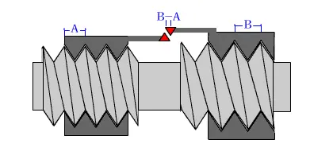
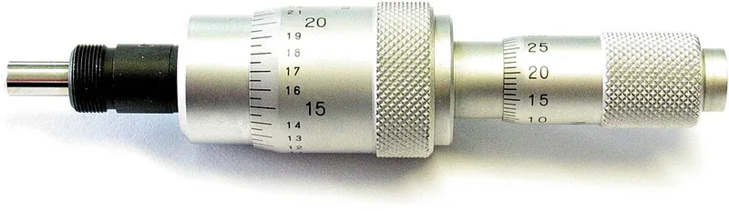
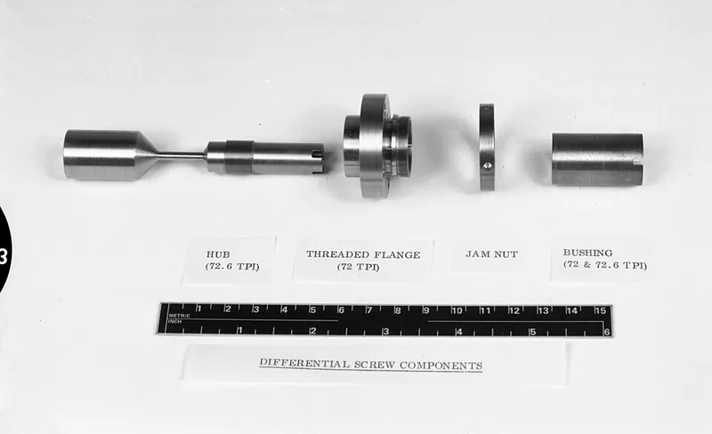

<figure class="eoc-pic eoc-pic-main"><picture><source media="(prefers-reduced-motion: reduce)" srcset="../media/differential-screw.still.webp"></picture><figcaption><strong>Animation.</strong> <a href="https://commons.wikimedia.org/wiki/File:DifferentialScrew.gif">DifferentialScrew</a> by ＋－ at Japanese Wikipedia, <a href="http://creativecommons.org/licenses/by-sa/3.0/">CC BY-SA 3.0</a>, from Wikimedia Commons.</figcaption></figure>
<figure class="eoc-pic"><figcaption><strong>Photo.</strong> <a href="https://commons.wikimedia.org/wiki/File:Differential_micrometer_screw.jpg">Differential micrometer screw</a> by Ansgar Hellwig, <a href="https://creativecommons.org/licenses/by-sa/2.0/de/deed.en">CC BY-SA 2.0 de</a>, from Wikimedia Commons.</figcaption></figure>
<figure class="eoc-pic"><figcaption><strong>Photo.</strong> <a href="https://commons.wikimedia.org/wiki/File:23_0045467_Convair_Negative_Image_-_Differential_screw_components_(53782490884).jpg">23 0045467 Convair Negative Image - Differential screw components (53782490884)</a> by San Diego Air &amp; Space Museum Archives, Public domain, from Wikimedia Commons.</figcaption></figure>

One turn of a screw carrying two threads of slightly different [pitch](../glossary.md#pitch) moves a nut that can't rotate by only the difference of the two pitches (for example M5 and M4 threads give 0.1 mm per turn), giving very fine, steady adjustment from coarse, standard threads.

**In plain words:** A screw with two slightly different threads on it, so a full turn moves the part only by the tiny difference between them: a super-fine adjuster made from ordinary threads. **Proper term:** Differential screw (differential thread, differential adjuster).

**Also called:** differential thread; differential adjuster / differential adjuster screw; differential micrometer / differential micrometer head (optics and measuring); differential screw translator (Mitutoyo (brand) name for its extra-fine micrometer heads); fine adjustment screw (the general name for fine adjusters; a differential screw is the extra-fine kind); differential screw clamp (toolmaker's clamp); differential-pitch screw / headless compression screw, e.g. the Herbert screw (surgical bone screw); Differenzgewinde (German).

## How it works

Turning the screw drives it through the fixed nut by one pitch, say 0.8 mm for an M5 thread. At the same time the second, finer thread on the same screw turns inside the moving nut, which can't rotate, and draws that nut back by its own pitch, 0.7 mm for M4. The moving nut therefore travels only the difference, 0.8 - 0.7 = 0.1 mm per turn, so a tenth of a turn moves it 10 um. Both threads must be the same hand (usually right-hand); with opposite hands the two movements add instead, as in a turnbuckle.

## Parts

A few parts: a screw (spindle) with two threads of slightly different pitch, or two standard screws joined end to end, or a threaded sleeve with one pitch outside and another inside; a fixed nut; a second nut on the part being adjusted, kept from turning by a slot, square tube or guide; a knob or thimble; and often a small spring that pushes the moving nut to take up play.

## Everyday examples

- Differential micrometer heads on laboratory and optical positioning stages, for sub-micrometre adjustment (Mitutoyo; Wikipedia)
- A finely adjustable Z=0 endstop on a home-built 3D printer (Hackaday)
- Headless 'compression' bone screws such as the Herbert screw, whose two ends have different thread pitches so tightening pulls the two bone pieces together (Wikipedia 'Herbert screw')
- Historic machine levelling feet and astronomical micrometers (Wikipedia 'Differential screw')

## When to use it

Use it when you need very fine, steady adjustment that stays where you set it, but only have (or only want) coarse, strong, standard threads: focusing, aligning optics or lasers, setting an endstop or a bed height, fine feed of a tool, or a fine final tightening stage in a clamp. It is also the usual way to get steps finer than the finest threads that can be made, and a differential micrometer gives both a coarse and a fine knob in one unit.

## When not to use it

Don't use it for long or fast travel: its range is short and each turn moves very little; use a lead screw or ball screw. Don't expect a big clamping force by hand, because friction on two threads doubles the starting [torque](../glossary.md#torque) (Home Metal Shop Club); use an ordinary screw clamp or a toggle clamp. If you need zero [backlash](../glossary.md#backlash), [preload](../glossary.md#preload) it with a spring or use a lever or [flexure](../glossary.md#flexure) reducer instead (Wikipedia 'Fine adjustment screw'). If one fine thread is fine enough (e.g. an 80-100 tpi adjuster), that is simpler and cheaper.

## Details

- **What it does (jobs):**
  - line parts up exactly: very fine position adjustment, e.g. optics, microscope focus, a 3D printer's Z endstop, measuring heads
  - change the kind of motion: rotation into a very small straight-line movement
  - change speed or turning force: in theory each turn gives a tiny movement and a large force (a 9:1 advantage over one of its threads alone in one example), though thread friction uses up much of that gain
- **Movement:** rotate+slide: the knob and screw turn, and the output nut slides a small distance (e.g. 0.1 mm per turn); the total output range is usually only a few millimetres
- **Directions it can move (degrees of freedom):** 1: the output nut's position is tied to the screw's rotation (one pitch difference per turn), so there is one independent motion
- **Special behaviour:**
  - motion conversion (rotary to linear): a turn of the knob becomes a very small straight movement of the output nut
  - [self-locking](../glossary.md#self-locking) (holds under load, won't back-drive): with a tiny effective lead and two pairs of sliding threads, pushing on the output can't turn the screw, so the setting stays put; a printed differential clamp maker calls this 'self-retention' (Printables, Jack)
- **How it holds:**
  - shape ([form-fit](../glossary.md#form-fit--force-fit--material-bond)): both threads interlock with their nuts, so the output can only move when the screw is turned
  - friction or clamping (force-fit): friction in the two threads keeps the screw from turning back under load
- **Input and output:** Rotation -> small straight-line motion. Effective pitch = P1 - P2 for single-start threads of the same hand: M5x0.8 with M4x0.7 gives 0.1 mm per turn; 16 tpi with 24 tpi gives about 0.0208 in (0.53 mm) per turn, the same as a 48 tpi thread; a 26 tpi thread with a 1.0 mm metric thread gives about 0.023 mm (Wikipedia). Force gain in theory = coarse pitch / difference, e.g. 9:1 over a 20 tpi screw for an 18/20 tpi pair (Home Metal Shop Club). Efficiency is low: the load presses on two sets of sliding threads, so the torque needed just to start turning is about double that of a single screw (Home Metal Shop Club). Shaft arrangement: in line. Back-drivable: no in practice (self-locking).
- **Power:** passive (no power needed): usually turned by hand with a knob, thimble, wrench or socket; it can be motor-driven but rarely is
- **Load:** light: it is a fine adjuster for positioning, focusing and light clamping. Loads act along the screw (push or pull); keep bending and side loads off the fine threads by guiding the moving part. Clamping force by hand is limited because the friction of two threads doubles the starting torque (Home Metal Shop Club).
- **Play and precision:** Resolution is excellent: 0.1 mm per turn from M5/M4, so 10 um per tenth of a turn (Hackaday); Mitutoyo's differential micrometer heads have a 0.05 mm spindle pitch with 0.001 mm graduations (Mitutoyo). Backlash is noticeable unless handled: the play of the two threads adds together (Wikipedia 'Fine adjustment screw'), so push the moving nut against the thread with a spring (Rehorst) and approach the setting from one direction. Range is short: for 2 mm of output an M5/M4 screw must itself travel 16 mm (Rehorst). The moving nut must be guided so it can't rotate, and there is little [tolerance](../glossary.md#tolerance) for [misalignment](../glossary.md#misalignment).
- **Taking it apart:** removable: the screw unscrews from both nuts; joined two-screw versions may be glued or thread-locked together
- **How often it can be reused:** many times: it is an adjuster made to be turned back and forth; nuts in plastic or brass slowly wear
- **Sealing:** none: nothing seals; the threads are open
- **Adjustable:** yes: adjustment is its whole purpose; the output is set by turning the knob, often after a coarse setting (differential micrometers combine a coarse micrometer drive with a fine differential drive)
- **Access needed:** one side only (blind): it is adjusted by turning a knob or screw head from one side; assembly needs the nuts threaded on from the screw's ends
- **Materials:** Screws: stainless steel (rigid; commonly 303) with brass nuts for low-cost greased adjusters or phosphor bronze for precise, hard-wearing ones (Wikipedia 'Fine adjustment screw'). DIY: standard steel machine screws with nuts embedded in printed parts, or with plastic (e.g. PTFE) blocks that the screw rolls its own thread into (Rehorst); coarse printed threads in PLA for demos and clamps (Printables).
- **Heat, cold, water and wear:** Nothing special beyond ordinary threads: grit in fine threads makes them stick, and grease extends nut life, while phosphor bronze nuts can run without grease, e.g. in vacuum (Wikipedia 'Fine adjustment screw'). Superglue used to fix a ball tip on an adjuster can outgas and degrade over time (Wikipedia). Printed PLA parts soften above about 60 C (Prusa). At micrometre level, temperature changes of the screw and frame shift the setting ⚑ [uncertain].

## Making it

- **Ways to make or get it:**
  - off-the-shelf part (differential micrometer heads and differential adjuster screws for optical mounts)
  - 3D print (FDM): coarse-thread differential clamps and demos, plus printed guides, nut holders and knobs for metal screws
  - CNC or manual lathe: turn down the end of a screw and cut a finer thread with a die, or drill and tap a coupling nut to join two screws
- **Printing it in one piece (print in place):** no: the screw, sleeve and nuts are printed or bought separately and screwed together; the moving nut also needs a separate anti-rotation guide
- **Tools:** None to adjust (knob or thimble), or a wrench or socket for clamp versions. To make one: a tap and die (e.g. an M4 die), a lathe to turn down the end of a screw, or a coupling nut drilled and tapped to join two screws; thread-locker or epoxy to lock joined screws together (Rehorst; Hackaday).
- **Difficulty:** moderate: easy if you join two standard screws of different sizes with a drilled-and-tapped coupling nut or printed adapter, or print two coarse threads; moderate with a lathe (turn an M5 screw's end down and cut an M4 thread); sub-micron precision versions are bought

### 3D printing tips

1) Let printed parts do the easy jobs and steel do the fine threads: Mark Rehorst's 3D printer Z-endstop uses a steel M5 screw turned down to M4 at one end, an M4 nut embedded in a printed 'flag', and a printed square tube that stops the flag rotating; a spring inside the tube pushes the flag against the nut to remove backlash. 2) Screws can roll their own threads in plastic: Rehorst drilled an undersized hole in a PTFE block for the M5 thread, giving a firm but adjustable fit; a commenter printed PETG parts and tapped most of the way through, leaving a few rolled threads to act like a lock washer. 3) No lathe? Hackaday suggests partly drilling and tapping a coupling nut, or printing an adapter that joins two bolts; lock the joint with thread-locker or epoxy (Rehorst). 4) Fully printed versions work with coarse threads: Sanford Prime's clamp uses 10 tpi and 13 tpi printed threads for roughly 44 tpi equivalent motion, printed in PLA; his first internal 1/2-13 thread needed a revised version, so print a test piece first. 5) Jack's printed clamp moves fast on a 10 mm pitch, then the second 8 mm-pitch thread takes over so the last half turn moves only 2 mm per turn with about 5x more force; he uses grease to keep friction low and leaves a 3.5 mm hole to glue in a reinforcing rod because printed layers are weak in tension. 6) Plan the thread lengths: with M5/M4 the screw moves 8 mm per 1 mm of output, so 2 mm of adjustment needs about 16 mm of M5 and 14 mm of M4 thread plus the nut thicknesses (Rehorst). 7) PLA softens above about 60 C (Prusa), so keep printed adjusters away from heated beds and motors.

### Buying one (off-the-shelf parts)

Differential micrometer heads (e.g. Mitutoyo Series 110 'differential screw translator' (brand), 0-1, 0-2.5 or 0-13 mm range); differential adjuster screws and differential drives for optical mounts and translation stages (optics suppliers); fine and ultra-fine adjustment screws with matched bushings (40-100 tpi and 100-508 tpi) when one fine thread is enough (Wikipedia); standard metric screws in pairs that differ by 0.1 mm of pitch (M3/M3.5, M3.5/M4, M4/M5) or 0.05 mm (M1.6/M2, M2/M2.5, M2.5/M3) (Rehorst); coupling nuts; taps and dies; small compression springs; thread-locker.

## Rules of thumb

- Movement per turn = pitch 1 - pitch 2 for single-start threads of the same hand; in inches per turn it is 1/TPI1 - 1/TPI2 (Wikipedia 'Differential screw'). Examples: M5x0.8 with M4x0.7 = 0.1 mm per turn; 16 tpi with 24 tpi = about 0.0208 in per turn (like a 48 tpi thread) (Wikipedia).
- Mixing metric and imperial threads gives still finer steps: 26 tpi (about 0.977 mm pitch) with a 1.0 mm metric thread = about 0.023 mm per turn (Wikipedia).
- Standard metric pairs: M3/M3.5, M3.5/M4 and M4/M5 give 0.1 mm per turn; M1.6/M2, M2/M2.5 and M2.5/M3 give 0.05 mm per turn (Rehorst).
- Output range is short: the screw itself moves (coarse pitch / difference) times the output, e.g. 8 mm of M5 travel per 1 mm of output with M5/M4, so 2 mm of adjustment needs about 16 mm of M5 and 14 mm of M4 thread (Rehorst).
- Friction is the catch: the [axial](../glossary.md#axial--radial) load bears on two threaded surfaces, so the torque to start turning is about twice that of a single screw, and the theoretical [mechanical advantage](../glossary.md#mechanical-advantage) (9:1 for an 18/20 tpi pair) does not help overcome it (Home Metal Shop Club, 2010).
- Backlash from the two threads adds together (Wikipedia 'Fine adjustment screw'); preload the moving nut with a spring (Rehorst).
- The moving nut must be stopped from rotating, or there is no differential action (Hackaday).
- Threads finer than about 250 tpi (0.1 mm pitch) are hard to make, which is why differential adjusters are used for finer steps; lever or cone reducers are the other option (Wikipedia 'Fine adjustment screw').
- Beware cheap 'differential screw micrometers' sold online that are only 0.5 mm pitch screws with a nice knob (Rehorst).

## Common failures

1) The moving nut turns with the screw, so nothing happens or the part [creeps](../glossary.md#creep); guide it with a slot or square tube (Hackaday; Rehorst). 2) Doubled backlash makes the setting jump when you reverse; add a spring and approach from one side (Rehorst; Wikipedia). 3) Too stiff to turn under load because of friction on two threads (Home Metal Shop Club); grease the threads (Printables, Jack). 4) Running out of range because the screw travels 8-10 times further than the output; plan thread lengths (Rehorst). 5) A joined two-part screw unscrews itself; use thread-locker or epoxy (Rehorst). 6) Printed internal threads come out wrong-sized; print a test first (Sanford Prime revised his). 7) Buying a fake 'differential micrometer' that is just a fine single thread (Rehorst).

## Safety

None known for small adjusters. A printed differential clamp can build up more force than its printed threads and layers can take (Jack reinforces his with a glued-in rod), so don't rely on printed clamps for anything hazardous.

## Related

- Lead screw and nut: one thread, long travel; the basic screw drive this refines
- Fine adjustment screw (single fine thread, 40-508 tpi): simpler, with less backlash, but threads finer than about 250 tpi are hard to get
- Turnbuckle: two threads of opposite hand, so the movements add instead of subtract (fast take-up rather than fine adjustment)
- Capstan and windlass, including the differential windlass: the same 'difference' trick with two rope drums of slightly different diameter
- Parallel leaf-spring flexure (linear flexure stage): a bending stage, often with a lever that divides a screw's motion for backlash-free fine positioning
- Eccentric adjuster: a turning off-centre bush for small, coarse-to-fine position tweaks
- [Kinematic coupling](../glossary.md#kinematic-coupling): fine adjusters usually push on kinematic mounts in optics
- Compound planetary gearbox (split-ring / Wolfrom) and strain-wave gear: large reductions from the difference between two nearly equal tooth counts
- Locking adjustment screws: pairs of opposing screws, or a screw and a spring, that set a tilt or height and then lock it; simpler when an ordinary thread is fine enough

## Make it yourself

- [Super Fine Adjustment from Coarse Thread (Differential Motion) (Sanford Prime, Printables) (URL from Printables API, page not opened)](https://www.printables.com/model/671468-super-fine-adjustment-from-coarse-thread-different): Fully printed hand clamp using 10 tpi and 13 tpi printed threads for about 44 tpi equivalent motion; printed in PLA *(licence: CC BY-SA)*
- [differential screw clamp (Jack, Printables) (URL from Printables API, page not opened)](https://www.printables.com/model/107132-differential-screw-clamp): Printed clamp that closes fast on a 10 mm pitch, then switches to a 2 mm-per-turn differential stage for the final squeeze *(licence: Public domain (CC0))*
- [A Differential Screw Based Z Axis Optical Endstop Design for UMMD (Mark Rehorst's Tech Topics)](https://drmrehorst.blogspot.com/2020/03/a-new-z-axis-optical-endstop-design-for.html): Step-by-step build of an M5/M4 differential screw with printed parts, including thread-pair tables, range calculation and links to the CAD and STL files *(licence: not stated)*
- [HUANGYAN920 Mechanical: interactive animations (entries 'DIFFERENTIAL-SCREW' and 'MICROMETER-SCREW')](https://huangyan920.github.io/Mechanical/): Browser animations of a differential screw and a micrometer screw that you can play with *(licence: MIT)*

## Pictures, videos and models

- [Differential screw (Wikipedia)](https://en.wikipedia.org/wiki/Differential_screw): Animation of two nuts on a two-pitch bolt, a colour-coded micrometer adjuster drawing (20 and 25 tpi), an 1817 Lanz and Betancourt plate, 1887 levelling feet, and worked examples of the pitch calculation *(licence: Text CC BY-SA 4.0; images per file on Commons)*
- [DifferentialScrew.gif (Wikimedia Commons, by user '＋－')](https://commons.wikimedia.org/wiki/File:DifferentialScrew.gif): Animation: turning one bolt through two nuts with slightly different pitches changes the gap between the nuts only by the difference *(licence: CC BY-SA 3.0 / GFDL 1.2+)*
- [Differenzgewinde.svg (Wikimedia Commons, by MatthiasDD)](https://commons.wikimedia.org/wiki/File:Differenzgewinde.svg): Clean labelled drawing of a differential thread; the pitch difference P1 - P2 produces the clamping force *(licence: Public domain)*
- [Differential screw mechanism (Nguyen Duc Thang, YouTube)](https://www.youtube.com/watch?v=YFzov0PbjpM): CAD animation of a differential screw: a gear-driven screw moving a slider by the difference of two threads *(licence: link only)*
- [Screwy Math For Super Fine Adjustments: Differential Screws (Hackaday, 2020)](https://hackaday.com/2020/03/21/screwy-math-for-super-fine-adjustments-differential-screws/): Photo and explanation of a home-made M5/M4 differential screw giving 0.1 mm per turn on a 3D printer endstop *(licence: link only)*

## Needs confirming

⚑ marks something nobody has confirmed yet: a fact the research could not confirm from a source, a finder value that is a best guess, or an open point from the research notes. Corrections are welcome (see `research/needs-confirming.md`).

- ⚑ 1 sentence on this page marked [uncertain].

## Sources

- <https://en.wikipedia.org/wiki/Differential_screw>
- <https://en.wikipedia.org/wiki/Fine_adjustment_screw>
- <https://en.wikipedia.org/wiki/Micrometer_(device)>
- <https://en.wikipedia.org/wiki/Herbert_screw>
- <https://commons.wikimedia.org/wiki/Category:Differential_screws>
- <https://commons.wikimedia.org/wiki/File:DifferentialScrew.gif>
- <https://commons.wikimedia.org/wiki/File:Differenzgewinde.svg>
- <http://www.homemetalshopclub.org/news/10/newsletter1003.pdf>
- <https://hackaday.com/2020/03/21/screwy-math-for-super-fine-adjustments-differential-screws/>
- <https://drmrehorst.blogspot.com/2020/03/a-new-z-axis-optical-endstop-design-for.html>
- <https://pim.mitutoyo.com/products/small-tool-instruments-and-data-management/micrometers/micrometer-heads/micrometer-heads-differential-screw-narrow-range/>
- <https://www.youtube.com/watch?v=YFzov0PbjpM>
- <https://huangyan920.github.io/Mechanical/>
- <https://help.prusa3d.com/article/pla_2062>
- <https://www.printables.com/model/671468-super-fine-adjustment-from-coarse-thread-different>
- <https://www.printables.com/model/107132-differential-screw-clamp>
- <https://api.printables.com/graphql/>
