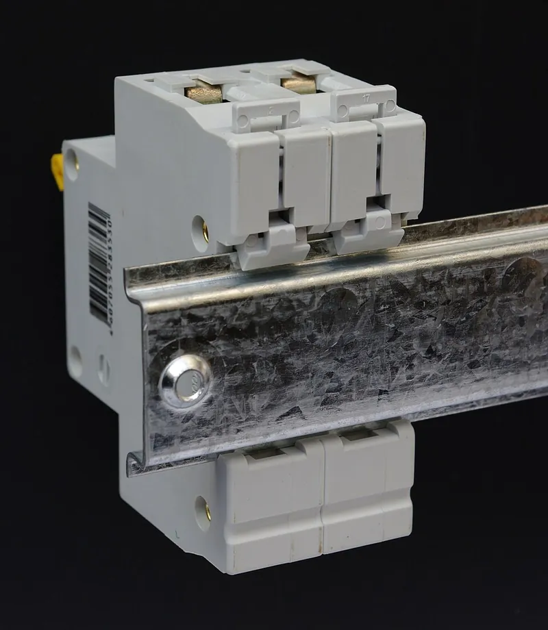

<figure class="eoc-pic eoc-pic-main"><figcaption><strong>Photo.</strong> <a href="https://commons.wikimedia.org/wiki/File:DIN_rail_rear_view.JPG">DIN rail rear view</a> by Kae, <a href="https://creativecommons.org/licenses/by-sa/3.0">CC BY-SA 3.0</a>, from Wikimedia Commons.</figcaption></figure>

A mounting foot with a fixed hook on one side and a spring-loaded latch on the other, so electrical modules and home-made boxes can be clicked onto, slid along, and unclipped from a standard 35 mm metal top-hat rail.

**In plain words:** A clip on the back of a box that hooks over the top edge of a standard metal strip and snaps onto the bottom edge, so the box clicks on and off the strip, like the switches in a fuse box. **Proper term:** DIN-rail clip (DIN-rail mounting foot or snap foot, for a top-hat rail to IEC/EN 60715).

**Also called:** DIN rail mounting clip, DIN rail mounting bracket or plate (Winford Engineering); DIN rail adapter, DIN clip, rail mount, snap foot or 'spring-loaded snap foot' (Phoenix Contact white paper); top-hat rail clip; the rail is called top-hat rail, TH35, TS35 (US), Type O or Omega (Ω) rail, NS 35 or U-rail (Wikipedia, DIN rail; Phoenix Contact white paper); Hutschiene (German for top-hat rail; the Printables and GitHub designs use it); DIN rail latch, release tab or release loop (the sliding part you pull to unclip; Wikipedia, DIN rail; Crestron); G-rail or G32 clip (for the older asymmetric rail) and C-rail (C-section) mounts are related variants (Wikipedia, DIN rail).

## How it works

The top-hat rail has two thin lips. The clip's fixed hook goes over the upper lip and carries the weight; you then swing the bottom of the clip toward the rail, the lower lip pushes a sloped spring latch aside, and the latch snaps back behind the lip so the rail is gripped on both edges (Winford Engineering; Crestron). To remove it, pull the latch down (by hand, with a pull tab, or with a small flat screwdriver in its slot) and tilt the bottom of the device away; 'lift and pivot' clips can instead be pushed up against their spring and tilted off without touching the latch (Crestron; Winford Engineering). Once on, the module can be slid along the rail, and end stops (end clamps) keep a row of modules from sliding (Aera Electrical Products).

## Parts

A few parts, or a single printed piece. Commercial clip: a moulded or steel body with a fixed hook at the top, a sliding latch (release tab) at the bottom pushed by a spring, and holes or threaded inserts for screwing it to the device (Winford Engineering). Printed clip: one piece with a flexing latch, or a [print-in-place](../glossary.md#print-in-place) slider and zigzag spring (hzeller din-rail-clip-mount). The rail itself: 35 mm wide, 1 mm thick zinc-plated steel strip bent into a top-hat shape (Wikipedia, DIN rail; IEC 60715).

## Everyday examples

- Circuit breakers in a home fuse box or consumer unit (Wikipedia, DIN rail; Wikimedia Commons photos)
- Terminal blocks, relays, power supplies and controllers in machine and control cabinets (Wikipedia, DIN rail; Phoenix Contact white paper)
- Home-automation and lighting-control modules in a wall-mounted enclosure (Crestron)
- The electronics bay of some DIY 3D printers, where boards are clipped onto a rail (Printables 592735 'DIN Rail Clip (Voron Heat Insert)', Voron (brand))

## When to use it

Use a DIN-rail clip when you want several modules or home-made boxes and boards to sit tidily in a row inside a cabinet, enclosure or printer frame, and to be added, moved or swapped later without drilling new holes (Phoenix Contact white paper). It is ideal for relays, power supplies, microcontroller boards, terminal blocks and small sensors, because the standard rail makes parts from different makers interchangeable and a printed clip lets you put almost any board on it (Wikipedia, DIN rail; hzeller). Terminal blocks are what usually go on a rail. The rail itself began in the late 1920s as a way to fit more wire connections closer together than nuts and bolts on a panel allowed: Phoenix Contact and the German power utility RWE gave each porcelain terminal block a 'spring-loaded snap foot' for a mounting rail; today 'a dizzying array of terminal block versions', plus circuit breakers, power supplies, controllers and relays, are made for the 35 mm rail (Phoenix Contact white paper). A row of screw or spring-clamp terminal blocks on a rail is a tidy way to join the wires in a printed or bought enclosure.

## When not to use it

Don't rely on it for heavy parts, parts that are pulled or levered upward, or heavy vibration and shock without end stops and a well-fixed rail; screw the part directly to the panel or use stronger steel 'latch release' clips (Winford Engineering; Phoenix Contact white paper). It is not a precise locator: use dowel pins or a kinematic mount if the part must return to exactly the same spot. Outdoors or where it must seal, use a sealed enclosure (the clip itself doesn't seal). For a hang-on wall mount with no rail, a keyhole slot or French cleat is simpler.

## Details

- **What it does (jobs):**
  - join and hold: holds a module, box or circuit board on a standard rail
  - lock, and release by hand: clicks on and unclips with a finger, pull tab or small screwdriver
- **Movement:** slide: once clipped on, a module can be pushed along the rail to position it; otherwise it doesn't move (end stops lock the row in place; Aera Electrical Products)
- **Directions it can move (degrees of freedom):** 1 while positioning (it can slide along the rail, held only by friction); 0 once end stops or neighbouring modules box it in
- **Special behaviour:**
  - quick-release (tool-free): snaps on by tilting and unclips by pulling the latch or lifting and pivoting (Winford Engineering; Crestron)
  - hand-release only (locks under load, releases when a person operates it): the fixed top hook takes the weight and the latch stays shut until someone pulls it or lifts the clip (Winford Engineering)
- **How it holds:**
  - shape (the parts interlock; [form-fit](../glossary.md#form-fit--force-fit--material-bond)): the hook and latch wrap over the rail's two lips
  - spring force (a spring or springy part presses it in place): a spring (or a flexing plastic arm) pushes the latch against the lower lip and takes up the rail's width [tolerance](../glossary.md#tolerance) (Winford Engineering; hzeller)
- **Input and output:** not applicable: it holds a part on a rail and does not pass motion on
- **Power:** passive (no power needed)
- **Load:** light to medium: the fixed hook on top bears the weight (Winford Engineering). Strong downward and against pulling straight off; weakest when the device is lifted upward (that is the release movement of lift-and-pivot clips) and against sideways twisting, which can tilt lift-and-pivot clips (Winford Engineering). Heavier modules call for sturdier rail fixing, and the rail can twist under heavy off-centre loads (Phoenix Contact white paper). IEC 60715 Annex B gives permissible rail loads against support spacing (IEC 60715 preview, contents)
- **Play and precision:** small: the rail is made to +/-0.3 mm width and +/-0.04 mm thickness (IEC 60715 preview, Fig. 2). 'Lift and pivot' clips leave a gap below the rail and can tilt under side loads; 'latch release' clips fit tighter and are more rigid (Winford Engineering). Position along the rail is not indexed, so it only repeats if butted against an end stop or a neighbouring module ⚑ [uncertain]
- **Taking it apart:** tool-free quick release: many clips unclip by hand ('lift and pivot', no screwdriver needed; Winford Engineering); others need the latch pulled with a small flat screwdriver (Crestron)
- **How often it can be reused:** many times: made to be clipped on and off repeatedly (Winford Engineering); printed clips with plastic springs may weaken over time (see environment_limits)
- **Sealing:** none
- **Adjustable:** yes: its position along the rail can be changed by sliding it (then locked with end stops; Aera Electrical Products); clamping force is not adjustable, except in printed designs by changing spring dimensions (hzeller)
- **Access needed:** one side only (blind): everything is done from the front; the rail is screwed to a panel and the latch is reached from the front at the bottom edge (Crestron)
- **Materials:** Rail: cold-rolled carbon steel, zinc-plated or chromated (Wikipedia, DIN rail); aluminium extruded rails also exist and may fit tighter (Printables 64242). Clips: fibreglass-reinforced nylon 66 (Enable-IT), nylon (Winford Engineering), steel (Winford Engineering); end stops in PA66, aluminium or zinc-coated steel (Aera Electrical Products). Printed clips: PLA, ABS and PETG all give roughly the right spring force in one design (hzeller); another is tested only in ABS/ASA and PETG (Printables 1089827)
- **Heat, cold, water and wear:** Heat: electrical cabinets get warm; a printed PLA clip starts to give at about 60 °C (CNC Kitchen) and its plastic spring can slowly relax and loosen under constant load (DuPont General Design Principles, p. 36); a commercial glass-fibre nylon 66 clip example is rated -20 to 65 °C (Enable-IT). Vibration: modules can slide along the rail unless end stops are fitted (Aera Electrical Products); heavy modules need closer rail fixing (Phoenix Contact white paper). Water and corrosion: the rail is zinc-plated or chromated steel (Wikipedia, DIN rail), so it tolerates indoor damp but is meant to live inside an enclosure ⚑ [uncertain].

## Making it

- **Ways to make or get it:**
  - off-the-shelf part: plastic or steel DIN-rail mounting clips and plates, DIN-rail enclosures, end stops
  - 3D print (FDM): one-piece clips with a flexing latch or a print-in-place spring slider (hzeller; Printables 64242, 1089827)
  - sheet metal: steel mounting clips (Winford Engineering)
  - 3D print (resin): possible for small clips, but no tested example found ⚑ [uncertain]
- **Printing it in one piece (print in place):** yes: hzeller's design prints the sliding latch and its zigzag spring in place, ready to clip on (hzeller din-rail-clip-mount), and flexing-latch clips are single parts. Some printed clips add screws or [heat-set inserts](../glossary.md#heat-set-insert) only for attaching the device (Printables 1089827, 537942)
- **Tools:** None, or a small flat-blade screwdriver to pull the latch (Crestron). A screwdriver to screw the clip to your device (Winford Engineering suggests flat-head screws) and to fix the rail to the backplate
- **Difficulty:** easy: buy clips for a few coins or print one in a single piece; one open design prints its slider and spring already assembled (hzeller din-rail-clip-mount)

### 3D printing tips

1) Orientation: print the clip lying flat on its back so the rail profile is extruded in the plane of the layers and the latch or spring bends along the layers rather than across them (in hzeller's design the spring and slider lie in the flat base plate; Prusa: prints are stronger in one direction, so orient structural parts for strength). 2) Fit: make the gap between hook and latch a little smaller than the 35 mm rail so the spring clamps (hzeller uses 35 - 0.5 = 34.5 mm) and allow for 1 mm rail thickness (IEC 60715; hzeller). 3) Print-in-place slider: hzeller uses a 0.25 mm gap; watch the first layer, because [elephant's foot](../glossary.md#elephants-foot) can weld the slider, which may need freeing after printing. 4) Spring: hzeller's printed zigzag spring is 1.2 mm thick and 2 mm high and 'depends on the filament, needs experimentation'; tune spring height and thickness for your material. 5) Release: add a screwdriver slot or pull tab on the latch, or print an unlocker tool, because the latch can be hard to reach behind a large board (Printables 95182; Printables 1089827). 6) Settings from one tested low-profile clip: 0.2 mm layers, 4 [perimeters](../glossary.md#perimeters), 4 top and bottom layers, 40% [infill](../glossary.md#infill), ABS/ASA or PETG, with M3 heat-set inserts for the device screws; its release tab has tight tolerances, so calibrate the printer (Printables 1089827). Another parametric mount suggests at least 3 walls and 35% infill (Printables 311970). 7) Material: PLA, ABS and PETG all worked in hzeller's design, but electrical cabinets get warm and PLA starts to give at about 60 °C (CNC Kitchen), so prefer PETG, ABS or ASA there. 8) Insulation: if a bare circuit board sits on the clip, hzeller offers an option with a 0.4 mm closed plastic floor between board and rail. 9) Check your rail: some designs fit only 35 x 7.5 mm rail (Printables 1089827) and aluminium rails can fit tighter (Printables 64242).

### Buying one (off-the-shelf parts)

Search for: 'DIN rail mounting clip', 'DIN rail mounting bracket' or 'DIN rail adapter plate' (plastic, nylon or steel, with through holes, countersunk holes, M3/M4 nuts or threaded inserts), 'DIN rail clip lift and pivot' or 'latch release' types (Winford Engineering); 'universal DIN rail adapter' and 'DIN rail enclosure' or 'DIN rail housing' in module widths (e.g. 1, 2, 3, 4 modules); 'DIN rail end stop', 'end clamp' or 'end bracket' (Aera Electrical Products); the rail itself as 'top hat rail 35 x 7.5', '35 x 15', 'TS35', perforated or unperforated, usually cut from 2 m lengths (Wikipedia, DIN rail; Phoenix Contact white paper); 'miniature top hat rail 15 x 5.5' (TH15); 'G32 rail' or 'C-rail' for older equipment (Wikipedia, DIN rail).

## Rules of thumb

- Standard top-hat rail: 35 mm wide (+/-0.3 mm) from 1 mm sheet (+/-0.04 mm) (IEC 60715:2017 preview, Figure 2), in two depths, 35 x 7.5 and 35 x 15 (Wikipedia, DIN rail). A miniature 15 x 5.5 mm rail and a 75 mm wide rail also exist (Wikipedia, DIN rail).
- Put the fixed (non-spring) hook on the top edge so it carries the weight, and the spring-loaded latch on the bottom edge (Winford Engineering).
- To mount: hook the top over the rail, then tilt the bottom in until it snaps; to remove: pull the release down with a small flat screwdriver and tilt the bottom away (Crestron).
- Choose 'lift and pivot' clips (more gap below the rail) for easy tool-free removal, or 'latch release' clips (tight fit) for rigidity against side loads such as stiff cables (Winford Engineering, steel DIN clips page).
- Clip width is often counted in 18 mm 'modules' (1 module = 18 mm, 4 modules = 72 mm) (Wikipedia, DIN rail, marked 'citation needed'); for example, Crestron's modules are 3 or 4 modules wide (Crestron).
- Printed clips: make the hook-to-latch distance about 0.5 mm under 35 mm for clamping (hzeller), give a print-in-place slider a 0.25 mm gap (hzeller), and start at about 0.3 mm [clearance](../glossary.md#clearance) for other moving parts (Prusa Knowledge Base).
- Use end stops (end clamps) at each end of a group of modules where there is vibration or transport, so they can't slide along the rail (Aera Electrical Products; Phoenix Contact white paper).
- Screw the rail at its ends for light terminal blocks, but fix it at shorter intervals for heavier products (Phoenix Contact white paper).
- Springs that stay loaded should be steel, not plastic, because plastic springs [creep](../glossary.md#creep) and relax (DuPont General Design Principles, p. 36); a printed spring clip is fine for light, occasionally removed parts.
- Commercial glass-fibre nylon 66 clip rating example: -20 to 65 °C (Enable-IT).

## Common failures

Clip fitted upside down, so the spring latch instead of the fixed hook carries the weight (Winford Engineering). Modules slide along the rail under vibration or when cables are pulled: fit end stops (Aera Electrical Products). Lift-and-pivot clips tilt or pop off under side loads or stiff cables: use tight 'latch release' clips (Winford Engineering). The latch can't be reached behind a large board: add a pull tab or use a release tool (Printables 95182). Wrong rail: some clips fit only 35 x 7.5 rail (Printables 1089827), and aluminium rails can be a tighter fit (Printables 64242). Printed clips: slider fused by elephant's foot (hzeller), latch snapped because it bends across the layers, or spring relaxed so the clip rattles (DuPont). If the device doesn't cover the clip, the spring and latch of some commercial clips can fall out (Winford Engineering).

## Safety

DIN rails usually live in cabinets with mains voltage: switch off and isolate before clipping modules on or off, and follow the electrical codes (Crestron). The rail is metal and may be earthed (Wikipedia, DIN rail), so bare solder joints on a board clipped to it can short; use an insulating floor (hzeller) or standoffs. Leave ventilation holes of modules unblocked (Crestron). A screwdriver used to pull the latch can slip toward live terminals ⚑ [uncertain: general caution].

## Related

- [Cantilever](../glossary.md#cantilever) snap fit: the flexing latch of a one-piece printed DIN clip is one; a DIN clip is a standard way of using it against a metal rail
- Hang-on mounts (keyhole slot, French cleat): also hook over an edge, but have no spring latch and are usually screwed to a wall
- Aluminium-extrusion connectors (T-slot nuts): slide along a rail too, but clamp with a screw, so they are stronger but need a tool
- Modular grid mounting systems (pegboard, Gridfinity-style grids): hook or clip into a grid of holes or sockets instead of a single rail
- G-rail mounting: on the older asymmetric G rail, equipment is hooked over the deep lip and rotated until it clips onto the shallow side (Wikipedia, DIN rail)
- Quick-release plate (dovetail clamp): slides into a dovetail and is clamped, for camera gear
- Magnet joint: also tool-free, but can slide off under side loads and needs a steel surface
- Screw terminal: screw terminal blocks are the commonest modules clipped onto a rail (Phoenix Contact white paper)
- Spring-clamp wire connector: spring-clamp and push-in terminal blocks also snap onto the rail; a spring, not a screw, holds the wire

## Make it yourself

- [din-rail-clip-mount (hzeller, GitHub; README and OpenSCAD file read via raw.githubusercontent.com)](https://github.com/hzeller/din-rail-clip-mount): Parametric OpenSCAD DIN-rail mount for circuit boards and relays, with a spring and slider printed in place that snap onto the rail 'with a satisfying click'; optional insulating floor; printed in PLA, ABS and PETG *(licence: CC BY-SA)*
- [OpenSCAD customizable din rail mounting clip (Mad Mechatronic, Printables) (URL from Printables API, page not opened)](https://www.printables.com/model/1145663-openscad-customizable-din-rail-mounting-clip): Fully parametric OpenSCAD clip with a choice of push, pull or double springs and many hole patterns (straight, countersunk, hex or square nut) *(licence: CC BY-SA)*
- [Din rail clip (Bryan, Printables) (URL from Printables API, page not opened)](https://www.printables.com/model/64242-din-rail-clip): A popular one-piece printable DIN-rail clip (over 9,000 downloads) with a tighter fit for aluminium extruded rails *(licence: CC0 (Public Domain))*
- [Low-profile DIN rail clip (Oseo, Printables) (URL from Printables API, page not opened)](https://www.printables.com/model/1089827-low-profile-din-rail-clip): Low-profile clip with a pull tab release and M3 heat-set inserts; tested in ABS/ASA and PETG; for 35 x 7.5 rail only *(licence: CC BY)*
- [DIN rail clip unlocker (HD_Creator, Printables) (URL from Printables API, page not opened)](https://www.printables.com/model/95182-din-rail-clip-unlocker): A small printed tool that fits the unlock groove of a printed clip to release it even when a board covers the clip *(licence: CC BY)*

## Pictures, videos and models

- [File:DIN rail rear view.JPG (Wikimedia Commons)](https://commons.wikimedia.org/wiki/File:DIN_rail_rear_view.JPG): Rear view of a 2-pole circuit breaker clipped on a DIN rail, shown upside down so the sliding latches and release loops can be seen *(licence: CC BY-SA 3.0 (Kae))*
- [File:DIN-rail-dimensions.svg (Wikimedia Commons)](https://commons.wikimedia.org/wiki/File:DIN-rail-dimensions.svg): Cross-section drawing of the 35 mm top-hat rail (EN 50022) *(licence: Public domain (Markus Kuhn))*
- [File:Din rail.jpg (Wikimedia Commons)](https://commons.wikimedia.org/wiki/File:Din_rail.jpg): A TS35 DIN rail with several electrical modules clipped on *(licence: Public domain (Ulfbastel))*
- [File:G-type-Din-rail.jpg (Wikimedia Commons)](https://commons.wikimedia.org/wiki/File:G-type-Din-rail.jpg): Cross-section of the older asymmetric G-type rail with equipment mounted on it *(licence: CC BY-SA 3.0 (d3j4vu))*
- [Removal of a terminal block from a DIN rail (James Ramsey, YouTube short)](https://www.youtube.com/watch?v=bOMrQ_mIGvM): Unclipping a terminal block from a DIN rail with a small screwdriver (per title and search listing) *(licence: link only (YouTube))*

## Needs confirming

⚑ marks something nobody has confirmed yet: a fact the research could not confirm from a source, a finder value that is a best guess, or an open point from the research notes. Corrections are welcome (see `research/needs-confirming.md`).

- ⚑ 4 sentences on this page marked [uncertain].
- ⚑ Finder value `usual_process` = off-the-shelf part (best guess): first-listed process is off-the-shelf, but `print_in_place` is yes

## Sources

- <https://en.wikipedia.org/wiki/DIN_rail>
- <https://site.ieee.org/npec-sc2/files/2017/06/SC-2Mgt08-2_Att9-WP_DIN-Rail.pdf>
- <https://www.sis.se/api/document/preview/8027750/>
- <https://www.winford.com/products/dinm15.php>
- <https://www.winford.com/products/dinm20.php>
- <https://www.winford.com/products/dinm03.php>
- <https://docs.crestron.com/en-us/9349/Content/Topics/Installation/DIN-Rail-Installation.htm>
- <https://aeraelectricalproducts.com/blog/din-rail-end-clamp>
- <https://enableit.com/product/din-rail-mounting-clip/>
- <https://raw.githubusercontent.com/hzeller/din-rail-clip-mount/master/README.md>
- <https://raw.githubusercontent.com/hzeller/din-rail-clip-mount/master/din-rail-clip-mount.scad>
- <https://help.prusa3d.com/article/modeling-with-3d-printing-in-mind_164135>
- <https://www.distrupol.com/General_Design_Principles_for_Engineering_Polymers.pdf>
- <https://www.cnckitchen.com/blog/comparing-pla-petg-amp-asa-feat-prusament>
- <https://commons.wikimedia.org/wiki/File:DIN_rail_rear_view.JPG>
- <https://commons.wikimedia.org/wiki/File:DIN-rail-dimensions.svg>
- <https://commons.wikimedia.org/wiki/File:Din_rail.jpg>
- <https://commons.wikimedia.org/wiki/File:G-type-Din-rail.jpg>
- <https://www.youtube.com/watch?v=bOMrQ_mIGvM>
- <https://api.printables.com/graphql/>
