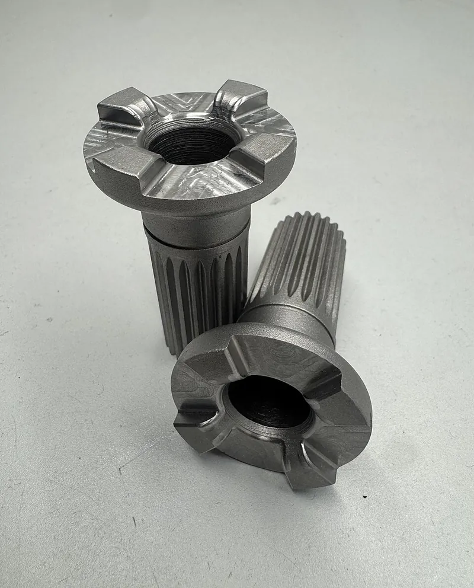

*Picture: [Claw coupling-tech diagram.png](https://commons.wikimedia.org/wiki/File:Claw_coupling-tech_diagram.png) by Jonasz at Polish Wikipedia, [CC BY-SA 3.0](http://creativecommons.org/licenses/by-sa/3.0/), from Wikimedia Commons.*

A clutch that connects and disconnects a drive by sliding a toothed ring into or out of mesh with matching teeth or slots, giving a solid, no-slip connection when engaged.

**In plain words:** Two parts with chunky teeth (lugs) on their faces: slide one along the shaft until its teeth drop into the gaps in the other and they lock and turn together; slide it back and the drive is disconnected. It never slips, but it should only be engaged when both parts are stopped or turning at nearly the same speed. **Proper term:** Dog clutch (jaw clutch, positive clutch).

**Also called:** claw clutch / claw coupling; jaw clutch; square-jaw clutch (both directions) and spiral-jaw clutch (sloping teeth, one direction); positive clutch / positive-engagement clutch (Wikipedia); dog ring, clutch dog, dog gear (Wikipedia); 'dogs' are the teeth or lugs; dog box / dog-engagement gearbox (racing gearbox that uses them without synchronisers); dog shifter / dog-shifting gearbox (FIRST Robotics (FRC) term); sliding clutch (Sturmey-Archer (brand) hub-gear term); driving ring and changeover catch (LEGO Technic (brand) terms); clutch dog (outboard motors and winch free-spool clutches); static dog clutch (industrial claw coupling engaged only at rest); Klauenkupplung (German); sprzęgło kłowe (Polish).

## How it works

One half is locked to its shaft so it must turn with it, but it can slide along the shaft; the other half (often a gear spinning freely on the same shaft) has matching teeth or slots on its face. Push the sliding half along with a fork or lever and its teeth drop into the gaps, so the two lock together by shape and turn at exactly the same speed with no slipping (Wikipedia). Pull it back and the gear spins freely again. Because the teeth can't slip, engaging while the parts turn at different speeds causes a bang (shock), so it is engaged when stopped, at low speed, or after the speeds have been matched.

## Parts

A few parts: a fixed toothed half (teeth or lugs on the face of a gear, collar or hub), a sliding toothed half (dog ring or collar) that turns with its shaft but can slide along it on a splined, hex or keyed section, a shift fork or lever riding in a groove round the sliding half, and usually a spring or [detent](../glossary.md#detent) that holds it engaged, in neutral, or disengaged.

## Everyday examples

- Motorcycle gearboxes, where dog rings lock the chosen gear to its shaft (Wikipedia; Honda CBR600RR teardown photos on Wikimedia Commons)
- The forward-neutral-reverse gear of a boat's outboard motor or inboard engine, which makes the 'clunk' you hear when it engages (Wikipedia; SeaSierra)
- A three-speed bicycle hub gear, where a cross-shaped sliding clutch selects the gear (Wikipedia; Sheldon Brown site)
- The free-spool lever on a vehicle winch, which slides a clutch dog out so the cable can be pulled off by hand (PIERCE winch parts; Garlway)

## When to use it

Use it when you want to connect or disconnect a drive, or choose between gears, and a solid, no-slip connection matters more than smooth engagement: a two-speed or multi-speed gearbox for a robot or model, forward-neutral-reverse on a small vehicle, a free-wheel or manual-override mode that disconnects a motor so a mechanism can be moved by hand, a winch or [crank](../glossary.md#crank) that can be disengaged, or a mechanism that must re-engage in exactly the same position (use a single dog). It is compact, strong for its size, simple, and doesn't wear from slipping the way friction clutches do.

## When not to use it

Avoid it when you need to engage while the parts are turning at different speeds or under load (use a friction clutch, which can slip gently while engaging, or a synchronised gearbox), when you want it to slip on overload to protect the mechanism (use a slip clutch, ball-detent [torque](../glossary.md#torque) limiter or [shear](../glossary.md#peel-vs-shear) pin), or when the drive must engage automatically (use a centrifugal clutch, or a one-way [sprag](../glossary.md#sprag) or roller clutch). Don't rely on a disengaged dog clutch to hold anything: with it out, the motor and gears no longer hold the load, so a winch drum or robot arm can run back. For a permanent, play-free joint between shafts use a coupling or a Hirth joint instead.

## Details

- **What it does (jobs):**
  - join and hold: when engaged it locks a gear to its shaft, or two shafts together, so they turn as one
  - lock, and release by hand: a lever or fork connects and disconnects the drive, e.g. a winch's free-spool lever or a boat's forward-neutral-reverse control
  - change speed or turning force: in constant-mesh gearboxes it selects which gear pair carries the drive (motorcycles, racing cars, robot two-speed gearboxes, bicycle hub gears)
- **Movement:** rotate+slide: the sliding half moves a short distance along the shaft to engage or disengage (about the tooth height plus a small gap), and once engaged the whole thing rotates continuously
- **Directions it can move (degrees of freedom):** Engaged: 0 between the two halves, apart from a little rotational play ([backlash](../glossary.md#backlash)) between the teeth. Disengaged: 1, the two halves turn independently. The sliding half also has 1 freedom along the shaft for shifting.
- **Special behaviour:**
  - quick-release: the drive can be connected or disconnected in a moment with a lever or fork, with no tools
  - one-way (spiral-jaw version only): with sloping teeth it drives in one direction and tends to ride over and [freewheel](../glossary.md#freewheel) in the other (Plant Engineering)
  - indexing (single-dog version): with only one dog it can only engage at one angle per turn, so it keeps two shafts in step, as in Gadget Builder's mini-lathe clutch that picks up a thread in the same place every time
- **How it holds:**
  - shape (the parts interlock; [form-fit](../glossary.md#form-fit--force-fit--material-bond)): the teeth interlock and turning force passes by the tooth faces pushing on each other, so there is no slipping
  - spring force (a spring or springy part presses it in place): a spring, detent or the shift [linkage](../glossary.md#linkage) keeps the sliding half engaged; square faces stay engaged with just a light spring force aided by friction (Jobst Brandt on Sturmey-Archer hubs)
- **Input and output:** Rotation in -> the same rotation out (1:1) when engaged, nothing out when disengaged; the two halves are in line on one shaft or on two in-line shafts (a gear and its shaft, or shaft to shaft). No slip, so almost no power is lost in the clutch itself ⚑ [uncertain: no efficiency figure found]. Back-drivable: yes when engaged; square jaws drive both ways, spiral jaws only one way.
- **Power:** passive (no power needed): the clutch itself is shifted by hand, by a lever, fork, cable or foot pedal. Some are shifted by a powered [actuator](../glossary.md#actuator), such as a pneumatic cylinder in FRC robot gearboxes (Chief Delphi) or an electric actuator; what happens when power is lost depends on that actuator's spring or detent (stays in its last position, or springs to one side) ⚑ [uncertain]
- **Load:** Heavy for its size in twist, because the teeth carry the load by shape rather than friction (Wikipedia; Plant Engineering notes toothed clutches are compact for their torque); industrial static claw couplings are made from 0.18 to 206 kN·m (Industrial Clutch Parts). Weak against shock: engaging at a speed difference hammers the teeth. The sliding half must be held in place along the shaft, because worn, rounded or sloping tooth faces push it out of mesh under load (Sportsterpedia; Brandt).
- **Play and precision:** Small to noticeable play: the dogs are usually narrower than the gaps they drop into, and that deliberate play (backlash) is what lets them find their gaps and engage while the parts turn at slightly different speeds (Technicopedia on the LEGO Technic driving ring; MathWorks Dog Clutch block). Precision claw couplings are made with zero backlash, but then need the shafts perfectly aligned and must be engaged at rest (Industrial Clutch Parts). Position repeats only to within one tooth: n dogs give n possible engagement angles, and a single dog gives just one. [Misalignment](../glossary.md#misalignment) [tolerance](../glossary.md#tolerance): low; the halves must be on the same axis for smooth engagement.
- **Taking it apart:** tool-free quick release: engaging and disengaging the drive needs no tools; taking the parts off their shafts needs ordinary tools
- **How often it can be reused:** effectively unlimited: it is made to be engaged and disengaged over and over, as long as it is engaged at low or matched speeds; shifting at speed or half-engaging it rounds off the tooth edges (Sportsterpedia; SeaSierra)
- **Sealing:** none: it is open between the teeth; in gearboxes and outboard motors it runs inside a sealed, oil-filled case
- **Adjustable:** no: engagement is either in or out; the shift linkage (cable, fork or lever) often needs adjusting so the teeth engage fully and don't hang on their tips (Sturmey-Archer hubs; Sportsterpedia)
- **Access needed:** end of a tube or shaft: the parts fit onto shafts (the sliding half on a splined, hex or keyed section); in use, only the shift lever, fork or cable needs to be reached
- **Materials:** Hardened steel in vehicle, boat and machine gearboxes and industrial claw couplings; plastic in LEGO Technic and toy or model gearboxes; printed PLA+, PETG or nylon in maker models and light robot drives (e.g. Bootjevaarder's printed gearboxes in PLA+).
- **Heat, cold, water and wear:** Metal clutches run best lubricated (in oil in gearboxes and outboard lower units); dirt and wear round off the teeth. Vibration and flexing can walk the halves out of mesh if the teeth are worn or slightly skewed, as Jobst Brandt found with shaft [deflection](../glossary.md#deflection) in Sturmey-Archer hubs, so good tooth shape and a detent matter. Printed parts: PLA softens above about 60 °C and breaks into shards on impact, PETG handles up to about 80 °C and is tougher (Prusa); plastic teeth wear and deform faster than steel. No particular water, UV or cold limits beyond those of the material.

## Making it

- **Ways to make or get it:**
  - 3D print (FDM): common in model gearboxes, jaw-clutch demonstrators and light robot drives
  - 3D print (resin): ⚑ [uncertain] possible for small models; standard resins may chip under engagement shock
  - CNC: milled or machined steel dogs for strong clutches
  - off-the-shelf part: jaw clutches, claw couplings, gearbox dog rings, outboard and winch clutch dogs, LEGO Technic driving rings, FRC dog-shifting gearboxes
- **Printing it in one piece (print in place):** no: the sliding half and the toothed half must be free to slide apart, so they are printed separately and assembled on a shaft
- **Tools:** None to operate. To assemble: hex keys or spanners, [circlip](../glossary.md#circlip) pliers for retaining rings, and a way to make the non-round shaft section (hex or splined shaft, or a key and keyway) the sliding half runs on.
- **Difficulty:** moderate: the toothed parts are easy to print or machine, but you also need a sliding fit on a non-round shaft, a fork or lever, a detent to hold positions, and good alignment, and you must only shift it when nearly stopped

### 3D printing tips

1) Print each toothed part with its teeth facing up, so the tooth faces are straight vertical walls and the base is flat and strong ⚑ [uncertain: reasoning, not a tested rule]. 2) Make the driving faces square or very slightly [undercut](../glossary.md#undercut) (tapered so the teeth pull deeper into mesh under load); sloping or rounded driving faces push the halves apart, which is how worn motorcycle and bicycle-hub clutches jump out of gear (Brandt; HP Academy; Sportsterpedia). A small [chamfer](../glossary.md#chamfer--fillet) on the tooth tips helps them find each other, but keep it small: a modelling study found bigger chamfers made successful engagement less likely (Aljawabrah and Lovas 2023). 3) Use few, chunky dogs with gaps wider than the dogs (LEGO's driving ring uses four tapered dogs with generous play so it can engage while turning, per Technicopedia); plastic teeth need to be big to survive engagement shock ⚑ [uncertain]. 4) Sliding fit: run the sliding half on a hex or keyed metal shaft with about 0.5 mm [clearance](../glossary.md#clearance) for FDM (Hubs); VGallo217 notes some sanding may be needed so a keyed coupling slides freely. Print on a smooth plate and avoid '[elephant's foot](../glossary.md#elephants-foot)' (a squashed, wider first layer), which stops sliding parts moving (Bootjevaarder). 5) Hold positions: add a spring or ball detent, or a spring-loaded fork, so the ring stays engaged or in neutral; always design a neutral between two gears so both can never be locked at once (Chief Delphi). 6) Support the shafts well (VGallo217's printed jaw clutch uses five 608 bearings) so the halves stay on the same axis. 7) Material: PETG or nylon is tougher than PLA, which breaks into shards on impact and softens above about 60 °C (Prusa). 8) Only shift when stopped or turning slowly; printed teeth chip quickly if engaged at speed.

### Buying one (off-the-shelf parts)

Search for: 'jaw clutch' ('square jaw clutch', 'spiral jaw clutch'), 'claw coupling' or 'static dog clutch' (Industrial Clutch Parts (brand)), 'multiple-tooth clutch', 'dog ring' and 'dog gear' (gearbox parts), 'clutch dog' (outboard motor and winch spares, e.g. PIERCE (brand) winch clutch dog), 'sliding clutch' (Sturmey-Archer (brand) hub spares), LEGO Technic (brand) 'driving ring' and 'changeover catch', FRC 'dog shifting gearbox' (AndyMark (brand) and others). Supporting parts: 'hex shaft', '[spline](../glossary.md#spline) shaft', 'shift fork', 'ball detent' or 'spring plunger', retaining (circlip) rings, 608 bearings, pneumatic cylinders or servos for remote shifting.

## Rules of thumb

- Maximum speed difference for engaging while running: about 10 rpm for square-jaw clutches, up to 150 rpm for spiral-jaw clutches (which only drive one way and tend to freewheel the other), and up to 400 rpm for multiple-tooth clutches (Foszcz, 'Selection factors for clutches & brakes', Plant Engineering 1999).
- Industrial static claw couplings are for occasional engagement with the shafts stopped, and the shafts must be accurately aligned for smooth engagement (Industrial Clutch Parts).
- Always provide a neutral position between two gears so both can never be locked at once, which would jam and break the gearbox (Chief Delphi, 'Help me understand dog shifting').
- Cut the driving faces square or with a slight back-taper (undercut) so torque pulls the dogs into mesh; a slight flare and matching slant would have stopped Sturmey-Archer hub clutches slipping out under load (Jobst Brandt, sheldonbrown.com; HP Academy on back-cut dogs).
- Rounded dog corners reduce contact and the undercut's effect, letting gears hop out of mesh; worn dogs must be replaced (Sportsterpedia, 'Gear Dog Damage').
- Gaps wider than the dogs (backlash) let the clutch engage while the halves turn at slightly different speeds (Technicopedia on the LEGO Technic driving ring; MathWorks Dog Clutch block).
- A dog clutch under load can't be pulled out: the torque must be reduced briefly (throttle lift or ignition cut in racing gearboxes) so the dogs can slide apart (HP Academy).
- A single dog engages at only one angle per turn, which keeps two shafts in step (Gadget Builder mini-lathe dog clutch).
- Shift outboard motor clutch dogs only at idle; shifting at higher rpm grinds and rounds the teeth (SeaSierra).
- In a modelling study of face dog clutches, larger tooth chamfer angles reduced the chance of a successful shift (Aljawabrah and Lovas, Design of Machines and Structures, 2023).

## Common failures

1) Rounded tooth corners from shifting at speed, slow or half-hearted shifting, or engaging with the throttle on, which then lets the clutch jump out of engagement under load (Sportsterpedia; SeaSierra): shift promptly, only at low or matched speed, and replace worn dogs. 2) Grinding or clashing when engaging at too high a speed (SeaSierra; Plant Engineering limits of 10 rpm for square jaws). 3) Teeth only half engaged, hanging on their tips, because the shift linkage is out of adjustment or a shift fork is worn or bent (Sportsterpedia; Sturmey-Archer hubs): adjust so it engages fully. 4) Slipping out under high torque because the tooth faces or pins are worn to a slant, skewed or deflected (Jobst Brandt): use square or undercut faces, stiff shafts and a detent. 5) Both gears engaged at once when there is no neutral, jamming the drive (Chief Delphi). 6) Won't engage because the shafts are misaligned (Industrial Clutch Parts) or, in printed parts, because the sliding half sticks from elephant's foot or a tight fit (Bootjevaarder; VGallo217). 7) Printed teeth shearing off along [layer lines](../glossary.md#layer-lines) under shock ⚑ [uncertain].

## Safety

Engaging a dog clutch connects the drive instantly, so machinery can start moving without warning; keep hands away from gears and moving parts when shifting. Disengaging it removes the braking effect of the gears: never use a winch's free-spool clutch to lower a load, because the drum can run away (Garlway). Engaging at a speed difference can break teeth and shafts ⚑ [uncertain: flying fragments possible]. Fingers can be pinched between the teeth when shifting by hand ⚑ [uncertain].

## Related

- Friction clutch (plate or cone clutch): can engage gently at any speed and slips on overload, but can slip under heavy load and wears; a dog clutch never slips
- Synchromesh (synchroniser): a small friction cone matches the speeds first so the dog teeth can then engage quietly; used in road-car gearboxes (Wikipedia)
- Spiral-jaw clutch: a dog clutch with sloping teeth that engages at higher speed but drives in one direction only (Plant Engineering)
- Jaw coupling (spider coupling): claw-shaped hubs that stay permanently meshed through a rubber spider; for joining shafts, not for switching drive on and off
- Hirth joint: many fine [radial](../glossary.md#axial--radial) teeth clamped by a screw, giving a play-free fixed joint or indexing; a dog clutch has fewer, chunkier teeth with gaps and play
- Face [ratchet](../glossary.md#ratchet) (star ratchet): sawtooth face teeth held by a spring, so it drives one way and clicks over the other
- Ball-detent torque limiter and slip clutch: deliberately let go when overloaded, which a dog clutch never does
- Sprag clutch and roller clutch (one-way bearing): engage and disengage automatically depending on direction
- Centrifugal clutch: engages automatically as speed rises
- Spline shaft (sliding spline) and hex shaft: the shaft the sliding half of a dog clutch runs on
- Half nut (split nut): another positive, lever-operated engagement, used to connect a lathe carriage to its leadscrew

## Make it yourself

- [Working Jaw Clutch (VGallo217, Printables)](https://www.printables.com/model/177943-working-jaw-clutch): Mostly 3D-printed working jaw clutch demonstrator on a baseplate, with five press-fit 608 bearings and a keyed sliding coupling (details read via the Printables API) *(licence: Creative Commons Public Domain (as listed on Printables))*
- [Constant Mesh Two Speed Gearbox (Bootjevaarder, Printables)](https://printables.com/model/144943-constant-mesh-two-speed-gearbox): Printable two-speed-plus-neutral gearbox model with a sliding dog clutch on the main shaft, worked by a selector fork; printed in PLA+ at 0.15 mm layers (details read via the Printables API) *(licence: CC BY-NC-ND)*
- [4 Speed "Constant Mesh" Manual Transmission. 100% 3D Printed! (MW-Mechanical, Printables)](https://www.printables.com/model/407245-4-speed-constant-mesh-manual-transmission-100-3d-p): Fully printed four-speed gearbox in which a ball-joint selector moves racks that engage dog clutch discs with the chosen gear (details read via the Printables API) *(licence: CC BY-NC)*
- [Manual transmission - 6 speed (Dmitrii Tomin, Printables) (URL from Printables API, page not opened)](https://www.printables.com/model/928009-manual-transmission-6-speed): Educational printed six-speed gearbox with dog-tooth parts, blocking rings and synchronisers, shift forks and a motor drive, with a PDF assembly guide *(licence: CC BY-SA)*

## Pictures, videos and models

- [Claw coupling-tech diagram.png (Wikimedia Commons, by Jonasz)](https://commons.wikimedia.org/wiki/File:Claw_coupling-tech_diagram.png): Simple technical diagram of a claw (dog) clutch with interlocking claws *(licence: CC BY-SA 3.0 or GFDL 1.2 or later)*
- [Dog Clutch.jpg (Wikimedia Commons, by Ael150)](https://commons.wikimedia.org/wiki/File:Dog_Clutch.jpg): Photo of a dog clutch used to engage and disengage four-wheel drive on a Baja SAE student car *(licence: CC0 1.0 (public domain dedication))*
- [Honda CBR600RR teardown 2015-10-19 13.44.17.jpg (Wikimedia Commons, by Spheroidite)](https://commons.wikimedia.org/wiki/File:Honda_CBR600RR_teardown_2015-10-19_13.44.17.jpg): Motorcycle gearbox gears with their face dogs, from an engine teardown (used in Wikipedia's 'Dog clutch' article to show a disengaged dog clutch) *(licence: CC BY-SA 4.0)*
- [Square Jaw Clutch Operation Animation | Claw Clutch | Solidworks (Solidworks Fun, YouTube)](https://www.youtube.com/watch?v=Jkyb5NiFdPY): CAD animation of a square-jaw clutch sliding into and out of engagement *(licence: link only (standard YouTube licence))*
- [Dog Clutch || Claw clutch (Gear Institute Mechanical Engineering Videos, YouTube)](https://www.youtube.com/watch?v=6LlQX-yoFzk): Explainer video on how a dog (claw) clutch engages and disengages *(licence: link only (standard YouTube licence))*

## Needs confirming

⚑ marks something nobody has confirmed yet: a fact the research could not confirm from a source, a finder value that is a best guess, or an open point from the research notes. Corrections are welcome (see `research/needs-confirming.md`).

- ⚑ 8 sentences on this page marked [uncertain].

## Sources

- <https://en.wikipedia.org/wiki/Dog_clutch>
- <https://en.wikipedia.org/wiki/Clutch>
- <https://commons.wikimedia.org/wiki/Category:Dog_clutches>
- <https://commons.wikimedia.org/wiki/File:Claw_coupling-tech_diagram.png>
- <https://commons.wikimedia.org/wiki/File:Dog_Clutch.jpg>
- <https://commons.wikimedia.org/wiki/File:Honda_CBR600RR_teardown_2015-10-19_13.44.17.jpg>
- <https://www.plantengineering.com/selection-factors-for-clutches-brakes/>
- <https://roymech.org/Useful_Tables/Drive/Clutches.html>
- <https://www.industrialclutch.com/icp-dog-clutch-mechanical-coupling.html>
- <https://www.mathworks.com/help/sdl/ref/dogclutch.html>
- <https://www.hpacademy.com/blog/tech-nugget-how-a-dog-engagement-gearbox-works/>
- <https://www.hpacademy.com/blog/clutchless-shifting-dog-engagement-gearboxes-tech-nugget/>
- <https://sportsterpedia.com/techtalk:ref:svcproc11l>
- <https://www.sheldonbrown.com/brandt/sturmey-archer.html>
- <https://www.technicopedia.com/fundamentals.html>
- <https://gadgetbuilder.com/Dog_Clutch.html>
- <https://www.chiefdelphi.com/t/help-me-understand-dog-shifting/65964>
- <https://seasierra.com/blogs/outboard-101/outboard-shifting-problems-hard-to-shift-or-wont-engage>
- <https://www.piercearrowinc.com/products/clutch-dog>
- <https://garlway.com/faqs/how-does-a-winch-free-spool-work>
- <https://ojs.uni-miskolc.hu/index.php/dms/article/view/3247>
- <https://www.youtube.com/watch?v=Jkyb5NiFdPY>
- <https://www.youtube.com/watch?v=6LlQX-yoFzk>
- <https://api.printables.com/graphql/>
- <https://www.printables.com/model/177943-working-jaw-clutch>
- <https://printables.com/model/144943-constant-mesh-two-speed-gearbox>
- <https://www.printables.com/model/407245-4-speed-constant-mesh-manual-transmission-100-3d-p>
- <https://www.hubs.com/knowledge-base/how-design-interlocking-joints-fastening-3d-printed-parts/>
- <https://help.prusa3d.com/article/pla_2062>
- <https://help.prusa3d.com/article/petg_2059>
