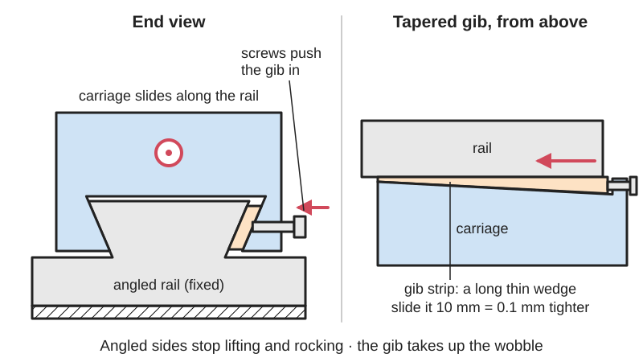

<figure class="eoc-pic eoc-pic-main"><picture><source media="(prefers-reduced-motion: reduce)" srcset="../media/drawn/dovetail-slide-with-gib-strip.svg"></picture><figcaption><strong>Animation.</strong> Diagram drawn for the encyclopaedia from the research notes. ⚑ Needs confirming: a drawing can simplify or get details wrong; a real photo or a better diagram is welcome.</figcaption></figure>

A carriage with angled (dovetail) edges slides along a matching angled track that stops it lifting off or rocking, and a thin strip (the gib), pushed in by screws or slid along as a wedge, takes up the play so it slides snugly without wobble and can be re-tightened as it wears.

**In plain words:** A sliding table whose edges are cut at a slant so it hooks under a matching slanted track and can only slide one way, with a thin adjustable strip squeezed in along one side to take out any wobble. **Proper term:** Dovetail slide with gib (dovetail ways and gib strip).

**Also called:** dovetail slide; dovetail ways / dovetail slideway / dovetail guide; gib strip / gib (the adjustable strip); tapered gib / [taper](../glossary.md#taper) gib (a long thin wedge slid lengthwise); straight gib / parallel gib / flat gib (pushed in by [set screws](../glossary.md#set-screw)); gibless dovetail (small slides that rely on a close fit and a locking grub screw); cross slide / compound slide / saddle (on a lathe); dovetail stage / dovetail translation stage (optics and lab positioning); cross-slide vise / X-Y compound vise (drill press); Schwalbenschwanzfuehrung (German, 'swallow-tail guide').

## How it works

The sliding part has a groove with sloping sides that wraps around a matching slanted rail, so it can slide along the rail but cannot lift off, rock or move sideways (dovetail ways constrain both cross directions and stop the carriage lifting, unlike flat or V ways). The groove is made slightly wider than the rail and the gap on one side is filled by a gib strip. With a straight (parallel) gib, set screws along the side push the strip against the rail; with a tapered gib, the strip is a long thin wedge that an end screw slides lengthwise, so on a 1-in-100 taper moving it 10 mm changes the fit by only about 0.1 mm. Tightening removes the play; the gib is then locked, and it can be re-adjusted as the sliding surfaces wear.

## Parts

A few parts: the base with the dovetail track (the ways), the sliding part (saddle or carriage), the gib strip, and either several gib screws with lock nuts (straight gib) or one adjusting screw and a lock (tapered gib). Usually also a lead screw and nut to drive it, and sometimes a lock screw to clamp it in place.

## Everyday examples

- The cross slide and compound slide on a metal lathe: turning the handles moves the tool on dovetails that have gib screws along one side
- A drill-press cross-slide (X-Y) vise, whose two dovetail slides have small gib screws to remove slop
- The table and column of a small milling machine or hobby lathe (Sherline machines use tapered plastic gibs on every dovetailed axis)
- Dovetail rails that mount telescopes and rifle scopes (the same shape used as a clamp mount, without a gib)

## When to use it

Use it when you need a stiff, strong, straight slide that can be tightened up as it wears: machine tool tables and tool slides, positioning stages, jigs and fixtures, camera, microscope and lab focusing stages, and slides that take shocks or vibration that would damage ball bearings. It suits hand-adjusted or slow screw-driven moves, long travels at low cost, and dusty workshops, since it has few parts to clog. For makers, a printed dovetail stage with a screw-pushed gib is a practical home-made X, XY or Z positioning stage.

## When not to use it

Avoid it for fast, frequent or very low-friction motion: sliding friction is higher than ball or roller guides and, without the right oil, it can stick then jump ([stick-slip](../glossary.md#stick-slip)); use a linear ball rail, linear bearings on round rods or V-wheels on extrusion instead. Avoid it where you can't lubricate or re-adjust it. For a tiny travel with no friction or play at all, use a [flexure](../glossary.md#flexure) stage. For attaching and removing something quickly rather than sliding it, use a dovetail clamp (quick-release plate) instead.

## Details

- **What it does (jobs):**
  - let it move (turn, slide or bend): guides a straight-line sliding motion
  - line parts up exactly: keeps the carriage square to the track, with the play adjusted out by the gib
  - lock, and release by hand: small dovetails can be locked with a grub screw, and tightening the gib (or a separate lock screw) clamps the slide
- **Movement:** slide: straight-line travel only, limited by the length of the ways (e.g. 50 mm on the_buff's printed 80 x 80 mm stage)
- **Directions it can move (degrees of freedom):** 1: the carriage can only slide along the track; the dovetail blocks sideways movement, lifting and rocking
- **Special behaviour:**
  - none: it is a plain sliding guide with no clever behaviour of its own
  - tensioning (takes up slack and holds), loosely: the gib is an adjustable take-up that removes play and can be re-set as the surfaces wear
- **How it holds:**
  - shape ([form-fit](../glossary.md#form-fit--force-fit--material-bond)): the slanted sides interlock, so the carriage can't lift or move sideways
  - friction or clamping (force-fit): the gib presses the sliding surfaces together; tightened hard, or with a lock screw, it clamps the slide in place
  - not a holding joint along the track: along the sliding direction it lets the carriage move freely unless locked
- **Input and output:** not applicable: it guides motion but does not convert or pass it on (a separate lead screw, rack or hand push moves the carriage)
- **Power:** passive (no power needed): the slide itself has no powered parts; it is pushed by hand or by a separate screw drive
- **Load:** Heavy for its size: full surface contact gives higher [stiffness](../glossary.md#stiffness) and load capacity than similar-sized ball or roller guides, and it soaks up shocks and vibration that would damage rolling bearings (linearmotiontips). It takes loads from several directions, but downward loads better than upward (lifting) loads. Friction is higher than rolling guides, so it is not for fast motion.
- **Play and precision:** Play: small to none once the gib is set; on a hobby lathe cross slide the target is under about 0.001 in (0.025 mm) of sideways shake measured with a dial indicator (Hobby-Machinist forum). Positioning [repeatability](../glossary.md#repeatability--accuracy) depends mostly on the drive screw. [Misalignment](../glossary.md#misalignment): tolerates almost none; the ways must be straight and parallel. A slide that is loose in one place and binds in another has worn ways (Sherline), and one that is tighter in one direction has a tapered (worn) dovetail (Hobby-Machinist forum).
- **Taking it apart:** removable: once the drive screw and gib are taken out, the carriage slides off the end of the ways
- **How often it can be reused:** many times: it can be dismantled for cleaning and refitted repeatedly; the gib is a wear part that is re-adjusted, shimmed or replaced (Sherline)
- **Sealing:** none: the sliding surfaces are open; felt wipers are sometimes fitted to keep the oil in (Wikipedia 'Way (machine tool element)')
- **Adjustable:** yes: the gib screws (straight gib) or the lengthwise position of a wedge-shaped gib (tapered gib) set the running [clearance](../glossary.md#clearance); a 1-in-100 tapered gib gives fine control (10 mm of gib travel = about 0.1 mm change in fit, john f's workshop). A worn tapered gib that has gone in as far as it can be built up with one or two layers of Mylar tape on its back (Sherline).
- **Access needed:** end of a tube or shaft: the carriage has to be slid on from an open end of the track (a dovetail in the middle of a surface needs an extra entry slot, as BOSL2's dovetail module notes); the gib screws are then reached from one side only
- **Materials:** Machine slides: close-grained cast iron normalised to limit distortion, also hard-coat aluminium, stainless steel or acetal (Wikipedia 'Linear-motion bearing'; linearmotiontips). Gibs: ground low-carbon steel, cast iron or brass, or a moulded self-lubricating composite (Sherline's tapered plastic gibs). Sliding faces may carry bonded low-friction plastic liners such as Turcite or Rulon (brands) as sacrificial wear surfaces. Printed versions: PETG body (the_buff) with steel screws pushing the gib.
- **Heat, cold, water and wear:** Needs a film of oil to slide smoothly and resist wear; old oil collects grit and 'crud' that makes it stiff (Model Engineer forum), so clean and re-oil. Dovetail slides are largely immune to chemicals, dust and dirt compared with rolling-element guides (Wikipedia 'Linear-motion bearing'). Printed versions: PLA softens above about 60 C and PETG is fine up to about 80 C (Prusa). ⚑ [uncertain] Bare cast iron and steel ways rust if left dry, and printed plastic parts may [creep](../glossary.md#creep) under constant gib-screw pressure, so the gib may need re-tightening over time.

## Making it

- **Ways to make or get it:**
  - off-the-shelf part: dovetail slides, lead-screw positioning slides and dovetail stages
  - CNC / machining: milled with a dovetail cutter, then ground or hand-scraped
  - 3D print (FDM): printed linear stages and slides with metal gib screws in tapped holes
- **Printing it in one piece (print in place):** no: the base, carriage and gib are printed as separate parts, slid together, and the gib screws are then fitted into tapped holes (as in the_buff's linear stage)
- **Tools:** Screwdriver or hex keys for the gib screws and a small spanner for their lock nuts; an oil can. Making a metal one needs a milling machine with a dovetail cutter plus files or a scraper for fitting. The printed stage by the_buff needs M6 and M3 taps and hex keys for M3 screws.
- **Difficulty:** moderate to print: the dovetail itself prints easily, but printed surfaces are rough, so it needs a gib, tapped holes, grease and some tuning to slide smoothly without play; hard in metal (needs a milling machine, a dovetail cutter and careful fitting or scraping), so buy a ready-made slide when precision matters

### 3D printing tips

1) Follow a proven printed stage: the_buff's 80 x 80 mm dovetail stage (50 mm travel) prints in PETG at 0.2 mm layers, 4 [perimeters](../glossary.md#perimeters), 6 top and 4 bottom layers, 20% gyroid [infill](../glossary.md#infill) and no supports; its holes are printed undersize for tapping (5 mm for M6, 2.5 mm for M3) and three M3 x 14 mm socket screws press on the gib (the author cut the gib screws from four to three). 2) Lay the base and carriage flat with the dovetail running along the bed so the slanted faces are gentle [overhangs](../glossary.md#overhang--bridging); Prusa says 45-60 degree overhangs print cleanly, and a 60 degree dovetail (the usual angle for small slides, john f's workshop) leans only 30 degrees from vertical. 3) Clearance: give moving parts at least 0.3 mm to start with (Prusa); BOSL2's dovetail() adds a $slop clearance on all three faces of the female part. Err on the loose side, because the gib takes up the rest. 4) Make the gib a separate strip that fills the gap on one side; give each screw a flat or a dimple to push on so the screw point doesn't dig in and the strip can't creep along (john f's workshop recommends milling a flat at right angles to each screw; the Model Engineer forum recommends ball- or cone-ended screws and one or two locating dowels). A strip of acetal or steel is smoother and stiffer than a printed one. 5) Printed surfaces are rough: a remix of the_buff's stage recommends thick silicone grease on the slide and screw to make it much smoother (Hungry_Hank's remix, Printables model 886997, read through the Printables API). 6) Thin printed features break: the_buff had to redesign a front screw clip that was too thin, and Hungry_Hank found the original parts broke easily in PLA and thickened them; PETG or glass-filled nylon hold up better. 7) [Chamfer](../glossary.md#chamfer--fillet) the edges of parts that slot together to make assembly easier (Prusa). 8) Keep printed slides away from heat: PLA softens above about 60 C and PETG is fine below about 80 C (Prusa). 9) BOSL2's dovetail() can also taper the dovetail (taper= or back_width=) so it slides freely until nearly home and then wedges tight, which is useful for a clamp-type dovetail rather than a running slide.

### Buying one (off-the-shelf parts)

Dovetail slides (manual, lead-screw 'positioning slides' and cylinder-powered versions, e.g. Gilman (brand)); dovetail translation stages with micrometer or lead-screw drive for optics and lab work; drill press cross-slide (X-Y compound) vises; lathe cross slides and compound rests; replacement gib strips (e.g. Sherline P/N 4098 and 4099 moulded composite gibs (brand)); gib screws (set screws with ball, cone or dog points) and lock nuts; dovetail cutters (45 and 60 degree) for milling your own; slideway (way) oil such as Mobil Vactra No. 2 (brand); bonded low-friction way liners such as Turcite and Rulon (brands).

## Rules of thumb

- Dovetail angle: usually 45 degrees on large industrial machines and 60 degrees on smaller dovetails; angles below 60 degrees make the adjusting parts hard to fit on small slides (john f's workshop, 'points applying to most types of dovetail').
- Tapered gib: with a taper of about 1 in 100, moving the gib 10 mm changes the fit by about 0.1 mm and moving it 1 mm changes it by 0.01 mm; both tapered faces must match exactly and the gib must touch evenly all along (john f's workshop, 'tapered gib').
- Tapered gibs bear on both surfaces over their full length, giving even pressure; straight gibs pushed by set screws press only at the screw points and wear unevenly, which is why better machines use tapered gibs (Hobby-Machinist forum, 'Tapered Gibs').
- Adjust in tiny steps ('1/16 is a tremendous turn on a gib'): with the drive screw removed and the ways oiled, the slide should move by hand with little shake, ideally under about 0.001 in of sideways movement on a dial indicator at each end (Hobby-Machinist forum, 'Gibb adjustments').
- If a new straight gib won't bed in, bow it slightly (0.5-1.0 mm over 300 mm) so it touches the middle of the dovetail first, then adjust the screws from the middle outwards (Model Engineer & Workshop forum, 'Gib strips').
- Oil sliding ways, don't grease them (john f's workshop; linearmotiontips specifies a slideway oil such as Mobil Vactra No. 2 and forbids grease). Exception: tiny microscope dovetails use thick grease on purpose to add friction (john f's workshop).
- Halve a manual slide's published dynamic load rating unless low-friction bearing material is bonded to the saddle and gib; that material cuts friction by about two-thirds and, because its static and moving friction are similar, reduces stick-slip (linearmotiontips, 'How to pick dovetail slides').
- A dovetail slide cannot be preloaded like a ball rail, but its clearance can be adjusted after assembly with the gib (linearmotiontips, 'benefits of dovetail slides').
- For printed moving parts, start with at least 0.3 mm clearance (Prusa 'Modeling with 3D printing in mind') and let the gib take up the rest.

## Common failures

1) Wear makes the slide sloppy: re-adjust the gib; a tapered gib at the end of its travel can be shimmed with Mylar tape (Sherline). 2) Loose in the middle but tight at the ends: the ways are worn where most use happens and need scraping or re-machining, not just a tighter gib (Sherline; Hobby-Machinist forum). 3) A straight gib pressing only at the screw points, flexing and wearing unevenly, or creeping along the dovetail: use ball- or cone-ended screws in matching dimples or flats, dowel the strip, or change to a tapered gib (Model Engineer forum; john f's workshop; Hobby-Machinist forum). 4) Stiff or jerky motion (stick-slip) from dirt or the wrong lubricant: clean it and use way oil, not grease (Model Engineer forum; linearmotiontips). 5) Over-tightening binds the slide: adjust in tiny increments (Hobby-Machinist forum). 6) Printed slides: rough faces bind and thin parts crack; add grease, print in PETG and thicken weak features (Hungry_Hank; the_buff).

## Safety

On machine tools the slide carries a cutting tool or workpiece next to spinning parts, so adjust gibs with the machine stopped. Sherline warns not to remove a gib-lock screw completely, because its damaged end thread can ruin the thread in the saddle. ⚑ [uncertain] Over-tightened gib screws can strip threads, especially in printed parts, and a screw-driven carriage can pinch fingers. Otherwise none known.

## Related

- Linear ball-bearing rail (profile rail and carriage): much lower friction and faster, but less tolerant of shocks and dearer
- Box ways (square ways): heavier and stiffer, used on large machines; clearance can't be adjusted after assembly the way a gib allows (linearmotiontips)
- V-ways and flat ways (lathe beds): V-ways guide sideways but, unlike a dovetail, don't stop the carriage lifting (Wikipedia 'Way')
- Linear bearings on round rods: cheap and easy to design printed parts around, but less stiff
- Parallel leaf-spring flexure (linear flexure stage): no friction or play at all, but only a short travel
- Quick-release plate (camera plate, dovetail clamp): the same dovetail shape used as a clamp-on mount rather than a running slide
- Split-part joints for large prints (dovetail keys): a dovetail used to join parts for good rather than to slide
- Lead screw and nut: the usual drive that moves a dovetail slide

## Make it yourself

- [Linear Stage: Updated (the_buff, Printables) (page returned 403; details read through the Printables API)](https://www.printables.com/model/453719-linear-stage-updated): Printable 80 x 80 mm single-axis dovetail stage with 50 mm travel and a gib pressed by three M3 screws; stacks into an XY stage; PETG print settings included *(licence: Creative Commons Attribution (CC BY))*
- [BOSL2 joiners.scad: dovetail() module (OpenSCAD library source)](https://raw.githubusercontent.com/BelfrySCAD/BOSL2/master/joiners.scad): Parametric male and female dovetails with adjustable angle, optional taper, chamfers, an entry slot and a $slop clearance setting for 3D printing *(licence: BSD 2-Clause)*
- [Dovetail Stepper Slide by 3DPRINTINGWORLD (Thingiverse) (page is JavaScript-only; details from search results)](https://www.thingiverse.com/thing:2805780): Direct-drive printed dovetail slide for a stepper motor, with a gib added to the dovetail way to adjust the clearance and reduce backlash *(licence: ⚑ [uncertain] not visible)*
- [DOVETAIL SLIDE (JOBIN JOY, Printables) (URL from Printables API, page not opened)](https://www.printables.com/model/913209-dovetail-slide): Simple printable male and female dovetail slide demonstrator *(licence: Creative Commons Public Domain)*
- [Making dovetails - the first type - parallel gib (john f's workshop)](https://johnfsworkshop.org/milling-machine-how-to-make/milling-machine-how-to-make-dovetails-links/making-dovetails-the-first-type-parallel-gib/): Illustrated how-to for machining a metal dovetail slide with a screw-adjusted parallel gib and lock nuts *(licence: link only)*

## Pictures, videos and models

- [Schwalbenschwanz2.jpg (Wikimedia Commons, by Kolossos)](https://commons.wikimedia.org/wiki/File:Schwalbenschwanz2.jpg): Photo of a machine-tool dovetail slide (Schwalbenschwanzfuehrung) in the Saxon Industrial Museum, Chemnitz *(licence: Choice of GFDL 1.2+, CC BY-SA 3.0 or CC BY-SA 2.0)*
- [Category:Dovetail slides (Wikimedia Commons)](https://commons.wikimedia.org/wiki/Category:Dovetail_slides): 16 files: photos of dovetail slides and rails, animated GIFs of a planing machine on slideways, and a linear table rail-guide animation *(licence: Per file (Commons free licences))*
- [Making dovetails - type 3 - tapered gib - side to side (john f's workshop)](https://johnfsworkshop.org/milling-machine-how-to-make/milling-machine-how-to-make-dovetails-links/making-dovetails-type-3-tapered-gib-side-to-side/): Step-by-step workshop photos of milling a dovetail slide and fitting a tapered gib with its adjusting screw *(licence: link only)*
- [Scraping a Tapered Gib to a Lathe Cross Slide: Monarch Lathe Restoration - Part 22 (Keith Rucker - VintageMachinery.org, YouTube)](https://www.youtube.com/watch?v=nT5O1szEG9k): Video of a tapered gib being fitted and scraped to a lathe cross-slide dovetail *(licence: link only)*
- [Gib Installation (Sherline Products, YouTube)](https://www.youtube.com/watch?v=FkoxaUCpvn8): Video of installing and setting a tapered plastic gib in a small lathe or mill dovetail *(licence: link only)*

## Needs confirming

⚑ marks something nobody has confirmed yet: a fact the research could not confirm from a source, a finder value that is a best guess, or an open point from the research notes. Corrections are welcome (see `research/needs-confirming.md`).

- ⚑ 3 sentences on this page marked [uncertain].

## Sources

- <https://en.wikipedia.org/wiki/Way_(machine_tool_element)>
- <https://en.wikipedia.org/wiki/Linear-motion_bearing>
- <https://en.wikipedia.org/wiki/Dovetail_joint>
- <https://commons.wikimedia.org/wiki/Category:Dovetail_slides>
- <https://commons.wikimedia.org/wiki/File:Schwalbenschwanz2.jpg>
- <https://commons.wikimedia.org/wiki/File:Dovetail-MTO11CA.jpg>
- <https://www.linearmotiontips.com/what-benefits-do-dovetail-slides-offer-versus-other-linear-bearing-types/>
- <https://www.linearmotiontips.com/dovetail-slides-durable-designs/>
- <https://gilmanprecision.com/slides/dovetail-slides/>
- <https://johnfsworkshop.org/milling-machine-how-to-make/milling-machine-how-to-make-dovetails-links/making-dovetails-type-3-tapered-gib-side-to-side/>
- <https://johnfsworkshop.org/milling-machine-how-to-make/milling-machine-how-to-make-dovetails-links/making-dovetails-the-first-type-parallel-gib/>
- <https://johnfsworkshop.org/milling-machine-how-to-make/milling-machine-how-to-make-dovetails-links/points-applying-to-most-types-of-dovetail/>
- <https://www.hobby-machinist.com/threads/tapered-gibs.16531/>
- <https://www.hobby-machinist.com/threads/gibb-adjustments.125090/>
- <https://www.model-engineer.co.uk/forums/topic/gib-strips-3/>
- <https://www.workshopshed.com/2009/08/gib-strip-adjustment/>
- <https://sherline.com/wp-content/uploads/2016/01/gib_inst.pdf>
- <https://sherline.com/wp-content/uploads/2016/04/lathe_bk_lash_inst.pdf>
- <https://www.youtube.com/watch?v=FkoxaUCpvn8>
- <https://www.youtube.com/watch?v=nT5O1szEG9k>
- <https://help.prusa3d.com/article/modeling-with-3d-printing-in-mind_164135>
- <https://help.prusa3d.com/article/pla_2062>
- <https://help.prusa3d.com/article/petg_2059>
- <https://raw.githubusercontent.com/BelfrySCAD/BOSL2/master/joiners.scad>
- <https://raw.githubusercontent.com/BelfrySCAD/BOSL2/master/LICENSE>
- <https://www.printables.com/model/453719-linear-stage-updated>
- <https://api.printables.com/graphql/>
- <https://www.thingiverse.com/thing:2805780>
- <https://www.mcmaster.com/products/dovetail-slides/>
