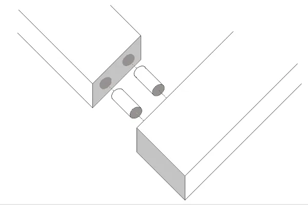
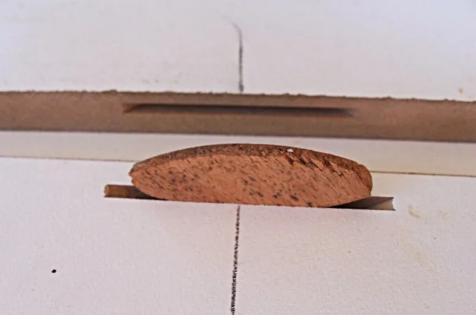
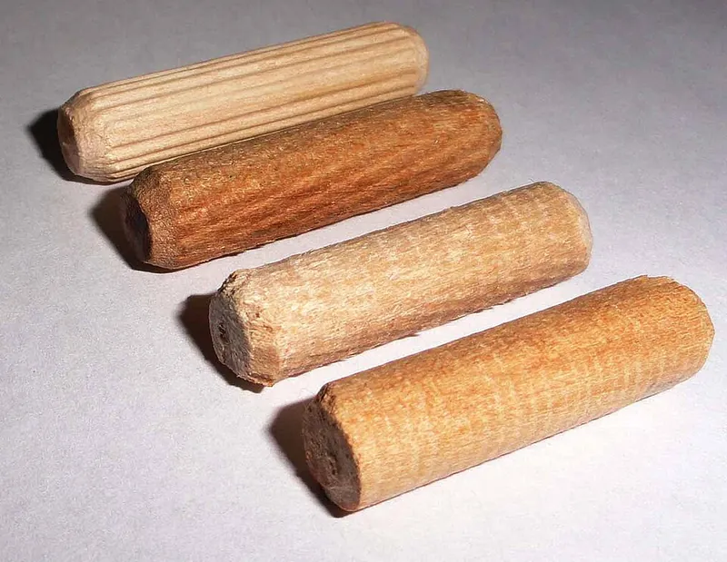

<figure class="eoc-pic eoc-pic-main"><figcaption><strong>Diagram.</strong> <a href="https://commons.wikimedia.org/wiki/File:Woodworking-joint-butt-dowel.gif">Woodworking-joint-butt-dowel</a> by Image by silentC, <a href="http://creativecommons.org/licenses/by-sa/3.0/">CC BY-SA 3.0</a>, from Wikimedia Commons.</figcaption></figure>
<figure class="eoc-pic"><figcaption><strong>How it works.</strong> <a href="https://commons.wikimedia.org/wiki/File:Biscuit-joint.jpg">Biscuit-joint</a> by Billbeee at en.wikipedia, <a href="https://creativecommons.org/licenses/by/2.5">CC BY 2.5</a>, from Wikimedia Commons.</figcaption></figure>
<figure class="eoc-pic"><figcaption><strong>Photo.</strong> <a href="https://commons.wikimedia.org/wiki/File:%D0%A0%D0%B8%D1%84%D0%BB%D0%B5%D0%BD%D0%B8%D0%B5_%D0%BD%D0%B0_%D1%88%D0%BA%D0%B0%D0%BD%D1%82%D0%B0%D1%85.JPG">Рифление на шкантах</a> by Андрей Перцев 1967, <a href="https://creativecommons.org/licenses/by-sa/3.0">CC BY-SA 3.0</a>, from Wikimedia Commons.</figcaption></figure>

Matching holes or slots are cut in both parts, and a glued wooden pin (dowel) or a flat oval wafer (biscuit) bridges the joint, lining the parts up and adding glue area to what would otherwise be a weak butt joint.

**In plain words:** Short round wooden pegs, or flat oval wooden wafers, glued half into one part and half into the other so the two parts line up and hold together. **Proper term:** Dowel joint and biscuit joint (dowel-reinforced and biscuit-reinforced butt joints).

**Also called:** dowel joint, dowelled (doweled) joint, dowel-reinforced butt joint (Wikipedia 'Butt joint'); dowel pin, dowel rod, fluted dowel, grooved dowel, pre-compressed dowel (Wikipedia 'Dowel'; Bailey Line Road; woodgears.ca); Miller dowel (brand; a stepped dowel driven in from the outside face; Wikipedia 'Butt joint'); Dowelmax (brand; a dowelling jig; Bailey Line Road); biscuit joint, biscuit-reinforced butt joint (Wikipedia 'Butt joint'; DT Online 'Biscuit Joint'); plate joint, plate joinery; biscuit joiner, biscuit jointer, plate joiner (Wikipedia 'Biscuit joiner'); Lamello (brand; the original biscuit system, invented by Hermann Steiner in 1956; often used as a generic name in Europe) (Wikipedia 'Biscuit joiner'); jointing biscuit, wood biscuit, wafer; Flachdübel, Lamellendübel (German names listed on the Printables model 'Flachdübel / biscuit joints'); biscuit sizes No. 0, No. 10, No. 20, FF (face frame), H9, and detail biscuits R1-R3 (Wikipedia 'Biscuit joiner'); dowel centres (dowel centers), dowelling jig (doweling jig) (Wikipedia 'Butt joint'; DT Online 'Dowel Joint').

## How it works

Each dowel or biscuit sits half in one part and half in the other, so the parts can't slide sideways across the joint and their faces are held flush (Wikipedia 'Butt joint'). Glue on the pin or wafer bonds its long grain to the walls of the holes, turning a weak end-grain butt joint into one with interlocking long-grain glue surfaces (USDA Wood Handbook ch. 10 lists dowels among the 'strong connections' for end-to-edge joints). Fluted dowels and biscuits are made slightly compressed, so the water in the glue swells them tight in their holes (Wikipedia 'Biscuit joiner'; Bailey Line Road). Biscuit slots are cut a little longer than the biscuit, so the parts can still slide along the joint to line up before the glue sets, while dowel holes must be drilled accurately in both parts (Wikipedia 'Biscuit joiner', 'Butt joint').

## Parts

A few parts: the two pieces of wood; one or more dowels (short round pins, usually fluted hardwood) in matching drilled holes, or one or more biscuits (thin oval wafers of compressed beech) in matching crescent-shaped slots; and glue (Wikipedia 'Butt joint', 'Biscuit joiner'; Lamello).

## Everyday examples

- Flat-pack furniture held together with small wooden dowels (e.g. the IKEA dowel pins reproduced in the Printables 'Ikea Dowel Pin collection')
- Chairs, cabinets, panels and tabletops joined with dowels, and the creaking chair or wobbly bookcase whose dowels have loosened (Wikipedia 'Butt joint')
- Kitchen cabinet face frames attached to cabinet boxes with biscuits (Wikipedia 'Butt joint')
- Wide tabletops glued up from several boards with biscuits keeping the surfaces flush (Rockler; The Wood Whisperer)

## When to use it

Use dowels to strengthen butt joints in frames and carcases (face frames, door frames, legs to aprons, chair legs, shelves) when you don't want to cut mortises and tenons; they are hidden, need only a drill and jig, and in tests are nearly as strong as a mortise and tenon (Wikipedia 'Butt joint'; woodgears.ca; Bailey Line Road). Use biscuits for fast, forgiving alignment in panel glue-ups, carcases of plywood, MDF or particleboard, mitred frames and face frames, where alignment matters more than strength (Wikipedia 'Biscuit joiner'; Rockler). Use printed dowels or pins to align and strengthen split 3D prints (Prusa).

## When not to use it

Don't rely on biscuits alone for joints that carry heavy loads or [end grain](../glossary.md#end-grain), such as chair or table frames; use dowels, a mortise and tenon or a loose tenon instead (The Wood Whisperer; Rockler). Avoid dowels in high-quality furniture meant to last generations, because dowels can shrink, go oval and loosen, letting joints flex and creak (Wikipedia 'Butt joint'). For furniture that must come apart, use knock-down cam-lock or cross-dowel connectors or a wedge dowel instead of glued pins. For edge-gluing boards, glue alone is already stronger than the wood, so dowels or biscuits are only for alignment (Rockler; The Wood Whisperer). In thin material, where a slot or hole would break through the face, use a plain glued edge or a [spline](../glossary.md#spline) ⚑ [uncertain].

## Details

- **What it does (jobs):**
  - join and hold: reinforces butt joints in frames (face frames, door frames, table legs to aprons, chair legs), cabinet carcases and panels (Wikipedia 'Butt joint')
  - line parts up exactly: keeps faces flush during panel and carcase glue-ups; biscuits are mainly used for this (Wikipedia 'Biscuit joiner'; Rockler 'Doweling vs. Biscuit Joints'; The Wood Whisperer)
  - glue or bond: the pins and wafers work only when glued, and add long-grain glue area to the joint (Wikipedia; USDA Wood Handbook ch. 10)
- **Movement:** none: a rigid joint once glued
- **Directions it can move (degrees of freedom):** 0 once glued. Before the glue sets, a dowelled joint can only be pushed together or pulled apart along the dowels (1 degree of freedom); a biscuit joint can also slide a little along the slot, because the slot is longer than the biscuit (Wikipedia 'Biscuit joiner').
- **Special behaviour:**
  - self-aligning or self-centring: the pins or wafers line the faces up flush as the joint is clamped, 'a quick means of getting a perfectly flush joint' (Wikipedia 'Biscuit joiner'); dowels are also used 'to assist with alignment during glue up' (Wikipedia 'Butt joint')
- **How it holds:**
  - [material bond](../glossary.md#form-fit--force-fit--material-bond) (glue, solvent or melting): the glue on the dowel or biscuit does most of the holding (The Wood Whisperer; Wikipedia)
  - shape (the parts interlock; form-fit): the pins bridge the joint and resist [shear](../glossary.md#peel-vs-shear) (sliding) even if the glue deteriorates: 'The dowels offer some holding strength even after the glue has deteriorated' (Wikipedia 'Butt joint')
  - friction or clamping (force-fit): compressed dowels and biscuits swell with the glue's moisture into a tight fit (Wikipedia 'Biscuit joiner'; Bailey Line Road)
- **Input and output:** not applicable
- **Power:** passive (no power needed)
- **Load:** Medium for dowels, light to medium for biscuits. In Matthias Wandel's rail-to-post tests (load 20 cm from the joint), three 3/8 in. dowels broke at 120-145 lb in spruce (average 135 lb, about 80% of a mortise and tenon) and 230-245 lb in maple; failures were the dowels pulling out of the cross-grain post (woodgears.ca 'Wood joint strength testing'). In a later test, two dowels averaged 153 lb against 99 lb for pocket holes (1.5 times as strong) and 202-236 lb for mortise and tenons (woodgears.ca 'Testing pocket holes'); a four-dowel joint and a 1/4 in. mortise and tenon in 3/4 in. red oak came out statistically level (woodgears.ca 'Dowel vs. mortise and tenon revisited'). Biscuits add pull-apart strength to butt and mitre joints but dowels are stronger, especially in shear, which WOOD Magazine's 2006 'Wood Joint Torture Test' also found (Rockler). A No. 20 biscuit reaches less than 1/2 in. into each part, so biscuits add little strength to end-grain joints (The Wood Whisperer). Strong in shear across the joint; weakest in pull-out and bending, where short or few pins can pull out of cross grain.
- **Play and precision:** Dowels: no play when drilled well, but '[accuracy](../glossary.md#repeatability--accuracy) is paramount' because both holes must line up (Wikipedia 'Butt joint'); holes that are not parallel split the wood under clamping, and oversized holes give a weak joint with poor alignment (Bailey Line Road). Biscuits: forgiving along the slot, which is longer than the biscuit, and the slot width is not critical, but the slot must be the same distance from the reference face in both parts (Wikipedia 'Butt joint', 'Biscuit joiner'). Some woodworkers find the slot [clearance](../glossary.md#clearance) means biscuit alignment 'is not guaranteed' (forum opinion quoted by Rockler).
- **Taking it apart:** permanent: glued dowels and biscuits can't be taken apart without breaking or cutting the joint; unglued dowels used as locating pins in flat-pack furniture can be pulled out (semi-permanent) ⚑ [uncertain]
- **How often it can be reused:** once for glued joints; a few times for unglued locating dowels in flat-pack furniture ⚑ [uncertain]
- **Sealing:** none: not designed to seal
- **Adjustable:** no once glued; biscuit joints can be slid sideways a little to line up before the glue sets (Wikipedia 'Biscuit joiner')
- **Access needed:** one side only (blind): the holes or slots are cut into the mating faces before assembly and are hidden inside the finished joint, so nothing is reached from the far side (Wikipedia 'Biscuit joiner'); a Miller dowel (brand) is the exception, drilled and driven from the outside face after gluing (Wikipedia 'Butt joint')
- **Materials:** Dowels: usually hardwood dowel pins (ready-made fluted pins are 'precisely sized, truly round and made of strong wood'; cheap dowel rod is often undersized and out of round) (Bailey Line Road); also plastic and metal dowels (Wikipedia 'Dowel'). Biscuits: compressed beech (Lamello; Wikipedia) or particle board; plastic and metal specialty biscuits exist (Wikipedia 'Biscuit joiner'). Joins solid wood, plywood, particleboard and MDF; biscuits were invented for chipboard and are 'predominantly used in joining sheet goods' (Wikipedia 'Biscuit joiner'; DT Online). Lamello says biscuits weaken panels less than dowels. Printed plastic biscuits and dowels are possible (Printables models), but glue that swells wood won't swell plastic.
- **Heat, cold, water and wear:** Wood swells and shrinks with humidity, much more across the grain than along it (USDA Wood Handbook ch. 4); a dowel crosses the grain of the other part, so over time it can shrink, turn oval and work loose (Wikipedia 'Butt joint'), and end-to-edge joints should be protected from moisture changes (USDA Wood Handbook ch. 10). Dowel pins stored in damp air swell and won't fit (Bailey Line Road). Outdoors, the joint is only as good as its glue; use a waterproof glue ⚑ [uncertain]. Printed plastic pins: PLA softens at about 60 °C and PETG at about 80 °C (CNC Kitchen).

## Making it

- **Ways to make or get it:**
  - woodwork: the main method, with a drill and dowelling jig or drill press for dowels, and a biscuit joiner or router slot cutter for biscuits (Wikipedia; DT Online)
  - off-the-shelf part: ready-made fluted dowel pins, Miller dowels (brand), wooden biscuits in standard sizes, dowel centres and dowelling jigs (Wikipedia; Bailey Line Road; Lamello)
  - 3D print (FDM): printed dowel pins and alignment pegs for joining split prints, e.g. PrusaSlicer's cut tool 'Dowel' connector, which cuts holes in both halves and makes a separate pin to print (Prusa knowledge base 'Cut tool'); printed biscuits and printed dowelling and biscuit-slot jigs (Printables)
  - CNC: CNC routers and boring machines can drill dowel holes in exact positions in both parts ⚑ [uncertain]
- **Printing it in one piece (print in place):** no: the pins or wafers are separate parts pushed into holes or slots in both halves
- **Tools:** Dowels: drill with brad-point or twist bits and a depth stop, plus a dowelling jig or a drill press; dowel centres (or small nails with the heads snipped off) to transfer hole positions; marking gauge and try square; glue and clamps (sash cramps) (Wikipedia 'Butt joint'; DT Online 'Dowel Joint', 'Widening Joint'; Bailey Line Road). Biscuits: a biscuit (plate) joiner with a 100 mm (4 in.) blade cutting a 4 mm slot, or a router with a slot-cutter bit; biscuits; glue and clamps (Wikipedia 'Biscuit joiner'; DT Online 'Biscuit Joint').
- **Difficulty:** moderate for dowels: holes must be positioned and drilled accurately, which a dowelling jig makes much easier (Wikipedia; Bailey Line Road); easy for biscuits once you have a biscuit joiner, because 'a quick pencil [stroke](../glossary.md#stroke)' is all the marking needed (Wikipedia 'Biscuit joiner'; DT Online)

### 3D printing tips

1) Split prints: PrusaSlicer's cut tool offers 'Dowel' connectors, which subtract a pin-shaped hole from both halves and generate an extra object to print as the pin; 'Plug' connectors instead add the pin to one half (Prusa knowledge base 'Cut tool'). Prusa also suggests modelling in pegs 'for alignment and strength' when gluing split parts (Prusa knowledge base 'Modeling with 3D printing in mind'). 2) Clearance: for FDM allow about 0.5 mm total clearance for an easy slip fit (Hubs), or start at 0.3 mm (Prusa); for a glued pin you can go tighter, and drilling or reaming the printed hole to size after printing gives a more accurate diameter (Hubs). 3) Print orientation of the pin: a pin printed standing up breaks easily along a layer line under sideways (shear) load, because layer bonds are the weak direction (CNC Kitchen: PLA layer adhesion about 55% of flat strength). Print pins lying down, or print each pin as two D-shaped halves lying flat and glue or press them together, as in the Printables 'Ikea Dowel Pin collection' (which also used 6 walls, 6 top and bottom layers and 50% gyroid [infill](../glossary.md#infill)). 4) Round holes in the vertical direction print as polygons; check your CAD model has enough facets (Prusa). 5) Let air and glue escape: add a flat or a groove along a printed pin, just as wooden dowels need one to avoid hydraulic pressure splitting the part (Wikipedia 'Dowel'; DT Online). 6) Printed biscuits: the Printables 'Flachdübel / biscuit joints' model prints No. 0, 10 and 20 biscuits 4 mm thick for standard slots; plastic won't swell with water-based wood glue, so their hold depends on the glue gripping the plastic ⚑ [uncertain]. 7) Printed jigs: printable dowelling jigs use skateboard (608, 22 x 8 x 7 mm) ball bearings as hard drill guides (Printables 'Dowel Jig' by Michael; 'Dowel Jig 8mm').

### Buying one (off-the-shelf parts)

Fluted (grooved) hardwood dowel pins in standard diameters such as 1/4, 5/16, 3/8 and 1/2 in. or 6, 8 and 10 mm (Bailey Line Road; woodgears.ca used 3/8 x 2 in. pre-compressed fluted pins; printable jigs on Printables are made for 8 mm); dowel rod (Wikipedia 'Dowel'); Miller dowels (brand) with stepped drill bits (Wikipedia 'Butt joint'); dowel centres (Bailey Line Road; DT Online); self-centring dowelling jigs (Rockler; Bailey Line Road). Biscuits: Lamello (brand) Original wood biscuits No. 0 (47 x 15 x 4 mm), No. 10 (53 x 19 x 4 mm) and No. 20 (56 x 23 x 4 mm), Porter-Cable FF face-frame biscuits (30 x 13 mm), detail biscuits R1-R3, plus specialty metal knock-down connectors and hinges cut with the same machine (Wikipedia 'Biscuit joiner'; Lamello); biscuit joiners (plate joiners) from Lamello, Porter-Cable, DeWalt and Makita (Wikipedia); router slot-cutter bits (Wikipedia 'Butt joint').

## Rules of thumb

- Dowel diameter: about one-third to one-half of the stock thickness, with a dowel about twice the stock thickness long; e.g. 5/16 or 3/8 in. x 1-1/4 to 1-1/2 in. dowels for 3/4 in. door frames, 1/4 in. dowels for 1/2 in. parts, 1/2 in. dowels for 1-1/2 in. stock (Steve Maxwell, Bailey Line Road). DT Online gives about one-third of the thickness and a length of about six times the diameter, half in each part (DT Online 'Dowel Joint').
- Let air and glue escape: a dowel in a blind hole needs a flat or groove along its side, or 'hammering the dowel home or clamping the joint can split the wood' (Wikipedia 'Dowel'); [taper](../glossary.md#taper) the dowel ends (DT Online).
- Dry-fit every dowel joint fully clamped before gluing to catch holes drilled too shallow, then assemble quickly because the dowels swell as soon as the glue touches them (Bailey Line Road).
- Troubleshooting dowels: joint won't close = holes too shallow or at mismatched angles; wood splits when clamped = holes not parallel; weak, misaligned joint = holes too large; dowels won't enter = pins swollen with moisture (dry them in an oven at 325 °F for 30 minutes) (Bailey Line Road).
- Dowel strength: three 3/8 in. dowels reached about 80% of a comparable mortise and tenon; the tapered dowel ends add little glue area, and dowels pull out of the cross-grain part first, so a thicker post and longer dowels help (woodgears.ca). Wandel expects four dowels to be nearly as strong as a mortise and tenon (woodgears.ca 'Testing pocket holes').
- Biscuit sizes (length x width x thickness): No. 0 47 x 15 x 4 mm, No. 10 53 x 19 x 4 mm, No. 20 56 x 23 x 4 mm; the standard cutter is 4 mm (5/32 in.) wide on a nominal 100 mm (4 in.) blade (Wikipedia 'Biscuit joiner'). Lamello biscuits fit a 4 mm groove snugly enough not to fall out when the part is turned over (Lamello).
- Biscuit layout: mark both parts with one pencil line across the joint, and always cut the slots with the machine registered on the same face so the boards come out flush; more than one biscuit side by side can be used in thick parts (Wikipedia 'Biscuit joiner', 'Butt joint').
- Biscuit strength: use biscuits mainly for alignment and to add pull-apart strength to butt and mitre joints; for joints needing shear strength, such as chairs, use dowels (Rockler) or a mortise and tenon, since a No. 20 biscuit penetrates less than 1/2 in. and its grain runs at 45 degrees (The Wood Whisperer). Lamello says the diagonal grain gives high break resistance.
- Wait before flattening a biscuit glue-up: the biscuit swells the wood above it, and sanding before the moisture leaves can leave shallow dips over each biscuit later; The Wood Whisperer waits at least 24 hours (The Wood Whisperer 'Biscuit Depression?').
- End-to-edge glue joints need interlocking pins or tenons to carry real load; dowels are one of the USDA's examples of a strong connection (USDA Wood Handbook ch. 10).

## Common failures

Misaligned or non-parallel dowel holes, so the joint won't close or the wood splits when clamped (Bailey Line Road); use a dowelling jig or drill press. Wood splitting from trapped air and glue in blind holes (Wikipedia 'Dowel'); use fluted or grooved dowels. Holes too shallow, so the joint won't close (Bailey Line Road); dry-fit first. Dowels loosening over the years as they shrink and go oval (Wikipedia 'Butt joint'). Dowels pulling out of the cross-grain part under bending load (woodgears.ca); use longer or more dowels. Biscuits used as the only strength in end-grain joints (The Wood Whisperer). Shallow dips appearing over biscuits in a tabletop that was sanded too soon after glue-up (The Wood Whisperer 'Biscuit Depression?'). Faces not flush because slots were cut from different reference faces (Wikipedia 'Biscuit joiner'). Fluted dowels swelling before the joint is closed when assembly is slow; the joint must slide together quickly once glued (Bailey Line Road). Biscuits start loose and only tighten as they swell, so the joint must stay clamped longer (DT Online 'Biscuit Joint').

## Safety

A biscuit joiner is a small spring-loaded circular saw: keep hands clear of the blade opening and let the blade stop before lifting the machine (Wikipedia 'Biscuit joiner' describes the spring-loaded blade) ⚑ [uncertain]; the Printables router biscuit template also says to let the bit stop before lifting the router. Drilling dowel holes can grab small parts; clamp the work ⚑ [uncertain]. Otherwise none known.

## Related

- Butt and lap wood joints: the plain joint that dowels and biscuits reinforce
- Mortise and tenon, including loose (floating) tenons such as the Domino (brand): a longer, flat-sided version of the same idea, generally stronger than dowels (woodgears.ca)
- Wedge dowel (click-in grooved dowel): a tool-free knock-down dowel for furniture that comes apart
- Knock-down cam-lock and cross-dowel connectors: metal fittings that act like removable dowels in flat-pack furniture
- Tongue-and-groove joint, including the loose tongue (spline): a continuous version of a biscuit along the whole edge
- Locating pins and hole-and-slot: the precision-engineering use of pins to position parts exactly
- Split-part joints for large prints (dovetail keys, puzzle joints, alignment pins): the 3D-printing cousin of dowelling

## Make it yourself

- [Cut tool (Prusa Knowledge Base, PrusaSlicer)](https://help.prusa3d.com/article/cut-tool_1779): Slicer feature that cuts a model into printable pieces and adds 'Dowel' connectors (holes in both halves plus a separate printable pin), 'Plug' or 'Snap' connectors, or a dovetail *(licence: free software (PrusaSlicer is AGPL-3.0 ⚑ [uncertain]); help page link only)*
- [Dowel Jig by Michael (Printables) (URL from Printables API, page not opened)](https://www.printables.com/model/123782-dowel-jig): A simple printable dowelling jig that centres the drill using two skateboard bearings (22 x 8 x 7 mm) as guides; chamfered to print without supports; remix of a Thingiverse design. Read through the Printables public API. *(licence: CC BY)*
- [Ikea Dowel Pin collection by WillyWanker (Printables) (URL from Printables API, page not opened)](https://www.printables.com/model/578658-ikea-dowel-pin-collection): Printable replacement dowel pins in IKEA part-number sizes, smooth and rippled, with tips on printing them strong (6 walls, 50% gyroid, or as two flat D-shaped halves). Read through the Printables public API. *(licence: CC BY-NC)*
- [Poor man's biscuit joiner / biscuit joint cutter by imototakashi (Printables) (URL from Printables API, page not opened)](https://www.printables.com/model/321230-poor-mans-biscuit-joiner-biscuit-joint-cutter): A printed router template and spacers for cutting No. 10 biscuit slots with a slot-cutter router bit, including a 45-degree frame for mitres. Read through the Printables public API. *(licence: CC BY-SA)*
- [Flachdübel / biscuit joints by yahbluez (Printables) (URL from Printables API, page not opened)](https://www.printables.com/model/1293403-flachdubel-biscuit-joints): Printable plastic biscuits in No. 0, 10 and 20 sizes, 4 mm thick, with hexagon-textured faces for more glue area. Read through the Printables public API. *(licence: CC BY-NC-ND)*

## Pictures, videos and models

- [Woodworking-joint-butt-dowel.gif (Wikimedia Commons, by SilentC)](https://commons.wikimedia.org/wiki/File:Woodworking-joint-butt-dowel.gif): Drawing of a butt joint reinforced with dowels in matching holes (used on Wikipedia 'Butt joint') *(licence: CC BY-SA 3.0)*
- [Woodworking-joint-butt-biscuit.gif (Wikimedia Commons, by SilentC)](https://commons.wikimedia.org/wiki/File:Woodworking-joint-butt-biscuit.gif): Drawing of a butt joint reinforced with an oval biscuit in matching slots *(licence: CC BY-SA 3.0)*
- [Biscuit-joint.jpg (Wikimedia Commons, by Billbeee)](https://commons.wikimedia.org/wiki/File:Biscuit-joint.jpg): Photo of 16 mm MDF edges with a No. 0 biscuit, set up for a right-angle joint (used on Wikipedia 'Biscuit joiner') *(licence: CC BY 2.5)*
- [Рифление на шкантах.JPG (fluting on wooden dowels; Wikimedia Commons, by Андрей Перцев 1967)](https://commons.wikimedia.org/wiki/File:%D0%A0%D0%B8%D1%84%D0%BB%D0%B5%D0%BD%D0%B8%D0%B5_%D0%BD%D0%B0_%D1%88%D0%BA%D0%B0%D0%BD%D1%82%D0%B0%D1%85.JPG): Photo of fluted wooden dowel pins (used on Wikipedia 'Dowel') *(licence: CC BY-SA 3.0)*
- [How Strong Are DOWELS vs DOMINOS vs BISCUITS? Strength Test (YouTube, Rag 'n' Bone Brown)](https://www.youtube.com/watch?v=DTv8JG5eDFk): Video strength test comparing glued dowel, loose-tenon and biscuit joints (title checked via YouTube oEmbed; results not checked) *(licence: link only (standard YouTube licence))*

## Needs confirming

⚑ marks something nobody has confirmed yet: a fact the research could not confirm from a source, a finder value that is a best guess, or an open point from the research notes. Corrections are welcome (see `research/needs-confirming.md`).

- ⚑ 9 sentences on this page marked [uncertain].

## Sources

- <https://en.wikipedia.org/wiki/Butt_joint>
- <https://en.wikipedia.org/wiki/Dowel>
- <https://en.wikipedia.org/wiki/Biscuit_joiner>
- <https://commons.wikimedia.org/wiki/File:Woodworking-joint-butt-dowel.gif>
- <https://commons.wikimedia.org/wiki/File:Woodworking-joint-butt-biscuit.gif>
- <https://commons.wikimedia.org/wiki/File:Biscuit-joint.jpg>
- <https://commons.wikimedia.org/wiki/File:Lamello-top.jpg>
- <https://commons.wikimedia.org/wiki/File:%D0%A0%D0%B8%D1%84%D0%BB%D0%B5%D0%BD%D0%B8%D0%B5_%D0%BD%D0%B0_%D1%88%D0%BA%D0%B0%D0%BD%D1%82%D0%B0%D1%85.JPG>
- <https://woodgears.ca/joint_strength/>
- <https://woodgears.ca/joint_strength/pockethole.html>
- <https://woodgears.ca/joint_strength/dowel.html>
- <https://baileylineroad.com/dowel-joinery-basics/>
- <https://www.rockler.com/learn/doweling-vs-biscuit-joints>
- <https://thewoodwhisperer.com/articles/are-biscuits-strong-enough/>
- <https://thewoodwhisperer.com/articles/biscuit-depression/>
- <https://lamello.com/products/lamello-system/wooden-biscuit>
- <https://wiki.dtonline.org/index.php/Dowel_Joint>
- <https://wiki.dtonline.org/index.php/Biscuit_Joint>
- <https://wiki.dtonline.org/index.php/Widening_Joint>
- <https://www.fpl.fs.usda.gov/documnts/fplgtr/fplgtr190/chapter_10.pdf>
- <https://www.fpl.fs.usda.gov/documnts/fplgtr/fplgtr190/chapter_04.pdf>
- <https://help.prusa3d.com/article/cut-tool_1779>
- <https://help.prusa3d.com/article/modeling-with-3d-printing-in-mind_164135>
- <https://www.hubs.com/knowledge-base/how-design-interlocking-joints-fastening-3d-printed-parts/>
- <https://www.hubs.com/knowledge-base/how-assemble-3d-printed-parts-threaded-fasteners/>
- <https://www.cnckitchen.com/blog/comparing-pla-petg-amp-asa-feat-prusament>
- <https://www.youtube.com/watch?v=DTv8JG5eDFk>
- <https://api.printables.com/graphql/>
