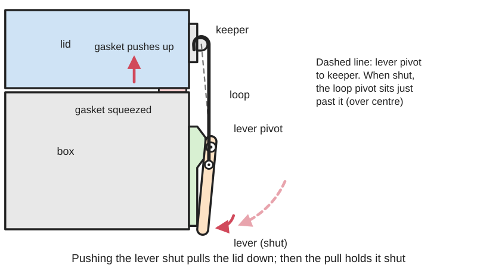
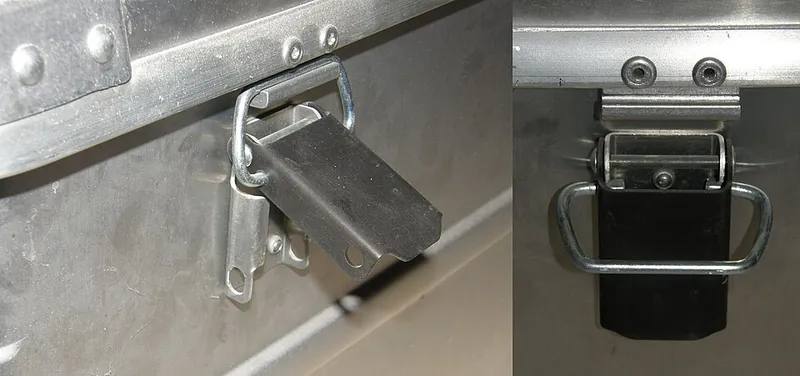
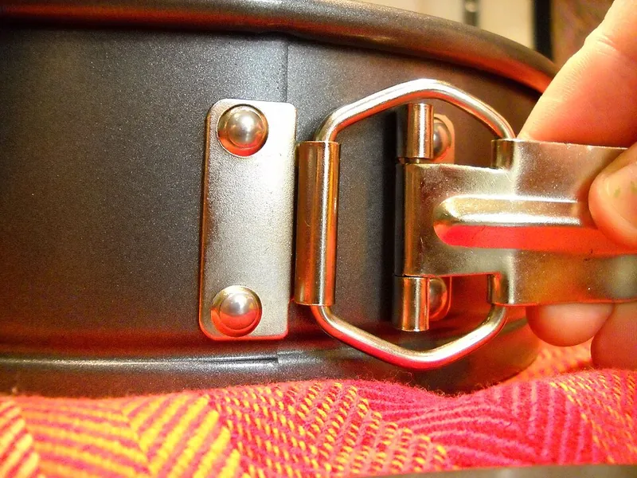
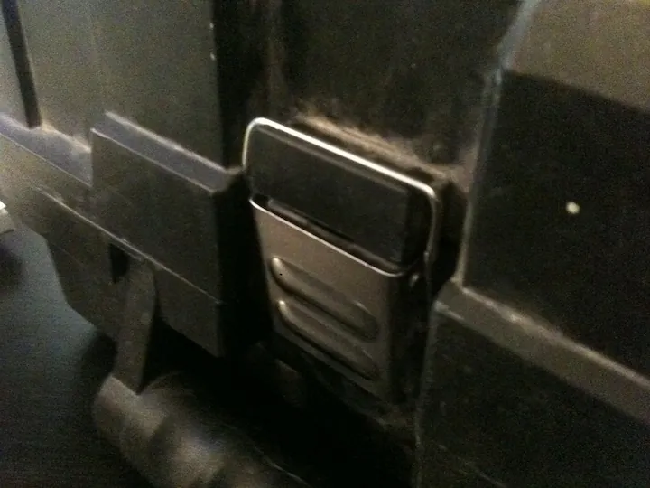

<figure class="eoc-pic eoc-pic-main"><picture><source media="(prefers-reduced-motion: reduce)" srcset="../media/drawn/draw-latch.svg"></picture><figcaption><strong>Animation.</strong> Diagram drawn for the encyclopaedia from the research notes. ⚑ Needs confirming: a drawing can simplify or get details wrong; a real photo or a better diagram is welcome.</figcaption></figure>
<figure class="eoc-pic"><figcaption><strong>Photo.</strong> <a href="https://commons.wikimedia.org/wiki/File:BuegelVS-Kniehebel2.JPG">BuegelVS-Kniehebel2</a> by StromBer, <a href="https://creativecommons.org/licenses/by-sa/3.0">CC BY-SA 3.0</a>, from Wikimedia Commons.</figcaption></figure>
<figure class="eoc-pic"><figcaption><strong>How it works.</strong> <a href="https://commons.wikimedia.org/wiki/File:SpringformPanSpring.jpg">SpringformPanSpring</a> by RibbonsOfIndecision, <a href="https://creativecommons.org/licenses/by-sa/3.0">CC BY-SA 3.0</a>, from Wikimedia Commons.</figcaption></figure>
<figure class="eoc-pic"><figcaption><strong>Photo.</strong> <a href="https://commons.wikimedia.org/wiki/File:LatchExample1.JPG">LatchExample1</a> by Lmartin iii, <a href="https://creativecommons.org/licenses/by-sa/3.0">CC BY-SA 3.0</a>, from Wikimedia Commons.</figcaption></figure>

A two-part latch in which a lever on one part carries a loop or hook that catches a keeper on the other part; closing the lever swings the loop's pivot past the line between the lever pivot and the keeper (over centre), pulling the parts tightly together and locking them there until the lever is lifted.

**In plain words:** The lever catch on toolboxes and cases: hook the loop over a catch on the lid, press the lever down and it pulls the lid tight shut with a snap, and it stays shut until you lift the lever. **Proper term:** Draw latch ([over-centre](../glossary.md#over-centre) latch, toggle latch).

**Also called:** toggle latch; over-centre latch / over-center latch; over-centre fastener; draw catch / toggle catch; spring claw latch; tension latch / pull latch; case latch / toolbox latch / box latch; latch clamp / latch-action (hook-type) toggle clamp (heavier versions); adjustable draw latch (with a threaded hook or rod); flexible draw latch / rubber T-handle latch; wire bail closure (Kilner-type jars and swing-top bottles); Bügelverschluss (German; also used for swing-top closures).

## How it works

The loop hangs from a pivot on the lever that is offset from the lever's own pivot. Hook the loop over the keeper and push the lever down: the loop's pivot swings towards, then just past, the straight line joining the lever pivot and the keeper (over centre), pulling the two parts together and stretching the loop and any gasket slightly. Once past centre, the pull between the parts tries to close the lever further, against its stop, so the latch cannot open by itself; lifting the lever back past centre releases it (Wikipedia 'Latch'; US patent 4,925,221; RS). Flexible (rubber) draw latches have no lever: the stretch of an EPDM rubber strap hooked over the keeper provides the pull (Boat Outfitters; HTF Hardware).

## Parts

A few parts: a base plate fixed to one part, a lever (handle) pivoted on the base, a loop, hook or wire bail pivoted part-way along the lever, and a keeper (catch plate or strike) fixed to the other part. Many add a threaded hook or rod for adjustment, a spring, a padlock hole or a secondary safety catch. Flexible versions are just a stretchy rubber T-handle and a keeper.

## Everyday examples

- Toolboxes, chests and crates (Wikipedia 'Latch')
- Flight cases, instrument cases and aluminium transport cases (Wikimedia Commons photo of case latches)
- The latch that tightens the ring of a springform cake pan (Wikipedia 'Latch')
- The wire clip on Kilner-type jars and swing-top bottles (Rowse; Wikipedia 'Flip-top')

## When to use it

Use a draw latch when a lid, door or panel must be pulled tightly closed and opened quickly by hand: cases and toolboxes, access panels and machine covers, boxes with a gasket that must be squeezed to keep water or dust out, and anything that rattles. It suits places where the catch is on a separate part from the latch, and where some [misalignment](../glossary.md#misalignment) must be pulled in. Choose a rubber (flexible) latch for quiet, corrosion-free, forgiving closure on coolers and lockers, and an adjustable or locking steel latch for higher loads or security (Boat Outfitters; Southco; RS).

## When not to use it

Avoid it where the latch must be flush or hidden (use a concealed latch, quarter-turn fastener or magnetic catch), where the part is opened constantly with no need for pull-down force (a simple snap fit, magnetic catch or ball catch is enough), where real security is needed (add a padlock or use a cam lock), and where the latch sticks out and could be knocked open or catch on things. Don't use it as the only closure for something under internal pressure or that must never open in service without a secondary safety catch (US 4,925,221).

## Details

- **What it does (jobs):**
  - join and hold: holds a lid, door, hatch or panel shut
  - lock, and release by hand: opens and closes with one flick of the lever; many take a padlock or have a secondary lock
  - tighten and hold tension: draws the two parts together and keeps them squeezed, removing rattle
  - seal it, or pass cables or fluid through: only indirectly, by squeezing a lid onto a gasket or [O-ring](../glossary.md#o-ring), which does the actual sealing (Southco)
- **Movement:** rotate: the lever and loop swing on pins through a limited arc (Firgelli gives roughly 90-180 degrees for the lever ⚑ [uncertain]); the joined parts are pulled together by only a small distance
- **Directions it can move (degrees of freedom):** 1 while closing: the lever angle sets the position of the loop and the gap between the parts; effectively 0 once closed and locked over centre
- **Special behaviour:**
  - over-centre (snaps past a point and stays): the loop's pivot passes the line between the lever pivot and the keeper and the latch snaps shut (RS: once past the cam point it 'will snap soundly into place and remain securely closed')
  - [self-locking](../glossary.md#self-locking) (holds under load, won't back-drive): pulling the parts apart pushes the lever harder into its closed position
  - hand-release only (locks under load, releases when a person operates it): only lifting the lever opens it
  - quick-release: opens and closes by hand with no tools
  - tensioning (takes up slack and holds): draws the parts together and holds a [preload](../glossary.md#preload), which compresses gaskets and stops rattles (Southco)
- **How it holds:**
  - shape ([form-fit](../glossary.md#form-fit--force-fit--material-bond)): the loop or hook physically hooks over the keeper
  - friction or clamping (force-fit): the over-centre lever holds the two parts pressed together with a preload
  - spring force (a spring or springy part presses it in place): flexible latches hold by the stretch of rubber, and the steel loops of rigid latches stretch very slightly
- **Input and output:** not applicable: it is a fastening latch, not a drive. For reference, the lever multiplies hand force by roughly the handle length divided by the offset of the loop's pivot (the Firgelli blog's example: a 65 mm handle and 5 mm offset give about 13:1) ⚑ [uncertain]
- **Power:** passive (no power needed)
- **Load:** Light to heavy in tension (pulling the two parts together). For example, Southco's A1 adjustable draw latches are rated up to 1,550 N (350 lb), 3,110 N (700 lb) and 4,450 N (1,000 lb) for small, medium and large sizes; RS groups latches into light, medium and heavy duty. Weak sideways ([shear](../glossary.md#peel-vs-shear)) and against prying, so let hinges, lips or locating pins take sideways loads ⚑ [uncertain]. The keeper and its screws must be as strong as the latch (RS)
- **Play and precision:** No play once closed, because it is preloaded. It tolerates small misalignment, but the keeper position matters: set too far away, the lever can't pass centre; set too close, it closes loosely, and an over-adjusted latch can even end up exactly on centre, looking closed but unlocked (US patent 4,925,221). Rubber latches tolerate misalignment best (Boat Outfitters). Wikipedia notes a draw latch does not need to be fully closed to hold the two halves together
- **Taking it apart:** tool-free quick release: it opens and closes by hand; the latch body and keeper are screwed, bolted or riveted on and can be removed with tools
- **How often it can be reused:** many times: opening and closing is its normal use; metal latches last many thousands of cycles, while rubber straps age and printed plastic latches wear and [creep](../glossary.md#creep) sooner ⚑ [uncertain]
- **Sealing:** none by itself. It is used to make a seal watertight or dust-resistant by pressing a lid onto a gasket or O-ring (Southco: draw latches give '[mechanical advantage](../glossary.md#mechanical-advantage) to compress gaskets and ensure sealing'). Maker example: a printed rugged box with a TPU seal and tight printed latches survived 10 minutes under 10 cm of water with no leak (zx82net)
- **Adjustable:** Yes on adjustable models: a threaded hook or rod changes the reach and the clamping force (Southco A1: grip range up to 144 mm and span adjustment up to 33 mm). Fixed models are adjusted by moving or shimming the keeper. Printed latches can be tuned by scaling the latch by about 2% in X and Y (zx82net)
- **Access needed:** one side only (blind): both parts are fixed with screws or rivets from the outside and it is operated from outside; through-bolts need both sides
- **Materials:** Stainless steel (corrosion-resistant, marine and industrial), zinc-plated steel or die-cast zinc (low cost), brass or chrome-plated brass (appearance, light to medium duty), acetal (RS); plastic bodies in polypropylene, nylon or glass-filled nylon, and rubber (Southco); EPDM rubber for flexible latches (HTF Hardware). Printed latches in PETG (preferred outdoors) or PLA, with steel screws or rod as pins
- **Heat, cold, water and wear:** Zinc-plated steel and zinc die-castings corrode outdoors; stainless steel suits marine and washdown use (RS; Boat Outfitters). EPDM rubber latches resist corrosion and damp vibration, but rubber ages; the Firgelli blog claims UV and heat cycling can cost rubber latches 20-30% of their preload within three years ⚑ [uncertain]. Printed latches: PLA softens above about 60 °C and PETG is fine below about 80 °C (Prusa), and PLA latches can creep and loosen over time (zx82net). The over-centre lock resists vibration, but a latch set only just past centre can shake open, so vibration-critical uses add a secondary safety catch (US 4,925,221).

## Making it

- **Ways to make or get it:**
  - off-the-shelf part: the usual choice; many sizes and materials
  - 3D print (FDM): [print-in-place](../glossary.md#print-in-place) latches, or separate printed parts pinned with M3-M5 screws or steel rod
  - sheet metal: commercial latches are usually stamped steel parts ⚑ [uncertain]
- **Printing it in one piece (print in place):** yes: ConceivablyEngineering's 'Sturdy print-in-place draw latch' prints already assembled with no supports and 0.2-0.3 mm gaps. Stronger printed latches are printed as separate parts joined with bolts or steel rod (TECbot, Glenn Brockett, the parametric Rugged Storage Box).
- **Tools:** None to open or close. To fit: a drill and a screwdriver (screws or bolts) or a rivet tool; a spanner to set a threaded hook; optionally a padlock
- **Difficulty:** easy: cheap to buy and screw on; printable versions, even print-in-place ones, work well for light boxes and cases

### 3D printing tips

1) Geometry: the loop's pivot must swing past the line from the lever pivot to the keeper, or the latch won't snap closed; mount the hook or keeper so this happens (TECbot: 'make sure the hook is mounted low enough that the loop passes the center pivot'). Add a stop on the lever so it can't over-travel. 2) Print-in-place: 0.2-0.3 mm gaps between moving parts, slight under-extrusion especially on the first layer so the joints free up, thick shells (1.2 mm) with [infill](../glossary.md#infill) of secondary importance; the latch can be fixed with up to four M3 screws or glued (ConceivablyEngineering). 3) Pins: bolts (M5 main pivot in TECbot's latch, with the nut pressed flush using a soldering iron) or steel rod (Glenn Brockett uses 2.2 mm welding rod; filament 'may work, not advised'). The Rugged Storage Box fixes each latch with two M3x40 screws that act as pins. 4) Strength and layers: 'You MUST have good layer adhesion or it will break' (Glenn Brockett). zx82net recommends at least 3 [perimeters](../glossary.md#perimeters) and over 30% infill for latches and hinges. 5) Material: PETG for outdoor or long-term use; zx82net found PLA latches work at first but can creep over time, loosening the latch and the seal; PLA softens above about 60 °C (Prusa). 6) Tuning: print two sizes and pick the tightness you like; scaling the latch by 2% in X and Y makes a significant difference (zx82net). Tight [tolerances](../glossary.md#tolerance) may need a little trimming (Glenn Brockett). 7) Sealing: for a watertight box, add a flexible seal (TPU gasket or a 1.75 mm TPU filament in a groove) for the latch to squeeze (zx82net; Rugged Storage Box). 8) Keep printed latches for boxes and light panels; they are 'not sturdy compared to non-printed, non-plastic latches' (ConceivablyEngineering).

### Buying one (off-the-shelf parts)

Draw latches / toggle latches in fixed-grip, adjustable (threaded hook or U-bolt) and locking (padlockable or key-locking) versions, with matching keepers (catch plates or strikes); concealed and rotary draw latches; flexible rubber T-handle draw latches with keepers; latch-action toggle clamps (hook or U-bolt with latch plate) for heavy lids and doors; latches with a secondary safety catch; wire bail closures for jars (Southco; RS; Carr Lane; Boat Outfitters).

## Rules of thumb

- Choose a latch whose ultimate tensile strength (UTS) is roughly double the force it will see, and make sure the keeper (catch or strike plate) is rated as strongly as the latch (RS).
- Longer handles need less force to close against the same over-centre resistance (RS).
- The loop must pass the centre pivot for the over-centre action to work (TECbot, Printables 'Over-Center Toggle Latch').
- Adjust carefully: under-adjustment leaves a gap that lets vibration and airflow work on the panel; over-adjustment can reduce the over-centre movement or leave the latch looking closed while sitting on centre, unlocked, which is why the aircraft toggle latch in US patent 4,925,221 adds an automatic safety catch.
- Printed draw latches: 0.2-0.3 mm print-in-place gaps and 1.2 mm shells (ConceivablyEngineering); scaling by 2% changes tightness noticeably (zx82net).
- Blog guidance on spacing and preload: about one latch per 200-300 mm of gasket perimeter with one within 100 mm of each corner; the latch should close about 1-3 mm past dead centre; rubber latches should be stretched to about 110-115% of their free length (Firgelli) ⚑ [uncertain].

## Common failures

1) Won't close, or needs two hands: the keeper is too far away or the gasket too thick; move or shim the keeper, or use an adjustable latch. 2) Closes loosely or rattles: the keeper is too close or has moved (loose screws), or the loop has stretched; re-set the keeper, tighten screws, use an adjustable hook. 3) Pops open under vibration or knocks: it is only just past centre, or on centre; adjust so it clearly snaps over, and add a secondary catch if needed (US 4,925,221). 4) Keeper or its screws pull out before the latch fails: rate and fix the keeper as strongly as the latch (RS). 5) Printed latches break at the [layer lines](../glossary.md#layer-lines) or creep loose; improve layer adhesion, use PETG and metal pins (Glenn Brockett; zx82net). 6) Rubber latches crack or lose tension with age and sunlight; replace them periodically ⚑ [uncertain].

## Safety

Pinch point: fingers can be trapped between the lever and the base, or between the lid and the box, as it snaps shut ⚑ [uncertain]. A tightly set lever can flick up when released, because the squeezed gasket and stretched loop push back ⚑ [uncertain]. A latch that looks closed may be sitting on centre and unlocked if it is badly adjusted (US 4,925,221). Don't rely on a printed latch where failure could hurt someone.

## Related

- Over-centre [linkage](../glossary.md#linkage) (toggle linkage): the principle a draw latch is built on
- Toggle clamp (latch-action type): a heavy-duty draw latch, usually with a threaded U-bolt, for doors and lids and for fixtures
- Eccentric cam lever: a cam that is flipped past its high point instead of a linkage; also used on some case latches
- Cam lock (quarter-turn latch): turns a cam behind the frame with a key or knob; flush and more secure, but draws the parts together less
- Snap fit ([cantilever](../glossary.md#cantilever) clip): a springy printed clip; simpler and cheaper, but gives little or no pull-down force
- Magnetic catch or ball catch: holds a door lightly closed with no lever and no clamping force
- Hasp and staple: a hinged strap that goes over a staple for a padlock; secures but does not pull the parts together

## Make it yourself

- [Sturdy print-in-place draw latch (ConceivablyEngineering, Printables)](https://www.printables.com/model/130254-sturdy-print-in-place-draw-latch): A compact draw latch that prints already assembled with no supports; 0.2-0.3 mm tolerances; fixes with up to four M3 screws; FreeCAD design *(licence: CC BY-SA)*
- [Rugged Storage Box, Parametric and Customizable (bulbasaur0, Printables)](https://printables.com/model/637028-rugged-storage-box-parametric-and-customizable): OpenSCAD model and library for printed rugged boxes with a choice of clip or draw latch, optional lip seal; latches pinned with M3 screws; all parts print without supports *(licence: CC BY-SA)*
- [Over-Center Toggle Latch (TECbot, Printables)](https://www.printables.com/model/1548353-over-center-toggle-latch): A printed over-centre latch for holding a door closed, with an M5 main pivot and M3 screws; notes on positioning the hook so the loop passes centre *(licence: CC BY-NC-SA)*
- [Playing card sturdy box with over center latch (Glenn Brockett, Printables)](https://www.printables.com/model/476807-playing-card-sturdy-box-with-over-center-latch): A small printed box with an over-centre latch pinned with 2.2 mm welding rod and a TPU seal channel *(licence: CC BY-NC-SA)*
- [zx82net Customizable Rugged Waterproof Box (zx82net, Printables)](https://www.printables.com/model/49414-zx82net-customizable-rugged-waterproof-box): Printed rugged box with a two-part cam-action latch, springy hinges and a TPU seal; tested watertight under 10 cm of water; Fusion 360 files included *(licence: CC BY-NC-SA)*

## Pictures, videos and models

- [Latch clamp animation.webm (Wikimedia Commons, by Slashme, made in Blender)](https://commons.wikimedia.org/wiki/File:Latch_clamp_animation.webm): 3D animation of an adjustable latch clamp: first adjusting the reach of the hook, then hooking and pulling in the catch *(licence: CC BY-SA 4.0)*
- [BuegelVS-Kniehebel2.JPG (Wikimedia Commons, photo by StromBer)](https://commons.wikimedia.org/wiki/File:BuegelVS-Kniehebel2.JPG): Photo of over-centre (knee-lever) box fasteners on an aluminium transport case *(licence: CC BY-SA 3.0 / GFDL 1.2 (dual licence))*
- [LatchExample1.JPG (Wikimedia Commons, photo by Lmartin iii)](https://commons.wikimedia.org/wiki/File:LatchExample1.JPG): Close photo of a lever latch on a DeWalt toolbox (DeWalt (brand)) *(licence: CC BY-SA 3.0)*
- [SpringformPanSpring.jpg (Wikimedia Commons, photo by RibbonsOfIndecision)](https://commons.wikimedia.org/wiki/File:SpringformPanSpring.jpg): Close-up of the over-centre latch that tightens the side ring of a springform pan *(licence: CC BY-SA 3.0 / GFDL 1.2 (dual licence))*
- [Latch (Wikipedia)](https://en.wikipedia.org/wiki/Latch_(hardware)): Short definitions of the draw latch and toggle latch among other latch types, with photos *(licence: CC BY-SA 4.0 (text); images per file)*

## Needs confirming

⚑ marks something nobody has confirmed yet: a fact the research could not confirm from a source, a finder value that is a best guess, or an open point from the research notes. Corrections are welcome (see `research/needs-confirming.md`).

- ⚑ 10 sentences on this page marked [uncertain].
- ⚑ Finder value `usual_process` = off-the-shelf part (best guess): first-listed process is off-the-shelf, but `print_in_place` is yes

## Sources

- <https://en.wikipedia.org/wiki/Latch_(hardware)>
- <https://en.wikipedia.org/wiki/Flip-top>
- <https://uk.rs-online.com/web/content/discovery/ideas-and-advice/toggle-latches-guide>
- <https://southco.com/en_us_int/latches/draw-latches>
- <https://southco.com/en_any_int/latches/draw-latches/adjustable-grip-draw-latches/a1-adjustable-series-draw-latches>
- <https://www.boatoutfitters.com/hardware/latches/draw-latches>
- <https://www.htfhardware.com/t-handle-latch-5587.html>
- <https://www.tai-sam.com/msg/msg79.htm>
- <https://www.huidinghardware.com/info-detail/toggle-latch-vs-draw-latch-whats-the-difference>
- <https://www.firgelliauto.com/blogs/mechanisms/draw-latch>
- <https://www.firgelliauto.com/blogs/mechanisms/toggle-latch>
- <https://patents.google.com/patent/US4925221A/en>
- <https://www.rowse.co.uk/blog/post/how-to-choose-holding-toggle-clamps>
- <https://www.carrlane.com/engineering-resources/technical-information/manual-workholding/how-do-toggle-clamps-work/toggle-clamp-applications-guide>
- <https://www.mcmaster.com/products/toggle-clamps/>
- <https://commons.wikimedia.org/wiki/File:Latch_clamp_animation.webm>
- <https://commons.wikimedia.org/wiki/File:BuegelVS-Kniehebel2.JPG>
- <https://commons.wikimedia.org/wiki/File:LatchExample1.JPG>
- <https://commons.wikimedia.org/wiki/File:SpringformPanSpring.jpg>
- <https://commons.wikimedia.org/wiki/Category:Case_lid_latches>
- <https://commons.wikimedia.org/wiki/Category:Swing-top_closures>
- <https://help.prusa3d.com/article/pla_2062>
- <https://help.prusa3d.com/article/petg_2059>
- <https://www.printables.com/model/130254-sturdy-print-in-place-draw-latch>
- <https://printables.com/model/637028-rugged-storage-box-parametric-and-customizable>
- <https://www.printables.com/model/1548353-over-center-toggle-latch>
- <https://www.printables.com/model/476807-playing-card-sturdy-box-with-over-center-latch>
- <https://www.printables.com/model/49414-zx82net-customizable-rugged-waterproof-box>
- <https://www.printables.com/model/1274025-print-in-place-draw-latch>
- <https://api.printables.com/graphql/>
