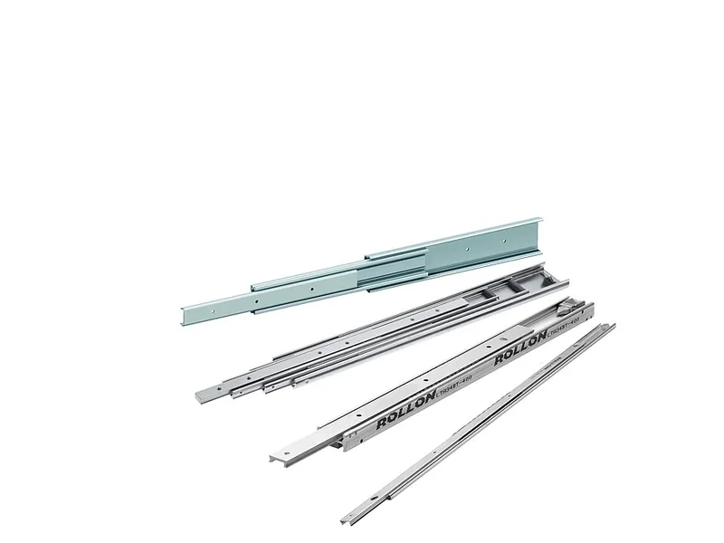

<figure class="eoc-pic eoc-pic-main"><figcaption><a href="https://commons.wikimedia.org/wiki/File:Light_Rail.jpg">Light Rail</a> by Rollon91, <a href="https://creativecommons.org/licenses/by-sa/3.0">CC BY-SA 3.0</a>, from Wikimedia Commons.</figcaption></figure>

Two or three nested steel or aluminium channels that roll on caged steel balls, letting a drawer, tray or robot stage pull out smoothly in a straight line, often its full length, with optional stops, locks, [detents](../glossary.md#detent) and soft-close.

**In plain words:** A pair of metal rails that slide inside each other on rows of little steel balls, so a drawer (or a robot arm) pulls out smoothly, often all the way, and can't fall out. **Proper term:** Telescopic ball-bearing drawer slide (ball-bearing slide, telescopic slide).

**Also called:** drawer slide / drawer runner; ball-bearing slide / ball slide / steel ball slide; telescopic slide / telescoping slide / telescopic rail / slide rail / telescopic channel slide; full-extension slide / 3-section slide (outer, middle and inner rails) versus 2-section slide (partial extension) (Wikipedia 'Drawer'); 3/4-extension, full-extension, over-travel and super-extension slides (how far the drawer comes out); side-mount slide / undermount slide / centre-mount slide (where it is fitted; Rockler); soft-close slide / self-closing slide / push-to-open or touch-release slide (Rockler); locking drawer slide / lock-in slide / lock-out slide (Chambrelan; Accuride); heavy-duty slide / file drawer slide / keyboard slide; double-extension slide (opens to both sides; Chambrelan); linear slide / drawer slides (robotics wording; gm0); MISUMI SAR slide rail, goBILDA Viper slide (brands used in FTC robotics; gm0); Accuride, Chambrelan (brands).

## How it works

Each member is a steel channel rolled into shape with grooves (ball races) along its edges (Wikipedia 'Drawer'). Rows of steel balls, spaced by a plastic or metal strip (ball retainer, or cage), sit in the grooves between one member and the next, so the members roll on the balls instead of rubbing (Wikipedia 'Linear-motion bearing'; Accuride). A three-part slide has a middle member that carries the drawer member further out, so the drawer can come out the full length of the slide (Wikipedia 'Drawer'); the members either move one after another (telescoping, in stages) or all together (progressive) (Accuride). The balls don't circulate: the ball cage rolls along between the members, moving about half as far as the member it carries ⚑ [uncertain], and stops at the ends keep the parts and balls together. Extra parts give a detent to stop the drawer creeping open, locks, a disconnect lever for removing the drawer, a spring that pulls the drawer shut, or a damper that slows it for the last few inches (Rockler; Accuride; Chambrelan).

## Parts

A small assembly that acts as one unit, used in pairs: an outer (cabinet) member, an intermediate member in full-extension slides, an inner (drawer) member, strips of steel balls held in ball retainers (cages) between each pair of members, end stops, and often a disconnect lever, a hold-in detent, a lock-in or lock-out latch, and a self-close spring or soft-close damper (Wikipedia 'Drawer'; Accuride slide reference guide; Rockler).

## Everyday examples

- Kitchen drawers and pantry pull-outs (Rockler)
- Office filing cabinets and tool-chest drawers (Accuride; Printables 'Drawer Slide Rear Detent' for a toolbox)
- Computer keyboard trays (Rockler)
- Oven racks and fridge drawers (Wikipedia 'Drawer' lists oven slides and fridge slides)
- Linear lifts and extending arms on FIRST Tech Challenge robots (gm0)

## When to use it

Use a ball-bearing slide when a drawer, tray, shelf or panel must pull out smoothly and carry weight, especially when you need to reach the back (full extension or over-travel): kitchen and workshop drawers, tool chests, pull-out shelves, keyboard and printer trays, electronics and equipment drawers, and vehicle drawers (with lock-in and lock-out). In robotics, cheap steel or aluminium drawer slides stacked with printed spacers make simple multi-stage lifts and extensions (gm0).

## When not to use it

Not for precise positioning or machine axes (use linear guides such as profile rails, rods and bushings, or crossed-roller slides); not where there is no room for side [clearance](../glossary.md#clearance) (use undermount slides or wooden runners; Rockler); not laid flat under heavy loads, which at least halves the rating (Accuride); not outdoors or in wet or dusty places unless stainless or aluminium and protected (Accuride). For small, light drawers, wooden runners or a printed plain slide are simpler and quieter; for cheap partial extension, roller (epoxy or 'Euro') slides with nylon wheels are enough (Rockler; Wikipedia 'Drawer').

## Details

- **What it does (jobs):**
  - let it move (turn, slide or bend): a low-friction straight-line guide for drawers, trays and robot lifts
  - lock, and release by hand: lock-in and lock-out slides hold a drawer shut or fully open until you press a latch (Chambrelan; Accuride)
  - slow it, stop it or keep its speed steady: soft-close slides slow the drawer over the last part of closing (Wikipedia 'Drawer'; Rockler)
  - click into set positions: a hold-in detent or 'hard point' keeps a drawer shut until pulled a little harder (Rockler; Chambrelan)
- **Movement:** slide, in a straight line. Travel: about 3/4 of the closed length (3/4 extension), the full length (full extension), a little more than the length (over-travel, the drawer clears the cabinet by an inch or so), or about 1.5 times the length with two intermediate members (super extension) (Rockler; Accuride; Chambrelan lexicon)
- **Directions it can move (degrees of freedom):** 1: the drawer slides in and out along the slide. Inside a full-extension slide the middle member also floats between its stops, but that doesn't give the drawer any extra movement
- **Special behaviour:**
  - hand-release only (locks under load, releases when a person operates it): lock-out slides hold the drawer fully open and lock-in slides hold it shut until you press a latch or lever; one locking slide per drawer is enough (Chambrelan; Accuride models 3607, 9307E, 9308E)
  - indexing (clicks into set positions): a hold-in detent keeps the drawer from creeping open if the cabinet is slightly out of plumb (Rockler); a 'hard point' holds shut or open until pulled harder (Chambrelan)
  - quick-release: disconnect levers, rail latches, push latches or a firm pull let the drawer come off its slides without tools (Accuride slide reference guide)
  - none of the others for a plain slide; self-close (a spring pulls the drawer shut over the last few inches), soft-close (a damper slows it) and push-to-open (a spring pushes it open) are added features (Rockler; Wikipedia 'Drawer')
- **How it holds:**
  - not a holding joint (it moves or passes on motion): it is a guide that lets the drawer slide
  - shape ([form-fit](../glossary.md#form-fit--force-fit--material-bond)): the balls run in rolled grooves that trap the members together, and stops, locks and disconnect latches hold by shape
  - spring force (a spring or springy part presses it in place): detents, self-close and push-to-open features use springs (Rockler)
- **Input and output:** not applicable (it guides straight-line motion; it doesn't change it). For robot lifts the slides are driven by a motor through strings or belts (see 'Multi-stage slide rigging'; gm0)
- **Power:** passive (no power needed); in robots and machines a motor drives the slide separately
- **Load:** light to heavy: Accuride groups slides as light duty up to 75 lb, medium duty 90 to 100 lb and heavy duty 100 to 600 lb per pair, with stainless and aluminium ranges up to 1,323 lb (Accuride slide reference guide); ordinary kitchen slides are about 75 to 100 lb (Rockler). Ratings are for a pair of 18 in slides fitted on their edges (on the drawer sides): they drop for longer slides, drop by at least 50% if the slides are laid flat under the drawer, and drop as extension increases (Accuride; Chambrelan). Strongest carrying weight down across the tall side of the slide; weakest to sideways loads and twisting when fully extended, where the slide bends (deflects) (Chambrelan lexicon; gm0)
- **Play and precision:** small in good steel slides; the fully extended slide bends (deflects) in proportion to the load (Chambrelan lexicon), and aluminium robot slides develop play as steel balls wear into the rails (gm0). The two slides must be parallel in both directions or they bind, though mounting one slightly higher than the other has little effect (Accuride). Side clearance must suit the slide, usually 1/2 in (12.7 mm) each side for ball-bearing side-mount slides (Rockler)
- **Taking it apart:** removable: screwed to the cabinet and drawer; most slides let the drawer be disconnected and lifted out by a lever, rail latch, push latch or a firm pull (Accuride slide reference guide)
- **How often it can be reused:** many times: can be unscrewed and refitted; most Accuride slides are tested to at least 50,000 open-and-close cycles to ANSI/BIFMA guidelines (Accuride slide reference guide)
- **Sealing:** none: dirt, sawdust and chips get into the ball tracks and spoil the movement (gm0; Accuride slide reference guide)
- **Adjustable:** mostly no: the position is fixed by where the screws go (some slides have slotted holes for small adjustments ⚑ [uncertain]), and travel, detent force and soft-close are set by the model; some industrial slides can be ordered with extension changed by up to 10% (Chambrelan lexicon)
- **Access needed:** one side only (blind): the cabinet member screws to the inside of the cabinet and the drawer member to the outside of the drawer box, each from its own open side
- **Materials:** Cold-rolled steel members and ball retainers with carburised steel balls and zinc plating; stainless steel throughout; or aluminium members with stainless balls and retainers for damp places (Accuride slide reference guide). Robot slides: aluminium (MISUMI SAR) or steel (goBILDA Viper) (gm0). Printed: PLA-on-PLA plain slides (Printables, JoshRC) or printed rails running on 6 mm airsoft BBs (Printables, Radek)
- **Heat, cold, water and wear:** Designed for indoor use, 0 to 180 F (about -18 to 82 C); keep away from moisture, chemical fumes, dirt and finish overspray; extreme temperatures affect the grease and the plastic or rubber parts (Accuride). Stainless steel and aluminium versions resist moisture (Accuride). Shock and vibration can upset slide performance, so test or pick a heavier slide (Accuride). Sawdust and chips spoil the movement (gm0). Vertical mounting, short [strokes](../glossary.md#stroke) and vibration make ball cages [creep](../glossary.md#creep) (linearmotiontips.com). Printed rails: PLA softens at about 60 C and PETG at about 80 C (CNC Kitchen).

## Making it

- **Ways to make or get it:**
  - off-the-shelf part: side-mount, undermount and centre-mount slides; heavy-duty, locking, soft-close and push-to-open slides; robotics slide rails
  - woodwork: fitting slides to cabinets, desks, workbenches and tool chests
  - 3D print (FDM): plain printed slides, rails running on airsoft BBs, spacers and brackets that stack bought slides into robot lifts, and installation jigs (Printables; gm0)
  - sheet metal: commercial slides are roll-formed from steel strip (Wikipedia 'Drawer'), a factory process
- **Printing it in one piece (print in place):** no: printed slides are printed as separate rails and assembled; Radek's BB slide says 'Do not print in place!', and JoshRC's plain slide has a stop block glued on after printing (Printables)
- **Tools:** screwdriver or drill-driver, tape measure and square or level, and ideally a positioning jig (Rockler; printable jigs on Printables); for robot lifts, countersunk M3 or M4 screws, nuts and often 3D-printed spacers (gm0)
- **Difficulty:** easy to moderate to buy and fit: the slides are cheap, but they must be mounted accurately, parallel and with the right side clearance (Accuride; Rockler); moderate to print a working light-duty slide (plain PLA or BB slides; Printables); hard to match steel slides' [stiffness](../glossary.md#stiffness) and load rating at home, so buy them for anything heavy

### 3D printing tips

1) For light drawers a plain printed slide can work without bearings: JoshRC's full-extension PLA slide relies on PLA's smooth surface, tightened its clearance from 0.5 mm to 0.25 mm, and was printed at 0.15 mm layers with 20% [infill](../glossary.md#infill) and at least 3 [perimeters](../glossary.md#perimeters), with no supports (Printables 'Smooth Drawer Slide without Bearings'). 2) For smoother running, print rails with grooves for 6 mm airsoft BBs: in Radek's parametric design a 0.15 mm gap lets the slide run freely (it moves by gravity from about 10 degrees of tilt) and a 0.10 mm gap makes it stay put even vertically; print each part separately in its best orientation with no supports, and screw the end stop on straight away so the balls can't escape (Printables 'Drawer Slide on Airsoft BBs'). Put in enough balls to cover the travel; Radek suggests testing how many fit so that one rail slides half the required distance. 3) Long thin rails twist: Radek's heavy-duty version reinforces the outer rail's edges and screws it at both ends and roughly in the middle; for longer rails on a 220 mm bed, print diagonally (Printables 'Airsoft Ball Bearing Drawer Slide - Extended'). 4) As a starting point for other moving fits use at least 0.3 mm clearance, then test (Prusa knowledge base). 5) Heat: PLA starts to give way at about 60 C and PETG at about 80 C (CNC Kitchen), so PLA rails in a hot car or enclosure will sag. 6) For robot lifts, use bought aluminium or steel slides and print only the spacers and brackets between stages; mount two slide sets facing each other to reduce sag, and keep chips and sawdust out of the tracks (gm0). 7) Printed jigs make fitting bought slides much easier (Printables 'Double Drawer Slide Jig'). 8) Anything heavy (tool drawers, pull-out shelves) needs bought steel slides.

### Buying one (off-the-shelf parts)

Search for: 'ball bearing drawer slide' (side mount), 'full extension drawer slide', '3/4 extension drawer slide', 'over travel slide', 'undermount drawer slide', 'soft close drawer slide', 'self closing drawer slide', 'push to open drawer slide' or 'touch release slide', 'heavy duty drawer slide', 'locking drawer slide' or 'lock-in lock-out slide', 'drawer slide with detent', 'disconnect', 'telescopic slide rail', 'keyboard slide', 'double extension slide', 'stainless steel drawer slide', 'drawer slide jig'. Robotics: 'MISUMI SAR2 / SAR3 slide rail', 'goBILDA Viper slide' (brands; gm0). Brands: Accuride, Chambrelan (brands)

## Rules of thumb

- Use the longest slide that fits; slide length is the closed length (Accuride slide reference guide); side-mount ball-bearing slides are usually the same length as the drawer box (Rockler).
- Ball-bearing side-mount slides usually need 1/2 in clearance between drawer and cabinet on each side (Rockler); many slides in Accuride's cross-section guide show a 0.50 in (12.7 mm) dimension, which appears to be that side space ⚑ [uncertain].
- Load ratings are per pair, for 18 in slides; the rating decreases in proportion beyond 18 in, and static capacity is at least twice the rating (Accuride slide reference guide).
- Mounting slides flat under a drawer cuts the load rating by at least 50% (Accuride); Chambrelan also advises mounting on the major axis rather than flat.
- Mount the pair parallel in both the vertical and horizontal directions; one high and one low has little effect (Accuride).
- For a flimsy drawer or cabinet, pick a slightly higher load rating and larger section, because the slides add stiffness (Accuride).
- Extension classes: partial about 0.7 of the closed length (roughly 2/3), full about 1x, super about 1.5x; more extension means less allowable load, and [deflection](../glossary.md#deflection) is proportional to load (Chambrelan lexicon).
- Typical ratings: light duty up to 75 lb, medium 90 to 100 lb, heavy 100 to 600 lb per pair (Accuride); everyday kitchen slides about 75 to 100 lb (Rockler).
- Commercial slides are designed for 0 to 180 F (about -18 to 82 C), indoors; re-grease cleaned slides with an EP (extreme pressure) grease (Accuride).
- Robot lifts: mount two sets of slides facing each other to reduce sag (gm0).
- Caged (non-recirculating) slides can suffer cage creep when mounted vertically, used on short strokes or shaken; occasional full strokes re-centre the cage (linearmotiontips.com; Isotech).

## Common failures

Drawer sags or tips when fully out (overloaded, too long, laid flat, or slides not facing each other; Accuride; gm0). Binding or rough running because the pair isn't parallel or the side clearance is wrong (Accuride; Rockler). Grit, sawdust or overspray in the tracks (Accuride; gm0). The ball cage creeps out of position, so the drawer won't open or close fully until it is pushed hard to the end, which skids the balls and causes wear (linearmotiontips.com; Isotech). Steel balls wear grooves into aluminium rails, giving play (gm0). End stops break and balls fall out (gm0). Plastic detents go [brittle](../glossary.md#brittle--ductile) and break (Printables 'Drawer Slide Rear Detent'). Printed slides: rails twist, warp or creep; use reinforced rails and screw them down along their length (Printables).

## Safety

Pinch points between the moving members and at the drawer front. Loaded, fully extended drawers move a cabinet's centre of gravity forward: US CPSC stability tests for dressers include loaded drawers and several drawers open at once, and CPSC reports 234 tip-over deaths from 2000 to 2022, 199 of them children, so anchor tall units to the wall (CPSC). Slides with a friction or rail disconnect release the drawer when it is pulled firmly or lifted (Accuride), so take care that a heavy drawer is not pulled off by accident. On robots, cheap slides' end stops can fail and spill ball bearings (gm0). In vehicles, lock-in slides keep drawers from flying open (Chambrelan).

## Related

- Linear guides (bushings on rods, wheels or carriages on rails): stiffer, more precise straight-line guides for machines
- Dovetail slide with gib strip: a sliding (not rolling) guide that can be tightened to remove play
- Multi-stage slide rigging (cascade and continuous): how strings or belts drive stacked slides in robot lifts
- Roller (epoxy or 'Euro') drawer slides: nylon wheels in a track; cheaper, usually 3/4 extension, often self-closing (Rockler; Wikipedia 'Drawer')
- Wooden drawer runners: a drawer sliding directly on the cabinet (Wikipedia 'Drawer')
- Telescoping tube locks (twist lock, lever lock): tubes that slide and lock at any length
- Dampers (rotary and linear soft-close dampers): the part that makes soft-close slides soft
- Push-push latch: the push-to-open mechanism used on handle-less drawers
- Crossed-roller slide: uses crossed rollers instead of balls for precise short strokes (linearmotiontips.com)

## Make it yourself

- [Drawer Slide on Airsoft BBs (f3d) (Radek, Printables) (URL from Printables API, page not opened)](https://www.printables.com/model/1216090-drawer-slide-on-airsoft-bbs-f3d): Parametric Fusion 360 drawer slide running on 6 mm airsoft BBs, in 180, 210, 350 and 720 mm lengths, with 'free' (0.15 mm) and 'constriction' (0.10 mm) clearance versions and a reinforced heavy-duty version; assembly instructions for loading the balls. Read through the Printables public API. *(licence: CC BY-SA)*
- [Smooth Drawer Slide without Bearings (Vollauszug - Open Drawer System) (JoshRC, Printables) (URL from Printables API, page not opened)](https://www.printables.com/model/95192-smooth-drawer-slide-without-bearings-vollauszug-op): A 400 mm full-extension printed slide that runs PLA on PLA with 0.25 mm clearance and no bearings or lubrication, for a 200 mm deep drawer. Read through the Printables public API. *(licence: CC BY-NC-SA)*
- [Airsoft Ball Bearing Drawer Slide - Extended (savingprivatebrian15, Printables)](https://www.printables.com/model/346078-airsoft-ball-bearing-drawer-slide-extended): A 9 in version of an airsoft-BB ball slide, printed diagonally on a 220 x 220 mm bed (page appeared in search results; details read through the Printables public API) *(licence: CC BY)*
- [Airsoft Ball Bearing Drawer Slide by EasilyBuild (Thingiverse) (page is JavaScript-only; details from a search-engine summary)](https://www.thingiverse.com/thing:2098563): The original printed ball slide using airsoft pellets as bearings ⚑ [uncertain] *(licence: ⚑ [uncertain])*
- [Double Drawer Slide Jig (Sorin B, Printables) (URL from Printables API, page not opened)](https://www.printables.com/model/184129-double-drawer-slide-jig): A reversible printed jig for positioning left- or right-hand drawer slides during installation. Read through the Printables public API. *(licence: CC BY)*

## Pictures, videos and models

- [P1000133 Teleskopschienenfuehrung: rail guide of a drawer (Dynomat, Wikimedia Commons)](https://commons.wikimedia.org/wiki/File:P1000133_Teleskopschienenf%C3%BChrung.JPG): Close-up photo of telescopic drawer slides fitted to a furniture drawer, used in Wikipedia's 'Drawer' article *(licence: CC BY-SA 3.0 (also GFDL 1.2+ and earlier CC BY-SA versions))*
- [Light Rail: telescopic drawer slides with ball bearings (Rollon91, Wikimedia Commons)](https://commons.wikimedia.org/wiki/File:Light_Rail.jpg): Photo of telescopic ball-bearing slides, used in Wikipedia's 'Drawer' gallery *(licence: CC BY-SA 3.0 / GFDL 1.2+)*
- [Telescopic Rail (Rollon91, Wikimedia Commons)](https://commons.wikimedia.org/wiki/File:Telescopic_Rail.jpg): Photo of a telescopic rail made of nested channels *(licence: CC BY-SA 3.0 / GFDL 1.2+)*
- [Drawer Slides (Game Manual 0)](https://gm0.org/en/latest/docs/common-mechanisms/linear-motion-guide/drawer-slides.html): Robot photos and cross-section drawings of drawer slides stacked into multi-stage lifts with 3D-printed inserts, and slides mounted facing each other to reduce sag *(licence: CC BY-NC 2.0 (gm0 repository licence))*
- [What Are Ball Bearing Drawer Slides and How Do They Work? (YouTube, OneMonroe)](https://www.youtube.com/watch?v=8VGzHawd8c8): Explainer video on ball-bearing drawer slides (title and channel confirmed via YouTube oEmbed; content not viewed) ⚑ [uncertain] *(licence: link only (standard YouTube licence))*
- [How to Load Bearings into a 3D Printed Linear Slide (YouTube, EasilyBuild)](https://www.youtube.com/watch?v=VrYiAUcE6vI): Loading airsoft BBs into a printed ball slide (title and channel confirmed via YouTube oEmbed; content not viewed) ⚑ [uncertain] *(licence: link only (standard YouTube licence))*

## Needs confirming

⚑ marks something nobody has confirmed yet: a fact the research could not confirm from a source, a finder value that is a best guess, or an open point from the research notes. Corrections are welcome (see `research/needs-confirming.md`).

- ⚑ 7 sentences on this page marked [uncertain].
- ⚑ Finder value `adjustable` = no (source uncertain): `adjustable` is marked ⚑ [uncertain] here: "…e the screws go (some slides have slotted holes for small adjustments ⚑ [uncertain]), and travel, detent force a…"

## Sources

- <https://en.wikipedia.org/wiki/Drawer>
- <https://en.wikipedia.org/wiki/Linear-motion_bearing>
- <https://www.rockler.com/learn/choosing-drawer-slide>
- <https://www.accuride.com/media/pdf/drawer-slide-reference-guide-2018.pdf>
- <https://chambrelan.com/lock-or-hard-points-on-drawer-slides/>
- <https://chambrelan.com/selecting-the-perfect-telescopic-slide-in-5-steps/>
- <https://chambrelan.com/lexicon/>
- <https://gm0.org/en/latest/docs/common-mechanisms/linear-motion-guide/drawer-slides.html>
- <https://gm0.org/en/latest/_sources/docs/common-mechanisms/linear-motion-guide/drawer-slides.rst.txt>
- <https://raw.githubusercontent.com/gamemanual0/gm0/main/LICENSE>
- <https://www.linearmotiontips.com/what-is-cage-creep-and-why-does-it-matter/>
- <https://www.linearmotiontips.com/what-is-a-crossed-roller-slide/>
- <https://www.isotechinc.com/choosing-crossed-roller-slide-or-table-assembly/>
- <https://www.cpsc.gov/Newsroom/News-Releases/2023/CPSC-Adopts-Final-Consumer-Product-Safety-Standard-to-Prevent-Tip-overs-of-Dressers-and-Other-Clothing-Storage-Units>
- <https://commons.wikimedia.org/wiki/Category:Telescopic_slides>
- <https://commons.wikimedia.org/wiki/File:P1000133_Teleskopschienenf%C3%BChrung.JPG>
- <https://commons.wikimedia.org/wiki/File:Light_Rail.jpg>
- <https://commons.wikimedia.org/wiki/File:Telescopic_Rail.jpg>
- <https://www.youtube.com/watch?v=8VGzHawd8c8>
- <https://www.youtube.com/watch?v=VrYiAUcE6vI>
- <https://www.cnckitchen.com/blog/comparing-pla-petg-amp-asa-feat-prusament>
- <https://help.prusa3d.com/article/modeling-with-3d-printing-in-mind_164135>
- <https://api.printables.com/graphql/>
