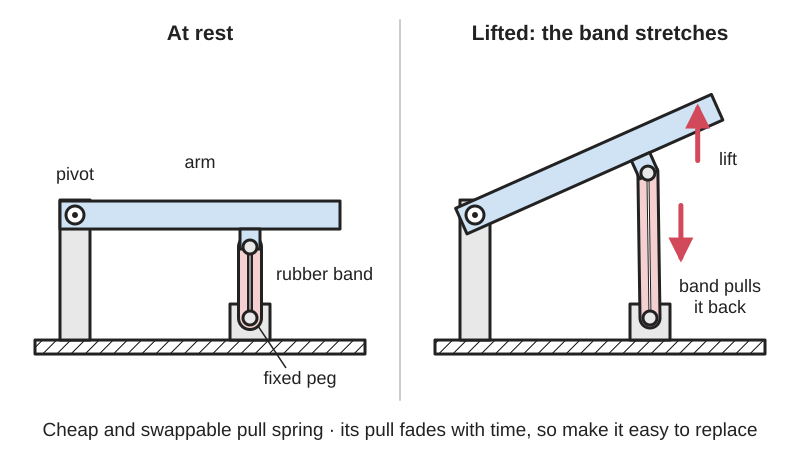

<figure class="eoc-pic eoc-pic-main"><figcaption>Diagram drawn for the encyclopaedia from the research notes. ⚑ Needs confirming: a drawing can simplify or get details wrong; a real photo or a better diagram is welcome.</figcaption></figure>

A rubber band, elastic cord or length of rubber tubing stretched between two anchor points so that it pulls them together: a cheap, very stretchy pull spring that you can cut, tie or swap by hand, but whose pull fades over time and which perishes in heat, sunlight and ozone.

**In plain words:** A stretchy loop or cord of rubber (a rubber band, hair tie, [O-ring](../glossary.md#o-ring), bungee cord or piece of rubber tubing) used instead of a metal spring to pull a part back into place, for example to pull a printed finger straight again after a string has bent it. **Proper term:** Elastomer tension spring: elastic band, elastic (shock) cord or rubber tubing used as an extension spring.

**Also called:** rubber band, elastic band (Wikipedia 'Rubber band'); elastic cord, shock cord, bungee cord (also spelled bungie or bungy); octopus strap or occy strap in Australia (Wikipedia 'Bungee cord'); rubber tubing bands: latex tubing, surgical tubing, slingshot or catapult bands, speargun bands (Wikipedia 'Slingshot', 'Speargun'); O-ring used as an elastic band (the OpenFlexure microscope calls its Viton O-rings 'elastic bands'); orthodontic elastics, intermaxillary elastics (small medical-grade latex bands; Wikipedia 'Elastics (orthodontics)'); ranger bands, snoopy loops (loops cut from car, motorcycle or bicycle inner tubes; Wikipedia 'Rubber band'); rubber motor (a twisted rubber band that powers a model aircraft propeller; Wikipedia 'Rubber band'); elastomer spring, rubber spring; hair tie, ponytail elastic; stretch cord, beading elastic; Viton (brand) O-ring, i.e. a fluoroelastomer (FKM) O-ring used as a band (Wikipedia 'Ozone cracking'; OpenFlexure).

## How it works

Rubber is a tangle of long, cross-linked chain molecules. Stretching it pulls the chains straighter; they 'want' to return to their tangled shape, so the band pulls back on whatever it is hooked to (an entropy effect, which is also why a stretched band warms up when stretched and contracts when heated; Wikipedia 'Rubber band', 'Gough-Joule effect'). Rubber can be stretched to several times its own length (Wikipedia 'Rubber elasticity' says up to about 10 times) and still return almost to its old length, which is far more stretch than a steel spring allows. The pull does not rise in a straight line with the stretch (it does not follow Hooke's law), and the band pulls less on the way back than on the way out ([hysteresis](../glossary.md#hysteresis)), so a little energy is lost as heat each time (Vernier; Penn State interactive). A loop hooked over two posts works as two strands side by side, and several bands side by side add their pulls, which is how makers tune the force: 'need more tension? use more/thicker rubber bands' (Makers Making Change, Printables).

## Parts

Single piece: a closed loop (rubber band, O-ring, hair tie) or a length of cord or tubing. To work it needs two anchor points on the parts: hooks, posts with a lip, notches, grooves, or holes with a knot tied behind them, and sometimes smooth tunnels or guides to route it (e-NABLE printed hands run elastic cord through tunnels from each fingertip into the palm; e-NABLE Phoenix v2). Shock cord is itself a small assembly: many rubber strands inside a woven cotton or polypropylene cover (Wikipedia 'Bungee cord'), sometimes with end hooks, cord locks or crimped fittings.

## Everyday examples

- a rubber band round a bundle of letters or a rolled-up newspaper (Wikipedia 'Rubber band')
- bungee cords with hooks holding luggage on a roof rack (Wikipedia 'Bungee cord')
- a slingshot (catapult) powered by latex tubing or flat bands (Wikipedia 'Slingshot')
- the elastic in braces on teeth (orthodontic elastics), and the thick elastic that holds ball-jointed dolls together (Wikipedia)

## When to use it

When you need a pull spring that is cheap, quick to try and easy to change: returning a printed finger, lever, latch or trigger to its rest position; holding a printed clamp or lid shut; keeping a nut or slider pressed against a screw to take out wobble; powering toys, catapults and rubber-band cars; or holding a string of parts together (dolls, tent-pole style sections). It is especially good when the part must stretch a long way compared with its size, when you want to tune the force by simply adding bands, when some [damping](../glossary.md#damping) is welcome, or when a soft, quiet pull is safer than a stiff steel spring.

## When not to use it

Not where the force must stay the same for months or years, or where failure matters: rubber loses force and perishes, so use a steel extension spring (see Coil spring) or a constant-force spring. Not in heat, strong sunlight, ozone (near electric motors) or oil: use a steel spring, or at least an EPDM, silicone or Viton band. Not where it must push: use a compression spring. Not for precise or repeatable force (e.g. a measuring device): rubber drifts with time and temperature. Not where a snapping band could hit someone's face or eyes. Not hidden inside a part where it can't be replaced.

## Details

- **What it does (jobs):**
  - store energy: stretch it and it pulls back, returning a part to its rest position, e.g. the elastic cords that straighten the fingers of printed prosthetic hands after the cable that bends them is released (Frontiers in Robotics and AI, 2021), or launching something (rubber-band catapults and cars)
  - tighten and hold tension: keeps a nut pulled against a screw so a mechanism has no wobble (OpenFlexure microscope), holds a printed clamp shut (rubber band spring clamp), or keeps a cord taut
  - join and hold: bundles things together (Wikipedia 'Rubber band') or holds a chain of parts together under tension, e.g. ball-jointed dolls strung with thick elastic (Wikipedia 'Ball-jointed doll')
- **Movement:** flex: it stretches along its own length. In practice it is used at about 2-3 times its relaxed length: orthodontic elastics are rated at 3 times their diameter (Clin Exp Dent Res 2025), and shock cord stretches about 120% +/- 15%, i.e. to about 2.2 times its length (Knot & Rope Supply). Rubber can be stretched much further, up to about 10 times in principle (Wikipedia 'Rubber elasticity'); a band in a Penn State demonstration was slowly stretched to almost 5 times. It can also wrap round pins and pulleys, and be twisted (rubber motor)
- **Directions it can move (degrees of freedom):** 1 in intended use: it only pulls along the straight line between its two anchors. Because it is floppy it does not hold anything in place sideways and it cannot push; it bends freely round pins, pulleys and tunnels
- **Special behaviour:**
  - tensioning (takes up slack and holds): keeps a fairly steady pull on a part as it moves or wears; in the OpenFlexure microscope the band 'tightens up the mechanism' so it moves smoothly and is less wobbly (OpenFlexure [actuator](../glossary.md#actuator) assembly guide)
  - none of the other listed behaviours on its own: it is the cheap 'engine' inside many printed latches, clamps, toys and prosthetic fingers
  - built-in damping: because it loses some energy on every stretch (hysteresis), it bounces less than a steel spring (Vernier; Penn State interactive)
- **How it holds:** spring force (the stretched band pulls the parts together); when it is wrapped round things to bundle or grip them, also friction or clamping (the band squeezes and its rubbery surface grips)
- **Input and output:** not applicable: it is a spring, not a transmission (a twisted rubber 'motor' does store turning energy and give it back to a propeller in rubber-powered model aircraft and boats; Wikipedia 'Rubber band')
- **Power:** passive (no power needed)
- **Load:** Light to medium, and only in pull. Orthodontic elastics are rated from 2 oz (about 0.56 N) to 8 oz (about 2.2 N) (Wikipedia 'Elastics (orthodontics)'); a printed-hand finger model assumed an elastic cord of about 1,000 N/m with forces under 25 N (Frontiers in Robotics and AI, 2021); 1/8 in (3 mm) shock cord has a breaking strength of about 100 lb (about 445 N), and safe working loads for rope are usually 1/10 to 1/4 of the breaking strength (Knot & Rope Supply). It cannot push and does nothing in [shear](../glossary.md#peel-vs-shear) or twist; it is weakest at knots (which can reduce rope strength by up to 50%; Knot & Rope Supply), at nicks and where it bends over a sharp edge
- **Play and precision:** not applicable as a locating part: it only supplies a pull. It is, however, a good way to remove play: the OpenFlexure microscope uses its bands to pull a nut down onto a screw so the mechanism is tight and smooth. Its force is not precise: it depends on how far and how often it has been stretched (hysteresis; the first stretches soften rubber, the Mullins effect, Wikipedia), on temperature, and on time (latex orthodontic elastics held at 3 times their diameter at 37 degC lost 16% of their force in 2 h and 31% in 48 h; Clin Exp Dent Res 2025). It tolerates large [misalignment](../glossary.md#misalignment) because it is floppy
- **Taking it apart:** tool-free quick release: a band slips off its hooks or posts by hand, and a tied cord is undone or cut. Exception: a band or O-ring embedded in a print during a pause cannot be replaced when it fails (comment on Hackaday, 2023), so that design is effectively permanent
- **How often it can be reused:** many times for fitting and removing, but the band itself is a wear part with a limited life: the OpenFlexure team found ordinary rubber bands 'perished after weeks to months (regardless of use)', while Viton O-rings let the microscope run about 30,000 cycles of stage motion over several months without failure (Collins et al., Biomedical Optics Express 2020). Plan for it to be replaced
- **Sealing:** none
- **Adjustable:** Yes: add or remove bands, use a thicker or shorter band, move an anchor post, or re-tie a cord shorter or at a different tie-off point (the e-NABLE Raptor Reloaded hand offers two tie-off options for its elastics). The [stiffness](../glossary.md#stiffness) of one given band cannot be changed
- **Access needed:** not applicable for most uses: it is fitted while the parts are assembled. You need to reach both anchor points, or route the cord through a tunnel and tie it off at an end you can reach (e-NABLE hands tie their finger elastics off in the palm)
- **Materials:** Natural rubber (latex) for most rubber bands, chosen for its 'superior elasticity' (Wikipedia 'Rubber band'); synthetic elastomers for larger or tougher bands: EPDM (outstanding resistance to ozone and sunlight, -50 to +150 degC), silicone (-100 to +315 degC, but poor tear and abrasion resistance), neoprene and nitrile (Pooley 'Common Properties of Rubber Elastomers'); fluoroelastomer (FKM, Viton (brand)) O-rings resist ozone and are used by OpenFlexure, which warns they must be Viton, not nitrile (OpenFlexure troubleshooting). Shock cord: rubber strands in a woven cotton, polypropylene or polyester cover (Wikipedia 'Bungee cord'). Printed TPU bands are a light-duty option (one OpenFlexure contributor reports a printed TPU band 'working great' so far). The anchors can be any printed plastic, wood or metal; keep natural rubber away from oils, fuels and solvents (poor resistance; Pooley)
- **Heat, cold, water and wear:** Heat: natural rubber's useful range is about -55 to +82 degC (Pooley); the e-NABLE Phoenix v2 remix replaced 'all the rubber bands' because they do not survive tropical heat. Sunlight, oxygen and ozone: natural rubber is 'damaged by aging, sunlight, oil and perspiration' (Wikipedia 'Natural rubber'); tiny traces of ozone crack natural, nitrile and styrene-butadiene rubbers, and cracks form in stretched parts at right angles to the stretch (Wikipedia 'Ozone cracking'); EPDM, fluoroelastomers (Viton), neoprene, silicone and polyurethanes resist ozone. Store spares cool, dark and away from motors and other ozone sources (APG: never above 120 degF, about 49 degC). Time: even indoors, rubber bands perished in weeks to months (Collins et al. 2020), and held stretched they lose force over hours ([stress relaxation](../glossary.md#stress-relaxation); Clin Exp Dent Res 2025) and slowly get longer under a steady load ([creep](../glossary.md#creep); Wikipedia 'Stress relaxation'). Cold: below its glass transition rubber goes stiff and stops springing back, as with the Challenger O-rings (Wikipedia 'Natural rubber'). Warmth: a stretched band pulls harder when heated (Gough-Joule effect). Water: natural rubber absorbs water and its elasticity deteriorates (Wikipedia 'Elastics (orthodontics)').

## Making it

- **Ways to make or get it:**
  - off-the-shelf part: rubber bands, O-rings, shock cord and latex tubing are the usual choice
  - 3D print (FDM): the parts with the hooks, posts, grooves and cord tunnels; printed TPU bands for light duty
  - 3D print (resin): the same anchor features, with smooth surfaces that are kind to bands
  - woodwork, laser cut, CNC: notches, pegs and holes to hook bands on or tie cord to
- **Printing it in one piece (print in place):** partly: the printed parts with their hooks, posts and tunnels can print in one go, but the band or cord is always a separate bought part added afterwards. A band can be dropped in during a print pause (Hackaday, 2023), but then it cannot be replaced when it perishes
- **Tools:** Usually none. Long-nose pliers or a small hook help stretch a small band onto a post (Joystick Fidget instructions, Printables); a printed insertion tool for bands hidden inside a part (OpenFlexure 'elastic band tool'); scissors for cord and tubing; a secure knot for cord, e.g. the improved clinch knot used on printed hands (Frontiers in Robotics and AI, 2021)
- **Difficulty:** easy: buy bands or cord, add hooks, posts or tunnels to the printed part, and stretch it on by hand. The real design work is making the anchors smooth and secure and making the band easy to replace

### 3D printing tips

1) Buy the stretchy part, print the anchors. A printed plastic spring slowly loses its force: 'plastic always permanently deforms under tension' and PLA makes a very poor spring (Hackaday, 2026, article and comments), whereas a rubber band costs almost nothing and is easy to replace. 2) Hooks and posts: give each post a lip, groove or mushroom head so the band cannot slide off, and round every edge the band touches; rubber cracks first where it is strained most, e.g. at sharp corners (Wikipedia 'Ozone cracking'). A post pulled sideways across its [layer lines](../glossary.md#layer-lines) can snap off, so make posts chunky or print them lying down so the pull runs along the layers ⚑ [uncertain: general FDM practice, not from a tested source]. 3) Tunnels for cord: make them wide and smooth with gentle bends; the e-NABLE Phoenix v2 remix widened all its cable tunnels and added tunnels so an elastic cord runs 'all the way from the fingertip up into the palm', tied to a bar at the thumb base (e-NABLE Phoenix v2 page). 4) Design for replacement: make bands reachable, or add a printed insertion tool and internal hooks the band clicks onto, as the OpenFlexure microscope does (its band 'should click twice - once for each side'). 5) [Preload](../glossary.md#preload) it: choose a band that is already stretched when the part is at rest, so it still pulls at the end of travel; size the working stretch to the band (orthodontic elastics are rated at 3 times their diameter; shock cord stretches about 120% at most; Knot & Rope Supply). 6) Tune the force with several bands side by side rather than one tight band; it also gives a spare if one breaks (Rubber Band Spring Clamp and Rubber Band Clamp models on Printables: 'add as many rubber bands as you like to get the desired clamping force'). 7) Heat: don't embed bands where hot plastic or a hot environment will cook them; natural rubber's useful range ends at about +82 degC (Pooley), and a Hackaday commenter worried about heat from the nozzle when embedding bands. 8) For cord, use a secure knot such as the improved clinch knot (Frontiers in Robotics and AI, 2021). 9) Common printed-part failures: post snaps at a layer line, band cut by a sharp printed edge, cord jams in a rough or too-narrow tunnel.

### Buying one (off-the-shelf parts)

Rubber bands, sized by number in the US (e.g. #33 = 3-1/2 x 1/8 in, #64 = 3-1/2 x 1/4 in, both 1/32 in thick; Wikipedia 'Rubber band'); weather-resistant rubber bands, extra-long rubber bands and rubber banding (McMaster-Carr 'Rubber Bands'); O-rings in FKM/Viton (brand), EPDM, silicone or nitrile, e.g. 30 mm x 2 mm Viton O-rings (OpenFlexure parts list, Collins et al. 2020); elastic cord, also sold as shock cord or bungee cord, in 1/8 in (3 mm), 1/4 in and larger sizes (Knot & Rope Supply; 3 mm polypropylene shock cord on a printed hand in Frontiers 2021); bungee cords with hooks (McMaster-Carr); latex tubing (surgical tubing, slingshot bands); orthodontic elastics in light to extra-heavy force ratings (Wikipedia 'Elastics (orthodontics)'); hair ties; cord locks and hooks for elastic cord ends

## Rules of thumb

- Stretch range: elastic (shock) cord stretches about 120% +/- 15%, so 6 in becomes about 13.2 in (Knot & Rope Supply, https://www.knotandrope.com/products/1-8-shock-cord-1000-spool); orthodontic latex elastics are rated at 3 times their own diameter (https://pmc.ncbi.nlm.nih.gov/articles/PMC11783226/). Design so the band works inside this range, with some stretch already on at rest.
- Expect the pull to fade: latex elastics held at 3 times their diameter at 37 degC lost 16% of their force after 2 h, 23% after 8 h, 28% after 24 h and 31% after 48 h in the lab (more in the mouth), with most of the loss in the first 2 h (Clin Exp Dent Res 2025, https://pmc.ncbi.nlm.nih.gov/articles/PMC11783226/). So size a band for the force you need after it has settled, not when new.
- Force is not proportional to stretch: an idealised rubber band follows F = K (L/L0 - (L0/L)^2), rising steeply at first, and the unloading curve lies below the loading curve (Penn State interactive, https://phys23p.sl.psu.edu/~mrg3/interactives/EJSS_mrg/ejss_model_Bungee_Hysteresis_Thermal_V2/ElasticHysteresisIntroduction.html; Vernier, https://www.vernier.com/vernier-ideas/elastic-hysteresis-of-a-rubber-band/).
- Rope-style safety margin for cord: working loads are usually 1/10 to 1/4 of the average breaking strength, and knots can reduce strength by up to 50% (Knot & Rope Supply, https://www.knotandrope.com/products/1-8-shock-cord-1000-spool).
- Lifetime: ordinary rubber bands perished in weeks to months whether used or not; Viton O-rings (30 mm inside diameter, 2 mm thick, about 75 Shore A, able to stretch at least 150%) lasted about 30,000 cycles over several months (Collins et al. 2020, https://www.ebi.ac.uk/europepmc/webservices/rest/PMC7249832/fullTextXML; OpenFlexure troubleshooting, https://build.openflexure.org/openflexure-microscope/master/troubleshooting.html).
- Temperature ranges by rubber type: natural rubber about -55 to +82 degC, EPDM -50 to +150 degC, nitrile and neoprene -40 to +135 degC, silicone -100 to +315 degC (Pooley, https://www.pooleyinc.com/wp-content/uploads/Common-Properties-of-Rubber-Elastomers.pdf).

## Common failures

1) Perishing: the band goes sticky, hard or cracked and then snaps, usually sooner in heat, sunlight or near motors; replace on a schedule or switch to EPDM, silicone or Viton (Collins et al. 2020; Wikipedia 'Ozone cracking'). 2) Losing force (stress relaxation and creep): a finger or latch no longer fully returns; use a band with more stretch on at rest, add a second band, or re-tie the cord tighter (Clin Exp Dent Res 2025). 3) Cut or nicked by sharp printed edges or rough layer lines, then tearing: round and smooth every contact point (silicone in particular has poor tear resistance; Pooley). 4) Slipping off a post or hook: add a lip, groove or keeper. 5) Breaking at a knot: knots can halve the strength of rope (Knot & Rope Supply); use a proper knot and leave a tail. 6) Sticking in tunnels: friction stops the part returning fully; widen and smooth the tunnel (e-NABLE Phoenix v2 widened its tunnels). 7) Wrong material: nitrile O-rings crack in ozone and failed in OpenFlexure, which requires Viton (OpenFlexure troubleshooting). 8) Band embedded in the print cannot be replaced, so the whole part is scrap when it fails (Hackaday comment).

## Safety

Snap-back: a band or bungee cord that slips or breaks can lash back and cause serious eye or face injuries (Wikipedia 'Bungee cord'); in slingshots a band that fails at the fork end flies back at the user's face (Wikipedia 'Slingshot'). Stretch bands away from your face, wear safety glasses for strong bands and tubing, and replace cracked bands. Latex allergy: some people react seriously to natural rubber latex; latex-free bands made from synthetic rubber exist (Wikipedia 'Natural rubber', 'Rubber band'). Tight bands round fingers or limbs cut off blood flow (this is how elastration rings work; Wikipedia 'Rubber band'). Catapults and band-powered launchers store a lot of energy: never aim them at people or animals.

## Related

- Coil spring (extension spring): steel, steady and predictable force for many years, but much less stretch and needs hooks; the long-life choice
- Constant-force spring: pulls almost the same force over a long distance, where a rubber band's force changes a lot with stretch
- Printed leaf spring and other printed compliant springs: printed in one piece with the part, but plastic creeps and loses force (PLA especially)
- Shock-corded sectional pole: uses elastic cord only to pull tube sections home
- Spiral power spring (clock spring): a flat steel spiral that stores turning energy, where a rubber motor stores it by twisting
- Elastomer isolation mount (rubber bobbin, grommet): rubber used squashed or sheared to soak up vibration rather than stretched as a spring
- Series-elastic coupling: puts a deliberate spring (sometimes elastic) between a motor and its load to measure and soften force
- Pneumatic artificial muscle (McKibben muscle): a rubber tube inside a braid that pulls when pumped up with air
- Stopper knots and cord-end anchors: a knot behind a hole or a printed cord-end anchor to tie off elastic cord, as at the palm end of printed hands

## Make it yourself

- [Rubber Band Spring Clamp (LoboCNC, Printables)](https://www.printables.com/model/617245-rubber-band-spring-clamp): Spring clamp printed flat in two halves held together by rubber bands; add bands to get the clamping force you want; scales from 50% to 100% *(licence: CC BY-SA)*
- [Rubber Band Clamp (Makers Making Change, Printables)](https://www.printables.com/model/476915-rubber-band-clamp): Simple printed clamp tensioned by rubber bands ('need more tension? use more/thicker rubber bands!'), needs 3 bolts and nuts *(licence: CC BY-SA)*
- [Spring latch sliding door bolt lock: rubber band, metal spring, 3D printed spring (Meister Edel, Printables) (URL from Printables API, page not opened)](https://www.printables.com/model/236902-spring-latch-sliding-door-bolt-lock-rubber-band-me): The same sliding bolt in three versions so you can compare a rubber band, a metal spring and a printed spring; the designer notes rubber bands work smoothly but 'get brittle and need to be replaced' *(licence: CC BY-NC-SA)*
- [Joystick Fidget (Using Rubber Band Spring) (Eric Woo-Shem, Printables) (URL from Printables API, page not opened)](https://www.printables.com/model/1347249-joystick-fidget-using-rubber-band-spring): Self-centring joystick sprung by two small orthodontic-size rubber bands crossed over hooks *(licence: CC BY)*
- [Rubber Band Catapult (Vojtech Ruzicka, Printables) (URL from Printables API, page not opened)](https://www.printables.com/model/145372-rubber-band-catapult): Small printed catapult powered by one rubber band, to feel how much energy a band stores (wear glasses; never aim at people) *(licence: CC BY-NC)*
- [The Raptor Reloaded (e-NABLE)](https://enablingthefuture.org/upper-limb-prosthetics/raptor-reloaded/): Open-source printed prosthetic hand whose fingers are bent by non-stretchy cords and pulled straight again by elastic cords; links to files and assembly instructions *(licence: not stated on the page (e-NABLE acceptance terms apply))*

## Pictures, videos and models

- [RubberBand.jpg (Hao-Nhien Q. Vu, Wikimedia Commons)](https://commons.wikimedia.org/wiki/File:RubberBand.jpg): Diagram of how a rubber band is measured: flat length, cut width and wall thickness *(licence: Public domain)*
- [Ozone cracks in tube1.jpg (Peterlewis, Wikimedia Commons)](https://commons.wikimedia.org/wiki/File:Ozone_cracks_in_tube1.jpg): Photo of ozone cracking in natural rubber tubing: the typical way rubber perishes, with cracks across the direction of strain *(licence: Public domain)*
- [Bungee Cord PICT6882a.jpg (Jmb, Wikimedia Commons)](https://commons.wikimedia.org/wiki/File:Bungee_Cord_PICT6882a.jpg): Photo of small bungee cords with metal hooks (elastic cord in a woven cover) *(licence: CC BY 2.5)*
- [Modeling Rubber Band Cords Beyond Hooke's Law (Penn State interactive)](https://phys23p.sl.psu.edu/~mrg3/interactives/EJSS_mrg/ejss_model_Bungee_Hysteresis_Thermal_V2/ElasticHysteresisIntroduction.html): Measured force-stretch graphs of a rubber band stretched to almost 5 times its length and released, showing the curved, looping (hysteresis) behaviour *(licence: link only)*
- [OpenFlexure Microscope: Actuator assembly](http://rwb27.github.io/openflexure_microscope/docs/1_actuator_assembly.html): Step-by-step photos of fitting Viton O-ring 'elastic bands' into a printed mechanism with a printed insertion tool, so they pull a nut down onto a screw *(licence: link only (licence not checked))*

## Needs confirming

⚑ marks something nobody has confirmed yet: a fact the research could not confirm from a source, a finder value that is a best guess, or an open point from the research notes. Corrections are welcome (see `research/needs-confirming.md`).

- ⚑ 1 sentence on this page marked [uncertain].
- ⚑ Finder value `connects` = strap, cord or fabric (best guess): worked out from its name, but joining parts is not one of its two main jobs

## Sources

- <https://en.wikipedia.org/wiki/Rubber_band (read as raw wikitext)>
- <https://en.wikipedia.org/wiki/Bungee_cord (read as raw wikitext)>
- <https://en.wikipedia.org/wiki/Natural_rubber (read as raw wikitext)>
- <https://en.wikipedia.org/wiki/Ozone_cracking (read as raw wikitext)>
- <https://en.wikipedia.org/wiki/Rubber_elasticity (read as raw wikitext)>
- <https://en.wikipedia.org/wiki/Mullins_effect (read as raw wikitext)>
- <https://en.wikipedia.org/wiki/Stress_relaxation (read as raw wikitext)>
- <https://en.wikipedia.org/wiki/Gough%E2%80%93Joule_effect (read as raw wikitext)>
- <https://en.wikipedia.org/wiki/EPDM_rubber (read as raw wikitext)>
- <https://en.wikipedia.org/wiki/Elastics_(orthodontics) (read as raw wikitext)>
- <https://en.wikipedia.org/wiki/Slingshot (read as raw wikitext)>
- <https://en.wikipedia.org/wiki/Speargun (read as raw wikitext; latex tubing bands about one third of the barrel length)>
- <https://en.wikipedia.org/wiki/Ball-jointed_doll (read as raw wikitext)>
- <https://www.frontiersin.org/journals/robotics-and-ai/articles/10.3389/frobt.2020.594196/full (Cabibihan et al., 'Suitability of the Openly Accessible 3D Printed Prosthetic Hands for War-Wounded Children', Frontiers in Robotics and AI, 2021)>
- <https://enablingthefuture.org/phoenix-hand/ (e-NABLE Phoenix v2: rubber bands replaced for tropical heat; elastic cord tunnels)>
- <https://enablingthefuture.org/upper-limb-prosthetics/raptor-reloaded/>
- <https://pmc.ncbi.nlm.nih.gov/articles/PMC11783226/ ('Force Degradation of Intermaxillary Latex Elastics: Comparative In Vitro and In Vivo Study', Clinical and Experimental Dental Research 2025, CC BY 4.0; full text also read via NCBI E-utilities)>
- <https://www.ebi.ac.uk/europepmc/webservices/rest/PMC7249832/fullTextXML (Collins et al., 'Robotic microscopy for everyone: the OpenFlexure microscope', Biomedical Optics Express 2020, CC BY 4.0, PMC7249832)>
- <https://build.openflexure.org/openflexure-microscope/master/troubleshooting.html>
- <http://rwb27.github.io/openflexure_microscope/docs/1_actuator_assembly.html>
- <https://gitlab.com/openflexure/openflexure-microscope/-/merge_requests/159 (printed TPU tension band; anecdotal report)>
- <https://www.knotandrope.com/products/1-8-shock-cord-1000-spool (Knot & Rope Supply shock cord specifications and rope strength notes)>
- <https://www.pooleyinc.com/wp-content/uploads/Common-Properties-of-Rubber-Elastomers.pdf (Pooley Inc., 'Common Properties of Rubber Elastomers')>
- <https://knowledge.callapg.com/blog/how-long-do-elastomers-last (APG, 'The Shelf Life of Elastomers')>
- <https://phys23p.sl.psu.edu/~mrg3/interactives/EJSS_mrg/ejss_model_Bungee_Hysteresis_Thermal_V2/ElasticHysteresisIntroduction.html>
- <https://www.vernier.com/vernier-ideas/elastic-hysteresis-of-a-rubber-band/>
- <https://hackaday.com/2023/02/26/rubber-bands-and-o-rings-give-3d-prints-some-stretch/ (article and comments)>
- <https://hackaday.com/2026/04/27/the-challenges-of-3d-printing-reliable-springs/ (article and comments)>
- <https://www.mcmaster.com/products/rubber-bands/ (product family names only)>
- <https://api.printables.com/graphql/ (Printables API: models 617245, 476915, 236902, 1347249, 145372)>
- <https://commons.wikimedia.org/wiki/File:RubberBand.jpg>
- <https://commons.wikimedia.org/wiki/File:Ozone_cracks_in_tube1.jpg>
- <https://commons.wikimedia.org/wiki/File:Bungee_Cord_PICT6882a.jpg>
