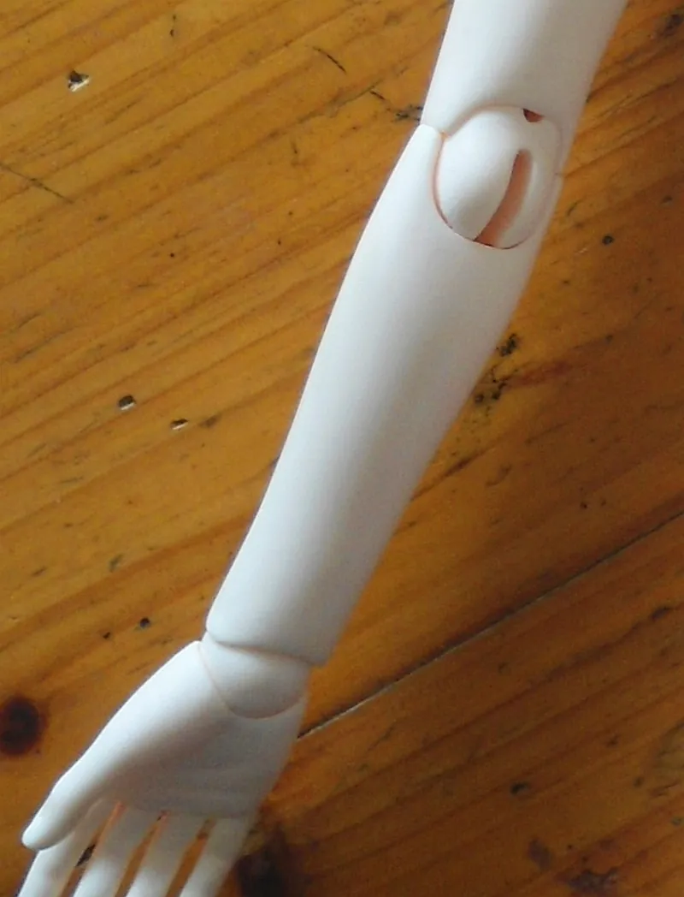

<figure class="eoc-pic eoc-pic-main"><picture><source media="(prefers-reduced-motion: reduce)" srcset="../media/drawn/elastic-strung-ball-joint.svg"></picture><figcaption><strong>Animation.</strong> Diagram drawn for the encyclopaedia from the research notes. ⚑ Needs confirming: a drawing can simplify or get details wrong; a real photo or a better diagram is welcome.</figcaption></figure>
<figure class="eoc-pic"><figcaption><strong>Photo.</strong> <a href="https://commons.wikimedia.org/wiki/File:Elbow_and_wrist_joint_of_male_ball-jointed_doll.jpg">Elbow and wrist joint of male ball-jointed doll</a> by Anna Frodesiak, <a href="http://creativecommons.org/publicdomain/zero/1.0/deed.en">CC0</a>, from Wikimedia Commons.</figcaption></figure>

A chain of hollow ball-and-socket joints held together by a stretched elastic cord running through them, so the cord keeps every joint pulled closed and friction lets the figure hold a pose, yet any part can be unhooked and swapped.

**In plain words:** Hollow doll or figure parts with round ball ends that sit in cups, all threaded on a stretchy cord hidden inside, so the cord pulls every joint shut and the rubbing of ball in cup holds whatever pose you bend it into. **Proper term:** Elastic-strung ball joint (ball-jointed doll stringing; strung ball-and-socket joints).

**Also called:** ball-jointed doll (BJD), Asian ball-jointed doll (ABJD); strung doll, strung body, elastic-strung doll; doll stringing / restringing (the job of fitting or replacing the cord); classic restringing (vintage composition and hard-plastic dolls; Prilly Charmin); S-hook stringing; double-jointed doll (bodies with an extra knee or elbow piece); Super Dollfie, Dollfie (brands; Wikipedia says these trademarks are sometimes wrongly used for all BJDs).

## How it works

Each body part is hollow, and the elastic cord is threaded through the hollow spaces so it runs through every joint (BJD Life). The cord is stretched when the doll is assembled, so it pulls each ball into its cup; the squeeze between ball and cup gives the friction that holds a pose. Most dolls use two loops: one goes across the chest and out through both arms to S-hooks at the hands, the other is an upside-down V from the neck down both legs to S-hooks at the feet, and the head is hooked onto the top of that leg loop (BJD Life). Tension is the whole adjustment: too loose and the doll can't sit or limbs flop; too tight and the joints grind, the doll 'snaps into a sitting position', and thin wrist and ankle pieces can crack (BJD Life). Because each hand, foot and head hangs on a hook, it can be unhooked and swapped for another (Wikipedia 'Ball-jointed doll'; BJD Life). Collectors Weekly notes that each segment is linked inside by elastic or, on some dolls, a metal spring.

## Parts

A small assembly that acts as one unit. Parts: hollow body pieces with a ball on one end and a cup (socket) on the other (head, neck, chest, pelvis, upper and lower arms and legs, hands, feet; extra knee or elbow pieces on double-jointed bodies); one or two loops of thick elastic cord; S-hooks (or wire hooks or a bar) at the hands, feet and inside the head; knots, sometimes a dab of glue on the knot; optional bead to keep the leg cords together (Prilly Charmin), magnets for a removable head cap or face plate, and friction add-ons such as suede linings or 'kips' discs (Afrodita review; BJD Collectasy).

## Everyday examples

- Resin ball-jointed collector dolls (Wikipedia 'Ball-jointed doll')
- Old composition and hard-plastic play dolls whose arms, legs and head are held on by elastic inside (Prilly Charmin; Wikipedia)
- Wooden artist's mannequins and 3D-printed posable figures strung with elastic ⚑ [uncertain]

## When to use it

Use elastic stringing for a posable figure made of hollow hard parts (doll, puppet, art figure, creature) when you want every joint to stay closed, hold a pose by friction, and come apart for painting, swapping hands, heads or feet, or repairs. It suits hand-sculpted clay dolls and 3D-printed figures because the joints need no pins, screws or tight print [tolerances](../glossary.md#tolerance): the cord takes up any gaps.

## When not to use it

Avoid it for small or solid parts with no room for a cord channel (use a pinned joint or a snap-in ball-and-socket joint), for poses that must hold a heavy part out sideways (use friction ball joints you can tighten, or a wire armature), for a figure that must never move once posed (glue it or use an armature), and for toys for small children, since unhooked parts and hooks are small and the cord snaps back hard ⚑ [uncertain]. For a single joint that must hold a camera or lamp, use a lockable ball head.

## Details

- **What it does (jobs):**
  - let it move (turn, slide or bend): every joint swivels and bends like a ball-and-socket joint
  - join and hold: the cord keeps all the separate parts together as one figure
  - tighten and hold tension: the stretched cord keeps every joint pulled closed, and its tension is set by where the knot is tied
- **Movement:** multiple: each joint can swivel and bend (rotate about any axis through the ball), limited by the cut of the cup; double-jointed knees and elbows add a second piece and pivot for a deeper bend and a more natural look (BJD Collectasy 'Embody' review; a Booth parts set converts single ball-jointed knees to double-jointed ones 'improving both the range of motion and appearance')
- **Directions it can move (degrees of freedom):** Up to 3 per joint (turning about three axes through the ball, no sliding), and the whole figure has many joints in a chain. In practice the cup shapes limit some joints to bending one way, like a hinge. The cord lets a joint pull apart a little under force, then snaps it back.
- **Special behaviour:**
  - tensioning (takes up slack and holds): the stretched cord keeps pulling every joint closed, and it can be tightened or loosened by moving the knot (BJD Life; Dolk)
  - self-aligning or self-centring: the cord pulls each ball back into its cup, so a limb that is knocked out of place pulls itself back in
  - quick-release: hands, feet and heads hang on S-hooks or wire hooks and can be unhooked and swapped (Wikipedia 'Ball-jointed doll'; BJD Life)
  - [fail-safe](../glossary.md#fail-safe--fail-secure) or breakaway: a limb pulled hard comes partly out of its socket against the cord instead of snapping off ⚑ [uncertain]
- **How it holds:**
  - spring force (a spring or springy part presses it in place): the stretched elastic cord pulls each ball into its socket
  - friction or clamping ([force-fit](../glossary.md#form-fit--force-fit--material-bond)): the pose is held only by friction between ball and cup, which the cord's pull creates; suede or hot-glue linings and silicone 'kips' discs add friction (Afrodita review; BJD Collectasy)
  - shape (the parts interlock; form-fit): the cup shapes stop joints bending past their limits, and the hooks catch on the cord
  - magnetic: some dolls hold the head cap, face plate or hands on with magnets instead of the cord (Printables 'Eve', 'The Fabled Hare'; BJD Collectasy on Pidgin dolls)
- **Input and output:** not applicable
- **Power:** passive (no power needed)
- **Load:** light: holds the figure's own weight in a pose. Strongest when the joints are pressed together; weakest against bending a limb that sticks out, which is held only by friction. Bigger, heavier dolls need a thicker or stronger cord (BJD Life supplies page; Prilly Charmin).
- **Play and precision:** noticeable: joints can be pulled apart a little against the cord and hold a pose by friction only, so they are not precise and don't return to exact angles. Loose stringing makes limbs swing; very tight stringing makes joints grind and spring back (BJD Life).
- **Taking it apart:** removable: parts come off by unhooking a hand, foot or head from the cord while holding the cord with a clamp; the whole doll can be taken apart and restrung (BJD Life)
- **How often it can be reused:** many times for swapping hands and heads; the elastic itself is a wearing part that stretches out and must be replaced from time to time (BJD Life)
- **Sealing:** none
- **Adjustable:** yes: tension is set by where the knot is tied (move the knot up or down; BJD Life) and can be tightened or loosened later with a hook tool or pliers (Dolk). Cord can be doubled for more pull (Prilly Charmin). Friction can be raised with suede or hot-glue linings or 'kips' discs (Afrodita review; BJD Collectasy).
- **Access needed:** both sides: you work through the neck, limb and head openings, and the head or a removable head cap gives access to the hook inside (Prilly Charmin; Printables 'Customizable ball jointed doll head cap')
- **Materials:** Body parts: polyurethane resin (modern BJDs), bisque, composition (pulp, sawdust and glue on old dolls), hard plastic and vinyl (vintage dolls), wood, polymer clay, papier-mache clay, air-dry clay and 3D-printed PLA or resin (Wikipedia 'Ball-jointed doll'; Prilly Charmin; Printables models). Cord: round elastic cord (rubber strands in a woven cover) ⚑ [uncertain]. Hooks: metal S-hooks or bent wire. Suits hard, smooth materials that can be made hollow; soft rubbery materials grip too much and bend instead of turning.
- **Heat, cold, water and wear:** Elastic cord loses stretch with age and use and must be replaced (BJD Life). Keep dolls out of direct sun and heat: sunlight makes the cord [brittle](../glossary.md#brittle--ductile) and weak and speeds yellowing of resin parts; store cool and dry, away from humidity that can grow mould (BJD Life). Polyurethane resin itself yellows and decays over time (Wikipedia 'Ball-jointed doll').

## Making it

- **Ways to make or get it:**
  - 3D print (FDM): hollow PLA parts with a channel for the cord (Printables 'The Fabled Hare', 'Eve')
  - 3D print (resin): small strung figures, e.g. 'Pinocchio Ball Jointed Doll', strung with rubber bands (Printables)
  - hand sculpting in polymer clay, papier-mache clay or air-dry clay (Wikipedia 'Ball-jointed doll'; Printables 'Arm joint KIT')
  - casting: commercial BJDs are cast in polyurethane resin from moulds of a clay or printed master (Wikipedia 'Ball-jointed doll')
  - off-the-shelf part: elastic cord, S-hooks, haemostats
- **Printing it in one piece (print in place):** no: the parts are printed separately, hollow, and then strung together with elastic cord.
- **Tools:** Elastic cord and scissors; needle-nose, flat-nose and round-nose pliers for hooks; surgical clamps (forceps or haemostats) to hold the stretched cord; a thin crochet hook or a stiff 'curling ribbon' or plastic string to pull the cord through the parts (BJD Life restringing guide and supplies page; Prilly Charmin).
- **Difficulty:** moderate: stringing a ready-made doll is easy with clamps and patience; designing your own hollow parts with matching balls and cups, clear cord channels and hooks takes careful sculpting or CAD

### 3D printing tips

1) Plan a clear channel for the cord through every part before modelling the joints; the designer of 'Eve' (Printables) and of 'The Fabled Hare' print hollow parts, and Eve was designed with 3 mm elastic in mind. 2) Keep the inside free of crossbars and bits that snag the cord, and make sure each joint has a hole all the way through (buyer comments reported in search results on printed BJD bodies) ⚑ [uncertain]. 3) Give the head a removable cap or face plate so you can reach the hook: 'Eve' and 'The Fabled Hare' use small magnets (Eve uses four 6 x 2 mm round magnets), and there is a printable 'Customizable ball jointed doll head cap' (Printables). 4) Settings used by the designers: The Fabled Hare was printed in PLA at 0.2 mm layers, 10% [infill](../glossary.md#infill), with supports; Eve in PLA at 0.12 mm layers, 20% infill, with supports and a raft (Printables). 5) Small resin figures can use rubber bands and a short pin (a bit of skewer, cotton bud stick or filament) across the wrist or ankle to hold the band; the designer of 'Pinocchio Ball Jointed Doll' says scalloping the joint cups would help posing (Printables). 6) Make thin wrists and ankles strong enough for the cord's pull, since tight stringing cracks them (BJD Life). 7) Smooth or line the balls and cups to set the friction: too smooth slips, too rough grinds; suede or hot glue in the socket adds grip (Afrodita review).

### Buying one (off-the-shelf parts)

Search for: 'BJD elastic cord' or 'doll stringing elastic' (sold by doll size, e.g. 1.5 mm to 4 mm round elastic cord; Prilly Charmin), 'S-hooks for BJD' or 'doll S-hooks' in several sizes (BJD Life), 'haemostat' or 'surgical forceps' (to clamp the cord), 'stringing tool' or a thin crochet hook, 'BJD joint suede' or 'sueding' material, silicone 'kips' discs (BJD Collectasy), small neodymium disc magnets for head caps, and BJD stands with a waist clamp (Dolk).

## Rules of thumb

- Most dolls use two big loops: one across the chest to S-hooks at both hands, one an upside-down V from the neck to S-hooks at both feet, with the head hooked onto the leg loop (BJD Life).
- Cut new cord to the doll's head-to-toe height plus 20% for knots, or use the old cord as a guide (BJD Life supplies page).
- Cord size by doll height (vintage dolls; Prilly Charmin): 1.5 mm for 4-6 in dolls (doubled for 8 in); 2 mm for 8-10 in; 2.5 mm for 10-18 in slender dolls; 3 mm (about 1/8 in) for 14-18 in stocky dolls; 3.5 mm a little stronger than 3 mm; 4 mm for medium to large dolls. Go thinner for slender dolls and thicker or doubled for stocky ones. These figures are for vintage dolls, not resin BJDs.
- Tension test: the doll should sit and stand; if it can't sit up, it is too loose; if it 'snaps into a sitting position' when you stand it, it is too tight (BJD Life).
- Tie a double or triple knot and dab it with household PVA glue, not superglue or model glue, which can damage the cord; leave about 1 in of tail and tuck it inside (Prilly Charmin).
- A bead (or a loose tie of cord) around both leg cords inside the body stops the legs splaying; it must slide freely (Prilly Charmin).
- Elastic ages: restring when limbs go floppy, poses won't hold, or joints creak (BJD Life 'When to Restring').

## Common failures

Floppy limbs or a doll that can't hold a pose: the elastic has stretched out or was too loose (restring or retie the knot higher; BJD Life). Creaking or cracking sounds when posing: joints rubbing because the cord is overstretched (BJD Life). Cracked wrists or ankles: strung too tight (BJD Life). Legs splaying: add a bead around the leg cords (Prilly Charmin). Joints that slide out of a pose even when the tension is right: add friction with suede, hot glue or kips (Afrodita review; BJD Collectasy). Cord that won't pass through: snags inside the parts or holes that don't go right through (remove obstructions; pull through with a crochet hook or plastic string; BJD Life). Knot slipping: tie a double or triple knot and glue it (Prilly Charmin).

## Safety

Stored energy: the cord is stretched, so a loop that is unhooked and let go will snap back through the body; clamp the cord with forceps or hold it with a string or crochet hook before unhooking (BJD Life). Stringing too tight makes joints rub and can crack thin wrist and ankle pieces (BJD Life). Hooks, small hands and magnets are choking hazards for young children ⚑ [uncertain]. Pliers can scratch resin (BJD Life supplies page).

## Related

- Ball-and-socket joint (lockable ball head): a single ball joint held by its own socket lip or a clamp, not by an internal cord
- Posable segmented arm (ball chain, gooseneck): many small snap-together ball joints held by their own sockets
- Shock-corded sectional pole: the same hidden stretched cord, used to keep straight tube sections together
- Elastic band and elastic cord springs: the cord here is one of these springs, used to pull joints shut
- Wire and foil armature: a bendable wire skeleton inside a figure that holds a pose by bending the wire, usually not taken apart
- Pinned glue joint: a wire or toothpick pin that joins figure parts permanently
- Magnet joint (embedded magnets): used on some dolls for removable head caps, face plates and hands

## Make it yourself

- [The Fabled Hare (A 3D Printed Ball-jointed Doll) (Loubie3D, Printables) (URL from Printables API, page not opened)](https://www.printables.com/model/25238-the-fabled-hare-a-3d-printed-ball-jointed-doll): A printable PLA ball-jointed hare strung with elastic cord, with a magnet-held face plate; build steps on Instructables. Read through the Printables public API. *(licence: CC BY-NC-ND)*
- [Eve - Ball Jointed Doll (Aly Westwood, Printables) (URL from Printables API, page not opened)](https://www.printables.com/model/793739-eve-ball-jointed-doll): A 1/3 scale (about 54 cm) printable BJD designed for about 3 mm elastic, with a magnet-held head cap. Read through the Printables public API. *(licence: CC BY-NC)*
- [Pinocchio Ball Jointed Doll (Ugly Robot, Printables) (URL from Printables API, page not opened)](https://www.printables.com/model/740282-pinocchio-ball-jointed-doll): A small resin-printed strung figure held together with rubber bands and pins at the wrists and ankles; a quick way to test the idea. Read through the Printables public API. *(licence: CC BY-SA)*
- [Customizable Ball jointed doll head cap (Printables) (URL from Printables API, page not opened)](https://www.printables.com/model/761481-customizable-ball-jointed-doll-head-cap): A customisable printable head cap for reaching the hook inside a BJD head. Read through the Printables public API. *(licence: CC BY-SA)*
- [Arm joint KIT for handmade Ball Jointed Doll (BJD) model (Artur Sardlishvili, Printables) (URL from Printables API, page not opened)](https://www.printables.com/model/56944-arm-joint-kit-for-handmade-ball-jointed-doll-bjd-m): Printable arm joint parts to use as a base when sculpting a handmade clay BJD. Read through the Printables public API. *(licence: CC BY-NC-SA)*

## Pictures, videos and models

- [Ball Jointed Doll string system (Nimdeen, Wikimedia Commons, 2018)](https://commons.wikimedia.org/wiki/File:Ball_Jointed_Doll_string_system.png): Diagram of the internal string system of a ball-jointed doll *(licence: CC BY-SA 4.0)*
- [Elbow and wrist joint of male ball-jointed doll (Anna Frodesiak, Wikimedia Commons)](https://commons.wikimedia.org/wiki/File:Elbow_and_wrist_joint_of_male_ball-jointed_doll.jpg): Photo of the elbow and wrist ball joints on a resin ball-jointed doll *(licence: CC0 1.0 (public domain dedication))*
- [A Guide to Properly Stringing Your Ball-Jointed Doll for Optimal Poseability (BJD Life, 2023)](https://asenvabjd.beehiiv.com/p/stringing-ball-jointed-doll): Step-by-step restringing: tools, the two elastic loops, S-hooks, checking tension *(licence: link only)*
- [Tips and Tricks: How to Restring a BJD (YouTube, AsenvaBJD)](https://www.youtube.com/watch?v=dVKn9zhm8jU): Video of restringing a ball-jointed doll (linked from the BJD Life guides; title confirmed via YouTube oEmbed) *(licence: link only (standard YouTube licence))*
- [Restring Vintage Dolls: the Classic Method (Prilly Charmin Dolls)](https://prillycharmin.com/restringing-instructions/26-restring-vintage-dolls-the-classic-way.html): Photos of restringing a 14 in vintage doll: head bar or hook, bead on the leg cords, knotting, and a cord size chart *(licence: link only)*

## Needs confirming

⚑ marks something nobody has confirmed yet: a fact the research could not confirm from a source, a finder value that is a best guess, or an open point from the research notes. Corrections are welcome (see `research/needs-confirming.md`).

- ⚑ 6 sentences on this page marked [uncertain].
- ⚑ Finder value `connects` = any solid parts (best guess): joins parts, but no specific kind of part found; set to any solid parts
- ⚑ Finder value `overload_response` = not applicable (best guess): listed as torque-limiting or breakaway, but no overload behaviour matched
- ⚑ Research note: *Elastic-strung ball joint* (431): the cord sizes (1.5-4 mm) are for vintage dolls; no opened page gives sizes for resin BJDs.

## Sources

- <https://en.wikipedia.org/wiki/Ball-jointed_doll>
- <https://asenvabjd.beehiiv.com/p/stringing-ball-jointed-doll>
- <https://asenvabjd.beehiiv.com/p/bjd-restringing-supplies>
- <https://asenvabjd.beehiiv.com/p/signs-your-bjd-needs-restringing>
- <https://dolkbjd.com/blogs/dolkbjd-blog/how-to-improve-your-ball-jointed-doll-posing>
- <https://prillycharmin.com/restringing-instructions/26-restring-vintage-dolls-the-classic-way.html>
- <https://www.collectorsweekly.com/dolls/ball-jointed>
- <https://lunarreverie.com/realistic-fashion-style-bjds-afrodita-dolls/>
- <https://bjdcollectasy.com/2016/11/07/embody-a-review/>
- <https://bjdcollectasy.com/2017/04/28/pidgin-doll-body-update/>
- <https://booth.pm/en/items/7517588>
- <https://commons.wikimedia.org/wiki/Category:Ball-jointed_dolls>
- <https://commons.wikimedia.org/wiki/File:Ball_Jointed_Doll_string_system.png>
- <https://commons.wikimedia.org/wiki/File:Elbow_and_wrist_joint_of_male_ball-jointed_doll.jpg>
- <https://www.youtube.com/watch?v=dVKn9zhm8jU>
- <https://api.printables.com/graphql/>
