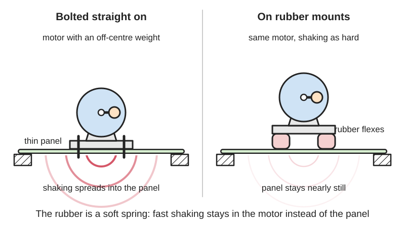
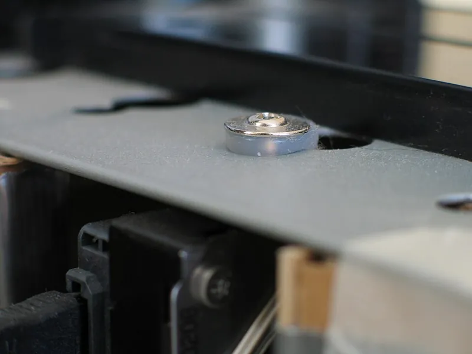
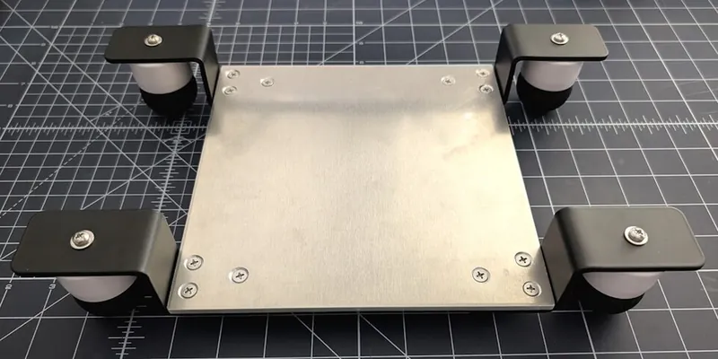

<figure class="eoc-pic eoc-pic-main"><picture><source media="(prefers-reduced-motion: reduce)" srcset="../media/drawn/elastomer-isolation-mount.svg"></picture><figcaption><strong>Animation.</strong> Diagram drawn for the encyclopaedia from the research notes. ⚑ Needs confirming: a drawing can simplify or get details wrong; a real photo or a better diagram is welcome.</figcaption></figure>
<figure class="eoc-pic"><figcaption><strong>Photo.</strong> <a href="https://commons.wikimedia.org/wiki/File:Schwingungsd%C3%A4mpfer_Aufbau.jpg">Schwingungsdämpfer Aufbau</a> by Schwingungsdämpfer, <a href="https://creativecommons.org/licenses/by-sa/4.0">CC BY-SA 4.0</a>, from Wikimedia Commons.</figcaption></figure>
<figure class="eoc-pic"><figcaption><strong>How it works.</strong> <a href="https://commons.wikimedia.org/wiki/File:Silent_PC-silicone_grommets.JPG">Silent PC-silicone grommets</a> by DonES, <a href="http://creativecommons.org/licenses/by-sa/3.0/">CC BY-SA 3.0</a>, from Wikimedia Commons.</figcaption></figure>
<figure class="eoc-pic"><figcaption><strong>Photo.</strong> <a href="https://commons.wikimedia.org/wiki/File:Home-Built_Vibration_Isolation_Platform_using_Squash_Balls.jpg">Home-Built Vibration Isolation Platform using Squash Balls</a> by Quirkipedia, <a href="http://creativecommons.org/publicdomain/zero/1.0/deed.en">CC0</a>, from Wikimedia Commons.</figcaption></figure>

An elastomer isolation mount holds a part to its frame through a piece of rubber or similar springy, lossy material, so vibration and shock from the part (or from the frame) are soaked up instead of being passed straight through as noise and shaking.

**In plain words:** A squashy rubber block, ring or button placed between a buzzing part (a motor, fan or pump) and the frame it is bolted to, so the shaking and humming soak into the rubber instead of spreading through the whole machine. **Proper term:** Elastomer vibration isolation mount (anti-vibration mount): rubber bobbin (cylindrical) mount, sandwich mount, isolator grommet or bushing.

**Also called:** anti-vibration mount, AV mount, vibration isolator, vibration-damping mount, shock mount; rubber bobbin, bobbin mount, cylindrical mount (Type A male-male, B male-female, C female-female, D single male, E single female); sandwich mount, rubber-metal mount, bonded rubber mount, silentblock or silent block; isolator grommet, vibration-damping grommet, rubber grommet, rubber bushing, isolation bushing; fan mount, silicone fan pin, fan gasket, anti-vibration fan screw; stepper motor damper, NEMA 17 damper (a rubber layer between two metal plates); rubber feet, anti-vibration feet, bumper, rubber buffer, levelling mount; engine mount, motor mount, suspension bushing (vehicles); gel pad, foam pad, Sorbothane (brand) pad or mount; soft mount (drones and flight controllers).

## How it works

The rubber acts as a soft spring, so the part and its mount form a mass-on-a-spring with a low natural frequency; vibration well above that frequency is poorly transmitted, because the rubber flexes instead of passing the force on (Penn State 'Vibration Isolation'; Wikipedia 'Vibration isolation'). Rubber also turns some of the motion into heat ([damping](../glossary.md#damping)), which stops the part bouncing wildly when it passes through its natural frequency during start-up (Barry Controls isolator guide). The catch: close to or below the natural frequency the mount does nothing or even makes the shaking worse, and any rigid path around it (a tight screw, a stiff cable or pipe) bypasses it.

## Parts

Single piece or a few parts. Grommet: one moulded rubber ring that sits in a hole, with a screw (sometimes with a metal sleeve or shoulder washer) through its middle. Bobbin or sandwich mount: a rubber cylinder bonded to two metal end plates with threaded studs or holes (AVMR; AV Products). Stepper damper: two metal plates joined by a rubber layer (Let's Print 3D). Pads and feet: a rubber, gel, foam or printed TPU piece under the part.

## Everyday examples

- Rubber stepper-motor dampers and anti-vibration feet on 3D printers (Let's Print 3D; Printables)
- Silicone grommets and fan pins that hold hard drives and fans in quiet PCs (Wikipedia 'Grommet'; Wikimedia Commons 'Silent PC-silicone grommets.JPG')
- Car engine mounts and suspension bushings; Chrysler's 1932 Plymouth made rubber engine mounts famous (Wikipedia 'Bushing (isolator)')
- Rubber feet under washing machines, pumps and air-conditioning units (Wikipedia 'Vibration isolation')

## When to use it

Use it when something that hums, buzzes or shakes (a motor, fan, pump, compressor, speaker or 3D-printer stepper) makes a panel, frame or table ring and amplify the noise, or when something delicate (a drone's flight controller, a camera, a hard drive, a sensor) needs protecting from vibration and knocks. It is cheap, passive and easy to retrofit: swap a rigid screw fixing for a grommet or bobbin, or stand the machine on rubber feet or foam. It works best against fast vibration (tens of hertz and above) and when the part sits on the mount's weight rating.

## When not to use it

Don't put rubber in a path that must stay stiff and precise: a printer extruder, a leadscrew nut, a robot joint or a camera that must not wobble (Let's Print 3D; ArduPilot: do not shock-mount a drone's motor arms). Don't use it to slow a lid or drawer; use a rotary or linear damper. Don't hang loads from bobbins in tension (AVMR). For very low-frequency vibration (a few hertz, such as a building or floor sway), rubber is too stiff; use springs, air springs or a heavy inertia block (Penn State). For isolating a shaft drive, use a flexible coupling with an elastomer spider instead.

## Details

- **What it does (jobs):**
  - join and hold: fixes a motor, fan, pump, drive or circuit board to a frame, with rubber in between
  - slow it, stop it or keep its speed steady: soaks up vibration and shocks (vibration isolation and damping), so less shaking and noise reach the frame, table or floor
- **Movement:** flex: only small elastic movements, usually well under a few millimetres, in all directions; softer sideways ([shear](../glossary.md#peel-vs-shear)) than along the squash direction (compression) (Barry Controls)
- **Directions it can move (degrees of freedom):** 0 intended: it is meant to hold the part in place; in practice the rubber allows small springy movements in all 6 directions, which is exactly what isolates vibration
- **Special behaviour:**
  - none of the listed behaviours in its basic form: its trick is being springy and lossy, so it filters out fast vibration while still holding the part
  - [fail-safe](../glossary.md#fail-safe--fail-secure) or breakaway: 'fail-safe' mounts interlock their metal parts so the load stays captive even if the rubber tears (McMaster-Carr fail-safe bolt-down mounts); plain bobbins and grommets are not fail-safe
- **How it holds:**
  - [material bond](../glossary.md#form-fit--force-fit--material-bond) (glue, solvent or melting): bobbin and sandwich mounts have the rubber bonded to their metal end plates (AVMR)
  - shape (the parts interlock; form-fit): a grommet's groove grips the edge of its hole
  - friction or clamping (force-fit): bolts and nuts clamp the mount to each part
- **Input and output:** not applicable (it does not pass on motion; it is meant to block vibration)
- **Power:** passive (no power needed)
- **Load:** Light to heavy depending on size: standard bobbins cover about 1 kg to 2,500 kg static load (AVMR). Strong in compression, softer in shear, and not meant for tension: bobbins 'are not intended for use in tension' and will fail early if hung from (AVMR). Keep continuous strain below about 10 to 15% in compression and 25 to 50% in shear (Barry Controls).
- **Play and precision:** Noticeable compliance by design: the mounted part can move slightly relative to the frame, so it tolerates small [misalignment](../glossary.md#misalignment) but loses positioning [stiffness](../glossary.md#stiffness). That is fine for fans, pumps and printer X/Y motors, but a damped extruder motor can cause under-extrusion, ringing and stringing (Let's Print 3D), and a flight controller's mount should not allow more movement than the vibration amplitude (ArduPilot).
- **Taking it apart:** removable: bolted, screwed, pushed in or stuck on; bonded bobbins are replaced as a whole unit
- **How often it can be reused:** many times, though rubber ages, takes a permanent squash (compression set) and grommets can tear when levered out, so worn mounts should be replaced
- **Sealing:** none: it is not meant to seal, although a snug rubber grommet does close the gap around a screw or cable
- **Adjustable:** Not usually. Stiffness is set by the rubber hardness (durometer), the shape (waisted and hollow bobbins deflect more than plain cylinders; AVMR) and the number of mounts. Over-tightening a screw through a grommet or strap squashes it solid and cancels the isolation (ArduPilot: don't fasten straps 'so securely that it interferes with the damping'). Levelling mounts add height adjustment.
- **Access needed:** usually both sides: each part needs its own bolt, nut or stud; push-in fan pins, grommets with a screw from one side, and stick-on pads or feet can be fitted from one side
- **Materials:** Natural rubber (the standard for bobbins, 35 to 90 Shore A), neoprene (chloroprene), EPDM, nitrile, butyl, silicone and polyurethane; metal parts usually zinc-plated mild steel (AVMR; AV Products). Viscoelastic urethane such as Sorbothane (brand) for soft pads (Wikipedia 'Sorbothane'). Thermoplastic damping compounds for fan mounts (E-A-R/Aearo ISODAMP). Makers also use printed TPU, squash balls, foam and even a concrete paver on foam under a printer (Hackaday; Printables).
- **Heat, cold, water and wear:** Heat, cold, oil and sunlight matter (Barry Controls table): natural rubber and neoprene are rated to about 180 °F (82 °C), silicone to about 300 °F (149 °C); natural rubber and neoprene get about 10 times stiffer at -65 °F (-54 °C) while silicone stiffens less than 2 times; natural rubber has poor oil, ozone and sunlight resistance, neoprene good to very good, silicone excellent for ozone and sunlight. Soft gels can fail in heat: ArduPilot notes one gel pad failing above 100 °F (38 °C). Rubber [creeps](../glossary.md#creep) and takes a permanent set under constant load if over-strained (Barry Controls; Printables squash-ball feet). Stepper dampers make motors run hotter because the rubber blocks heat flow into the frame (Let's Print 3D).

## Making it

- **Ways to make or get it:**
  - off-the-shelf part: bobbin, sandwich and bolt-down mounts, grommets, bushings, fan pins, stepper dampers, rubber feet, Sorbothane pads
  - 3D print (FDM): TPU gaskets, feet, grommets and pads; springy PETG feet; holders for squash balls or bought dampers (Printables examples)
  - 3D print (resin): flexible or elastic resins for small grommets ⚑ [uncertain]
  - woodwork: cutting rubber, cork or foam pads for machine bases (Wikipedia 'Vibration isolation' lists cork, dense foam and rubber sheets)
- **Printing it in one piece (print in place):** partly: a TPU gasket, foot or grommet prints as one working piece, but it needs screws, washers or a rigid holder to be fitted; bonded rubber-metal bobbins cannot be printed
- **Tools:** Screwdriver or spanners for bolted mounts and stepper dampers; none for push-in fan pins and stick-on pads; pliers to pull grommets into holes
- **Difficulty:** easy: buy standard mounts, grommets or stepper dampers and bolt them in, or print TPU gaskets and feet; choosing a mount that is soft enough for a light part (so it actually isolates) takes some trial and error

### 3D printing tips

1) Print isolators in a flexible filament such as TPU; a 2 mm thick TPU fan gasket printed at 0.2 mm layers with 100% [infill](../glossary.md#infill) is a simple starting point (Printables 'Fan Gasket 40mm for TPU'). 2) Softer isolates better: make the part flex by shape (thin walls, hollow or waisted forms deflect more than solid cylinders; AVMR) or, for rigid filaments, use a springy hollow shape; one popular printed foot uses 3 [perimeters](../glossary.md#perimeters), no infill and no top or bottom layers in PETG, noting PLA is stiffer (Printables 'Anti-vibration feet'). 3) Size it for the load: aim for roughly 10 to 15% squash under the part's weight, not more, or it will creep (Barry Controls); squash-ball feet needed extra supports to stop the balls deforming over time (Printables 'SquashBall ... Vibration Damper'). 4) Don't short-circuit it: a screw clamped hard through a grommet, a tight cable, a rigid bracket or a stiff pipe bypasses the rubber (Penn State 'Vibration Isolation'; ArduPilot); use shoulder screws or sleeves so the screw stops before squashing the rubber, and leave slack loops in wires. 5) Stepper motors: dampers on X and Y motors are fine, but don't isolate the extruder motor, and add a heatsink because the rubber cuts heat flow into the frame (Let's Print 3D). 6) Very light parts need very soft mounts: a drone flight controller weighs under 2 oz (about 57 g), while most off-the-shelf pad and stud mounts are designed for 5 to 10 times that mass (ArduPilot). 7) Mount the whole machine on isolators plus mass if the table is the noise source: foam plus a concrete paver cut a printer's noise by almost 8 dBA (Hackaday on CNC Kitchen).

### Buying one (off-the-shelf parts)

Search for: 'anti-vibration mount', 'rubber bobbin' or 'cylindrical rubber mount' (Type A male-male, B male-female, C female-female, D single male, E single female; metric M3 to M20 threads), 'waisted bobbin', 'sandwich mount', 'bolt-down mount' and 'fail-safe mount', 'vibration-damping grommet', 'rubber grommet', 'isolation bushing', 'rubber bumper' or 'rubber buffer', 'levelling mount', 'wire rope isolator', 'spring mount' (McMaster-Carr; AV Products; AVMR); 'NEMA 17 stepper motor damper'; 'anti-vibration fan pins', 'silicone fan mount' or 'fan gasket'; 'hard drive silicone grommets'; 'Sorbothane (brand) pad' by durometer; 'anti-vibration gel pad' or 'flight controller soft mount' (drones); squash balls (a maker favourite for printer feet).

## Rules of thumb

- Isolation only starts when the vibration frequency is more than about 1.4 times (the square root of 2) the mount's natural frequency; below that the mount passes on or amplifies the vibration, so aim for the natural frequency to be as far below the disturbing frequency as possible (Penn State 'Vibration Isolation'; Barry Controls).
- Natural frequency from static squash: 0.5 in (12.7 mm) gives 4.43 Hz, 1 in (25.4 mm) gives 3.13 Hz (Penn State table); in general about 15.8 / square root of (squash in mm) Hz, so 1 mm of squash is about 16 Hz and 4 mm about 8 Hz (converted from the same formula). Rubber's dynamic stiffness is higher than its static stiffness, so the real natural frequency is somewhat higher than this estimate (Barry Controls).
- Damping ratio is about 0.05 to 0.10 for rubber versus 0.005 to 0.01 for steel springs (Penn State); natural rubber and neoprene about 0.05, butyl about 0.12, a high-damping silicone about 0.15 (Barry Controls). More damping calms the start-up resonance but slightly reduces isolation at high frequency (Wikipedia 'Vibration isolation').
- Don't continuously strain elastomers more than 10 to 15% in compression or 25 to 50% in shear, or they creep (Barry Controls).
- Soft viscoelastic pads (Sorbothane): maximum static compression depends on shape factor (loaded area of one face divided by the free bulging side area): shape factor up to 1.0 allows 20%, 1.0 to 1.6 allows 10%, 1.6 to 2.0 allows 5%, above 2.0 only 3% (Sorbothane 'How to Choose the Correct Durometer and Shape').
- Load bobbins in compression or compression plus shear, never tension; use a bracket to turn a hanging load into a compressive one (AVMR).
- Use equally loaded mounts spread wide, keep the machine level, restrain sideways sway with snubbers, and provide a fail-safe support in case a mount fails (Penn State).

## Common failures

1) Short-circuited isolation: a rigid conduit, pipe, stiff cable, bracket or fully tightened screw bypasses the rubber (Penn State shows a conduit bypassing a chiller's isolators; ArduPilot warns against over-tight straps). 2) Wrong stiffness: too stiff for a light part (most off-the-shelf mounts suit masses 5 to 10 times heavier than a flight controller; ArduPilot) or so soft the part wobbles and bottoms out ('too much is just as bad as too little'; ArduPilot). 3) Running near resonance, so the vibration is amplified instead of reduced (Penn State). 4) Creep and permanent set from overloading, so the part sags and the mount hardens (Barry Controls; Printables squash-ball feet). 5) Tearing when bobbins are loaded in tension (AVMR). 6) Rubber perishing from heat, oil, ozone or sunlight (Barry Controls table); a failed rubber bush on an outboard propeller is a typical example (Wikimedia Commons 'Propeller rubber bush failed.jpg'). 7) Print defects when the extruder motor is isolated, and overheated steppers (Let's Print 3D).

## Safety

If the rubber tears or perishes, a plain mount lets go: use fail-safe (captive) mounts or a mechanical backstop for anything heavy, overhead or hanging (McMaster-Carr fail-safe mounts; Penn State 'fail safe operation'). Never hang loads from bobbins in tension (AVMR). Motors on rubber can overheat; check their temperature and add heatsinks (Let's Print 3D). A 'wobbly' mounted machine can walk or tip if the mounts are too soft or too narrow; restrain sideways movement (Penn State).

## Related

- Dampers (rotary and linear soft-close dampers): oil- or air-filled parts that slow one movement; isolation mounts filter continuous vibration with rubber
- Jaw coupling (spider coupling): an elastomer spider between two shaft hubs that also soaks up shocks and vibration in a drive line
- Flexible beam coupling (helical-slot coupling): isolates misalignment in a shaft but passes vibration on more than rubber does
- Series-elastic coupling: a deliberately springy link in a robot drive, used to measure and control force rather than to block vibration
- Grommets in cable [glands](../glossary.md#gland) and strain reliefs: the same rubber ring used to protect and seal a cable passing through a panel
- Crush ribs and compliant press fits: springy features that hold parts snugly rather than isolate them
- Double-sided foam tape (acrylic foam tape): bonds parts while adding some damping
- Spring mounts, wire-rope isolators and air springs: for heavier loads or lower frequencies than rubber can reach (McMaster-Carr; Penn State)
- Levelling foot: a threaded foot that sets a machine level on the floor; some feet and levelling mounts add a rubber pad that also soaks up vibration

## Make it yourself

- [Fan Gasket 40mm for TPU (br34ker, Printables) (URL from Printables API, page not opened)](https://www.printables.com/model/435170-fan-gasket-40mm-for-tpu): 2 mm TPU gasket between a 40 mm fan and its case to stop vibration transfer; sister models for 30, 80, 120 and 140 mm fans; STEP file included to change thickness *(licence: CC BY)*
- [Anti-vibration feet for Prusa MK3/S/S+, MK4 and Prusa Mini/+ (schuetzi99, Printables) (URL from Printables API, page not opened)](https://www.printables.com/model/1727-anti-vibration-feet-for-prusa-mk3ss-mk4-and-prusa-): Springy printed feet (3 perimeters, no infill, PETG preferred) that stop a printer's vibration reaching a hollow table; optional bicycle inner-tube insert against slipping *(licence: CC BY-NC-ND)*
- [SquashBall MK3s/MK3s+/MK4 Vibration Damper V3.0 (Rui do Carmo, Printables) (URL from Printables API, page not opened)](https://www.printables.com/model/59947-squashball-mk3smk3smk4-vibration-damper-v30): PETG clips that stand a printer frame on squash balls; notes on adding extra supports to reduce the balls' creep *(licence: CC BY-NC)*
- [Sorbothane Design Guide Vibration Calculator (Sorbothane, Inc.)](https://www.sorbothane.com/technical-data/design-guide-calculators/vibration-calculator/): Online calculator: enter pad shape, size, durometer, load per isolator and vibration frequency to get static deflection, natural frequency, transmissibility and percent isolation, with shape-factor warnings *(licence: free online tool (link only))*

## Pictures, videos and models

- [Silent PC-silicone grommets.JPG (Wikimedia Commons, by DonES)](https://commons.wikimedia.org/wiki/File:Silent_PC-silicone_grommets.JPG): Silicone grommets isolating a hard drive from a PC case (Antec P180) *(licence: CC BY-SA 3.0 / GFDL)*
- [Schwingungsdämpfer Aufbau.jpg (Wikimedia Commons)](https://commons.wikimedia.org/wiki/File:Schwingungsd%C3%A4mpfer_Aufbau.jpg): Cutaway of a rubber anti-vibration mount: metal cover, natural rubber core, sleeve with tear-off protection and metal base plate *(licence: CC BY-SA 4.0)*
- [Passvib3.jpg (Wikimedia Commons, by Sdv1120)](https://commons.wikimedia.org/wiki/File:Passvib3.jpg): Transmissibility curves for different amounts of damping: the resonance peak and the isolation region above it (used in Wikipedia 'Vibration isolation') *(licence: CC BY-SA 3.0)*
- [Home-Built Vibration Isolation Platform using Squash Balls.jpg (Wikimedia Commons, by Quirkipedia)](https://commons.wikimedia.org/wiki/File:Home-Built_Vibration_Isolation_Platform_using_Squash_Balls.jpg): A maker-style isolation platform standing on squash balls *(licence: CC0)*
- [Seriously the BEST $2 3D printer upgrade! (CNC Kitchen, YouTube; embedded in Hackaday's 20 May 2020 article)](https://www.youtube.com/watch?v=y08v6PY_7ak): Noise and print tests of a 3D printer on its stock feet versus on foam and a concrete paver *(licence: link only (standard YouTube licence))*

## Needs confirming

⚑ marks something nobody has confirmed yet: a fact the research could not confirm from a source, a finder value that is a best guess, or an open point from the research notes. Corrections are welcome (see `research/needs-confirming.md`).

- ⚑ 1 sentence on this page marked [uncertain].
- ⚑ Finder value `mounts_on` = wall or ceiling (best guess): carried over from the finder's old rule on entry names (R33), for "What is it going onto?" under "Hold two things together > Something onto a wall, desk, bar, tripod, rail or grid"
- ⚑ Finder value `wall_hold` = tape or pads (best guess): carried over from the finder's old rule on entry names (R33), for "How should it hold?" under "Hold two things together > Something onto a wall, desk, bar, tripod, rail or grid > A wall or ceiling"
- ⚑ Finder value `slows_by` = damper (best guess): carried over from the finder's old rule on entry names (R33), for "What do you need?" under "Control a movement > Slow it down, stop it, or keep its speed steady"

## Sources

- <https://en.wikipedia.org/wiki/Vibration_isolation>
- <https://en.wikipedia.org/wiki/Bushing_(isolator)>
- <https://en.wikipedia.org/wiki/Grommet>
- <https://en.wikipedia.org/wiki/Sorbothane>
- <https://www.vibrationdata.com/tutorials_alt/vibiso12.pdf>
- <https://hutchinsonai.com/wp-content/uploads/2020/01/IsolatorsSelection.pdf>
- <https://wp.optics.arizona.edu/optomech/wp-content/uploads/sites/53/2016/08/Barry-isolators-selection-guide.pdf>
- <https://www.sorbothane.com/technical-data/articles/how-to-choose-the-correct-sorbothane-durometer-and-shape/>
- <https://www.sorbothane.com/technical-data/design-guide-calculators/vibration-calculator/>
- <https://avmr.com/blogs/resources/what-are-rubber-bobbin-mounts>
- <https://www.avproductsinc.com/cylindrical-bobbin/mounts.html>
- <https://www.mcmaster.com/products/vibration-damping-mounts/>
- <https://www.rathbun.com/e-a-r/fan-mounts>
- <https://ardupilot.org/copter/docs/common-vibration-damping.html>
- <https://letsprint3d.net/how-to-install-stepper-motor-dampers-ender-3/>
- <https://hackaday.com/2020/05/20/bricking-your-3d-printer-in-a-good-way/>
- <https://www.youtube.com/oembed?url=https://www.youtube.com/watch?v=y08v6PY_7ak&format=json>
- <https://api.printables.com/graphql/>
- <https://commons.wikimedia.org/wiki/File:Silent_PC-silicone_grommets.JPG>
- <https://commons.wikimedia.org/wiki/File:Schwingungsd%C3%A4mpfer_Aufbau.jpg>
- <https://commons.wikimedia.org/wiki/File:Passvib3.jpg>
- <https://commons.wikimedia.org/wiki/File:Home-Built_Vibration_Isolation_Platform_using_Squash_Balls.jpg>
- <https://commons.wikimedia.org/wiki/File:Propeller_rubber_bush_failed.jpg>
