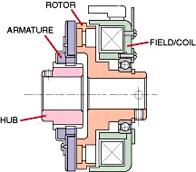

*Picture: [B-1 electromagnetic-clutch1.png](https://commons.wikimedia.org/wiki/File:B-1_electromagnetic-clutch1.png) by Oguraclutch, Public domain, from Wikimedia Commons.*

A drive connector that joins a spinning input to an output only while its coil is powered, by magnetically clamping a steel plate (armature) against a spinning face (rotor), and lets them separate the moment the current stops.

**In plain words:** A switch-on connector for spinning parts: an electric coil pulls a plate against a spinning disc so the drive is connected while the power is on, and springs pull them apart when the power is switched off. **Proper term:** Electromagnetic clutch (electrically actuated friction clutch; most commonly the single-face friction-plate type).

**Also called:** electric clutch / EM clutch / magnetic clutch (loose everyday name); electro-mechanical clutch (older name, Wikipedia); power-on clutch (catalogue term for a clutch that engages when powered); single-face clutch / friction-plate clutch (the common type; about 90% of sales, Wikipedia); AC compressor clutch / A/C clutch (car air conditioning); electric PTO clutch / PTO clutch-brake / blade engagement clutch (ride-on lawn mowers); micro clutch / paper feed clutch (printers and copiers); clutch-brake / clutch/brake unit (clutch and brake combined in one unit); variants: electromagnetic tooth clutch, multiple-disc clutch, magnetic particle clutch, [hysteresis](../glossary.md#hysteresis) clutch; brand examples a beginner may meet: Ogura (brand), Warner Electric (brand), Miki Pulley (brand).

## How it works

The rotor spins with the input all the time. When DC current flows in the coil it becomes an electromagnet; the magnetic flux jumps the small air gap and pulls the armature, which is joined to the output hub, hard against the rotor face (Machine Design, 2009). Friction then speeds the output up: the faces slip for about 0.02 to 1.0 s until both turn together ('100% lockup'), after which there is no slip. When the current stops, the flux collapses and springs pull the armature back to a set air gap, so the output is free again (Wikipedia; Ogura). Other versions use teeth instead of friction (tooth clutch), a stack of discs (multiple-disc clutch), iron powder that stiffens in the field (magnetic particle clutch) or contact-free magnetic drag (hysteresis clutch) (Wikipedia, Electromagnetic clutch).

## Parts

A small assembly that acts as one unit. Clutch: coil in a steel shell (the field), rotor fixed to the always-turning input, armature plate, hub or output part (pulley, gear or shaft), return springs, and bearings or bushings (Wikipedia 'Electromagnetic clutches and brakes' names four main parts: field, rotor, armature and hub). Plus a DC supply, a switch (relay or transistor) and a suppression diode.

## Everyday examples

- Car air conditioning: 'most, but not all, automobile air conditioning systems are switched on and off by using an electromagnetic clutch' that joins the compressor shaft to its belt pulley (Wikipedia); the plate at the front of the compressor that starts spinning when you press A/C
- Ride-on lawn mowers: the electric PTO clutch that starts the blades when you pull the blade switch, often combined with a brake (Wikipedia; Warner Electric)
- Photocopiers and laser printers, where tiny 24 V clutches start and stop paper-feed rollers from one motor (Wikipedia; Ogura MIC; Kyocera printer teardown photos on Wikimedia Commons)
- All-wheel-drive cars, where electromagnetic clutches vary the power sent to each axle (Wikipedia)

## When to use it

Use it when one motor that keeps running must drive something only some of the time, switched remotely by electricity: starting and stopping a conveyor, roller, pump, fan or cutter blade without stopping the motor; sharing one motor between several outputs (as printers do); machines controlled by a microcontroller or PLC where no hand lever can reach; and when the drive must disconnect automatically if power fails. Magnetic particle or hysteresis versions suit winding and tensioning where a steady slipping [torque](../glossary.md#torque) is wanted (Wikipedia).

## When not to use it

Not for holding a load still when power is off: it lets go when unpowered, so use a spring-applied electromagnetic brake or a [self-locking](../glossary.md#self-locking) drive instead. Not needed where you can simply switch a small motor on and off, or reverse it; a motor driver is simpler ⚑ [uncertain: design judgement]. For a clutch that must connect with no power, or be operated by hand, use a dog clutch, friction clutch with a lever, or a centrifugal clutch that engages automatically with speed. For exact start-stop positioning (one revolution at a time) a solenoid-tripped wrap-spring clutch is the usual choice (Warner CB series: loads started and stopped 'within +1/2°' up to 1800 rpm) ⚑ [uncertain: from a search summary of the Warner catalogue, not opened]. Tooth clutches cannot be engaged at speed (above about 50 rpm, Wikipedia).

## Details

- **What it does (jobs):**
  - hold or release using power: it connects the drive only while powered and disconnects it when switched off
  - join and hold: while engaged it locks the input and output shafts together so they turn as one
  - slip or let go when overloaded: a friction type slips if the load needs more torque than it can carry; magnetic particle types are made to slip at a controlled torque for tension control (Wikipedia)
- **Movement:** rotate: it passes on continuous rotation; inside, the armature moves only across a small air gap (typically 0.2-0.5 mm, KEB)
- **Directions it can move (degrees of freedom):** 1 when switched off (the output can turn freely about the shaft axis relative to the input); 0 relative movement when switched on (input and output turn together)
- **Special behaviour:**
  - [fail-safe](../glossary.md#fail-safe--fail-secure) or breakaway: 'turning off the power to the coil disengages the unit' (Machine Design, 2009), so a power cut disconnects the drive; clutch-brake units add a brake that grabs when power is removed (Warner Electric MagStop mower clutch-brakes stop the blade within 3-7 s)
  - torque-limiting (slips or clicks at a set force/torque): a friction clutch slips above its torque; torque falls roughly in proportion to voltage ('applying 48 V to a 90-V clutch results in about half the torque output', Machine Design), and magnetic particle clutches give accurately controlled slip torque for tension control (Wikipedia)
  - indexing (clicks into set positions): electromagnetic tooth clutches can be made 'single position' so they only engage at one angle, for machines where timing matters (Wikipedia)
- **How it holds:**
  - friction or clamping ([force-fit](../glossary.md#form-fit--force-fit--material-bond)): the armature is clamped against the rotor face and the drive is carried by friction
  - magnetic: the clamping force comes from the electromagnet
  - powered hold: it only holds while current flows
  - shape (the parts interlock; form-fit): tooth clutches lock with interlocking teeth instead of friction (Wikipedia)
- **Input and output:** Continuous rotation in -> the same rotation out when engaged (1:1, no ratio change). The faces slip for about 0.02-1.0 s while the output speeds up (Machine Design, 2009); once fully engaged there is no relative slip, 'thus torque transfer is 100% efficient' (Wikipedia), apart from the electrical power the coil uses (11-60 W at 24 V for 6-400 N·m industrial units, Sunrise MCS table). Shaft arrangement: in line (shaft to shaft, e.g. face-mount clutches that bolt to a motor and 'let you electrically control when to transmit power without turning off your motor', McMaster-Carr) or a pulley, sprocket or gear riding on the shaft, so torque to that part is cut 'without stopping your drive shaft' (McMaster-Carr, electric clutches). Back-drivable: yes while engaged (Ogura: 'All clutches are bi-directional'); when off, the output simply [freewheels](../glossary.md#freewheel).
- **Power:** powered: needs DC current to engage; common supplies are 24 or 90 V DC (Machine Design, 2012), vehicle and mower clutches run on 12-14 V (Warner CMS 250: 6-7 A), printer micro clutches on 24 V (Ogura MIC). When power is lost it releases (disengages): the drive is disconnected and the output coasts or freewheels. Combined clutch-brakes apply a brake at the same moment (Warner MagStop uses permanent magnets for this).
- **Load:** Light to heavy depending on size, and only in twist (torque) about the shaft: 0.25-0.8 N·m for printer micro clutches (Ogura MIC, max 300 rpm), 6-400 N·m static torque for shaft-mounted industrial clutches (Sunrise MCS, max 1800 rpm), and 60-250 lb·ft (about 80-340 N·m) for ride-on mower PTO clutch-brakes (Warner). Dynamic (slipping) torque can be under half the static rating at high speed (Wikipedia). Side loads must be carried by its bearings; plain bushings are only for low speed, low side load or short running hours (Wikipedia).
- **Play and precision:** small: spline-connected armatures typically have about 2° of [backlash](../glossary.md#backlash) that grows with wear, and zero-backlash units keyed to a shaft still have a little play at the key (Wikipedia); some industrial units are sold as 'backlash-free' (Sunrise MCS). [Repeatability](../glossary.md#repeatability--accuracy): as the faces wear the gap grows and pull-in slows, so timing can drift by 10-15 ms in high-cycle machines (Wikipedia; Machine Design). [Misalignment](../glossary.md#misalignment) [tolerance](../glossary.md#tolerance) is low: the rotor must run concentric (checked with a dial indicator) and the gap must be even all round (EIDE).
- **Taking it apart:** removable: it is keyed, set-screwed or D-bored onto shafts and bolted to a frame; its own connect/disconnect action is electrical and needs no tools
- **How often it can be reused:** many times: it engages and disengages every time it is switched, but each engagement under slip wears the faces (e.g. Warner CMS 250 mower clutch-brake: B10 life of 25,000 cycles); the unit itself can be unbolted and refitted many times
- **Sealing:** none: the friction faces are open; oil, grease, oil mist or paper dust between the faces cuts torque, and makers offer contamination shields; in clean rooms or food machines the clutch should be enclosed because it sheds wear dust (Wikipedia, Electromagnetic clutches and brakes)
- **Adjustable:** partly: on fixed-armature types the air gap can be reset as the faces wear (KEB; EIDE), while 'zero gap or auto wear' armatures take up wear themselves (Wikipedia); engagement can be softened by applying less than full voltage, which lowers torque and lengthens engagement time (Machine Design, 2012); pre-assembled micro clutches have 'no adjustments to make or gaps to set' (Ogura MIC)
- **Access needed:** end of a tube or shaft: it slides onto a shaft end (or a motor shaft, for face-mount types), and the field needs an anchor to the frame
- **Materials:** Coil shell of carbon steel ('combines strength with magnetic properties'), copper or sometimes aluminium coil held by a bobbin or epoxy (Machine Design; Wikipedia); steel rotor and armature (they must be magnetic); industrial clutches have friction material set flush between the poles, while most car and farm clutches run steel on steel with no friction material, which also avoids swelling from moisture (Wikipedia); steel springs; bearings or bushings. Printer micro clutches come with a moulded plastic gear or timing pulley (Ogura MIC). It connects steel shafts; printed parts are only the pulleys, gears and brackets fixed to it.
- **Heat, cold, water and wear:** Heat is the main limit: the heat of the coil sets the maximum operating temperature through the rating of its insulation (Wikipedia, Electromagnetic clutch), and torque falls about 8% per 20 °C rise in coil temperature on an unregulated supply (Machine Design). Coils usually fail from heat caused by high ambient temperature, high cycle rates, slipping or overvoltage (Wikipedia). Example rating: Warner CMS 250 mower clutch-brake, ambient -40 °F to +200 °F (about -40 to +93 °C). Oil or grease on the faces 'could drastically decrease the torque'; friction material can swell with moisture, which is why outdoor mobile clutches often have none; light surface rust after long idle periods wears off within a few cycles (Wikipedia). Faces wear with every slipping engagement, so the gap grows and engagement timing drifts (Wikipedia).

## Making it

- **Ways to make or get it:**
  - off-the-shelf part: always bought or salvaged (printer/copier micro clutches, mower PTO clutches, car AC compressor clutches, industrial clutches)
  - 3D print (FDM): pulleys, gears and hub adapters that bolt to the output, anti-rotation brackets for the coil housing, motor mounts
  - CNC: metal hubs, shaft adapters and mounting plates where torque is high or the rotor must run true
- **Printing it in one piece (print in place):** no: the clutch is a bought electromagnetic assembly; only parts attached to it can be printed
- **Tools:** hex keys or spanners and a key or [set screws](../glossary.md#set-screw) to mount it; a feeler gauge to check the air gap on adjustable types (KEB; EIDE); a dial indicator to check the rotor runs true (EIDE); for wiring, a DC supply, a relay or transistor/MOSFET and a flyback diode (plus a Zener diode for fast release) (Machine Design, 2012)
- **Difficulty:** moderate: buy one (24 V printer micro clutches and salvaged mower or car AC clutches are the usual maker sources); mounting it true, setting the gap and driving the coil safely from a microcontroller take care; making your own is hard

### 3D printing tips

Print the parts around the clutch, not the clutch. (1) Output parts: printer micro clutches take D-bored shafts (6 or 8 mm, Ogura MIC) and carry a moulded gear or pulley, so a printed gear or pulley can be keyed to the output in the same way; for more torque bolt printed parts to a metal hub rather than relying on a printed bore ⚑ [uncertain: general practice]. (2) Anti-rotation: the coil housing must be fixed to 'a completely static part' (EIDE); a printed bracket or tab that stops it turning is fine if it is stiff. (3) Trueness: the rotor should run concentric and the armature square to it with an even gap all round (EIDE), so print mounts flat, avoid elephant's-foot on locating faces and check runout; a wobbling printed pulley can make the armature rub ⚑ [uncertain]. (4) Heat: the coil uses power the whole time it is engaged (11-60 W at 24 V for industrial sizes, Sunrise MCS) and slipping makes friction heat; PLA 'gets soft and deforms at temperatures over 60 °C' (Prusa), so use PETG or ASA (ASA 'up to 93 °C', Prusa) for anything touching the clutch body ⚑ [uncertain: surface temperatures of small clutches not measured]. (5) Keep grease from printed gears well away from the friction faces: oil 'would significantly reduce the coefficient of friction' (Wikipedia). (6) Never put printed plastic in the magnetic path; the armature and rotor must be steel.

### Buying one (off-the-shelf parts)

Search terms: 'electromagnetic clutch 24V' or '12V electromagnetic clutch'; 'micro electromagnetic clutch' / 'printer paper feed clutch' / 'mini electromagnetic clutch D-shaft 6 mm' (0.25-0.8 N·m class, e.g. Ogura MIC); 'shaft mounted power-on electromagnetic clutch' (e.g. Sunrise MCS, 6-400 N·m); 'electric clutch for face-mount motor' and 'electric clutch/brake' (McMaster-Carr, 90 V DC); 'electric PTO clutch' (mower); 'AC compressor clutch' (car, salvage); 'electromagnetic tooth clutch'; 'multiple disc electromagnetic clutch'; 'magnetic particle clutch' and 'hysteresis clutch' (for tension control); 'clutch-brake'; 'clutch power supply' or 'rectifier'; 'flyback diode' (e.g. 1N4004 or 1N5404) and 'Zener diode' for suppression (Machine Design, 2012); 'logic-level MOSFET' or 'TIP120' / 'relay' to switch it.

## Rules of thumb

- Air gap: 'an air gap of between 0.2 mm and 0.5 mm is generally used' (KEB); set it with a feeler gauge and make it 'uniform across the entire circumference' (EIDE). Too large a gap weakens the pull; too small can make the parts rub (KEB).
- Run-in (burnishing): a new clutch may give as little as 50% of its rated torque until the faces bed in; burnishing takes 20 to over 100 on-off cycles at low speed or low inertia, and is only needed if the job needs more than the out-of-box torque (Wikipedia, Electromagnetic clutches and brakes; Machine Design, 2009).
- Size by the torque after burnishing, using T = J x Δω / t (torque = inertia x change in speed / time) (Wikipedia).
- Static versus dynamic torque: catalogues list static torque; at around 5-50 rpm that is what you get, but at high speed (e.g. 3,000 rpm) dynamic torque 'can be less than half the static rating' (Machine Design, 2009; Wikipedia).
- Heat and voltage: on an unregulated supply torque drops about 8% for every 20 °C rise in coil temperature, and torque is roughly proportional to voltage ('48 V to a 90-V clutch results in about half the torque output') (Machine Design, 2009; Wikipedia).
- Suppression: switching off the coil can produce a spike of 7-10 times the supply voltage (over 600 V from a 90 V coil); a flyback diode rated at least twice the coil current and voltage protects the switch, but it slows release, and adding a Zener diode shortens the decay (Machine Design, 2012).
- Faster engagement (overexcitation): a brief pulse of 3 times rated voltage gives about one-third faster response, 15 times gives about 3 times faster, but only for a few milliseconds so the coil does not overheat (Machine Design, 2009).
- Tooth clutches must not be engaged above about 50 rpm or the teeth get damaged (Wikipedia, Electromagnetic clutch).
- Slip time: about 0.02-1.0 s from switch-on to full lockup (Machine Design, 2009); Wikipedia gives 1/200 s to 1 s.

## Common failures

Will not engage: open or shorted coil, blown fuse, broken wire or switch, AC applied instead of DC, or air gap too large from wear (Ogura troubleshooting; Wikipedia: a fixed-armature clutch 'will eventually simply cease to engage' as wear widens the gap); check voltage and reset the gap. Slips: oil on the facing, not burnished, low voltage or a hot coil, worn armature, or a clutch too small for the job (Ogura troubleshooting; Wikipedia). Will not release or drags: gap too small so the faces rub (KEB), or slow release because only a plain diode is fitted (Machine Design, 2012). Noise: worn bearing, rotor contact or misalignment (Ogura; EIDE). Car AC clutches: coil failure, a gap widened by wear, and screeching from rust or a wrong gap (ricksfreeautorepairadvice.com). Avoid by keeping faces clean and dry, burnishing a new clutch, using the rated DC voltage with suppression, and checking the gap as it wears.

## Safety

Rotating shafts, pulleys and belts are entanglement and pinch hazards even when the clutch is off, because the input side keeps spinning. Switching the clutch off does not stop the output: it coasts, so blades and flywheels need a brake (mower PTO clutch-brakes exist for this; the Warner MagStop brakes the blade within 3-7 s). Because it releases when power fails, never rely on it alone to hold up a load that could fall ⚑ [uncertain: general design practice]. The coil produces high voltage spikes when switched off (7-10 times supply voltage, Machine Design 2012): fit a suppression diode or it can damage transistors and insulation. Coils can get hot. A DIY table-saw stop using a salvaged lawnmower clutch shows the forces involved: Hackaday called it 'just about as sketchy as it sounds' (Hackaday, 2022).

## Related

- Electromagnetic brake (power-off, spring-applied): the same coil-and-armature parts, but it holds a shaft still when power is off instead of connecting a drive when power is on
- Wrap-spring clutch (spring clutch): a coiled spring grips the shaft; solenoid-tripped versions start and stop a load at one exact position each turn
- Dog clutch (claw clutch): teeth that interlock; engaged by a lever, [solenoid](../glossary.md#solenoid) or servo, no slip, but must be engaged slowly or at rest
- Friction clutch (plate or cone clutch): the same friction idea operated by a hand lever or pedal instead of a coil
- Centrifugal clutch: engages by itself when the input spins fast enough; no electricity needed
- Magnetic coupling and magnetic gear: permanent magnets pass torque through a wall with no contact; always on, not switchable
- Magnetic particle clutch and hysteresis clutch: electromagnetic clutches built to slip at a controlled torque, for tensioning (Wikipedia)
- Eddy-current coupling: drag from currents induced in a conductor; torque depends on the speed difference (RoyMech; a printable eddy-current 'electromagnetic clutch' model exists on Thingiverse)
- Friction slip clutch and torque limiters: slip at a set torque without any electricity
- Solenoid latch: the same electromagnet principle used to pull a bolt instead of clamp a plate

## Make it yourself

- [Electromagnetic Clutch / Eddy Current Coupling, by stefan_stoove (Thingiverse)](https://www.thingiverse.com/thing:4647488): A printable 'electromagnetic clutch using eddy currents' demonstration model (a contact-free cousin of the friction clutch); description and licence read from the page's metadata *(licence: CC BY 4.0 (from the page's schema.org metadata))*
- [Arduino Electromagnet Control (Tutorial & Code Example), by Khaled Magdy (DeepBlueMbedded, 2024)](https://deepbluembedded.com/arduino-electromagnet-control-circuit-code-example/): Wiring and code for switching a 12 V DC coil from an Arduino with a TIP120 transistor and a flyback diode across the coil, the same driver a hobby 12 or 24 V clutch coil needs *(licence: tutorial; link only)*

## Pictures, videos and models

- [B-1 electromagnetic-clutch1.png (Wikimedia Commons), by Oguraclutch](https://commons.wikimedia.org/wiki/File:B-1_electromagnetic-clutch1.png): Cutaway diagram of a single-face electromagnetic clutch with field, rotor, armature and hub, used in Wikipedia's article *(licence: Public domain (Commons licence field))*
- [Multiple Disk Clutch.gif (Wikimedia Commons), by Oguraclutch](https://commons.wikimedia.org/wiki/File:Multiple_Disk_Clutch.gif): Animation of an electromagnetic multiple-disc clutch engaging *(licence: Public domain)*
- [Electromagnetic Clutches - How It Works (KEB America)](https://www.youtube.com/watch?v=OztP3uFlUlI): Animation of a friction electromagnetic clutch joining two shafts when powered (title checked with YouTube oEmbed) *(licence: YouTube standard licence; link only)*
- [New vivid animation on how Electromagnetic Clutches work (oguraindustrial)](https://www.youtube.com/watch?v=CYXNXeEW0Go): Manufacturer animation of the coil, rotor and armature engaging and releasing (title checked with YouTube oEmbed) *(licence: YouTube standard licence; link only)*
- [Kyocera FS-C5200DN - Tenryu Marusawa TMC-5T-04 micro clutch (Wikimedia Commons), by Raimond Spekking](https://commons.wikimedia.org/wiki/File:Kyocera_FS-C5200DN_-_Tenryu_Marusawa_TMC-5T-04-4680.jpg): Photo of a small 24 V-class printer micro clutch with its gear, as found in a laser printer teardown *(licence: CC BY-SA 4.0)*

## Needs confirming

⚑ marks something nobody has confirmed yet: a fact the research could not confirm from a source, a finder value that is a best guess, or an open point from the research notes. Corrections are welcome (see `research/needs-confirming.md`).

- ⚑ 6 sentences on this page marked [uncertain].
- ⚑ Finder value `connects` = any solid parts (best guess): joins parts, but no specific kind of part found; set to any solid parts
- ⚑ Finder value `clicks` = clicks (best guess): the text uses both clicking and silent words

## Sources

- <https://en.wikipedia.org/wiki/Electromagnetic_clutch (read via the Wikipedia API)>
- <https://en.wikipedia.org/wiki/Electromagnetic_clutches_and_brakes (read via the Wikipedia API)>
- <https://www.machinedesign.com/archive/article/21831719/the-basics-of-electromagnetic-clutches-and-brakes>
- <https://www.machinedesign.com/news/article/21829695/suppression-circuits-for-clutches-and-brakes>
- <https://ogura-clutch.com/electromagnetic_clutch.php>
- <https://ogura-clutch.com/troubleshooting.php>
- <https://ogura-clutch.com/products.php?category=5&product=6&sort=3>
- <https://www.keb-automation.com/blog/the-clutch-air-gap-adjustment-made-easy>
- <https://eide.net/en/how-to-assembly-an-electromagnetic-clutch/>
- <https://www.sunrisescn.com/shaft-mounted-mcs-power-on-electromagnetic-clutch1.html>
- <https://www.djautomation.net/files/p-1698-we.pdf (Warner Electric P-1698-WE, Clutch/Brakes for Lawn & Garden Equipment)>
- <https://www.mcmaster.com/products/electric-clutches/>
- <https://ricksfreeautorepairadvice.com/car-ac-compressor-clutch/>
- <https://roymech.org/Useful_Tables/Drive/Clutches.html>
- <https://hackaday.com/tag/electromagnetic-clutch/>
- <https://hackaday.com/2022/08/02/homemade-sawstop-attachment-is-just-about-as-sketchy-as-it-sounds/>
- <https://deepbluembedded.com/arduino-electromagnet-control-circuit-code-example/>
- <https://help.prusa3d.com/article/pla_2062>
- <https://help.prusa3d.com/article/asa_1809>
- <https://commons.wikimedia.org/wiki/Category:Electromagnetic_clutches>
- <https://commons.wikimedia.org/wiki/File:B-1_electromagnetic-clutch1.png>
- <https://commons.wikimedia.org/wiki/File:Multiple_Disk_Clutch.gif>
- <https://commons.wikimedia.org/wiki/File:Kyocera_FS-C5200DN_-_Tenryu_Marusawa_TMC-5T-04-4680.jpg>
- <https://www.youtube.com/watch?v=OztP3uFlUlI (verified via YouTube oEmbed)>
- <https://www.youtube.com/watch?v=CYXNXeEW0Go (verified via YouTube oEmbed)>
- <https://www.youtube.com/watch?v=5SuqyE_bXqo (verified via YouTube oEmbed; 'Electromagnetic Clutches - How they work', oguraindustrial)>
- <https://www.youtube.com/watch?v=F87u7IQL-3M (verified via YouTube oEmbed; 'Making A DIY SawStop!', Ruth Amos)>
- <https://www.thingiverse.com/thing:4647488>
