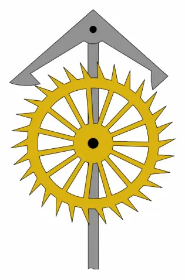
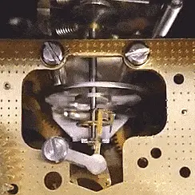
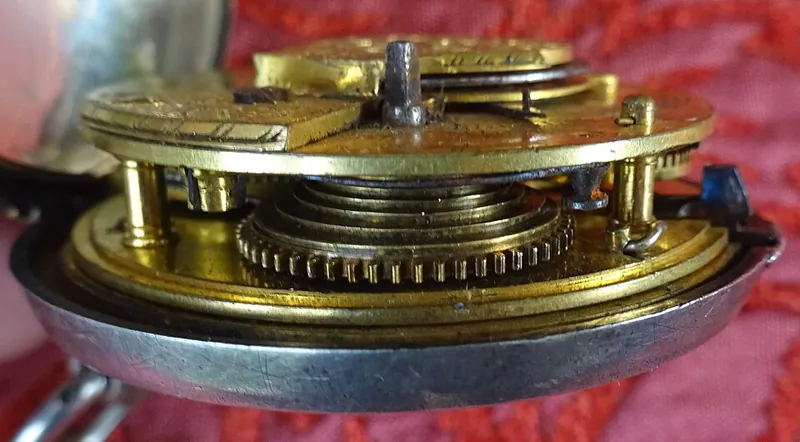

<figure class="eoc-pic eoc-pic-main"><picture><source media="(prefers-reduced-motion: reduce)" srcset="../media/escapement-23e924.still.webp"></picture><figcaption><strong>Animation.</strong> <a href="https://commons.wikimedia.org/wiki/File:Anchor_escapement_animation_315x478px.gif">Anchor escapement animation 315x478px</a> by Chetvorno, <a href="http://creativecommons.org/publicdomain/zero/1.0/deed.en">CC0</a>, from Wikimedia Commons.</figcaption></figure>
<figure class="eoc-pic"><picture><source media="(prefers-reduced-motion: reduce)" srcset="../media/escapement-cc4caf.still.webp"></picture><figcaption><strong>How it works.</strong> <a href="https://commons.wikimedia.org/wiki/File:Floating_Balance_Escapement_(2).gif">Floating Balance Escapement (2)</a> by Glosome, <a href="https://creativecommons.org/licenses/by-sa/4.0">CC BY-SA 4.0</a>, from Wikimedia Commons.</figcaption></figure>
<figure class="eoc-pic"><figcaption><strong>Photo.</strong> <a href="https://commons.wikimedia.org/wiki/File:The_1845_Verge_Escapement_on_a_pocket_watch.jpg">The 1845 Verge Escapement on a pocket watch</a> by Rosser1954, <a href="https://creativecommons.org/licenses/by-sa/4.0">CC BY-SA 4.0</a>, from Wikimedia Commons.</figcaption></figure>

An escapement lets a spring- or weight-driven wheel turn only in small, regular steps, releasing one tooth at a time each time a pendulum or balance wheel swings, while giving that swinging part a small push to keep it going.

**In plain words:** A rocking catch that lets a wound-up clock's toothed wheel slip forward one tooth at a time, in step with a swinging pendulum, which is what makes a clock tick. **Proper term:** Escapement (anchor or recoil escapement, deadbeat or Graham escapement, verge or crown-wheel escapement).

**Also called:** anchor escapement / recoil escapement; deadbeat escapement / Graham escapement; verge escapement / crown-wheel escapement / verge and foliot; grasshopper escapement (John Harrison's low-friction version); pin-pallet, pin-lever or Roskopf escapement (cheap alarm clocks and kitchen timers); lever escapement / Swiss lever escapement (most mechanical watches); runaway escapement (no pendulum or hairspring: the rate is set only by the inertia of the rocking part; used in toys and simple timers); escape wheel and pallets; anchor; pallet fork; Hemmung, Ankerhemmung (German); échappement (French); 擒纵机构 (Chinese).

## How it works

The spring or weight tries to spin the gear train, and the escape wheel at its end is blocked by one of the two pallets. As the pendulum swings, it rocks the anchor so that pallet lets go; the wheel jumps forward, and a tooth on the other side lands on the second pallet, which has just moved into its path. Each time a tooth slides off a pallet's sloping face it gives the pendulum a small push that replaces the energy lost to friction, and each sudden stop makes the 'tick'. In the anchor (recoil) type the pendulum pushes the wheel slightly backwards after each catch; in the deadbeat type the pallets have curved 'dead' faces centred on the anchor's pivot, so the wheel stays still until released; in the verge type two flag-like pallets on a rod work against a crown-shaped wheel, and the pendulum or foliot must swing widely (Wikipedia 'Escapement', 'Anchor escapement', 'Verge escapement').

## Parts

A few parts: an escape wheel with sloping, saw-like teeth; an anchor (or verge rod) carrying two pallets that catch the teeth; a crutch and fork linking the anchor to the pendulum; and the timekeeper itself (pendulum, balance wheel or foliot bar). It only works as part of a clock-like assembly with a power source (wound spring or hanging weight) and a gear train.

## Everyday examples

- A grandfather (longcase) clock, whose tick-tock and second hand come from an anchor or deadbeat escapement and a seconds pendulum (Wikipedia)
- A mechanical wristwatch, which uses a lever escapement and a balance wheel (Wikipedia 'Escapement')
- A wind-up kitchen timer or old alarm clock, which uses a cheap pin-pallet escapement (Wikipedia 'Pin-pallet escapement')
- A mechanical metronome, which runs from a spring-wound clockwork escapement; manual typewriters also used an escapement to step the carriage one letter at a time (Wikipedia)

## When to use it

Use it when a wound spring or falling weight must be let down slowly, steadily and in countable steps without electricity: a mechanical clock or timer, a metronome, a slow-moving automaton or a spring-driven toy car that should [creep](../glossary.md#creep) rather than race (gzumwalt's runaway-escapement car). It is also the right choice for a teaching model that shows how clocks keep time, and for anything that should advance one step per event with a stop in between (the typewriter carriage). With a pendulum or balance it gives surprisingly good timekeeping from purely printed parts.

## When not to use it

Don't use it to transmit useful power: it passes only tiny forces. For precise timing, a quartz crystal or microcontroller is far more accurate and cheaper. For smooth, silent slowing of a spring or falling load, use a speed governor (fly fan or centrifugal governor) or a damper. For stepping driven by a motor, use a Geneva drive, [ratchet](../glossary.md#ratchet) and [pawl](../glossary.md#pawl) or a stepper motor. If a wide swing is unacceptable, avoid the verge; if you can't make accurate parts, prefer the forgiving anchor over the deadbeat.

## Details

- **What it does (jobs):**
  - slow it, stop it or keep its speed steady: lets a wound spring or falling weight run down slowly at a steady, countable rate
  - change the kind of motion: turns a wheel's continuous urge to spin into regular step-by-step motion, and keeps a pendulum or balance swinging
- **Movement:** multiple: the escape wheel turns in small steps (half a tooth per tick; with a 30-tooth wheel and a seconds pendulum that is 6 degrees per tick and one turn per minute), while the anchor or verge rocks back and forth: the pendulum swings about 4 to 6 degrees with an anchor and 80 to 100 degrees with a verge (Wikipedia)
- **Directions it can move (degrees of freedom):** 1 while a pallet is touching the wheel (the pendulum's position controls the wheel); between release and catch the wheel briefly runs free for a small amount called the 'drop' (Goodrich, The Modern Clock, 1905)
- **Special behaviour:**
  - motion conversion (e.g. rotary to linear): a steady driving force becomes regular, step-by-step rotation, and in the other direction the wheel's pushes keep the oscillator swinging
  - indexing (clicks into set positions): the wheel advances exactly one tooth for every full swing (half a tooth per tick), so the hands move by a fixed amount each time
  - [self-locking](../glossary.md#self-locking) (holds under load, won't back-drive): between releases a pallet blocks the wheel, so the spring or weight cannot run away; the train moves only when the swinging pendulum lets it
- **How it holds:**
  - shape (the parts interlock; [form-fit](../glossary.md#form-fit--force-fit--material-bond)): a pallet sits in front of a tooth and physically blocks it (the 'lock')
  - not a holding joint (it moves or passes on motion): its purpose is to meter motion, not to hold parts together
- **Input and output:** Input: steady [torque](../glossary.md#torque) from a wound spring or falling weight, passed through a gear train to the escape wheel (the lightest, fastest wheel in the clock). Output: step-by-step rotation of the escape wheel and small pushes (impulses) that keep the pendulum or balance swinging. Ratio: set by the tooth count and the swing rate; a seconds pendulum with a 30-tooth wheel turns the wheel once a minute (Wikipedia 'Anchor escapement'; Goodrich). Efficiency: low and not the point; the tiny energy per tick goes into friction and air drag; Steve Peterson calculated only about 0.035 oz (about 1 g) of force at his printed clock's escape wheel. Shafts: parallel for anchor, deadbeat and grasshopper types; crossed at right angles in the verge (crown-wheel axis at 90 degrees to the verge rod). Back-drivable: no, the pendulum cannot rewind the spring; but in recoil types (anchor and verge) the pendulum pushes the wheel and the whole train slightly backwards on every tick, while the deadbeat has no recoil (Wikipedia).
- **Power:** passive (no power needed): no electricity, but it needs stored energy from a wound spring or raised weight; when that runs out it simply stops. Anchor and deadbeat escapements are not self-starting, so the pendulum must be given a push to start; the watch lever escapement is self-starting (Wikipedia).
- **Load:** Very light: it is a control device, not a load-carrying joint. Tooth forces are tiny (about the weight of a house fly at the escape wheel of Steve Peterson's 8-day printed clock), and tooth tips and pallet faces are delicate; if a clock is moved with its pendulum swinging freely, the pallets can hit the teeth hard, which is one reason anchor teeth slant backwards (Wikipedia 'Anchor escapement').
- **Play and precision:** Working [clearances](../glossary.md#clearance) matter: the 'drop' (free run between release and catch) should be as small as safe locking allows, and the 'lock' (how far a pallet overlaps a tooth) must be safe but not too deep (Goodrich; his seconds-pendulum layout allows 6 degrees of wheel drop). The anchor is tolerant of errors in its shape; the deadbeat is less tolerant of inaccuracy and wear (Wikipedia). Timekeeping: verge-and-foliot clocks erred by hours a day, pendulums improved this to minutes a day (Wikipedia 'Verge escapement'); printed deadbeat clocks keep about 1-2 minutes a week (Steve Peterson) or 30 seconds a week or better (tomas38). The clock must be level and 'in beat', or it may stop.
- **Taking it apart:** removable: the escape wheel and anchor run on arbors or pins between frame plates and can be taken out for cleaning or adjustment
- **How often it can be reused:** many times: clocks are routinely dismantled, cleaned, re-oiled and reassembled; wear of pallets and teeth is the limit
- **Sealing:** none: it is an open mechanism; a clock case keeps dust off, but the escapement itself does not seal anything
- **Adjustable:** Yes: the rate by the pendulum's length (a nut under the bob; lowering the bob slows the clock; SP1 notes: 0.025 in, about 0.6 mm, changes his clock by about a minute a day); the beat (even tick and tock) by rotating or bending the crutch relative to the anchor or by levelling the case (Wikipedia 'Pendulum clock'; SP1 notes; tomas38); in runaway escapements the rate by the rocking mass (Ticking Turn Timer: heavier coins tick slower). Some clocks also allow the anchor's depth into the wheel to be set ⚑ [uncertain].
- **Access needed:** not applicable: it sits between the clock's plates and is reached by opening the case or removing a plate
- **Materials:** Traditionally brass escape wheels and hardened steel pallets; precision clocks and watches use jewel pallets of synthetic sapphire or ruby, with only 10-20% of metal-on-metal friction (Wikipedia 'Escapement'); Harrison's grasshopper pallets were wood and needed no oil. 3D-printed clocks use PLA for wheels, frames and pallets with steel shafts (1/16 in steel rod, 1.4 mm steel pins or nails), brass or stainless bushings and 608 ball bearings (SP1 notes; tomas38); printed springs should be PETG or ABS because PLA creeps and takes a permanent set (Ticking Turn Timer; Piercet's ABS escapement spring).
- **Heat, cold, water and wear:** Heat lengthens a metal pendulum rod so the clock loses time in summer; wooden rods expand less, and precision clocks use compensated pendulums (Wikipedia 'Pendulum clock'). Moving a pendulum clock from sea level to 4000 ft makes it lose about 16 s a day (Wikipedia). Oil ages, dries and collects dust, changing the rate and eventually stopping the clock (Wikipedia 'Escapement'; Goodrich; SP1 notes). Printed PLA softens above about 60 °C and degrades in UV (Prusa), and PLA springs creep and take a permanent set under constant load (Ticking Turn Timer). A pendulum clock must stand level and steady; draughts, bumps and vibration can stop it, and non-self-starting escapements will not restart on their own.

## Making it

- **Ways to make or get it:**
  - 3D print (FDM): many working printed clocks, escapement demonstrators and runaway-escapement toys
  - 3D print (resin): tomas38 supplies an 'exact' pallet for SLA or machining, as FDM pallets need hand finishing
  - laser cut: possible in plywood, but Elias Lundgaard's laser-cut clock never got its escapement running reliably within his project
  - woodwork: wooden gear clocks are a traditional hobby project; Harrison made grasshopper pallets from wood
  - CNC: metal escape wheels and pallets for precision clocks
  - off-the-shelf part: complete mechanical clock movements, bearings, steel rod and pendulum suspension springs
- **Printing it in one piece (print in place):** no: escapements are printed as separate parts (escape wheel, anchor or pallets, frame, pendulum) and assembled on pins or shafts; even the no-hardware Ticking Turn Timer is seven printed parts snapped together
- **Tools:** Screwdrivers; small files and fine sandpaper to finish printed pallets and teeth (tomas38 provides a printed pallet-shaping tool); a vice or press for fitting bearings; pliers and side cutters for steel pins; a spirit level for setting the beat; clock oil or dry PTFE lubricant
- **Difficulty:** moderate to hard: a ticking demonstrator is an easy print, but a clock that keeps running and keeps time needs very low friction through the whole gear train, carefully finished pallet faces, correct depth and a pendulum set in beat (tomas38; Steve Peterson's SP1 build notes)

### 3D printing tips

1) Start with a stand-alone escapement and pendulum before building a whole clock (jattie; Hackaday's 2018 escapement article). 2) Print gears and small parts at low layer heights (0.12 or 0.1 mm) and not too fast; check the toolpath so [perimeters](../glossary.md#perimeters) don't cross and cause stringing; turn off thin-wall detection if it spoils teeth; tune elephant's-foot compensation, because a squashed first layer changes tooth shape and adds friction (tomas38). 3) Make sure escape-wheel teeth are not wider at the tip; if the escapement won't work, thin or sharpen the teeth with a file (tomas38). 4) The pallet faces need real finishing: smooth, flat and burr-free; tomas38 provides a shaping tool, or print the 'exact' pallet in resin. 5) Friction is everything: SP1's 6.4 lb weight gives only about 0.035 oz at the escape wheel, so use steel axles instead of printed ones, brass or stainless bushings, and bearings with the grease cleaned out (SP1 notes; tomas38). 6) [Lubrication](../glossary.md#lubrication): SP1 uses a tiny amount of dry PTFE (Teflon) lubricant on bushings and on the pallets, since oil holds dust that scrapes surfaces; test that a lubricant doesn't attack your filament. 7) Use at least 4-5 perimeters on frames so they don't bend under the weight, and at least 4 on printed pendulum springs (tomas38); print springs in PETG, not PLA, which creeps (Ticking Turn Timer), or replace a printed pendulum suspension with thin hardened steel (tomas38). 8) The two crutch pins that hold the pendulum rod must not leave a gap, or the crutch 'knocks' and wastes energy (tomas38). 9) Set the beat by ear ('tick...tock...' not 'tick-tock...pause') and give at least 3 degrees of swing each side for a margin against draughts; about 1 degree each way is the minimum to run (SP1). 10) Runaway (pendulum-less) escapements: if the wheel locks solid the pallet pins go too deep; if it free-runs they are too shallow; heavier rocking masses slow it down (Ticking Turn Timer). 11) Keep PLA clocks below about 60 °C and out of sunlight (Prusa).

### Buying one (off-the-shelf parts)

608 ball bearings (with grease removed for low friction); miniature bearings (e.g. 3 x 8 x 3 mm, 1/8 x 3/8 in); steel rod or pins for arbors (e.g. 1/16 in or 1.4-2 mm); brass or stainless tube as bushings; nylon fishing line or cord and a weight (lead shot, steel balls, washers) for the drive; M6 threaded rod and nut for the pendulum rating nut; thin spring steel for the pendulum suspension spring; dry PTFE lubricant or clock oil; complete mechanical clock movements (search 'mechanical pendulum clock movement', '[regulator](../glossary.md#regulator) movement').

## Rules of thumb

- Pendulum length sets the rate: a 'seconds pendulum' (1 s per swing, 2 s period) is about 0.994 m (roughly 1 m from pivot to centre of bob); a half-second pendulum is about 25 cm (Wikipedia 'Pendulum clock'). Small-swing formula: period = 2 x pi x square root(length / g) (tomas38 uses it to set his pendulum).
- A 30-tooth escape wheel on a seconds pendulum turns once a minute, so the second hand can sit on its arbor (Wikipedia 'Anchor escapement'; Goodrich, The Modern Clock, 1905).
- Anchor layout: the pallets span about 7.5 teeth (90 degrees) of a 30-tooth wheel; with 90 degrees between the pallets the anchor's pivot sits about 1.4 x (square root of 2) the wheel radius from the wheel's centre (Wikipedia 'Anchor escapement'; Goodrich draws tangents from radii 45 degrees each side of the centre line).
- Deadbeat layout for a seconds pendulum (Goodrich): 4 degrees of pendulum swing is usual, giving 2 degrees of lift on each pallet; lifting planes at 60 degrees to the radii; about 6 degrees of drop left for safety; keep the drop as small as safe locking allows and never lock too deep.
- Keep the swing small: the anchor needs only about 4-6 degrees versus 80-100 degrees for a verge (Wikipedia); a change of amplitude from 4 to 3 degrees shortens the period by about 0.013%, a gain of about 12 s a day, so a steady driving force matters (Wikipedia 'Escapement').
- Verge: the crown wheel must have an odd number of teeth, or two opposite teeth hit the pallets at once and jam it; the pallets are usually 90-105 degrees apart (Wikipedia 'Verge escapement').
- Tooth shape: recoil (anchor) escape-wheel teeth slant backwards against the direction of rotation and the pallets are slightly convex; deadbeat teeth are [radial](../glossary.md#axial--radial) or slant forwards (Wikipedia 'Anchor escapement'; Goodrich).
- Give the impulse evenly either side of the bottom of the swing (the clock is 'in beat'); impulses before or after the bottom make the rate depend on the driving force (Wikipedia, Airy condition).
- Printed clocks: aim for about 3 degrees of swing each side for reliability; about 1 degree is the minimum for the escapement to work (Steve Peterson, SP1 build notes).

## Common failures

1) Out of beat (uneven tick-tock), which easily stops the clock and is one of the most common reasons for repair calls: level the case or adjust the crutch (Wikipedia 'Pendulum clock'). 2) Runs a while then stops: too much friction or too light a weight; check every gear turns freely, add weight, or fix a crutch that knocks on the pendulum rod (tomas38). 3) Escapement won't work at all: teeth too wide or pallet shape wrong; thin the teeth with a file and check the pallet (tomas38); a first printed design that slipped teeth needed tighter [tolerances](../glossary.md#tolerance) (jattie). 4) Teeth butting on the pallets' sloping faces because the lock is too shallow or the drop too great (Goodrich). 5) Wear of tooth tips from recoil, and pallets worn into grooves (Wikipedia; Goodrich), which is why pallets were made convex. 6) Old oil drying or trapping dust: clean and re-lubricate; high-quality watch oils last over five years (Wikipedia). 7) Worn verge escapements run fast, sometimes by hours a day (Wikipedia 'Verge escapement'). 8) Runaway escapement locks solid (pallet pins too deep) or free-runs (too shallow) (Ticking Turn Timer).

## Safety

Wound mainsprings store a lot of energy and can whip out or cut fingers if released carelessly ⚑ [uncertain: general clockmaking caution]; don't over-wind printed springs (the Ticking Turn Timer sets 2.5 turns as its spring's stress limit). Drive weights of 1.5-3 kg (tomas38; SP1's 6.4 lb) can fall if a cord, knot or wall fixing fails: hang the clock on a screw in a wall stud (SP1) and keep feet and small children clear ⚑ [uncertain]. Coins, small pins and bearings in desk toys are swallowing hazards for small children ⚑ [uncertain].

## Related

- Geneva drive (Maltese cross): also gives step-by-step rotation, but driven by a turning [crank](../glossary.md#crank) rather than released by a swinging pendulum, and it locks the output between steps
- Ratchet and pawl: a toothed wheel and catch that allow motion one way only; an escapement is like a ratchet whose catch is rocked in and out by a pendulum to meter the motion
- Speed governor (fly fan, centrifugal governor): slows a spring or weight smoothly and silently, used in music boxes and chiming trains, but does not keep accurate time
- Dampers (rotary and linear soft-close dampers): slow motion smoothly without steps
- Intermittent gear (mutilated or part-toothed gear): stop-go motion from a steadily turning drive
- Stepper motor: electrical step-by-step rotation that can be commanded to any rate

## Make it yourself

- [Pendulum Clock (tomas38, Printables)](https://www.printables.com/model/69659-pendulum-clock): Fully mechanical wall clock with a seconds pendulum, Graham (deadbeat) escapement and one-week run time; detailed print, finishing and troubleshooting notes *(licence: CC BY-NC-SA)*
- [3D Printed Pendulum Clock (Steve Peterson, Hackaday.io)](https://hackaday.io/project/163814-3d-printed-pendulum-clock): 8-day printed pendulum clock with a deadbeat escapement, accurate to about 1-2 minutes a week; also on Printables (model 2508, CC BY) with full build notes *(licence: CC BY on Printables; not stated on Hackaday.io ⚑ [uncertain])*
- [3D Printed Pendulum Clock SP1 Build Notes (Steve Peterson, March 2019)](https://cdn.hackaday.io/files/1638147008618176/SP1_Build_Notes_2019_Mar.pdf): 32-page build guide covering friction, lubrication, escapement assembly, setting the beat and adjusting the rate *(licence: not stated ⚑ [uncertain])*
- [Ticking Turn Timer - wind-up escapement, no electronics, no metal parts (Miloslav Brožek, Printables) (URL from Printables API, page not opened)](https://www.printables.com/model/1794344-ticking-turn-timer-wind-up-escapement-no-electroni): Seven-part printed runaway pin-pallet escapement with a printed PETG spiral spring and a foliot bar weighted with two coins; includes a tuning guide *(licence: CC BY)*
- [Mechanical Clock Escapement with Balance-Wheel (bene, Printables)](https://www.printables.com/model/69711-mechanical-clock-escapement-with-balance-wheel): Printable balance-wheel escapement with a small power reserve, to see how watches tick; PLA, no supports *(licence: CC BY-NC-SA)*
- [Runaway Escapement Mechanism With Optional Windup Car (gzumwalt, Printables) (URL from Printables API, page not opened)](https://www.printables.com/model/1406983-runaway-escapement-mechanism-with-optional-windup): Printed runaway escapement spring motor, optionally built into a wind-up car that creeps along *(licence: CC BY-NC-SA)*
- [50mm Pendulum Clock Escapement (jattie, Printables)](https://www.printables.com/model/936249-50mm-pendulum-clock-escapement): Small stand-alone test rig for a Graham escapement and pendulum, documented through several failed and improved versions *(licence: GPL-3.0)*
- [HUANGYAN920/Mechanical interactive mechanism animations](https://huangyan920.github.io/Mechanical/): Browser animation of an escapement (擒纵机构) among 250+ mechanisms *(licence: MIT (code))*

## Pictures, videos and models

- [Anchor escapement animation 217x328px.gif (Wikimedia Commons, by Chetvorno)](https://commons.wikimedia.org/wiki/File:Anchor_escapement_animation_217x328px.gif): Animated anchor escapement: pendulum, anchor and escape wheel ticking one tooth at a time (the lead image of Wikipedia's Escapement article) *(licence: CC0 (public domain dedication))*
- [VergeEscapementCycle.gif (Wikimedia Commons, by AlienAtSystem)](https://commons.wikimedia.org/wiki/File:VergeEscapementCycle.gif): Animated verge escapement: a crown wheel stepping round as the verge rod's two pallets rock *(licence: CC BY-SA 4.0)*
- [Graham Escapement.svg (Wikimedia Commons, after F. J. Britten, derivative by McSush)](https://commons.wikimedia.org/wiki/File:Graham_Escapement.svg): Labelled drawing of a deadbeat (Graham) escapement with the concentric locking faces marked *(licence: Public domain)*
- [Grasshopper-escapement colored.gif (Wikimedia Commons)](https://commons.wikimedia.org/wiki/File:Grasshopper-escapement_colored.gif): Animated grasshopper escapement, Harrison's low-friction design with hinged pallets *(licence: CC BY-SA 3.0)*
- [3D printed clock (Steve Peterson, YouTube)](https://www.youtube.com/watch?v=imYTm0Vh5TA): Video of Steve Peterson's 3D-printed 8-day pendulum clock with a deadbeat escapement running (linked from its Hackaday.io project page) *(licence: link only (standard YouTube licence))*

## Needs confirming

⚑ marks something nobody has confirmed yet: a fact the research could not confirm from a source, a finder value that is a best guess, or an open point from the research notes. Corrections are welcome (see `research/needs-confirming.md`).

- ⚑ 6 sentences on this page marked [uncertain].
- ⚑ Finder value `motion_in` = steady turning (best guess): read from the "Input: ... Output: ..." wording of `input_output`, not the usual "in -> out" form
- ⚑ Finder value `motion_out` = steps, back-and-forth turning, straight push or pull (best guess): read from the "Input: ... Output: ..." wording of `input_output`, not the usual "in -> out" form
- ⚑ Finder value `shaft_layout` = parallel, at an angle, crossed (best guess): read from the "Input: ... Output: ..." wording of `input_output`, not the usual "in -> out" form
- ⚑ Finder value `clicks` = clicks (best guess): the text uses both clicking and silent words

## Sources

- <https://en.wikipedia.org/wiki/Escapement>
- <https://en.wikipedia.org/wiki/Anchor_escapement>
- <https://en.wikipedia.org/wiki/Verge_escapement>
- <https://en.wikipedia.org/wiki/Grasshopper_escapement>
- <https://en.wikipedia.org/wiki/Pendulum_clock>
- <https://en.wikipedia.org/wiki/Pin-pallet_escapement>
- <https://en.wikipedia.org/wiki/Metronome>
- <https://de.wikipedia.org/wiki/Hemmung_(Uhr)>
- <https://www.gutenberg.org/files/61494/61494-0.txt>
- <https://507movements.com/mm_234.html>
- <https://507movements.com/mm_288.html>
- <https://commons.wikimedia.org/wiki/File:Anchor_escapement_animation_217x328px.gif>
- <https://commons.wikimedia.org/wiki/File:VergeEscapementCycle.gif>
- <https://commons.wikimedia.org/wiki/File:Graham_Escapement.svg>
- <https://commons.wikimedia.org/wiki/File:Grasshopper-escapement_colored.gif>
- <https://commons.wikimedia.org/wiki/File:Anchor_escapement.jpg>
- <https://www.youtube.com/watch?v=imYTm0Vh5TA>
- <https://www.youtube.com/watch?v=fC8D_KzMGrk>
- <https://wiki.dtonline.org/index.php/Ratchet>
- <https://hackaday.com/2018/06/21/clock-this-a-3d-printed-escapement-mechanism/>
- <https://hackaday.com/2016/11/15/the-little-mechanism-that-made-precise-time-keeping-possible/>
- <https://hackaday.io/project/163814-3d-printed-pendulum-clock>
- <https://cdn.hackaday.io/files/1638147008618176/SP1_Build_Notes_2019_Mar.pdf>
- <https://api.printables.com/graphql/>
- <https://www.printables.com/model/69659-pendulum-clock>
- <https://www.printables.com/model/2508-pendulum-clock>
- <https://www.printables.com/model/1794344-ticking-turn-timer-wind-up-escapement-no-electroni>
- <https://www.printables.com/model/1406983-runaway-escapement-mechanism-with-optional-windup>
- <https://www.printables.com/model/69711-mechanical-clock-escapement-with-balance-wheel>
- <https://www.printables.com/model/936249-50mm-pendulum-clock-escapement>
- <https://www.printables.com/model/33481-abs-printable-escapement-spring-for-3d-printed-mec>
- <https://www.eliaslundgaard.com/posts/lasercut-mechanical-clock/>
- <https://huangyan920.github.io/Mechanical/>
- <https://help.prusa3d.com/article/pla_2062>
