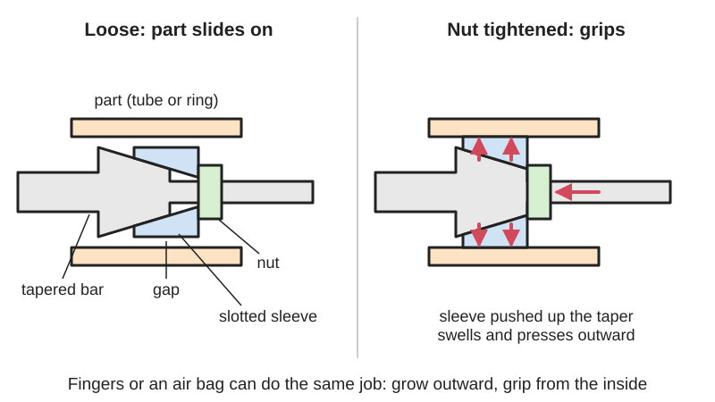

*Diagram drawn for the encyclopaedia from the research notes. ⚑ Needs confirming: a drawing can simplify or get details wrong; a real photo or a better diagram is welcome.*

A plug or set of fingers goes into a hole, tube or ring and is made to grow outward, by a cone or wedge, a screw-driven [linkage](../glossary.md#linkage) or an inflated rubber bladder, so friction against the inside wall holds and centres the part, and shrinking it again lets the part go.

**In plain words:** A plug, sleeve or ring of fingers that you push into a hole, tube or ring and then make fatter, so it presses outward on the inside wall and holds the part from within; make it thinner again and the part slides off. **Proper term:** Expanding internal grip: the expanding mandrel (expanding arbor) used to hold a part by its bore for turning, grinding or sanding, and the internal gripper (I.D. gripper, expansion gripper) used on robots, including the inflatable bladder gripper.

**Also called:** expanding mandrel; expanding arbor; expansion arbor (Wikipedia 'Mandrel'; Joe Pie video title); expanding mandrel and sleeve; split-sleeve mandrel (a slotted sleeve pushed along a tapered arbor) (Birla Precision; US patent 6832756); expanding [collet](../glossary.md#collet); internal expanding collet; ID chuck (Printables 'Watch Case Back Polishing Arbor - Internal Expanding Collet / ID Chuck'); [O-ring](../glossary.md#o-ring) mandrel; O-ring expansion arbor (rubber rings squeezed so they bulge outward) (US patent 6832756; Hobby-Machinist forum); ring expanding mandrel (jeweller's or lathe ring holder) (Sherline video title; Printables 'Expanding ring mandrel'); internal gripper; inside gripper; I.D. (inside-diameter) gripper; internal gripping; expansion gripping (Ozobot ORA guide; SCHUNK CGP data sheet 'I.D. gripping'); EOAT internal gripper (end-of-arm tooling) (US patent 4770456); inflatable bladder gripper; bladder gripper; inflatable gripper (US patents 4770456 and 4955655); airshaft; air shaft; air expanding shaft, lug type or strip type, for gripping the cardboard core of a roll of paper or film (Wikipedia 'Airshaft'); rubber expansion sanding drum (nut-lock, screw-lock and quick-lock types) (Bearing Distributors catalogue); expanding spool holder; spool hub expander (Printables 'Ankermake M5 - Spoolholder - Expanding Mandrel').

## How it works

Something inside the plug pushes its outer surface outward until it presses hard against the inside of the part, and friction then stops the part sliding or turning. In the classic lathe mandrel a sleeve with long slots is pushed along a gently tapered bar, so the slotted sections are forced outward, roughly parallel to the centre line (US patent 6832756); squashing rubber O-rings or a rubber sleeve along its length makes it bulge outward in the same way (US patent 6832756; Bearing Distributors). Robot inside grippers either move fingers outward through a linkage driven by an [actuator](../glossary.md#actuator), or inflate a bladder (with or without a shell) inside the cavity (US patent 4770456); airshafts inflate a bladder that pushes metal lugs out of slots to grip a roll's core (Wikipedia 'Airshaft'). Because the push is even all round, the part ends up centred on the plug, and reversing the screw, nut or air lets the springy sleeve or rubber shrink back so the part comes off.

## Parts

A few parts to a small assembly that acts as one unit. Lathe expanding mandrel: a tapered arbor (bar), a sleeve slit along its length, and a nut or pull-rod (drawbar) that pushes the sleeve up the [taper](../glossary.md#taper) (Birla Precision; US patent 6832756). Shop-made mandrel: a bar slit into four at one end, a tapered thread and a screw (Model Engineer forum). Rubber type: spacers, O-rings or a rubber sleeve and a nut that squashes them (US patent 6832756; Bearing Distributors). Robot inside gripper: an actuator (air cylinder or servo), a wedge, cone or linkage, and two or more fingers or jaws (US patent 4770456; SCHUNK CGP). Bladder gripper or airshaft: a rubber or silicone bladder inside a housing or slotted tube, an air valve, an air supply, and in airshafts metal lugs pushed out by the bladder (US patent 4770456; Wikipedia 'Airshaft').

## Everyday examples

- The rubber sanding drum on a rotary tool or drill, which swells when you tighten its nut or screw to hold the sanding band (Bearing Distributors)
- A jeweller's or hobbyist's expanding ring mandrel that holds a ring on a drill or lathe for filing and polishing (Printables 882417; Sherline video)
- Filament spool holders whose hub expands to grip the spool's centre hole (Printables 346075)
- The airshaft that grips the cardboard core of a big roll of paper or plastic film in printing and packaging machines (Wikipedia 'Airshaft')

## When to use it

Use it when you have to hold a part by its hole: to machine, sand or polish the outside of a ring, bush, wheel or case back so the outside ends up true to the hole (Birla Precision; Printables 1854987); when the outside is delicate and must not be touched, like gear teeth (Ozobot ORA guide); when a robot must pick up rings, cups, cones, tubes or roll cores from the inside (MatterHackers 'Slight Malfunction'; Wikipedia 'Airshaft'); and when the hole is blind or only one end is reachable (Birla Precision).

## When not to use it

Avoid it when the part has no reasonably round, clean bore, when the bore is too thin-walled or soft and would bulge or crack, or when sizes vary more than the mandrel's small range (Birla Precision; Printables 346075) - use an outside grip such as a collet or scroll chuck instead. Avoid friction-only grips for heavy parts held overhead; grip by shape (a lip or groove) or add a spring-assisted or braked gripper (SCHUNK CGP data sheet). Avoid inside grips on stacked or nested parts: REV Robotics' Power Play guide preferred outside gripping 'to reduce the chances of picking up more than one element' (REV FTC Kickoff Concepts). Avoid bladders where burrs or sharp edges are inside the bore (US patent 4955655).

## Details

- **What it does (jobs):**
  - join and hold: holds a ring, bush, gear, tube, spool or roll by its hole so the outside stays free to be machined, sanded, polished or handled (Birla Precision; Ozobot ORA guide; Wikipedia 'Airshaft')
  - hold or release using power: robot and air versions grip when air pressure or a motor pushes the fingers or bladder outward, and let go when it is removed (PFA 'What is an Air Gripper?'; US patent 4770456)
  - line parts up exactly: centres the part on its bore, so the outside can be turned true to the hole (Birla Precision: expanding mandrels are used 'for locating and holding the components with a bore')
  - lock, and release by hand: screw, nut and knob versions are tightened and undone by hand or with a spanner (Printables 'Expanding ring mandrel'; Printables 'Ankermake M5 - Spoolholder - Expanding Mandrel')
- **Movement:** none: once expanded nothing moves. The gripping surface only moves outward a little: about 0.8 mm on the diameter for a standard precision sleeve (Birla Precision), 9 mm for a printed spool-holder mandrel (50 to about 59 mm, Printables 346075) and about 7 mm for a printed ring mandrel (13.2 to 20.2 mm, Printables 882417)
- **Directions it can move (degrees of freedom):** 0 while gripping: the outward push fixes the part's sideways position and tilt, and friction stops it sliding along or turning on the plug. On lathe mandrels a shoulder or face sets the depth, and the sleeve's pull-back action draws the part 'hard against the locating face' (Birla Precision). While released: 2 (the part can slide on and off and turn).
- **Special behaviour:**
  - self-aligning or self-centring: the even outward push centres the part on its bore; a precision double-angle sleeve mandrel holds parts to within 0.013 mm (0.0005 in) total indicated run-out (Birla Precision). The older single-taper sleeve type 'has never been a particularly accurate method' (US patent 6832756)
  - quick-release: powered inside grippers open and close in a few hundredths of a second (closing and opening times of 0.02 to 0.07 s for SCHUNK CGP grippers), and an airshaft 'may also be easily deflated to facilitate easy withdrawal' (Wikipedia 'Airshaft'). Screw-driven mandrels need a few turns of a nut or knob
  - [fail-safe](../glossary.md#fail-safe--fail-secure) or breakaway: only in spring-assisted powered grippers: a spring keeps a minimum gripping force if the air pressure drops, and in the version made for inside gripping (SCHUNK 'IS') the spring pushes the jaws open, i.e. outward against the bore (SCHUNK CGP data sheet; PFA 'What is an Air Gripper?'). Plain air and bladder grippers are not fail-safe: they relax when the air goes
- **How it holds:**
  - friction or clamping ([force-fit](../glossary.md#form-fit--force-fit--material-bond)): the outward push presses the sleeve, fingers or bladder against the bore and friction carries the load (US patent 6832756; SCHUNK rates its grippers for 'force-fit gripping' by friction, SCHUNK CGP data sheet)
  - powered hold: robot grippers, bladder grippers and airshafts hold only while air pressure or motor force is applied, unless a spring or brake keeps the grip (PFA 'What is an Air Gripper?'; SCHUNK CGP data sheet)
  - spring force (a spring or springy part presses it in place): in spring-assisted grippers a spring keeps a minimum grip force; in slit sleeves and rubber types the springiness mainly shrinks the plug again for release (SCHUNK CGP data sheet; US patent 6832756)
  - shape (the parts interlock; form-fit): only in special cases, e.g. serrated sleeves that locate in [splines](../glossary.md#spline) or internal gear teeth (Birla Precision) or fingers that hook under a lip; SCHUNK notes that form-fit gripping allows 'significantly higher' part weights than friction gripping (SCHUNK CGP data sheet)
- **Input and output:** Not a motion converter in use. A lathe or drill mandrel passes the spindle's rotation straight into the part, 1:1 and in line, until it slips. Inside, a cone, wedge or linkage turns an [axial](../glossary.md#axial--radial) push (a nut, drawbar, air piston or servo) into a small outward movement; e.g. the SCHUNK CGP uses a wedge-hook to turn the piston's up-and-down movement into synchronised jaw movement. Back-drivable: ⚑ [uncertain] screw-tightened mandrels are not undone by the part's load in normal use, but no source states this.
- **Power:** passive (no power needed) for screw, nut, knob and drawbar mandrels: they stay tight on their own. Powered (compressed air, hydraulics or an electric motor) for robot inside grippers, bladder grippers and airshafts. If power is lost: an air gripper 'will relax its grip on an object when air pressure is lost. This may cause the object to be dropped' (PFA 'What is an Air Gripper?'); spring-assisted versions keep a minimum grip force (SCHUNK CGP data sheet); a pressure maintenance valve can hold the air in the gripper's piston for a while during an emergency stop (SCHUNK SDV-P, in the CGP data sheet). Electric grippers can be fitted with a permanent-magnet brake to keep their grip (SCHUNK gripper range filter 'M (permanent magnet brake)'). ⚑ [uncertain] A hobby servo that is back-drivable will usually let the fingers relax when unpowered; a worm or lead-screw drive tends to keep its last position (reasoning; see the [self-locking](../glossary.md#self-locking) entries).
- **Load:** Light to heavy depending on build. Strong against twisting and against pulling the part off along the axis, as long as friction holds; weaker against tilting or prying if the grip is short. Industrial guide: SCHUNK CGP air grippers give 350 to 1585 N of gripping force but are rated for parts of only 1.75 to 5.6 kg when gripping by friction, because the rating assumes a friction coefficient of 0.1 and a safety factor of 2 (SCHUNK CGP data sheet). Precision mandrels hold well enough for 'heavy machining operations' (Birla Precision). Printed mandrels and grippers are light duty. The part's own wall limits the load: a thin ring or cardboard core can deform or crush (Printables 346075).
- **Play and precision:** No play once gripping. Precision varies widely: double-angle precision sleeves 0.013 mm (0.0005 in) run-out or better (Birla Precision); the older single-taper slotted sleeve is 'never ... particularly accurate' (US patent 6832756); the O-ring type 'requires a very tightly controlled size [tolerance](../glossary.md#tolerance) for the workpiece inside diameter' (US patent 6832756). Home-made mandrels run truer if you expand them slightly and then turn the outside to the bore size, so they clamp evenly (Hobby-Machinist forum). It tolerates bore size only within its small expansion range, and a robot needs to line the gripper up accurately with the hole ('This technique requires a high degree of precision', Ozobot ORA guide).
- **Taking it apart:** removable: undo the nut or knob, or release the air, and the part slides off. Powered grippers and airshafts are effectively tool-free quick release (Wikipedia 'Airshaft'; PFA 'What is an Air Gripper?')
- **How often it can be reused:** effectively unlimited for metal mandrels and industrial grippers (pneumatic grippers 'can provide millions of cycles without needing upkeep', PFA 'What is an Air Gripper?'); bladders wear and are replaced when they fail (US patent 4955655). Printed plastic mandrels: many times, but thin fingers can chip or crack (Printables 346075: cardboard spools 'resulting in chipped keys')
- **Sealing:** none: it grips but is not meant to seal. The same squeezed-rubber or inflated-bladder principle is used in tube and pipe plugs, which are a separate type (see Internal tube anchors)
- **Adjustable:** yes: how far it expands, and so how tightly it grips, is set by how far the screw, nut or knob is turned, or by the air pressure. Grip force of an air gripper rises in proportion to pressure: 'If you increase the air pressure by 20 percent, you increase the force on the gripper by 20 percent', and a [regulator](../glossary.md#regulator) can reduce it (PFA 'What is an Air Gripper?'). Each mandrel covers only a small size range (0.8 mm per standard precision sleeve, up to 6.3 mm on large diameters, Birla Precision), so different bores need different sleeves or keys.
- **Access needed:** one side only (blind): it goes into the hole from one end, so it suits blind bores and parts whose outside must stay free; [cantilever](../glossary.md#cantilever) mandrels are 'specifically useful for blind bores' (Birla Precision), and Joe Pie's O-ring expansion arbor video is titled 'No through hole...No Problem'
- **Materials:** Made from: hardened steel (traditional precision mandrels, US patent 6832756); free-cutting steel such as 12L14 or EN1A, or aluminium, for shop-made mandrels (Hobby-Machinist forum); rubber O-rings, rubber drums or silicone bladders (US patent 6832756; Bearing Distributors; US patent 4770456); printed PLA, PETG or ABS, with TPU suggested for extra grip (Printables 882417). Parts it holds: anything with a round bore or inner surface: metal rings, bushes and gears, wheels, watch case backs, drink cans, cardboard and plastic spool and roll cores, game-piece cones (Printables 1854987, 129962, 346075; Wikipedia 'Airshaft'; MatterHackers). Poor fits: parts with burrs or sharp edges inside (they damage bladders, US patent 4955655), thin or soft parts that bulge, and nested or stacked parts.
- **Heat, cold, water and wear:** Printed PLA mandrels soften and deform above about 60 °C and degrade in UV light; PETG is fine below about 80 °C (Prusa PLA and PETG guides). Printed plastic [creeps](../glossary.md#creep) under constant load, so the grip of a printed mandrel can fade over time (Filament Specs 'Creep Resistance') ⚑ [uncertain: not measured for mandrels]. Oil or grease in the bore lowers friction and grip ⚑ [uncertain: no source opened]. Rubber and silicone bladders wear and can be cut; failures can be sudden (US patent 4955655). Air grippers lose grip with pressure (PFA 'What is an Air Gripper?').

## Making it

- **Ways to make or get it:**
  - off-the-shelf part: expanding mandrels and sleeves, ring expanding mandrels, rubber expansion sanding drums, airshafts, air grippers with an I.D. gripping option, inflatable internal grippers
  - 3D print (FDM): screw-expanded mandrels for rings, watch case backs, cans and filament spools, and game-piece grippers for robot contests (Printables 882417, 1854987, 129962, 346075; MatterHackers 'Slight Malfunction')
  - CNC: turned and slit metal mandrels on a lathe, including the taper-tap-and-screw method and expand-then-turn-to-size (Model Engineer forum; Hobby-Machinist forum)
- **Printing it in one piece (print in place):** partly: most printed versions are one or a few printed parts plus a bought screw and nut, e.g. the ring mandrel needs an M4 nut and an M4 x 30 bolt (Printables 882417) and the watch case-back arbor an M5 screw, nut and washer (Printables 1854987); bigger ones are assemblies of many printed parts (the spool mandrel uses 24 key halves, 12 dowels, threaded bodies and two 608 bearings, Printables 346075)
- **Tools:** Lathe mandrels: a spanner or 'C' spanner, or the machine's drawbar (Birla Precision). Shop-made slit mandrel: a hex key for the taper-ended screw (Model Engineer forum). Printed mandrels: a screwdriver or hex key for an M4 or M5 screw and nut (Printables 882417, 1854987), or no tools where a hand knob is printed (Printables 346075). Powered grippers: no tools in use, but they need an air supply and valve, or a servo and controller. Making a metal one needs a lathe and a slitting saw or hacksaw (Model Engineer forum; Hobby-Machinist forum).
- **Difficulty:** easy to moderate: a printed ring or spool mandrel with one screw and nut is easy (Printables 882417); an accurate metal mandrel needs a lathe and a slitting cut (moderate); a powered robot inside gripper is moderate to hard because it needs an actuator, control and careful alignment (Ozobot ORA guide)

### 3D printing tips

1) Print the split body so the layers run along the fingers, not across their roots: the ring mandrel 'must be printed as shown in the picture to prevent snapping of the moving jaws' (Printables 882417). 2) Make the fingers solid: Bobino used 5 [perimeters](../glossary.md#perimeters) and 20% adaptive cubic [infill](../glossary.md#infill) in PLA, and says PETG or ABS also work and TPU 'might provide even better grip' (untested) (Printables 882417). 3) Use metal threads: a [captive nut](../glossary.md#captive-nut) plus a screw that pushes into a cone or tapered hole is the usual drive (Printables 882417, 129962); a washer under the screw head spreads the force, and chamfering the screw head makes it run smoother (Printables 1854987). 4) Print a small tolerance test first: the spool mandrel is 'a tight tolerance model' and its author added a cut-down test piece of the expansion collar (Printables 346075). 5) Keep thin finger tips away from crushable parts: hollow cardboard spool cores put all the force on the thin edge of the keys and chipped them (Printables 346075). 6) Expect only a small size range per design: plan one printed mandrel per size band (13-20 mm and 18-26 mm ring versions, Printables 1803272). 7) Printed plastic slowly creeps under constant load (Filament Specs 'Creep Resistance'), so re-tighten a printed mandrel that has to hold for a long time ⚑ [uncertain: no test of printed mandrels found]. 8) Keep PLA mandrels out of heat: PLA 'gets soft and deforms at temperatures over 60 °C' (Prusa PLA guide); friction from sanding or polishing can warm the part, so use PETG (good below about 80 °C, Prusa PETG guide) for heavy use ⚑ [uncertain: heating during sanding not measured].

### Buying one (off-the-shelf parts)

Search for: 'expanding mandrel' or 'expanding mandrel set' (lathe, between centres or with a Morse-taper shank), 'expanding sleeve' and 'expanding mandrel sleeve' (standard, flush, segmented and serrated types, Birla Precision), 'expansion arbor', 'ring expanding mandrel' (jewellery and small lathes, e.g. Sherline (brand)), 'rubber expansion sanding drum' (nut-lock, screw-lock or quick-lock, Bearing Distributors), 'airshaft' or 'air expanding shaft' (lug type or strip type, Wikipedia 'Airshaft'), 'pneumatic parallel gripper' with 'I.D. gripping' or a 'spring-opening' gripping-force-maintenance version (SCHUNK 'IS' (brand) type), 'inflatable internal gripper' or 'bladder gripper', and 'pressure maintenance valve' for grippers (SCHUNK SDV-P (brand)). For home-made versions: a 'taper tap', socket-cap screws, M3-M5 screws and nuts, washers and 608 bearings for spool versions (Model Engineer forum; Printables 882417, 346075).

## Rules of thumb

- For friction grips, the gripping force must be many times the part's weight: SCHUNK rates its grippers for 'force-fit gripping with a coefficient of static friction of 0.1 and a safety factor of 2', which works out at a grip force of about 20 times the part's weight (e.g. 350 N for a 1.75 kg part) (SCHUNK CGP data sheet).
- Gripping by shape (fingers hooking under a lip or into a groove) allows 'significantly higher permissible workpiece weights' than friction gripping (SCHUNK CGP data sheet).
- Each precision expanding sleeve covers only about 0.8 mm of bore size as standard (the page's inch figure of 0.32 in appears to be a misprint for 0.032 in), with special types expanding up to 6.3 mm on large diameters; precision double-angle sleeves hold to 0.013 mm run-out (Birla Precision).
- Fit an over-expansion stop: commercial mandrels have one 'to avoid over-stressing on the expanding sleeve' (Birla Precision).
- A plain (non-expanding) tapered mandrel has a taper of about 0.005 in per foot and is driven into an accurate hole to grip by friction (Wikipedia 'Mandrel').
- Shop-made mandrel: turn a bar to the bore size, drill and tap the end with a taper tap, slit it into four, and tighten a screw so the taper spreads the fingers (Sparey, 'The Amateur's Lathe', as described on the Model Engineer forum); slot width hardly matters, about 0.7 mm is fine, and expanding the mandrel slightly before turning it to final size gives even clamping (Hobby-Machinist forum).
- Air gripper force is proportional to air pressure (+20% pressure gives +20% force) (PFA 'What is an Air Gripper?'); SCHUNK CGP grippers run at 6 bar nominal, with a minimum of 2.5 bar, or 4 bar for spring-assisted versions (SCHUNK CGP data sheet).
- Inflatable bladder grippers often need 'very high air or hydraulic pressure' to grip properly and can have sealing problems (US patent 4770456).

## Common failures

Slipping because the grip force is too low for the part's weight or the bore is oily: size the force with a large safety margin (SCHUNK CGP data sheet). Part dropped when air or power fails (PFA 'What is an Air Gripper?'). Part not centred or wobbling because the sleeve expands unevenly: expand slightly and turn to size (Hobby-Machinist forum) or use a precision double-angle sleeve (Birla Precision; US patent 6832756). Cracked or over-stressed sleeves from over-expanding (Birla Precision). Chipped printed fingers on hollow cardboard cores (Printables 346075) or snapped jaws from the wrong print orientation (Printables 882417). Burst or cut bladders from burrs (US patent 4955655). A robot gripper that misses the hole because of [misalignment](../glossary.md#misalignment) (Ozobot ORA guide), or that picks up two nested parts at once (REV FTC Kickoff Concepts).

## Safety

A powered inside gripper can drop its part if air pressure or power is lost: 'A gripper will relax its grip on an object when air pressure is lost. This may cause the object to be dropped' (PFA 'What is an Air Gripper?'). Use a spring-assisted version (for inside gripping the spring must push outward, SCHUNK 'IS' type), a pressure maintenance valve, a brake or a self-locking drive, keep the part low, and never stand or reach under a part held this way (SCHUNK CGP data sheet). Bladders can fail suddenly (US patent 4955655). On lathes and drills, a part that slips off a spinning mandrel can be flung out: tighten fully and keep clear of the line of the part ⚑ [uncertain: general workshop practice, no source opened]. Don't over-expand: commercial mandrels have an over-expansion stop to protect the sleeve (Birla Precision). Robot arms need a slow test speed and an emergency stop within reach (Ozobot ORA guide). Keep fingers out of the fingers' and arm's path.

## Related

- Collet (and keyless chuck): grips a rod from the outside by squeezing inward; the 'expanding collet' variant is this entry
- Internal tube anchors (star nut, expansion plug): uses the same expanding idea as a semi-permanent fixing inside a tube, not as a quick-release grip
- Scroll mechanism (self-centring scroll chuck, spiral-slot plate): a chuck whose jaws can also be opened against the inside of a bore; covers a much wider size range
- Press-fit and expanding inserts (tap-in insert): expand once to stay in a hole permanently
- Wall plug (expansion anchor for solid walls): expands inside a drilled hole to anchor a screw; permanent
- Taper fit (Morse taper): grips by wedging a cone into a cone with no moving fingers
- Keyless locking bush (taper-lock bush, shaft locking device): a pair of tapered rings that expand and contract to lock a hub to a shaft
- Compliant gripper and force amplifier / Fin-ray gripper: grip from the outside with flexing fingers
- Granular jamming gripper (coffee-balloon gripper) and Vacuum (suction) gripper: other ways to pick parts without precise jaws; a jamming balloon can also be pushed into an opening
- Bellows and inflatable actuators (air bag, air spring): the same inflating idea used to push rather than grip
- Air or hydraulic cylinder (pneumatic cylinder, hydraulic ram): the usual actuator behind a powered inside gripper

## Make it yourself

- [Expanding ring mandrel (Bobino, Printables) (URL from Printables API, page not opened)](https://www.printables.com/model/882417-expanding-ring-mandrel): Printed split mandrel for a drill: an M4 nut and M4 x 30 bolt expand it to hold rings of 13.2 to 20.2 mm for filing and sanding; PLA, 5 perimeters *(licence: CC BY (Creative Commons Attribution))*
- [Ankermake M5 - Spoolholder - Expanding Mandrel (Drekentai HieloRey, Printables) (URL from Printables API, page not opened)](https://www.printables.com/model/346075-ankermake-m5-spoolholder-expanding-mandrel): Expanding spool hub with 12 keys pushed out by threaded expansion collars, from 50 to about 59 mm, on two 608 bearings; a tight-tolerance print with a test piece *(licence: CC BY-NC-SA (Creative Commons Attribution-NonCommercial-ShareAlike))*
- [Watch Case Back Polishing Arbor - Internal Expanding Collet / ID Chuck (hummi, Printables) (URL from Printables API, page not opened)](https://www.printables.com/model/1854987-watch-case-back-polishing-arbor-internal-expanding): Split-collet mandrel expanded by an M5 screw and nut that holds watch case backs or bezels from the inside, so the outside can be polished in a drill or lathe *(licence: CC BY-NC (Creative Commons Attribution-NonCommercial))*
- [Can Internal Expanding collet (tylermor, Printables) (URL from Printables API, page not opened)](https://www.printables.com/model/129962-can-internal-expanding-collet): Screw-and-nut expanding mandrel that clamps inside a standard US soda can *(licence: CC BY (Creative Commons Attribution))*
- [Expanding ring mandrel for drill (Damien Villeneuve, Printables) (URL from Printables API, page not opened)](https://www.printables.com/model/1803272-expanding-ring-mandrel-for-drill): Simple ring mandrel for a drill in two size ranges, 13-20 mm and 18-26 mm *(licence: CC BY (Creative Commons Attribution))*

## Pictures, videos and models

- [H. P. King Expanding Mandrels (US Patent Office drawing, 1874, Wikimedia Commons)](https://commons.wikimedia.org/wiki/File:H._P._King_Expanding_-_Mandrels_-_DPLA_-_3e18df8d7fdf3370ffcd9787f697a9e1_(page_1).jpg): Historic patent drawing of an expanding mandrel *(licence: Public domain)*
- [Airshaft closeup.jpg (Alexander Davronov, Wikimedia Commons)](https://commons.wikimedia.org/wiki/File:Airshaft_closeup.jpg): An airshaft inside a paper roll core with its air inlet; the caption in Wikipedia 'Airshaft' notes the protruding holders that expand when air is let in *(licence: CC BY-SA 4.0)*
- [Model Engineering Basics: No 6 An Expanding Mandrel (SteamWorx, YouTube)](https://www.youtube.com/watch?v=gX25t4OaNOI): Making a simple expanding mandrel in a home workshop (title and channel verified via YouTube oEmbed; video content not viewed) *(licence: link only (standard YouTube licence))*
- [Expansion Arbors --- No through hole...No Problem..Take a Look (Joe Pie, YouTube)](https://www.youtube.com/watch?v=J1RFTRzuAcU): Expansion arbors for parts with blind holes; forum users describe Joe Pie's videos as making mandrels with O-rings instead of slitting (Hobby-Machinist forum) (title and channel verified via YouTube oEmbed; video content not viewed) *(licence: link only (standard YouTube licence))*
- [ORA Expansion Gripping: Getting a Grip from Within, Student Guide (Ozobot)](https://classroom.ozobot.com/wp-content/uploads/2026/07/ORA-Expansion-Gripping-Getting-a-Grip-from-Within-Student-Guide.MOzGTDjKRv6effhDH6GTlwxO.pdf): Classroom robot-arm lab with a photo of a finger gripper expanded inside a gear's centre hole, placing it on a peg; the gears and wall can be 3D-printed *(licence: link only)*

## Needs confirming

⚑ marks something nobody has confirmed yet: a fact the research could not confirm from a source, a finder value that is a best guess, or an open point from the research notes. Corrections are welcome (see `research/needs-confirming.md`).

- ⚑ 7 sentences on this page marked [uncertain].
- ⚑ Research note: *Expanding internal grip*: Birla Precision gives the sleeve expansion range as '0.8 mm (0.32")'; the inch figure looks like a misprint for 0.032 in, and the entry says so. Some safety points (parts thrown from a spinning mandrel) are reasoning without a source and marked [uncertain].

## Sources

- <https://en.wikipedia.org/wiki/Mandrel>
- <https://en.wikipedia.org/wiki/Airshaft>
- <https://classroom.ozobot.com/wp-content/uploads/2026/07/ORA-Expansion-Gripping-Getting-a-Grip-from-Within-Student-Guide.MOzGTDjKRv6effhDH6GTlwxO.pdf>
- <https://patents.google.com/patent/US4770456>
- <https://patents.google.com/patent/US4955655>
- <https://patents.google.com/patent/US6832756>
- <https://www.birlaprecision.com/product/bpt/expanding-mandrels-and-sleeves.html>
- <https://www.model-engineer.co.uk/forums/topic/expanding-mandrels/>
- <https://www.hobby-machinist.com/threads/home-made-expanding-mandrels.64513/>
- <https://www.pfa-inc.com/what-is-an-air-gripper/>
- <https://a.storyblok.com/f/298593/x/71527a6786/cgp-catalog-section.pdf>
- <https://schunk.com/us/en/sistemi-di-presa/pinza-parallela/c/PUB_8295>
- <https://products.bearingdistributors.com/category/sanding-drums>
- <https://www.matterhackers.com/articles/3d-prints-robot-for-competition>
- <https://docs.revrobotics.com/ftc-kickoff-concepts/powerplay-2022-2023/intake>
- <https://help.prusa3d.com/article/pla_2062>
- <https://help.prusa3d.com/article/petg_2059>
- <https://filamentspecs.com/creep-resistance-3d-printed-parts/>
- <https://commons.wikimedia.org/wiki/File:H._P._King_Expanding_-_Mandrels_-_DPLA_-_3e18df8d7fdf3370ffcd9787f697a9e1_(page_1).jpg>
- <https://commons.wikimedia.org/wiki/File:Airshaft_closeup.jpg>
- <https://www.youtube.com/watch?v=gX25t4OaNOI>
- <https://www.youtube.com/watch?v=J1RFTRzuAcU>
- <https://www.youtube.com/watch?v=ceuVGYqovXw>
- <https://api.printables.com/graphql/>
