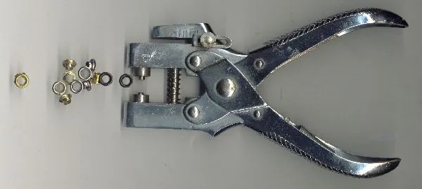
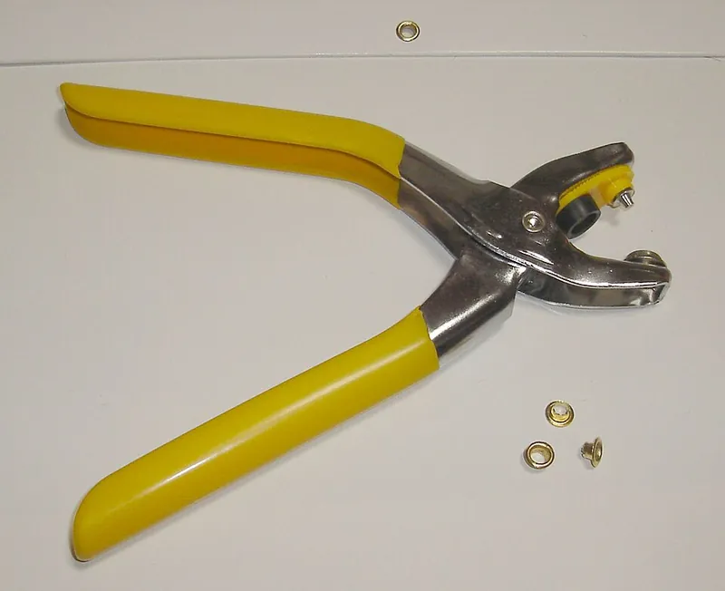
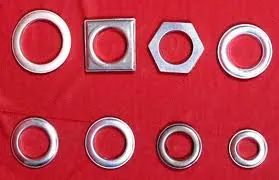

<figure class="eoc-pic eoc-pic-main"><figcaption><strong>Photo.</strong> <a href="https://commons.wikimedia.org/wiki/File:Eyelet.jpg">Eyelet</a> by Sonett72 at English Wikipedia, Public domain, from Wikimedia Commons.</figcaption></figure>
<figure class="eoc-pic"><figcaption><strong>Photo.</strong> <a href="https://commons.wikimedia.org/wiki/File:%E3%83%8F%E3%83%88%E3%83%A1%E3%83%91%E3%83%B3%E3%83%81.jpg">ハトメパンチ</a> by ＋－, <a href="http://creativecommons.org/licenses/by-sa/3.0/">CC BY-SA 3.0</a>, from Wikimedia Commons.</figcaption></figure>
<figure class="eoc-pic"><figcaption><strong>Photo.</strong> <a href="https://commons.wikimedia.org/wiki/File:Eyelets_For_Curtain.jpg">Eyelets For Curtain</a> by Aman78665, <a href="https://creativecommons.org/licenses/by-sa/3.0">CC BY-SA 3.0</a>, from Wikimedia Commons.</figcaption></figure>

A small metal or plastic ring set into a punched hole in fabric, leather or thin sheet, with its tube (barrel) rolled over onto a washer or onto the material itself, so the hole has a smooth, strong rim that a lace, cord, hook, peg or pole can pass through without tearing the material.

**In plain words:** A metal or plastic ring squeezed into a hole in fabric, leather or thin sheet so the edge of the hole can't tear or fray, letting a lace, cord, hook, tent peg or curtain pole pass through it. **Proper term:** Eyelet and grommet (two-piece grommet with washer; one-piece eyelet).

**Also called:** grommet; a small grommet is also called an eyelet, 'especially when used in clothing or crafting' (Wikipedia 'Grommet'); eyelet: some leather and craft suppliers use 'eyelet' only for the one-piece kind with no washer and 'grommet' for the two-piece kind with a washer on the back (Weaver Leather Supply; SewGuide); plain grommet, washer grommet, grommet and washer (G&W) (Sailrite; Trivantage); spur grommet, rolled-rim grommet with spur washer: the washer has teeth that bite into the fabric (Sailrite; Stimpson; FAA Parachute Rigger Handbook); self-piercing grommet ('No Hole Needed' is a Stimpson (brand) trade name): cuts its own hole as it is set (Stimpson; Trivantage); tooth washer, spur washer, neck washer, plain washer: the washer types (Trivantage); cringle: in sailmaking, a rope-rimmed hole in the edge or corner of a sail, usually enclosing a metal grommet; the two words are sometimes used interchangeably (Wikipedia 'Cringle', 'Grommet'); curtain eyelet, curtain grommet, grommet-top curtain: large rings that let a curtain slide along a pole (Wikipedia 'Grommet'); not the same as: the rope grommet (a ring laid up from a single rope strand, see Rope splices), rubber cable grommets and insulating bushings (see Cable [gland](../glossary.md#gland) and strain relief), rubber isolator grommets (see Elastomer isolation mount), grommet edging (see Push-on edge trim), or ear grommets (tympanostomy tubes, a medical device) (Wikipedia 'Grommet').

## How it works

A hole is punched or cut in the material, the grommet's barrel is pushed through it from the front, the washer (if any) goes over the barrel at the back, and a setting tool curls or splits the end of the barrel outward so it rolls over the washer and clamps the material between the front flange and the washer (Wikipedia 'Grommet'; Harbour Chandler; SewGuide). The rolled rim spreads the pull of a cord over the whole edge of the hole and covers the cut fibres, so 'The grommet prevents the cord from tearing through the hole' (Wikipedia 'Grommet'). A spur washer's teeth dig into the fabric and wrap round the barrel 'to provide a strong grip and to keep the grommet from spinning' (Sailrite). A self-piercing grommet has a sharpened barrel that is pressed against the washer's edge, cutting the hole and coiling the barrel 'in one [stroke](../glossary.md#stroke)' (Stimpson).

## Parts

A few parts: a grommet (a flanged tube, or barrel) and, for two-piece grommets, a washer that goes on the back; a one-piece eyelet has no washer. Setting needs a hole punch or cutter and a matching setting die and anvil (or a press or pliers). Printed versions are two threaded or snap-fit rings.

## Everyday examples

- The lace holes in shoes and boots (Wikipedia 'Grommet')
- The metal rings round the edge of a tarpaulin, tent or vinyl banner that you tie or peg through (Harbour Chandler; 4over4)
- Grommet-top curtains and shower curtains hanging from a pole or hooks (Wikipedia 'Grommet')
- The rings for hoisting a flag on a flagpole line (Wikipedia 'Grommet')

## When to use it

Use a grommet or eyelet wherever a cord, lace, hook, peg, bungee or pole has to pass through fabric, leather, card or thin sheet: lacing up shoes, bags, corsets and covers; tying down tarps, awnings, boat covers and banners; hanging curtains and flags; and for neat, reinforced holes in craft and leather work (Wikipedia 'Grommet'; Weaver Leather Supply). Choose plain grommets or one-piece eyelets for light, stationary jobs (flags, bags, curtains, crafts) and spur grommets on a reinforced hem for anything pulled by wind or tension, such as tarps, tents and covers (Sailrite; Trivantage). Printed screw-together grommets suit curtains and light covers where a metal grommet kit isn't to hand (Printables 579887).

## When not to use it

Not as a lifting point, a tie-off for climbing or anything that holds a person: use rated, sewn hardware. Not in a single layer of thin, stretchy or loosely woven fabric without reinforcement; for a strong attachment point on fabric, sew on a webbing loop or a D-ring with a box-X stitch (Sailrite; see Load-bearing stitch patterns). Not for passing electric cables or hoses through a rigid panel: use a rubber cable grommet or gland (Cable gland and strain relief) or grommet edging (Push-on edge trim). To join two layers permanently rather than make a hole, use a leather or textile rivet; to make the join undo, a press stud. For a whole fabric edge held in a frame, a keder or [spline](../glossary.md#spline) in a groove (Bead-in-groove fabric edge) seals better and installs faster than a row of loops and grommets (Specialty Fabrics Review).

## Details

- **What it does (jobs):**
  - join and hold: gives a lace, cord, hook, carabiner, tent peg, cable tie or bungee a strong reinforced hole to hold fabric, leather, a tarp or a banner by
  - let it move (turn, slide or bend): curtain eyelets let a curtain slide along a pole, and laces and cords slide through eyelets as they are pulled tight (Wikipedia 'Grommet')
- **Movement:** none: the grommet is clamped fixed in the material; only the cord, lace, hook or pole through it slides or turns.
- **Directions it can move (degrees of freedom):** 0 between the grommet and the material it is set in; whatever passes through the hole is free to slide and turn.
- **Special behaviour:**
  - none: it simply reinforces a hole. The useful extras are passive: the smooth rim stops a cord chafing, and spur washers stop the grommet spinning and wearing the fabric (Sailrite)
- **How it holds:**
  - shape (the parts interlock; [form-fit](../glossary.md#form-fit--force-fit--material-bond)): the rolled-over barrel traps the material between the flange and the washer, and spur teeth bite into the fabric (Sailrite; Harbour Chandler)
  - friction or clamping (force-fit): setting squeezes the material between flange and washer; a plain washer only 'compress[es]' the fabric, which is why it can spin (Harbour Chandler; Sailrite)
- **Input and output:** not applicable
- **Power:** passive (no power needed)
- **Load:** Light to medium, limited by the material round the hole rather than the metal ring. Strongest when the pull is spread over many grommets along a reinforced hem; a single grommet in single-layer material, or one pulled by a cord with no stretch, tends to tear out: banner makers say wind is the main cause of damage, as 'the constant pull on each grommet eventually stretches the hole until the material gives way' (Banners.com). Plain grommets are for 'lighter duty applications like flags, bags, or curtains' and are 'not strong enough for medium to heavy applications'; spur grommets are for 'medium to heavy applications like tarps, tents, covers, and awnings' (Sailrite). No published pull-out figures were found for typical grommets ⚑ [uncertain]. A grommet in a tarp or banner is not a rated attachment point for lifting or for people.
- **Play and precision:** not applicable (it doesn't locate parts). The hole fit matters for setting: the hole should be snug on the barrel, as 'a too small hole is any day better than a too big hole' and a too-big hole gives 'A wobbly grommet' (SewGuide).
- **Taking it apart:** permanent for metal grommets and eyelets: to remove one, the washer is cut through with diagonal cutters, peeled back and the grommet pulled out, after which a new one is set (FAA Parachute Rigger Handbook, 'Container Grommet Replacement'). Printed screw-together grommets are removable.
- **How often it can be reused:** once: a set metal grommet is destroyed when it is cut out. Printed screw-together grommets can be unscrewed and refitted many times ⚑ [uncertain].
- **Sealing:** none: the hole stays open for the cord or pole; the rolled rim only covers the cut edge so it can't fray.
- **Adjustable:** no: a grommet is fixed once set. Adjustment comes from what goes through it (lacing, a cord, a bungee or a cord lock).
- **Access needed:** both sides: the barrel goes in from the front and the washer and setting tool (or press die) need the back of the material; the anvil or lower die supports the front flange.
- **Materials:** Grommets and eyelets: brass ('Durable, moderately priced material that resists corrosion and can withstand high temperatures'), stainless steel ('Less malleable than brass but very strong, making it best for use in self-piercing grommets'), aluminium (light and corrosion-resistant) and nickel- or black-plated brass (Trivantage); stainless has become the parachute industry's preferred choice 'due to the ability to resist deformation and corrosion' (FAA Parachute Rigger Handbook, ch. 7); also plastic, for example curtain rings and printed ones. Suited to woven fabrics and sheets: canvas, duck, tarp and awning fabric, vinyl banners, sailcloth, webbing, leather and faux leather, felt, card and paper for crafts (Wikipedia 'Grommet'; Harbour Chandler; SewGuide). Medium or thin fabric needs interfacing (an extra stiffening layer) round the hole, and it is 'difficult to attach the grommets on thin fabrics like tshirt knit, chiffon' (SewGuide). Wikipedia also lists thin sheet metal and composite sheets as materials grommets are set into.
- **Heat, cold, water and wear:** Corrosion: brass 'does not rust' and suits indoor and outdoor use, and nickel plating adds corrosion and wear resistance (Stimpson); stainless steel resists corrosion and deformation best and is preferred in parachutes (FAA Parachute Rigger Handbook) and marine use (Trivantage, spur washers). Sun: 'UV exposure also breaks down vinyl fibers over months of direct sun, making the material [brittle](../glossary.md#brittle--ductile) and more likely to split under stress' (Banners.com). Wind and flapping [fatigue](../glossary.md#fatigue) the material and stretch the holes (Banners.com). Printed plastic grommets: PLA softens above about 60 °C and degrades in UV; PETG is suitable outdoors below about 80 °C (Prusa Knowledge Base).

## Making it

- **Ways to make or get it:**
  - off-the-shelf part: metal grommets, eyelets and washers, set with a hammer-on kit, pliers or a hand press
  - 3D print (FDM): two-part screw-together or snap-together plastic grommets and shoe eyelets (see make_it_yourself)
- **Printing it in one piece (print in place):** no: printed grommets are two separate rings (front and back) that are screwed or snapped together through the hole in the fabric.
- **Tools:** A hole punch or hole cutter and a setting tool: the cheapest kit is a hollow hole punch plus a punch with a shaped tip and an anvil, struck with a hammer on a solid surface; or a hand press with matching dies (e.g. C.S. Osborne W-1 (brand)), grommet pliers, or a bench press (e.g. Stimpson 405 (brand)); industry uses powered setting machines (Wikipedia 'Grommet'; SewGuide; Sailrite; Stimpson). Each grommet type and size needs its own die set: 'The plain grommet die set will not install a spur grommet and vice versa' (Sailrite). Self-piercing grommets need their matching press dies but no hole punch (Stimpson). Printed screw-together grommets need only scissors to cut the hole (rorys3D, Printables 579887).
- **Difficulty:** easy: a cheap hammer-on kit sets grommets in a few minutes ('You can easily install multiple grommets within a few minutes with a hammer, measuring tape, grommet, washer, fabric, and a hole punch', Trivantage); the main skills are cutting the right-sized hole and reinforcing the fabric first.

### 3D printing tips

1) Use a two-part design that clamps the fabric between a front ring and a back ring, joined by a thread or a snap: rorys3D's threaded curtain grommets come in through-hole sizes from 10 to 50 mm, print without supports in PETG, and are screwed into a hole cut 'about +2mm bigger than the diameter of the through hole'; for a curtain pole, choose a through-hole 25-50% bigger than the pole (Printables 579887). 2) Print a trial pair first and tune it: rorys3D advises trying the print settings on one grommet because the threads must work together, and W3asel's snap-together grommet needed 'a bit of force' to snap and a screwdriver to pry apart, with the suggestion to reduce the extrusion multiplier if the fit is too tight (Printables 579887, 1411144). 3) Round every edge the cord or yarn runs over; W3asel's design was made with 'a smooth channel through the middle and rounded edges to prevent snagging the yarn' (Printables 1411144). 4) For shoe eyelets, Toby3D printed in PLA at 0.1 mm layers and found the click-together version 'with slightly inner diameter is more durable' than the glued one (Printables 213352). 5) Choose the plastic for where it will live: PLA 'gets soft and deforms at temperatures over 60 °C, degrades under UV light' and is 'not suitable for technical and outdoor use', while PETG is suitable for 'most exterior use (with temperatures below 80 °C)' (Prusa Knowledge Base 'PLA', 'PETG'). 6) A printed stepped washer that drops into an existing tarp grommet lets a tarp be screwed down without tearing it (Printables 667856). 7) Expect printed grommets to be bulkier and weaker than metal ones; for tarps under wind load, metal spur grommets on a reinforced hem are the proven choice ⚑ [uncertain].

### Buying one (off-the-shelf parts)

Plain (washer) grommets; rolled-rim spur grommets with spur washers; self-piercing grommets and washers; tooth, spur, neck and plain washers; one-piece (self-backing) eyelets and two-piece eyelets with washers; snap-together plastic curtain eyelets; grommet kits (hole punch, setting punch and anvil); hand-press die sets with matching hole cutters (e.g. C.S. Osborne W-1 (brand), Sailrite HandyPress (brand)); bench presses (e.g. Stimpson 405 (brand)); rotary leather punches and eyelet pliers. Sizes are trade numbers (#00, #0, #1 ... #5 and up) for the inner diameter; link to a catalogue for the dimensions rather than copying them, e.g. the Trivantage grommet guide or the Stimpson product guide.

## Rules of thumb

- A grommet's number is not a hole size, and the same number differs between types: 'plain and spur grommets of the same number are not identical in size' (Sailrite). Sources side by side: a #1 plain grommet takes a 9/32 in hole and a #1 rolled-rim grommet a 3/8 in hole (Trivantage), while Sailrite's #1 spur die set comes with a 5/16 in hole cutter; a #3 takes 7/16 in (plain, Trivantage; spur, Sailrite) or 15/32 in (rolled rim, Trivantage). Always cut the hole with the cutter made for that grommet and die set.
- Fabric holes: keep the hole slightly smaller than the barrel so the grommet fits snugly; 'a too small hole is any day better than a too big hole', but too small makes the fabric bunch (SewGuide). Back thin or medium fabric with interfacing (SewGuide).
- Reinforce before you punch: banner makers set each ring 'on a folded, welded 1 inch hem, about half an inch in from the edge' (4over4); parachute riggers repair a grommet that has pulled out by sewing reinforcing tape over both sides of the area and punching new holes through it (FAA Parachute Rigger Handbook, pp. 7-67 to 7-72).
- Spacing on banners and covers: a grommet in each corner, then every 24-36 in (2-3 ft) along the edges, closer (18-24 in) for large or windy banners 'so no single grommet carries too much load' (NameBadge; 4over4; Catdi).
- Choose the washer for the job: plain washers 'work best in general or stationary uses'; tooth washers 'bite down for heavier duty projects'; spur washers are 'the most robust and secure option ... ideal for demanding conditions that experience movement (e.g., marine settings)'; neck washers have a longer flange for thicker fabrics (Trivantage).
- Self-piercing grommets save punching but are 'Not recommended for multiple layers of fabric or thick fabric' (Trivantage).
- Set it fully: 'Make sure that the grommet is set sufficiently so that there is no exposed edge to snag lines or material', and check that 'There should be no sharp edges on inside of grommet' (FAA Parachute Rigger Handbook, p. 7-42 to 7-43). A good spur grommet 'should sit flat against the material with no loose edges or movement' (Harbour Chandler).
- Stainless grommets need heavier tools: the Stimpson 405 bench press sets rolled-rim grommets up to #4 in brass but only up to #3 in stainless steel (Stimpson).
- Hang a grommeted banner or cover with some give: use bungee cords or elastic straps rather than zip ties, which 'have zero stretch', attach at every grommet, and aim for 'hand-taut' (Banners.com).
- Where you have no grommet tools, a loop of doubled webbing sewn on with a box-X stitch can replace a grommet; Sailrite says the box-X 'has the same strength level as a grommet' (Sailrite 'Webbing Loops Instead of Grommets').

## Common failures

Tearing or pulling out: the FAA says the most common repair to a parachute's main deployment bag is the closing flap round its grommets, which 'work loose and pull out, damaging the material' (FAA Parachute Rigger Handbook, p. 7-72); on banners, holes stretch under constant wind pull until 'the material gives way', made worse by unreinforced hems, grommets too near the edge, and zip ties that let every gust hit the grommet (Banners.com). Avoid by reinforcing the hem, spacing grommets closely, and hanging with some give. Spinning: plain grommets 'have a tendency to spin and break down the fabric'; use spur grommets (Sailrite). Wobbly or loose grommet from a hole cut too big, or bunched fabric from one too small (SewGuide). Uneven or incomplete setting leaving a sharp or exposed edge (FAA). Wrong die set for the grommet type (Sailrite). Self-piercing grommets that fail in thick or multi-layer fabric (Trivantage). Repair: cut out the old grommet, zigzag-stitch round the damaged hole to make it smaller, seal frayed synthetic edges with a hot tip, and reset (FAA Parachute Rigger Handbook, p. 7-43).

## Safety

Few hazards: keep fingers clear of the hammer, punch and press, and work on a solid block or scrap board, not a good table (SewGuide). A badly set grommet can leave a sharp edge that cuts a cord or snags (FAA Parachute Rigger Handbook). A grommet in a tarp, cover or banner is not a rated anchor: never lift, hang or secure a person through one. Small grommets, eyelets and washers are small loose parts; keep them away from young children ⚑ [uncertain].

## Related

- Lacing (cord through rows of holes or eyelets): what eyelets are most often used for
- Leather and textile rivets (double-cap, tubular and split rivets): set the same way but join layers instead of leaving a hole
- Press stud (snap fastener): set with similar dies; makes a join that opens and closes
- Load-bearing stitch patterns for straps and webbing (bar tack, box-X): a sewn webbing loop is the stronger alternative to a grommet for tie-down points
- Sew-on part (sewing holes, loops and slots on a rigid part): reinforced holes in the part rather than in the fabric
- Bead-in-groove fabric edge (keder, boltrope, screen spline): holds a whole fabric edge in a frame instead of point by point
- Cable gland and strain relief: rubber cable grommets and insulating bushings for cables through panels
- Elastomer isolation mount: rubber isolator grommets that stop vibration
- Push-on edge trim (U-channel edging, grommet edging): protects a long cut edge instead of a round hole
- Rope splices: the rope grommet, a ring laid up from one strand of rope
- Hook-and-loop fastener: an area fastener that needs no hole at all

## Make it yourself

- [Screw Assembly Tarp Grommet (Cisco3D, Printables) (URL from Printables API, page not opened)](https://www.printables.com/model/20004-screw-assembly-tarp-grommet): A printed two-part tarp grommet that screws together through the fabric *(licence: Creative Commons Attribution)*
- [Curtain grommets (eyelets) (rorys3D, Printables) (URL from Printables API, page not opened)](https://www.printables.com/model/579887-curtain-grommets-eyelets): Threaded two-part curtain grommets in seven through-hole sizes (10-50 mm), printed without supports in PETG *(licence: Creative Commons Attribution-NonCommercial-ShareAlike)*
- [Parametric Snap-together Rounded Grommet (W3asel, Printables) (URL from Printables API, page not opened)](https://www.printables.com/model/1411144-parametric-snap-together-rounded-grommet): OpenSCAD-parametric snap-together grommet with a smooth, rounded channel for yarn or cord *(licence: Creative Commons Attribution)*
- [Shoe Eyelet (Toby3D, Printables) (URL from Printables API, page not opened)](https://www.printables.com/model/213352-shoe-eyelet): Printed shoelace eyelet in glued and click-together versions, to reinforce or decorate shoe eyelets *(licence: Creative Commons Attribution-ShareAlike)*
- [Stepped Grommet Washer for Securing Tarps (Ian Foulds, Printables) (URL from Printables API, page not opened)](https://www.printables.com/model/667856-stepped-grommet-washer-for-securing-tarps): A stepped washer that sits in an existing tarp grommet so the tarp can be screwed down without tearing *(licence: Creative Commons Attribution)*

## Pictures, videos and models

- [Eyelet.jpg (Wikimedia Commons, by Sonett72)](https://commons.wikimedia.org/wiki/File:Eyelet.jpg): Scan of metal eyelets and an eyelet setting tool *(licence: Public domain)*
- [Eyelets For Curtain.jpg (Wikimedia Commons, by Aman78665)](https://commons.wikimedia.org/wiki/File:Eyelets_For_Curtain.jpg): Large curtain eyelets set into the top of a curtain *(licence: CC BY-SA 3.0)*
- [Category:Grommets (Wikimedia Commons)](https://commons.wikimedia.org/wiki/Category:Grommets): About two dozen photos of metal eyelets, curtain and flag eyelets, eyelet pliers and sail cringles *(licence: per file (Commons; mostly CC or public domain))*
- [What's the Difference Between Plain & Spur Grommets? (Sailrite)](https://www.sailrite.com/Whats-the-Difference-Between-Plain-Spur-Grommets): Photos and a linked video comparing plain and spur grommets and how each is set with its own die set *(licence: link only)*
- [How to Place Grommets on Banners (4over4)](https://v2.4over4.com/guide/how-to-place-grommets-on-banners): Diagram of grommet placement on a banner: corners first, then every 24-36 in on a welded hem *(licence: link only)*

## Needs confirming

⚑ marks something nobody has confirmed yet: a fact the research could not confirm from a source, a finder value that is a best guess, or an open point from the research notes. Corrections are welcome (see `research/needs-confirming.md`).

- ⚑ 4 sentences on this page marked [uncertain].
- ⚑ Research note: *Eyelets and grommets*: naming differs (Wikipedia: a small grommet is an eyelet; some leather and sewing suppliers: an eyelet is one piece, a grommet two pieces with a washer), and the same trade number means different holes (a #1 takes a 9/32 in hole plain and 3/8 in rolled-rim per Trivantage; Sailrite's #1 spur die set has a 5/16 in cutter); the Trivantage guide was read only through WebFetch, asked twice with matching answers. No pull-out figures for grommets or keder edges were found (`load` is [uncertain] in both).

## Sources

- <https://en.wikipedia.org/wiki/Grommet>
- <https://en.wikipedia.org/wiki/Cringle>
- <https://marketcorner.trivantage.com/grommet-guide>
- <https://www.sailrite.com/Whats-the-Difference-Between-Plain-Spur-Grommets>
- <https://sailrite.com/W-1-Hand-Press-Spur-Grommet-3-Piece-Die-Set-Hole-Cutter-3-7-16>
- <https://www.sailrite.com/Webbing-Loops-Instead-of-Grommets>
- <https://stimpson.com/blog/grommet-installation-methods/>
- <https://stimpson.com/grommets-washer-overview/self-piercing-grommets-washers/>
- <https://stimpson.com/blog/self-piercing-grommets-for-signs-and-banners/>
- <https://www.harbourchandler.ca/blogs/harbour-chandler-resource-centre/what-are-spur-grommets-a-complete-guide-to-stronger-canvas-amp-fabric-reinforcement>
- <https://www.weaverleathersupply.com/blogs/leathercrafting/eyelets-vs-grommets>
- <https://sewguide.com/metal-grommets/>
- <https://www.faa.gov/sites/faa.gov/files/regulations_policies/handbooks_manuals/aviation/prh_change1.pdf>
- <https://www.namebadge.com/learn/banners-large-format/banner-grommet-spacing>
- <https://v2.4over4.com/guide/how-to-place-grommets-on-banners>
- <https://www.catdi.com/blog/grommets-on-scrim-vinyl-banners>
- <https://www.banners.com/c/why-banners-tear-common-causes-and-how-to-prevent-damage>
- <https://help.prusa3d.com/article/pla_2062>
- <https://help.prusa3d.com/article/petg_2059>
- <https://specialtyfabricsreview.com/2019/03/01/making-it-easy-the-benefits-of-keder/>
- <https://commons.wikimedia.org/wiki/File:Eyelet.jpg>
- <https://commons.wikimedia.org/wiki/File:Eyelets_For_Curtain.jpg>
- <https://commons.wikimedia.org/wiki/Category:Grommets>
- <https://api.printables.com/graphql/>
