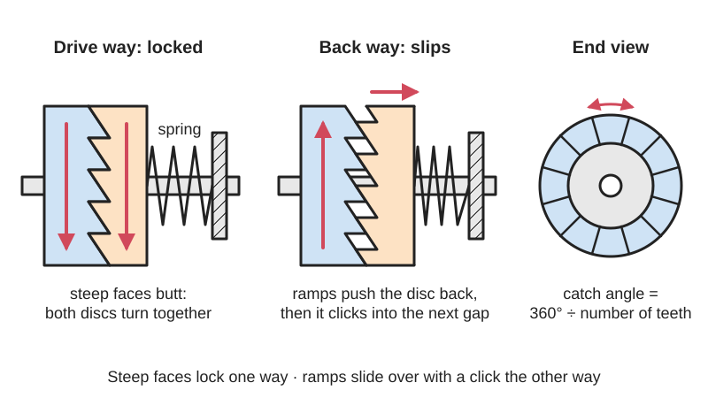

*Diagram drawn for the encyclopaedia from the research notes. ⚑ Needs confirming: a drawing can simplify or get details wrong; a real photo or a better diagram is welcome.*

Two [coaxial](../glossary.md#coaxial) discs with sloped teeth on their facing sides, pressed together by a spring, that lock and drive together in one direction and ride up and click over each other in the other, as in star-ratchet bicycle hubs and printed one-way knobs and joints.

**In plain words:** Two discs with sloping saw-like teeth on their flat faces, pushed together by a spring: turned one way the teeth lock and the discs turn together; turned the other way the teeth ride up their slopes, push the discs apart and click over each other. **Proper term:** Face [ratchet](../glossary.md#ratchet) ([axial](../glossary.md#axial--radial) ratchet, sawtooth face clutch, one-way jaw clutch).

**Also called:** star ratchet (DT Swiss (brand) name for its bicycle-hub ratchet rings; now used loosely for any hub of this type); Ratchet System / Ratchet EXP / Ratchet DEG (DT Swiss (brand) hub systems); face-engagement ratchet; ratchet rings / toothed ratchet discs; sawtooth ratchet one-way clutch (Chinese patent CN203743242U); running face ratchet / ratchet one-way clutch (face type) (Stackpole patent US6907971B2); sawtooth jaw clutch or one-way dog clutch; Durley calls a jaw clutch with sloped jaws 'really a running-ratchet gear'; the simplest [freewheel](../glossary.md#freewheel): 'two saw-toothed, spring-loaded discs pressing against each other axially' (Wikipedia 'Freewheel').

## How it works

Each disc carries a ring of lopsided teeth on its face: a gentle ramp and a steep locking face. Turned the drive way, the steep faces butt together and the discs turn as one; turned the other way, the ramps slide over each other, pushing the sliding disc back against its spring until the tips pass, then the spring snaps it back into the next gap with a click (Wikipedia 'Freewheel'; Stackpole patent US6907971B2). Because the teeth run all the way round the face, all of them engage at once and share the load, unlike a single [pawl](../glossary.md#pawl) (DT Swiss). The number of teeth sets how far it turns before it catches: engagement angle = 360° divided by the number of teeth, e.g. 18 teeth = 20°, 36 = 10°, 54 = 6.67°, 72 = 5°, 90 = 4° (DT Swiss).

## Parts

A few parts acting as one unit: two toothed discs or rings, at least one of which can slide along the shaft but not turn on it (it sits on [splines](../glossary.md#spline), a key or a hex); a spring that pushes them together (a coil, conical or wave spring, or a disc spring); and a nut, [circlip](../glossary.md#circlip) or housing that holds the stack together. A DT Swiss hub has two ratchet rings, two springs, a spacer, a threaded ring nut and the freewheel body (DT Swiss manual; freewheel.co.uk).

## Everyday examples

- Bicycle rear hubs of the 'star ratchet' type (e.g. DT Swiss (brand) hubs), which click as you coast
- Palm-ratchet screwdriver knobs and ratcheting knobs that click one way ⚑ [uncertain] (many such knobs use pawls instead)
- Sawtooth one-way clutches in small-engine starters (Chinese patent CN203743242U)
- Related everyday cousins: clicking fuel caps (sloped teeth that slip, a [torque](../glossary.md#torque) limiter) and push-and-turn child-resistant caps

## When to use it

Use a face ratchet when you want a one-way drive or freewheel that is compact along a shaft, strong for its size because every tooth shares the load, and easy to strip and clean, such as a hub, a winding knob, a one-way [crank](../glossary.md#crank) or a printed joint that should ratchet one way. It suits 3D printing because the teeth are on a flat face and it needs only two printed discs and a spring. With symmetric teeth instead of sawtooth teeth the same layout becomes an indexing joint that locks both ways.

## When not to use it

Avoid it when you need zero [backlash](../glossary.md#backlash) or silent freewheeling (use a [sprag](../glossary.md#sprag) clutch or roller clutch), when the axial space for the sliding disc and spring isn't available (use a ratchet and pawl or a one-way bearing), or at high freewheeling speeds where constant clicking causes wear and noise ⚑ [uncertain]. If you want it to hold in both directions and be adjusted by hand, use a Hirth joint or a ball [detent](../glossary.md#detent). If you want it to slip at a set torque, use a ratchet-tooth or ball-detent torque limiter.

## Details

- **What it does (jobs):**
  - stop it moving back (one-way): it drives or holds one way only
  - let it move (turn, slide or bend): the driven part can keep turning (coasting or overrunning) when the drive stops, as in a bicycle freewheel
  - slip or let go when overloaded: only in the variant whose locking faces are sloped instead of steep, which then slips at a set torque (see ratchet-tooth torque limiter)
- **Movement:** rotate: unlimited rotation, locked together one way and free the other; the sprung disc also moves a little along the axis (about one tooth height) each time a tooth passes
- **Directions it can move (degrees of freedom):** 1: relative rotation about the shared axis, allowed in one direction only; the sprung disc's small in-and-out movement along the axis is an internal motion that lets the teeth pass
- **Special behaviour:**
  - one-way (moves freely one way, locks the other): the defining behaviour
  - torque-limiting (slips or clicks at a set force/torque): not in a true face ratchet, but if the locking faces are made sloping the same parts become a clicking torque limiter whose slip torque is set by the spring and slope
  - self-aligning or self-centring: DT Swiss uses conical ratchet rings and conical springs to keep the rings aligned ⚑ [uncertain] (unclear whether this applies to flat face ratchets in general)
- **How it holds:**
  - shape (the parts interlock; [form-fit](../glossary.md#form-fit--force-fit--material-bond)): the steep locking faces butt together
  - spring force (a spring or springy part presses it in place): the spring keeps the teeth pressed into mesh; if it is missing or too weak the ratchet slips (DT Swiss manual)
- **Input and output:** Rotation -> rotation at the same speed (1:1) in the drive direction; in the other direction the output overruns (freewheels) or the input can turn back without moving the output. Shafts in line (coaxial). Engagement angle (the free play before it catches) = 360°/number of teeth (DT Swiss). Efficiency when locked is essentially 100% because the teeth lock solid ⚑ [uncertain]; while freewheeling there is some drag and wear from the spring pressure and grease. Not back-drivable in the locked direction.
- **Power:** passive (no power needed)
- **Load:** Medium to heavy for its size, because all the teeth share the load at once, creating far fewer point loads than pawls (DT Swiss) and giving a large contact area (Trifox). Strong in drive torque; the weak points are the spring (too weak and the teeth can be forced apart), the axial push that the sloped teeth create, and, in 3D prints, teeth shearing off along [layer lines](../glossary.md#layer-lines) at their roots ⚑ [uncertain].
- **Play and precision:** small to noticeable: it can turn back up to one tooth (engagement angle 360°/N, e.g. 10° for 36 teeth, 4° for 90 teeth; DT Swiss) before it catches. It needs the two discs coaxial and parallel; the sliding disc must slide freely along its splines or key but not tilt ⚑ [uncertain].
- **Taking it apart:** removable: DT Swiss freehub bodies come off by hand and the ratchet rings and springs slide out for cleaning (freewheel.co.uk; DT Swiss manual); printed versions are held by a screw, nut or snap ring
- **How often it can be reused:** many times: it can be taken apart and reassembled for cleaning and greasing; the limit is tooth wear
- **Sealing:** none: the ratchet itself doesn't seal; hubs add seals and grease around it
- **Adjustable:** Not in position. The freewheeling drag and noise can be tuned with the amount of grease (less grease is louder but wears more; DT Swiss manual) and the spring strength; the engagement angle is set by the number of teeth.
- **Access needed:** end of a tube or shaft: the discs and spring are stacked onto the shaft from one end (e.g. the freehub body slides onto the hub axle)
- **Materials:** Steel ratchet rings in bicycle hubs (DT Swiss mentions steel ratchets for its high-tooth-count systems ⚑ [uncertain]); powder-metal parts in automotive one-way clutches (Stackpole International Powder Metal is the patent holder of US6907971B2); moulded plastics for light duty; 3D prints in PETG, nylon or PLA; the spring should be steel, because plastic springs under constant load relax (DuPont).
- **Heat, cold, water and wear:** It depends on its grease: too much or the wrong grease makes the rings slip (DT Swiss manual), and thick grease in cold weather may slow the rings re-engaging ⚑ [uncertain]. Dirt and water in the teeth increase wear ⚑ [uncertain]. Printed PLA discs soften from about 60 °C (CNC Kitchen). Plastic springs relax under constant load (DuPont), so use a steel spring.

## Making it

- **Ways to make or get it:**
  - off-the-shelf part: bicycle hub ratchet rings and springs (spare kits), and face-type one-way clutches
  - 3D print (FDM): knobs, joints and demo one-way clutches with a metal spring
  - 3D print (resin): fine teeth for small knobs ⚑ [uncertain]
  - CNC: milled face teeth ⚑ [uncertain]
  - powder metal and injection moulding: how production face ratchets are made ⚑ [uncertain]
- **Printing it in one piece (print in place):** partly / no: usually printed as two discs and assembled with a metal spring and a screw or nut. [Print-in-place](../glossary.md#print-in-place) versions with tapered teeth exist, such as shiura's print-in-place palm ratchet knob, whose 'tapered ratchet gear' is aligned and locked by pressing the knob towards the screw (Printables API, model 230516) ⚑ [uncertain] (unclear whether this counts as a true face ratchet).
- **Tools:** Often none to open (DT Swiss hubs: pull off the end cap and freehub body by hand); a special tool and a lot of force can be needed to undo the threaded ring nut in hub shells (singletrackworld forum); grease; for printed versions a screwdriver or hex key
- **Difficulty:** moderate: the CAD is simple, but you need a metal spring, a disc that slides along a keyed or hex shaft without jamming, and face teeth that print cleanly and don't [shear](../glossary.md#peel-vs-shear) off along layers

### 3D printing tips

1) Print each disc flat with its teeth pointing up; the teeth are then made of stacked layers, so keep them short and wide (low tooth height compared with the [pitch](../glossary.md#pitch)) and use several teeth to share the load, because the drive force bends each tooth across the layer lines at its root ⚑ [uncertain]. 2) The sloping ramps come out as tiny stair-steps of layer lines, which make the click rough and wear faster; a finer layer height (or variable layer height) on the toothed band helps ⚑ [uncertain]. 3) [Overhangs](../glossary.md#overhang--bridging) up to about 45-60° print cleanly (Prusa), so teeth pointing up need no supports; if the teeth must face down onto the bed, one Hirth-joint library author suggests cutting off half of each tooth so no support is needed and it still meshes with full teeth (mechadense scad-lib-hirthjoints README). 4) The sliding disc needs a keyed, splined or hex bore with [clearance](../glossary.md#clearance) so it can move along the shaft; start with about 0.3 mm (Prusa) and make sure it can't tilt and jam. 5) Use a metal spring (compression, wave or disc spring) to press the discs together, not a printed one: plastic springs under constant load relax (DuPont), and PLA [creeps](../glossary.md#creep) most (thrinter creep test). 6) The spring force and ramp angle set how hard it is to turn the free way; the steep locking faces must be truly steep (or very slightly [undercut](../glossary.md#undercut)) or the teeth will ride over under load and act as a torque limiter instead ⚑ [uncertain]. 7) Grease lightly: too much or the wrong grease stops the rings from engaging and they slip (DT Swiss manual). 8) Check that both toothed faces point at each other when assembling; one ring mounted upside down means no engagement (DT Swiss manual; freewheel.co.uk). 9) PLA softens from about 60 °C (CNC Kitchen); prefer PETG or nylon for anything used outdoors or in a warm place.

### Buying one (off-the-shelf parts)

Search terms: 'ratchet kit' or 'star ratchet' spares for bicycle hubs (e.g. DT Swiss (brand) 36T, 54T), 'freehub body', 'compression spring', 'wave spring', 'disc spring' or 'Belleville washer', 'hex shaft' or 'splined shaft', 'thrust washer', 'circlip' or 'retaining ring', 'ratchet one-way clutch'. For a symmetric (both-ways) version look for 'Hirth coupling' or 'Hirth joint' (e.g. camera and lighting 'rosette' mounts).

## Rules of thumb

- Engagement angle = 360° / number of teeth: 18 teeth = 20°, 36 = 10°, 54 = 6.67°, 72 = 5°, 90 = 4° (DT Swiss 'Ratchet technologies overview').
- All teeth engage at the same time, so the load is shared and point loads are far lower than with pawls (DT Swiss).
- Grease only a thin, even layer; too much or the wrong grease can stop the ratchets working and let them slip while pedalling; less grease gives a louder freewheel but more wear (DT Swiss Ratchet Hubs technical manual v2022.09, pp. 19-23).
- The simplest freewheel is two saw-toothed, spring-loaded discs pressing axially together (Wikipedia 'Freewheel').
- A jaw clutch with sloped jaws, one half sliding on a feather key, transmits motion in one sense only and 'is therefore really a running-ratchet gear' (Durley, Kinematics of Machines, ch. IX, pp. 235-236).
- Example proportions from a production sawtooth face clutch: 12-16 teeth, kept engaged by a compression spring; the patent claims over 30,000 cycles of life compared with under 20,000 for the roller type it replaced (Chinese patent CN203743242U).
- Springs that stay compressed should be steel, not plastic (DuPont 'General Design Principles for Engineering Polymers', p. 36).
- Printed sliding parts need about 0.3 mm clearance as a starting point (Prusa knowledge base).

## Common failures

From the DT Swiss manual: the freewheel does not engage or slips because one or both ratchet rings are fitted upside down, there is too much or the wrong grease, the rings are worn, or a spring was left out. Other problems: a weak spring lets the teeth jump under load; a strong spring causes drag and wear; the sliding disc binds on its splines or key and can't lift or return ⚑ [uncertain]; printed teeth shear off along layer lines or wear on their stepped ramps ⚑ [uncertain]; and threaded retaining rings seize and are very hard to undo (singletrackworld forum).

## Safety

On a bicycle, a freewheel that slips because of wrong [lubrication](../glossary.md#lubrication) can cause a fall; DT Swiss marks this as a risk of injury. The spring is compressed, so parts can jump out when the stack is opened. Fingers can be pinched between the toothed faces when turning it by hand.

## Related

- Ratchet and pawl: one pawl catches a toothed wheel; simpler and needs no axial spring travel, but carries the load on one tooth
- Linear ratchet: the same one-way idea on a straight toothed strip
- Hirth joint: symmetric teeth on the faces of two discs, self-centring and locking both ways with no backlash once an axial load (such as a clamping bolt) holds the halves together (Wikipedia 'Hirth joint')
- Ratchet-tooth torque limiter: similar sprung face teeth but with sloping locking faces, so it slips when the torque is too high
- Dog clutch (jaw clutch): square jaws on two discs slid together to engage drive in both directions
- Push-and-turn child-resistant cap: ratchet-like teeth on the cap that only drive when pressed together
- Sprag clutch and roller clutch (one-way bearing): silent one-way locking by wedging, with almost no backlash
- Ball-detent torque limiter: balls in dimples instead of teeth, slipping at a set torque
- Compliant ratchet ([flexure](../glossary.md#flexure) pawl): one-piece printed ratchet with springy arms instead of a separate spring

## Make it yourself

- [Print-in-Place Palm Ratchet - 6.5mm axis (Dracrius, Printables; remix of shiura's Print-in-place Palm Ratchet)](https://www.printables.com/model/432501-print-in-place-palm-ratchet-65mm-axis): Remixed shaft for shiura's print-in-place palm ratchet screwdriver knob, whose tapered ratchet teeth lock when you press the knob towards the screw; the rest of the knob comes from shiura's original. Details read through the Printables public API because the web page blocks automated access ⚑ [uncertain] (unclear whether the mechanism is a true face ratchet) *(licence: CC BY-NC-SA)*
- [scad-lib-hirthjoints (mechadense, OpenSCAD library README)](https://raw.githubusercontent.com/mechadense/scad-lib-hirthjoints/master/README.md): OpenSCAD library that generates correct face-toothed (Hirth) joints, flat or conical, with tooth count, radius and slant as parameters; a starting point for printed face teeth, though its teeth are symmetric, not sawtooth *(licence: LGPL-3.0)*

## Pictures, videos and models

- [Ratchet Technologies Overview (DT Swiss)](https://www.dtswiss.com/en/wheels/wheels-technology/ratchet-technologies-overview): Diagrams of star-ratchet hub systems with two toothed rings and springs, and a table of tooth counts and engagement angles *(licence: link only)*
- [DT SWISS Star Ratchet Explained ! & HOW TO Service freehub (YouTube, Alex - Cycle Fixation)](https://www.youtube.com/watch?v=-qO2c1GzQMU): Video of the two toothed ratchet rings and springs inside a hub, how they engage, and how to clean and grease them *(licence: link only (standard YouTube licence))*
- [DT Star Ratchet Hubs Technical Manuals (Internet Archive)](https://archive.org/details/dt-swiss-ratchet-hub-manual-v17-08-and-v22-09): Exploded diagrams of the ratchet rings, springs and ring nut, assembly steps and a troubleshooting table *(licence: link only ⚑ [uncertain])*
- [Durley, Kinematics of Machines, ch. IX 'Ratchet mechanisms and escapements' (Cornell eCommons scan)](https://ecommons.cornell.edu/server/api/core/bitstreams/809167fc-7cef-4c99-a0a1-60a708dede4f/content): Fig. 158: a jaw clutch with sloped jaws that works as a one-way (running) ratchet, next to a square-jaw clutch that locks both ways *(licence: old book scan, likely public domain ⚑ [uncertain])*
- [US6907971B2 One-way clutch (Stackpole, Google Patents)](https://patents.google.com/patent/US6907971B2/en): Patent drawings of a spring-loaded face ratchet one-way clutch with inclined faces and axial locking faces *(licence: link only)*

## Needs confirming

⚑ marks something nobody has confirmed yet: a fact the research could not confirm from a source, a finder value that is a best guess, or an open point from the research notes. Corrections are welcome (see `research/needs-confirming.md`).

- ⚑ 21 sentences on this page marked [uncertain].

## Sources

- <https://en.wikipedia.org/wiki/Freewheel>
- <https://en.wikipedia.org/wiki/Hirth_joint>
- <https://www.dtswiss.com/en/wheels/wheels-technology/ratchet-technologies-overview>
- <https://archive.org/details/dt-swiss-ratchet-hub-manual-v17-08-and-v22-09>
- <https://archive.org/download/dt-swiss-ratchet-hub-manual-v17-08-and-v22-09/MAN_WXD10000000896S_WEB_EN_001_djvu.txt>
- <https://www.freewheel.co.uk/blog/post/how-to-service-dt-swiss-star-ratchet-hubs>
- <https://www.trifoxbike.com/inside-the-click-a-guide-to-ratchet-pawl-and-star-ratchet-hub-mechanisms>
- <https://singletrackworld.com/forum/bike-forum/dt-swiss-effing-star-ratchet/>
- <https://patents.google.com/patent/US6907971B2/en>
- <https://patents.google.com/patent/CN203743242U/en>
- <https://ecommons.cornell.edu/server/api/core/bitstreams/809167fc-7cef-4c99-a0a1-60a708dede4f/content>
- <https://www.distrupol.com/General_Design_Principles_for_Engineering_Polymers.pdf>
- <https://www.youtube.com/watch?v=-qO2c1GzQMU>
- <https://www.printables.com/model/432501-print-in-place-palm-ratchet-65mm-axis>
- <https://api.printables.com/graphql/>
- <https://raw.githubusercontent.com/mechadense/scad-lib-hirthjoints/master/README.md>
- <https://help.prusa3d.com/article/modeling-with-3d-printing-in-mind_164135>
- <https://www.cnckitchen.com/blog/comparing-pla-petg-amp-asa-feat-prusament>
- <http://thrinter.com/creep-abs-pla-petg-alloy-910/>
