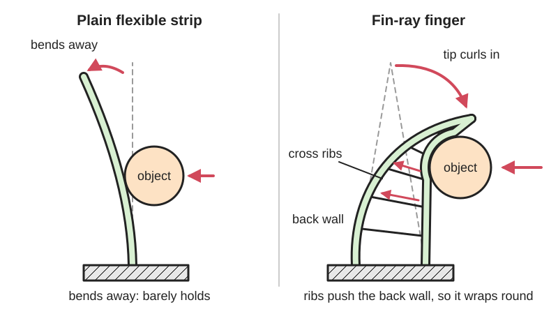

<figure class="eoc-pic eoc-pic-main"><picture><source media="(prefers-reduced-motion: reduce)" srcset="../media/drawn/fin-ray-gripper.svg"></picture><figcaption><strong>Animation.</strong> Diagram drawn for the encyclopaedia from the research notes. ⚑ Needs confirming: a drawing can simplify or get details wrong; a real photo or a better diagram is welcome.</figcaption></figure>

A flexible, hollow, triangular gripper finger with cross ribs that bends toward a pushing object and wraps around it, giving a gentle, self-adjusting grip with no sensors or joints.

**In plain words:** A soft, triangle-shaped robot finger with a ladder of cross ribs inside, which curls around whatever presses on it instead of bending away, so it hugs odd-shaped or delicate things like fruit. **Proper term:** Fin Ray Effect finger (fin-ray gripper).

**Also called:** fin ray gripper, finray gripper or fin-ray finger; Fin Ray Effect (registered trademark 'Fin Ray®'); finray-effect gripper; fish-fin gripper or fish-tail-fin gripper; adaptive gripper finger or adaptive finger; soft fin ray finger or fin-ray-inspired soft gripper; FinGripper (Festo, brand); DHAS adaptive gripper finger (Festo, brand); TPU gripper finger or flexible gripper jaw (maker terms).

## How it works

The idea copies a fish's tail fin: its two bony rays form a V with tissue between them, and pulling or pushing on one side makes the whole fin bend (Crooks et al. 2016). A fin-ray finger has two flexible walls meeting at the tip, joined by cross ribs; when an object presses on the inner wall, the ribs pass the push across to the outer wall, and the base and tip of the finger swing toward the object, so the finger wraps around it instead of bending away like a plain flexible strip would (Crooks et al. 2016; Festo's Johannes Stoll, quoted in Make). This spreads the grip over a large contact area, so the finger conforms to round, soft or irregular objects without sensors (Crooks et al. 2016). Tilting the ribs gives the finger a preferred bending direction, which needs less force and gave about 40% more holding strength in one study (Crooks et al. 2016).

## Parts

Single piece: two flexible side walls joined at the tip in a V or A shape, several cross ribs (crossbeams) between them, and a stiffer base with mounting holes. A gripper uses two or three fingers on a servo, motor-and-tendon, pneumatic or parallel-jaw drive; some add a rigid 'fingernail' tip or rubber grip pads.

## Everyday examples

- A fish's tail fin, which bends toward a finger pushed against it (Crooks et al. 2016; Make)
- Blue or grey soft gripper fingers on factory pick-and-place robots and cobot arms (Festo FinGripper and DHAS, brands) ⚑ [uncertain]
- Fruit- and vegetable-picking robot grippers, e.g. designs for handling tomatoes (Adeli and Sayyaadi 2026)
- Student robot competition grippers (an FTC team's TPU fin-ray gripper, SPIDERMONK, Printables)

## When to use it

Use fin-ray fingers when a robot or tool must pick up things of different shapes and sizes, or soft and fragile things (fruit, eggs, bottles, cans, packaging) without precise positioning or force sensors; when you want a cheap, printable, one-piece finger for a servo or parallel gripper; or when a gripper must tolerate [misalignment](../glossary.md#misalignment), such as pushing plugs or parts into place (Crooks et al. 2016; Hackaday egg gripper; Hartisch and Haninger 2023).

## When not to use it

Avoid it for heavy loads, high gripping forces or strong twisting (use rigid jaws or a vacuum cup); for tiny or very thin items such as needles or paper, and for tasks like stacking that need precise placement, because the fingers deform (Source Robotics); and for gripping at the very fingertip with a plain V-shaped finger (use a notched or flat-tipped finger or rigid tweezers; Hartisch and Haninger 2023). For grip that multiplies force, use a lever-based compliant gripper or pliers instead.

## Details

- **What it does (jobs):**
  - join and hold: grips and holds objects, especially delicate or odd-shaped ones
  - let it move (turn, slide or bend): the whole finger bends and curls, with no joints
  - line parts up exactly: fingers with notches can self-align a part as they close, e.g. compensating up to about 7.5 mm of misalignment in plug insertion (Hartisch and Haninger 2023)
- **Movement:** flex: the finger curls toward and around the contact point; when a 60 mm ball was pushed 20 mm into a simulated 100 mm TPU 95A finger, the finger deformed about 20 mm around it while its tip shifted only about 1.4 mm sideways (Adeli and Sayyaadi 2026)
- **Directions it can move (degrees of freedom):** One intended motion (curling in the gripping plane), but as a continuous flexible body it can also twist and bend sideways; designers stiffen the outer wall and add side supports to limit this (Crooks et al. 2016)
- **Special behaviour:**
  - self-aligning or self-centring: the finger passively adapts to the object's shape and position; notched fin-ray fingers corrected up to about 7.5 mm of misalignment when inserting plugs at high speed (Hartisch and Haninger 2023)
- **How it holds:**
  - friction or clamping ([force-fit](../glossary.md#form-fit--force-fit--material-bond)): the gripper's [actuator](../glossary.md#actuator) squeezes the fingers against the object and friction holds it
  - shape (the parts interlock; form-fit): the fingers wrap partly around the object, and notched fingertips can lock a part in place (Hartisch and Haninger 2023)
- **Input and output:** not applicable as a transmission: the finger is passive. A servo, motor-and-tendon, pneumatic bellows or parallel-jaw gripper closes the fingers, and the fingers turn contact pressure into a wrapping motion (Crooks et al. 2016)
- **Power:** passive (no power needed) for the finger itself; the gripper needs a motor, servo or air to close it, and if power is lost the grip is usually released unless the drive is [self-locking](../glossary.md#self-locking) ⚑ [uncertain]
- **Load:** light: gentle grip for delicate objects; a tendon-driven research gripper held about 560 g, and fingers began to pull away from their holders at about 300 g of sideways load (Crooks et al. 2016). Weak against twisting (it twisted when trying to open a door) and sideways loads (Crooks et al. 2016)
- **Play and precision:** Play: no [backlash](../glossary.md#backlash) in the finger itself, but it is deliberately soft, so the held object's position is not precise. Misalignment [tolerance](../glossary.md#tolerance): high; fin-ray fingers absorbed up to about 7.5 mm of offset in plug insertion (Hartisch and Haninger 2023). A force along the finger rotates the fingertip, which can make a small part lose contact (Hartisch and Haninger 2023)
- **Taking it apart:** tool-free quick release: the gripper lets go as soon as it opens; the fingers are usually bolted to the gripper (removable with a screwdriver)
- **How often it can be reused:** many times: soft TPU fingers flex repeatedly, but stiff PLA versions broke after a bit of use (juh, Printables), and PLA+ or PETG fingers can deform permanently where ribs meet the wall if overloaded (Hartisch and Haninger 2023)
- **Sealing:** none
- **Adjustable:** no, after printing: [stiffness](../glossary.md#stiffness) is set by rib angle, spacing and thickness, wall thickness and material; makers change these (or the slicer [infill](../glossary.md#infill) settings for ribs) and reprint (Hartisch and Haninger 2023; Adeli and Sayyaadi 2026)
- **Access needed:** not applicable
- **Materials:** TPU (Shore 95A is common, e.g. Cartman's gripper and the vekkax open-source gripper) or NinjaFlex for soft fingers; PETG or PLA+ for stiffer fingers (Hartisch and Haninger 2023; juh prints a [print-in-place](../glossary.md#print-in-place) version in plain PETG, and PLA versions broke); multi-material resin (TangoPlus soft with VeroClear rigid parts on an Objet500) in research (Crooks et al. 2016); cast silicone (Dragon Skin 30) for early prototypes (Crooks et al. 2016); laser-sintered polyamide for Festo's commercial grippers (Crooks et al. 2016); card or paper for demonstration models (Make, Festo Fin Gripper)
- **Heat, cold, water and wear:** Hot water deforms PETG fingers, so don't clean them in it (Bas, Printables); PLA softens above about 60 to 65 degrees C (An et al. 2018). Printed fingers lose shape if overloaded, with permanent deformation where ribs meet the walls (Hartisch and Haninger 2023). TPU grip and stiffness change with temperature and TPU can wear or tear after long use ⚑ [uncertain]. Rubber coatings wear off and need renewing (juh) ⚑ [uncertain].

## Making it

- **Ways to make or get it:**
  - 3D print (FDM): TPU, PETG or PLA+ fingers, often with the ribs made from slicer infill lines
  - 3D print (resin): multi-material PolyJet (soft and rigid resins together) in research grippers
  - 3D print (SLS): laser-sintered polyamide for Festo's commercial fingers
  - casting silicone in printed moulds for soft prototypes
  - paper or card models for teaching (Festo template)
  - off-the-shelf part: ready-made adaptive gripper fingers from automation suppliers (e.g. Festo DHAS)
- **Printing it in one piece (print in place):** yes: a fin-ray finger prints as one piece; juh's gripper even prints the whole two-finger mechanism in place in PETG with [flexure](../glossary.md#flexure) joints (Printables); mounting to a servo or gripper needs screws
- **Tools:** screwdriver or hex key to bolt fingers to the gripper; none to operate
- **Difficulty:** easy: the finger prints in one piece with no assembly; TPU needs slow printing and a direct-drive extruder is strongly recommended (vekkax, GitHub), and fingers need rubber or texture on the gripping face

### 3D printing tips

Print the finger lying flat so the ribs and walls are drawn in the plane of bending. A neat slicer trick replaces modelled ribs: model a solid finger, then in the slicer use 'lines' infill with 'connect infill lines' off, one wall about one nozzle width (0.4 mm) thick, and no top or bottom layers, so the infill lines become the ribs; use a modifier or support-blocker region to give the mounting base normal walls and solid top and bottom layers (Hartisch and Haninger 2023, GitHub README). Rib density and angle then become slicer settings: 10 to 30% infill at 0 to 40 degrees was tested; 10% PETG was too floppy to hold a part, 30% was stiff enough to damage delicate parts, and 40 degree ribs failed by buckling and permanent deformation (Hartisch and Haninger 2023). For TPU: 0.2 mm layers, about 220 degrees C nozzle, 20 mm/s, cooling and retraction off, direct-drive extruder (vekkax Fin-ray Soft Gripper). Use many walls (about 10) around screw holes in TPU so the mounts don't flex (SPIDERMONK, Printables). PETG is more forgiving than PLA+ (less permanent deformation; Hartisch and Haninger 2023) and PLA versions broke quickly (juh). Calibrate to avoid over-extrusion, stringing and [elephant's foot](../glossary.md#elephants-foot), which stiffen print-in-place joints (juh). Add grip: rubber bands glued on, vulcanising fluid, spray-on rubber or foam, because smooth PLA or PETG is too slippery (SPIDERMONK; juh; Source Robotics; Hartisch and Haninger 2023). Avoid tiny hard-soft interfaces in dual-material prints; PLA-to-NinjaFlex joints broke, so the fingers were made entirely soft (Crooks et al. 2016). Don't wash PETG fingers in hot water, which deforms them (Bas, Printables).

### Buying one (off-the-shelf parts)

Ready-made fin-ray fingers are sold as 'adaptive gripper fingers' for pneumatic or electric parallel grippers, e.g. Festo DHAS (brand; blue polyurethane fingers in 60, 80 and 120 mm sizes per a supplier listing ⚑ [uncertain]). For DIY grippers: hobby servos (e.g. SG90 or HK15138), parallel-jaw gripper modules, and mounting hardware. Fin-ray grippers are sold ready-made for 'cobot' robot arms ⚑ [uncertain].

## Rules of thumb

- Angle the cross ribs (not at right angles to the base) to give a preferred bending direction; this needed less force, bent about 15% further and held about 40% more (560 g versus 390 g) than the symmetric design (Crooks et al., Frontiers in Robotics and AI 2016)
- Make the outer (back) wall thicker than the gripping wall: 1 mm front wall with 2 mm back and bottom walls in TPU 95A (Adeli and Sayyaadi 2026)
- A simulated optimum for a 100 mm TPU 95A finger gripping a 60 mm ball: 30 mm width, 10 mm rib spacing, seven ribs tilted at about 15 degrees (-15 degrees as the paper defines it) and 1 mm rib thickness (Adeli and Sayyaadi, arXiv 2026)
- Best beam thickness and spacing depend on the object: 0.5 to 1.0 mm beams with 10 to 11 mm spacing for TPU 95A fingers across three test objects (Deng and Li, Frontiers in Robotics and AI 2021)
- Slicer-made ribs in PLA+ or PETG: 10 to 30% line infill and 0 to 30 degree rib direction worked; 40 degrees failed; PETG tolerated up to about 7.5 mm of misalignment (Hartisch and Haninger 2023)
- The standard V-shaped finger moves most in the middle and has a stiff tip; if you must grip at the fingertip, use a squarer tip or a notch (Hartisch and Haninger 2023)

## Common failures

Objects slip because printed plastic is smooth: add rubber, foam or texture (Hartisch and Haninger 2023; SPIDERMONK). Finger too floppy (too few, thin or low-density ribs) or too stiff and crushes parts (too many ribs or high infill): tune rib density and angle (Hartisch and Haninger 2023). Ribs buckle or tear from the walls when overloaded or with steep rib angles (Hartisch and Haninger 2023). Finger twists or bends sideways under side loads: thicken or stiffen the outer wall and add side supports (Crooks et al. 2016). Mounting holes flex or tear in TPU: use many walls there (SPIDERMONK). [Brittle](../glossary.md#brittle--ductile) PLA fingers crack: use TPU or PETG (juh). Hard-soft material interfaces break in dual-material prints (Crooks et al. 2016).

## Safety

Generally one of the safest grippers because the fingers are soft and limit crushing force; still keep fingers clear of the gripper's drive (servo [linkages](../glossary.md#linkage) or tendons can pinch). Vulcanising fluid used as a grip coating gives off fumes; don't inhale them (juh, Printables).

## Related

- Compliant gripper and force amplifier: one-piece lever-based grippers that multiply force, rather than soft fingers that wrap
- Soft pneumatic gripper fingers: silicone fingers bent by air pressure, softer but need a pump
- Underactuated linkage fingers: rigid jointed fingers driven by one tendon that also wrap around objects
- Vacuum suction cup: holds flat, smooth objects instead of wrapping them
- Jamming gripper: a bag of grains that moulds around an object and then locks rigid when air is sucked out
- Parallel leaf-spring flexure: gives straight, parallel jaw motion with no wrapping
- [Living hinge](../glossary.md#living-hinge) and flexure hinge: the thin bending joints that make up the rib-to-wall connections

## Make it yourself

- [Print-in-place flexure fin ray gripper (juh, Printables) (URL from Printables API, page not opened)](https://www.printables.com/model/1134880-print-in-place-flexure-fin-ray-gripper): Fully printed, no-assembly fin-ray gripper in plain PETG (no TPU needed), servo-driven, fischertechnik-compatible *(licence: CC BY-NC-SA)*
- [Fingergripper - Fin Ray Effect (Cartman, Printables) (URL seen in search results; read via Printables API)](https://www.printables.com/model/382440-fingergripper-fin-ray-effect): Small hand-held two-finger fin-ray gripper printed in TPU 95A, with STEP file for modification *(licence: CC BY-NC-SA)*
- [Fin Ray Adaptive gripper for Gobilda pattern (SPIDERMONK, Printables) (URL from Printables API, page not opened)](https://www.printables.com/model/621918-fin-ray-adaptive-gripper-for-gobilda-pattern): TPU fin-ray gripper used by an FTC robotics team; print with at least 10 walls *(licence: CC BY)*
- [compliantfinray (Richard Hartisch, GitHub README)](https://raw.githubusercontent.com/richardhartisch/compliantfinray/main/README.md): CAD and STL files for printed fin-ray fingers, plus the Cura slicing method that turns infill lines into ribs *(licence: BSD 3-Clause)*
- [Fin-ray Soft Gripper (vekkax, GitHub)](https://github.com/vekkax/Fin-ray-Soft-Gripper/blob/main/README.md): Open-source servo gripper with TPU 95A fin-ray fingers, force sensor, STM32 firmware and TPU print settings *(licence: CC BY 4.0 according to Open Source For You; the README does not state a licence ⚑ [uncertain])*
- [Festo Fin Gripper paper model (Make:)](https://makezine.com/projects/festo-fin-gripper/): Cut-and-fold card fin-ray finger from Festo for Maker Camp 2014; two can be taped together into a claw *(licence: ⚑ [uncertain] (not shown))*

## Pictures, videos and models

- [Fin Ray Effect Inspired Soft Robotic Gripper: From the RoboSoft Grand Challenge toward Optimization (Crooks et al., Frontiers in Robotics and AI 2016)](https://www.frontiersin.org/articles/10.3389/frobt.2016.00070/full): Diagrams of the traditional fin-ray finger bending under a point load, the modified angled-rib finger, simulation results and photos of printed grippers *(licence: CC BY 4.0)*
- [Compliant Finray gripper for high-speed robotic electrical plug assembly (Kevin Haninger, YouTube)](https://www.youtube.com/watch?v=J7EGXtE54oY): Video of printed fin-ray fingers gripping and inserting electrical plugs (title and channel confirmed via YouTube oEmbed; video not watched) *(licence: link only)*
- [Adaptive gripper based on FESTO FinGripper fingers (malte ahlers, YouTube)](https://www.youtube.com/watch?v=90cXfaFM4O8): Video of a DIY motor-driven gripper using fin-ray fingers picking up different objects (title and channel confirmed via YouTube oEmbed; video not watched) *(licence: link only)*
- [Compliant Robot Gripper Won't Scramble Your Eggs (Hackaday)](https://hackaday.com/2013/12/03/compliant-robot-gripper-wont-scramble-your-eggs/): Article, photos and linked video of a three-finger printed fin-ray-style gripper holding an egg *(licence: link only)*
- [Festo Fin Gripper (Make:)](https://makezine.com/projects/festo-fin-gripper/): Printable card template and step photos for a paper fin-ray finger that bends toward a push *(licence: link only (no licence shown))*

## Needs confirming

⚑ marks something nobody has confirmed yet: a fact the research could not confirm from a source, a finder value that is a best guess, or an open point from the research notes. Corrections are welcome (see `research/needs-confirming.md`).

- ⚑ 8 sentences on this page marked [uncertain].
- ⚑ Finder value `gripped_by` = machine (best guess): carried over from the finder's old rule on entry names (R33), for "Who does the gripping?" under "Hold two things together > Something that has to be gripped or clamped"
- ⚑ Finder value `flex_does` = grips or snaps (best guess): carried over from the finder's old rule on entry names (R33), for "What should the bendy part do?" under "Let something move > Bend or flex"

## Sources

- <https://www.frontiersin.org/articles/10.3389/frobt.2016.00070/full>
- <https://www.frontiersin.org/journals/robotics-and-ai/articles/10.3389/frobt.2016.00070/pdf>
- <https://www.frontiersin.org/journals/robotics-and-ai/articles/10.3389/frobt.2020.590076/full>
- <https://arxiv.org/pdf/2606.03798>
- <https://arxiv.org/abs/2301.08431>
- <https://arxiv.org/pdf/2301.08431>
- <https://raw.githubusercontent.com/richardhartisch/compliantfinray/main/README.md>
- <https://github.com/vekkax/Fin-ray-Soft-Gripper/blob/main/README.md>
- <https://www.opensourceforu.com/2026/09/open-source-fin-ray-gripper-enables-multi-robot-manipulation/>
- <https://source-robotics.com/blogs/blog/soft-robotic-grippers-fin-ray-effect>
- <https://makezine.com/projects/festo-fin-gripper/>
- <https://makezine.com/2011/09/09/adaptive-gripping-mechanism/>
- <https://hackaday.com/2013/12/03/compliant-robot-gripper-wont-scramble-your-eggs/>
- <https://en.wikipedia.org/wiki/Compliant_mechanism>
- <https://morphingmatter.org/s/thermorph.pdf>
- <https://www.youtube.com/watch?v=J7EGXtE54oY>
- <https://www.youtube.com/watch?v=90cXfaFM4O8>
- <https://api.printables.com/graphql/>
