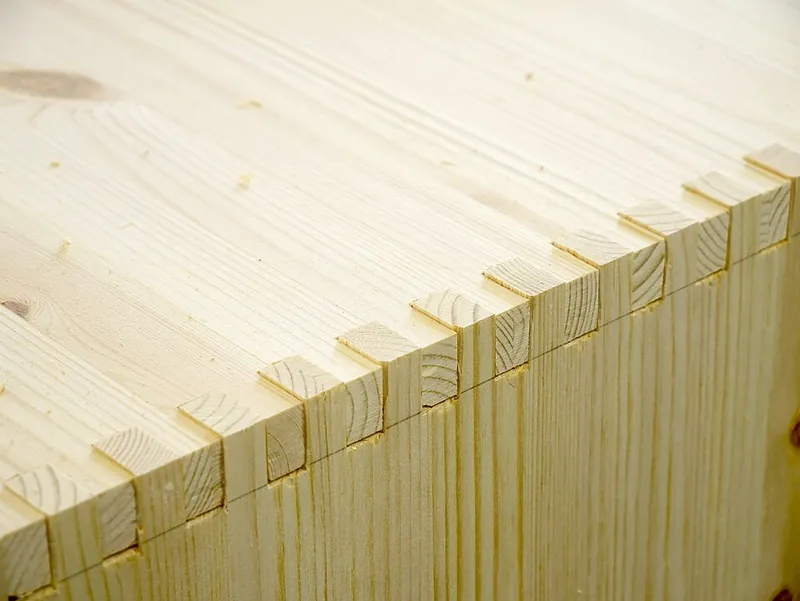

<figure class="eoc-pic eoc-pic-main"><figcaption><strong>Photo.</strong> <a href="https://commons.wikimedia.org/wiki/File:Finger_joint_20180321.jpg">Finger joint 20180321</a> by Santeri Viinamäki, <a href="https://creativecommons.org/licenses/by-sa/4.0">CC BY-SA 4.0</a>, from Wikimedia Commons.</figcaption></figure>
<figure class="eoc-pic"><figcaption><strong>Photo.</strong> <a href="https://commons.wikimedia.org/wiki/File:Living_hinge_(wood).jpg">Living hinge (wood)</a> by Autopilot, <a href="https://creativecommons.org/licenses/by-sa/3.0">CC BY-SA 3.0</a>, from Wikimedia Commons.</figcaption></figure>

A corner joint where the edges of two boards or sheets are cut into alternating square fingers and gaps that mesh together, usually glued, giving a strong, square corner with lots of gluing surface that is easy to make on a table saw, router, laser cutter or CNC router.

**In plain words:** Two boards or flat sheets whose edges are cut into matching square teeth that slot into each other at a corner, like the fingers of two hands laced together. **Proper term:** Finger joint (box joint).

**Also called:** box joint (the usual name for the corner version; Wikipedia 'Box joint'); finger joint, comb joint (Wikipedia 'Finger joint', which notes the two names are 'regularly confused'); box comb (Wikimedia Commons 'Boxjoint.png' description); finger-joint edge and finger holes (Boxes.py terms: fingers at corners, and matching slots for T-shaped connections); pinned box joint (a box joint with a dowel pin driven through the fingers; Fine Woodworking); laser-cut box, finger-jointed box, 'toothed' or 'tabbed' corners (maker wording) ⚑ [uncertain]; Fingerzinken (German; Commons 'Fingerzinken.jpg', 'Holzzinken.jpg'); not the same as finger-jointed lumber: tapered 'scarfed' finger joints (German 'Keilzinken') glued end to end to make long boards from short ones (Wikipedia 'Finger joint'; Commons 'Keilzinkenprofile.jpg'); generators and jigs a beginner may search for: Boxes.py (free software), MakerCase (web tool), 'box joint jig', 'box joint sled', 'box joint blade set'.

## How it works

Each edge is cut into a row of square fingers, and the two boards use the same pattern shifted by one finger, so the fingers of one fill the gaps of the other when they meet at a right angle (Wikipedia 'Box joint'). The fingers stop the boards sliding sideways or twisting, which holds the corner square and places the parts relative to each other (Speetzen and Kobbelt 2024), and the many finger sides give a large area of side-grain (long-grain) gluing surface, which is what makes the glued joint strong (Fine Woodworking; Wikipedia). Without glue the joint can still come apart by pulling the boards straight back the way they went in, because the fingers have straight sides and no flare to lock them, unlike a dovetail (Wikipedia 'Box joint'); glue, a tight press fit, pins or the other walls of the box stop that. For laser-cut and CNC boxes the same pattern is drawn as a flat outline whose finger size scales with the sheet thickness, and the outline is offset to make up for the material the laser burns away ([kerf](../glossary.md#kerf) compensation) (Boxes.py manual).

## Parts

A few parts: two boards or panels, each with a row of square fingers and gaps cut along one edge (the gaps on one match the fingers on the other), plus glue in most cases. Optional extras: a dowel pin through the fingers (pinned box joint; Fine Woodworking), bolts and [captive nuts](../glossary.md#captive-nut) through the fingers ('bed bolts' in Boxes.py), or springy, barbed or snap-shaped fingers for glue-free laser-cut boxes (Boxes.py finger styles 'springs', 'barbs' and 'snap').

## Everyday examples

- Laser-cut plywood or acrylic project boxes and electronics enclosures with toothed corners (Boxes.py; Commons photo '[Living hinge](../glossary.md#living-hinge) (wood).jpg')
- Wooden drawers, crates, lids and small boxes (Wikipedia 'Box joint'), such as the wooden case of a WWII Enigma cipher machine (Commons photo, public domain)
- Pine chests and storage boxes with a row of square fingers showing at each corner (Commons 'Finger joint 20180321.jpg')
- Arts-and-Crafts style furniture with scaled-up finger joints, as in some Greene and Greene pieces (Fine Woodworking)

## When to use it

Use a finger joint to join two flat parts at a corner when you want a strong, square, glued corner that is quick to make in quantity. It is the default joint for laser-cut boxes and enclosures, because a free generator can draw the whole box from its size and sheet thickness, and the fingers line the parts up for you (Boxes.py; Speetzen and Kobbelt 2024). In woodworking it gives 'a gluing surface equal to dovetails but they are much easier to produce' with a table-saw jig (Fine Woodworking video, Gary Rogowski), and once a jig is set up you can cut a stack of parts at once (woodgears.ca). Choose it for boxes, drawers, crates, trays, speaker or electronics cases, and any corner that will be loaded in several directions, because it is strong both ways rather than in one direction like a dovetail (woodgears.ca). It also works for hexagonal and other angled boxes (Wikipedia) and for T-shaped joints using finger holes (Boxes.py).

## When not to use it

Don't rely on it to resist being pulled straight apart without glue: a dry box joint slides apart the way it went in, so use a dovetail joint (which locks in one direction), add pins, or bolt it with captive nuts (T-slot joint). It is 'not, in general, for joining thin panels to structural members' (Wikipedia 'Box joint'); use a groove, rabbet or screws instead. If you don't want [end grain](../glossary.md#end-grain) and fingers showing on the outside, use a half-blind dovetail, a mitre joint, or a rabbet. If the box must come apart often, use T-slot bolts, knock-down cam-lock connectors, or hinges rather than a tight press fit that wears out. For curved walls use kerf bending, and for a 3D-printed box that fits on the bed, print it in one piece. If your design will be cut on other people's laser cutters, press-fit fingers may not fit; springy-finger designs (HPI springFit; Boxes.py 'springs' style) tolerate differences in kerf. For lengthening a board end to end, the separate tapered finger joint used in finger-jointed lumber is the right choice (Wikipedia 'Finger joint').

## Details

- **What it does (jobs):**
  - join and hold: joins two boards or panels at a corner (or a T-junction), usually permanently with glue
  - line parts up exactly: the fingers position the panels and pull the corner square as it goes together; box joints 'provide guidance for the part placement relative to each other, rigidity in one direction, as well as an overlapping surface area to aid in the application of adhesives' (Speetzen and Kobbelt 2024)
- **Movement:** none: a fixed, rigid corner once assembled
- **Directions it can move (degrees of freedom):** 0 once glued, or once all the walls of a closed box hold each other in place. A single dry (unglued) joint has 1: it can only slide apart straight back along the direction it was pushed together.
- **Special behaviour:**
  - self-aligning or self-centring: the fingers locate the two panels and square up the corner as they are pushed together (Speetzen and Kobbelt 2024)
  - none of the other listed behaviours: it is a fixed joint
- **How it holds:**
  - shape (the parts interlock; [form-fit](../glossary.md#form-fit--force-fit--material-bond)): the fingers block sideways sliding and twisting, but not pulling straight apart in the direction of assembly
  - material bond (glue, solvent or melting): in woodworking the glue on the long-grain faces of the fingers does most of the holding; in tests the joints 'failed mostly along the glue line' (woodgears.ca)
  - friction or clamping (force-fit): unglued laser-cut boxes can be press-fitted; tuning Boxes.py's 'burn' value 'allows fine tuning the gaps between joins up to the point where plywood can be press fitted even without any glue' (Boxes.py README)
  - spring force (a springy part presses it in place): optional springy or barbed finger shapes in Boxes.py for glue-free boxes, and cantilever-spring finger joints that fit across different laser cutters (HPI springFit)
- **Input and output:** not applicable
- **Power:** passive (no power needed)
- **Load:** medium to heavy for its size: strong against racking (the corner folding out of square), against bending, and against pulling in both directions ('the box joint is strong in both directions, whereas the dovetails are useful only for pulling from one piece, but not the other'; woodgears.ca). In corner-bending tests on boards 10 cm wide and 2.7 cm thick, loaded 8 cm from the inside corner, some joints needed over 540 lb (about 245 kg) to break, and finer box joints cut on an accurate jig took about 1.4 times the force of dovetails or coarse box joints of the same width (woodgears.ca). Weakest against pulling straight apart in the assembly direction, which relies on glue or friction alone. Laser-cut boxes in 3 mm plywood or acrylic are light-duty ⚑ [uncertain].
- **Play and precision:** None to small when well made and glued. The fit depends entirely on cutting [accuracy](../glossary.md#repeatability--accuracy): an uncompensated laser-cut joint 'ends up loose by roughly twice your kerf' (Craftgineer), Boxes.py suggests changing its burn value in steps of 0.01 or even 0.005 mm, and for plywood 'even a 100th of a millimeter makes a notable difference in how stiff the fit is', so measure each sheet's real thickness (Boxes.py manual). CNC-routed inside corners are rounded to the cutter's radius and stop the fingers seating unless dogbones are added or the corners are filed square (Fablab RUC). It tolerates no [misalignment](../glossary.md#misalignment): the angle is set by the cut, usually 90°, though Boxes.py and the Joinery tool also make other angles.
- **Taking it apart:** permanent: when glued, which is the usual case; the wood tends to fail before or at the glue line and the corner cannot be taken apart without damage (woodgears.ca). A dry laser-cut press fit or a bolted version is semi-permanent to removable, but a very tight plywood press fit 'goes together once and destroys itself when taken apart' (Craftgineer).
- **How often it can be reused:** once when glued; a few times as a dry press fit in plywood or MDF (fibres crush and fingers can split; Craftgineer); many times for bolted laser-cut boxes or springy-finger styles ⚑ [uncertain]
- **Sealing:** dust-resistant: a tight, fully glued corner keeps dust out, but nothing in the joint makes it watertight, and an unglued laser-cut joint has kerf gaps, so treat a dry one as 'none' ⚑ [uncertain]
- **Adjustable:** no: once cut, the fit is fixed. The fit is tuned before cutting: the 'burn' and 'play' settings in Boxes.py, the pin position on a table-saw jig, or the dado width (Boxes.py manual; Fine Woodworking).
- **Access needed:** both sides: you push the two panels together and clamp across the corner, so both parts must be reachable; not suited to blind fitting
- **Materials:** Solid wood, plywood, MDF and bamboo (Wikipedia; Boxes.py; Speetzen and Kobbelt 2024 used MDF), acrylic sheet (usually glued; Boxes.py says [brittle](../glossary.md#brittle--ductile) acrylic should be cut undersized 'to leave a gap for the glue'), 'thicker sheet materials like acrylic and bass wood' (Joinery help), and 3D-printed plastics, where Hubs prefers ABS over PLA for interlocking joints because it is more ductile. Wood glue (PVA or aliphatic resin) for wood; see the adhesives entries for other pairs.
- **Heat, cold, water and wear:** The joint itself is only as durable as the material and glue. Wood and plywood swell and shrink with humidity, so a dry laser-cut press fit may loosen or tighten with the seasons ⚑ [uncertain]. White PVA glue '[creeps](../glossary.md#creep) the most' under long-term load and is vulnerable to heat and moisture; standard PVA 'will not stand up well to moisture', aliphatic 'Titebond II' (brand) tolerates occasional wetting and 'Titebond III' (brand) is waterproof, while epoxy and polyurethane glues are waterproof (Woodcraft glue guide; Rockler glue guide). MDF swells badly if it gets wet ⚑ [uncertain]. 3D-printed PLA panels soften in hot places such as a car in summer; use PETG, ASA or PC for outdoor or hot uses (Prusa suggests PC, ASA or PETG for outdoor or mechanically loaded parts).

## Making it

- **Ways to make or get it:**
  - laser cut: the classic laser-cut box corner; in Boxes.py 'Finger Joints are the work horse of the library' (Boxes.py README)
  - CNC: routed plywood or MDF, with dogbone or T-bone relief at inside corners (Fablab RUC)
  - woodwork: table saw with a dado stack or box-joint blades and a jig or sled (Fine Woodworking), router table jig, bandsaw (woodgears.ca), or tenon saw and chisel by hand (Wikipedia 'Box joint')
  - 3D print (FDM): flat-printed panels joined with finger joints, or a large model split with a finger-shaped cut (Hubs lists finger joints among interlocking joints; BOSL2 partition() 'finger' cut path)
  - 3D print (resin): possible with tighter [clearances](../glossary.md#clearance) (Hubs: 0.2 mm for SLA) ⚑ [uncertain]
- **Printing it in one piece (print in place):** no: the two panels are printed separately (usually flat on the bed) and pushed together; if a box fits on the bed it would normally be printed in one piece instead ⚑ [uncertain]
- **Tools:** Woodwork: a table saw with a dado stack or a box-joint blade set plus a box-joint jig or sled (Fine Woodworking), or a router table and jig, a bandsaw (woodgears.ca), or a tenon saw and chisel (Wikipedia); clamps and wood glue. Laser or CNC: a laser cutter or CNC router, a generator such as Boxes.py, and glue or a rubber mallet to assemble; a file or dogbone corners for CNC-cut inside corners (Fablab RUC). 3D printing: a printer, and glue or screws.
- **Difficulty:** easy: with a laser cutter and a free generator (Boxes.py) or a simple table-saw sled, a box joint is 'very easy to cut' once set up (Fine Woodworking); the main skill is tuning the fit with a test piece. Moderate by hand with saw and chisel, and hard to do without a jig because the spacing errors add up.

### 3D printing tips

1) Ask whether you need the joint at all: a printer can make a box corner in one piece. Finger joints earn their place when a box is bigger than the bed, when you want to print the walls flat for a smooth surface and no supports, or to mix colours or materials; Hubs lists reduced part count, avoiding [overhangs](../glossary.md#overhang--bridging) and supports, and multi-colour assemblies as reasons for interlocking joints. 2) Print each panel flat so the fingers lie in the plane of the layers; 'like wood, FFF prints are stronger in one direction than another' (Prusa), and fingers printed standing upright can snap off along a layer line ⚑ [uncertain]. 3) Clearance: Hubs gives 0.5 mm for FDM interlocking joints (0.2 mm SLA and SLS, 0.1 mm material jetting); Prusa says its printers are accurate to at least 0.2 mm and suggests at least 0.3 mm for parts that move. For a glued finger joint start near the smaller end and print a two-finger test corner before the full box. 4) The squashed first layer ([elephant's foot](../glossary.md#elephants-foot)) makes the bottom of each finger wider and stops the joint closing; turn on elephant's foot compensation or [chamfer](../glossary.md#chamfer--fillet) the bottom edges (Prusa mentions both 'Elephant foot compensation' and that 'using a chamfer on the edges of two parts that slot together can save you a lot of effort when assembling'). 5) Round or chamfer finger edges: 'adding a small radius to part edges assists joint assembly and reduces [stress concentrations](../glossary.md#stress-concentration)' (Hubs). 6) Material: Hubs prefers ABS to PLA for interlocking joints because it is more ductile; PETG is a similar tough choice ⚑ [uncertain]. Glue printed panels with an adhesive suited to the plastic, and keep glued faces clean and lightly sanded (Prusa's advice for split models). 7) To split a large model with an interlocking seam, BOSL2's partition() has a 'finger' cut path ('a modified square halfwave with walls at a 20° angle'), and its $slop setting adds clearance. 8) For stiffer printed joints, S-curved fingers (Tom Conte's 'Interlocking/anti-flex finger joint generator' on Printables) resist flexing better than plain square ones, according to the designer.

### Buying one (off-the-shelf parts)

None are needed for the joint itself. Useful bought items: box-joint blade sets (a pair of blades that cut flat-bottomed kerfs in two fixed widths), a dado blade stack, or a flat-top rip blade (Fine Woodworking); commercial box-joint jigs for the table saw or router table; wood glue (PVA or aliphatic resin such as 'yellow glue'; Rockler); laser-grade 3 mm birch plywood or cast acrylic sheet. For knock-down laser-cut boxes: M3 machine screws with square or hex nuts held in T-slots (see 'T-slot joint (captive nut and bolt joint)') ⚑ [uncertain for sizes].

## Rules of thumb

- Boxes.py defaults (a well-tested starting point for laser-cut boxes): finger width 2 × material thickness, gap ('space') 2 × thickness, 2 gaps' worth of plain edge at each end ('surroundingspaces' 2.0), and finger holes for T-joints 1 × thickness wide; 'play' adds extra clearance and 'extra_length' makes fingers longer so burn marks can be sanded off (Boxes.py edges.py, FingerJointSettings).
- Laser-cut finger width: 'somewhere around two to three times the material thickness is a convenient starting range'; narrower fingers get fragile and wider ones lose definition (Craftgineer blog).
- Kerf compensation: Boxes.py's 'burn' is 'basically the radius of the laser - or half the width of the laser cut' (default 0.1 mm). 'Bigger burn values make a tighter fit'; adjust in steps of 0.01 or 0.005 mm; to find it, cut a rectangle, measure how much undersized it is and use about half the difference, or cut the BurnTest sample (Boxes.py manual).
- An uncompensated laser-cut joint is loose by about twice the kerf, because slots grow and fingers shrink by one kerf each (Craftgineer). Typical kerf is about 0.1-0.2 mm on a mid-range diode laser and 0.2-0.4 mm on a CO2 laser (Bonny Creations blog), but measure your own machine and material.
- Measure every sheet: for plywood 'even a 100th of a millimeter makes a notable difference in how stiff the fit is'. Spongy materials like plywood can be cut oversize and press-fitted without glue; brittle acrylic should be cut undersize to leave a gap for glue (Boxes.py manual).
- Aim for a fit 'you can push together by hand or seat with a light mallet tap'; a joint that is too tight is worse than one slightly loose, because wood does not compress and glue needs somewhere to go; sand charred laser-cut faces before gluing (Craftgineer).
- Press-fit finger joints tuned on one laser often fail on another (too tight on a smaller kerf, loose on a wider kerf, cracked in brittle material); cantilever-spring finger joints keep working across kerf and material changes (HPI springFit, Roumen et al., UIST 2019).
- CNC: inside corners can't be sharper than the cutter: 'if you are e.g. using a 6mm mill ... all the inside corners ... will instead have an inside diameter of 3 mm'; add dogbones or T-bones, file the corners square, or use soft sheet such as OSB. Fablab RUC uses a 3 mm cutter for stock up to 12 mm thick and a 5 mm cutter up to 24 mm, and stops the dogbone 0.2-0.3 mm short of the corner so it is almost invisible and the joint grips by friction (Fablab RUC).
- Table saw: the finger width equals the blade or dado width; a dedicated sled with two runners is more stable than a jig on the miter gauge; flat-topped rip or box-joint blades leave cleaner, flat-bottomed cuts than combination blades; cut test fingers on two scrap boards to dial in the spacing (Fine Woodworking, Doug Stowe, #267, 2018).
- Stack the two halves plus a scrap backer board and cut them together to save time and stop tear-out on the exit side (woodgears.ca).
- Strength: a glued box joint matched or beat a dovetail of the same width in woodgears.ca's tests, and finer fingers cut on an accurate jig were about 1.4 times as strong as coarse ones, with the wood next to the joint failing first (woodgears.ca, 'Dovetail vs. box joint strength').
- 3D printing clearances for interlocking joints: FDM 0.5 mm, SLA 0.2 mm, SLS 0.2 mm, material jetting 0.1 mm (Hubs); Prusa printers are accurate to at least 0.2 mm, and moving fits start at 0.3 mm (Prusa knowledge base).

## Common failures

1) Too tight: the joint won't seat, fingers crack, or glue is scraped off during assembly, especially in brittle acrylic or when a design meets a laser with smaller kerf (Craftgineer; HPI springFit). Fix: reduce Boxes.py's burn value or add play, and always cut a test corner first (Boxes.py BurnTest). 2) Too loose: gaps and a weak joint when kerf isn't compensated or the sheet is thinner than its nominal size (Craftgineer; Boxes.py manual). Fix: measure the real sheet thickness and increase burn. 3) Weak glue joint on charred laser-cut faces; sand them first (Craftgineer). 4) CNC-cut fingers won't go in because the inside corners are rounded; add dogbones or file them square (Fablab RUC). 5) Spacing errors add up along a long edge on a table-saw jig so the last fingers don't line up; test on scrap and use an accurate jig (Fine Woodworking; woodgears.ca). 6) Tear-out on the back face where the blade exits; use a backer board (woodgears.ca). 7) Fingers printed upright snapping along [layer lines](../glossary.md#layer-lines), and elephant's foot stopping printed joints closing (Prusa) ⚑ [uncertain for the first]. 8) Box not square because it was glued up on an uneven surface or clamped unevenly ⚑ [uncertain].

## Safety

Table saw with a dado stack: the normal blade guard often can't be used for dadoing, so use a proper jig or sled, keep hands out of the line of cut, and use push sticks; kickback and blade contact cause serious hand injuries (OSHA table saw eTool, which includes a finger-amputation case involving a dado on a table saw). Laser cutter: fires are a real risk with wood and card, so 'never leave an operating laser cutter unattended', use air assist and keep the cutter clean, and never cut PVC or vinyl, which gives off hydrogen chloride gas (MIT EHS). Wood dust and burnt-wood smoke irritate the lungs; use dust and fume extraction ⚑ [uncertain]. Tapping tight fingers together with a mallet can split them and leave sharp splinters.

## Related

- Dovetail joint (through and half-blind): flared tails lock against pulling in one direction and look traditional, but take more skill; box joints are equally strong when glued (woodgears.ca)
- Tab-and-slot joint: tabs pass through slots in the middle of another sheet rather than meshing along two edges; common for laser-cut and sheet-metal assemblies
- T-slot joint (captive nut and bolt joint): adds a bolt and a trapped nut so a laser-cut box can be taken apart; often combined with finger joints
- Snap-lock sheet joint (barbed or spring finger): fingers with barbs or springs that click in and hold with no glue (Boxes.py 'barbs', 'springs' and 'snap' styles)
- Cross-halving slot joint (egg-crate joint): two slotted sheets slid together into a cross, for grids and dividers
- Kerf bending (laser-cut living hinge): cuts that let a wall bend round a curve; kerf-bent box walls often end in finger joints
- Split-part joints for large prints (dovetail keys, puzzle joints, alignment pins): ways to join 3D-printed pieces, including finger-shaped cuts
- Butterfly key (bow-tie key): a separate bow-tie insert that locks two parts edge to edge
- Knock-down cam-lock and cross-dowel connectors: fittings for furniture that must come apart
- Finger-jointed lumber (tapered finger joint): the end-to-end cousin used to lengthen boards, not to make corners (Wikipedia 'Finger joint')

## Make it yourself

- [Boxes.py ClosedBox generator (online)](https://boxes.hackerspace-bamberg.de/ClosedBox?language=en): Free web generator for a fully closed finger-jointed box: enter inside sizes, sheet thickness and burn (kerf) correction, choose finger size and style (rectangular, springs, barbs, snap), and download SVG, DXF, PDF or LightBurn files for laser cutting *(licence: GPL v3+ (Boxes.py is free software))*
- [Boxes.py BurnTest generator (online)](https://boxes.hackerspace-bamberg.de/BurnTest?language=en): Cuts pairs of finger-jointed test pieces, each testing several burn values, so you can find the kerf setting that gives your preferred fit before cutting a whole box *(licence: GPL v3+)*
- [Joinery: parametric joint generation for laser-cut assemblies (Clement Zheng; help at https://clementzheng.github.io/joinery/help/help.html)](https://clementzheng.github.io/joinery/): Web tool that loads your own SVG parts, lets you pick pairs of edges, and adds 'Finger Joint (90deg)' or angled finger joints with adjustable finger width, corner radius and tolerance (negative tolerance gives a forced press fit) *(licence: free web tool; licence not stated on the pages opened ⚑ [uncertain])*
- [BOSL2 partitions.scad: partition() with the 'finger' cut path (OpenSCAD library)](https://raw.githubusercontent.com/BelfrySCAD/BOSL2/master/partitions.scad): OpenSCAD modules that cut a model into two interlocking pieces for printing, with 'finger', dovetail, jigsaw and other cut paths and a $slop clearance setting *(licence: BSD 2-Clause)*
- [Finger or Box Joint Parametric Jig Parts (paha, Printables) (URL from Printables API, page not opened)](https://www.printables.com/model/1412515-finger-or-box-joint-parametric-jig-parts): Three printed parts (pin, push plate and first-cut spacer) that turn a table-saw crosscut sled into a box-joint jig; FreeCAD file resizes them to your measured dado slot width. Read through the Printables public API. *(licence: CC BY-SA)*
- [Customizable Finger Joints Template (Michael Heeg, Printables) (URL from Printables API, page not opened)](https://www.printables.com/model/1467670-customizable-finger-joints-template): A printable template for cutting finger joints by hand with a flush-cut saw, fully adjustable in FreeCAD (finger width, number of fingers, stop size). Read through the Printables public API. *(licence: CC BY-NC)*
- [Interlocking/anti-flex finger joint generator - scalable/parametric (Tom Conte, Printables) (URL from Printables API, page not opened)](https://www.printables.com/model/1775292-interlockinganti-flex-finger-joint-generator-scala): A scalable finger shape with S-curved sides to duplicate and mirror into stiffer finger joints for 3D-printed parts; example included. Read through the Printables public API. *(licence: CC BY)*

## Pictures, videos and models

- [Finger joint 20180321.jpg (Wikimedia Commons, by Santeri Viinamäki)](https://commons.wikimedia.org/wiki/File:Finger_joint_20180321.jpg): Close-up photo of a pine box corner with a long row of square fingers, showing the alternating end grain and side grain *(licence: CC BY-SA 4.0)*
- [Boxjoint.png (Wikimedia Commons, drawn by Luigi Zanasi, 2005)](https://commons.wikimedia.org/wiki/File:Boxjoint.png): Simple drawing of a box joint (box comb) as used in woodworking; used on the Wikipedia 'Box joint' article *(licence: CC BY-SA 2.0 Canada)*
- [Living hinge (wood).jpg (Wikimedia Commons, by Autopilot)](https://commons.wikimedia.org/wiki/File:Living_hinge_(wood).jpg): A laser-cut plywood box whose corners use finger joints and whose curved wall is a kerf-cut living hinge *(licence: CC BY-SA 3.0)*
- [Dovetail vs. box joint strength (Matthias Wandel, woodgears.ca)](https://woodgears.ca/dovetail/strength.html): Photos of bandsaw-cut and jig-cut box joints and dovetails, the test rig, the results table and how each joint broke *(licence: link only)*
- [Dovetail joint vs box joint strength test (YouTube, Matthias Wandel)](https://www.youtube.com/watch?v=cRPgCMmbeyQ): Video of glued box joints and dovetails being broken on a home-made test rig *(licence: link only (standard YouTube licence))*

## Needs confirming

⚑ marks something nobody has confirmed yet: a fact the research could not confirm from a source, a finder value that is a best guess, or an open point from the research notes. Corrections are welcome (see `research/needs-confirming.md`).

- ⚑ 15 sentences on this page marked [uncertain].

## Sources

- <https://en.wikipedia.org/wiki/Finger_joint>
- <https://en.wikipedia.org/wiki/Box_joint>
- <https://commons.wikimedia.org/wiki/File:Finger_joint_20180321.jpg>
- <https://commons.wikimedia.org/wiki/File:Boxjoint.png>
- <https://commons.wikimedia.org/wiki/File:Box_joint_on_Enigma_machine.png>
- <https://commons.wikimedia.org/wiki/File:Living_hinge_(wood).jpg>
- <https://commons.wikimedia.org/wiki/File:Keilzinkenprofile.jpg>
- <https://commons.wikimedia.org/wiki/File:Fingerzinken.jpg>
- <https://commons.wikimedia.org/wiki/File:Holzzinken.jpg>
- <https://woodgears.ca/dovetail/dovetail_vs_boxjoint.html>
- <https://woodgears.ca/dovetail/strength.html>
- <https://www.youtube.com/watch?v=cRPgCMmbeyQ>
- <https://florianfesti.github.io/boxes/html/usermanual.html>
- <https://raw.githubusercontent.com/florianfesti/boxes/master/boxes/edges.py>
- <https://raw.githubusercontent.com/florianfesti/boxes/master/README.rst>
- <https://boxes.hackerspace-bamberg.de/ClosedBox?language=en>
- <https://boxes.hackerspace-bamberg.de/BurnTest?language=en>
- <https://craftgineer.com/blog/laser-cut-finger-joint-boxes>
- <https://www.bonnycreations.com/blog/how-to-make-a-laser-cut-box>
- <https://hpi.de/baudisch/projects/springfit.html>
- <http://fablab.ruc.dk/more-elegant-cnc-dogbones/>
- <https://www.finewoodworking.com/2018/02/07/build-simple-box-joint-sled>
- <https://www.finewoodworking.com/project-guides/joinery/tablesaw-box-joint-jig>
- <https://clementzheng.github.io/joinery/>
- <https://clementzheng.github.io/joinery/help/help.html>
- <https://www.graphics.rwth-aachen.de/media/papers/359/Freeform_Shape_Fabrication_by_Kerfing_Stiff_Materials.pdf>
- <https://www.hubs.com/knowledge-base/how-design-interlocking-joints-fastening-3d-printed-parts/>
- <https://help.prusa3d.com/article/modeling-with-3d-printing-in-mind_164135>
- <https://raw.githubusercontent.com/BelfrySCAD/BOSL2/master/partitions.scad>
- <https://www.woodcraft.com/blogs/sanding-finishing/complete-guide-to-woodworking-glues>
- <https://www.rockler.com/learn/understanding-wood-glue>
- <https://www.osha.gov/etools/machine-guarding/saws/table>
- <https://ehs.mit.edu/workplace-safety-program/laser-cutter-safety/>
- <https://api.printables.com/graphql/>
