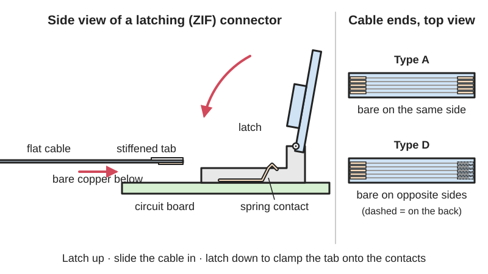
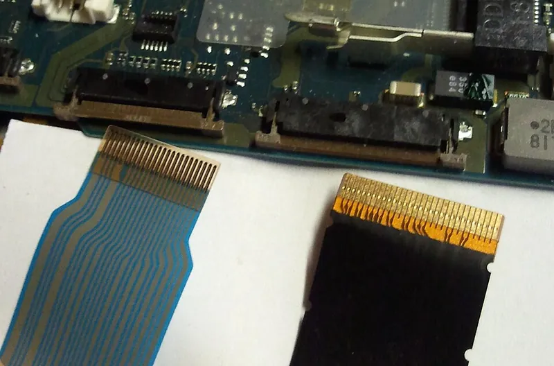
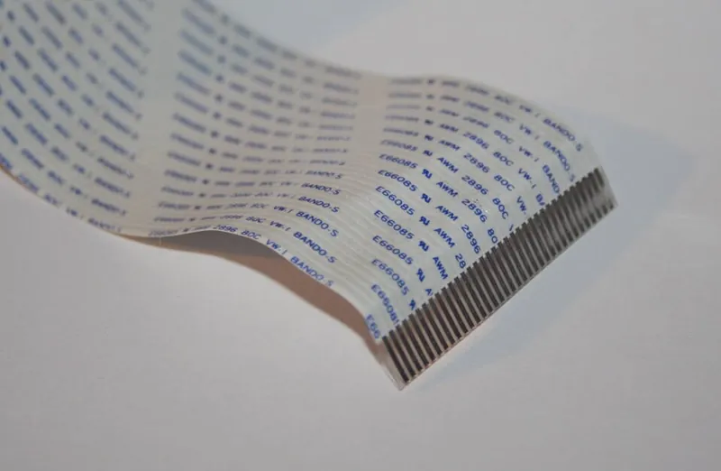

<figure class="eoc-pic eoc-pic-main"><picture><source media="(prefers-reduced-motion: reduce)" srcset="../media/drawn/flat-flexible-cable-and-latching-connector.svg"></picture><figcaption><strong>Animation.</strong> Diagram drawn for the encyclopaedia from the research notes. ⚑ Needs confirming: a drawing can simplify or get details wrong; a real photo or a better diagram is welcome.</figcaption></figure>
<figure class="eoc-pic"><figcaption><strong>Photo.</strong> <a href="https://commons.wikimedia.org/wiki/File:ZIF_connector_and_FFC.jpg">ZIF connector and FFC</a> by Zeroping, <a href="http://creativecommons.org/publicdomain/zero/1.0/deed.en">CC0</a>, from Wikimedia Commons.</figcaption></figure>
<figure class="eoc-pic"><figcaption><strong>How it works.</strong> <a href="https://commons.wikimedia.org/wiki/File:Samsung_SGH-U700_FFC.jpg">Samsung SGH-U700 FFC</a> by RobbertS, Public domain, from Wikimedia Commons.</figcaption></figure>
<figure class="eoc-pic"><figcaption><strong>Photo.</strong> <a href="https://commons.wikimedia.org/wiki/File:Flat-Flex-Cable.jpg">Flat-Flex-Cable</a> by Marcus Wong Wongm, <a href="https://creativecommons.org/licenses/by-sa/3.0">CC BY-SA 3.0</a>, from Wikimedia Commons.</figcaption></figure>

A flat flexible cable is a thin plastic film with many flat copper conductors whose stiffened, bared ends slide into low-profile board connectors that are clamped shut by a small latch (a ZIF connector), carrying many low-current signals between boards, cameras and displays and through hinges and moving parts.

**In plain words:** A very thin, flat plastic strip with a row of tiny copper stripes inside; its bare end slides into a slim socket on a circuit board and is clamped by flipping or sliding a little lid. It carries many signals to a camera or screen, and can bend through a hinge or follow a moving print head. **Proper term:** Flat flexible cable and latching connector (FFC with ZIF connector).

**Also called:** flat flexible cable / flexible flat cable (FFC) (Wikipedia 'Flexible flat cable'); flat flex cable / flat flex jumper (e.g. Premo-Flex, Molex brand; WR-FFC, Würth Elektronik brand) (Molex and Würth data sheets); FPC (flexible printed circuit): strictly an etched or printed flexible circuit board, but often used loosely for any FFC (Wikipedia 'Flexible flat cable'); ribbon cable / flex cable / camera cable (loose everyday names; true ribbon cable has round wires) (iFixit 'Categorisation of Connectors'; Raspberry Pi camera documentation; Wikipedia); ZIF connector (zero insertion force) and LIF or non-ZIF connector (low insertion force) (Wikipedia 'Zero insertion force'; IRISO 'FPC/FFC connector types'); FPC connector / FFC connector / FPC-FFC connector (e.g. Hirose FH12 series, brand) (Hirose data sheet); latch styles: flip-lock or front-flip, back-flip, slide-lock or slider-cover, push-lock, locking-bar and non-locking (IRISO; iFixit; Hirose); Type A (same-side contacts) and Type D (opposite-side contacts) (Molex), also called Type 1 and Type 2 (Würth Elektronik) (Wikipedia 'Flexible flat cable'); top-contact and bottom-contact connectors (which face of the cable end touches the contacts) (Hirose data sheet); Raspberry Pi camera and display connectors: standard 15-pin and mini 22-pin (Raspberry Pi camera documentation); ZIF tape connector (1.8-inch hard drives, ZIF-24, ZIF-40, ZIF-50) (Wikipedia 'Zero insertion force'); clockspring / spiral cable (a wound flat cable that lets a car's steering wheel turn) (Wikipedia 'Clockspring').

## How it works

The copper strips are bared for a few millimetres at each end on one face only, and a stiffener on the other face makes the end a firm tab of a set thickness, typically 0.3 mm (Wikipedia; Hirose). In a ZIF connector, opening the latch takes the pressure off the contacts so the tab slides in with almost no force; closing the latch pushes the tab against the row of spring contacts and holds it there (Wikipedia 'Zero insertion force'; IRISO). Non-ZIF (LIF) connectors have no latch: the contacts are sprung from the start and grip the tab by friction, which is simpler and smaller but holds less well (IRISO; Wikipedia). Because the contacts touch only one face of the tab, the bared side must face them: a connector is either top-contact or bottom-contact, and a cable has its bare contacts on the same side at both ends (Type A) or on opposite sides (Type D), which together decide which way up each end goes (Molex; Wikipedia; Hirose).

## Parts

A few parts: the cable (polyester film insulation, a row of flat tin- or gold-plated copper conductors, and a stiffener or 'support tape' on the back of each bared end) and two board-mounted connectors, each with a plastic housing, a row of spring contacts and a latch that flips or slides (Wikipedia 'Flexible flat cable'; Würth WR-FFC data sheet; IRISO; Hirose FH12 data sheet).

## Everyday examples

- the cable from a laptop's screen to its motherboard (Wikipedia 'Zero insertion force')
- the ribbon from a Raspberry Pi camera module to the board (Raspberry Pi camera documentation)
- the cable to the moving print head in an inkjet printer (Wikipedia 'Flexible flat cable'; Molex lists printers)
- the flat cable joining the two halves of a slide phone (Wikimedia Commons 'Samsung SGH-U700 FFC.jpg'), and the spiral 'clockspring' cable behind a car's steering wheel (Wikipedia 'Clockspring')

## When to use it

When you need many low-current signals in very little space, such as between two boards, to a camera or display module, or across a hinge, sliding drawer or carriage, where a bundle of round wires would be too thick or stiff (Wikipedia 'Flexible flat cable'; Molex). FFCs 'take up less space than round cables' and suit 'high-flex applications' (Wikipedia). Use a ZIF connector where the cable must go in without strain on the delicate contacts, and a non-ZIF one only where space and cost matter most (IRISO). Ready-made modules (cameras, displays) often come with the cable and connector, so this is what you use to connect them.

## When not to use it

For power above about an amp per conductor or for any mains voltage: use Wire-to-board plug connectors, a Screw terminal or a High-current battery plug. For connections that are plugged and unplugged often (about 20 cycles only): use a Standard plug-and-socket connector or Wire-to-board plug connectors. For a joint that keeps turning: use a Slip ring and rotary union or an Anti-twister mechanism; a clockspring only allows a few turns (Wikipedia 'Clockspring'). For long runs outside an enclosure, or where the cable could be pulled or snagged: use a round, jacketed cable with Cable [gland](../glossary.md#gland) and strain relief. For a custom length or pin count you can't buy: use ribbon cable with Insulation-displacement connector (IDC) plugs, since an FFC's ends need factory-made bared contacts and stiffeners ⚑ [uncertain: inferred from the cable construction].

## Details

- **What it does (jobs):**
  - join and hold: connects many signal lines between two boards, or to a camera or display, with a plug-free cable end (the finder reaches this entry through the 'electrical connections' family)
  - seal it, or pass cables or fluid through: a thin flat cable carries many signals across a hinge, a sliding carriage or a limited-turn joint (see Cable through a hinge)
  - lock, and release by hand: the latch locks the cable in and is opened with a fingernail or plastic spudger (Hirose; iFixit)
- **Movement:** flex: the connector is fixed, but the cable can bend and fold, and some thin grades are made for repeated movement (Molex flex-life table: 10,000 to 2.5 million cycles depending on thickness)
- **Directions it can move (degrees of freedom):** 0 at each latched connector; the cable between them bends easily across its thin direction but resists bending sideways in its own plane and stretching ⚑ [uncertain: geometry, not stated on an opened page], so it suits hinges and back-and-forth carriages, not twisting or endless rotation
- **Special behaviour:**
  - quick-release: the latch opens by hand and the cable slides out with almost no force (IRISO; Hirose)
  - none otherwise: it is a passive set of conductors
- **How it holds:** friction or clamping ([force-fit](../glossary.md#form-fit--force-fit--material-bond)): the closed latch presses the tab against the contacts; spring force: the springy contacts keep the pressure on (Hirose: its contacts 'maintain the required normal force'); shape: some connectors add a catch that hooks a notch in the cable end (IRISO 'I-Lock')
- **Input and output:** not applicable
- **Power:** passive (no power needed)
- **Load:** Electrical: up to about 3 A, extra-low voltage only. Each conductor carries little: Molex Premo-Flex 0.5 A at 0.5 mm [pitch](../glossary.md#pitch), 1.2 A at 1.0 mm and 1.4 A at 1.25 mm (Molex); Würth 0.5 mm-pitch cable 0.5 A (Würth); and the connector contact may be lower, e.g. 0.4 A DC for Hirose FH12 (Hirose). Larger currents are shared over several conductors ⚑ [uncertain: common practice, not stated on an opened page]. Voltage: 60 V maximum for the cables (Molex; Würth) and 50 V AC for the FH12 connector (Hirose), so extra-low voltage only (not more than 50 V AC or 120 V ripple-free DC, UK Approved Document P); never mains. Mechanical: light. The latched joint survives vibration (10-55 Hz) and shock (490 m/s²) tests (Hirose), but the connectors 'do not have strong resistance to upward pulling; therefore, support the FPC when a pulling force is applied' (Hirose), and the conductors are only 0.05 mm thick (Würth).
- **Play and precision:** The tab must go in straight and all the way: 'When the FPC is partially inserted or there is an extreme insertion offset, the lock level will engage poorly or not at all', and poor insertion 'could cause FPC breakage and conduction faults' (Hirose); Raspberry Pi says to make sure the cable 'is seated straight to correctly align all contacts'. The cable end must match the connector's thickness, typically 0.3 ± 0.05 mm (Hirose).
- **Taking it apart:** removable: lift or slide the latch with a fingernail or spudger and pull the cable straight out (Hirose; iFixit); check first for a latch, since 'it is important not to pull an FPC out of a connector until you are sure that there is no retention method that you've missed' (iFixit)
- **How often it can be reused:** a few times: typical ratings are 20 mating cycles for both connector and cable (Hirose FH12: 20 cycles; Würth WR-FFC: 20 mating cycles)
- **Sealing:** none: the connector is open and the bared contacts are exposed
- **Adjustable:** no: cable length, pitch, pin count and contact type are fixed when you buy it
- **Access needed:** one side only (blind): the connector is reached from the component side of the board, with room above it to lift the latch (the FH12 latch stands 2.0 mm above the board, Hirose) and room in front to slide the cable in
- **Materials:** Cable: white PET (polyester) insulation 0.043 mm thick, tin-plated copper conductors 0.3 mm wide and 0.05 mm thick at 0.5 mm pitch, and a blue PET support tape 0.225 mm thick at the ends (Würth WR-FFC); total cable thickness 0.12, 0.22 or 0.27 mm, tin or gold plated (Molex). Connectors: plastic housing with solder- or gold-plated contacts (Hirose). Not a material that joins other things; it only connects to matching FFC/FPC connectors or is soldered to pads (Adafruit FPC adapters).
- **Heat, cold, water and wear:** Temperature: cables are rated -30 to +105 °C (Würth) or -40 to +105 °C (Molex); the Hirose FH12 connector -40 to +70 °C including its own heating from current. Humidity: 90% relative humidity maximum, not condensing (Hirose). Flexing: copper [fatigue](../glossary.md#fatigue) limits moving use; thicker cables last far fewer cycles (Molex flex-life table). Vibration: a latched FH12 showed no break in contact over 10-55 Hz for 2 hours in each axis (Hirose). Dust and water: open contacts, so keep the joint inside an enclosure ⚑ [uncertain]. Static: camera modules are static-sensitive (Raspberry Pi).

## Making it

- **Ways to make or get it:**
  - off-the-shelf part (cables bought by pitch, pin count, length and contact type; board connectors)
  - printed circuit board with a surface-mount connector footprint
  - 3D print (FDM): clamps, guides, strain reliefs and hinge channels for the cable (Printables 905215 and 35028)
- **Printing it in one piece (print in place):** no: the cable and connectors are bought; only clips and guides are printed
- **Tools:** none to plug in (the latch is flicked up 'with the fingernail of the thumb or forefinger', Hirose); a plastic spudger or tweezers helps (iFixit); fitting the connector to your own board needs fine-pitch surface-mount soldering, or use a ready-made breakout board (Adafruit FPC Stick)
- **Difficulty:** easy to plug in when the board already has the connector (camera modules, displays, Raspberry Pi); moderate to hard to design in yourself, because the connectors are tiny 0.5 mm-pitch surface-mount parts and four things must match (pitch, pin count, end thickness and contact side); breakout boards make prototyping easier (Adafruit FPC Stick)

### 3D printing tips

Clamp the cable close to each connector so pulls and movement don't reach the latch, because ZIF connectors have little resistance to upward pulling (Hirose); a printed clip screwed down next to the connector does this (Printables 35028 uses a 2.5 mm screw). Printed guides that hold a cable along an aluminium extrusion can be printed upright without supports in PLA (Printables 905215). Make any slot the cable passes through a little thicker than the cable (0.12-0.3 mm, Molex; Hirose) and round its edges so the film is not cut ⚑ [uncertain: no [clearance](../glossary.md#clearance) figure found on an opened page]. Never fold the cable sharply against a printed edge: Molex's folding test uses a 4 mm radius, and for parts that move (hinges, carriages) choose the thinnest cable and the largest loop you can, since flex life falls from 2.5 million cycles at 0.12 mm thick to 10,000 cycles at 0.27 mm (Molex). Leave room in the enclosure to reach the latch with a fingernail or spudger, and to slide the cable in straight (Hirose; iFixit). For routing across a pivot (hollow pin, on-axis routing, service loop), see Cable through a hinge.

### Buying one (off-the-shelf parts)

Search terms: 'FFC cable' or 'flat flex cable jumper' with pitch (0.5 mm, 1.0 mm, 1.25 mm), pin count, length and contact type ('Type A' same-side or 'Type D' opposite-side, Molex Premo-Flex; 'Type 1' or 'Type 2', Würth WR-FFC); 'FFC FPC connector' or 'ZIF connector' with pitch, pin count, 'top contact' or 'bottom contact', and latch style ('flip lock', 'back flip', 'slider'), e.g. Hirose FH12 (brand); 'FPC breakout' or 'FPC adapter' (e.g. Adafruit FPC Stick 20-pin 0.5/1.0 mm, Adafruit 50-pin 0.5 mm FPC adapter); 'Raspberry Pi camera cable' (standard 15-pin or mini 22-pin, and 15-to-22-pin adapter cables); 'FFC extension board' ⚑ [uncertain]; 'plastic spudger'. Link to a catalogue rather than copying part numbers.

## Rules of thumb

- Match four things between cable and connector: pitch, number of pins, end thickness (commonly 0.3 ± 0.05 mm; 0.18 mm for thin-FPC versions) and which side the contacts are on (Hirose FH12, https://datasheet.trustcompo.com/hirose-fh12-12s-0.5sh.pdf; Molex, https://cdn.hackaday.io/files/1956458370475680/Data%20Sheet%20-%20987650-6631.pdf).
- Common pitches are 0.5, 1.0 and 1.25 mm (Wikipedia, https://en.wikipedia.org/wiki/Flexible_flat_cable); 0.5 mm 'is the most used' today (IRISO, https://www.irisoele.com/en/technology/connectors/feature/fpcffc-types-features).
- Which way up: Type A cables have contacts on the same side at both ends, Type D on opposite sides, to suit top- and bottom-contact connectors (Molex; Wikipedia). On a bottom-contact connector insert the cable 'with the conductive surface facing down'; on a top-contact one, facing up (Hirose). On a Raspberry Pi camera port, insert the cable 'with the metallic contacts facing away from the flap' (Raspberry Pi, https://www.raspberrypi.com/documentation/accessories/camera.html).
- Current per conductor: 0.5 A at 0.5 mm pitch, 1.2 A at 1.0 mm, 1.4 A at 1.25 mm, 60 V maximum (Molex); 0.4 A DC and 50 V AC per contact for the Hirose FH12 connector (Hirose). Use the lower of the cable and connector ratings.
- Mating cycles: about 20 (Hirose FH12; Würth WR-FFC, https://www.we-online.com/components/products/datasheet/687712050002.pdf). Don't plan to unplug it often.
- Bending, figures side by side: Molex tests folding at 180° over a 4 mm radius for at least 20 cycles and gives flex life of 2.5 million cycles for 0.12 mm cable, 100,000 for 0.22 mm and 10,000 for 0.27 mm; its feature list separately claims 900,000 cycles versus 6,000 for a standard jumper (Molex). Würth's cable passes a 180° flexing test 20 times (Würth).
- Latch type: front-flip is small and easy to work but holds less if the cable is tilted upward; back-flip is more resistant to tilt; the slider type holds best but is larger and fiddlier (IRISO).
- Close a flip latch by pressing on both sides; pressing only one side won't lock it (Hirose). Don't force the latch up when no cable is in, and don't grip it with your fingers (Hirose).
- Power off before plugging in, and earth yourself first, since camera boards are 'sensitive to static' (Raspberry Pi camera documentation).

## Common failures

(1) Broken latch from forcing it, gripping it with fingers, or opening the wrong way; identify the latch type first (Hirose; iFixit). (2) Cable not fully inserted or skewed, giving intermittent faults or a latch that won't lock (Hirose; Raspberry Pi). (3) Cable in upside down, or Type A used where Type D was needed, so nothing works (Molex; Hirose). (4) Cable torn out because a latch was not opened, or pulled upward at the connector (iFixit; Hirose). (5) Crack in the conductors from a sharp crease or too many flex cycles in a moving joint (Molex). (6) Contacts worn after more than about 20 matings (Hirose; Würth). (7) Static damage to a camera or display module (Raspberry Pi). (8) Flip latch closed on one side only, so it doesn't lock (Hirose).

## Safety

Shut down and unplug the device before connecting or disconnecting a cable, and earth yourself, because modules are 'sensitive to static' (Raspberry Pi camera documentation). A cable put in the wrong way up, or the wrong type (A instead of D), may put power on the wrong pins and damage the boards ⚑ [uncertain: not stated on an opened page]. Ratings are 50-60 V at most (Hirose; Molex; Würth): never use FFCs for mains. Mains work must follow local law; in England, Approved Document P covers electrical installation work in homes. A car's clockspring is part of the airbag and horn circuit (Wikipedia 'Clockspring'): don't take one apart or reuse it in a project ⚑ [uncertain: general caution]. The latch is 'small and thin and could be damaged', so don't force it (Hirose).

## Related

- Cable through a hinge (hollow hinge pin, cable on the pivot axis, service loop): how to route this or any cable across a pivot
- Insulation-displacement connector (IDC, ribbon-cable plug, punch-down, T-tap): round-wire ribbon cable with crimp-on plugs, thicker but easy to make to any length
- Wire-to-board plug connectors (pin header and crimp housing): sturdier plugs for fewer wires and more current
- Slip ring and rotary union: passes signals across a joint that keeps turning
- Anti-twister mechanism (twist-free cable feed): lets a joint turn endlessly with a plain cable; clocksprings are the flat-cable answer for a few turns
- Cable carrier (drag chain, energy chain): guides cables, including flat ones, along a moving axis
- Pogo pin (spring-loaded contact pin): spring contacts pressed onto pads, an alternative way to connect a moving or removable board
- Conductive tape (copper foil tape, conductive fabric tape): a home-made flat conductor for paper and card
- [Keying](../glossary.md#keying) (one-way-only fit, poka-yoke): FFC orientation is a keying problem that the connector does not solve for you

## Make it yourself

- [Adafruit FPC Stick - 20 Pin 0.5mm/1.0mm Pitch Adapter (Adafruit)](https://www.adafruit.com/product/1325): A breakout board with long pads for 0.5 mm and 1.0 mm pitch FPC connectors broken out to 0.1 inch headers, for prototyping with flat cables on a breadboard *(licence: link only (product))*
- [Adafruit 50 pin 0.5mm pitch FPC Adapter (Adafruit)](https://www.adafruit.com/product/1492): A breakout board for 0.5 mm pitch connectors up to 50 pins, broken out to breadboard-friendly headers *(licence: link only (product))*
- [V Slot FFC Cable Clamp (Printables 905215; URL from Printables API, page not opened)](https://www.printables.com/model/905215-v-slot-ffc-cable-clamp): Printed clamps that hold an FFC or ribbon cable where it crosses a 2020 or 2040 aluminium extrusion; printed upright in PLA without supports *(licence: CC BY (Creative Commons Attribution))*
- [Raspberry Pi Camera Ribbon Cable holder (Printables 35028; URL from Printables API, page not opened)](https://www.printables.com/model/35028-raspberry-pi-camera-ribbon-cable-holder): A tiny printed clip, fixed with a 2.5 mm screw, that holds a camera's flat cable in place *(licence: CC BY-NC (Creative Commons Attribution-NonCommercial))*

## Pictures, videos and models

- [ZIF connector and FFC.jpg (Wikimedia Commons, by Zeroping)](https://commons.wikimedia.org/wiki/File:ZIF_connector_and_FFC.jpg): A pair of zero-insertion-force connectors on a laptop mainboard with the flat flexible cables that plug into them *(licence: CC0 1.0 (public domain dedication))*
- [Flat-Flex-Cable.jpg (Wikimedia Commons, by Marcus Wong)](https://commons.wikimedia.org/wiki/File:Flat-Flex-Cable.jpg): A length of 35-conductor flat flexible cable with bared ends *(licence: CC BY-SA 3.0 or GFDL 1.2+ (reuse with credit))*
- [Samsung SGH-U700 FFC.jpg (Wikimedia Commons, by RobbertS)](https://commons.wikimedia.org/wiki/File:Samsung_SGH-U700_FFC.jpg): Close-up of the flat flexible cable linking the two sliding halves of a phone, an example of a cable across a moving joint *(licence: CC BY-SA 3.0 or GFDL 1.2+ (author also releases it to the public domain))*
- [Categorisation of Connectors (iFixit wiki)](https://www.ifixit.com/Wiki/Categorisation_of_Connectors): Photo pairs of front-flip, back-flip, push-lock, pinch-lock, locking-bar, slide-lock and non-locking FPC/FFC connectors, open and closed *(licence: link only [licence not shown on the page as read])*
- [FPC/FFC connector types and features (IRISO)](https://www.irisoele.com/en/technology/connectors/feature/fpcffc-types-features): Drawings comparing slider-cover, front-flip, back-flip and non-ZIF connectors, with their pros and cons *(licence: link only)*

## Needs confirming

⚑ marks something nobody has confirmed yet: a fact the research could not confirm from a source, a finder value that is a best guess, or an open point from the research notes. Corrections are welcome (see `research/needs-confirming.md`).

- ⚑ 8 sentences on this page marked [uncertain].
- ⚑ Finder value `load_max` = light (best guess): electrical entry whose mechanical load has no light/medium/heavy band; set to light
- ⚑ Finder value `made_of` = 3D prints, plastic sheet, tube or moulded parts, metal (best guess): proposed from the words in the research text (R37); not yet checked
- ⚑ Research note: *Flat flexible cable*: Molex flex life differs between its test table (2.5 million / 100,000 / 10,000 cycles by cable thickness) and its feature list (900,000 vs 6,000); both recorded. Hirose FH12 current: the data sheet read says 0.4 A per contact; a Mouser search summary said 0.5 A; only 0.4 A is cited.

## Sources

- <https://en.wikipedia.org/wiki/Flexible_flat_cable>
- <https://en.wikipedia.org/wiki/Zero_insertion_force>
- <https://en.wikipedia.org/wiki/Clockspring>
- <https://www.irisoele.com/en/technology/connectors/feature/fpcffc-types-features>
- <https://www.ifixit.com/Wiki/Categorisation_of_Connectors>
- <https://datasheet.trustcompo.com/hirose-fh12-12s-0.5sh.pdf>
- <https://www.we-online.com/components/products/datasheet/687712050002.pdf>
- <https://cdn.hackaday.io/files/1956458370475680/Data%20Sheet%20-%20987650-6631.pdf>
- <https://www.raspberrypi.com/documentation/accessories/camera.html>
- <https://www.adafruit.com/product/1325>
- <https://www.adafruit.com/product/1492>
- <https://assets.publishing.service.gov.uk/government/uploads/system/uploads/attachment_data/file/441872/BR_PDF_AD_P_2013.pdf>
- <https://commons.wikimedia.org/wiki/File:ZIF_connector_and_FFC.jpg>
- <https://commons.wikimedia.org/wiki/File:Flat-Flex-Cable.jpg>
- <https://commons.wikimedia.org/wiki/File:Samsung_SGH-U700_FFC.jpg>
- <https://api.printables.com/graphql/>
