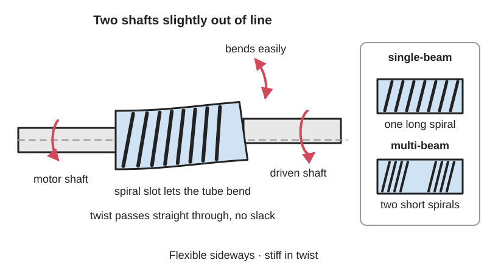
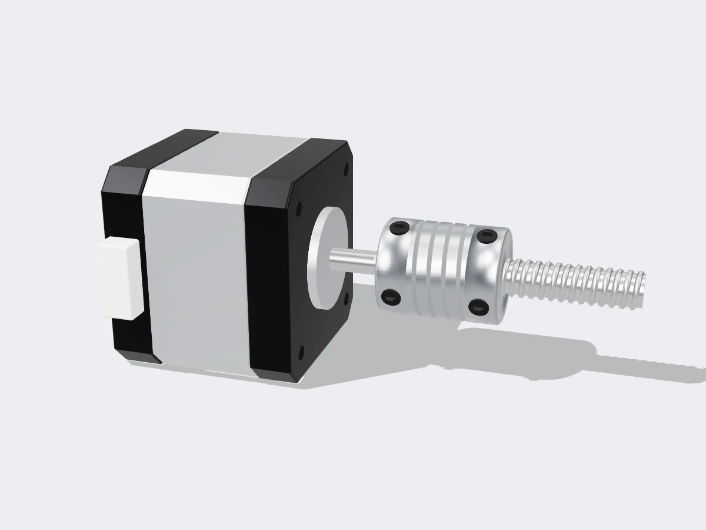

<figure class="eoc-pic eoc-pic-main"><picture><source media="(prefers-reduced-motion: reduce)" srcset="../media/drawn/flexible-beam-coupling.svg"></picture><figcaption><strong>Animation.</strong> Diagram drawn for the encyclopaedia from the research notes. ⚑ Needs confirming: a drawing can simplify or get details wrong; a real photo or a better diagram is welcome.</figcaption></figure>
<figure class="eoc-pic"><figcaption><strong>Render.</strong> A 3D model made for the encyclopaedia, not a photo: a stand-in until a good real photo is found. ⚑ Needs confirming: a model can simplify or get details wrong; a real photo is welcome.</figcaption></figure>

A one-piece tube with a spiral slot cut through its wall that joins two shafts end to end, bending slightly to cope with small errors in their line-up while turning them together with no play.

**In plain words:** A short metal (or printed) tube with a spiral slot cut round its middle that joins a motor shaft to another shaft end to end; the slotted part bends like a spring so shafts that don't quite line up can still turn together, without any slack. **Proper term:** Beam coupling (helical beam coupling, flexible beam coupling).

**Also called:** helical coupling (Wikipedia's other main name for it); helical beam coupling / helical-beam shaft coupling; flexible beam coupling; [flexure](../glossary.md#flexure) coupling (Wikipedia); flexible coupling / flexible shaft coupling / flex shaft coupler (general names also used for other flexible types); spiral coupler / spiral-cut coupler (3D-printer and hobby-seller wording); 'aluminium flexible coupling coupler helical shaft 5mm x 8mm' (the usual online listing wording for the 3D-printer size); Z coupler / leadscrew coupler (3D-printer use); single-beam and multi-beam coupling (one spiral cut, or two to six overlapped cuts); parallel-cut or slotted beam coupling (McMaster-Carr name for a stiffer variant with short straight slits); servo coupling (the catalogue family it is sold in); Heli-Cal (brand, Helical Products Company).

## How it works

Cutting a spiral slot through the wall of a solid tube leaves a thin spiral strip (the helical beam) joining the two ends. That strip can bend like a coil spring, so the two ends can tilt a few degrees, shift slightly sideways and move a little closer or further apart. Twisting is different: the twisting force has to pass all the way along the strip, which is much stiffer that way, so the two shafts turn together with no slack (zero [backlash](../glossary.md#backlash)) and only a slight springy twist under load (wind-up). Because it is one piece there are no parts to wear loose, but its resistance to bending does push sideways on the shafts' bearings (Machine Design, Boehm 2003).

## Parts

Single piece: one tube with a spiral (helical) slot cut through the middle, a bore at each end for the two shafts (they can be different sizes, e.g. 5 mm and 8 mm), and either [set screws](../glossary.md#set-screw) (usually two per end, e.g. at 120 degrees apart) or a split clamp with a clamping screw at each end. Printed versions may add [captive nuts](../glossary.md#captive-nut) or [heat-set inserts](../glossary.md#heat-set-insert) for the screws.

## Everyday examples

- The shiny slotted aluminium tube joining the Z-axis motor to the long threaded rod (leadscrew) on many desktop 3D printers and hobby CNC machines
- The small coupling between a motor or shaft and a rotary encoder (the sensor that counts turns) in automation and robotics equipment (Wikipedia 'Coupling')
- Stepper-motor linear stages and [actuators](../glossary.md#actuator) in maker kits, where the motor turns a leadscrew through a spiral coupler (Adafruit sells it for these uses)

## When to use it

Use it to join two shafts end to end where you need the output to follow the motor exactly, with no slack, but you can't guarantee perfect alignment: a stepper motor driving a leadscrew or threaded rod, a motor turning a potentiometer or encoder, a small robot joint, a turntable or a camera slider. It is compact, needs no [lubrication](../glossary.md#lubrication) or maintenance, has no parts to wear or rattle, and copes with the small angle and position errors that come from printed or home-made frames. Choose a multi-beam or stainless version when you need more [stiffness](../glossary.md#stiffness) or [torque](../glossary.md#torque), or more sideways offset.

## When not to use it

Avoid it for high torque, shock loads or drives that hit hard stops or jam (use a jaw coupling with a rubber spider, which absorbs shocks, or a rigid or keyed coupling on well-aligned shafts). Avoid single-beam types where the shafts are noticeably offset sideways (use an Oldham coupling, which is designed for offset, or a multi-beam type). For large angles use a universal joint or CV joint; to go round bends use a flexible drive shaft. Don't let it carry the weight of a machine part along its length, such as a heavy 3D-printer gantry hanging on the leadscrew, because it acts as a spring: support that load with a bearing or nut, or use a coupler with a solid core or a stiffer (stainless or multi-beam) type. It also can't fix a bent leadscrew or badly misaligned motor; fix the alignment first.

## Details

- **What it does (jobs):**
  - join and hold: connects two shafts end to end so they turn together, e.g. a stepper motor to a leadscrew
  - let it move (turn, slide or bend): it bends so that two slightly misaligned shafts can turn without forcing each other or their bearings
- **Movement:** flex: the slotted middle bends while the whole coupling turns with the shafts; typical small catalogue couplings allow about 3-5 degrees of angle, 0.25-0.76 mm (0.010-0.030 in) of sideways offset and about 0.2-0.25 mm of end movement (MW Components); special helical-beam universal joints with many coils bend up to 90 degrees (Boehm, Machine Design)
- **Directions it can move (degrees of freedom):** 0 in the direction that matters: it does not let one shaft turn relative to the other (apart from a slight springy twist under load). As a flexure it gives small springy movement in five directions: tilting two ways, shifting sideways two ways, and stretching or squashing along the shaft
- **Special behaviour:**
  - self-aligning or self-centring (loosely): it does not pull the shafts into line, but it flexes to accept small line-up errors instead of forcing the shafts and bearings, so it tolerates a less-than-perfect build
  - none of the other listed behaviours: it is a simple, permanent drive connection that does not slip, click, lock or release
- **How it holds:**
  - friction or clamping ([force-fit](../glossary.md#form-fit--force-fit--material-bond)): set screws or a clamp screw grip each shaft; McMaster-Carr notes clamp hubs grip evenly without marring and hold tighter than set screws
  - shape (the parts interlock; form-fit): a set screw tightened onto the flat of a D-shaped motor shaft also locks by shape; the turning force itself passes through the continuous one-piece body
- **Input and output:** Rotation in -> the same rotation out (1:1), shafts in line (nominally on the same axis, with small angle, offset and end-float allowed). No sliding parts, so almost no power is lost. Zero backlash, but it twists slightly under load (wind-up): from about 5 degrees at full load for flexible designs down to about 0.05 degrees for stiff servo designs (Boehm, Machine Design). Back-drivable: yes, it passes turning force equally in both directions.
- **Power:** passive (no power needed)
- **Load:** Light to medium: made for motion-control jobs (steppers, servos, encoders, leadscrews), not heavy power. Catalogue torque ratings run from about 0.14 N·m to about 63 N·m (1.2-556 in·lb) across MW Components' ranges, and 3-175 in·lbf (0.34-20 N·m) on McMaster-Carr's listing. Strong and stiff in twist within its rating; deliberately soft in bending and along its length; the thin spiral beam is the weak point, and it cracks from [fatigue](../glossary.md#fatigue) if overloaded by torque spikes, reversing loads or too much [misalignment](../glossary.md#misalignment) (especially sideways offset for single-beam types).
- **Play and precision:** No play (zero backlash), and it returns to the same position every time because nothing slides; the only 'give' is springy twist under load (wind-up), which is small for multi-beam and stainless designs and larger for long single-beam ones. Misalignment tolerated: about 3-5 degrees of angle, 0.25-0.76 mm sideways offset and 0.2-0.25 mm end float for small catalogue couplings (MW Components). Single-beam types handle angle and end float well but sideways offset poorly, because the single beam has to bend two ways at once (Hewitson, Machine Design 2000). It is also a little springy along its length, which on a 3D printer's Z axis can show up as uneven layers if the carriage weight rests on it (LoboCNC; SoliForum).
- **Taking it apart:** removable: loosen the set screws or clamp screws with a hex key and slide it off the shafts
- **How often it can be reused:** many times: it can be refitted repeatedly; set screws that dig into a round shaft can leave marks or raised burrs that make the next fitting harder ⚑ [uncertain], which clamp-type hubs avoid (McMaster-Carr)
- **Sealing:** none: the slot is open; it does not seal anything
- **Adjustable:** no: once tightened nothing adjusts; you can only choose where along the shafts it sits before tightening the screws
- **Access needed:** end of a tube or shaft: it slides over the shaft ends, and you need side access to its set screws or clamp screws with a hex key
- **Materials:** Usually aluminium alloy (7075-T6) for low weight and inertia; stainless steel (17-4PH or 303) for about twice the torque and stiffness and for heat or corrosion; also acetal (Delrin), titanium and other plastics for special uses (Wikipedia 'Coupling'; ABSSAC; Hewitson, Machine Design). Joins any metal shafts, typically steel motor shafts and leadscrews of different diameters (e.g. 5 mm to 8 mm). Maker-printed versions in PETG, PLA or nylon work for light loads.
- **Heat, cold, water and wear:** Heat: aluminium beam couplings are rated to about 93 °C (200 °F) and stainless steel to about 316 °C (600 °F) (MW Components; ABSSAC). Printed PLA softens above about 60 °C, PETG is good to about 80 °C (Prusa), so keep printed couplers away from hot motors and enclosures. Wet or corrosive places and food or medical machines: choose stainless steel, titanium or acetal (Boehm, Machine Design). Vibration: set screws can work loose over time ⚑ [uncertain]; clamp hubs or thread-locking compound help. Fatigue: a metal beam coupling has a very long fatigue life inside its ratings (Boehm), but running beyond its misalignment or torque limits makes it crack. Printed plastic couplers slowly [creep](../glossary.md#creep) and lose stiffness under constant load ⚑ [uncertain].

## Making it

- **Ways to make or get it:**
  - off-the-shelf part: by far the usual choice (aluminium or stainless beam couplings in many bore-size pairs)
  - CNC: made commercially by turning a bar and machining the spiral slot through the wall
  - 3D print (FDM): possible for light loads; several printable designs exist (LoboCNC, tierra, JoanPeturPetersen)
  - 3D print (resin): ⚑ [uncertain] no tested example found; [brittle](../glossary.md#brittle--ductile) standard resins are likely to crack at the thin beam
- **Printing it in one piece (print in place):** partly: a printed beam coupling is one piece and works straight off the printer, but it needs added set screws, nuts or heat-set inserts to grip the shafts
- **Tools:** A hex key (the common 5 x 8 mm aluminium coupler uses a 2 mm hex key for its set screws, per Adafruit). Optional thread-locking compound on set screws ⚑ [uncertain]. Printed versions need nuts, set screws or heat-set inserts (and a soldering iron to fit inserts).
- **Difficulty:** easy to fit, and best bought: metal ones are cheap standard parts that just need a hex key. Printing one is moderate: the spiral slot has awkward [overhangs](../glossary.md#overhang--bridging) and a printed plastic beam is weaker, springier and less durable than aluminium

### 3D printing tips

1) Consider buying one: a machined aluminium 5 x 8 mm coupler is a cheap standard part and is far stiffer in twist than a printed spiral. 2) If you print one, print it standing up (shaft axis vertical), so the spiral beam builds as a ramp: tierra printed his Anycubic i3 Mega coupler upright with no supports at 100% [infill](../glossary.md#infill) and 0.2 mm layers, but slowly because of the big overhangs; LoboCNC used 0.2 mm layers, 25% infill, no supports and 4 [perimeters](../glossary.md#perimeters) for strength. 3) Shape the slot for printing: a normal straight-sided spiral slot needs a very steep (high helix angle) cut to avoid overhangs, which makes the coupler stiff in bending and soft in twist, the opposite of what you want; LoboCNC's 'Con-Helical' coupler uses a conical, low-angle helical slot that removes the steep overhang. 4) Stop it acting as a spring on a Z axis: LoboCNC adds a small solid core down the middle so it cannot compress under the Z-carriage weight but can still bend; otherwise small squashing movements show up as ragged [layer lines](../glossary.md#layer-lines). 5) Grip the shafts with metal: M3 set screws in captive nut slots (or tapped straight into plastic) as in LoboCNC's two versions, M4 nuts and screws as in tierra's, or heat-set inserts. 6) Bores and fits: FDM holes usually print slightly small, so check them against the shafts and drill or ream to size ⚑ [uncertain]; Hubs suggests about 0.5 mm [clearance](../glossary.md#clearance) between interlocking FDM parts. 7) Material: PETG is tougher and handles more heat (up to about 80 °C) than PLA, which softens above about 60 °C and breaks along layers (Prusa); nylon is tougher still ⚑ [uncertain]. 8) Layer lines run across the thin spiral beam, so it is the part most likely to crack from repeated bending; make the beam thicker and use fewer turns for a printed part ⚑ [uncertain: reasoning, not a tested rule]. 9) An easier-to-print alternative is two rigid printed hubs with a TPU middle (e.g. Pappy's 'Flexible Stepper Coupler' on Printables, PLA-CF hubs with a TPU insert), but that is a jaw-type flexible coupling, not a beam coupling.

### Buying one (off-the-shelf parts)

Search for: 'beam coupling', 'helical coupling', 'flexible shaft coupling 5mm x 8mm' (the usual 3D-printer size, about 25 mm long x 18-19 mm diameter), 'set screw beam coupling' and 'clamp beam coupling', 'single-beam', 'four-beam' and 'six-beam' servo couplings (Ruland (brand) sells 4-beam and 6-beam types), 'spiral cut' versus 'parallel cut' couplings (McMaster-Carr), stainless steel beam couplings (Heli-Cal (brand) from Helical Products, MW Components (brand) A/H/W/X/MC series). Related hardware: D-profile (D-flat) motor shafts, cup-point set screws (M3 or M4), thread-locking compound, heat-set threaded inserts. For comparison when choosing: jaw (spider) couplings, Oldham couplings, bellows and disc couplings, rigid couplings.

## Rules of thumb

- Single-beam couplings (one long spiral cut) handle angle and end float well but sideways (parallel) offset poorly, because the single beam must bend two ways at once, which raises stress and causes early failure; multi-beam couplings (two or three overlapped cuts, like a multi-start thread) have shorter beams, more torque and torsional stiffness and better offset capacity, at the cost of somewhat higher bearing loads (Hewitson, 'Sorting out servo couplings', Machine Design 2000; ISC Companies on Ruland (brand) beam couplings).
- Typical limits for small catalogue beam couplings: 3-5 degrees angle, 0.25-0.76 mm (0.010-0.030 in) parallel offset, about 0.2-0.25 mm (0.008-0.010 in) [axial](../glossary.md#axial--radial) motion, and up to 10,000 rpm (3,600 rpm for the largest sizes) (MW Components beam coupling page).
- Treat the catalogue 'dynamic' torque as a momentary peak: divide it by 2 for drives that always turn one way and by 4 for drives that reverse (Helical Products engineering data as published by ABSSAC).
- Stainless steel versions have about twice the torsional strength and stiffness of aluminium ones, but add mass and inertia (Hewitson, Machine Design 2000).
- Thicker coils raise torsional stiffness and torque rating; a bigger inside diameter makes the coupling more flexible but lowers its torque capacity (Boehm, 'What you need to know about one-piece, helix-curved beams', Machine Design 2003).
- Wind-up (springy twist) at full load ranges from about 5 degrees for flexible designs down to about 0.05 degrees for stiff servo designs; for servo positioning the torque-to-wind-up relationship must stay linear over the working range (Boehm, Machine Design 2003).
- Temperature: aluminium beam couplings are rated to about 93 °C (200 °F), stainless steel to about 316 °C (600 °F) (MW Components; ABSSAC).
- Don't push the shaft ends into the slotted middle: beam couplings have a relieved bore so the shafts don't touch the flexing part (ABSSAC).
- Clamp-style hubs grip shafts evenly without marring them and hold tighter than set screws (McMaster-Carr beam couplings page).
- For a printed helical coupler, use a low-angle (conical) slot rather than a steep straight-sided one: steep slots print badly and make the coupler stiff in bending and soft in twist (LoboCNC, 'Con-Helical Flexible Coupler', Printables).
- The common 3D-printer coupler joins a 5 mm stepper shaft to an 8 mm leadscrew, is about 25 mm long and 18 mm across, and uses two set screws per side tightened with a 2 mm hex key (Adafruit product 1176).

## Common failures

1) Cracking and breaking of the thin spiral beam, often near the middle, from torque spikes (jams, crashes into end stops, emergency stops) or from running beyond its misalignment rating (Power Transmission World; Ruland (brand) video 'Why Are My Beam Couplings Breaking When They Come To A Hard Stop?'). Avoid it by choosing a torque rating with margin (divide the dynamic rating by 2, or by 4 if the drive reverses, per ABSSAC) and aligning the shafts reasonably well. 2) Single-beam coupling failing early under sideways offset, because the beam bends two ways at once (Hewitson, Machine Design): use a multi-beam type or an Oldham coupling. 3) Shaft slipping inside the coupling because a set screw has loosened or isn't on the flat of a D-shaft: tighten onto the flat, use a clamp-type hub, or add thread-locking compound ⚑ [uncertain]. 4) Uneven layers or 'Z banding' on a 3D printer because the springy coupler squashes under the weight of the carriage: a stainless (stiffer) coupler stopped this for one SoliForum user, and LoboCNC's printable design adds a solid core; some RepRap forum users also report that heavy gantries sitting on the coupler make wobble worse. 5) Extra wear on motor and leadscrew bearings, because the coupling pushes back when bent (Boehm, Machine Design): keep misalignment small. 6) Printed couplers splitting along layer lines or softening in heat: use PETG or nylon, thicker beams and metal screws.

## Safety

It spins with the shafts, and the set screws or clamp screw sticking out of it can catch hair, loose clothing or fingers; keep it covered or out of reach while the machine runs ⚑ [uncertain]. If it breaks from fatigue or overload the drive is suddenly disconnected, so anything the leadscrew was holding up (a Z gantry, a lift) could drop if it is not held another way. Otherwise none known.

## Related

- Jaw coupling (spider coupling): two claw hubs with a rubber spider between them; absorbs shocks and takes more torque, but the rubber insert gives a little and it is intolerant of end movement (Hewitson)
- Oldham coupling: three discs with tongue-and-groove slots at right angles; the best simple choice for sideways offset (about 0.6-2.5 mm or more) but allows under 0.5 degrees of angle and is limited to about 4,000 rpm (Hewitson)
- Bellows coupling: a thin metal bellows instead of a spiral; one of the stiffest in twist, with about 1-2 degrees of angle (Hewitson)
- Disc coupling: thin flexible metal discs; very stiff in twist and up to about 5 degrees with multiple discs, but delicate (Hewitson)
- Rigid coupling (sleeve or clamp coupling): no flexibility at all, so it needs the shafts almost perfectly aligned (Wikipedia 'Coupling')
- Parallel-cut (slotted) beam coupling: short straight slits instead of a long spiral; stiffer, faster and stronger but less tolerant of misalignment (McMaster-Carr)
- Helical-beam universal joint: the same spiral idea with many coils so it can bend up to 90 degrees (Boehm)
- Universal joint (Hooke's joint): passes rotation through large angles, but has pins that wear and a single joint makes the output speed wobble
- Flexible drive shaft (rotating cable): carries rotation round real bends, but twists noticeably under load
- Flexure hinges and other [compliant mechanisms](../glossary.md#compliant-mechanism): the same principle of getting movement by bending one piece of material instead of using sliding parts

## Make it yourself

- [Con-Helical Flexible Coupler (LoboCNC, Printables)](https://www.printables.com/model/132287-con-helical-flexible-coupler): Printable 5 mm to 8 mm helical coupler with a conical low-angle slot that prints without supports and a solid core that stops it compressing under a Z carriage; versions with M3 nut slots or plain holes for set screws (details read via the Printables API) *(licence: CC BY-SA)*
- [Flexible coupling for Anycubic i3 mega z-axis (tierra, Printables)](https://www.printables.com/model/82357-flexible-coupling-for-anycubic-i3-mega-z-axis): Printed spring-type 5 mm to 8 mm coupler that replaced rigid couplers to reduce Z wobble; flexible in bending, stiff in twist; uses M4 nuts and screws; printed upright, 100% infill, no supports (details read via the Printables API) *(licence: CC BY-NC-SA)*
- [flexible-helical-coupling (JoanPeturPetersen, GitHub, OpenSCAD)](https://raw.githubusercontent.com/JoanPeturPetersen/flexible-helical-coupling/master/README.md): OpenSCAD source for a printable flexible helical coupling; the README says it is also on Thingiverse as thing:143514 (not opened) *(licence: ⚑ [uncertain] no licence file found in the repository root)*
- [Parametric Flexible Coupling (marcoalici, Thingiverse)](https://www.thingiverse.com/thing:44078): Customizer-ready OpenSCAD parametric flexible coupling with settable bores, lengths, nut sizes and number of slices; a Printables remix (model 1076992, 'My Customized Parametric Flexible Coupling') lists its settings. The Thingiverse page did not render for the agent; title from search results *(licence: ⚑ [uncertain] the Printables remix is GPL v2.0, which suggests the original is too)*
- [HUANGYAN920 Mechanical: 'FLEX-COUPLING' (柔性联轴器机构, no. 94) interactive animation](https://huangyan920.github.io/Mechanical/): Interactive, adjustable animation of a generic flexible coupling joining two slightly misaligned shafts (not specifically a beam coupling) *(licence: MIT)*

## Pictures, videos and models

- [Beam Coupling - Helical Standard.jpg (Wikimedia Commons, by Helical Products)](https://commons.wikimedia.org/wiki/File:Beam_Coupling_-_Helical_Standard.jpg): Photo of typical one-piece helical beam couplings with the spiral slot clearly visible *(licence: GNU Free Documentation License 1.2 or later)*
- [Helical U-Joint (Beam Style Coupling) - Angular Misalignment.jpg (Wikimedia Commons, by Helical Products)](https://commons.wikimedia.org/wiki/File:Helical_U-Joint_(Beam_Style_Coupling)_-_Angular_Misalignment.jpg): Helical beam parts bent at an angle, showing that more coils allow more angular misalignment *(licence: GNU Free Documentation License 1.2 or later)*
- [Abssac Heli-Cal beam shaft coupling animation (ABSSACLTD, YouTube)](https://www.youtube.com/watch?v=u_fWc7U51Gk): Animation of a helical beam coupling flexing as it turns *(licence: link only (standard YouTube licence))*
- [Why Are My Beam Couplings Breaking When They Come To A Hard Stop? (Ruland Manufacturing (brand), YouTube)](https://www.youtube.com/watch?v=awbFi-0ffgk): Manufacturer's explanation of beam coupling failure from sudden stops (video content not viewed by the agent; title and channel confirmed) *(licence: link only (standard YouTube licence))*
- [Aluminum Flex Shaft Coupler - 5mm to 8mm (Adafruit product page)](https://www.adafruit.com/product/1176): Photos of the typical 3D-printer and CNC spiral coupler with its set screws, and its dimensions *(licence: link only)*

## Needs confirming

⚑ marks something nobody has confirmed yet: a fact the research could not confirm from a source, a finder value that is a best guess, or an open point from the research notes. Corrections are welcome (see `research/needs-confirming.md`).

- ⚑ 12 sentences on this page marked [uncertain].
- ⚑ Finder value `tools` = soldering iron, hand tools (source uncertain): `tools_needed` is marked ⚑ [uncertain] here: "…screws, per Adafruit). Optional thread-locking compound on set screws ⚑ [uncertain]. Printed versions need nuts,…"
- ⚑ Finder value `made_of` = 3D prints, plastic sheet, tube or moulded parts, metal (best guess): proposed from the words in the research text (R37); not yet checked

## Sources

- <https://en.wikipedia.org/wiki/Beam_coupling>
- <https://en.wikipedia.org/wiki/Coupling>
- <https://commons.wikimedia.org/wiki/Category:Beam_couplings>
- <https://commons.wikimedia.org/wiki/File:Beam_Coupling_-_Helical_Standard.jpg>
- <https://commons.wikimedia.org/wiki/File:Helical_U-Joint_(Beam_Style_Coupling)_-_Angular_Misalignment.jpg>
- <https://www.machinedesign.com/automation-iiot/article/21827627/what-you-need-to-know-about-one-piece-helix-curved-beams>
- <https://www.machinedesign.com/motors-drives/article/21827544/sorting-out-servo-couplings>
- <https://www.mwcomponents.com/beam-couplings-helical-couplings>
- <https://www.abssac.co.uk/catalogue/v/helical-beam-shaft-couplings/Helical+Beam+Shaft+Coupling/22/>
- <https://www.isccompanies.com/ruland-beam-couplings-designed-couple-stepper-servo-motors-encoders/>
- <https://www.powertransmissionworld.com/eight-best-ways-to-wreck-your-coupling-driven-system/>
- <https://www.mcmaster.com/products/beam-couplings/>
- <https://www.adafruit.com/product/1176>
- <http://www.soliforum.com/topic/1910/zbanding-reduction-using-helical-beam-coupling>
- <https://reprap.org/forum/read.php?1,305126>
- <https://www.electronicsweekly.com/blogs/engineer-in-wonderland/3d-printing-z-wobble-2019-01/>
- <https://www.youtube.com/watch?v=u_fWc7U51Gk>
- <https://www.youtube.com/watch?v=awbFi-0ffgk>
- <https://api.printables.com/graphql/>
- <https://www.printables.com/model/132287-con-helical-flexible-coupler>
- <https://www.printables.com/model/82357-flexible-coupling-for-anycubic-i3-mega-z-axis>
- <https://raw.githubusercontent.com/JoanPeturPetersen/flexible-helical-coupling/master/README.md>
- <https://www.thingiverse.com/thing:44078>
- <https://huangyan920.github.io/Mechanical/>
- <https://raw.githubusercontent.com/HUANGYAN920/Mechanical/master/README.md>
- <https://www.hubs.com/knowledge-base/how-design-interlocking-joints-fastening-3d-printed-parts/>
- <https://help.prusa3d.com/article/pla_2062>
- <https://help.prusa3d.com/article/petg_2059>
