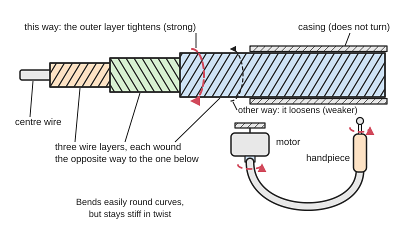
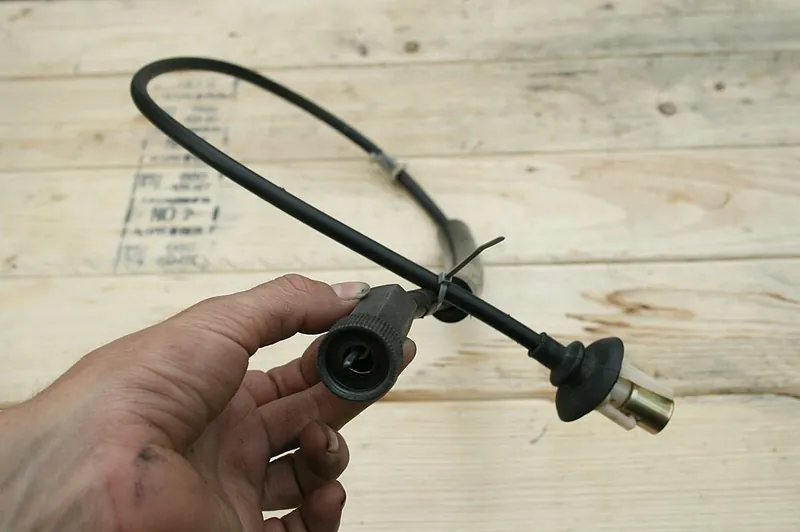
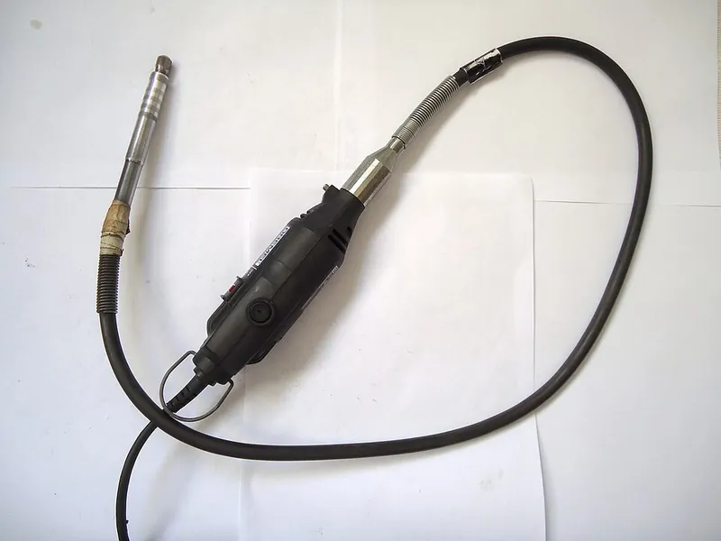

<figure class="eoc-pic eoc-pic-main"><picture><source media="(prefers-reduced-motion: reduce)" srcset="../media/drawn/flexible-drive-shaft.svg"></picture><figcaption><strong>Animation.</strong> Diagram drawn for the encyclopaedia from the research notes. ⚑ Needs confirming: a drawing can simplify or get details wrong; a real photo or a better diagram is welcome.</figcaption></figure>
<figure class="eoc-pic"><figcaption><strong>Photo.</strong> <a href="https://commons.wikimedia.org/wiki/File:2008-05-06_1990_Geo_Storm_GSi_speedometer_cable.jpg">2008-05-06 1990 Geo Storm GSi speedometer cable</a> by Ildar Sagdejev (Specious), <a href="https://creativecommons.org/licenses/by-sa/4.0">CC BY-SA 4.0</a>, from Wikimedia Commons.</figcaption></figure>
<figure class="eoc-pic"><figcaption><strong>How it works.</strong> <a href="https://commons.wikimedia.org/wiki/File:Flexible_shaft_motor.jpg">Flexible shaft motor</a> by Mauro Cateb, <a href="https://creativecommons.org/licenses/by-sa/3.0">CC BY-SA 3.0</a>, from Wikimedia Commons.</figcaption></figure>

A rotating core of wire wound in layers, usually running inside a non-turning sleeve (casing), that carries turning motion or power round bends and between parts that aren't lined up or that move.

**In plain words:** A bendy cable that spins inside a sleeve, so a motor can turn something round corners or at the end of a hose, like the wobbly extension on a Dremel or the cable that used to drive a car's speedometer. **Proper term:** Flexible shaft (flexible rotary shaft, flex shaft).

**Also called:** flex shaft / flexi-shaft; flexible drive shaft; flexible rotary shaft; rotating cable; drive cable; speedometer cable / speedo cable; tachometer cable (its spinning part is the 'inner cable' or 'core'); power-drive flexible shaft vs remote-control flexible shaft, also called [torsion](../glossary.md#torsion) shaft (Elliott; Thonab terms); flex cable (radio-controlled boats); pendant drill / flex-shaft machine (the hanging-motor tool used by jewellers); Flex-Shaft attachment (Dremel (brand) model 225); Foredom (brand), Suhner (brand), S.S. White (brand), Elliott (brand), Willtec (brand); remote direct drive / flex-drive extruder (3D-printing use), e.g. Flex3Drive (brand), Zesty Nimble (brand).

## How it works

The core is made by winding several layers of springy wire round a centre wire, each layer at the opposite slope to the one below (Machine Design 2000). When it is twisted, half the layers try to unwind and swell while the layers between them try to wind tighter and shrink, so they squeeze against each other; that squeeze makes the bundle stiff in twist while it still bends easily, about 100 times stiffer than the layers acting alone (Machine Design 2013). It is strongest when turned the way that tightens the outer layer, because nothing outside that layer stops it loosening the other way (Machine Design 2000). The casing holds the spinning core in a smooth curve, keeps grease in and dirt out, stops the core looping or corkscrewing, and protects hands (Machine Design 2000; Thonab).

## Parts

A small assembly that acts as one unit: a core (a centre wire with layers of spring wire wound over it, each layer in the opposite direction), an outer casing (flexible conduit or hose, sometimes with a liner) that doesn't turn, end fittings on the core (often squared ends, a [collet](../glossary.md#collet) or a short solid shaft), and ferrules or threaded nuts that anchor the casing ends (Elliott; Machine Design; Dremel).

## Everyday examples

- The flexible extension for a Dremel-type rotary tool, or a jeweller's hanging-motor pendant drill (Wikipedia; Dremel 225 instructions)
- The speedometer cable behind older car and motorbike dashboards (Machine Design 2000; HowACarWorks)
- A plumber's drain snake and the drive in a string trimmer (Wikipedia; Machine Design 2000)
- The flex cable that drives the propeller of a radio-controlled boat (Traxxas)

## When to use it

Use it when the motor and the thing it turns can't be lined up, are far apart, sit round a corner, or move relative to each other: a handheld tool driven by a heavier motor hung out of the way, a knob that adjusts something buried inside a machine (remote-control shafts), a light drive to a moving carriage (flex-shaft 3D-printer extruders), or a boat propeller. It saves precise alignment work, weighs about a third as much as the alternatives (Machine Design 2000), soaks up shock and vibration, and can turn 180° or more.

## When not to use it

Avoid it when you need exact position or no lag under load (it twists; use a rigid shaft with universal joints or gears, or put a stepper or servo motor at the far end), for high [torque](../glossary.md#torque) at low speed (twist and stress rise; add a reduction gearbox at the far end instead, Thonab), where bends would be tighter than its minimum radius (use bevel gears or a right-angle gearbox), or when a one-direction shaft would have to drive hard both ways. To push or pull rather than turn, use a Bowden (push-pull) cable.

## Details

- **What it does (jobs):**
  - let it move (turn, slide or bend): carries turning motion round bends and over distance, to a tool or part that can move about while it runs
  - join and hold: connects a motor to a driven shaft that isn't lined up with it, standing in for bevel gearboxes, chain drives and universal joints (Thonab)
- **Movement:** rotate: continuous rotation (small shafts up to about 20,000 rpm, Machine Design 2000); the shaft body also bends (flex), so its ends can be moved and aimed while it turns
- **Directions it can move (degrees of freedom):** It passes 1 rotation from end to end (locked 1:1 apart from twist under load); otherwise the two ends are free to move and point in different directions within the bend-radius limits (turns of 180° or more, Machine Design 2000), so it is not a joint with a fixed number of freedoms.
- **Special behaviour:**
  - none of the listed behaviours: it simply carries rotation round bends. Useful side effects: it 'naturally absorbs shock and dampens vibration' (Machine Design 2000; Thonab), removes the need for precise alignment, and its twist under load acts like a soft spring in the drive
- **How it holds:**
  - not a holding joint (it moves or passes on motion): it transmits rotation
  - shape (the parts interlock; [form-fit](../glossary.md#form-fit--force-fit--material-bond)): the core's squared ends drive into square sockets (Machine Design 2000 'integral-form-squared' ends; HowACarWorks; Dremel)
  - friction or clamping (force-fit): some ends are gripped by a collet or clamp, e.g. an RC-boat flex cable held in a collet at the motor (Traxxas)
- **Input and output:** Rotation -> the same rotation (1:1 on average), with the output lagging behind the input by the twist under load (torsional [deflection](../glossary.md#deflection), which is proportional to torque and length, Thonab). Shaft arrangement: any: in line, at an angle, offset, or moving, including 180° turns (Machine Design 2000). Efficiency 85-95% (Machine Design 2013) or 90-95% (Machine Design 2000). Back-drivable: yes, torque can pass either way, but a one-direction (unidirectional) shaft is much softer and weaker when turned the wrong way (Machine Design 2000).
- **Power:** passive (no power needed): it only carries power from a motor or a hand [crank](../glossary.md#crank)
- **Load:** Light to medium, in twist only: small shafts carry a few N·m (Willtec 6 mm shaft 3 N·m, 20 mm shaft 18.5 N·m, data for 1 m length), a 0.25 in (6.4 mm) shaft about 60 lbf·in (6.8 N·m) continuous, and the largest up to 5,000 lbf·in (565 N·m) (Machine Design 2000). It is strong only in its design direction, and torque capacity falls with tighter bends and higher speed (Thonab). It can't support side or bending loads for the machine; the casing takes push-pull forces (Thonab).
- **Play and precision:** No gear-type [backlash](../glossary.md#backlash), but noticeable twist (windup) under load that grows with torque and length (Thonab): e.g. Willtec's 6 mm shaft twists about 80° per metre at its 3 N·m rating, and the cable in Piercet's flex-drive extruder winds up about a quarter turn (Printables). Two-direction (bidirectional) shafts twist about the same either way, one-direction shafts much more the wrong way (Machine Design 2000). [Misalignment](../glossary.md#misalignment) [tolerance](../glossary.md#tolerance): huge; offsets of 180° or more, against about 30° for a universal joint and 5° for a flexible coupling (Machine Design 2000).
- **Taking it apart:** removable: the core ends usually push into square sockets or a collet and the casing screws or clips on; the Dremel flex shaft screws onto the tool by hand, and an RC-boat flex cable pulls out after loosening its collet (Dremel; Traxxas)
- **How often it can be reused:** effectively unlimited: it can be unplugged and refitted any number of times; what wears out is the core and its ends, from running hours, tight bends and lack of grease
- **Sealing:** dust-resistant: the casing keeps dirt out and lubricant in (Machine Design 2000; Thonab); it is not watertight by itself, though RC boats pack the stuffing tube round the flex cable with heavy-duty waterproof grease (Traxxas)
- **Adjustable:** no: its length and twist [stiffness](../glossary.md#stiffness) are fixed; you can re-route it, and the driven end can move while in use
- **Access needed:** end of a tube or shaft: each end fits onto or into a shaft end, square socket or collet, with the casing anchored beside it
- **Materials:** Core: high-tensile carbon spring steel for general use; stainless steel for corrosion and heat to 600 °F (315 °C), phosphor bronze for lowest magnetism, Monel, and Inconel to 1,100 °F (593 °C) (Machine Design 2000). Casings: wound steel conduit, galvanised steel hose, or Rilsan plastic covers that resist oil, grease, dirt and corrosive agents; end fittings of stainless steel (Willtec).
- **Heat, cold, water and wear:** Heat: sharp or multiple bends make the jacket and handpiece hot, and too much grease overheats it (Dremel). Special cores handle heat: stainless steel to 600 °F (315 °C), Inconel to 1,100 °F (593 °C) (Machine Design 2000). Water: carbon-steel cores rust, so use stainless or keep them greased; wet conditions shorten greasing intervals to about 50 hours (Thonab), and gearbox oil seeping up a speedometer cable makes the needle sluggish (HowACarWorks). Dust: the casing keeps it out (Thonab). Vibration: it absorbs shock and vibration rather than suffering from it (Machine Design 2000). Over time grease dries and the square ends wear round (HowACarWorks). Printed mounts: PLA softens above about 60 °C (Prusa).

## Making it

- **Ways to make or get it:**
  - off-the-shelf part: rotary-tool flex shafts, speedometer cables, RC-boat flex cables, and industrial flexible shafts with casings and end fittings
  - 3D print (FDM): holders, stands, routing guides, end adaptors and small gearboxes around a bought shaft (many Printables models)
  - CNC: machined end fittings, couplers and output gearboxes
- **Printing it in one piece (print in place):** no: the wound-wire core is a bought part; only the parts around it are printed
- **Tools:** Often none for the casing (threaded ferrules are done up finger tight, HowACarWorks); a small spanner for a collet (Dremel wrench; Traxxas 10 mm wrenches); grease for relubrication
- **Difficulty:** easy to fit, hard to make: buy one (a rotary-tool flex shaft or a speedometer cable) and print or make the mounts and end adaptors; winding a good core yourself is not practical

### 3D printing tips

1) Buy the core and casing (a rotary-tool flex shaft or a speedometer cable) and print only the mounts, guides, adaptors and gearbox. 2) Put any speed-reducing gearbox at the driven (tool) end, so the cable spins fast with little torque; that keeps twist and load low (Thonab). Flex-shaft 3D-printer extruders use 30:1-40:1 reductions at the hot end (Steemit overview), the Orbiter extruder designer says about 20-30:1 is needed to avoid print artefacts from twist (Hackaday comment), and Piercet's 40:1 NovaPro turns a quarter turn of cable windup into about 1/16 of a gear tooth (Printables). 3) Clamp the casing ends firmly so the casing can't turn or pull out; keep bends gentle, e.g. no bend within 50 mm of either end and at least 150 mm radius elsewhere for a car speedometer cable (HowACarWorks), 6 in (152 mm) minimum for the Dremel 225 (Dremel); check your own cable's minimum bend radius. Print clips and guides with generous curved paths and don't pinch the casing, because a crushed casing makes the drive jerky (HowACarWorks). 4) Drive the squared core end with a snug square socket; printed plastic sockets are likely to wear round, so prefer a metal coupler or socket ⚑ [uncertain]; boothyboothy's side-mounted speedometer-cable extruder used a small 4-5 mm metal shaft coupler (Printables). 5) Mount the motor higher than the working end, as Dremel warns the core can otherwise work loose. 6) Expect windup: boothyboothy abandoned a DIY speedometer-cable extruder because cable twist 'considerably' negated retraction (Printables), while FLEXTRUDER2 17 reached reliable results with a worm drive and the cable at 1,500 rpm (hackaday.io). 7) Printed housings near motors and fast-spinning cable get warm; PLA softens above about 60 °C (Prusa), so use PETG, ASA or nylon ⚑ [uncertain: no temperature measured in these projects]. 8) Leave room to pull the core out for greasing.

### Buying one (off-the-shelf parts)

Search for 'flexible shaft', 'flex shaft', 'flexible drive shaft', 'flexible rotary shaft', 'power drive flexible shaft', 'remote control flexible shaft', 'speedometer cable' or 'speedo inner cable', 'tachometer cable', 'rotary tool flex shaft attachment' (e.g. Dremel 225 (brand)), 'pendant drill' or 'flex shaft machine' (e.g. Foredom (brand)), 'RC boat flex cable' and 'stuffing tube', and flex-shaft extruder kits (Flex3Drive (brand), Zesty Nimble (brand)). Industrial makers: S.S. White (brand), Elliott (brand), Suhner (brand), Willtec (brand), with end couplings such as square ends, cylindrical solid or hollow shafts and keyed shafts. Supporting parts: shaft couplers, collets, casing ferrules and clamps, and wheel-bearing grease.

## Rules of thumb

- Turn it in the direction that tightens the outer layer (TOL): that gives the highest stiffness and strength, and the loosen-outer-layer (LOL) direction the lowest (Machine Design 2000). A shaft whose outer layer is wound left-handed carries more torque clockwise; a right-wound one, counter-clockwise (Thonab).
- A shaft counts as bidirectional only if its stiffness the weak way is at least 40% of the strong way (torsional stiffness ratio, TSR); the best reach 60-65% (Brian Parlato, 'Flexible shafts eliminate obstacles', Machine Design, 2000).
- Size it for start-up or stall torque, not running torque; below 100 rpm (hand operation) a shaft can take about twice its rated running torque (Machine Design 2000).
- Speed: shafts up to 0.188 in (4.8 mm) diameter run at up to 20,000 rpm; for 0.25 in (6.4 mm) and larger keep the surface speed under 500 ft/min, i.e. max rpm = 500 × 12 / (π × diameter in inches) (Machine Design 2000). Below 3,000 rpm no special measures are needed (Machine Design 2013).
- Catalogue torque values apply at about 20% of maximum speed with the shaft straight; the maximum torque falls as speed rises and as bends get tighter, and exceeding it can permanently deform the shaft (Thonab).
- Twist is proportional to torque and length (Thonab); e.g. a 6 mm Willtec shaft twists 80° per metre at 3 N·m and has a 70 mm minimum bend radius (Willtec TR data sheet).
- Run the shaft as fast as practical: put a step-up gearbox at the motor end, or a reduction gearbox at the tool end (Thonab).
- Use a casing for high-speed cores longer than about 5-8 cm (Thonab) and for any shaft over 12-14 in (300-350 mm), which otherwise tends to corkscrew; a casing also raises torque capacity (Machine Design 2000). Casing bore about 1.2 × core diameter (Thonab).
- Route with the largest possible bends (Thonab): Dremel 225 minimum 6 in (152 mm) radius (Dremel instructions); car speedometer cables, no bend within 50 mm of either end and at least 150 mm radius elsewhere (HowACarWorks).
- Grease sparingly and regularly: Dremel, a very thin film of wheel-bearing grease every 25-30 hours of use, as too much overheats it (Dremel); industrial cores, clean and grease about every 200 hours, or 50 hours in wet conditions (Thonab); RC boats, regrease the flex cable every three runs, about 15 minutes of running (Traxxas).
- Flexible shafts are 85-95% efficient, typically better than gears, universal joints and belts (Machine Design 2013).

## Common failures

1) Broken core, or square ends worn round so they no longer engage their sockets, so the drive stops (HowACarWorks). 2) Kinked, crushed or too sharply bent casing, giving a jerky drive (a twitching speedometer needle) and heat (HowACarWorks; Dremel). 3) Dry or dirty core, heard as tapping and felt as stiffness; clean it and re-grease sparingly (HowACarWorks; Dremel). 4) Overheating from too much grease or sharp bends (Dremel). 5) The shaft disengaging from the tool when the motor sits lower than the working end, or the core coming loose from the handpiece if it is pulled out to engage the driver cap (Dremel). 6) Too much twist (windup) for precise work, e.g. lost 3D-printer retraction (boothyboothy, Printables; Orbiter designer on Hackaday). 7) Permanent deformation from overload, or weakness from running a one-direction shaft the wrong way (Thonab; Machine Design 2000). 8) Long uncased cores looping or corkscrewing (Machine Design 2000; Thonab).

## Safety

A bare spinning core can catch hair, clothing or skin; keep it in its casing, which also shields the user (Machine Design 2000). Dremel's rules: wear eye protection; hold the handpiece firmly at start-up because the motor's reaction torque twists the shaft; don't use router bits or bits 1 in (25 mm) or larger, which can kick back; and never remove the end ferrule while it runs, or the cable 'will uncontrollably whip or lash around'. Over-bent shafts get hot (Dremel).

## Related

- Bowden cable (push-pull cable): the same sleeve-and-core idea, but it carries a pull or push instead of rotation
- Universal joint (Hooke's joint): rigid and precise with no windup, but only about 30° per joint, and a single joint gives uneven speed (Machine Design 2000)
- Bevel gears or a right-angle gearbox: an exact, stiff turn through 90°, but needs precise alignment
- Belt or chain drive: bridges a gap between parallel shafts; needs alignment and tension
- Schmidt coupling and Oldham coupling: join parallel offset shafts at exactly constant speed, but can't go round bends
- Flexible beam coupling and jaw coupling: handle only small misalignment between nearly in-line shafts
- Capstan cable drive (tendon drive): cables over pulleys that pull rather than spin
- Remote motor with wires: often simpler today, as with electronic speedometer sensors replacing cables (Hackaday)

## Make it yourself

- [NovaPro V4 - Flex Shaft Driven Dual Feed Gear Extruder (Piercet, Printables) (URL from Printables API, page not opened)](https://www.printables.com/model/33557-novapro-v4-flex-shaft-driven-dual-feed-gear-extrud): Open-source 3D-printer extruder with the motor on the frame driving a 40:1 gearbox at the hot end through a flexible shaft; STEP files and a bill of materials included (details read via the Printables API) *(licence: CC BY-NC-SA)*
- [FLEXTRUDER2 17: Dual drive remote direct extruder (Luc JOB, hackaday.io)](https://hackaday.io/project/188378-flextruder2-17-dual-drive-remote-direct-extruder): Printed dual-drive extruder for delta printers driven by a flexible shaft from a remote motor through a worm gear; about 30 g at the head *(licence: CC BY-NC-SA)*
- [Flexible Shaft Direct Drive for Ender 3 CR10S (boothyboothy, Printables) (URL from Printables API, page not opened)](https://www.printables.com/model/169204-flexible-shaft-direct-drive-for-ender-3-cr10s): DIY flex-shaft extruder using a speedometer cable; a useful cautionary example, as the designer abandoned it because cable twist undid retraction (details read via the Printables API) *(licence: CC BY-SA)*
- [Flex Shaft Router (Steamboat Ed, Printables) (URL from Printables API, page not opened)](https://www.printables.com/model/194019-flex-shaft-router): Printed router table and fence that holds a Foredom flex-shaft handpiece to rout wood or thin aluminium (details read via the Printables API) *(licence: CC BY)*
- [Dremel Flex Shaft Routing Guide (M, Printables) (URL from Printables API, page not opened)](https://www.printables.com/model/568612-dremel-flex-shaft-routing-guide): Printed router guide that clips onto a Dremel flex-shaft handpiece, e.g. for cutting openings in enclosures (details read via the Printables API) *(licence: CC BY-SA)*

## Pictures, videos and models

- [2008-05-06 1990 Geo Storm GSi speedometer cable.jpg (Wikimedia Commons, by Ildar Sagdejev (Specious))](https://commons.wikimedia.org/wiki/File:2008-05-06_1990_Geo_Storm_GSi_speedometer_cable.jpg): Photo of a car speedometer cable in its casing *(licence: CC BY-SA 4.0 (also 3.0, 2.5, 2.0, 1.0) or GFDL 1.2 or later)*
- [Flexible shaft motor.jpg (Wikimedia Commons, by Mauro Cateb)](https://commons.wikimedia.org/wiki/File:Flexible_shaft_motor.jpg): A jeweller's flexible-shaft motor (pendant drill) with its hanging motor and flexible shaft; the image used in Wikipedia's 'Flexible shaft' article *(licence: CC BY-SA 3.0)*
- [Category:Flex shaft drills (Wikimedia Commons)](https://commons.wikimedia.org/wiki/Category:Flex_shaft_drills): 16 photos of flex-shaft drills and craftspeople using them in jewellery and metalwork *(licence: per-file licences (Creative Commons; check each file))*
- [Flexible shafts eliminate obstacles (Brian Parlato, S.S. White, Machine Design, 2000)](https://www.machinedesign.com/motors-drives/article/21828208/flexible-shafts-eliminate-obstacles): Article with figures of the wire-layer construction and a shaft making a 180° turn, plus selection advice *(licence: link only)*
- [Dremel Flex-Shaft Attachment Instructions, Model 225 (PDF)](http://pdf.lowes.com/useandcareguides/080596002251_use.pdf): Illustrated instructions including the 6 in minimum bend-radius diagram, fitting the square-ended core, and greasing *(licence: link only (manufacturer's copyright))*

## Needs confirming

⚑ marks something nobody has confirmed yet: a fact the research could not confirm from a source, a finder value that is a best guess, or an open point from the research notes. Corrections are welcome (see `research/needs-confirming.md`).

- ⚑ 2 sentences on this page marked [uncertain].
- ⚑ Finder value `shaft_layout` = at an angle, in line, far apart (best guess): worked out from the name: a belt, chain, cable or flexible shaft links the two shafts
- ⚑ Finder value `made_of` = 3D prints, plastic sheet, tube or moulded parts, metal (best guess): proposed from the words in the research text (R37); not yet checked

## Sources

- <https://en.wikipedia.org/wiki/Flexible_shaft>
- <https://www.machinedesign.com/motors-drives/article/21828208/flexible-shafts-eliminate-obstacles>
- <https://www.machinedesign.com/motors-drives/article/21833481/flexible-rotary-shaft-operation-uses-and-advances>
- <https://www.elliottmfg.com/frequently-asked-questions/>
- <http://thonab.se/wp-content/uploads/2015/10/Flexible-shaft.pdf>
- <https://www.willtec.de/media/pdf/9d/fe/e1/TR_DB_2022-08-24_EN.pdf>
- <http://pdf.lowes.com/useandcareguides/080596002251_use.pdf>
- <https://www.itm.com/pdfs/cache/www.itm.com/5000225-01/manual/5000225-01-manual.pdf>
- <https://www.howacarworks.com/accessories/fitting-a-new-speedometer-cable>
- <https://hackaday.com/2024/08/22/tech-in-plain-sight-speedometers/>
- <https://hackaday.com/2020/11/05/a-featherweight-direct-drive-extruder-in-a-class-of-its-own/>
- <https://steemit.com/printing3d/@boucaron/3d-printers-remote-direct-drive-extruders-overview>
- <https://hackaday.io/project/188378-flextruder2-17-dual-drive-remote-direct-extruder>
- <https://traxxas.com/articles/basic-boat-maintenance>
- <https://commons.wikimedia.org/wiki/File:2008-05-06_1990_Geo_Storm_GSi_speedometer_cable.jpg>
- <https://commons.wikimedia.org/wiki/File:Flexible_shaft_motor.jpg>
- <https://commons.wikimedia.org/wiki/Category:Flexible_shafts>
- <https://commons.wikimedia.org/wiki/Category:Flex_shaft_drills>
- <https://api.printables.com/graphql/>
- <https://help.prusa3d.com/article/pla_2062>
