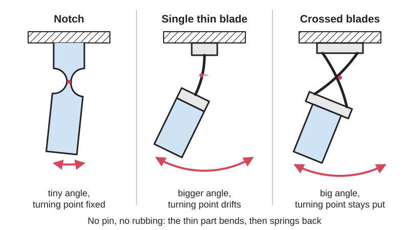
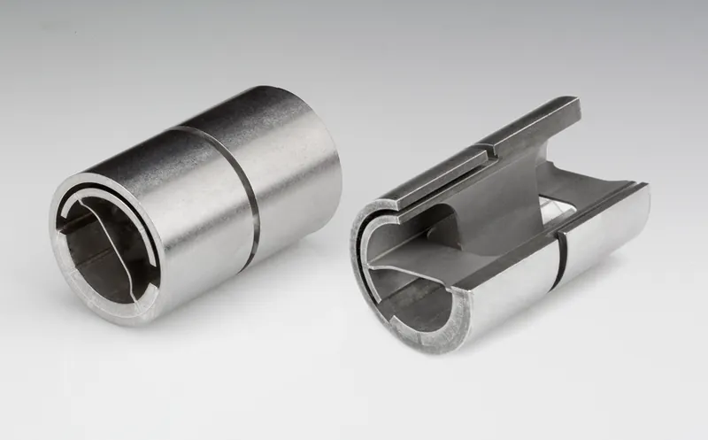
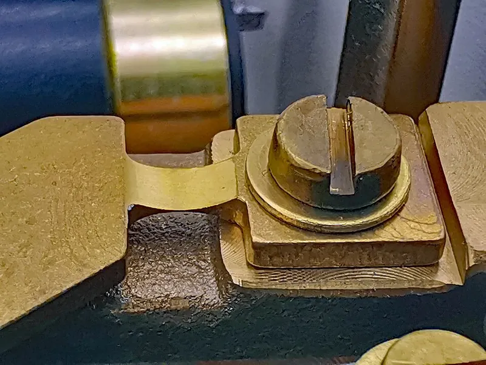

<figure class="eoc-pic eoc-pic-main"><picture><source media="(prefers-reduced-motion: reduce)" srcset="../media/drawn/flexure-hinge.svg"></picture><figcaption><strong>Animation.</strong> Diagram drawn for the encyclopaedia from the research notes. ⚑ Needs confirming: a drawing can simplify or get details wrong; a real photo or a better diagram is welcome.</figcaption></figure>
<figure class="eoc-pic"><figcaption><strong>Photo.</strong> <a href="https://commons.wikimedia.org/wiki/File:Flexure_pivot.png">Flexure pivot</a> by Ellen I. Williams, Richard T. Summers, and Miroslaw A. Ostaszewski, Public domain, from Wikimedia Commons.</figcaption></figure>
<figure class="eoc-pic"><figcaption><strong>How it works.</strong> <a href="https://commons.wikimedia.org/wiki/File:Sartorius_BP_160_P_6.jpg">Sartorius BP 160 P 6</a> by PaulT (Gunther Tschuch), <a href="https://creativecommons.org/licenses/by-sa/4.0">CC BY-SA 4.0</a>, from Wikimedia Commons.</figcaption></figure>

A pivot made from a deliberately thinned or crossed springy section that bends to let two parts rotate a small angle about each other, with no friction, [backlash](../glossary.md#backlash) or wear.

**In plain words:** A pivot with no pin: a thin or crossed springy strip joining two parts bends a little so one part can tilt or swing a few degrees, smoothly and with no rubbing, wobble or wear, and springs back when you let go. **Proper term:** [Flexure](../glossary.md#flexure) hinge (flexure pivot); main kinds: notch hinge, leaf-spring (blade) hinge and cross-axis flexural pivot (crossed-leaf or cross-spring pivot).

**Also called:** flexure pivot, flex pivot, flexural pivot, pivot bearing (trade terms); flexure bearing (Wikipedia 'Flexure bearing'); compliant joint or compliant revolute joint (compliant-mechanism term); notch hinge or notch flexure; circular, elliptical or corner-filleted notch hinge (by the shape of the cut-out; Linss, Henning and Zentner, IntechOpen); leaf-spring hinge, leaf-type hinge, blade flexure; cross-axis flexural pivot (CAFP), cross-spring pivot, crossed-leaf hinge, X-hinge (Akaki Kuumeri's name for a printed one); butterfly hinge or multi-trapezoidal hinge (a larger-angle variant; IntechOpen); suspension spring (the flexure a pendulum clock's pendulum hangs from); Free-Flex pivot (brand, Riverhawk) and C-Flex pivot bearing (brand); Festkoerpergelenk (German: 'solid-body joint'); [living hinge](../glossary.md#living-hinge) (sometimes used loosely for plastic flexure hinges, e.g. by Sharkey et al. 2016).

## How it works

Instead of a pin turning in a hole, the two parts are joined by a section that is much thinner than the rest, so all the bending happens there and the parts turn about it like a hinge (Wikipedia 'Flexure'; Sharkey et al. 2016). A short notch keeps the turning point almost fixed but allows only a few degrees; a longer thin blade allows more angle, but its turning point drifts as it bends; crossing two blades in an X gives a larger angle with a well-defined axis and good [stiffness](../glossary.md#stiffness) in the other directions (Linss et al., IntechOpen; BYU CMR). Because nothing slides, there is no friction, stiction, backlash or need for oil, and the bent section acts as a spring that pulls the part back to its rest position (Riverhawk; Physik Instrumente). The price is a small range of motion, set by how far the material can bend without taking a permanent bend or fatiguing (Wikipedia 'Flexure bearing').

## Parts

Single piece for notch and leaf-spring hinges, which are cut, moulded or printed into one block (e.g. the whole OpenFlexure microscope body with its hinges prints as one part). A few parts for a cross-axis pivot: two thin blades crossed in an X and fixed to the two parts; printed versions are two identical halves that clip together (BYU CMR), and bought pivots are two sleeves joined by flat springs crossed at 90 degrees (Riverhawk Free-Flex) or three leaf springs on two planes (C-Flex).

## Everyday examples

- Tweezers: two springy arms joined at one end, a common example of a flexure joint (German Wikipedia 'Festkoerpergelenk'; Wikimedia Commons photo)
- The thin metal ribbon that a pendulum clock's pendulum hangs from (suspension spring), used because it avoids the wobble of a conventional pivot (Wikipedia 'Pendulum clock')
- The weighing mechanism of a precision laboratory balance, built with thin notch hinges (Wikimedia Commons photo of a Sartorius BP 160 P balance)
- The rubber doughnut coupling (rag joint or giubo) on some car drive shafts, a flexure that bends in two directions (Wikipedia 'Flexure bearing')

## When to use it

Use a flexure hinge when you need a small, smooth, precise rotation with no play and no friction: tilting mirrors and optics, fine-adjustment levers, weighing and measuring mechanisms, joysticks and controllers that spring back to centre, grippers, and pivots in places where oil, wear particles or dirt are a problem (vacuum, clean rooms, outdoors). In 3D printing it replaces a sloppy printed pin joint with a crisp, rattle-free one that prints in place, and it gives a built-in return spring for free.

## When not to use it

Avoid it when you need a large angle or continuous rotation (use a pin hinge, a bearing or a living hinge for folding lids), when the joint carries heavy loads or shocks, when the part must stay deflected for long periods in plastic (it [creeps](../glossary.md#creep); use a metal flexure or a bearing with a separate spring), or when the extra returning force would be a nuisance. For a folding lid use a living hinge; for straight-line motion use a parallel leaf-spring flexure; for heavy, long-range rotation use ball bearings or bushings.

## Details

- **What it does (jobs):**
  - let it move (turn, slide or bend): a small, smooth, play-free rotation
  - line parts up exactly: it returns to the same spot every time, so it is used for precise alignment in instruments (Wikipedia 'Flexure')
  - store energy: the bent section is a spring that returns the part to centre
- **Movement:** flex (rotates by bending), over a small angle: aluminium notch hinges only a few degrees (Linss et al., IntechOpen); printed PLA notch hinges in the OpenFlexure microscope are limited to about 6 degrees (Sharkey et al. 2016); bought crossed-spring pivots from plus or minus 3.7 degrees to plus or minus 15 degrees for unlimited life and up to plus or minus 30 degrees before damage (C-Flex design guide), or up to 60 degrees in total (Riverhawk)
- **Directions it can move (degrees of freedom):** 1: rotation about the hinge axis, with the other directions held by the stiffness of the section. A notch flexure holds five directions and leaves one rotation free; a single thin blade holds only three, so it also bends sideways and twists easily (Wikipedia 'Flexure'), which is why blades are crossed or stacked to make a true one-axis pivot.
- **Special behaviour:**
  - self-aligning or self-centring: the springy section always pulls the part back to its rest position; flexural pivots are described as self-centring by both Riverhawk and C-Flex
  - none of the locking, one-way or clicking behaviours: it is a smooth, spring-return pivot
- **How it holds:**
  - not a holding joint (it moves or passes on motion): it guides a rotation
  - spring force (a spring or springy part presses it in place): the bent section pushes back towards the rest position
- **Input and output:** not applicable as a transmission on its own. Used as the fulcrum of a flexure lever it scales motion: e.g. Topias Korpi's printed flexure lever turns M3-screw movement into dial-gauge movement reduced about 10:1 to 15:1 (Hackaday, 2022), and Physik Instrumente uses flexure levers to multiply piezo travel up to 2 mm. Back-drivable: yes, it is a spring.
- **Power:** passive (no power needed)
- **Load:** light to medium. Bought steel crossed-spring pivots are very stiff sideways ([radial](../glossary.md#axial--radial) stiffness up to 100,000 lb/in) and carry radial loads up to 1,600 lb (about 7 kN) in the biggest sizes (Riverhawk); printed plastic hinges carry only light loads. Load capacity and stiffness fall as the rotation angle grows (C-Flex design guide; DSPE 'Infinity flexure'). A single blade is strong when pulled along its length, weaker when pushed (it can buckle) and weak against twisting (Wikipedia 'Flexure').
- **Play and precision:** none: no backlash, stiction or lost motion, so it can be adjusted in extremely fine steps (Riverhawk: increments of 0.00005 in; Physik Instrumente: guiding [accuracy](../glossary.md#repeatability--accuracy) of a few nanometres or microradians). The axis is not perfectly fixed: the turning point shifts sideways as it rotates (centre shift), zero at rest and growing with angle (C-Flex design guide); circular notches drift least, while corner-filleted notches and long blades allow more angle but drift more (Linss et al., IntechOpen). Printed plastic creeps, so the rest position can wander after it has been held bent (Akaki Kuumeri; Sharkey et al.). As a one-piece part it has no fitting [misalignment](../glossary.md#misalignment); clamped metal blades must be clamped square ⚑ [uncertain].
- **Taking it apart:** permanent for one-piece notch, leaf and printed hinges (they are part of the part); removable for crossed pivots that clip together (BYU CMR Cross-Axis Flexure Pivot), for metal blades clamped between blocks, and for bought pivot bearings that mount in a hole (C-Flex design guide)
- **How often it can be reused:** many times for clip-together, clamped and bought versions. The real limit is flex life, not taking it apart: effectively unlimited when the strain is kept low (a Riverhawk pivot was cycled over 12 billion times in twenty years; C-Flex rates 'indefinite life' below a set angle), but limited in 3D-printed plastic, which yields early and creeps (Akaki Kuumeri)
- **Sealing:** none
- **Adjustable:** No: stiffness and range are fixed by the section's thickness, length, width and material. You can limit travel with end stops (Akaki Kuumeri), and bought pivots come in thinner or thicker spring series: thinner springs give more range but less stiffness and load capacity (C-Flex design guide).
- **Access needed:** not applicable: it is built into the part (bought pivot bearings can mount in a blind hole; C-Flex design guide)
- **Materials:** Metal: stainless or spring-steel flat springs (AISI 420 in Riverhawk pivots), beryllium copper, titanium and Inconel for special pivots (Riverhawk; C-Flex); high-strength aluminium such as 7075 for machined notch hinges (Linss et al., IntechOpen). Plastic: polypropylene sheet gives BYU's cut FlexLinks pivots the best flexibility and [fatigue](../glossary.md#fatigue) life; PLA and ABS work in printed instruments (Sharkey et al.), and PLA+ was the most useful in Akaki Kuumeri's tests, with PETG said to yield later and creep less. Plastics bend further than metals of the same size, giving more range (Sharkey et al.), but creep.
- **Heat, cold, water and wear:** Metal flexures suit hostile places: they work underwater, in a vacuum and at high temperatures (Wikipedia 'Flexure bearing'); steel Riverhawk pivots are rated from -400 °F to +1200 °F and have no lubricant to outgas in space; flexure stages need no lubricants and work in vacuum (Physik Instrumente). Metals still fatigue and eventually snap if bent too far too often (Wikipedia 'Flexure bearing'). Printed plastic hinges: PLA softens from about 60 °C and PETG from about 80 °C (CNC Kitchen); plastic creeps and takes a set if left bent (Akaki Kuumeri), and printed OpenFlexure stages drift slowly after large moves because of creep (Sharkey et al.).

## Making it

- **Ways to make or get it:**
  - 3D print (FDM): one-piece notch and leaf hinges and clip-together crossed pivots (OpenFlexure microscope; BYU CMR; Akaki Kuumeri's controllers)
  - CNC: machined notch hinges in aluminium or steel; the most accurate flexure guides are cut by wire EDM (Physik Instrumente; Linss et al.)
  - laser cut: flat plastic flexures; BYU FlexLinks can also be milled, water-jet cut or CNC-routed from polypropylene sheet
  - sheet metal: spring-steel or beryllium-copper blades clamped between blocks, or a clock's suspension spring ⚑ [uncertain: no build guide opened]
  - off-the-shelf part: flexural pivot bearings (Free-Flex (brand), C-Flex (brand))
- **Printing it in one piece (print in place):** yes: notch and leaf hinges print as part of the mechanism with no assembly (the OpenFlexure microscope body, with all its hinges, prints as one piece without supports; Sharkey et al.). Crossed-blade pivots, whose blades cross in space, are often printed as two identical halves that clip together (BYU CMR Cross-Axis Flexure Pivot; layer.works 'Simplified Snap-Fit Flexure Pivot').
- **Tools:** none for printed one-piece or clip-together hinges; a screwdriver or hex key to clamp metal blades between blocks ⚑ [uncertain]; bought pivot bearings are fitted into a bore ⚑ [uncertain: fitting method not checked]
- **Difficulty:** easy to moderate: a printed notch or leaf hinge is just a thin wall and prints in place, but getting thickness, length and range right takes test prints, and plastic yields and creeps; precise, long-life metal pivots are easiest to buy ready-made

### 3D printing tips

1) Orient the flexure so it bends along the printed lines, not across layer joins. Two good options: (a) lay the flexure flat with its hinge axis horizontal, as OpenFlexure does, because a printer's layer height is thinner than its line width, so flat flexures can be thinner and stronger (Sharkey et al.); if it lies flat, make the lines run lengthwise along the flexure (Akaki Kuumeri); or (b) print the flexure as a thin standing wall with its hinge axis vertical, exactly two lines thick (Akaki Kuumeri: 'always printed vertically'; zalo's XY stage). Avoid a standing wall that bends about a horizontal axis, because the layers [peel](../glossary.md#peel-vs-shear) apart (Hubs advises against Z-direction [cantilevers](../glossary.md#cantilever)). 2) Starting sizes that worked: Akaki Kuumeri's 'flexure primitive' is 0.75 mm thick (two lines from a 0.4 mm nozzle), at least 10 mm wide (narrower twists too easily), at least 40 mm long (shorter doesn't bend well) and moved 5 mm at the tip; OpenFlexure's notch hinges are 0.72 mm thick, 1.5 mm long and 4 mm wide, bent no more than 6 degrees. 3) Check the strain before printing: the surface strain of a bent flexure is about thickness x angle (in radians) / (2 x length); OpenFlexure's 0.024 (2.4%) is already close to the yield strain of PLA and ABS (Sharkey et al.), so keep printed hinges at or below about that. 4) Add end stops so the hinge cannot be bent past its limit; OpenFlexure saw flexures snap only in designs where the motion was not constrained (Sharkey et al.; Akaki Kuumeri). 5) Design the hinge so it rests unbent, and never leave it under load: printed plastic creeps and won't return to centre after being held bent for a day (Akaki Kuumeri). 6) [Fillet](../glossary.md#chamfer--fillet) the corners where the flexure meets the stiff parts, and keep the print seam away from the flexure (use a seam painter or seam attractor) (Akaki Kuumeri; Line Arc Line). 7) Slicer settings for thin flexures: use the Classic perimeter generator rather than Arachne so the flexure is one or two clean lines (Line Arc Line), turn off 'detect thin walls' and set a 0.4 mm external perimeter, and check that two lines run along each flexure (zalo). 8) Materials: PLA or PLA+ is fine for light, occasional use (Akaki Kuumeri; Sharkey et al.); PETG or nylon for more flexing; PLA softens from about 60 °C (CNC Kitchen). 9) Crossed pivots: print two identical halves and clip them together with the clips at opposite ends (BYU CMR). 10) Print a small test piece first; OpenFlexure includes one to tune flexures and bridges for your printer (Sharkey et al.).

### Buying one (off-the-shelf parts)

Search for 'flexural pivot', 'flex pivot' or 'pivot bearing' (Free-Flex (brand, Riverhawk) in cantilevered single-ended and double-ended styles, 0.125-1 in diameter; C-Flex (brand) pivot bearings in 10, 20 and 30 spring series). For making your own: 'spring steel strip' or 'shim stock', 'beryllium copper strip' (see safety notes), 'polypropylene sheet' for cut plastic flexures (BYU FlexLinks), and 'clock suspension spring' from clock-parts suppliers ⚑ [uncertain: supplier pages not opened].

## Rules of thumb

- Surface strain in a bent flexure is about t x alpha / (2 L) (t thickness, L length, alpha bend angle in radians); 0.72 mm x 1.5 mm PLA hinges bent 6 degrees reach about 2.4% strain, close to the yield strain of PLA and ABS (Sharkey et al., Rev. Sci. Instrum. 87, 025104, 2016).
- Printed flexure starting point: 0.75 mm thick (two 0.4 mm lines), at least 10 mm wide, at least 40 mm long, about 5 mm tip movement; use end stops and never leave it loaded (Akaki Kuumeri, '3D Printed Flexures' slides).
- Aluminium (7075) notch hinges are limited to rotations of a few degrees; a circular notch gives the least axis drift but the smallest range, a corner-filleted notch the largest range (Linss, Henning and Zentner, IntechOpen 2019).
- Crossed-spring pivot bearings: indefinite life up to about half the angle that damages them, e.g. plus or minus 15 degrees versus 30 degrees (thin 10 series), plus or minus 7.5 versus 15 (20 series), plus or minus 3.7 versus 7.5 (thick 30 series); thinner springs give more range but less stiffness and load capacity (C-Flex design guide).
- Centre shift grows with rotation angle and pivot diameter, and is zero at the centre position (C-Flex design guide; Riverhawk).
- Keep cyclic stress low enough and a steel flexure can last effectively forever: a Riverhawk pivot ran over 12 billion cycles (Riverhawk engineering data).
- Ordinary flexure hinges lose stiffness in their supporting directions as they deflect, especially at large angles; special designs are needed beyond a few tens of degrees (DSPE 'Large range of motion flexure hinge: Infinity flexure').

## Common failures

Bent too far, so the material yields (takes a permanent bend) or snaps; add end stops and check the strain (Sharkey et al.; Akaki Kuumeri). Fatigue cracks at the thinnest point or at sharp corners after many cycles, especially in metals bent near their limit (German Wikipedia 'Festkoerpergelenk'; Wikipedia '[Compliant mechanism](../glossary.md#compliant-mechanism)'); fillet the corners and lower the angle. Creep in plastic: the hinge no longer returns to centre after being held bent (Akaki Kuumeri). Layer splitting when a printed flexure bends across layer joins (Hubs). A single blade twisting or buckling under side or compressive loads (Wikipedia 'Flexure'). Loss of support stiffness and axis shift at large angles (DSPE; C-Flex). Seams, blobs or stray [infill](../glossary.md#infill) lines on a printed flexure make it stiff or weak (Akaki Kuumeri; zalo).

## Safety

Generally low risk. Printed flexures bent past their limit snap suddenly (Sharkey et al.). Beryllium-copper flexure material is safe to handle, but breathing its dust or fumes can cause chronic beryllium disease (Wikipedia 'Beryllium copper'), so never grind, sand or machine it without proper controls. Thin spring-steel blades can have sharp edges ⚑ [uncertain].

## Related

- Living hinge: a thin plastic web used to fold lids through large angles for a limited life, rather than for precise, small-angle pivots
- Parallel leaf-spring flexure (linear flexure stage): two or more flexures arranged as a parallelogram to give straight-line motion instead of rotation
- [Print-in-place](../glossary.md#print-in-place) hinge: a printed pin-and-knuckle hinge with unlimited angle but with play and friction
- Ball bearing or plain bushing: for large angles, continuous rotation and heavy loads, at the cost of friction and play
- Knife-edge pivot: the most accurate balances and [regulator](../glossary.md#regulator) clocks pivot on hardened knife edges instead of a spring (Wikipedia 'Pendulum clock')
- [Bistable](../glossary.md#bistable) compliant mechanism: flexure hinges arranged to snap between two stable positions
- Compliant gripper and force amplifier: whole mechanisms built from flexure hinges
- [Torsion](../glossary.md#torsion) bar or torsion spring: twisting rather than bending gives the rotation

## Make it yourself

- [Cross-Axis Flexure Pivot (BYU CMR, Printables)](https://www.printables.com/model/576067-cross-axis-flexure-pivot): Two identical printed parts that clip together to form a crossed-blade pivot that replaces a pin joint; stack two at right angles for a two-axis joint. Includes references to the Jensen and Howell (2002) modelling paper. Read through the Printables public API. *(licence: CC BY-NC (Creative Commons Attribution-NonCommercial))*
- [FlexLinks: Cross-Axis Flexural Pivot (BYU CMR, Printables)](https://www.printables.com/model/569143-flexlinks-cross-axis-flexural-pivot): A LEGO-compatible crossed flexure pivot for prototyping compliant mechanisms; can be printed, milled, water-jet or CNC-router cut, best from polypropylene sheet (two 1/8 in layers). Read through the Printables public API. *(licence: CC BY-NC (Creative Commons Attribution-NonCommercial))*
- [Simplified Snap-Fit Flexure Pivot (layer.works, Printables) (URL from Printables API, page not opened)](https://www.printables.com/model/174512-simplified-snap-fit-flexure-pivot): A slimmed-down remix of a BYU CMR crossed flexure pivot: print two identical parts and snap them together; prints well in PLA. Read through the Printables public API. *(licence: CC BY-NC (Creative Commons Attribution-NonCommercial))*
- [OpenFlexure Microscope (OpenFlexure project)](https://openflexure.org/projects/microscope/): An open-source 3D-printed microscope whose stage and focus move on printed plastic flexure hinges, with build instructions and files *(licence: CC BY-SA 4.0)*

## Pictures, videos and models

- [Flexure pivot.png (Wikimedia Commons, NASA Space Mechanisms Project)](https://commons.wikimedia.org/wiki/File:Flexure_pivot.png): A Riverhawk Free-Flex crossed-spring flexure pivot, used in place of bearings in precision alignment mechanisms and scientific instruments *(licence: Public domain (NASA work))*
- [Sartorius BP 160 P 6.jpg (Wikimedia Commons, by PaulT / Gunther Tschuch)](https://commons.wikimedia.org/wiki/File:Sartorius_BP_160_P_6.jpg): Close-up of one of the thin notch flexure hinges inside a precision laboratory balance *(licence: CC BY-SA 4.0)*
- [Why Machines That Bend Are Better (YouTube, Veritasium)](https://www.youtube.com/watch?v=97t7Xj_iBv0): Veritasium visits BYU's Compliant Mechanisms Research group; demonstrations of flexure-based mechanisms that replace pins and bearings *(licence: link only (standard YouTube licence))*
- [Triple crossed flexure pivot (TRIVOT) compliant mechanism (YouTube, Instant-Lab)](https://www.youtube.com/watch?v=rUH3cDmeXC4): Video of a large-angle crossed-blade flexure pivot in motion *(licence: link only (standard YouTube licence))*
- [Building Prototypes Dan Gelbart part 10 of 18 Flexures (YouTube, Dan Gelbart)](https://www.youtube.com/watch?v=PaypcVFPs48): A prototyping engineer demonstrates practical metal and printed flexure hinges and levers *(licence: link only (standard YouTube licence))*

## Needs confirming

⚑ marks something nobody has confirmed yet: a fact the research could not confirm from a source, a finder value that is a best guess, or an open point from the research notes. Corrections are welcome (see `research/needs-confirming.md`).

- ⚑ 6 sentences on this page marked [uncertain].
- ⚑ Finder value `connects` = lid, door or cover (best guess): worked out from its name, but joining parts is not one of its two main jobs
- ⚑ Finder value `tools` = none, hand tools (source uncertain): `tools_needed` is marked ⚑ [uncertain] here: "…hinges; a screwdriver or hex key to clamp metal blades between blocks ⚑ [uncertain]; bought pivot bearings are f…"

## Sources

- <https://en.wikipedia.org/wiki/Flexure>
- <https://en.wikipedia.org/wiki/Flexure_bearing>
- <https://en.wikipedia.org/wiki/Compliant_mechanism>
- <https://en.wikipedia.org/wiki/Pendulum_clock>
- <https://en.wikipedia.org/wiki/Beryllium_copper>
- <https://en.wikipedia.org/wiki/Freedom_and_constraint_topologies>
- <https://de.wikipedia.org/wiki/Festkörpergelenk>
- <https://commons.wikimedia.org/wiki/File:Flexure_pivot.png>
- <https://commons.wikimedia.org/wiki/File:Sartorius_BP_160_P_6.jpg>
- <https://commons.wikimedia.org/wiki/File:Risorta_pinchilo.jpg>
- <https://kalab.emma.cam.ac.uk/pdfs/Sharkey2016.pdf>
- <https://arxiv.org/abs/1509.05394>
- <https://www.intechopen.com/chapters/66493>
- <https://www.dspe.nl/knowledge/dppm-cases/large-range-of-motion-flexure-hinge-infinity-flexure/>
- <https://www.flexpivots.com/free-flex-flexural/>
- <https://direct.daitron.co.jp/pdf/Riverhawk-FlexuralPivotEngineeringData.pdf>
- <https://c-flex.com/products/pivot-bearings/>
- <https://c-flex.com/wp-content/uploads/2024/10/DESIGN-GUIDE.pdf>
- <https://www.physikinstrumente.com/en/expertise/technology/guiding-systems-force-transmission/flexure-stages>
- <https://s3files.core77.com/images/c77_webinar_series/Akaki-Kuumeri-3D-printed-flexures.pdf>
- <https://hackaday.com/2022/06/03/3d-printed-flexture-shows-precision-in-action/>
- <https://www.hubs.com/knowledge-base/how-design-snap-fit-joints-3d-printing/>
- <https://www.cnckitchen.com/blog/comparing-pla-petg-amp-asa-feat-prusament>
- <https://openflexure.org/projects/microscope/>
- <https://api.printables.com/graphql/>
- <https://www.printables.com/model/576067-cross-axis-flexure-pivot>
- <https://www.printables.com/model/569143-flexlinks-cross-axis-flexural-pivot>
- <https://www.printables.com/model/77081-xy-flexure-translation-stage>
- <https://scholarsarchive.byu.edu/facpub/6578>
- <https://www.youtube.com/watch?v=97t7Xj_iBv0>
- <https://www.youtube.com/watch?v=rUH3cDmeXC4>
- <https://www.youtube.com/watch?v=PaypcVFPs48>
- <https://www.youtube.com/watch?v=K0wr_ZhhtbE>
