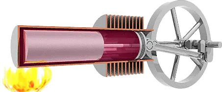
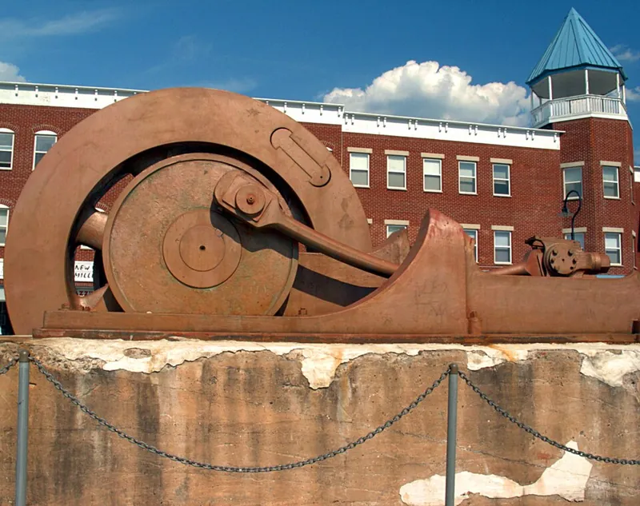
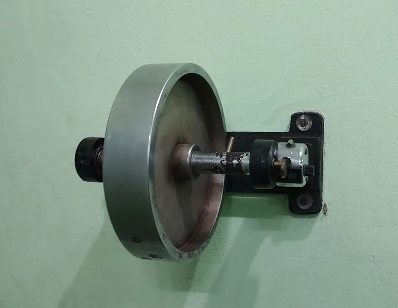

<figure class="eoc-pic eoc-pic-main"><picture><source media="(prefers-reduced-motion: reduce)" srcset="../media/flywheel-b9df00.still.webp"></picture><figcaption><strong>Animation.</strong> <a href="https://commons.wikimedia.org/wiki/File:Beta_stirling_animation.gif">Beta stirling animation</a> by Van helsing, <a href="https://creativecommons.org/licenses/by/2.5">CC BY 2.5</a>, from Wikimedia Commons.</figcaption></figure>
<figure class="eoc-pic"><figcaption><strong>How it works.</strong> <a href="https://commons.wikimedia.org/wiki/File:Flywheel_from_old_factory.jpg">Flywheel from old factory</a> by unknown, Public domain, from Wikimedia Commons.</figcaption></figure>
<figure class="eoc-pic"><figcaption><strong>Photo.</strong> <a href="https://commons.wikimedia.org/wiki/File:Flywheel_(2).jpg">Flywheel (2)</a> by Al Riaz Uddin, <a href="https://creativecommons.org/licenses/by-sa/4.0">CC BY-SA 4.0</a>, from Wikimedia Commons.</figcaption></figure>

A flywheel is a heavy wheel on a shaft that stores energy as spin, so it evens out jerky turning, carries a [crank](../glossary.md#crank) past the points where it can't be pushed round, and keeps a machine or toy going for a while after the push stops.

**In plain words:** A heavy wheel that, once spun, wants to keep spinning: it soaks up bursts of turning effort and hands them back, so a hand crank, foot pedal or one-cylinder engine keeps turning smoothly past its stuck points, and a toy car keeps rolling after you stop pushing. **Proper term:** Flywheel (inertia wheel); in toys, the friction motor.

**Also called:** inertia wheel; rimmed flywheel (a heavy rim joined to a hub by spokes) and solid-disc flywheel (Wikipedia 'Flywheel'); friction motor: a large flywheel geared to the drive wheels of toy cars, trucks and trains, wound up by pushing the toy along (Wikipedia 'Friction motor'); kick wheel: the heavy foot-spun flywheel under a potter's wheel; 'fast wheel', the ancient potter's wheel that 'operated on the flywheel principle' (Explain that Stuff; Wikipedia 'Potter's wheel'); weighted flywheel of an indoor 'spinning' exercise bike (Wikipedia 'Stationary bicycle'); dual-mass flywheel (car engines; Wikipedia 'Flywheel', see also); flywheel energy storage (FES), 'flywheel battery' (Wikipedia 'Flywheel energy storage'); reaction wheel, control moment gyroscope: a flywheel used to hold or change the direction something points rather than to store energy (Wikipedia 'Flywheel energy storage'); gyroscope rotor, heavy-rim rotor (desk gyroscopes; Printables 1800233); fidget spinner (weighted lobes on a ball bearing; Wikipedia 'Fidget spinner'); spoked flywheel, handwheel (machine-guarding wording; OSHA).

## How it works

A spinning wheel stores energy of movement (kinetic energy) equal to half its moment of inertia times its speed squared (½Iω²), and it resists being sped up or slowed down (Wikipedia 'Flywheel'). When the drive pushes harder than the load needs, the wheel speeds up slightly and soaks up the extra; when the push fades, as at a crank's dead centre where pushing straight along the rod gives no turning force, it slows slightly and gives the energy back, so the shaft keeps turning (Wikipedia 'Flywheel'; 'Dead centre (engineering)'). Mass near the rim counts most: a thin ring has about twice the inertia of a solid disc of the same mass and radius (mr² against ½mr²; Wikipedia 'Flywheel'), and spinning twice as fast stores four times the energy, while a rim twice as heavy only stores twice as much (Explain that Stuff). In a friction-motor toy, pushing the car spins a large flywheel through gears so it turns much faster than the wheels; let go and the flywheel drives the car (Wikipedia 'Friction motor').

## Parts

Single piece or a few parts: the wheel (a solid disc, or a heavy rim joined to a hub by spokes or a web), its shaft or axle, and bearings (Wikipedia 'Flywheel'). A friction motor adds a gear train to the drive wheels and sometimes a one-way clutch (Wikipedia 'Friction motor'). Printed flywheels usually add metal weights in the rim, such as coins, nuts or large washers (Printables 973796, 187860).

## Everyday examples

- A friction-powered toy car or truck: push it along a few times and it races off by itself (Wikipedia 'Friction motor')
- A potter's kick wheel, or a fidget spinner with weights in its arms (Wikipedia 'Potter's wheel', 'Fidget spinner')
- The heavy front wheel of an indoor spinning bike (Wikipedia 'Stationary bicycle')
- The big wheel on the crankshaft of a car engine, a tractor or a treadle sewing machine (Wikipedia 'Flywheel', 'Treadle')

## When to use it

Use a flywheel when the push comes in pulses but you want smooth turning: a single-piston model engine, a Stirling engine, a hand crank or a foot treadle driving a crank, where the flywheel carries the crank past its dead centres (Wikipedia 'Dead centre (engineering)'; Thang, 'Pottery wheel 1', 'Hand powered machine'); a mechanism that turns stop-start motion into continuous rotation (Thang, 'Mechanism for converting interrupted rotation to continuous rotation 1'); a turntable or wheel that should keep going while your hands are busy (potter's wheel; Wikipedia 'Potter's wheel'); a toy that should keep rolling after a push (friction motor); or a small source that must deliver a short, strong burst, as in power hammers (Wikipedia 'Flywheel'). It also makes spinning toys and desk gyroscopes resist tilting (Printables 1800233).

## When not to use it

Not when the machine must stop or reverse quickly: the stored spin fights you, so use a light rotor and a brake. Not for storing energy for long: a flywheel runs down (energy-storage flywheels on ordinary bearings can lose 20-50% in two hours; Wikipedia 'Flywheel energy storage'), so use a wound spring (spiral power spring, as in pull-back cars), a raised weight or a battery. Not in something you carry and turn, or in a light vehicle, without thinking about the gyroscopic effect, which resists changes of direction (Wikipedia 'Flywheel energy storage'; Explain that Stuff). Never as a high-speed energy store at home or in printed plastic: the burst risk rises with the square of speed (Wikipedia 'Flywheel'). To limit speed rather than smooth it, use a speed governor; to soak up vibration at one frequency, use a tuned mass damper.

## Details

- **What it does (jobs):**
  - store energy: holds the energy of a push, pedal [stroke](../glossary.md#stroke) or power stroke as spin and gives it back later, or releases it in a short burst faster than the source could (power hammers, riveting machines; Wikipedia 'Flywheel')
  - slow it, stop it or keep its speed steady: evens out speed, smoothing 'sufficiently small deviations' like a low-pass filter on speed (Wikipedia 'Flywheel')
- **Movement:** rotate: continuous rotation about its own axis, any number of turns
- **Directions it can move (degrees of freedom):** 1: the wheel only turns on its shaft; its bearings block every other movement. A desk gyroscope adds gimbal pivots so the spinning wheel's axis can also tilt (Printables 1800233).
- **Special behaviour:**
  - none of the listed behaviours: its trick, storing energy as spin and evening out speed, is not on this list. A spinning flywheel also acts as a gyroscope and resists being tilted, which lets a coin-flywheel toy car 'do tricks and drive on 2 wheels' (Printables 973796; Wikipedia 'Flywheel energy storage')
  - one-way (moves freely one way, locks the other): only in some friction motors, where a one-way clutch in the gears stops the toy being wound backwards (Wikipedia 'Friction motor'); a pedal potter's wheel uses an overrunning clutch so the wheel can coast (Thang, 'Pottery wheel 2')
- **How it holds:**
  - not a holding joint (it moves or passes on motion): it stores and smooths rotation. The wheel itself is fixed to its shaft by a key, [set screw](../glossary.md#set-screw), clamp or press fit (see Shaft-to-hub joints), or by crush ribs on a printed axle (Printables 1800233)
- **Input and output:** Rotation -> the same rotation, smoothed: on its own shaft the ratio is 1:1 and in line. In a friction motor a gear train with 'very low [gear ratio](../glossary.md#gear-ratio)' steps the speed up so the flywheel revolves 'much faster than the wheels', and the flywheel's axis lies across the toy's direction of travel (Wikipedia 'Friction motor'); the one in the Commons photo uses three gears (Wikimedia Commons 'Friction motor.jpg'). Back-drivable: yes, by design: the load drives the flywheel while you push, and the flywheel drives the load when you let go. Losses: bearing friction and air drag make it run down; energy-storage flywheels on mechanical bearings 'can lose 20% to 50% of their energy in two hours' (Wikipedia 'Flywheel energy storage'), and a fidget spinner's speed falls away exponentially (Wikipedia 'Fidget spinner'). A round-trip efficiency figure for small toys was not found ⚑ [uncertain].
- **Power:** passive (no power needed) for hand-, foot- and push-driven flywheels; a motor-driven flywheel needs power to spin up. When the power is cut it keeps its last state, carrying on spinning until friction stops it, which is the point of a flywheel but also means it is still dangerous after switch-off.
- **Load:** Light (toys, models, fidget spinners) to heavy (engine and press flywheels). The important load is the outward pull that spinning puts on the rim (hoop stress), which rises with the square of speed (ρr²ω²; Wikipedia 'Flywheel'), so twice the speed means four times the stress; when it passes the material's tensile strength 'the flywheel will break apart' (Wikipedia 'Flywheel'). It also loads its shaft and bearings with its weight, with shaking from any imbalance, and with a strong twist ([torque](../glossary.md#torque)) whenever it is suddenly started or stopped.
- **Play and precision:** Not used for locating, but it must run true and balanced: an unbalanced flywheel shakes its bearings, and in large rotors the imbalance after a piece breaks off 'may lead to rapid bearing failure from vibration' (Wikipedia 'Flywheel energy storage'). Make every weight pocket carry the same mass (Printables 973796). A loose fit on the shaft lets it wobble or slip; a printed rotor can be gripped by crush ribs and tested first with a fit coupon (Printables 1800233).
- **Taking it apart:** removable: the wheel comes off its shaft by undoing its key, set screw or clamp; printed toys snap together and apart without glue or screws (Printables 973796)
- **How often it can be reused:** effectively unlimited: it is a moving part rather than a joint and is spun up and down endlessly; the bearings wear and need replacing (large energy-storage flywheels have their bearings replaced every five to ten years; Wikipedia 'Flywheel energy storage')
- **Sealing:** none: it is not a sealing part
- **Adjustable:** Yes, before use: add or remove rim weights to change its inertia, e.g. coin holders for 14-20 mm coins (Printables 973796) or large flat washers instead of nuts (Printables 187860). While running its inertia is fixed, apart from rare variable-inertia designs whose weights fold in and out (Explain that Stuff, describing a 1959 patent by Bertram Schmidt).
- **Access needed:** end of a tube or shaft: it slides onto the end of its shaft and is fixed there
- **Materials:** Steel and cast iron (old steam engines), cast or nodular iron, steel or aluminium (car engines), lead (small toy flywheels), and carbon-fibre composites for very fast energy-storage rotors (Wikipedia 'Flywheel'); some kick wheels are concrete (Explain that Stuff). Printed flywheels: a PLA, PETG or PCTG hub and rim carrying coins, steel nuts or washers (Printables 973796, 187860), or a PLA rotor printed at 50% [infill](../glossary.md#infill) or more (Printables 1800233).
- **Heat, cold, water and wear:** Heat: printed rotors soften, PLA at about 60 °C and PETG at about 80 °C (CNC Kitchen), so keep them away from engines and hot sun. [Fatigue](../glossary.md#fatigue): aluminium flywheels 'can develop microfractures from repeated low-energy stretching', and cast metal fails at its grain boundaries (Wikipedia 'Flywheel energy storage'); a printed rim spun often and fast may likewise crack or [creep](../glossary.md#creep) over time ⚑ [uncertain]. Flywheels themselves are 'not as adversely affected by temperature changes' as batteries (Wikipedia 'Flywheel energy storage'). Dust, dry or cold bearings and air drag make it run down sooner; low-friction bearings let large flywheels keep their energy for days (Explain that Stuff).

## Making it

- **Ways to make or get it:**
  - 3D print (FDM): hubs and rims with pockets for metal weights, toy cars and desk gyroscopes (Printables 973796, 187860, 1800233)
  - off-the-shelf part: cast-iron or steel flywheels and handwheels, ball bearings, and washers, coins, nuts or steel balls used as rim weights (Printables 187860)
  - CNC: turned steel or brass flywheels for model engines ⚑ [uncertain]
  - woodwork: plywood or hardwood discs, e.g. for a home-made kick wheel ⚑ [uncertain]
  - laser cut: stacked plywood or acrylic discs with metal weights ⚑ [uncertain]
- **Printing it in one piece (print in place):** partly: printed flywheel toys are separate parts that snap together without glue or screws but need added coins and rubber-band or TPU tyres (Printables 973796); the rotor is one printed part, with metal mass added (Printables 187860) or printed solid enough to be heavy (Printables 1800233).
- **Tools:** To fit a metal flywheel: a spanner or Allen key for its hub fixing (set screw, key or clamp). Printed toys: none, they snap together, plus light general-purpose oil for the pivots and matched coins for the rim (Printables 973796). Turning a large stopped engine off dead centre may need a lever or 'turning bar' (Wikipedia 'Dead centre (engineering)').
- **Difficulty:** easy for a hand-spun, string-pulled or push-along toy: print a hub with pockets for coins or washers (Printables 973796, 187860). Moderate to hard for anything motor-driven or large: it needs balancing, a secure hub fixing, good bearings and a guard (OSHA 1910.219).

### 3D printing tips

1) Put the mass at the rim: plastic is light, so give the rim pockets or a channel for coins, steel nuts, washers or steel balls; a ring of mass has about twice the inertia of the same mass spread as a disc (Wikipedia 'Flywheel'). One remix swapped a few nuts for large flat washers (2 in outside, 1/2 in hole) (Printables 187860); the coin car takes 14-20 mm coins (Printables 973796). 2) Balance it: every pocket must carry the same mass; the coin-car designer says to make all four groups of coins weigh the same and warns that US pennies from before 1982 are heavier (Printables 973796). 3) Capture the weights so they can't be thrown out: enclose them under a printed lid or glue them in ⚑ [uncertain]. 4) No weights? Print the rotor dense: 'rotor in PLA at 50 percent infill or more - the flywheel wants mass, a hollow rotor spins down at once' (Printables 1800233). 5) Orientation: print the disc flat on the bed so the outward pull runs along the layers rather than trying to split them; CNC Kitchen measured layer bonds at only 55% (PLA) and 46% (PETG) of the in-layer strength. 6) Hub fit: a press fit on crush ribs with a cam-in ramp works; print a short fit coupon first and adjust the rib diameter if the rotor is too tight or slips (Printables 1800233). 7) Bearings: one designer prints the flywheel bearings in vase mode with two 0.2 mm base layers in a higher-melting plastic (PCTG rather than PLA), uses dry filament for smooth pivots and oils every spinning part (Printables 973796). A 608 skateboard bearing is the usual bought alternative ⚑ [uncertain]. 8) Gears for a friction motor: fine teeth on the bed get spoiled by [elephant's foot](../glossary.md#elephants-foot), so turn on elephant-foot compensation; a coarser, deeper tooth works better (Printables 187860). 9) Speed: keep printed flywheels to hand, string or push speeds; never spin one up with a drill, rotary tool or fast motor (see safety_notes). 10) Heat: PLA gives at about 60 °C and PETG at 80 °C (CNC Kitchen), so keep printed rotors away from engines and heaters.

### Buying one (off-the-shelf parts)

Search terms: 'flywheel' (cast iron or steel, with a bore and keyway or set screw, for engines, models and machines); 'handwheel' (a spoked or disc wheel with a handle that also acts as a flywheel); 'friction motor' for toys (Wikipedia 'Friction motor'); 'ball bearing', e.g. a 608 skateboard bearing, for printed spinners ⚑ [uncertain]; 'shaft collar' and 'set screw hub' to fix it; 'flat washer' or 'fender washer', coins and steel balls as rim weights (Printables 187860, 973796); 'flywheel puller' (tool for removing a tight engine flywheel) ⚑ [uncertain].

## Rules of thumb

- Stored energy is ½Iω²; a solid disc has I = ½mr², a thin rim about mr², so the same mass at the rim stores up to twice as much (Wikipedia 'Flywheel').
- Twice the rim mass stores twice the energy at the same speed; twice the speed stores four times the energy (Explain that Stuff).
- Rim stress (hoop stress) is about ρr²ω², density x radius² x speed², so stress also goes with the square of speed and the material's strength-to-density ratio sets the limit; a typical flywheel has a shape factor of 0.3 (Wikipedia 'Flywheel').
- Sizing for smooth running: inertia J = U / (ω_avg² x Cs), where U is the energy swing per cycle and Cs = (ω_max - ω_min) / ω_avg; suggested Cs: very uniform <= 0.003, moderately uniform 0.003-0.012, some variation acceptable 0.012-0.05, moderate variation 0.05-0.2, large variation acceptable >= 0.2 (Engineers Edge).
- Ordinary steel flywheels on conventional bearings are limited to a few thousand rpm; carbon-fibre rotors on magnetic bearings reach up to 60,000 rpm (Wikipedia 'Flywheel').
- Guarding (US workplace rule): a flywheel with any part 7 ft (2.1 m) or less above the floor must be enclosed in sheet, perforated or expanded metal or woven wire, or fenced with guard rails 15-20 in (380-510 mm) from the rim (OSHA 1910.219(b)(1)).
- Printed rotors without metal weights: 50% infill or more (Printables 1800233).
- Friction motors gear the flywheel up so it spins much faster than the wheels (Wikipedia 'Friction motor').

## Common failures

1) Too little inertia: mass close to the hub, or a hollow printed rotor, 'spins down at once' (Printables 1800233); move the mass to the rim (Wikipedia 'Flywheel'). 2) Imbalance: unequal weights make it shake and wear its bearings (Printables 973796; Wikipedia 'Flywheel energy storage'); weigh the weights. 3) Slipping or wobbling on the shaft: the press fit is too loose; adjust the crush ribs or add a drop of CA glue on one rib (Printables 1800233). 4) Friction and binding: printed bearings bind when the car body is squeezed unless a roof braces it, and damp filament makes rough pivots (Printables 973796); oil every spinning part. 5) Fine gear teeth in a printed friction motor jam or strip (Printables 187860). 6) Bursting from over-speed, or fatigue cracks in metal rotors (Wikipedia 'Flywheel', 'Flywheel energy storage'). 7) A single-cylinder engine that stops on dead centre won't restart until the flywheel is turned off it by hand (Wikipedia 'Dead centre (engineering)').

## Safety

Bursting: rotation energy can be stored 'until the rotor shatters', when the hoop stress exceeds the material's tensile strength (Wikipedia 'Flywheel'), and high-performance flywheels 'can explode, injuring bystanders with high-speed fragments' (Wikipedia 'Flywheel energy storage'). Because stress grows with the square of speed, never over-speed a printed flywheel: spin it by hand, string or push, never with a drill, rotary tool or fast motor. Guard any motor-driven flywheel with an enclosure strong enough to catch fragments and hold the wheel if its shaft or mounting fails; big systems use strong containment or are buried (Wikipedia 'Flywheel energy storage'; OSHA 1910.219(b)(1)(vi)). Entanglement: 'even smooth, slowly rotating shafts can grip hair and clothing', and spoked flywheels form nip points with fixed parts (OSHA Machine Guarding eTool), so tie back hair and keep sleeves clear. It keeps turning after the power is cut, so wait for it to stop. Turning a stopped engine off dead centre by hand must be done 'with care to avoid the operator becoming entangled in the machinery' (Wikipedia 'Dead centre (engineering)'). Coins, nuts or balls in a printed rim can be thrown out if they are not captured ⚑ [uncertain].

## Related

- Spiral power spring (clock spring): stores energy in a wound spring, as in pull-back toy cars; unlike a friction motor it can't be 'pumped up' by pushing repeatedly (Wikipedia 'Friction motor')
- Speed governor (fly fan, centrifugal governor): limits speed with air drag or weights rather than storing energy
- Tuned mass damper: a mass on a spring tuned to absorb vibration at one frequency
- Slider-crank and Scotch yoke: crank mechanisms that need a flywheel to carry them past their dead centres
- Roller clutch (one-way bearing): lets a flywheel [freewheel](../glossary.md#freewheel) ahead of its drive, as in some friction motors and pedal potter's wheels
- Friction brake and Eddy-current brake: stop a flywheel or load it, as on exercise bikes (resistance by magnets, fans or friction; Wikipedia 'Stationary bicycle')
- Centrifugal clutch and Friction clutch: engine flywheels usually carry the clutch
- Shaft-to-hub joints (key, set screw, D-flat, clamp hub): how the flywheel is fixed to its shaft
- Plain pivot and rolling bearing: what it spins on; bearing friction decides how long it keeps going
- Coil spring, Gas spring and Constant-force spring: other ways to store energy, which hold it until released instead of running down

## Make it yourself

- [Coin Flywheel Toy Car (Keenan Finucan, Printables) (URL from Printables API, page not opened)](https://www.printables.com/model/973796-coin-flywheel-toy-car): A snap-together toy car with a coin-weighted flywheel (14-20 mm coins), no glue or screws; gyroscopic effect lets it drive on two wheels *(licence: CC BY)*
- [Flywheel vehicle "remix of #3566283" (robothut, Printables) (URL from Printables API, page not opened)](https://www.printables.com/model/187860-flywheel-vehicle-remix-of-3566283): A geared flywheel-powered car that uses large flat washers as flywheel mass; all parts print without supports *(licence: CC BY)*
- [Desk Gyroscope - two-axis gimbal flywheel (Miloslav Brožek, Printables) (URL from Printables API, page not opened)](https://www.printables.com/model/1800233-desk-gyroscope-two-axis-gimbal-flywheel-a-toy-not): A heavy-rim printed flywheel in a two-axis gimbal, string-pulled, no hardware; parametric .scad with all clearances named *(licence: CC BY)*

## Pictures, videos and models

- [File:Spoked flywheel animation.gif (Wikimedia Commons, from OSHA's machine-guarding eTool)](https://commons.wikimedia.org/wiki/File:Spoked_flywheel_animation.gif): Animation of a spinning spoked flywheel: heavy rim, spokes and hub *(licence: Public domain (US Government, OSHA))*
- [File:Friction motor.jpg (Wikimedia Commons, used on Wikipedia 'Friction motor')](https://commons.wikimedia.org/wiki/File:Friction_motor.jpg): Inside a toy car's friction motor: the drive wheels connect through three gears to a flywheel that keeps the car moving after release *(licence: CC BY-SA 4.0 (MattGiuca))*
- [File:Leonardo-Flywheel.ogv (Wikimedia Commons, video used on Wikipedia 'Flywheel')](https://commons.wikimedia.org/wiki/File:Leonardo-Flywheel.ogv): Video of a flywheel with spherical weights on its arms, built from Leonardo da Vinci's drawings (Berlin exhibition, 2005) *(licence: Public domain (Erik Möller))*
- [File:Landini VL30(Italien)2.JPG (Wikimedia Commons, used on Wikipedia 'Flywheel')](https://commons.wikimedia.org/wiki/File:Landini_VL30(Italien)2.JPG): An old single-cylinder Landini tractor with its large flywheel clearly visible on the side *(licence: Public domain (Späth Chr.))*
- [Pottery wheel 1 (Nguyen Duc Thang, thang010146, YouTube; title confirmed through YouTube oEmbed, video not watched)](https://www.youtube.com/watch?v=P-xT0xrK6AE): CAD animation of a foot-pedalled potter's wheel kept turning by flywheel inertia, with the dead point overcome by hand at the start (Thang, 2700 Animated Mechanical Mechanisms part 2, p. 158) *(licence: link only (standard YouTube licence))*

## Needs confirming

⚑ marks something nobody has confirmed yet: a fact the research could not confirm from a source, a finder value that is a best guess, or an open point from the research notes. Corrections are welcome (see `research/needs-confirming.md`).

- ⚑ 10 sentences on this page marked [uncertain].
- ⚑ Research note: *Flywheel*: 6 fields are marked [uncertain].

## Sources

- <https://en.wikipedia.org/wiki/Flywheel>
- <https://en.wikipedia.org/wiki/Friction_motor>
- <https://en.wikipedia.org/wiki/Flywheel_energy_storage>
- <https://en.wikipedia.org/wiki/Dead_centre_(engineering)>
- <https://en.wikipedia.org/wiki/Fidget_spinner>
- <https://en.wikipedia.org/wiki/Potter%27s_wheel>
- <https://en.wikipedia.org/wiki/Treadle>
- <https://en.wikipedia.org/wiki/Stationary_bicycle>
- <https://www.explainthatstuff.com/flywheels.html>
- <https://www.engineersedge.com/mechanics_machines/flywheel_mass_size_design_13981.htm>
- <https://www.osha.gov/laws-regs/regulations/standardnumber/1910/1910.219>
- <https://www.osha.gov/etools/machine-guarding/introduction/hazardous-motions-actions>
- <https://cs448m.github.io/lectures/machines/doc/2.pdf>
- <https://www.cnckitchen.com/blog/comparing-pla-petg-amp-asa-feat-prusament>
- <https://commons.wikimedia.org/wiki/File:Spoked_flywheel_animation.gif>
- <https://commons.wikimedia.org/wiki/File:Friction_motor.jpg>
- <https://commons.wikimedia.org/wiki/File:Leonardo-Flywheel.ogv>
- <https://commons.wikimedia.org/wiki/File:Landini_VL30(Italien)2.JPG>
- <https://www.youtube.com/watch?v=P-xT0xrK6AE>
- <https://api.printables.com/graphql/>
