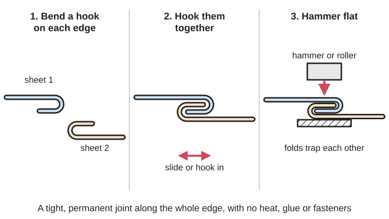
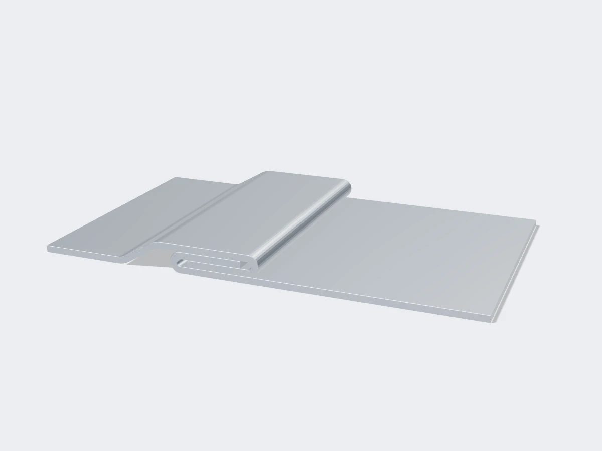

<figure class="eoc-pic eoc-pic-main"><figcaption>Diagram drawn for the encyclopaedia from the research notes. ⚑ Needs confirming: a drawing can simplify or get details wrong; a real photo or a better diagram is welcome.</figcaption></figure>
<figure class="eoc-pic"><figcaption><strong>Render.</strong> A 3D model made for the encyclopaedia, not a photo: a stand-in until a good real photo is found. ⚑ Needs confirming: a model can simplify or get details wrong; a real photo is welcome.</figcaption></figure>
<figure class="eoc-pic"><figcaption><strong>Cross-section.</strong> <a href="https://commons.wikimedia.org/wiki/File:Can_solderless_seam_cutaway.jpg">Can solderless seam cutaway</a> by Could not be extracted automatically; most are anonymous or pseudonymous. Scanned by the Seattle Public Library., Public domain, from Wikimedia Commons.</figcaption></figure>

Sheet-metal edges are bent into hooks or pockets, slid or hooked together and pressed flat so the folds trap each other, making a permanent, often near-airtight joint along a whole edge without heat or fasteners.

**In plain words:** The edges of two thin metal sheets are each folded into a narrow hook, hooked into each other and hammered flat, so they lock together with no screws, rivets, glue or welding, like the side seam of a food tin or the corner of a heating duct; a single edge folded back flat on itself is a hem. **Proper term:** Folded seam (lock seam, grooved seam, Pittsburgh lock seam); a single folded-back edge is a hem.

**Also called:** lock seam, locked seam, folded seam, seaming (Wikipedia 'Hemming and seaming'; Thatcher, 'Making Tin Can Toys', 1919); grooved seam, outside and inside grooved seam, grooved seam joint (US Navy Hull Maintenance Technician manual; DT Online); Pittsburgh lock, Pittsburgh seam, Pittsburgh lock seam (a corner seam for rectangular ducts) (US Navy manual; MEP Academy); snap lock, button punch snap lock (a quick duct seam snapped together and dimpled) (MEP Academy; SMACNA type L-2 as cited in UPenn and Dartmouth duct standards); standing seam, single-lock and double-lock standing seam, cross welt (roofing and duct stiffening) (elZinc; DT Online; MEP Academy); double seam (the seam that joins a can's lid to its body) (Wikipedia 'Double seam'); cap strip seam, drive slip, locked corner seam (US Navy Steelworker manual; DT Online); hem: closed (crushed) hem, open hem, teardrop hem, rolled hem, single-hem and double-hem edge (Approved Sheet Metal; US Navy manual); hem flange, hemming (joining a car door's outer skin over its inner panel) (Wikipedia 'Automotive hemming'); Falz, Falzverbindung, Stehfalz, Doppelfalz (German) (German Wikipedia 'Falz (Verbindungstechnik)').

## How it works

Each sheet edge is folded into a narrow hook; the two hooks are slid or dropped into each other and hammered or rolled flat, often with a grooving tool, so neither can straighten and unhook (grooved seam) (DT Online; US Navy manual). In a Pittsburgh lock one edge is folded into a pocket with a projecting lip, the other gets a plain right-angle flange that is pushed into the pocket, and the lip is then hammered or rolled over the flange to lock it (US Navy manual; MEP Academy). A can's double seam rolls the lid's curled edge around the body's flange so five layers interlock (Wikipedia 'Double seam'), and a hem folds a single edge back on itself to stiffen it and hide the sharp edge, or wraps it over a second panel as on a car door (Wikipedia 'Hemming and seaming'; 'Automotive hemming'). How tight and strong the seam is depends on how hard the folds are pressed together (German Wikipedia 'Falz (Verbindungstechnik)').

## Parts

Single piece per sheet: the joint is folded from the sheets themselves, with no extra parts. Optional extras: a separate folded strip (cap strip or drive slip) that hooks two edges together, sealant or adhesive laid in the fold, and prick-punch dimples or button punches that stop the seam sliding (US Navy manuals; DT Online; MEP Academy).

## Everyday examples

- The side seam and the rolled-on lids of food tins: 'most of them have locked seams at the side' (Thatcher 1919; Wikipedia 'Double seam')
- Rectangular heating and air-conditioning ducts, whose corners are Pittsburgh locks or snap locks (MEP Academy)
- Standing-seam metal roofs in zinc, copper, steel or aluminium (elZinc; German Wikipedia)
- Car doors, bonnets and boot lids, where the outer skin is hemmed over the inner panel (Wikipedia 'Automotive hemming'); also the folded or wired edges on metal bins, funnels and trays that stop them cutting you (US Navy manual)

## When to use it

Use a folded seam to join thin sheet metal along a long edge when you want no screws, rivets, solder or welding: boxes, trays, cylinders, ducts, flashing and roofing, and tin-can projects (DT Online; Thatcher 1919). It needs only hand tools, keeps the metal's coating (no heat to burn off galvanising), survives heat that would melt a soldered joint (Thatcher: a locked seam won't 'melt apart' in a candle socket or a pot that boils dry), and can be made fairly airtight or watertight with sealant (German Wikipedia; elZinc). A hem on its own is the standard way to stiffen an edge and hide a sharp burr (Wikipedia 'Hemming and seaming').

## When not to use it

Avoid it for thick sheet (roughly over 3 mm), which cracks when folded flat and needs a press; weld, bolt or rivet instead (Approved Sheet Metal). Avoid closed hems in aluminium and other crack-prone metals and use a teardrop hem (Approved Sheet Metal). Don't use it where the parts must come apart again; use screws, rivet nuts or a removable tab joint. For plastics, wood or 3D prints use other joints. For truly airtight or pressure-tight joints, add sealant or solder, or weld; some duct standards ban snap-lock and grooved seams and require Pittsburgh locks with sealant (UPenn and Dartmouth duct standards). For joining two flat sheets at a point rather than along an edge, clinching or rivets are quicker.

## Details

- **What it does (jobs):**
  - join and hold: joins sheet-metal edges along their whole length, flat, at corners or into cylinders (US Navy manual; DT Online)
  - seal it, or pass cables or fluid through: folded seams are fairly airtight and can be sealed with sealant or sealing compound, as on food cans, ducts and roofs (Wikipedia 'Double seam'; German Wikipedia 'Falz (Verbindungstechnik)'; elZinc)
  - store energy: not applicable; a hem's extra job is to stiffen an edge and remove its sharp burr (Wikipedia 'Hemming and seaming')
- **Movement:** none: the sheets are locked together. A lightly pressed seam can let the sheets [creep](../glossary.md#creep) along its length as they expand and shrink with heat (German Wikipedia 'Falz (Verbindungstechnik)').
- **Directions it can move (degrees of freedom):** 0 for a hard-pressed seam. A lightly pressed seam effectively leaves about 1: slight sliding along the seam, which roofers rely on for heat expansion (German Wikipedia 'Falz (Verbindungstechnik)').
- **Special behaviour:**
  - none: it simply holds. Its useful extras are sealing (the folds squeeze together and can hold a sealant) and stiffening (a hem or standing seam makes a floppy sheet edge or wide duct side stiffer) (Wikipedia 'Hemming and seaming'; MEP Academy)
- **How it holds:**
  - shape (the parts interlock; [form-fit](../glossary.md#form-fit--force-fit--material-bond)): the hooked folds trap each other (German Wikipedia: sheets are joined 'formschlüssig', by form-fit)
  - friction or clamping (force-fit): hammering or rolling the seam flat presses the layers hard together; tightness and strength depend on this pressure (German Wikipedia 'Falz (Verbindungstechnik)')
  - material bond (glue, solvent or melting): optional sealant, sealing compound or hem-flange adhesive in the fold, used on ducts, cans and car doors (UPenn duct standard; Wikipedia 'Double seam'; Atlas Copco)
- **Input and output:** not applicable
- **Power:** passive (no power needed)
- **Load:** Light to medium, limited by the thin sheet it is made from. Resists pulling the sheets apart across the seam and sliding along it when hard-pressed; weakest against prying the folded lip open ([peel](../glossary.md#peel-vs-shear)) ⚑ [uncertain]. Folding adds [stiffness](../glossary.md#stiffness): a double-hem edge is used 'where additional strength is needed' (US Navy manual), standing seams stiffen wide duct sides (MEP Academy), and car hem flanges are glued for extra stiffness and crash strength (Atlas Copco).
- **Play and precision:** No play in a well-closed seam. Folds must be laid out accurately: the Pittsburgh flange is made 1/16 inch narrower than the pocket depth 'to ensure a good tight fit' (US Navy manual). A lightly closed seam lets sheets slide along it (German Wikipedia). Not a locating joint otherwise.
- **Taking it apart:** permanent for can double seams and hem flanges; semi-permanent (can be undone but may damage parts) for grooved and Pittsburgh seams, which can be pried or bent open but leave distorted folds ⚑ [uncertain].
- **How often it can be reused:** once: the folds work-harden and distort when opened, so a seam is normally re-made from new sheet rather than re-closed ⚑ [uncertain].
- **Sealing:** dust-resistant for a plain duct or grooved seam: fairly airtight but leaks some air unless sealed, so duct standards call for sealant in seams (German Wikipedia; UPenn duct standard). Watertight for a double-lock standing-seam roof: 'weather-tight down to 7º of [pitch](../glossary.md#pitch), 3º if seams are sealed' (elZinc). Airtight or pressure for a can double seam, which needs a sealing compound to fill the tiny voids (Wikipedia 'Double seam'). Kitchen exhaust ducts get sealing tape in the fold to be grease-tight (German Wikipedia).
- **Adjustable:** no: once folded and closed it cannot be adjusted.
- **Access needed:** both sides for most seams: one side rests on a stake, mandrel or bench block while the other is hammered or grooved (DT Online). A Pittsburgh lock, once the flange is in the pocket, is closed from the outside only by hammering the lip against the duct wall or with a hand-held seam closer (MEP Academy; lockforming.com).
- **Materials:** Thin, [ductile](../glossary.md#brittle--ductile) sheet metal: galvanised steel (ducts), tinplate (cans and toys), aluminium, copper, zinc and lead (roofing), stainless steel (German Wikipedia; elZinc; Thatcher 1919). Closed hems suit sheet about 0.040-0.125 inch (1-3.2 mm) thick; thicker sheet tends to crack, and aluminium should get teardrop hems instead of closed ones (Approved Sheet Metal). Duct lock-forming machines typically handle galvanised sheet 0.5-1.5 mm, at most 2.0 mm (lockforming.com, a machine seller) ⚑ [uncertain]. The same idea works for folded paper and card, but not for rigid plastics or 3D prints ⚑ [uncertain].
- **Heat, cold, water and wear:** No solder or glue to melt, so seams stand heat well (Thatcher 1919). Folds can trap water and dirt: car hem flanges must be filled with adhesive or they corrode, because the closed hem cannot be properly cleaned and coated (Atlas Copco hem-flange bonding). A lightly pressed seam lets the sheets move with temperature changes, which roofs use on purpose, while long roof trays need sliding clips to avoid buckling (German Wikipedia; elZinc). Roof seams keep water out only above a minimum pitch: 7 degrees for double-lock standing seams, 3 degrees if sealed, and 25 degrees for single-lock cross welts (elZinc). Snap-lock duct seams can slowly work open under vibration if the locking dimples are skipped (Taokron, a machine seller) ⚑ [uncertain].

## Making it

- **Ways to make or get it:**
  - sheet metal: folded by hand in a vice, bench folder, brake or hand seamer and closed with a mallet and hand groover; in industry on a press brake, lock former or seaming machine
  - off-the-shelf part: ready-made ducts, cans and roofing panels come with their seams formed
- **Printing it in one piece (print in place):** no: it is folded from sheet metal; 3D-printed plastic cannot be folded and hammered flat like this.
- **Tools:** By hand: a bench vice with hardwood or steel bars, a bench folder or sheet-metal brake, hand seamer (flat-jawed seaming pliers), boxwood or rawhide mallet, hammer, hand groover (grooving iron) and a stake, mandrel or bench block to hammer on (DT Online; Wikipedia 'Hand seamer'; US Navy Steelworker manual). In industry: press brake with a flattening die, lock-forming (roll-forming) machines, Pittsburgh seam closers, can seamers and roof seamers (Wikipedia 'Hemming and seaming'; MEP Academy; Wikipedia 'Double seam').
- **Difficulty:** moderate: needs only hand tools (vice, mallet, brake or hand seamer), and school pupils and hospital patients learned it on tin cans (Thatcher 1919), but getting neat, tight folds needs careful layout of allowances and some practice; thicker or harder sheet needs a proper brake or press.

### 3D printing tips

Not applicable to the seam itself. You can 3D-print tools for folding thin sheet: for example a PETG bending tool that clamps in a vice, printed with 12 [perimeters](../glossary.md#perimeters) and 80% [infill](../glossary.md#infill) and tested on 1 mm aluminium and 0.8 mm steel (Printables 'Metal Bending Tool for Sheet Metal'), or a printed sheet-metal brake built around steel offcuts (Printables 'Serious Metal Sheet Brake'). For joining 3D-printed panels edge to edge, use a sliding dovetail, a snap fit or tab-and-slot instead.

### Buying one (off-the-shelf parts)

Tools: hand seamer (3 inch or 6 inch jaws, straight or angled), bench folder or box-and-pan brake, hand groover (grooving iron, sized by groove width, e.g. No. 0 to No. 8), soft-faced (boxwood, rawhide or plastic) mallet, stakes and bench block; in trade shops a lock former (Pittsburgh machine), snap-lock roll former, Pittsburgh seam closer, roof seamer and can seamer (Wikipedia 'Hand seamer'; DT Online; MEP Academy). Consumables: duct sealant (mastic) or sealing tape, can sealing compound, hem-flange adhesive (UPenn duct standard; Wikipedia 'Double seam'; Atlas Copco). Related duct parts: cap strips, drive slips and S-cleats (US Navy Steelworker manual). Search terms: 'hand seamer', 'sheet metal brake', 'hand groover', 'Pittsburgh lock former', 'standing seam seamer'.

## Rules of thumb

- Hem: inside diameter at least equal to the sheet thickness; hem return length 6 times the sheet thickness (Protolabs sheet-metal design guidelines).
- Closed hems work best in sheet 0.040-0.125 inch thick; the flat length must be at least 4 times the thickness so it doesn't break; closed hems are formed by bending to about 145 degrees then flattening; avoid closed hems on aluminium and use a teardrop hem (Approved Sheet Metal, 'What Type of Sheet Metal Hem Does Your Part Need?').
- Allowances: a single hem needs extra sheet equal to its width; a double hem twice its width; a wired edge 2.5 times the wire diameter; a grooved seam 3 times the seam width W, half added to each edge (US Navy Hull Maintenance Technician manual, ch. 12, pp. 12-8 to 12-10). DT Online adds that up to 4 times the sheet thickness more may be needed for thicker sheet.
- Pittsburgh lock: the pocket edge needs W + W + 3/16 inch (W = pocket depth; 3/16 inch forms the locking lip), so a 1/4-inch Pittsburgh lock needs 11/16 inch; make the inserted flange 1/16 inch narrower than W for a tight fit (US Navy Hull Maintenance Technician manual, ch. 12, p. 12-10).
- Use a hand groover about 1/16 inch wider than the seam, and prick-punch the seam about 1/2 inch in from each end so it can't slide (US Navy Steelworker Vol. 2, 'Joints').
- Closing a hem flat needs much more force than leaving it open: for 1.0 mm steel about 15 tonnes per metre of length for an open hem against 40 for a closed hem, and 30 against 80 for 2.0 mm (Wikipedia 'Hemming and seaming', from Benson, 'Press Brake Technology', 1997, p. 138). Close long seams a little at a time by hand.
- A double-lock standing-seam roof uses 70 mm of sheet per joint and stays weather-tight down to 7 degrees of pitch (3 degrees if the seams are sealed); trays longer than 1.5 m need sliding clips for heat expansion (elZinc double lock standing seam).

## Common failures

Cracking along the fold when a closed hem is made in thick sheet or aluminium; use an open or teardrop hem and follow the thickness limits (Approved Sheet Metal). Hem return or flat too short, so it breaks or won't form; keep it at least 4-6 times the thickness (Approved Sheet Metal; Protolabs). Wrong allowances, so the flange won't go into the pocket or rattles in it; lay out with the Navy allowances and make the flange 1/16 inch narrower than the pocket (US Navy manual). Seam not hammered tight, so it leaks or slides; go over it with a hand groover and prick-punch the ends (US Navy Steelworker manual). Leaks in ducts and roofs where no sealant was used, or on roofs laid below the minimum pitch (UPenn duct standard; elZinc). Corrosion inside hems that trap moisture (Atlas Copco). Can double-seam defects such as droops and 'vees' where the seaming rolls are badly set up (Wikipedia 'Double seam').

## Safety

Cut sheet-metal edges and burrs are razor-sharp; hems exist partly to 'eliminate a raw edge that could cut someone' (US Navy manual), so wear gloves until edges are folded. Keep fingers out of a brake or folder when it closes ⚑ [uncertain]. Hammering sheet metal is loud; wear ear and eye protection ⚑ [uncertain]. A damaged double seam on a food can can let contamination in, so don't use dented or badly seamed cans (Wikipedia 'Double seam').

## Related

- Bent or twisted tab through a slot (lanced tab): locks sheets at separate points with small tabs instead of along a whole folded edge
- Clinching (press joining without rivets): a punch and die press two sheets into a locking button at single spots
- Blind rivets and lap seams: overlapping sheets riveted or soldered together; the Navy manual's alternative to folded seams (US Navy manual)
- Tab-and-slot joint (self-fixturing sheet joint): tabs locate sheets at an angle, then are glued, welded or bent
- Snap-lock sheet joint (barbed or spring finger): sheet tabs that click into slots
- Welding and soldering: stronger and fully sealed, but need heat, which burns off coatings and can distort thin sheet
- Crimped or swaged joints: pressing a tube or ferrule to grip another part, the round-section cousin of the folded seam ⚑ [uncertain]
- Sewn seams in fabric: the textile version of joining two edges by folding and locking them together

## Make it yourself

- [Making Tin Can Toys, by Edward Thatcher (1919), Project Gutenberg](https://www.gutenberg.org/files/56939/56939-h/56939-h.htm): Free illustrated beginner's book; its tray candlestick chapter shows folding two flaps and locking them into a locked seam around a 3/4-inch bar held in a vice, and it explains hemming edges so they don't cut *(licence: Public domain (Project Gutenberg))*
- [Metal Bending Tool for Sheet Metal (Antigreen, Printables) (URL from Printables API, page not opened)](https://www.printables.com/model/35548-metal-bending-tool-for-sheet-metal): 3D-printed PETG bending jaws that clip to a vice with magnets, for folding thin aluminium and steel edges; includes FreeCAD source to adapt to your vice. Read through the Printables public API. *(licence: Public domain (CC0 as listed on Printables))*
- [Serious Metal Sheet Brake (JMAW, Printables) (URL from Printables API, page not opened)](https://www.printables.com/model/559777-serious-metal-sheet-brake): Plans and printed parts for a home-made sheet-metal brake (folder) built with steel offcuts, for making straight folds up to 90 degrees. Read through the Printables public API. *(licence: CC BY-NC-SA (Creative Commons Attribution-NonCommercial-ShareAlike))*

## Pictures, videos and models

- [Umschlagbiegen-Animation-2D.gif (Wikimedia Commons, by Borowski, 2006)](https://commons.wikimedia.org/wiki/File:Umschlagbiegen-Animation-2D.gif): Animation of a press brake bending a sheet edge over and then flattening it into a hem *(licence: Public domain)*
- [Pittsburgh Schnappfalz.jpg (Wikimedia Commons, by Willy Stahl, RAS Reinhardt Maschinenbau, 2010)](https://commons.wikimedia.org/wiki/File:Pittsburgh_Schnappfalz.jpg): Drawing of a Pittsburgh lock and a snap-lock seam as used on ducts *(licence: CC BY-SA 3.0 or GFDL 1.2+)*
- [Can solderless seam cutaway.jpg (Wikimedia Commons, 1909 Heinz exhibition material, scanned by Seattle Public Library)](https://commons.wikimedia.org/wiki/File:Can_solderless_seam_cutaway.jpg): Cut-away drawing of the folded 'solderless' seam joining a can's end to its body (a double seam) *(licence: Public domain)*
- [Grooved Seam Joint (DT Online)](https://wiki.dtonline.org/index.php/Grooved_Seam_Joint): Illustrations of making a grooved seam by hand with a grooving iron on a stake, plus cap-strip, locked-corner and standing seams *(licence: CC BY-NC-SA (DT Online site licence))*
- [Hand Formed Pittsburgh Lock (YouTube, Sheet Metal with T)](https://www.youtube.com/watch?v=OHbKJgdsjJ8): Video of forming a Pittsburgh lock seam by hand (title and channel checked via YouTube oEmbed; not watched) *(licence: link only (standard YouTube licence))*

## Needs confirming

⚑ marks something nobody has confirmed yet: a fact the research could not confirm from a source, a finder value that is a best guess, or an open point from the research notes. Corrections are welcome (see `research/needs-confirming.md`).

- ⚑ 9 sentences on this page marked [uncertain].

## Sources

- <https://en.wikipedia.org/wiki/Hemming_and_seaming>
- <https://en.wikipedia.org/wiki/Double_seam>
- <https://en.wikipedia.org/wiki/Automotive_hemming>
- <https://en.wikipedia.org/wiki/Hand_seamer>
- <https://de.wikipedia.org/wiki/Falz_(Verbindungstechnik)>
- <https://de.wikipedia.org/wiki/B%C3%B6rdeln>
- <https://www.protolabs.com/services/sheet-metal-fabrication/design-guidelines/>
- <https://www.approvedsheetmetal.com/blog/what-type-of-hem-does-your-custom-sheet-metal-part-need>
- <https://enginemechanics.tpub.com/14119/Figure-12-22-Layout-Of-A-Square-Or-Rectangular-Elbow-367.html>
- <https://enginemechanics.tpub.com/14119/Figure-12-24-Double-Hem-Edge-368.html>
- <https://enginemechanics.tpub.com/14119/Figure-12-30-Layout-Of-Pittsburgh-Lock-Seam-369.html>
- <https://constructionmanuals.tpub.com/14251/css/Joints-65.htm>
- <https://wiki.dtonline.org/index.php/Grooved_Seam_Joint>
- <https://wiki.dtonline.org/index.php/Grooving_Iron>
- <https://mepacademy.com/sheet-metal-seams/>
- <https://facilities.upenn.edu/sites/default/files/pdfs/233100_-_ductwork_-_mechanical_design_guide_0.pdf>
- <https://www.dartmouth.edu/fom/docs/2023_construction_guidelines/23_31_13_ductwork.pdf>
- <https://taokron.com/insights/pittsburgh-lock-vs-snaplock>
- <https://www.lockforming.com/pittsburgh-lock-seam_sp>
- <https://elzinc.es/us/installer/installation-systems/roofing/double-lock-standing-seam/>
- <https://www.atlascopco.com/en-us/itba/expert-hub/articles/hem-flange-bonding>
- <https://www.gutenberg.org/files/56939/56939-h/56939-h.htm>
- <https://commons.wikimedia.org/wiki/File:Umschlagbiegen-Animation-2D.gif>
- <https://commons.wikimedia.org/wiki/File:Hem_sheetmetal.png>
- <https://commons.wikimedia.org/wiki/File:Pittsburgh_Schnappfalz.jpg>
- <https://commons.wikimedia.org/wiki/File:Schnappfalz_Detail.jpg>
- <https://commons.wikimedia.org/wiki/File:Can_solderless_seam_cutaway.jpg>
- <https://www.youtube.com/watch?v=OHbKJgdsjJ8>
- <https://api.printables.com/graphql/>
