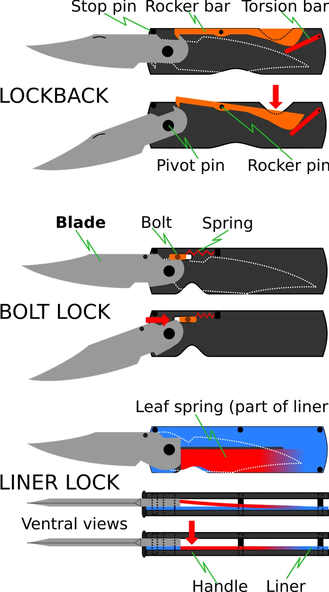
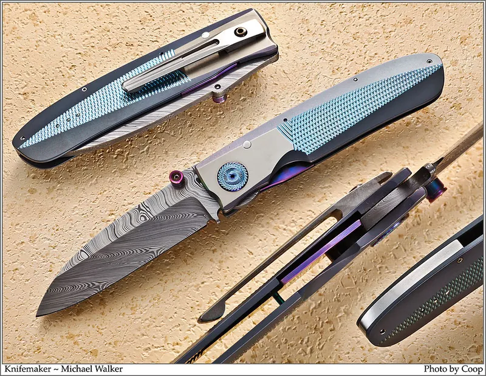
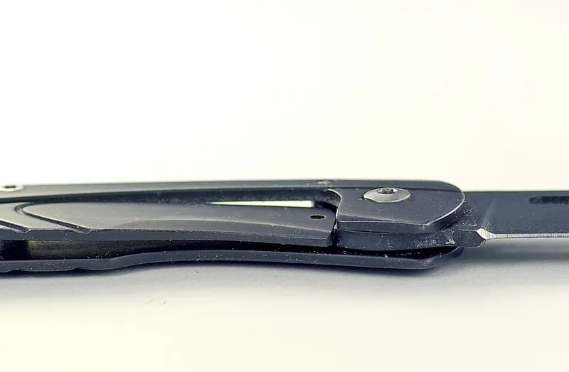

<figure class="eoc-pic eoc-pic-main"><picture><source media="(prefers-reduced-motion: reduce)" srcset="../media/drawn/folding-blade-lock.svg"></picture><figcaption><strong>Animation.</strong> Diagram drawn for the encyclopaedia from the research notes. ⚑ Needs confirming: a drawing can simplify or get details wrong; a real photo or a better diagram is welcome.</figcaption></figure>
<figure class="eoc-pic"><figcaption><strong>Diagram.</strong> <a href="https://commons.wikimedia.org/wiki/File:Folding_knife_locking_mechanisms.svg">Folding knife locking mechanisms</a> by Waerloeg, <a href="https://creativecommons.org/licenses/by-sa/3.0">CC BY-SA 3.0</a>, from Wikimedia Commons.</figcaption></figure>
<figure class="eoc-pic"><figcaption><strong>How it works.</strong> <a href="https://commons.wikimedia.org/wiki/File:WalkerLinerlock2.jpg">WalkerLinerlock2</a> by Photograph by Jim Cooper, Knives by Michael Walker, <a href="https://creativecommons.org/licenses/by-sa/4.0">CC BY-SA 4.0</a>, from Wikimedia Commons.</figcaption></figure>
<figure class="eoc-pic"><figcaption><strong>Photo.</strong> <a href="https://commons.wikimedia.org/wiki/File:Liner_Lock.jpg">Liner Lock</a> by Hustvedt, <a href="https://creativecommons.org/licenses/by-sa/3.0">CC BY-SA 3.0</a>, from Wikimedia Commons.</figcaption></figure>

A pivot joint for a folding blade or arm in which, once it is swung fully open, a spring-loaded bar (a split strip of the handle liner, the handle frame itself, or a rocker along the spine) drops in behind the blade's heel and blocks it from folding until the bar is pushed aside, while a slip joint only holds the blade with spring pressure and a [detent](../glossary.md#detent).

**In plain words:** The catch in a folding pocket knife or tool that holds the blade open: a springy strip or rocker in the handle drops in behind the blade's heel so it cannot fold back until you push the catch aside; the simplest kind has no catch and just holds the blade with spring pressure. **Proper term:** Folding-blade lock (liner lock, lockback, slip joint).

**Also called:** lock-blade knife; clasp knife; locking folder (knives that lock open; Wikipedia 'Pocketknife'); liner lock; locking liner; Linerlock (trademark of knifemaker Michael Walker; brand); frame lock; integral lock; Reeve Integral Lock or R.I.L. (the frame itself is the spring; named after Chris Reeve); lockback; back lock; spine lock; mid lock; rocker-bar lock; 'buck knife' used loosely for any lockback (Wikipedia); slip joint; slipjoint; spring-back knife; backspring knife (non-locking; may have a 'half-stop'); friction folder (no spring and no lock; e.g. higonokami); related lock types, often brand names: Tri-Ad lock (Cold Steel; brand), Compression Lock and Ball Bearing Lock (Spyderco; brand), AXIS lock (Benchmade; brand), button lock or plunge lock, collar lock or twist lock (Opinel; brand); parts: tang (the blade's heel), lock face, lock bar or leaf spring, rocker bar, backspring, stop pin, pivot pin, detent ball, overtravel stop or lockbar stabiliser, lockbar insert.

## How it works

Liner and frame lock: one handle liner (or the metal frame) is split lengthwise and bent inwards so it springs across the handle; while the blade is closed or partly open, the heel of the blade holds this strip to the side, and when the blade reaches fully open the strip snaps across behind the heel. Pressure on the cutting edge then pushes the heel end-on into the strip, which cannot fold, so the blade stays open until you push the strip back with your thumb (Wikipedia 'Liner lock'; Knife Informer). The heel's contact face is ground at a small angle so the strip wedges in and moves further across as the faces wear, which makes the lock 'self-adjusting for wear' (Wikipedia). A small ball set in the strip drops into a dimple in the blade to hold it closed (the 1990 Walker patent, US 4,896,424). Lockback: a rocker bar along the spine pivots on a pin in the middle; a spring pushes its front end down, and when the blade opens a hook on the rocker drops into a notch on top of the heel; pressing the exposed rear end of the rocker lifts the hook out (Wikipedia 'Pocketknife'; Knife Informer). Slip joint: the same backspring presses on flat faces on the heel, so the blade snaps to closed, open (and sometimes a 'half-stop') positions, but firm pressure on the back of the blade folds it, because nothing actually blocks it (Knife Informer).

## Parts

A few parts: the blade with a shaped heel (tang) turning on a pivot pin; the handle sides (scales, often with thin metal liners inside, or a solid metal frame); a stop pin that sets the fully open position; and the catch: in a liner or frame lock, a strip cut in the liner or frame and bent inwards to act as a leaf spring, usually with a small detent ball; in a lockback, a rocker bar pinned in the middle of the spine and a backspring (or [torsion](../glossary.md#torsion) bar) that presses it; in a slip joint, just a backspring bearing on the tang.

## Everyday examples

- a Swiss Army knife (slip joint; the Swiss soldier knife of 2008 adds liner locks; Wikipedia; Wikimedia Commons)
- a classic lockback hunting knife that you close by pressing the back of the handle (a style popularised by Buck Knives in the 1960s; Wikipedia 'Pocketknife')
- a pocket knife with a thumb-pushed liner or frame lock
- a folding utility (box-cutter) knife that locks open (Wikipedia 'Latch')

## When to use it

For a blade, tool arm or bracket that must fold away for carrying or storage but must not fold back while in use: pocket knives, multitool blades, folding utility knives. Choose a liner or frame lock for one-handed opening and closing, a lockback for a simple, ambidextrous and strong lock, and a slip joint where a light hold is enough or where locking knives are restricted. The same idea (a springy bar that drops in behind a folding part's heel) can lock printed folding arms, stands and levers open.

## When not to use it

Not for prying, chopping or heavy work: use a fixed blade, since even good locks can fail (KnivesShipFree; Wikipedia 'Pocketknife'). Not where locking knives are restricted (for example, carrying one in public in the UK without good reason): use a slip joint with a blade of 3 inches or less (GOV.UK). If you want your fingers out of the blade's path when closing, choose a crossbar lock (AXIS-type), compression lock or button lock instead of a liner lock or lockback (Knife Informer; Benchmade). In dusty, linty pockets lockbacks can fill with lint; open-backed designs stay cleaner (AllOutdoor; Knife Informer). For a part that must hold at many angles, use a detent hinge, friction hinge or Hirth joint instead.

## Details

- **What it does (jobs):**
  - lock, and release by hand: holds a folding blade or arm open until the catch is pushed aside
  - click into set positions: slip joints and detent balls snap the blade into the closed, half-open (half-stop) and open positions
  - let it move (turn, slide or bend): the pivot lets the blade fold away into the handle for carrying
- **Movement:** rotate: the blade swings about the pivot pin from folded inside the handle to fully open, roughly half a turn (about 180 degrees) ⚑ [uncertain: typical figure, not measured in a source]; the lock bar or rocker also flexes or swings a small amount
- **Directions it can move (degrees of freedom):** 1 while unlocked (the blade turns about its pivot); 0 once locked open, because the stop pin stops it opening further and the lock stops it folding. A slip joint always keeps its 1 freedom but resists movement with spring force.
- **Special behaviour:**
  - hand-release only (liner, frame and lockback locks hold against any force on the edge and open only when the catch is pushed aside)
  - [self-locking](../glossary.md#self-locking) (with the right angle on the heel's contact face, pressure on the blade pushes the lock bar end-on and does not push it out; knifemakers report that too shallow an angle makes the lock stick and too steep an angle lets it slip; KnifeDogs forum)
  - indexing (a slip joint snaps into closed, half-stop and open positions; the detent ball in a liner or frame lock holds the blade closed; Knife Informer; Benchmade)
  - quick-release (a liner lock 'can be opened and closed with one hand without repositioning the knife in the hand'; Wikipedia 'Liner lock')
- **How it holds:** shape (the lock bar or rocker hook physically blocks the blade's heel; [form-fit](../glossary.md#form-fit--force-fit--material-bond)), plus spring force (a springy strip, frame or backspring keeps the catch engaged); in liner and frame locks the bar also wedges against a slightly sloped face, so friction helps it stay put; a slip joint holds by spring force only
- **Input and output:** not applicable
- **Power:** passive (no power needed)
- **Load:** light to medium: plenty for cutting and normal hand forces, but 'never subject a folding knife to the same kind of stress that a fixed-blade knife can handle' (KnivesShipFree). Strong when the edge is pushed towards the closed position, because the lock bar or rocker takes the load end-on; weakest against sideways twisting, blows on the back of the blade (the 'spine whack'), and wear that lets the bar walk off the heel. Liner locks are 'not normally suited for heavy-duty use due to the thin nature of the liner'; frame locks and lockbacks have thicker bars (Knife Informer). In a 2014 static test of production knives, a liner-lock knife and a frame-lock knife each held the rig's maximum of 380 lb (about 170 kg), though the frame lock was unusable afterwards (BladeHQ test as reported by KnivesAdvisor) ⚑ [uncertain: second-hand report], though AllOutdoor argues static tests say little about real use and that nearly all modern locks are strong enough for everyday tasks. A slip joint only resists with spring pressure and folds under a firm push on the spine.
- **Play and precision:** small play when new: the stop pin sets a repeatable open position (Walker's refinement 'to align the blade in the open position', Wikipedia). Play grows with wear: 'vertical blade play' on lockbacks and 'lock rock' on titanium frame and liner locks (Knife Informer; AllOutdoor); side-to-side play depends on pivot tension. Little [tolerance](../glossary.md#tolerance) for [misalignment](../glossary.md#misalignment): parts must be made accurately; one maker says 'you have maybe a thou or two' (about 0.03-0.05 mm) to get a liner lock's face right (KnifeDogs).
- **Taking it apart:** tool-free quick release: the blade folds and unfolds by hand; taking the tool apart needs a screwdriver or Torx or hex key for the pivot and handle screws (printed designs use small wood screws or M3 screws; Printables 664449 and 713924)
- **How often it can be reused:** many times: it is opened and closed daily for years, but the locking faces wear, giving blade play or 'lock rock', especially in lockbacks and titanium frame locks (Knife Informer; AllOutdoor)
- **Sealing:** none
- **Adjustable:** partly: the pivot screw on many knives can be tightened to remove side-to-side play; the lock engagement itself is set by grinding and fitting the lock face, and some frame locks have replaceable steel lockbar inserts (Knife Informer). Printed designs may need their pin size adjusted to your printer (Printables 144600).
- **Access needed:** not applicable: the lock is built into the handle and is worked with the thumb (liner and frame locks) or by pressing the back of the handle (lockbacks)
- **Materials:** Blades: hardened steel. Liners and frames: titanium alloy or steel (Wikipedia 'Liner lock'); titanium frame locks often have a hardened steel lockbar insert, and some use a ceramic ball at the lock face (Knife Informer). Detent balls: steel or ceramic. Handle scales: many materials. Printed training and fidget knives: ABS holds the frame lock's spring tension better than PLA; PETG and PLA are also used; one printed lockback is made in ABS at 100% [infill](../glossary.md#infill) (Printables 144605, 144600, 713924).
- **Heat, cold, water and wear:** Pocket lint and dirt collect in a lockback's notch and can stop it locking; one reviewer's lockback was 'foiled twice by pocket lint' (AllOutdoor; Knife Informer). Knives kept in bags or pockets can corrode and stiffen, so oil the pivot and clean out dirt (Knife Informer). Titanium lock faces rub against steel and can gall, causing 'lock stick'; steel inserts or ceramic balls prevent this (Knife Informer). Printed PLA lock strips lose their spring over time ([creep](../glossary.md#creep)), so store printed knives open or print in ABS (Printables 144605). No temperature limits were found in the sources checked ⚑ [uncertain].

## Making it

- **Ways to make or get it:**
  - off-the-shelf part: buy a knife, multitool or folding utility knife, or a knife kit
  - CNC, waterjet or laser cutting: liners and frames are cut from titanium or steel sheet (one maker has liners and frames waterjet cut; KnifeDogs)
  - sheet metal: the liner lock bar is a split, bent strip of sheet (Wikipedia; Walker patent)
  - 3D print (FDM): blunt training knives, fidget toys and prototypes to test blade shape and lock geometry (Printables 203389, 664449, 144605)
  - woodwork: handle scales
- **Printing it in one piece (print in place):** no: printed folding knives are printed as separate parts (blade halves, frame, pin) and assembled with a pin or screws; one frame-lock design needs supports so the printed lock strip does not fuse to the rest of the frame (Printables 144605)
- **Tools:** To use: none. To adjust: a Torx, hex or slotted driver for the pivot screw to take out side-to-side play (Knife Informer). To make: files, a disc or belt sander set to the lock-face angle, stones or abrasive paper to finish the lock faces, and a torch or heat gun to bend a metal lock bar (KnifeDogs); for printed ones, a heat source to bend the printed lock bar (Printables 831782) and small screws or pins.
- **Difficulty:** moderate for a printed, blunt training or fidget knife (a few printed parts, a pin or screws, and a printed lock bar that has to keep its spring); hard for a real knife lock, which needs hardened steel, a lock-face angle held to a degree or so, careful finishing and heat treatment

### 3D printing tips

Keep printed versions blunt: use them as training knives, fidgets or prototypes (Printables 664449 'not intended cutting or use'; 193429 rounded, unsharpened blade for a child; 387356 warns a printed utility-blade folder 'is not recommended for use'). Material: ABS 'will hold spring tension better' than PLA for a printed frame lock; if the frame is PLA, store the knife open so the lock strip does not lose its tension over time (creep) (Printables 144605, 144600). [Preload](../glossary.md#preload) the printed lock bar by heating and bending it inwards ('heat & bend method'; Printables 831782). Print the frame with supports under the lock strip so it does not fuse to the frame, then free it with a sharp spatula or knife (Printables 144605). Print the blade as two mirror-image halves and glue them, and scale the pivot pin slightly if it is too tight, since a forced pin can crack an ABS frame (Printables 144605, 144600). A printed lockback karambit uses ABS, 100% infill, 0.2 mm layers and M3 screws and nuts (Printables 713924). A parametric slip-joint model at 100% infill lets you try blade length, drop and 'kick' before making a real one (Printables 203389). Design suggestions ⚑ [uncertain: not tested]: print the handle and lock strip lying flat so the strip bends within the layers rather than across them, since FDM parts are stronger in one direction (Prusa knowledge base); give the lock strip a long length so it can flex without cracking; and make the heel's lock face sloped a few degrees, as on metal knives, so the strip wedges in rather than sliding off.

### Buying one (off-the-shelf parts)

Folding knives, multitools and folding utility knives with liner, frame, lockback or slip-joint mechanisms; knife kits; pivot screws and pivot washers (bronze or plastic), thrust bearings for smoother pivots (used in the Benchmade Lowden; Benchmade), stop pins, detent balls, steel lockbar inserts and overtravel stops or 'lockbar stabilisers' (Knife Informer), handle screws. Search terms: 'liner lock', 'frame lock', 'lockback', 'slip joint', 'lockbar insert', 'detent ball', 'knife pivot washer', 'knife kit'.

## Rules of thumb

- Grind the blade heel's lock face at about 7.5-10 degrees; one maker finds 8 degrees or less sticks and more than 10.5 degrees slips, and another reports Bob Terzuola's book uses 8.5 degrees on a 2 inch wheel (KnifeDogs forum thread 'Liner lock lockup angle', knifemakers' practice, https://knifedogs.com/threads/liner-lock-lockup-angle.51197/).
- One maker aims for about 30% lock-up (the share of the lock bar's width that engages the blade heel) on a finished frame lock, though makers disagree about leaving extra engagement for future wear; a tiny [chamfer](../glossary.md#chamfer--fillet) (3-4 thousandths of an inch) on the lock bar's engaging corner stops it crushing and loosening (same KnifeDogs thread).
- An 'early' lock-up (the bar engaging close to its own side) is much safer than a 'late' one, because force on the blade tends to push the bar away from the lock side and a late bar can slide off the heel (Knife Informer, https://knifeinformer.com/pocket-knife-lock-types/).
- Use a stop pin to set the open position and take the opening shock, so the lock bar only has to hold the blade from folding (Walker's refinement, Wikipedia 'Liner lock'; Tri-Ad lock, Knife Informer).
- If a new liner lock sticks, check the lock bar is not bent too far (too much pressure) and that too much of its face is not engaging; lightly sanding both faces fixed one maker's sticky lock (KnifeDogs thread 'Liner lock problem', https://knifedogs.com/threads/liner-lock-problem.17018/).
- UK law: a folding pocketknife with a cutting edge of 3 inches (about 7.6 cm) or less that is not a lock knife may be carried in public without a good reason; lock knives need a good reason (GOV.UK, https://www.gov.uk/buying-carrying-knives).

## Common failures

(1) Lock stick: the lock bar jams hard against the heel, from too shallow an angle, rough faces or titanium [galling](../glossary.md#galling--fretting); fix by correcting the angle, finishing the faces, or fitting a steel insert (KnifeDogs; Knife Informer). (2) Lock slip or the bar walking off the heel: too steep an angle, late lock-up or worn faces; check engagement and replace worn parts (KnifeDogs; Knife Informer). (3) Blade play and lock rock from wear on the locking faces, especially in lockbacks and titanium frame locks (Knife Informer; AllOutdoor). (4) Lint or dirt in the notch stops a lockback or slip joint engaging fully; clean it out (Knife Informer; AllOutdoor). (5) The lock bar is pushed too far when released and [fatigues](../glossary.md#fatigue); overtravel stops prevent this (Knife Informer). (6) Printed lock strips lose their spring (PLA creep) or fuse to the frame during printing (Printables 144605). (7) Crossbar-type locks can break their thin springs (Knife Informer).

## Safety

A sharp blade folding onto your fingers is the main hazard. When closing a liner lock, frame lock or lockback, your fingers are in the blade's path (Knife Informer; Benchmade), and a lockback's spring snaps the blade shut past a certain point (Knife Informer). A slip joint can fold if pushed on the back of the blade. A lock that engages 'late' or is worn can slip off and let the blade close (Knife Informer). Knife carry is regulated: in the UK, carrying a lock knife in public without a good reason can lead to up to 4 years in prison, an unlimited fine or both (GOV.UK); US rules vary by place (Wikipedia 'Pocketknife'). Printed knives fitted with real blades are dangerous; the designers themselves advise against using them (Printables 387356).

## Related

- Detent hinge (click hinge, position hinge): holds at set angles with spring detents only, like a slip joint
- Ball detent (spring plunger): the small detent ball that holds a liner-lock blade closed is a tiny ball detent
- Compliant detent ([flexure](../glossary.md#flexure) click arm): a printed springy arm that clicks into notches, like a slip joint's backspring
- Compliant one-piece latch (flexure latch): the liner-lock bar is a one-piece springy latch cut from the handle
- Spring button lock (snap button, push-button tube lock): a spring pops a button into a hole to lock a tube; the same 'spring drops in and blocks' idea
- Indexing plunger (pull-knob index pin): a spring pin that you pull out to move a part to a new position
- Friction hinge ([torque](../glossary.md#torque) hinge): held by friction only, like a friction-folder knife
- [Over-centre](../glossary.md#over-centre) [linkage](../glossary.md#linkage) (toggle linkage): folding table legs and stands often lock open by going past centre instead
- Sear and trigger (trip release mechanism): automatic knives use a trigger-released catch (button lock) that also holds the blade open

## Make it yourself

- [Flip knife with frame lock (Printables 144605; details read via the Printables public API) (URL from Printables API, page not opened)](https://www.printables.com/model/144605-flip-knife-with-frame-lock): A printed fidget folding knife with a working printed frame lock: supports stop the lock strip fusing to the frame, ABS holds the spring better than PLA, and PLA versions should be stored open *(licence: CC BY)*
- [3" Lockback Training Knife by infinitevalence (Printables 664449; details read via the Printables public API) (URL from Printables API, page not opened)](https://www.printables.com/model/664449-3-lockback-training-knife): A blunt printed lockback knife for teaching knife safety, held together with four #4 1/2" countersunk screws *(licence: CC BY-NC)*
- [Parametric slipjoint folding knife by jhobson (Printables 203389; details read via the Printables public API) (URL from Printables API, page not opened)](https://www.printables.com/model/203389-parametric-slipjoint-folding-knife): A parametric, non-cutting slip-joint knife model for trying blade length, drop and kick before making a real one; printed at 100% infill *(licence: CC BY)*
- [OBERTECH NSP-02 KARAMBIT folding utility knife by Edu08 (Printables 713924; details read via the Printables public API) (URL from Printables API, page not opened)](https://www.printables.com/model/713924-obertech-nsp-02-karambit-folding-utility-knife): A printed folding utility-blade holder with a working back lock (lockback), printed in ABS at 100% infill and assembled with M3 screws and nuts *(licence: CC BY-SA)*
- [Folding Knife Fidgit by divided joy (Printables 831782; details read via the Printables public API) (URL from Printables API, page not opened)](https://www.printables.com/model/831782-folding-knife-fidgit): A printed frame-lock fidget knife; the printed frame lock is preloaded with a 'heat & bend' step *(licence: CC BY-NC-SA)*

## Pictures, videos and models

- [Folding knife locking mechanisms.svg (Wikimedia Commons, Waerloeg, 2013)](https://commons.wikimedia.org/wiki/File:Folding_knife_locking_mechanisms.svg): Simplified cutaway diagrams of a lockback (stop pin, rocker bar, rocker pin, torsion bar, pivot pin), a sliding bolt lock with spring, and a liner lock (leaf spring cut from the liner, with top views), each shown open and being released *(licence: CC BY-SA 3.0 (also GFDL))*
- [WalkerLinerlock2.jpg (Wikimedia Commons; knife by Michael Walker, photo by Jim Cooper)](https://commons.wikimedia.org/wiki/File:WalkerLinerlock2.jpg): Close-up photo of the locking mechanism of a Linerlock knife *(licence: CC BY-SA 4.0)*
- [Liner Lock.jpg (Wikimedia Commons, Hustvedt)](https://commons.wikimedia.org/wiki/File:Liner_Lock.jpg): The frame lock on a Gerber STL 2.0 knife (the file is named 'Liner Lock' but shows a frame lock) *(licence: CC BY-SA 3.0)*
- [Lock Back Safety schematics.gif (Wikimedia Commons; drawings from a US patent)](https://commons.wikimedia.org/wiki/File:Lock_Back_Safety_schematics.gif): Patent schematics of a lockback knife mechanism with an added safety *(licence: Public domain)*
- [Soldatenmesser 08 dual liner lock system.JPG (Wikimedia Commons, Francis Flinch, 2009)](https://commons.wikimedia.org/wiki/File:Soldatenmesser_08_dual_liner_lock_system.JPG): The dual liner locks on the Swiss Army soldier knife of 2008 *(licence: CC BY 3.0)*

## Needs confirming

⚑ marks something nobody has confirmed yet: a fact the research could not confirm from a source, a finder value that is a best guess, or an open point from the research notes. Corrections are welcome (see `research/needs-confirming.md`).

- ⚑ 4 sentences on this page marked [uncertain].
- ⚑ Finder value `connects` = lid, door or cover (best guess): worked out from its name, but joining parts is not one of its two main jobs
- ⚑ Finder value `opens_by` = catch or lever (best guess): carried over from the finder's old rule on entry names (R33), for "How should it open?" under "Hold two things together > A lid, door or cover that opens and closes"
- ⚑ Finder value `locks_out` = yes (best guess): carried over from the finder's old rule on entry names (R33), for "Should it lock, so only the right person can open it?" under "Hold two things together > A lid, door or cover that opens and closes > Press, pull or flip a catch or lever"
- ⚑ Finder value `clicks_do` = hold a set position (best guess): carried over from the finder's old rule on entry names (R33), for "What should the clicks do?" under "Control a movement > Click into set positions > Turns"
- ⚑ Finder value `holds_for` = a load (best guess): carried over from the finder's old rule on entry names (R33), for "What should it do?" under "Control a movement > Stay where I leave it, and let go when I release it > Turns"

## Sources

- <https://en.wikipedia.org/wiki/Liner_lock (read via the Wikipedia API)>
- <https://en.wikipedia.org/wiki/Pocketknife (read via the Wikipedia API)>
- <https://en.wikipedia.org/wiki/Latch (read via the Wikipedia API)>
- <https://knifeinformer.com/pocket-knife-lock-types/>
- <https://www.benchmade.com/blogs/beyond-the-bench/knife-mechanisms-guide>
- <https://knifedogs.com/threads/liner-lock-lockup-angle.51197/>
- <https://knifedogs.com/threads/liner-lock-problem.17018/>
- <https://www.alloutdoor.com/2013/10/01/analyze-lock-strength-folding-knives/>
- <https://www.knivesshipfree.com/knife-knowledge/faq-whats-the-strongest-lock-on-a-folding-knife/>
- <https://knivesadvisor.com/frame-lock-vs-liner-lock/>
- <https://www.freepatentsonline.com/4896424.html (Walker, US 4,896,424, 1990)>
- <https://www.gov.uk/buying-carrying-knives>
- <https://help.prusa3d.com/article/modeling-with-3d-printing-in-mind_164135>
- <https://commons.wikimedia.org/wiki/File:Folding_knife_locking_mechanisms.svg>
- <https://commons.wikimedia.org/wiki/File:WalkerLinerlock2.jpg>
- <https://commons.wikimedia.org/wiki/File:Liner_Lock.jpg>
- <https://commons.wikimedia.org/wiki/File:Lock_Back_Safety_schematics.gif>
- <https://commons.wikimedia.org/wiki/File:Soldatenmesser_08_dual_liner_lock_system.JPG>
- <https://www.printables.com/model/144605-flip-knife-with-frame-lock (read via https://api.printables.com/graphql/)>
- <https://www.printables.com/model/144600-folding-knife-frame-lock-kizer-begleiter (read via https://api.printables.com/graphql/)>
- <https://www.printables.com/model/664449-3-lockback-training-knife (read via https://api.printables.com/graphql/)>
- <https://www.printables.com/model/203389-parametric-slipjoint-folding-knife (read via https://api.printables.com/graphql/)>
- <https://www.printables.com/model/713924-obertech-nsp-02-karambit-folding-utility-knife (read via https://api.printables.com/graphql/)>
- <https://www.printables.com/model/831782-folding-knife-fidgit (read via https://api.printables.com/graphql/)>
- <https://www.printables.com/model/387356-inspire-m3-folding-utility-knife (read via https://api.printables.com/graphql/)>
- <https://www.printables.com/model/193429-blunted-folding-knife (read via https://api.printables.com/graphql/)>
- <https://api.printables.com/graphql/>
