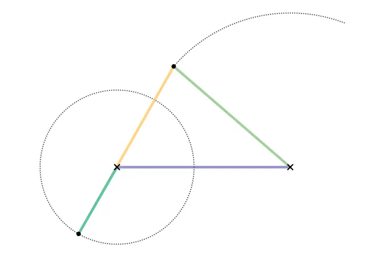

<figure class="eoc-pic eoc-pic-main"><picture><source media="(prefers-reduced-motion: reduce)" srcset="../media/four-bar-linkage.still.webp"></picture><figcaption><strong>Animation.</strong> <a href="https://commons.wikimedia.org/wiki/File:Crank-Rocker_4-bar_Linkage.gif">Crank-Rocker 4-bar Linkage</a> by Arglin Kampling, <a href="https://creativecommons.org/licenses/by-sa/4.0">CC BY-SA 4.0</a>, from Wikimedia Commons.</figcaption></figure>

Four bars joined by four pivots into a closed loop, one bar fixed, so that turning or swinging one bar moves the rest in a single set way: turning into swinging, swinging into turning, a part kept level (parallelogram), or a drawing traced at a new scale (pantograph).

**In plain words:** Four stiff bars pinned together at their ends in a loop, with one bar held still; moving one bar makes the others turn, swing or carry a part along a set path. When opposite bars are equal (a parallelogram) the moving part stays pointing the same way, like a desk-lamp head, and a pantograph uses one to copy a drawing bigger or smaller. **Proper term:** Four-bar [linkage](../glossary.md#linkage) (incl. parallelogram linkage and pantograph).

**Also called:** four-link mechanism / 4-bar / four-bar mechanism; quadrilateral linkage, RRRR linkage (four revolute joints; Wikipedia); crank-rocker, double [crank](../glossary.md#crank) (drag link), double rocker: the Grashof types; parallelogram linkage / parallel linkage / parallel four-bar; antiparallelogram (contra-parallelogram, crossed four-bar); virtual four-bar: the chain or belt version used in robot arms (gm0); pantograph (copying linkage for enlarging and reducing drawings); eidograph (an improved pantograph of 1821; Wikipedia); parallel link coupling (parallelogram linkages passing rotation between parallel shafts; Nguyen Duc Thang); 四连杆机构 / 平行四连杆机构 / 缩放仪 (Chinese: four-bar linkage / parallel four-bar / pantograph).

## How it works

Because the four bars form a closed loop, fixing one bar leaves only one way for the others to move: set the input's angle and every other part's position follows (one degree of freedom). The link lengths decide what happens: by Grashof's rule, if the shortest plus the longest bar are no longer than the other two added together, the shortest bar can turn all the way round, giving a crank-rocker (input turns, output swings), a double crank (both turn) or a double rocker (both swing) depending on which bar is shortest (Wikipedia; MechSimulator). Points on the coupler trace curves (coupler curves) ranging from near-straight lines to figure-eights. When opposite bars are equal (a parallelogram) the coupler stays parallel to the fixed bar, so a lamp head, loader bucket or wiper blade keeps its angle (Carnegie Mellon notes; Wikipedia); a pantograph arranges a parallelogram so that a fixed point, a tracing point and a pen stay on one straight line, so the pen copies the tracer's path scaled by the ratio of their distances from the fixed point (Nguyen Duc Thang, 'Bar pantograph 1'; 507 Mechanical Movements no. 246). A mechanism can also be given deliberate lost motion (free play before the driven part is picked up), so the output waits while the input moves: in Nguyen Duc Thang's 'Motion delay mechanism 1' a crank 'rotates idly' on its gear's shaft, so the output rack 'moves only after the blue gear makes around two revolutions', and adding more idle cranks lengthens the delay (Thang, 2700 Animated Mechanical Mechanisms part 2, p. 119).

## Parts

A few parts: a fixed base (ground link) with two pivots; an input link (crank or lever); a floating link between the moving ends (coupler); an output link (rocker or follower); four pivot pins, bolts or bearings. A pantograph uses a parallelogram with two arms extended, one fixed pivot, a tracing point and a pen.

## Everyday examples

- Car windscreen wipers, driven from the motor through four-bar linkages, and the parallelogram 'pantograph' wipers on buses (Wikipedia 'Windscreen wiper')
- Balanced-arm desk lamps, whose parallelogram keeps the lamp head pointing the same way, and ironing boards that stay level as you change the height (Wikipedia 'Balanced-arm lamp'; reSolve Maths)
- Oil-well pumpjacks, bicycle rear suspensions, door closers, folding chairs and treadle sewing machines (Wikipedia 'Four-bar linkage')
- Locking pliers, and your own knee joint (Hackaday)

## When to use it

Use a four-bar when you need a part to move along a particular path, swing back and forth from a turning motor, or stay level while it moves, using only pivots, which are cheap, strong and wear slowly. Crank-rockers turn a motor's rotation into a swing (wipers, pumps, walking toys); double rockers make grippers, suspensions and folding mechanisms; parallelograms keep a lamp head, platform, gripper jaw or camera level while it rises and falls; a pantograph copies, enlarges or reduces motion, from drawing aids to precise probes. A four-bar near its toggle position gives a very large force and can lock, as in toggle clamps and locking pliers.

## When not to use it

Avoid it when you need a long straight-line movement (use a slide, rack and pinion or lead screw) or exact straight lines from pivots only (see the straight-line linkages, Watt, Chebyshev and Peaucellier), when a parallel arm must swing more than about 180 degrees (use a chain or belt 'virtual four-bar'; gm0), when you need a constant speed or force through the whole movement (linkages vary; use gears, belts or screws), or when the motion must change often (use a servo or programmable [actuator](../glossary.md#actuator)). A parallelogram run through its line-up positions can flip unless guided; avoid designs that pass through those points.

## Details

- **What it does (jobs):**
  - change the kind of motion: e.g. continuous rotation into swinging (wipers, pumpjacks), swinging into rotation (treadles), or a swing into a shaped path; a pantograph copies motion at a larger or smaller scale
  - let it move (turn, slide or bend): guides a part along a set path, e.g. keeping it level (parallelogram lamps, lifts and robot arms) or as a vehicle suspension or folding mechanism
  - change speed or turning force: the force and speed ratio change through the motion, and near a toggle position the force gain becomes very large (locking pliers, toggle clamps)
  - lock, and release by hand: driven just past a toggle ([over-centre](../glossary.md#over-centre)) position against a stop it locks, as in toggle clamps and locking pliers, and is released by pulling it back
- **Movement:** rotate: every joint is a pivot; the input and output bars either turn fully or swing through a limited angle depending on the link lengths (Grashof), and the coupler moves along a curved path; in a parallelogram the coupler moves without turning. A parallelogram arm used to keep a part level travels less than 180 degrees in total (under 90 degrees either way; gm0)
- **Directions it can move (degrees of freedom):** 1 for a four-bar with one bar fixed (mobility M = 1; Wikipedia 'Linkage (mechanical)'). A drawing pantograph has 2, because it is anchored at only one pivot so its tracer can go anywhere on the table (Wikipedia lists the pantograph as a four-bar with two [degrees of freedom](../glossary.md#degrees-of-freedom))
- **Special behaviour:**
  - motion conversion (e.g. rotary to linear): turns rotation into swinging and back, moves a point along a chosen curve (coupler curve), and a crank-rocker with unequal [strokes](../glossary.md#stroke) gives a quick return (time ratio Q; Wikipedia)
  - over-centre (snaps past a point and stays): at toggle (dead) positions, where two links line up, the output cannot drive the input and the force gain is very large; toggle clamps and locking pliers use this, and driving a linkage over centre 'can have some benefits, like making the linkage harder to backdrive' (gm0; Thang, 'Toggle clamp 2a'; Hackaday)
  - parallel motion (a special kind of motion conversion): a parallelogram keeps the moving part at a fixed angle, and a pantograph copies motion at a fixed scale; the catch is that at its change points, where all four bars line up, a parallelogram can flip into a crossed antiparallelogram unless something prevents it (Wikimedia Commons animation 'Parallel 4-bar Linkage 1'; Thang, 'Parallelogram Mechanism 1')
- **How it holds:**
  - not a holding joint (it moves or passes on motion); when used over-centre against a stop (toggle clamp, locking pliers) it holds by its shape: the load pushes the joint further into the locked position
- **Input and output:** Rotation or swinging -> rotation, swinging, or a guided path. Crank-rocker: continuous rotation -> back-and-forth swing whose size is set by the link lengths; double crank: rotation -> rotation at a varying speed; parallelogram: rotation -> equal rotation, so a parallel link coupling passes rotation between parallel shafts with no [backlash](../glossary.md#backlash) (Thang, 'Parallel link coupling'); pantograph: tracer motion -> pen motion scaled by k = OE/OC, e.g. 2:1 (Thang, 'Bar pantograph 1'). The force and speed ratios change through the motion; linkages 'generally reach a maximum speed and force when the bars are perpendicular' (gm0), and force passes best when the coupler meets the output bar at 90 degrees (the transmission angle; Carnegie Mellon notes), becoming poor below about 40 degrees (MechSimulator). Efficiency: high with good pivot bearings because nothing slides, but no reliable figure was found ⚑ [uncertain]. Shaft arrangement: all pivot axes parallel in the usual flat (planar) linkage; spherical and spatial four-bars also exist (Wikipedia). Back-drivable: usually yes, except at toggle positions, where the output cannot drive the input (Carnegie Mellon notes).
- **Power:** passive (no power needed); driven by hand, a motor, a spring, gravity or an actuator. If power is lost it stops or falls under its load unless it is balanced (balanced-arm lamps use springs; Wikipedia) or parked over centre
- **Load:** Light to heavy: from pantographs and desk lamps to loader buckets, vehicle suspensions and oil-well pumpjacks (Wikipedia; Carnegie Mellon notes). If loads act only at the pivots, each bar is simply pushed or pulled along its length, and the pivots carry the load in [shear](../glossary.md#peel-vs-shear). Weak spots: the pivots (wear and bending of the pins), positions with a poor transmission angle or close to a toggle position, where forces in the links and bearings rise sharply (MechSimulator), and sideways (out-of-plane) loads, which twist long thin bars.
- **Play and precision:** Small with good bearings, but each pivot's [clearance](../glossary.md#clearance) adds up and is magnified at the end of long links; for a printed pantograph, 'any sloppiness will be transferred to the drawing' (bce.gatien, Printables). Repeatable, because the geometry fixes every position. It needs all pivot axes parallel and the links stacked in their proper planes: a printed pantograph binds if the arms are not stacked in the same vertical plane (Collin_Builds, Printables). It tolerates little [misalignment](../glossary.md#misalignment) between pivots ⚑ [uncertain].
- **Taking it apart:** removable: the pivots are bolts, pins, shoulder screws or snap pins that can be undone
- **How often it can be reused:** many times: taking the pivots apart does not harm them; life is limited by pivot wear
- **Sealing:** none: it is an open linkage and does not seal anything
- **Adjustable:** Not usually. Adjustable link lengths (slotted holes, a row of pivot holes, or threaded rod ends) change the output motion; a pantograph's slides or pivot holes change its scale (507 Mechanical Movements no. 246; bce.gatien's printable pantograph copies at 1/2, 1/3, 1/4 or 1/6 scale, or the reverse by swapping pen and tracer).
- **Access needed:** not applicable: it is a mechanism assembled from bars and pivots, reached from wherever the bars are
- **Materials:** Steel and aluminium bars and extrusions for machines and vehicles; wood, plywood and acrylic for models, lamps and pantographs ⚑ [uncertain]; 3D-printed PLA or PETG for demos and light robot arms. Pivots are usually steel bolts, shoulder screws or pins, often with plastic or bronze bushings or ball bearings (vachaj11's printed pantograph uses 608 ball bearings; Collin_Builds' uses M5 bolts, washers and nyloc nuts). The PantoProbe used brass tubing joints or flexible links (Hackaday).
- **Heat, cold, water and wear:** Printed PLA softens above about 60 °C and degrades in UV light, so use PETG or ASA near heat or outdoors (Prusa). Pivot clearance grows as holes wear, adding play (bce.gatien notes play shows directly in a pantograph's drawing); dust and lack of [lubrication](../glossary.md#lubrication) speed this up ⚑ [uncertain]. Balancing springs lose some force over time and must be re-adjusted ⚑ [uncertain].

## Making it

- **Ways to make or get it:**
  - 3D print (FDM): links print flat; many printable demos and pantographs
  - laser cut: ⚑ [uncertain] flat links in acrylic or plywood suit linkages well; no tested example was opened
  - woodwork: pantographs, treadles and lamp arms are traditional wooden linkages ⚑ [uncertain]
  - CNC: for metal links and brackets
  - off-the-shelf part: rod ends, shoulder screws, bushings and bearings for the pivots; aluminium bars or extrusion for the links
- **Printing it in one piece (print in place):** no: usually printed as flat links and joined with bolts or pins (bce.gatien's pantograph assembles without hardware; others use bolts or bearings). [Print-in-place](../glossary.md#print-in-place) pivots are possible with at least about 0.3 mm clearance (Prusa), but no tested print-in-place four-bar was opened ⚑ [uncertain]
- **Tools:** A screwdriver or hex key and a spanner for the pivot bolts and lock nuts; none for snap-together printed demos; optionally a drill or reamer to bring printed pivot holes to size
- **Difficulty:** easy for a simple linkage or pantograph (flat parts joined with bolts); moderate to design one that gives a particular path or swing, which is easiest with a free simulator such as PMKS+, Linkage or MechSimulator

### 3D printing tips

1) Print links flat on the bed so the layers run along each bar's length; FDM parts are much weaker between layers (Prusa). 2) Pivots: a metal bolt or shoulder screw through the printed holes, a washer between each pair of moving links, and a nylon-insert lock nut tightened only until the joint turns without wobble (Collin_Builds uses M5 bolts, washers and nyloc nuts); for smoother, longer-lasting joints press ball bearings into the links (vachaj11 uses 608 bearings). 3) Clearance: at least 0.3 mm for printed moving parts (Prusa), 0.5 mm to be safe on FDM (Hubs); for precise tools go tighter and test: bce.gatien offers 0.1, 0.2 and 0.3 mm versions and a [tolerance](../glossary.md#tolerance) test, because any play shows up in the drawing. 4) Keep the links stacked in the right planes; if arms that should line up are offset, the linkage binds (Collin_Builds). 5) Avoid [brittle](../glossary.md#brittle--ductile) filaments for thin links: bce.gatien advises against silk or brittle PLA and recommends regular or matte PLA, PLA+, PETG or ABS/ASA. 6) Check the geometry first: Grashof's rule for whether a link can turn fully, and keep the transmission angle above about 40 degrees (MechSimulator); a free simulator (PMKS+, Linkage, MechSimulator) or Print a Motion saves reprints. 7) For parallelograms, stop the links before they line up flat, or add a second crank at another angle, so it cannot flip into a crossed shape (Thang, 'Parallelogram Mechanism 1'). 8) Long parallel arms that must travel more than about 180 degrees are awkward; robot builders use a chain or belt 'virtual four-bar' instead (gm0). 9) PLA softens above about 60 °C (Prusa); use PETG or ASA near heat.

### Buying one (off-the-shelf parts)

Pivot pins: shoulder screws (shoulder bolts), clevis pins, dowel pins or plain bolts with nylon-insert lock nuts and washers. Bearings: sleeve bearings (bushings), flanged sleeve bearings, ball bearings (e.g. 608). Adjustable links: ball-joint rod ends or clevis rod ends on threaded rod. Links: flat bar, aluminium extrusion or tube. Balancing: extension springs or gas springs (balanced-arm lamps use extension springs; Wikipedia). Names as used in the McMaster-Carr catalogue.

## Rules of thumb

- Grashof's rule: if shortest + longest <= sum of the other two links, the shortest link can rotate fully; otherwise every link only swings (a triple rocker) (Wikipedia 'Four-bar linkage'; Carnegie Mellon notes; MechSimulator).
- Which Grashof type you get depends on which link is shortest: shortest link is the crank -> crank-rocker; the fixed base -> double crank (drag link); the coupler -> double rocker; the output -> rocker-crank (MechSimulator).
- Transmission angle (between the coupler and the output link): best at 90 degrees (Carnegie Mellon notes); keep it above about 40 degrees throughout the motion or force transmission becomes poor and the linkage may struggle to move (MechSimulator).
- Quick return: time ratio Q = (180° + b)/(180° - b), where b is the imbalance angle (Wikipedia 'Four-bar linkage').
- Parallelogram: opposite links equal; the coupler keeps its orientation (Carnegie Mellon notes; gm0). A parallelogram arm travels under 180 degrees, less than 90 degrees either way (gm0). At the change points it can flip into an antiparallelogram; extra cranks at other angles get it through (Thang, 'Parallelogram Mechanism 1').
- Parallel link coupling (several parallelograms sharing a moving frame): all cranks must be the same length and the shaft pattern on the moving and fixed frames identical; keep the moving frame light, as it is unbalanced and unsuitable for high speed (Nguyen Duc Thang, 'Parallel link coupling').
- Pantograph: the fixed point, tracer and pen must stay on one straight line; scale factor k = distance from fixed point to pen / distance to tracer (Thang, 'Bar pantograph 1'); swap tracer and pen to enlarge instead of reduce (507 Mechanical Movements no. 246; bce.gatien, Printables).
- Linkage speed and force are not constant and generally peak when the bars are perpendicular (gm0).
- Printed pivots: start with at least 0.3 mm clearance (Prusa) or 0.5 mm on FDM (Hubs); precise tools such as pantographs need tighter joints (0.1-0.3 mm, bce.gatien) or bearings.

## Common failures

1) It locks or will not move because it reaches a toggle (dead) point where the input cannot turn the output (Carnegie Mellon notes), or the transmission angle becomes too small (MechSimulator): change link lengths or add stops. 2) A parallelogram flips into a crossed shape as the bars pass the line-up position (Commons 'Parallel 4-bar Linkage 1'; Thang): add stops or a second crank at another angle. 3) A link was meant to turn fully but only rocks because the lengths break Grashof's rule (Wikipedia): check shortest + longest <= the other two. 4) Wobbly, inaccurate motion from worn or loose pivots, magnified by long links (bce.gatien): use bearings or bushings and tighter clearances. 5) Binding because links are not stacked in their planes or pivots are not parallel (Collin_Builds): check the stacking order and shim with washers. 6) Thin printed links snapping along a layer line or being printed in brittle filament (Prusa; bce.gatien): print flat, use PETG or plain PLA.

## Safety

Scissor-like closing gaps between links are pinch points, especially in motor- or spring-driven arms, and parallelogram arms with balancing springs store spring energy that can snap the arm when a link or pivot is removed ⚑ [uncertain]. Toggle and over-centre positions multiply force and can crush fingers ⚑ [uncertain]. None known for small hand-moved demos.

## Related

- Slider-crank: a four-bar with one pivot replaced by a slide, turning rotation into straight back-and-forth motion (Carnegie Mellon notes; Wikipedia)
- Scotch yoke: straight back-and-forth motion from a pin in a slot, a pure sine wave
- Straight-line linkages (Watt, Chebyshev, Peaucellier): four-bars and larger linkages whose coupler point traces a (nearly) straight line
- Scissor linkage (lazy tongs, scissor lift): a chain of crossed links that extends a long way from a small movement
- Over-centre linkage (toggle linkage) and toggle clamp: a four-bar or slider-crank used at its toggle position to lock
- Quick-return mechanism (Whitworth, crank and slotted lever): uses a slotted link to make the return faster
- Virtual-pivot linkage (remote centre of motion): a linkage arranged so a part rotates about a point in empty space
- Bell crank (angle lever): a single L-shaped lever often used as one link of a linkage
- Oldham coupling: like a parallel link coupling, passes rotation between offset parallel shafts, but by sliding rather than pivots
- Multi-turn rotation limiter: its stacked-ring stops use the same lost-motion idea, each ring turning idly until it picks up the next

## Make it yourself

- [Four-Bar Linkage simulator (MechSimulator)](https://mechsimulator.com/tools/four-bar-linkage/): Interactive four-bar: change the four link lengths and see the Grashof class, transmission angle, output speed and a traced coupler curve *(licence: link only (no licence stated))*
- [PMKS+ (Planar Mechanism Kinematic Simulator, web app, WPI)](https://pmksplus.com/): Free, open-source browser tool for designing and simulating planar linkages with kinematic and force analysis *(licence: free and open source (licence not named on the page) ⚑ [uncertain])*
- [Linkage mechanism designer and simulator (David Rector, Windows program)](https://blog.rectorsquid.com/linkage-mechanism-designer-and-simulator/): Free program to sketch and animate linkages, then export images, video, DXF (per Hackaday) and 1:1 printouts to use as templates *(licence: free to use (licence not stated) ⚑ [uncertain])*
- [Print a Motion (Saltire Software, web app)](https://printamotion.com/): Define a crank-rocker (or crank-slider) and a coupler point, then download a 3D model of that exact linkage to print *(licence: not stated ⚑ [uncertain])*
- [Mechanical mechanism library (HUANGYAN920, web app)](https://huangyan920.github.io/Mechanical/): Browser library of 257 parametric mechanism animations, including four-bar, crank-rocker, double crank, double rocker, parallel four-bar, antiparallelogram, pantograph, wiper and pumpjack linkages *(licence: MIT (per the GitHub README))*
- [Pantograph 200mm, 250mm, 300mm (bce.gatien, Printables) (URL from Printables API, page not opened)](https://www.printables.com/model/898021-pantograph-200mm-250mm-300mm): Hardware-free printable pantograph copying at 1/2 to 1/6 scale (or enlarging by swapping pen and tracer), with 0.1/0.2/0.3 mm clearance versions and a tolerance test *(licence: CC BY-SA)*
- [Sharpie Pantograph (Collin_Builds, Printables) (URL from Printables API, page not opened)](https://www.printables.com/model/254344-sharpie-pantograph): Doubling or halving pantograph for teaching ratios, assembled with M5 bolts, washers and nyloc nuts *(licence: CC BY-NC)*
- [Pantograph for scaling up using 608 bearings (vachaj11, Printables) (URL from Printables API, page not opened)](https://www.printables.com/model/15364-pantograph-for-scaling-up-using-608-bearings): Printed pantograph whose pivots run on five 608 ball bearings, with M5 and M3 screws *(licence: CC BY)*

## Pictures, videos and models

- [Crank-Rocker 4-bar Linkage.gif (Wikimedia Commons, by Arglin Kampling)](https://commons.wikimedia.org/wiki/File:Crank-Rocker_4-bar_Linkage.gif): Animated crank-rocker: one link turns fully while the other rocks back and forth (made in GeoGebra) *(licence: CC BY-SA 4.0)*
- [Parallel 4-bar Linkage 1.gif (Wikimedia Commons, by Arglin Kampling)](https://commons.wikimedia.org/wiki/File:Parallel_4-bar_Linkage_1.gif): Animated parallelogram, a parallelogram flipping to a contraparallelogram, and a contraparallelogram, side by side *(licence: CC BY-SA 4.0)*
- [Pantograph animation.gif (Wikimedia Commons, by AlphaZeta)](https://commons.wikimedia.org/wiki/File:Pantograph_animation.gif): Animated pantograph copying a drawing at a different scale *(licence: Public domain)*
- [507 Mechanical Movements, No. 246: pantograph for copying, enlarging and reducing plans](https://507movements.com/mm_246.html): 1868 drawing, with an animated version, of a drawing pantograph with adjustable slides to change the scale *(licence: Book public domain; website animation link only)*
- [Parallelogram Mechanism 1 (Nguyen Duc Thang, YouTube thang010146)](https://www.youtube.com/watch?v=prMefg7NCsc): CAD animation of a parallelogram linkage getting past its dead points with extra cranks set at different angles *(licence: link only (standard YouTube licence))*

## Needs confirming

⚑ marks something nobody has confirmed yet: a fact the research could not confirm from a source, a finder value that is a best guess, or an open point from the research notes. Corrections are welcome (see `research/needs-confirming.md`).

- ⚑ 13 sentences on this page marked [uncertain].
- ⚑ Finder value `move_kind` = follows a set path (best guess): carried over from the finder's old rule on entry names (R33), for "How should it move?" under "Let something move"
- ⚑ Finder value `turns` = part of a turn (best guess): carried over from the finder's old rule on entry names (R33), for "For things that turn: less than a full turn (swings or rocks) or full turns (spins)."

## Sources

- <https://en.wikipedia.org/wiki/Four-bar_linkage>
- <https://en.wikipedia.org/wiki/Linkage_(mechanical)>
- <https://en.wikipedia.org/wiki/Slider-crank_linkage>
- <https://en.wikipedia.org/wiki/Pantograph>
- <https://en.wikipedia.org/wiki/Balanced-arm_lamp>
- <https://en.wikipedia.org/wiki/Windscreen_wiper>
- <https://commons.wikimedia.org/wiki/File:Crank-Rocker_4-bar_Linkage.gif>
- <https://commons.wikimedia.org/wiki/File:Parallel_4-bar_Linkage_1.gif>
- <https://commons.wikimedia.org/wiki/File:Pantograph_animation.gif>
- <https://www.cs.cmu.edu/~rapidproto/mechanisms/chpt5.html>
- <https://mechsimulator.com/mechanisms/>
- <https://mechsimulator.com/tools/four-bar-linkage/>
- <https://gm0.org/en/latest/docs/common-mechanisms/linkages.html>
- <https://hackaday.com/2017/03/29/marvelous-mechanisms-the-ubiquitous-four-bar-linkage/>
- <https://hackaday.com/tag/four-bar-linkage/>
- <https://hackaday.com/2017/10/04/precision-pantograph-probes-pcbs/>
- <https://hackaday.com/2018/01/26/amazing-mechanical-linkages-and-the-software-to-design-them/>
- <https://resolve.edu.au/v84-sequences/mechanical-linkages-similar-triangles>
- <https://507movements.com/mm_246.html>
- <https://507movements.com/mm_158.html>
- <https://507movements.com/toc.html>
- <https://www.youtube.com/watch?v=prMefg7NCsc>
- <https://www.youtube.com/watch?v=pkcdVQZubiM>
- <https://www.youtube.com/watch?v=9H5hSLaRPTQ>
- <https://www.youtube.com/watch?v=Nmp_U-tkoH8>
- <https://cs448m.github.io/lectures/machines/doc/1.pdf>
- <https://cs448m.github.io/lectures/machines/doc/3.pdf>
- <https://cs448m.github.io/lectures/machines/doc/4.pdf>
- <https://printamotion.com/>
- <https://pmksplus.com/>
- <https://blog.rectorsquid.com/linkage-mechanism-designer-and-simulator/>
- <https://huangyan920.github.io/Mechanical/>
- <https://raw.githubusercontent.com/HUANGYAN920/Mechanical/main/README.md>
- <https://api.printables.com/graphql/>
- <https://help.prusa3d.com/article/modeling-with-3d-printing-in-mind_164135>
- <https://help.prusa3d.com/article/pla_2062>
- <https://www.hubs.com/knowledge-base/how-design-interlocking-joints-fastening-3d-printed-parts/>
- <https://www.mcmaster.com/products/rod-ends/>
- <https://www.mcmaster.com/products/shoulder-bolts/>
- <https://www.mcmaster.com/products/sleeve-bearings/>
- <https://cs448m.github.io/lectures/machines/doc/2.pdf>
