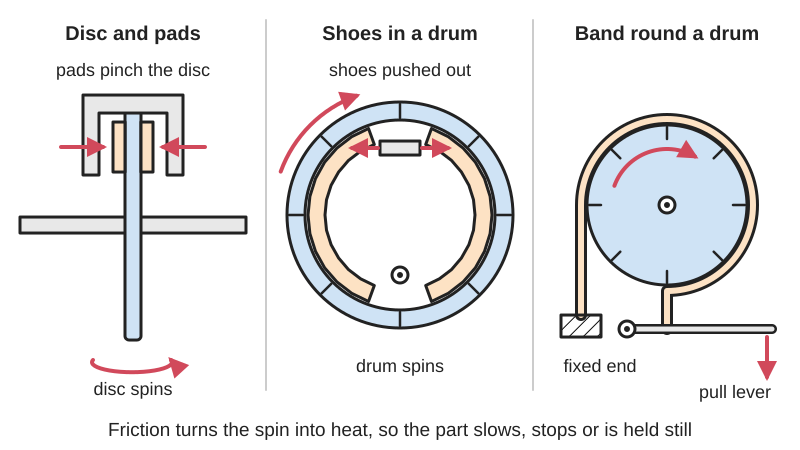

<figure class="eoc-pic eoc-pic-main"><picture><source media="(prefers-reduced-motion: reduce)" srcset="../media/drawn/friction-brake.svg"></picture><figcaption><strong>Animation.</strong> Diagram drawn for the encyclopaedia from the research notes. ⚑ Needs confirming: a drawing can simplify or get details wrong; a real photo or a better diagram is welcome.</figcaption></figure>

A device that presses friction material (pads, shoes or a band) against a rotating disc or drum, turning the motion into heat so the part slows down, stops or is held still (Wikipedia, Brake).

**In plain words:** Pads, shoes or a strap that press or wrap onto a spinning disc or drum and rub on it to slow it down or hold it still, like the brakes on a bike or car; a strap wrapped further round grips much harder. **Proper term:** Friction brake (band brake, drum brake, disc brake).

**Also called:** band brake, brake band; Prony brake (a band brake used to measure an engine's or motor's [torque](../glossary.md#torque)) (Wikipedia, Band brake); drum brake, shoe brake, internal expanding shoe brake (shoes push outwards on the inside of a drum) (Wikipedia, Brake; Drum brake); block brake or shoe brake (a block pressed on the outside of a wheel) (RoyMech, Brakes); disc brake, caliper brake, brake rotor (US) or brake disc, brake pads (Wikipedia, Disc brake); rim brake, V-brake, coaster brake (back-pedal hub brake) (Wikipedia, Bicycle brake); drag (fishing reels: disc drag, caliper drag) (Wikipedia, Fishing reel); holding brake, parking brake, handbrake (Wikipedia, Drum brake); spool brake, filament brake (3D-printing spool holders; Printables model titles); mechanical brake ⚑ [uncertain].

## How it works

Pressing a friction surface against a moving one creates a drag force that turns the motion's energy into heat (Wikipedia, Brake). A disc brake pinches a disc between two pads, so the braking torque is roughly 2 × friction coefficient × pad force × disc radius, and the braking follows exactly how hard you squeeze (Engineering ToolBox; Wikipedia, Disc brake). In a drum brake the turning drum drags one or both shoes harder into it ('self-energising'), which adds free extra force but makes it touchier (Wikipedia, Drum brake). A band brake wraps a strap round a drum, anchored at one end and pulled at the other: friction multiplies the pull all the way round, so the tight end can carry e^(μθ) times the slack end's tension, which is why it grips harder the further it wraps (RoyMech, Band Brakes; Wikipedia, Band brake).

## Parts

A small assembly: a rotating part (disc, drum or wheel) fixed to the shaft; friction material (pads, shoes, a lined band, or a rubber or TPU strip); something to press it on (a lever, cam, cable, screw, spring, weight or hydraulic piston); a fixed anchor or backing plate that takes the braking torque; and usually a return spring to pull it off (Wikipedia, Drum brake; Disc brake; RoyMech; Thang 'Shaft brake 3').

## Everyday examples

- Bicycle rim, disc and back-pedal (coaster) brakes (Wikipedia, Bicycle brake)
- Car disc brakes at the front and drum brakes, with the handbrake, at the back (Wikipedia, Drum brake)
- The chain brake on a chainsaw and the brake on a winch drum, both band brakes (Wikipedia, Band brake)
- The drag knob on a fishing reel, which presses friction discs together (Wikipedia, Fishing reel)
- A spring or weight-loaded pad that stops a 3D-printer filament spool over-running (Printables 1536289, 208775)

## When to use it

Use a friction brake to slow, stop or hold anything that turns: wheels, winch drums, spools, turntables, robot joints or a hand-cranked hoist. It works at any speed, including zero, so unlike an eddy-current brake it can hold something still, and at any angle, unlike a [ratchet](../glossary.md#ratchet) with teeth. Choose a disc brake for smooth, controllable braking that copes with heat and water (Wikipedia, Disc brake); a band brake for a simple, compact, high-grip brake worked by a light pull (Wikipedia, Band brake); a drum brake when the rubbing surfaces should be enclosed from dirt and rain (Wikipedia, Bicycle brake). A light, adjustable drag brake is the usual fix for spools that over-run and tangle. A band brake round a pulley (Prony brake) is also a simple way to measure a motor's torque (Wikipedia, Band brake).

## When not to use it

Don't use it where you need wear-free, silent, contactless slowing: use an eddy-current brake or a damper. Don't rely on a hand-set friction brake to hold a load safely if power or a person fails: use a spring-applied (power-off) brake, a [self-locking](../glossary.md#self-locking) worm drive or a ratchet. If you only need to stop motion in one direction, a ratchet or one-way clutch holds positively without wear. For long, continuous slowing (long descents, heavy loads), small brakes overheat and fade; coaster brakes, for example, lack heat dissipation for long descents (Wikipedia, Bicycle brake). For a precise, repeatable torque limit, use a purpose-made slip clutch or torque limiter.

## Details

- **What it does (jobs):**
  - slow it, stop it or keep its speed steady: the main job, e.g. stopping a wheel or lowering a load slowly
  - lock, and release by hand: parking and holding brakes keep a shaft still until you let them off
  - tighten and hold tension: a light drag on a spool keeps filament, thread or cable from over-running and tangling (Printables spool brakes)
- **Movement:** rotate: the braked disc or drum turns (continuous rotation); the pads, shoes or band only move a millimetre or so to touch it. Some brakes act on a straight rail or slider instead (Thang, 'Hand brake for rail cars')
- **Directions it can move (degrees of freedom):** 1: the braked shaft can still turn about its axis; the brake only resists that turning, and when fully on it holds it (0)
- **Special behaviour:**
  - self-locking (holds under load, won't back-drive): a drum brake's leading shoe is dragged into the drum ('self-energising'), and a differential band brake can be arranged so the drum's own pull applies the brake, needing no force at all (Wikipedia, Drum brake; RoyMech, Band Brakes)
  - one-way (moves freely one way, locks the other): a self-locking differential band brake is 'effectively free wheeling in the opposite direction' (RoyMech, Band Brakes); a simple band brake is also much stronger in one direction than the other
  - torque-limiting (slips at a set force/torque): a brake held on by a set spring or screw slips smoothly when the torque passes its limit; fishing-reel drags use this to tire a fish without snapping the line (Wikipedia, Fishing reel)
  - tensioning (takes up slack and holds): spool brakes add steady drag so filament stays taut (Printables 748642, 1536289)
- **How it holds:**
  - friction or clamping ([force-fit](../glossary.md#form-fit--force-fit--material-bond)): pads, shoes or a band pressed or wrapped onto the disc or drum
  - spring force (a spring or springy part presses it in place): many holding brakes are pushed on by springs or weights (Thang 'Automatic brake for hoist 1a'; Printables 1536289 uses nut weights)
- **Input and output:** not applicable: it doesn't pass motion on; it absorbs it as heat. Braking torque ≈ 2μFr for a two-pad disc brake (Engineering ToolBox) and (T1 − T2) × r for a band brake (RoyMech)
- **Power:** passive (no power needed) when worked by hand, foot, a cable, a spring or a weight; powered versions use hydraulics, air, a [solenoid](../glossary.md#solenoid) or a servo (e.g. a servo-driven RC plane drum brake, Printables 77496). If power is lost, a power-applied brake lets go, while a spring-applied brake stays on (see the electromagnetic power-off brake entry) ⚑ [uncertain]
- **Load:** light to heavy: from a few newton-centimetres on a filament spool to cars and trains. Torque grows with the pressing force, the friction coefficient and the radius (Engineering ToolBox), and a band brake multiplies its pull by e^(μθ) (RoyMech). A shoe pressing on one side pushes the shaft sideways unless the [linkage](../glossary.md#linkage) takes that force back to the frame; shoes on opposite sides cancel it (Thang, 'Shaft brake 1', 'Shaft brake 2' and 'Shaft brake 3')
- **Play and precision:** not applicable for passing motion; as a holding brake it can hold a shaft at any angle (no teeth, so no steps), but a heavily loaded brake may [creep](../glossary.md#creep) or slip. Needs some [clearance](../glossary.md#clearance) when off, or it drags (Wikipedia, Brake: 'Drag')
- **Taking it apart:** removable: bolted to a frame and a hub, with pads, shoes or bands that are designed to be replaced as they wear (Wikipedia, Brake: 'Durability')
- **How often it can be reused:** many times: the brake can be taken off and refitted, and applied endlessly, but the friction material and disc or drum wear and need renewing (Wikipedia, Brake)
- **Sealing:** none: it isn't a sealing part. Enclosed drum and coaster brakes keep rain and mud off the rubbing surfaces, so they work consistently when wet (Wikipedia, Bicycle brake)
- **Adjustable:** yes: set the pressing force with a screw, spring or weights (Printables 208775, 1536289), change the lever ratio, and take up pad wear with an adjuster (self-adjusting drum brakes appeared in the 1950s; Wikipedia, Drum brake)
- **Access needed:** end of a tube or shaft: the disc or drum is fixed onto the shaft (usually slid on from the end or bolted to a hub), and the caliper, shoes or band mount on the frame beside it
- **Materials:** Discs and drums: grey cast iron in cars, stainless steel (often drilled or slotted) on motorcycles and bikes, aluminium hats with iron rings, carbon-ceramic in racing (Wikipedia, Disc brake). Friction material: purpose-made pads and linings; rubber pads on bicycle rims (Wikipedia, Bicycle brake); leather, cork or felt for light home-made brakes ⚑ [uncertain]. Typical dry friction: brake material on cast iron about 0.4 dry and 0.2 wet; leather on metal about 0.4 dry and 0.2 greasy (Engineering ToolBox). Maker parts: TPU or rubber strips and [O-rings](../glossary.md#o-ring) as linings (Printables 748642, 1536289, 77496), PETG linings (Printables 748642), aluminium or hard-drive platter discs (Hackaday.io Braker One).
- **Heat, cold, water and wear:** Heat: brakes lose grip as they heat up (brake fade), drum and band brakes more than discs (Wikipedia, Drum brake; Band brake); printed parts soften from about 60 °C for PLA (CNC Kitchen). Water: can halve friction (Engineering ToolBox) and rim brakes perform poorly with wet rims (Wikipedia, Bicycle brake). Oil and grease on the friction surfaces cut friction sharply (Engineering ToolBox gives leather on metal 0.4 dry and 0.2 greasy). Rust on a drum can make a band brake grab or chatter (Wikipedia, Band brake). Pads and discs wear with use (Wikipedia, Brake). Spring-set brakes may lose force over time if a plastic spring creeps ⚑ [uncertain].

## Making it

- **Ways to make or get it:**
  - off-the-shelf part: bicycle caliper, V-brake and cable-operated disc brakes with rotors, drum and band brakes, conveyor and linear-bearing brakes (Wikipedia, Disc brake; McMaster-Carr brakes page)
  - 3D print (FDM): levers, housings, spool brakes and small drums for light duty (Printables 208775, 1536289, 77496)
  - CNC: turned drums and discs, milled calipers ⚑ [uncertain]
  - laser cut: flat metal or plywood discs and levers ⚑ [uncertain]
- **Printing it in one piece (print in place):** no: it needs separate friction material (TPU, rubber, O-rings or pads) and usually screws, springs or weights to set the force (Printables 748642, 1536289, 77496)
- **Tools:** Spanners and hex keys to mount and adjust; a screwdriver or knob to set the pressing force on simple brakes (Printables 208775, 1804380); a bleed kit for hydraulic brakes ⚑ [uncertain]
- **Difficulty:** moderate: a light spool or hand brake is easy to print, but anything that gets hot, carries people or holds a load safely needs metal rubbing surfaces and proper linings, so buy a bicycle brake or a commercial holding brake

### 3D printing tips

1) Keep heat low: PLA starts to give at about 60 °C, PETG at 80 °C and ASA at 110 °C (CNC Kitchen), so printed rubbing surfaces only suit light, slow, occasional braking such as spool drag; for real stopping, rub on metal (a steel or aluminium disc, or a hard-drive platter as in Hackaday.io Braker One). 2) Use a separate friction material: a TPU brake lining (a very soft 40D TPU at 2.2 mm thick worked in Printables 748642; PETG linings 0.8-1 mm also tested), a TPU 95A strip (Printables 1536289), or O-rings on a printed drum (Printables 77496). 3) Make the force adjustable: an M3 screw (Printables 1804380), a threaded knob (Printables 208775) or stackable M8-nut weights (Printables 1536289), because friction varies from filament to filament and spool to spool. 4) Balance the shoes: put pads on opposite sides so the brake doesn't push the shaft sideways into its bearings (Thang, 'Shaft brake 2'). 5) Give servo-worked brakes enough leverage: one RC designer used the servo's full 90° travel with a sized cam because the servo was weak (Printables 77496). 6) Print levers and cams solid enough (e.g. 3-4 walls) and lay them flat so bending runs along the layers, not across them ⚑ [uncertain]. 7) Threads on printed brake knobs may come out loose in some specialty filaments; PLA or PLA+ printed well (Printables 208775).

### Buying one (off-the-shelf parts)

Search for: 'mechanical disc brake caliper' (cable-operated bicycle brake) and 'disc brake rotor', 'V-brake' or 'rim brake', 'brake pads', 'brake shoes', 'brake drum', 'band brake' (minibike, go-kart, winch), 'brake lining' or 'friction material' ⚑ [uncertain], 'conveyor brake' and 'clutch/brake' units and 'linear bearing brake' (McMaster-Carr categories), 'floor lock' or caster brake, 'spring-applied electromagnetic brake' or 'power-off brake' (see its own entry), 'Prony brake' for torque testing. Sources: Wikipedia, Disc brake, Bicycle brake, Band brake; McMaster-Carr brakes page.

## Rules of thumb

- Band brake tensions: T1/T2 = e^(μθ), where μ is the friction coefficient and θ the wrap angle in radians; braking torque M = (T1 − T2) × r (RoyMech, Band Brakes; Wikipedia, Band brake; the same law as the capstan equation, Wikipedia).
- Worked example (our calculation from the formula above and Engineering ToolBox's μ ≈ 0.4 for brake material on cast iron): the tight end can carry about 3.5× the slack-end pull at 180° wrap, 6.6× at 270° and 12× at a full turn. At the wet value μ ≈ 0.2 the 270° figure drops to about 2.6×, which shows how sensitive band brakes are.
- A large μθ makes a band brake powerful for a light pull but very sensitive: light rust can make it grab or chatter, water can make it slip, and heat can make it lose force (Wikipedia, Band brake).
- A differential band brake is self-locking when b2 × T2 = b1 × T1 ([lever arms](../glossary.md#lever-arm) times tensions), and then [freewheels](../glossary.md#freewheel) in the other direction (RoyMech, Band Brakes).
- Disc brake torque with two pads: T = 2 μ F r, where F is the force on each pad and r the mean radius to the pad centre (Engineering ToolBox, Disk Brakes).
- Friction coefficient: brake material on cast iron about 0.4 dry and 0.2 wet, so water can halve braking (Engineering ToolBox, Friction coefficients); water between shoe and drum acts as a lubricant until it evaporates (Wikipedia, Drum brake).
- Drum brakes are self-energising, so they need less effort but are harder to modulate and fade more when hot; disc brakes have no self-servo action, so braking is proportional to applied force, and they cool better and recover faster after getting wet (Wikipedia, Drum brake; Disc brake).
- Arrange shoes symmetrically (on opposite sides of the drum) so the braking force doesn't load the shaft sideways (Thang, 'Shaft brake 2' and 'Shaft brake 3').

## Common failures

Fade from overheating (Wikipedia, Brake fade; Drum brake); slipping when wet, oily or greasy (Engineering ToolBox; Wikipedia, Drum brake); grabbing or chatter from rust or a high μθ band (Wikipedia, Band brake); pads worn out or glazed, and uneven pad deposits that make a disc judder (Wikipedia, Disc brake); cracks round the holes of drilled discs (Wikipedia, Disc brake); dragging when released because the pads don't pull back (Wikipedia, Brake); a one-sided shoe pushing the shaft sideways and wearing its bearings ⚑ [uncertain] (Thang shows symmetric shoes avoid the side load). In printed brakes: softened or melted plastic, linings that are too hard or too soft, and threads that loosen (Printables 748642, 208775). Avoid them by using metal rubbing surfaces, adjustable force, balanced shoes and keeping oil away.

## Safety

Discs, drums and pads get hot enough to burn after hard use (Wikipedia, Brake). Old drum-brake linings may contain asbestos; don't blow out or sand old brake dust (Wikipedia, Drum brake). Self-energising brakes can grab suddenly, and a broken return spring can let shoes lock a wheel (Wikipedia, Drum brake; Band brake). Keep fingers clear of the gap between a spinning disc and the caliper or band ⚑ [uncertain]. For anything that carries people or holds a hanging load, use a commercial brake rated for the job, not a printed one.

## Related

- Eddy-current brake: a magnet drags on a metal disc without touching, so no wear, but it can't hold still
- Electromagnetic (power-off, spring-applied) brake: a friction disc brake held on by springs and released by a coil, so it holds when power fails; a home-built CNC 4th-axis version clamps an aluminium disc with Belleville-washer stacks and releases with a hand-wound coil, holding about 90 N·m (Hackaday.io, DIY CNC 4th Axis with Brake)
- Friction clutch (plate or cone clutch): the same pads and discs, but both sides turn and it passes drive on instead of stopping it
- Friction slip clutch: a spring-loaded friction joint that slips at a set torque to protect a drive
- Dampers: oil or air slows a movement smoothly instead of rubbing surfaces
- Speed governor (fly fan or centrifugal governor): keeps a speed steady rather than stopping
- Ratchet and [pawl](../glossary.md#pawl), [sprag](../glossary.md#sprag) clutch: hold positively in one direction without relying on friction
- Wrap-spring clutch and capstan: use the same wrap-angle friction law as a band brake

## Make it yourself

- [Large spool holder - wall mount, friction brake (Homunculus, Printables) (URL from Printables API, page not opened)](https://www.printables.com/model/1536289-large-spool-holder-wall-mount-friction-brake): Spool holder for 1-5 kg spools with a TPU-strip friction brake whose force is set by adding M8 nuts as weights; all parts support-free *(licence: CC0 (Public Domain))*
- [Filament Spool Brake (Nickc47, Printables) (URL from Printables API, page not opened)](https://www.printables.com/model/208775-filament-spool-brake): Screw-adjustable printed brake that presses on a spool to stop it spinning too freely *(licence: CC BY)*
- [Spool Brake for Bambu Lab Filament Spool Switcher & Donor Spool Frame 2 (STORM DESIGN, Printables) (URL from Printables API, page not opened)](https://www.printables.com/model/748642-spool-brake-for-bambu-lab-filament-spool-switcher): Brake with printed TPU or PETG linings in several thicknesses, or an anti-vibration mat, to keep filament tight while rewinding *(licence: CC BY-NC-SA)*
- [Servo-driven drum-brake for Freewing Avanti EDF-plane (Lonsan, Printables) (URL from Printables API, page not opened)](https://www.printables.com/model/77496-servo-driven-drum-brake-for-freewing-avanti-edf-pl): Printed wheel with an internal drum brake using O-rings as friction material, worked by a small servo and cam *(licence: CC BY-NC-SA)*
- [Braker One Robot (Hackaday.io)](https://hackaday.io/project/171924-braker-one-robot): 3D-printed robot whose joints are driven by braking continuously spinning discs (hard-drive platters) with SG90-servo calipers *(licence: ⚑ [uncertain])*

## Pictures, videos and models

- [File:Band brake.png (Wikimedia Commons)](https://commons.wikimedia.org/wiki/File:Band_brake.png): Diagram of a band brake: a band wrapped round a drum, tightened by a lever *(licence: CC BY-SA 3.0 (SIDDHARTHSB.MECH))*
- [File:Hydraulic disc brake diagram.gif (Wikimedia Commons)](https://commons.wikimedia.org/wiki/File:Hydraulic_disc_brake_diagram.gif): Animation of a hydraulic disc brake: pressure pushes the pads onto the spinning disc *(licence: CC BY-SA 3.0 (KDS444))*
- [File:Tipologia tamburo.svg (Wikimedia Commons)](https://commons.wikimedia.org/wiki/File:Tipologia_tamburo.svg): Several drum brake shoe layouts, with the braking force distribution shown in black *(licence: CC BY-SA 4.0 (A7N8X))*
- [File:Broms, fig 3, Nordisk familjebok.png (Wikimedia Commons)](https://commons.wikimedia.org/wiki/File:Broms,_fig_3,_Nordisk_familjebok.png): Old encyclopedia drawing of a band brake worked by a lever *(licence: Public domain (Nordisk familjebok))*
- [Shaft brake 1 (Nguyen Duc Thang, YouTube channel thang010146)](https://www.youtube.com/watch?v=Yn6FK7_5VjI): CAD animation of a lever and linkage pressing a brake shoe onto a drum to brake a shaft (see also 'Shaft brake 2' and 'Motorcycle brake 1') *(licence: link only)*

## Needs confirming

⚑ marks something nobody has confirmed yet: a fact the research could not confirm from a source, a finder value that is a best guess, or an open point from the research notes. Corrections are welcome (see `research/needs-confirming.md`).

- ⚑ 12 sentences on this page marked [uncertain].
- ⚑ Finder value `tools` = hand tools (source uncertain): `tools_needed` is marked ⚑ [uncertain] here: "…brakes (Printables 208775, 1804380); a bleed kit for hydraulic brakes ⚑ [uncertain]…"

## Sources

- <https://en.wikipedia.org/wiki/Brake>
- <https://en.wikipedia.org/wiki/Band_brake>
- <https://en.wikipedia.org/wiki/Drum_brake>
- <https://en.wikipedia.org/wiki/Disc_brake>
- <https://en.wikipedia.org/wiki/Bicycle_brake>
- <https://en.wikipedia.org/wiki/Brake_fade>
- <https://en.wikipedia.org/wiki/Capstan_equation>
- <https://en.wikipedia.org/wiki/Fishing_reel>
- <https://roymech.org/Useful_Tables/Drive/Brakes.html>
- <https://roymech.org/Useful_Tables/Drive/Band_Brakes.html>
- <https://roymech.org/Useful_Tables/Drive/Drum_Brakes.html>
- <https://www.engineeringtoolbox.com/friction-coefficients-d_778.html>
- <https://www.engineeringtoolbox.com/disk-brakes-d_1808.html>
- <https://www.cnckitchen.com/blog/comparing-pla-petg-amp-asa-feat-prusament>
- <https://www.mcmaster.com/products/brakes/>
- <https://cs448m.github.io/lectures/machines/doc/3.pdf>
- <https://www.youtube.com/watch?v=Yn6FK7_5VjI>
- <https://www.youtube.com/watch?v=TGLrUAvWDP4>
- <https://www.youtube.com/watch?v=RwI1PthoGEY>
- <https://hackaday.io/project/171924-braker-one-robot>
- <https://hackaday.io/project/169807-diy-cnc-4th-axis-with-brake>
- <https://commons.wikimedia.org/wiki/File:Band_brake.png>
- <https://commons.wikimedia.org/wiki/File:Hydraulic_disc_brake_diagram.gif>
- <https://commons.wikimedia.org/wiki/File:Tipologia_tamburo.svg>
- <https://commons.wikimedia.org/wiki/File:Broms,_fig_3,_Nordisk_familjebok.png>
- <https://api.printables.com/graphql/>
