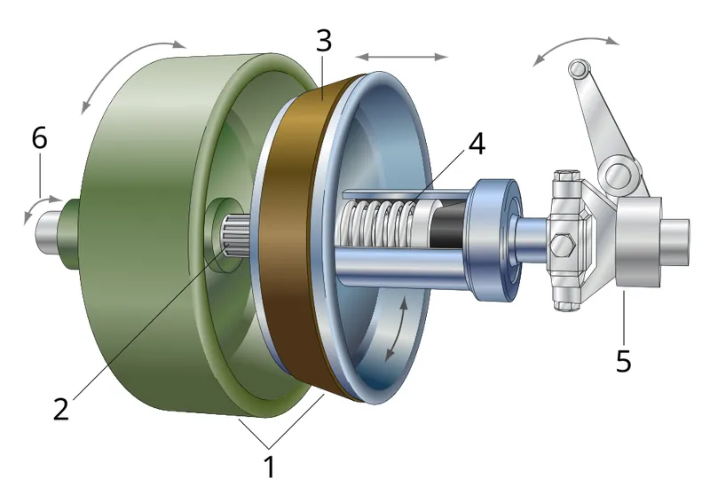

<figure class="eoc-pic eoc-pic-main"><figcaption><a href="https://commons.wikimedia.org/wiki/File:Cone_clutch.svg">Cone clutch</a> by Sweber.de, <a href="https://creativecommons.org/licenses/by-sa/3.0">CC BY-SA 3.0</a>, from Wikimedia Commons.</figcaption></figure>

A clutch that connects a driving shaft to a driven shaft by pressing friction surfaces together and disconnects it by pulling them apart, and that can slip in between so the drive takes up gently.

**In plain words:** Two grippy surfaces, flat discs or a cone in a cup, that a spring squeezes together so one spinning shaft drives the other, and that a lever or pedal pulls apart to disconnect the drive; letting them come together slowly lets them slip at first so the drive takes up smoothly. **Proper term:** Friction clutch (plate or disc clutch, cone clutch).

**Also called:** clutch; engageable friction coupling; plate clutch / disc (disk) clutch; single-plate and multi-plate (multi-disc) clutch; clutch pack; dry clutch (car) and wet clutch (runs in oil, e.g. motorcycles); cone clutch (cone and cup); synchroniser cone or synchro ring (the small cone clutch inside a manual gearbox); basket clutch (motorcycle multi-plate clutch with a slotted basket); clutch disc / friction disc / driven plate, pressure plate, diaphragm spring, release (throw-out) bearing (car clutch parts); handwheel or 'stop-motion' clutch knob (sewing machine friction clutch); Reibungskupplung, Kegelkupplung, Lamellenkupplung (German); 摩擦离合器 (Chinese).

## How it works

A spring presses the friction surfaces together, and the friction between them lets the driving part turn the driven part (Wikipedia 'Clutch'). To disconnect, a lever or pedal pushes the spring back so the surfaces part and the driven shaft can stop while the input keeps turning. While the surfaces are only lightly pressed, they slip, so the driven part is brought up to speed gradually instead of with a bang; the energy lost in slipping becomes heat (Plant Engineering). The [torque](../glossary.md#torque) it can carry depends on the clamping force, the grip of the lining (friction coefficient), the size of the rubbing ring and the number of rubbing faces; a cone clutch wedges its cone into a cup so the same spring force gives more grip (RoyMech 'Cone Clutch').

## Parts

A small assembly that acts as one unit: a driving member (a flywheel, plate, cup or basket on the input shaft), one or more friction discs or a cone that can slide along the other shaft on [splines](../glossary.md#spline), friction linings, a spring (coil springs or a diaphragm spring) that squeezes them together, and a release mechanism (lever, pedal, cable or hydraulics, fork and release bearing) that pushes the spring back to separate them.

## Everyday examples

- The clutch pedal in a manual car, which pulls a friction disc away from the engine's flywheel (Wikipedia)
- The hand lever on a motorcycle, which releases a stack of oil-bathed friction and steel plates (Wikipedia)
- The knob in the middle of a sewing machine's handwheel, loosened to stop the needle while winding a bobbin (Sailrite)
- The small cone clutches (synchronisers) inside a car's manual gearbox that match speeds before a gear engages (Wikipedia 'Cone clutch')

## When to use it

Use it when you need to connect and disconnect a drive while the motor keeps running, and the pick-up must be smooth rather than a bang: starting a heavy or high-inertia load from a running motor or engine, a winch or conveyor that must start gently, a vehicle or robot drive with a manual disconnect, a mechanism you want to be able to turn by hand without [back-driving](../glossary.md#back-driving) the motor, or a hand-set mechanism (like a clock's hands or a sewing machine's handwheel) that must be able to slip. It also gives built-in overload protection, since it slips rather than breaks when overloaded.

## When not to use it

Avoid it when the drive must never slip or must keep an exact angle between input and output (use a dog clutch, which locks by shape, or a solid coupling). If you only need overload protection and never switch it off, a friction slip clutch or ball-detent torque limiter is simpler. If it should engage automatically as a motor speeds up, use a centrifugal clutch; if it should drive one way only, use a [sprag](../glossary.md#sprag), roller or wrap-spring clutch. If it must switch by electrical signal, buy an electromagnetic clutch. For heavy, frequent or long slipping, a small printed clutch will overheat and wear; use a wet (oil-bathed) clutch or a fluid coupling instead (Plant Engineering; Wikipedia).

## Details

- **What it does (jobs):**
  - lock, and release by hand: a lever, pedal or knob connects and disconnects the drive while the motor keeps running (Wikipedia; Sailrite sewing-machine clutch)
  - slip or let go when overloaded: it slips instead of breaking something if the load is more than its spring setting allows (Slocum: in robots and machines a clutch often protects gears from overload)
  - change speed or turning force: lets a running motor pick up a stopped load smoothly, and in vehicles lets the gearbox be shifted (Wikipedia)
  - hold or release using power: electromagnetic, hydraulic and pneumatic versions engage or release on a signal (Plant Engineering)
- **Movement:** rotate+slide: both sides rotate continuously; to engage or disengage, one friction member slides a short distance along its shaft (a few millimetres in most clutches ⚑ [uncertain])
- **Directions it can move (degrees of freedom):** Engaged and not slipping: 0 between input and output (they turn as one). Disengaged: 1 (the two sides turn independently, like a plain bearing, per Slocum). While slipping: 1, with a friction drag between the sides. The sliding member also has 1 short [axial](../glossary.md#axial--radial) movement for engaging.
- **Special behaviour:**
  - quick-release: the drive can be disconnected instantly with a lever, pedal or knob, with no tools, even while the motor runs (Wikipedia)
  - torque-limiting (slips or clicks at a set force/torque): if the load torque is more than the clutch's clamp force can carry, it slips smoothly, which protects gears; the slip torque is set by the spring force and can be adjusted with a screw (Slocum)
- **How it holds:**
  - friction or clamping ([force-fit](../glossary.md#form-fit--force-fit--material-bond)): turning force passes only by friction between the pressed surfaces
  - spring force (a spring or springy part presses it in place): coil springs, a diaphragm spring or a leaf-spring washer supply the clamping force (Wikipedia; Sailrite)
- **Input and output:** Rotation in -> the same rotation out (1:1) when fully engaged; no output when disengaged; while slipping, the output turns slower than the input with torque limited to the clutch's capacity. Shafts in line on one axis. When fully engaged a dry clutch loses almost nothing ⚑ [uncertain: no figure found]; wet clutches lose some energy to the oil (Wikipedia). During every engagement the heat produced equals the energy given to the load (Plant Engineering). Back-drivable: yes when engaged; it passes torque in both directions and either shaft can drive.
- **Power:** passive (no power needed) for hand, lever, pedal or cable operated clutches. Powered versions exist: electric clutches engaged by an electromagnet and released by springs, or hydraulic and pneumatic ones; an electrically engaged clutch releases when power is lost, while a normally-engaged spring clutch stays engaged when its release power is lost (Plant Engineering; Slocum on normally engaged and normally disengaged clutches)
- **Load:** Medium to heavy in twist, set by the design: slip torque = number of rubbing faces x friction coefficient x clamping force x mean radius of the rubbing ring (Mustansiriyah lecture; RoyMech). Above that torque it slips rather than breaks. The spring's clamping force pushes along the shafts, so the shafts and bearings must carry that thrust and the release force (bearing close to the clutch and well aligned, per the Mustansiriyah lecture). Hand-operated clutches are limited to fairly small sizes because a person can only apply about 75 lb (about 330 N) (Plant Engineering).
- **Play and precision:** Not a position-holding device: because it can slip, it does not keep a fixed angle between input and output. If the disc slides on a spline there is [backlash](../glossary.md#backlash), so for precise drives Slocum recommends mounting the friction plate on a flexible diaphragm instead. [Misalignment](../glossary.md#misalignment) [tolerance](../glossary.md#tolerance): low; shafts and bearings must be well aligned and the plates must sit flat, or the clutch drags and chatters (Mustansiriyah lecture; Apex Tech Nation on warped discs).
- **Taking it apart:** tool-free quick release: the drive is connected and disconnected by hand with no tools; taking the clutch itself apart needs ordinary tools
- **How often it can be reused:** effectively unlimited: it is made to be engaged and disengaged over and over; the friction linings wear with slipping and are replaced from time to time (Wikipedia; Apex Tech Nation)
- **Sealing:** none: dry clutches are open inside a cover (a car's bellhousing), and wet clutches run inside the sealed, oil-filled engine or gearbox case (Wikipedia); the clutch itself does not seal anything
- **Adjustable:** yes: the slip torque can be adjusted by changing the spring pressure, often with a screw or nut (Slocum); cable-operated vehicle clutches also need their free play adjusted, and the pedal must return fully or the clutch slips (Apex Tech Nation)
- **Access needed:** end of a tube or shaft: the clutch fits on the ends of two in-line shafts; in use, only the lever, pedal, cable or knob needs to be reached
- **Materials:** Linings: organic resin with copper wire, or ceramic, in car clutches (Wikipedia); older and simple clutches used cork, leather, felt or wood against cast iron or steel (RoyMech friction materials table); wet clutches often use paper-based composites (Wikipedia, citation needed). Plates and cones: steel or cast iron. Springs: steel coil springs, a diaphragm (Belleville-type) spring or a leaf-spring washer. Asbestos linings were once common and are no longer acceptable (RoyMech; US EPA). Maker versions: printed PETG, nylon or PLA plates and cones, ideally with a glued-on cork, rubber or leather facing and a metal spring ⚑ [uncertain: not tested].
- **Heat, cold, water and wear:** Heat is the main limit: every engagement turns energy into heat (Plant Engineering), and each lining has a maximum temperature, e.g. cork and leather about 100 °C, felt about 140 °C (RoyMech). Oil, grease or hydraulic fluid on the faces causes slipping and chatter (Apex Tech Nation), and oil or water lowers friction (RoyMech table). Clamping springs lose force with heat cycling and age (Apex Tech Nation on diaphragm springs; Sailrite on flattened spring washers). Printed parts: PLA softens above about 60 °C and PETG is rated to about 80 °C (Prusa); plastic parts under constant spring load may [creep](../glossary.md#creep) and lose clamp force over time ⚑ [uncertain].

## Making it

- **Ways to make or get it:**
  - 3D print (FDM): plates, cones, hubs and levers for light-duty and demonstration clutches (e.g. the Printables clock friction clutch in PETG and the squeeze-fan clutch)
  - 3D print (resin): ⚑ [uncertain] possible for small demonstrators; no tested example found
  - CNC: turned steel or aluminium cones and plates for stronger clutches
  - laser cut: ⚑ [uncertain] flat plates and cork or rubber facing discs
  - off-the-shelf part: vehicle clutch discs, pressure plates and release bearings; motorcycle and RC friction plates; industrial and electromagnetic clutches (McMaster-Carr lists 'Clutches' and 'Clutch/Brakes'); Belleville (disc) springs and wave springs for clamping
- **Printing it in one piece (print in place):** no: the friction members must be free to separate and need a separate spring, so the parts are printed apart and assembled
- **Tools:** None to operate. To build or service: spanners and hex keys, [circlip](../glossary.md#circlip) pliers, and for vehicle clutches a clutch alignment (centring) tool to line up the disc with the flywheel (makers print these; several are on Printables). Old clutch dust may contain asbestos, so wet-wipe rather than blow or brush it (US EPA).
- **Difficulty:** moderate: the friction parts are simple discs or cones, but a clutch that engages smoothly and reliably also needs a spring, a sliding member on a spline or hex, a release lever with a thrust bearing, good alignment, and a facing that grips consistently

### 3D printing tips

1) Size it with the formula: slip torque = n x mu x W x R, with W the spring force, mu the friction coefficient, R the mean radius of the rubbing ring ((outer + inner radius) / 2 once worn in) and n the number of rubbing faces (n = discs on the driving side + discs on the driven side - 1) (Mustansiriyah lecture). A cone multiplies torque by 1 / sin(half-angle) for the same spring force (RoyMech). 2) Don't rely on smooth plastic rubbing on plastic: give it a real friction facing. RoyMech's table gives dry friction coefficients against steel of about 0.3 to 0.5 for cork and leather and 0.22 for felt, but cork and leather only survive about 100 °C and very low pressures (cork 0.1 MPa), so make the rubbing ring large ⚑ [uncertain: gluing facings onto printed plates is not tested in the sources]. 3) Print plates flat on the bed so the rubbing faces are smooth top or bottom surfaces rather than layer edges ⚑ [uncertain: common practice]. 4) Use a metal spring for the clamping force (coil, wave or disc spring) rather than squeezed plastic: plastic and even sprung washers relax over time and the clutch starts slipping, as with flattened sewing-machine clutch washers (Sailrite). 5) Material: PETG or nylon over PLA; the Printables clock friction clutch 'does not work printed in PLA' and needs a tolerance-calibrated PETG profile, and PLA softens above about 60 °C (Prusa), which slipping can reach. 6) Keep lubricant off the rubbing faces: the Printables squeeze-fan clutch designer found the clutch could not be greased or it would not grip, and that plastic plates slip under high load; oil on a real clutch causes slipping and chatter (Apex Tech Nation). 7) Let the sliding member run on a hex or spline section so it turns with its shaft but can move along it (Thang 'Friction clutch 3' shows discs 'slidingly splined'); expect a little backlash (Slocum). 8) Make the release lever push on a thrust bearing or a non-rotating collar, not directly on a spinning part, as a car's release bearing does ⚑ [uncertain]. 9) For a cone, use a cone angle of at least 8°, normally 12° to 15°; smaller angles jam in engagement (RoyMech) ⚑ [uncertain: plastic cones may need a larger angle]. 10) Test the slip torque with a torque screwdriver or a drill on a low clutch setting and re-check after the faces bed in ⚑ [uncertain].

### Buying one (off-the-shelf parts)

Search for: 'friction clutch', 'plate clutch', 'disc clutch', 'multi-disc clutch' or 'clutch pack', 'cone clutch', 'wet clutch', 'clutch disc' / 'friction disc', 'pressure plate', 'diaphragm spring' or 'Belleville spring' / 'disc spring', 'wave spring', 'release bearing' / 'throw-out bearing', 'clutch fork', 'clutch lever' and 'clutch cable'; 'clutch/brake' units and 'electromagnetic clutch' for powered versions; 'clutch facing' or 'friction material' sheet, cork sheet, 'brake lining'; motorcycle 'friction plates' and 'steel plates'; 'clutch alignment tool'. For overload protection only (not switched on and off), look at 'slip clutch' or 'torque limiter' instead.

## Rules of thumb

- Torque capacity T = n x mu x W x R, where n = number of pairs of rubbing faces, mu = friction coefficient, W = axial clamping force and R = mean radius; for worn-in (uniform wear) faces R = (outer radius + inner radius) / 2; for a multi-disc pack n = n1 + n2 - 1, where n1 and n2 are the discs on the driving and driven shafts (University of Mustansiriyah lecture 'Friction Clutches', General Notes).
- Cone clutch (uniform wear): T = F x mu x (ro + ri) / (2 x sin alpha), so a small cone angle alpha multiplies the torque; the cone angle is always above 8° and normally 12° to 15°, because below that the clutch is liable to jam in engagement (RoyMech 'Cone Clutches').
- A plate clutch is the special case of a cone clutch with sin alpha = 1 (Mustansiriyah lecture), and a cone clutch carries more torque than a plate clutch of the same size but is now mostly used for low peripheral speeds (Wikipedia 'Cone clutch'; RoyMech).
- Friction coefficients against cast iron or steel (dry / oiled): cork 0.3-0.5 / 0.15-0.25, leather 0.3-0.5 / 0.12-0.15, felt 0.22 / 0.18, wood 0.2-0.35 / 0.16, steel on steel 0.15-0.20 / 0.05; maximum temperatures about 100 °C for cork and leather, 140 °C for felt, 300 °C for iron and steel, up to 500 °C for carbon-graphite (RoyMech 'Friction Materials', general values only).
- Oil cuts the friction coefficient to roughly a quarter to a half of its dry value (RoyMech table), which is why wet clutches stack more discs to avoid slipping (Wikipedia).
- The heat generated in each engagement equals the energy given to (or taken from) the load, so frequent or long slipping needs a larger clutch or one running in oil (Plant Engineering, 'Selection factors for clutches & brakes'); slipping should be kept short to limit wear (Wikipedia).
- Hand operation is limited to about 75 lb (about 330 N) of force, so manual clutches are used on small equipment (Plant Engineering).
- A clutch plate sliding on a spline brings backlash; for precise drives mount the plate on a diaphragm instead (Slocum, FUNdaMENTALs of Design, Topic 5, PDF p. 40).
- Design with the uniform-wear assumption for clutches that have run in; the uniform-pressure assumption applies only to new linings (RoyMech 'Axial Plate Clutch').
- Keep oil and grease off the linings: contamination causes slipping and chatter and a soaked disc cannot be cleaned; fix the leak before replacing the disc (Apex Tech Nation).

## Common failures

1) Slipping: worn linings, oil contamination, a weak spring or a lever or pedal that does not fully return (Apex Tech Nation); replace linings and springs, fix leaks, adjust the [linkage](../glossary.md#linkage). 2) Chatter or judder while engaging: oil or grease on the faces, glazed or heat-spotted surfaces from long slipping, or broken damper springs (Apex Tech Nation); avoid 'riding' the clutch. 3) Drag (won't fully release): warped disc, air in hydraulics or worn cylinders, seized pilot bearing (Apex Tech Nation), or a misaligned printed assembly. 4) Clamping force fading as sprung washers flatten, so owners over-tighten the knob until it won't release (Sailrite sewing-machine clutch). 5) Printed clutches: plastic faces that slip under high load or can't be lubricated elsewhere (Printables squeeze-fan clutch), PLA parts softening or deforming from slip heat (Prusa), and parts that bind because of tight tolerances (Printables clock friction clutch needs a calibrated PETG profile).

## Safety

Old clutch linings may contain asbestos and you cannot tell by looking; don't blow or brush the dust, use the wet-wipe method, and wash work clothes separately (US EPA). Engaging the clutch starts the driven machine moving, so keep hands clear of the output when engaging. Clutch plates get hot after slipping (Plant Engineering) ⚑ [uncertain: burn risk not stated in source]. Pressure-plate and diaphragm springs store a lot of energy; release them evenly when dismantling ⚑ [uncertain]. A slipping or disengaged clutch no longer holds a load, so never rely on it to stop a hoist or winch drum from running back; use a brake.

## Related

- Dog clutch (claw clutch): locks by interlocking teeth, so it never slips, but must be engaged when stopped or at matched speed
- Friction slip clutch (slip coupling): the same friction discs, always engaged and set to slip only when overloaded, not switched on and off
- Centrifugal clutch: friction shoes thrown outward by speed engage it automatically as the motor speeds up (Wikipedia)
- Electromagnetic clutch and clutch/brake: friction or magnetic engagement switched by electricity (Plant Engineering; Wikipedia)
- Belt clutch: an [idler](../glossary.md#idler) pulley tightens a slack belt to engage drive, as on lawn mowers and snow blowers (Wikipedia; Thang 'Belt clutch 1a')
- Expanding-shoe or expanding-bush clutch: a wedge expands a sleeve against the inside of a drum (Thang 'Friction clutch 5')
- Wrap-spring clutch: a coil spring grips the shaft in one direction; also used as a single-revolution clutch (Wikipedia)
- Synchromesh (synchroniser): a small cone clutch that matches speeds before a dog clutch engages (Wikipedia)
- Fluid coupling and torque converter: pass drive through oil with smooth slip and no wear (Wikipedia)
- Magnetic particle, eddy-current and [hysteresis](../glossary.md#hysteresis) clutches: slip smoothly by magnetism, with controllable torque (Plant Engineering)
- Disc brake: the same friction parts, but holding against a fixed frame instead of connecting two shafts

## Make it yourself

- [Friction Clutch for Clock (jattie, Printables) (URL from Printables API, page not opened)](https://www.printables.com/model/948932-friction-clutch-for-clock): Adjustable printed friction clutch for a pendulum clock, so the hands can be set without disconnecting the drive train; Fusion 360 source included; needs a tolerance-calibrated PETG profile and does not work in PLA *(licence: GPL 3.0)*
- [Clutch for Squeeze fan (felixlamb, Printables) (URL from Printables API, page not opened)](https://www.printables.com/model/536698-clutch-for-squeeze-fan): A first-attempt printed clutch combined with a gear so a hand-squeeze fan can freewheel; the designer's honest notes explain why it slips under high load and can't be lubricated *(licence: CC BY-NC)*
- [VW Engine - Clutch and Flywheel (bglasford1, Printables) (URL from Printables API, page not opened)](https://www.printables.com/model/1048257-vw-engine-clutch-and-flywheel): Printable clutch and flywheel parts for a model VW engine, useful for seeing the parts of a car clutch *(licence: CC BY-NC)*
- [Cone Clutch (ravindra.mohan09, Sketchfab)](https://sketchfab.com/3d-models/cone-clutch-08a6044f319440abbc99dc61e6fa2801): Free downloadable 3D model of a cone clutch that can be viewed and rotated in the browser (details read via the Sketchfab API) *(licence: CC BY)*

## Pictures, videos and models

- [Cone clutch.svg (Wikimedia Commons, by Sweber.de)](https://commons.wikimedia.org/wiki/File:Cone_clutch.svg): Labelled schematic of a cone clutch: male and female cones, the male cone sliding on splines, the friction material, the return spring and the release control *(licence: CC BY-SA 3.0)*
- [Car clutch.png (Wikimedia Commons, by Genetics4good)](https://commons.wikimedia.org/wiki/File:Car_clutch.png): 3D model of a dry car clutch, used as the 'Diagram of a dry clutch' in Wikipedia's 'Clutch' article *(licence: CC BY-SA 3.0)*
- [Basket clutch.png (Wikimedia Commons, by Genetics4good)](https://commons.wikimedia.org/wiki/File:Basket_clutch.png): 3D model of a motorcycle-style multi-plate basket clutch *(licence: CC BY-SA 3.0)*
- [Friction clutch 3 (Nguyen Duc Thang, YouTube thang010146)](https://youtu.be/_mMIk3RcPA0): CAD animation of a spring-loaded multiple-disc clutch with outer discs splined to a drum and inner discs splined to the driven shaft, released by a lever *(licence: link only (standard YouTube licence))*
- [Friction clutch 4 (Nguyen Duc Thang, YouTube thang010146)](https://youtu.be/QqaWJ7PDSg8): CAD animation of a spring-engaged cone clutch that is disconnected by pressing a pedal *(licence: link only (standard YouTube licence))*

## Needs confirming

⚑ marks something nobody has confirmed yet: a fact the research could not confirm from a source, a finder value that is a best guess, or an open point from the research notes. Corrections are welcome (see `research/needs-confirming.md`).

- ⚑ 13 sentences on this page marked [uncertain].
- ⚑ Finder value `connects` = shaft (best guess): worked out from its name, but joining parts is not one of its two main jobs

## Sources

- <https://en.wikipedia.org/wiki/Clutch>
- <https://en.wikipedia.org/wiki/Cone_clutch>
- <https://commons.wikimedia.org/wiki/File:Cone_clutch.svg>
- <https://commons.wikimedia.org/wiki/File:Car_clutch.png>
- <https://commons.wikimedia.org/wiki/File:Basket_clutch.png>
- <https://roymech.org/Useful_Tables/Drive/Clutches.html>
- <https://roymech.org/Useful_Tables/Drive/Axial_Plate_clutch.html>
- <https://roymech.org/Useful_Tables/Drive/Cone_Clutch.html>
- <https://roymech.org/Useful_Tables/Drive/Brake_Clutch_mat.html>
- <https://uomustansiriyah.edu.iq/media/lectures/5/5_2021_12_11!08_29_17_PM.pdf>
- <https://www.plantengineering.com/selection-factors-for-clutches-brakes/>
- <https://pergatory.mit.edu/resources/FUNdaMENTALs%20Book%20pdf/FUNdaMENTALs%20Topic%205.PDF>
- <https://cs448m.github.io/lectures/machines/doc/1.pdf>
- <https://youtu.be/_FKePQ8PvY0>
- <https://youtu.be/_mMIk3RcPA0>
- <https://youtu.be/QqaWJ7PDSg8>
- <https://youtu.be/JlQ0v77oGtE>
- <https://youtu.be/fM-OMJnaLks>
- <https://www.sailrite.com/The-Ultrafeed-and-Posi-Pin>
- <https://apextechnation.com/articles/clutch-diagnosis-guide>
- <https://www.epa.gov/asbestos/current-best-practices-preventing-asbestos-exposure-among-brake-and-clutch-repair-0>
- <https://www.mcmaster.com/products/clutches/>
- <https://help.prusa3d.com/article/pla_2062>
- <https://help.prusa3d.com/article/petg_2059>
- <https://api.printables.com/graphql/>
- <https://api.sketchfab.com/v3/models/08a6044f319440abbc99dc61e6fa2801>
