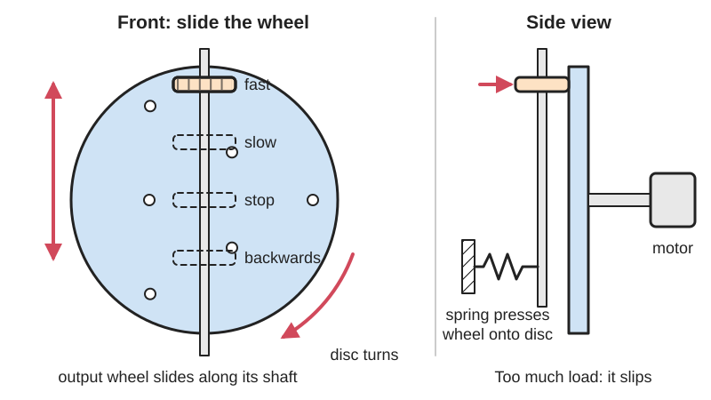
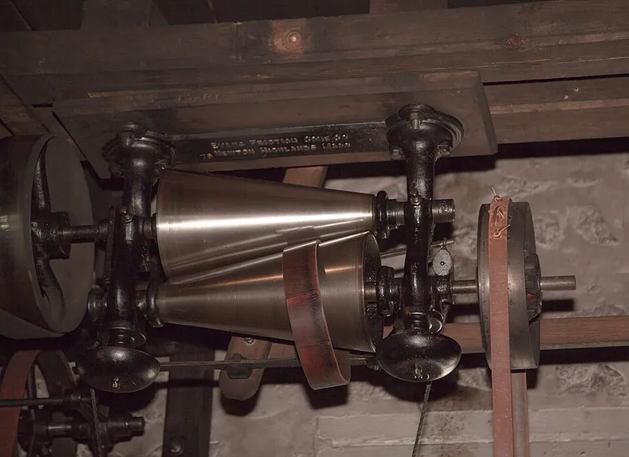
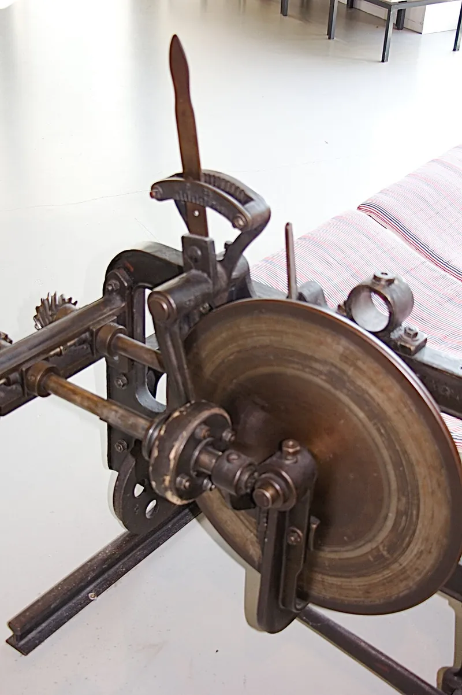

<figure class="eoc-pic eoc-pic-main"><picture><source media="(prefers-reduced-motion: reduce)" srcset="../media/drawn/friction-drives-and-cvts.svg"></picture><figcaption><strong>Animation.</strong> Diagram drawn for the encyclopaedia from the research notes. ⚑ Needs confirming: a drawing can simplify or get details wrong; a real photo or a better diagram is welcome.</figcaption></figure>
<figure class="eoc-pic"><figcaption><strong>How it works.</strong> <a href="https://commons.wikimedia.org/wiki/File:Evans_friction_cone_-_Hagley_Aug_2009.jpg">Evans friction cone - Hagley Aug 2009</a> by Ukexpat, <a href="https://creativecommons.org/licenses/by-sa/3.0">CC BY-SA 3.0</a>, from Wikimedia Commons.</figcaption></figure>
<figure class="eoc-pic"><figcaption><strong>Photo.</strong> <a href="https://commons.wikimedia.org/wiki/File:TEZ-Reibradgetriebe_7271.JPG">TEZ-Reibradgetriebe 7271</a> by Karl Gruber, <a href="https://creativecommons.org/licenses/by-sa/4.0">CC BY-SA 4.0</a>, from Wikimedia Commons.</figcaption></figure>

A wheel or roller pressed against a wheel, disc, cone, ring or ball passes on rotation purely by friction, so it is smooth, quiet and free of play ([backlash](../glossary.md#backlash)), slips instead of breaking when overloaded and, when the contact point can be moved across a disc or cone, gives a smoothly variable speed ratio (a continuously variable transmission).

**In plain words:** A wheel, often with a rubber tyre, pressed hard against another wheel, a disc or a cone so it turns it by grip alone, with no teeth; slide the wheel across the disc or along the cone and the output speed changes smoothly. **Proper term:** Friction drive (friction wheel drive, traction drive) and friction continuously variable transmission (CVT, variator).

**Also called:** friction wheels / friction gearing (507 Mechanical Movements #32 and #45); friction roller drive / rolling-contact drive (Nguyen Duc Thang); traction drive (usually hardened steel rollers running in a special traction oil; Wikipedia 'Friction drive'; NASA/Loewenthal); idler-wheel drive / rim drive (record-player turntables; Korf Audio); bottle dynamo / sidewall dynamo (bicycle generator driven by a roller on the tyre); friction-disc transmission / disc-and-wheel drive (early cars such as the Lambert and Metz; snow blowers; Wikipedia); brush-wheels (a disc driving a wheel at a variable radius; 507 Mechanical Movements #28); ball-and-disk integrator (the same disc-and-wheel drive used as a mechanical calculator); cone drive / Evans friction cone / cone-ring transmission; variator / speed variator / friction disk, cone, ball or sphere variator (Thang); toroidal CVT (e.g. Nissan Extroid (brand)); tilting-ball variator / Kopp variator; NuVinci or Enviolo (brand) bicycle hub; infinitely variable transmission (IVT), when the ratio range passes through zero; belt CVT / variable-pulley drive / Variomatic (brand) (a V-belt between cone-shaped pulleys: a close relative covered under belt drives).

## How it works

Two smooth rolling surfaces are pressed together, and the grip (friction, or 'traction' when an oil film is involved) at the contact passes the turning force from one to the other; the most force it can pass on is the pressing force times the friction coefficient (Loewenthal, NASA; Wikipedia 'Friction drive'). The speed ratio is the ratio of the rolling radii at the contact, e.g. a 1 mm motor shaft driving a 50 mm rubber-rimmed disc gives 1:50 (Wikipedia). If a wheel presses on the flat face of a disc, the disc's surface moves faster the further out the wheel sits, so sliding the wheel along its shaft changes the ratio smoothly, to zero at the centre and into reverse beyond it; cones, rings, tilting balls and toroidal discs do the same thing with other shapes (Wikipedia 'Friction drive' and 'Continuously variable transmission'; Thang section 1.13). If the load gets too big the contact slips instead of breaking, and the surfaces always [creep](../glossary.md#creep) a little, so the output isn't exactly in step with the input (Wikipedia).

## Parts

A few parts to a small assembly: a driving wheel or roller (often rubber-tyred or with an [O-ring](../glossary.md#o-ring)), the driven wheel, disc, cone, ring or ball, shafts and bearings, and something that presses them together (a spring, weight, screw or a load-sensing cam or pivot). A variator adds a slide, screw or tilting cage that moves the contact point; industrial traction drives use hardened steel rollers in a sealed case of traction oil (Thang, '2700 Animated Mechanical Mechanisms' sections 1.4 and 1.13; Wikipedia 'Friction drive'; Loewenthal, NASA).

## Everyday examples

- A bicycle bottle dynamo, whose small roller is driven by the side of the tyre (Wikipedia 'Bottle dynamo')
- Old idler-wheel record players, where a rubber-tyred wheel links the motor shaft to the platter rim (Korf Audio; Loewenthal)
- Snow blowers and some self-propelled lawn mowers with a friction-disc drive (Wikipedia 'Continuously variable transmission'; Loewenthal)
- Motorised bicycles, where a rubber-coated roller on the motor drives the bike wheel, and friction-drive scooters such as Go-Peds (Wikipedia 'Friction drive')

## When to use it

When you want a smooth, quiet, backlash-free drive and don't need exact positioning: driving a turntable, a spool or a wheel from a small motor; big speed reductions from a small shaft without fine gears; drives that should slip rather than break when jammed (toys, feeders, winders); a clutch you can engage by pressing the wheels together; and when you want to change speed smoothly while running (disc, cone or ball variator) (Wikipedia 'Friction drive'; Loewenthal). It is also an easy way to drive something round with no shaft access, such as a tyre or a rim.

## When not to use it

Where exact positioning or timing matters: use gears, a toothed timing belt or a chain instead, or add a sensor on the output (Wikipedia 'Friction drive'). Where high [torque](../glossary.md#torque) must pass through a small, dry printed drive: use gears. In wet, oily or dusty places that ruin grip: use gears or a toothed belt. For a stepped speed choice, step pulleys or a gearbox are simpler and more efficient than a variator. For high-power variable speed, a belt CVT or an electric motor speed controller is usually more practical than a home-made friction variator.

## Details

- **What it does (jobs):**
  - change speed or turning force: a small roller driving a big wheel gives a large speed reduction without fine teeth (Wikipedia 'Friction drive')
  - slip or let go when overloaded: the contact slips instead of breaking, which protects the mechanism (Wikipedia)
  - change the kind of motion: a wheel rolling on a track or a rod turns rotation into straight movement (Wikipedia 'Friction drive', wheel and track)
- **Movement:** rotate: continuous rotation for fixed-ratio drives; rotate+slide for variators, where the wheel or ring slides across a disc or along a cone (or balls or rollers tilt) to change the ratio while running
- **Directions it can move (degrees of freedom):** 1 for a fixed-ratio drive: the output turns with the input (apart from small creep and slip). A variator adds a second, separate input (the position of the wheel or the tilt of the balls) that sets the ratio
- **Special behaviour:**
  - torque-limiting (slips or clicks at a set force/torque): it slips when the load exceeds the grip, set by the pressing force (Wikipedia 'Friction drive'); but early friction drives were also vulnerable to slip damage in an overload, because their pressing force was fixed at assembly (Loewenthal)
  - motion conversion (e.g. rotary to linear): a driven wheel pressed on a track, belt or smooth rod moves it in a straight line (Wikipedia, wheel and track)
  - one-way (moves freely one way, locks the other): some wedge-loaded [idler](../glossary.md#idler) layouts drive only in one direction and [freewheel](../glossary.md#freewheel) in the other (Thang, 'Friction roller drive 6' and '7')
  - quick-release: lifting the wheel away stops the drive, so it doubles as a clutch; a bicycle bottle dynamo can be completely disengaged (Wikipedia 'Bottle dynamo'; Thang 'Friction roller drive 8': 'can be used as a controllable clutch')
- **How it holds:**
  - friction or clamping ([force-fit](../glossary.md#form-fit--force-fit--material-bond)): torque passes only through the grip at the pressed contact
  - not a holding joint (it moves or passes on motion): it is a drive, not a fastening
- **Input and output:** Continuous rotation -> continuous rotation (or rotation -> straight line for a wheel on a track or rod). Ratio: fixed, set by the rolling radii (e.g. 1:50 for a 1 mm shaft on a 50 mm rubber rim; Wikipedia), or continuously variable on disc, cone, ball and toroidal variators, including through zero to reverse on disc types (Wikipedia 'Continuously variable transmission'). Efficiency: dry rubber-tyred drives lose energy in the squashed tyre and in slip ⚑ [uncertain: no figure found]; well-designed oil-film traction contacts can reach 99% or more if spin and [misalignment](../glossary.md#misalignment) are kept small (Loewenthal, NASA); tilting-ball CVTs are typically 70-89% (Wikipedia 'NuVinci'); a belt CVT is about 88% (Wikipedia 'CVT'). Shafts: parallel (cylinders side by side), intersecting (wheel on a disc face or a cone), or in line (toroidal, ball and planetary traction drives). Back-drivable: yes for plain wheel pairs, since friction works both ways; wedge-loaded idler layouts drive only one way (Thang).
- **Power:** passive (no power needed) in itself; it is usually driven by a motor, and the ratio of a variator can be set by hand, by a screw or by a servo (James Bruton's ball CVT tilts its spheres with servos; Hackaday)
- **Load:** Light to heavy depending on type. Dry drives with leather, rubber or plastic tyres are for light duty (record players, lawn mowers, hand tools, snow blowers) because the soft tyre's wear and heat limit the power; oil-lubricated hardened steel rollers carry at least ten times more (Loewenthal, NASA), up to e.g. a 373 kW traction reducer for a torpedo and a 75 kW planetary traction drive (Loewenthal). Strong only in the rolling direction; the pressing force loads the shafts and bearings sideways (Korf Audio), and misalignment turns part of the grip into useless side force (Loewenthal).
- **Play and precision:** No play (backlash) at all, since there are no teeth (Loewenthal, NASA), and very smooth. But the contact always creeps slightly and slips when overloaded, so it can't be used for exact positioning unless a sensor measures the output (Wikipedia 'Friction drive'). Sensitive to misalignment: shafts that are not parallel cause scraping, side loads and lost grip (Korf Audio; Loewenthal). Out-of-round wheels cause speed flutter (Korf Audio).
- **Taking it apart:** removable: wheels, discs and cones sit on shafts with [set screws](../glossary.md#set-screw), keys or press fits and can be taken apart; rubber tyres and O-rings are replaced when worn (Korf Audio)
- **How often it can be reused:** many times for the rigid parts; the rubber or polyurethane tyre is a wear part that hardens, cracks and flattens with age and gets replaced (Korf Audio; Loewenthal)
- **Sealing:** none for dry friction drives, which must be kept clean and dry; oil-lubricated traction drives and CVTs run in a closed, oil-filled housing ⚑ [uncertain]
- **Adjustable:** Yes: the pressing force can be set with a spring, screw or nut (507 Mechanical Movements #413 squeezes a rubber disc outward with a nut to increase grip; Thang), and on variators the ratio is adjusted continuously while running by moving the wheel, ring or balls (Thang section 1.13).
- **Access needed:** end of a tube or shaft: wheels, discs and cones slide onto shaft ends; you also need room for the pressing spring or adjuster
- **Materials:** Driving wheels faced with rubber, polyurethane, leather, fibre or (historically) paper, running on metal or plastic; 507 Mechanical Movements #32 recommends leather or, better, vulcanised rubber facing. Oil-lubricated traction drives use hardened bearing steel rollers with a traction fluid (Loewenthal). Maker versions: PLA or PETG hubs, discs and cones with an O-ring, rubber band, printed TPU tyre or cast polyurethane tyre (Hackaday tyre tests; Printables CVT models).
- **Heat, cold, water and wear:** Water, oil and grease reduce grip (RoyMech: leather on metal about 0.6 dry, 0.4 wet), and many oil additives markedly reduce traction (Loewenthal). Rubber tyres age: they harden, crack, warp and lose grip, and last about a decade in record players (Korf Audio); soft friction materials lose flexibility and wear, and their heat and wear limits set the power (Loewenthal). Sustained overloads can break down the oil film in traction drives and cause failure (Loewenthal). Printed PLA parts soften in heat and creep under the constant pressing force ⚑ [uncertain]. Dust on the contact causes slip ⚑ [uncertain].

## Making it

- **Ways to make or get it:**
  - 3D print (FDM): hubs, discs, cones and frames, with an O-ring, rubber band or TPU tyre for grip (Printables 'Beltless CVT', 'Simple Model CVT Transmission')
  - laser cut: flat discs and wheel cores ⚑ [uncertain]
  - woodwork: discs and wheels for demonstration models ⚑ [uncertain]
  - off-the-shelf part: rubber-tyred drive wheels, O-rings, bottle dynamos, bike friction-drive kits, belt CVT pulleys, industrial variators and traction drives
- **Printing it in one piece (print in place):** no: the wheel, disc or cone are printed separately and assembled on shafts and bearings with a spring for pressure and an elastomer tyre for grip (Printables 'Beltless CVT' bill of materials: 608 bearings, linear bearings, a T8 lead screw and motors)
- **Tools:** Hex keys or screwdrivers for set screws and mounting; a way to set the pressing force (spring, adjusting screw or nut); for printed versions, bearings, bolts and O-rings pressed on by hand
- **Difficulty:** easy to moderate: a spring-pressed rubber-tyred wheel is easy to make and print; a smooth, reliable variable-ratio drive takes care with alignment, pressing force and tyre material; high-power traction drives are hard, so buy one

### 3D printing tips

1) Don't rely on bare printed plastic for grip: slick printed plastic is useless for all but the most basic wheels (Hackaday, 2019). Give the driving wheel an elastomer tyre: an O-ring or rubber band in a groove, a printed TPU tyre, or a cast polyurethane tyre. Hackaday (2024) reported a test of PLA, TPU, sprayed-rubber and cast-urethane tyres; readers summarising the video in the comments say cast urethane did best, printed TPU next, and bare PLA and sprayed rubber were poor ⚑ [uncertain]. 507 Mechanical Movements #32 gives the same advice: face one wheel with leather or, better, rubber. 2) Press the wheels together with a spring rather than a fixed screw: springs give fairly constant pressure despite manufacturing errors (Thang, 'Friction roller drive 1'). Better still, pivot the driving wheel so the load pulls it harder into contact (Thang, 'Friction roller drive 9'); industrial traction drives use a torque-sensing loading mechanism for the same reason (Loewenthal). 3) Carry the shafts on ball bearings (e.g. 608 skate bearings), because the pressing force pushes the shafts sideways (Printables 'Beltless CVT'; Korf Audio). 4) Keep shafts parallel or truly square: misalignment causes scraping, side loads and lost grip (Korf Audio; Loewenthal). 5) On disc and cone variators keep the wheel's contact edge narrow or rounded: the inner and outer edges of a wide wheel scrub on the disc, wearing it and wasting power (Wikipedia 'Friction drive'; Loewenthal on 'spin'). 6) Move the wheel with a lead screw or a slider on linear bearings (Printables 'Beltless CVT' uses a T8 lead screw, LM8UU bearings and a stepper motor; Thang's variators use a screw). 7) Make shafts strong: in 'Simple Model CVT Transmission' a printed cone shaft broke along the [layer lines](../glossary.md#layer-lines) and the designer went to 4 walls; a steel shaft through the printed part is safer. 8) Keep the contact clean and dry: oil and grease cut friction (RoyMech's table lists leather on clean metal at 0.6 and on wet metal at 0.4), and many oil additives markedly reduce traction (Loewenthal). 9) Don't leave a rubber wheel pressed on when stopped for long: permanently loaded idler tyres develop flat spots (Korf Audio). 10) Print discs and cones so the contact face is smooth and round; out-of-round wheels make the speed pulse (Korf Audio) ⚑ [uncertain: best print orientation not found]. 11) If it slips, replace a worn or hardened tyre rather than just pressing harder, which overloads bearings (Korf Audio).

### Buying one (off-the-shelf parts)

O-rings (nitrile rubber), rubber-tyred wheels and rollers, polyurethane-tread wheels and drive rollers, turntable idler wheels, drive-roller kits for bicycles (friction-drive motor kits), bottle (sidewall) dynamos, ball bearings (608 and similar), linear bearings and lead screws for moving the wheel, compression and extension springs, belt CVT (variable-pitch) pulleys and belts from scooters, industrial speed variators and traction drives, traction fluid ⚑ [uncertain].

## Rules of thumb

- The largest force the contact can pass on = friction (traction) coefficient x pressing force; transmitted torque = that force x rolling radius (Loewenthal, NASA: traction coefficient = traction force / normal load). Example arithmetic: with a coefficient of 0.5 you need to press with at least 2 N for every 1 N of drive force.
- Design with a friction coefficient 20-30% below the highest measured value, as a margin against slip (Loewenthal, NASA).
- Speed ratio = ratio of the rolling radii at the contact; e.g. a 1 mm motor shaft on a 50 mm rubber-rimmed disc gives 1:50 (Wikipedia 'Friction drive'). On a disc, output speed is proportional to the wheel's distance from the disc centre, zero at the centre and reversed beyond it (Wikipedia 'Continuously variable transmission'; 'Ball-and-disk integrator').
- Don't over-press: the rolling-contact [fatigue](../glossary.md#fatigue) life falls with the cube of the contact load (Loewenthal, NASA).
- Oil-lubricated hardened steel rollers carry at least ten times the load of rubber or reinforced plastic running dry on cast iron (Loewenthal, NASA).
- For a wedge-type self-loading idler (a free roller wedged between input and output), it only drives if tan((a+b)/2) is less than the friction coefficient, where a and b are the wedge angles (Thang, 'Friction roller drive 6').
- Efficiency guide: traction contacts with little spin and misalignment can exceed 99% (Loewenthal, NASA); tilting-ball CVTs are typically 70-89% (Wikipedia 'NuVinci continuously variable transmission'); belt CVTs about 88% (Wikipedia 'Continuously variable transmission').
- Approximate dry friction coefficients: leather on clean metal about 0.6 (0.4 wet), polystyrene on steel 0.3-0.35, nylon on nylon 0.15-0.25; RoyMech warns these are guidance values only (RoyMech 'Coefficients of Friction').
- Never raise the pressing force to [cure](../glossary.md#cure) slip from a worn or glazed tyre; replace the tyre (Korf Audio).

## Common failures

1) Slip from a worn, glazed, hardened or oily tyre; replace the tyre rather than pressing harder (Korf Audio). 2) Flat spots on rubber tyres left pressed on while stopped (Korf Audio). 3) Scraping, squeaking and bearing wear from misaligned shafts or worn idler bearings (Korf Audio). 4) Worn, overheated edges on disc drives because the wheel's inner and outer edges scrub (Wikipedia 'Friction drive'). 5) Slip damage after an overload, because a pressing force set once at assembly can't follow the load (Loewenthal); fix with a load-sensing pivot or cam. 6) Pitting (surface fatigue) of hard rollers that are pressed too hard (Loewenthal). 7) Speed flutter from out-of-round wheels or platters (Korf Audio). 8) Printed shafts snapping along layer lines (Printables 'Simple Model CVT Transmission'). 9) A plastic belt or wheel slipping on smooth plastic cones (Hackaday, Lego CVT).

## Safety

Strong in-running pinch points where the wheel meets the disc or tyre: keep fingers, hair and loose clothing away ⚑ [uncertain]. Pressing springs store energy. A slipping drive can suddenly grip again, and a variator set to zero ratio may start moving when the setting is changed ⚑ [uncertain].

## Related

- Belt drives (timing, round and V-belt): pass rotation by friction too (except toothed belts), between shafts further apart; a belt CVT uses cone-shaped pulleys whose gap changes (Wikipedia 'Continuously variable transmission')
- Spur gear train: positive drive with no slip but with backlash and tooth noise
- Friction slip clutch (slip coupling): uses friction on purpose as an overload slip
- Friction clutch (plate or cone clutch): friction to connect and disconnect, not to change ratio
- Threadless ball screw (rolling-ring drive): tilted rolling rings pressed on a smooth shaft turn rotation into straight motion by friction
- Capstan cable drive: a zero-backlash drive using a cable wrapped on drums instead of pressed wheels
- Magnetic coupling and magnetic gear: pass torque with no contact at all
- Planetary gear set: used in 'eCVT' hybrid transmissions to vary the ratio with gears and a motor (Wikipedia)
- Anti-backlash gear: another way to remove backlash while keeping teeth
- Rack and pinion: the toothed way to make straight motion from rotation, where a roller on a bar can slip

## Make it yourself

- [Beltless CVT (cndewil, Printables) (URL from Printables API, page not opened)](https://www.printables.com/model/1290012-beltless-cvt): Motorised CVT demo that uses a wheel instead of a belt, moved by a T8 lead screw on linear bearings, with 608 bearings, a DC gear motor and a NEMA 17 stepper *(licence: CC BY)*
- [Simple Model CVT Transmission (cakeman435, Printables) (URL from Printables API, page not opened)](https://www.printables.com/model/1003262-simple-model-cvt-transmission): 99% printed hand- or drill-driven cone CVT: a rubber band between two opposed cones is slid up and down to change the output speed *(licence: CC BY-NC)*
- [Friction wheel for small stepper motor 24(28)-BYJ-48 (mnentwig, Printables) (URL from Printables API, page not opened)](https://www.printables.com/model/1565754-friction-wheel-for-small-stepper-motor-2428-byj-48): Parametric friction wheel (FreeCAD Python macro included) to couple a small stepper motor loosely to another wheel *(licence: Creative Commons Public Domain (as listed on Printables))*
- [HUANGYAN920 Mechanical: interactive mechanism library (entries FRICTION-WHEEL no. 43 and FRICTION-DISK no. 97)](https://huangyan920.github.io/Mechanical/): Browser animations with sliders for a friction-wheel drive and a friction-disc variable-speed drive *(licence: MIT (code))*
- [Ball CVT Drives Robot From A Constant Speed Motor (Hackaday, about James Bruton's build)](https://hackaday.com/2021/06/29/ball-cvt-drives-robot-from-a-constant-speed-motor/): See-it-built article and video of a tilting-sphere CVT on an RC vehicle: 1:1 at 45 degrees, reverse by tilting the other way, and neutral through a hole in the sphere *(licence: link only)*

## Pictures, videos and models

- [TEZ-Reibradgetriebe 7271.JPG (Wikimedia Commons, by Karl Gruber)](https://commons.wikimedia.org/wiki/File:TEZ-Reibradgetriebe_7271.JPG): Photo of a friction-wheel transmission (Reibradgetriebe) on a textile machine at the Textilzentrum Haslach, Austria *(licence: CC BY-SA 4.0)*
- [28. Brush-wheels (507 Mechanical Movements)](https://507movements.com/mm_028.html): 1868 drawing and animation of a wheel driven by the face of a disc, with the speed changed by moving the wheel towards or away from the centre; notes that facing with india-rubber increases grip *(licence: book public domain; website animation link only)*
- [Friction cone variator 1 (Nguyen Duc Thang, thang010146, YouTube)](https://www.youtube.com/watch?v=nCav0rm53uc): CAD animation of a spring-pressed roller moved along a friction cone by a screw to change output speed (description from Thang's '2700 Animated Mechanical Mechanisms' PDF, section 1.13) *(licence: link only (standard YouTube licence))*
- [Tilting ball variator.svg (Wikimedia Commons, by Sleske)](https://commons.wikimedia.org/wiki/File:Tilting_ball_variator.svg): Schematic of a tilting-ball variator, as used in a type of CVT *(licence: CC BY-SA 3.0)*
- [Evans friction cone - Hagley Aug 2009.jpg (Wikimedia Commons, by Ukexpat)](https://commons.wikimedia.org/wiki/File:Evans_friction_cone_-_Hagley_Aug_2009.jpg): Photo of an Evans friction cone speed changer: two opposed cones with a movable belt, driven from a water turbine in the Hagley Museum machine shop *(licence: CC BY-SA 3.0 (also GFDL 1.2 or later))*

## Needs confirming

⚑ marks something nobody has confirmed yet: a fact the research could not confirm from a source, a finder value that is a best guess, or an open point from the research notes. Corrections are welcome (see `research/needs-confirming.md`).

- ⚑ 11 sentences on this page marked [uncertain].

## Sources

- <https://en.wikipedia.org/wiki/Friction_drive>
- <https://en.wikipedia.org/wiki/Continuously_variable_transmission>
- <https://en.wikipedia.org/wiki/Ball-and-disk_integrator>
- <https://en.wikipedia.org/wiki/Bottle_dynamo>
- <https://en.wikipedia.org/wiki/NuVinci_continuously_variable_transmission>
- <https://ntrs.nasa.gov/api/citations/19830011852/downloads/19830011852.pdf>
- <https://507movements.com/mm_028.html>
- <https://507movements.com/mm_032.html>
- <https://507movements.com/mm_045.html>
- <https://507movements.com/mm_413.html>
- <https://507movements.com/toc.html>
- <https://cs448m.github.io/lectures/machines/doc/1.pdf>
- <https://www.youtube.com/watch?v=nCav0rm53uc>
- <https://www.youtube.com/watch?v=HJutD78Av4A>
- <https://www.youtube.com/watch?v=V1Y7ayNun-4>
- <https://www.youtube.com/watch?v=HkjnM-g-dQ0>
- <https://www.youtube.com/watch?v=04jEqln4SRI>
- <https://www.youtube.com/watch?v=KXb1gDpeq-Y>
- <https://korfaudio.com/blog94>
- <https://roymech.org/Useful_Tables/Tribology/co_of_frict.html>
- <https://hackaday.com/2024/10/24/3d-printed-tires-by-the-numbers/>
- <https://hackaday.com/2019/01/30/3d-printed-wheels-get-some-much-needed-grip/>
- <https://hackaday.com/2021/06/29/ball-cvt-drives-robot-from-a-constant-speed-motor/>
- <https://hackaday.com/tag/cvt/>
- <https://commons.wikimedia.org/wiki/File:TEZ-Reibradgetriebe_7271.JPG>
- <https://commons.wikimedia.org/wiki/File:Evans_friction_cone_-_Hagley_Aug_2009.jpg>
- <https://commons.wikimedia.org/wiki/File:Tilting_ball_variator.svg>
- <https://huangyan920.github.io/Mechanical/>
- <https://api.printables.com/graphql/>
